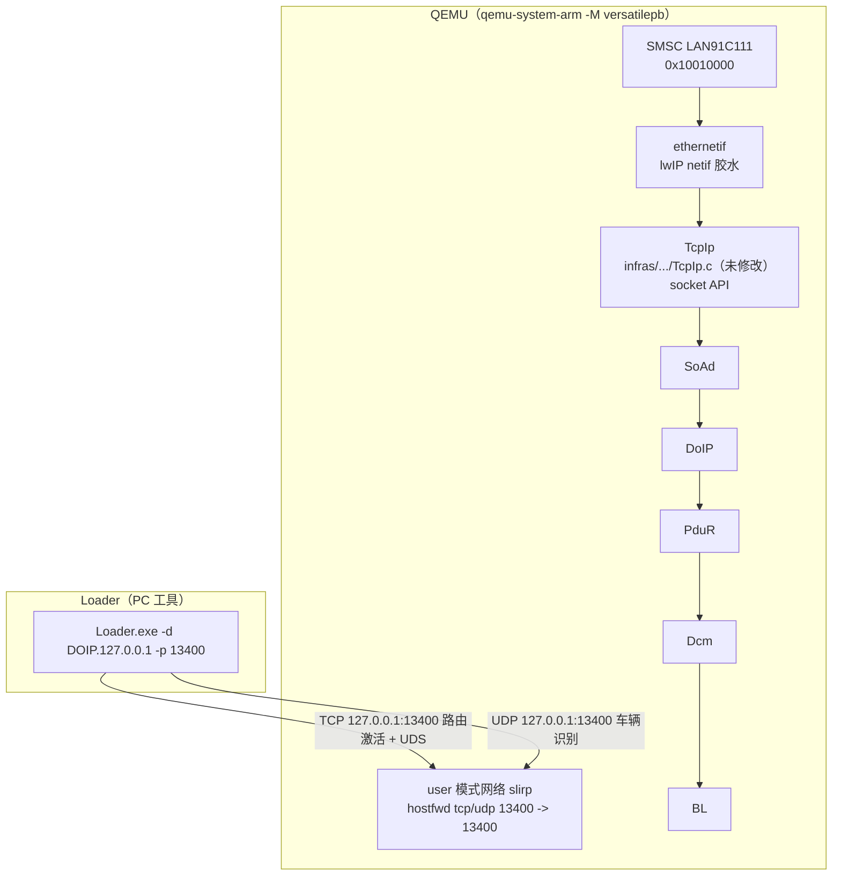

# 在 QEMU versatilepb 上通过 TCP/IP 验证 Bootloader

## 目录

1. [简介](#1-简介)
2. [架构](#2-架构)
3. [配置](#3-配置)
4. [构建](#4-构建)
   - [先获取 QEMU 平台](#41-先获取-qemu-平台)
   - [构建目标](#42-构建目标)
5. [运行 DoIPBL](#5-运行-doipbl)
6. [测试通过 DoIP 烧写](#6-测试通过-doip-烧写)
   - [准备 Flash 驱动与应用镜像](#61-准备-flash-驱动与应用镜像)
   - [启动 QEMU 目标](#62-启动-qemu-目标)
   - [通过 DoIP 烧写](#63-通过-doip-烧写)
7. [排错](#7-排错)

## 1. 简介

[BL-DoIP.md](BL-DoIP.md) 演示的是**主机模拟器**（Windows/Linux 进程）上的 BL over DoIP。本文换一个目标：把同一个 Bootloader 软件栈跑在 **QEMU 的 ARM Versatile/PB 板**（`-M versatilepb`）上，通过板载的 **SMSC LAN91C111** 以太网控制器收发真实以太网帧，从而在没有硬件、也没有主机网卡抓包驱动（pcap/tap）的情况下，端到端验证 `Loader -> TCP/IP -> DoIP -> Dcm -> BL` 的完整烧写链路。

与主机模拟器版本相比，差异只在"网络从哪来"：

| 项目 | 主机模拟器 DoIPBL | QEMU versatilepb DoIPBL |
| --- | --- | --- |
| CPU | x86/x64 本机 | ARM926EJ-S（QEMU 模拟） |
| 以太网 | lwIP 的 `pcapif`/`tapif`，依赖主机网卡与抓包驱动 | SMSC LAN91C111（`0x10010000`）+ lwIP 裸机移植 |
| lwIP 运行方式 | `NO_SYS=0` + 线程/信号量 | `NO_SYS=0` + socket API，线程为空实现、协议栈由主循环轮询推进（见 2.2） |
| 诊断仪怎么连 | 与 ECU 在同一网段 | QEMU user 模式网络的端口转发（`hostfwd`） |
| 复位行为 | 不跳转、不复位 | 不跳转、不复位（见 3.3） |

要点：

- **平台本身不在本仓库里。** `app/platform/qemu` 是 `autoas/qemu` 的独立克隆，被 `app/platform/.gitignore` 忽略，构建前要先克隆到该位置（见 4.1）。
- `VersatilepbDoIPBL` 是 `BL_RECOVERY_MODE` 的纯烧写目标：既不校验/跳转到应用，也不执行真正的复位，因此同一个 QEMU 实例可以被反复烧写，便于演示。
- 目标 IP 固定为 QEMU user 模式网络的默认值 `10.0.2.15/24`，网关 `10.0.2.2`；诊断仪通过宿主机 `127.0.0.1` 的端口转发访问它。
- 目标端软件栈与 [BL-DoIP.md](BL-DoIP.md) 完全一致（BL、Dcm、PduR、SoAd、DoIP 的配置与行为相同），`TcpIp` 模块也是同一份 `infras/communication/TcpIp/TcpIp.c`，**一行都没改**；裸机适配全部收敛在平台的 `TcpIp_Config`（`InitFnc`/`MainFnc`）+ lwIP 端口层里，`TcpIp.c` 仍然走 `lwip/sockets.h` 的 socket API。

## 2. 架构



请求路径：`Loader -> slirp hostfwd -> 91C111 -> ethernetif -> TcpIp -> SoAd -> DoIP -> PduR(P2P_RX) -> Dcm -> BL`。
响应路径：`BL -> Dcm -> PduR(P2P_TX) -> DoIP -> SoAd -> TcpIp -> 91C111 -> slirp -> Loader`。

DoIP 会自动创建两个 SoAd socket：

- 一个 UDP socket，加入车辆识别多播组 `224.244.224.245:13400`（用于车辆公告与车辆识别）。
- 一个 TCP 服务端 socket，监听 `13400`（最多 `MaxConnections` 个连接）。

TCP 连接建立后，诊断仪以源地址 `0xbeef` 发送路由激活请求；激活成功后，目标地址为 `0xdead` 的 UDS 请求被路由到 Dcm。

### 2.1 分层实现

```
app/platform/qemu/versatilepb/
├── bsp/net/
│   ├── smc91c111.c/.h    SMSC LAN91C111 轮询驱动（寄存器 + 包内存 DMA）
│   └── ethernetif.c/.h   lwIP netif：linkoutput / input / IGMP MAC 过滤 / 回环地址 NAT
├── config/TcpIp/
│   └── TcpIp_Cfg.c       TcpIp 的平台移植：TcpIp_Config 的 InitFnc/MainFnc
├── config/LWIP/
│   ├── lwipopts.h        lwIP 配置（NO_SYS=0、socket API、TCP/UDP/IGMP）
│   ├── arch/cc.h         lwIP 编译器/平台抽象
│   ├── arch/sys_arch.h   sys_sem/sys_mutex/sys_mbox 的裸机数据结构
│   ├── sys_arch.c        lwIP 端口层：无调度器的 sys_arch_* 桩实现
│   ├── Lwip_Port.c/.h    sys_now() / lwip_rand() / 泵栈钩子 / __errno()
│   └── Lwip_Cfg.c        占位配置源文件，供 RegisterConfig("LWIP") 使用
└── config/Net/           DoIP/SOAd/PduR/Dcm/Mempool 的 JSON 配置（见第 3 节）
```

**TcpIp 模块本身没有在平台里重写，也没有被条件编译改造**，用的就是 `infras/communication/TcpIp/TcpIp.c`（`accept/recv/recvfrom/sendto/send` 全部是 `lwip/sockets.h` 的标准 socket 调用）。平台只做两件事：提供 `TcpIp_Config` 的两个函数指针，以及把 lwIP 的 OS 抽象层填成"没有 OS"的样子。

```c
/* config/TcpIp/TcpIp_Cfg.c：平台只提供这两件事 */
const struct TcpIp_Config_s TcpIp_Config = {
  TcpIp_VersatilepbInit,           /* tcpip_init + netif_add(ethernetif_init) + netif up */
  TcpIp_VersatilepbMainFunction,   /* ethernetif_input + sys_check_timeouts */
};
```

`TcpIp_Init()` / `TcpIp_MainFunction()`（infras 侧，与网络后端无关）分别调用 `TcpIp_Config.InitFnc()` / `MainFnc()`，因此 Bootloader 的 `Task_MainLoop()` 照旧调用它们即可，调度方式与主机版一致。

### 2.2 裸机上为什么还能用 socket API

lwIP 的 socket API 建立在 netconn 之上，netconn 的每个操作都通过 `tcpip_send_msg_wait_sem()` 投递给 tcpip 线程。关键在于 `LWIP_TCPIP_CORE_LOCKING=1` 时这个函数被编译成**同步内联执行**：

```c
/* lwip/core/tcpip.c（LWIP_TCPIP_CORE_LOCKING=1） */
#define tcpip_send_msg_wait_sem(fn, apimsg, sem) do { \
    LOCK_TCPIP_CORE();                                \
    fn(apimsg);                                       \
    UNLOCK_TCPIP_CORE();                              \
  } while (0)
```

即：调用者自己拿着 core lock 直接执行协议栈函数，**既不需要 tcpip 线程，也不需要邮箱往返**。于是裸机也可以用 `socket()/bind()/recv()/sendto()/accept()`，只要满足三个条件：

1. `lwipopts.h` 里 `NO_SYS=0`、`LWIP_SOCKET=1`、`LWIP_NETCONN=1`、`LWIP_TCPIP_CORE_LOCKING=1`；
2. `sys_arch.c` 提供 `sys_sem_*`/`sys_mutex_*`/`sys_mbox_*` 的**无阻塞桩实现**，`sys_thread_new()` 直接返回假句柄、不创建线程（`tcpip_init()` 里创建的 tcpip 线程因此什么也不做）；
3. 协议栈的推进由主循环负责：`TcpIp_MainFunction()` → `ethernetif_input()`（收包）+ `sys_check_timeouts()`（定时器、ARP、TCP 重传）。

`sys_arch.c` 里还有一个细节：Bootloader 里没有真正的线程，`TcpIp_Recv()`/`accept()` 是阻塞式调用，等待期间必须继续泵网络，否则永远等不到报文。所以 `sys_arch_sem_wait()` / `sys_arch_mbox_fetch()` 在阻塞等待的循环里调用平台注册的泵栈钩子：

```c
/* sys_arch.c */
do {
  if (sem->count > 0) { sem->count--; return sys_now() - start; }
  elapsed = sys_now() - start;
  if ((0 != timeout) && (elapsed >= timeout)) return SYS_ARCH_TIMEOUT;
  Lwip_PortPump();                      /* -> ethernetif_input + sys_check_timeouts */
} while (elapsed < SYS_WAIT_MAX_MS);     /* 封顶 1s，避免烧写流程被无限期挂住 */
```

泵栈钩子由 `TcpIp_VersatilepbInit()` 通过 `Lwip_PortSetPumpFnc()` 注册，并且带重入保护（阻塞 socket 调用内部泵栈时，驱动不会被递归调用）。

## 3. 配置

### 3.1 DoIP 侧配置

与 [BL-DoIP.md](BL-DoIP.md) 第 3 节完全对应，只是放在了平台目录下（由 `ApplicationVersatilepbDoIPBL.gencfg()` 生成代码到 `config/Net/GEN`）：

| 文件 | 内容 |
| --- | --- |
| `config/Net/Network.json` | 发现地址 `224.244.224.245:13400`、`MaxConnections: 3`、目标 `P2P`（逻辑地址 `0xdead`）、诊断仪 `default`（`0xbeef`） |
| `config/Net/PduR.json` | `P2P_RX`（DoIP -> Dcm）与 `P2P_TX`（Dcm -> DoIP） |
| `config/Net/Dcm.json` | 仅 `P2P` 物理通道用于路由；包含烧写用例程 `0xFF00/0xFF01/0xFF02` |
| `config/Net/Mempool.json` | SoAd/DoIP 使用的 `Net` 内存池（与主机版相同） |
| `config/BL/BL.json` | BL 配置：`BL_USE_CRC_16`、`BL_USE_APP_INFO_V2`、Flash `0x40000` 大小 `0x100000`、Flash 驱动 `0x140000` |

### 3.2 lwIP 配置要点

`config/LWIP/lwipopts.h` 是针对裸机裁剪的（注意 `NO_SYS=0` 但线程是空的，见 2.2）：

```c
#define NO_SYS 0                     /* 需要 socket API，但不需要真正的 OS */
#define SYS_LIGHTWEIGHT_PROT 0
#define LWIP_TIMERS 1
#define LWIP_SOCKET 1                /* TcpIp.c 用的就是这套 API */
#define LWIP_NETCONN 1               /* socket API 建在 netconn 之上 */
#define LWIP_TCPIP_CORE_LOCKING 1    /* 关键：API 调用在调用者上下文内联执行 */
#define LWIP_TCPIP_CORE_LOCKING_INPUT 1
#define LWIP_COMPAT_MUTEX 0
#define LWIP_IPV4 1
#define LWIP_ARP 1
#define LWIP_ICMP 1
#define LWIP_UDP 1
#define LWIP_TCP 1
#define LWIP_IGMP 1                  /* DoIP 车辆发现需要 */
#define LWIP_DHCP 0                  /* 使用静态地址 10.0.2.15 */
#define LWIP_DNS 0
#define LWIP_SINGLE_NETIF 1
#define LWIP_SO_RCVTIMEO 1
#define LWIP_SO_RCVBUF 1             /* 关键：TcpIp_Tell() 依赖 ioctl(FIONREAD) */
#define TCP_MSS 1460
#define MEM_SIZE (24 * 1024)
#define PBUF_POOL_SIZE 16
#define PBUF_POOL_BUFSIZE 1524
#define LWIP_NETIF_TX_SINGLE_PBUF 1
#define LWIP_TIMEVAL_PRIVATE 0       /* struct timeval 来自 <sys/time.h> */
#define LWIP_RAND() ((u32_t)lwip_rand())   /* 由 config/LWIP/Lwip_Port.c 提供 */
```

其中两个开关是"能用"与"能通"的分界线，调错时的现象很有欺骗性：

- `LWIP_TCPIP_CORE_LOCKING=1`：否则 netconn 会往 tcpip 邮箱投递并等信号量，而裸机没有任何线程去消费它，所有 socket 调用会永久阻塞。
- `LWIP_SO_RCVBUF=1`：lwIP 只在打开它时才实现 `ioctl(FIONREAD)`，否则 `lwip_ioctl()` 落到 `default` 返回 `ENOSYS`，`TcpIp_Tell()` 恒返回 0 —— SoAd 因此认为永远没有数据可读，表现为"TCP 已连接、路由激活能发出去但收不到响应"。

`config/LWIP/arch/cc.h` 把 lwIP 的断言/调试输出重定向到本工程的 `std_printf`，关闭断言（`LWIP_NOASSERT`），并引入 `<sys/time.h>` 以免 `struct timeval` 重定义。

### 3.3 平台相关实现要点

**(1) 91C111 的接收长度字段**

LAN91C111 的 RX 状态字后 2 字节是"包长"，它包含 4 字节包头，并且：

- 偶数长度帧：包长 = 帧长 + 6（多 2 字节尾部控制字）；
- **奇数长度帧**：包长 = 帧长 + 5（只有 1 字节尾部），且状态字 `0x1000` 置位表示 odd frame。

`smc91c111_recv()` 必须同时处理这两种情况，否则奇数长度帧会少 1 字节，lwIP 在 `ip4_input()` 里发现 `pbuf` 长度与 IP 头总长不符会直接丢包（表现为"TCP 已连接但不回响应"）：

```c
length = (hdr >> 16) & 0x07FF;
if (0 != (hdr & SMC_RX_STATUS_ODD)) {
  length = (length > 5) ? (length - 5) : 0;
} else {
  length = (length > 6) ? (length - 6) : 0;
}
```

**(2) IGMP 组播**

lwIP 的 `igmp_joingroup()` 要求 netif 同时满足"带 `NETIF_FLAG_IGMP` 标志"和"安装了 `igmp_mac_filter`"，否则返回 `ERR_VAL`，DoIP 的 UDP 发现 socket 会创建失败。`ethernetif_init()` 里补齐：

```c
netif->flags = NETIF_FLAG_BROADCAST | NETIF_FLAG_ETHARP | NETIF_FLAG_IGMP | NETIF_FLAG_LINK_UP;
netif_set_igmp_mac_filter(netif, ethernetif_igmpMacFilter);
```

（QEMU 的 91C111 模型不做 MAC 过滤，所有帧都会送给 guest，所以过滤回调只返回 `ERR_OK`；真实硬件上应在这里编程组播哈希表。）

**(3) 回环地址在收包侧 NAT 成 slirp 网关**

QEMU user 模式下，宿主机上绑定在回环地址的 socket 发来的报文，到 guest 里源地址仍然是 `127.0.0.1`（用 `-nic ...,filter-dump` 抓包能直接看到 `127.0.0.1 → 10.0.2.15` 的 DoIP 报文）。这个源地址对 lwIP 是不可路由的：

- 若在 `TcpIp_SendTo()` 里改写目标地址：`LWIP_SINGLE_NETIF=1` 会把 `LWIP_HOOK_IP4_ROUTE` 一起编译掉，`ip4_route()` 对 loopback 硬编码返回 `NULL`，`sendto` 直接返回 `ERR_RTE`（`-4`，Windows 侧 `errno` 为 118）。
- 即使改写成功，slirp 也无法把回程报文投递到宿主机回环（日志里是 `Slirp: Failed to send packet, ret: -1`）。

所以在**收包侧**做一次地址翻译：宿主机在 slirp 里恒等于网关别名 `10.0.2.2`，把源地址换掉之后，报文就落在"来自网关"的正常路径上，响应回到 `10.0.2.2`，再由 slirp 交回宿主机上的那个 socket：

```c
/* bsp/net/ethernetif.c：ethernetif_input() 里、pbuf_alloc() 之前调用 */
static void ethernetif_natHostLoopback(uint8_t *frame, uint16_t length) {
  /* 仅处理 IPv4、ip[0]==0x45、源地址为 127.0.0.1 的帧 */
  memcpy(&ip[12], lHostGateway, 4);          /* 127.0.0.1 -> 10.0.2.2 */
  ip[10] = 0; ip[11] = 0;                    /* 重算 IP 头校验和 */
  checksum = ethernetif_ipv4Checksum(ip, ipHeaderLen);
  ip[10] = (uint8_t)(checksum >> 8);
  ip[11] = (uint8_t)(checksum & 0xFF);
}
```

顺带说明 `ethernetif_announceMac()`：`TcpIp_VersatilepbInit()` 在 netif up 之后主动广播一个 42 字节的 ARP reply（"10.0.2.15 is at `<mac>`"），让 slirp 尽早学到 guest 的 MAC，缩短首个报文的往返时延。

**(4) 恢复模式不真正复位**

`VersatilepbDoIPBL` 定义了 `BL_RECOVERY_MODE`。此时 `Dcm_PerformReset()` 只打印日志、不重启（见 `app/platform/qemu/common/integration.c`），因为一次真实复位会断开诊断仪的 TCP 连接，后面的"使能通信/开启 DTC"就无法完成；而恢复模式本来也不会跳转到应用，最终状态是一致的。

### 3.4 地址与空间布局

| 项目 | 地址 | 说明 |
| --- | --- | --- |
| Bootloader（`linker-boot.lds`） | `0x00008000` | 向量表被 `start.S` 搬到 0，`reset_main = 0x8040` |
| 应用区（Flash） | `0x00040000` ~ `0x00140000` | 1 MB，单一分区（Versatile/PB 的 BL 配置没有 A/B 双分区） |
| 应用签名 | `0x00040000 + 0x3FE80` | `Loader -a ... -s 0x3FE80 -S crc16-v3` |
| Flash 驱动（运行地址） | `0x00140000` | 由 `Loader -f ... -s 4096` 签名 |
| BL 元信息/应用信息 | 应用区尾部 | `BL_USE_APP_INFO_V2`，运行时日志会打印 `V2 sinature at ... app info at ...` |

## 4. 构建

### 4.1 先获取 QEMU 平台

`app/platform/qemu` **不在**本仓库的版本管理内：`app/platform/.gitignore` 里除了 `simulator` 之外全部忽略，QEMU 平台是独立仓库的一份克隆，因此刚 clone 下来的 ssas 是**没有**这个目录的。构建任何 QEMU 目标之前，先把它克隆到 `app/platform/qemu`（Windows 下即 `app\platform\qemu`）：

```bash
cd <ssas-root>
# GitHub（主仓库）
git clone git@github.com:autoas/qemu.git app/platform/qemu
# Gitee 镜像——国内通常快很多
git clone git@gitee.com:autoas/qemu.git app/platform/qemu
# 没有配置 SSH key 就用 https://github.com/autoas/qemu.git 或 https://gitee.com/autoas/qemu.git
```

两个镜像都要落在同一个位置：`app/platform/qemu`（即 `app\platform\qemu`），因为 `app/platform/SConscript` 只 glob `app/platform` 下一层的 `*/SConscript`。

目录就位后 `scons` 会自动纳入。`QemuVersatilepbGCC` 编译器和 `Versatilepb*` 系列应用都是在 `app/platform/qemu/versatilepb/SConscript` 里注册的，所以没有这份克隆时 `--cpl=QemuVersatilepbGCC`、`--app=VersatilepbDoIPBL` 都是未知名字，构建会立刻停下。

> 同一份克隆也提供其他虚拟板（`virt`、`x86`、`STM32-P107`），所以这是所有虚拟平台共用的一次性步骤；检出保持在 `master` 分支即可。

### 4.2 构建目标

工具链参考 [构建环境搭建](build-env-setup.md)。与主机版的差别只有一处：**必须用 `--net=LWIP`**，其余参数与主机版相同。

- `--net=LWIP`：让 `infras/communication/TcpIp` 编进 lwIP 版本并链接 `LWIP` 库；`RequireConfig("TcpIp")` 会取平台注册的 `config/TcpIp/TcpIp_Cfg.c`（而不是默认那份 pcap/tap + 线程的主机配置）。
- `USE_LWIP`：由 `--net=LWIP` 自动带上，`TcpIp.c` 因此使用 `lwip/sockets.h`；平台侧再通过 `lwipopts.h` 把它变成"有 socket API、没有线程"的形态（见 2.2）。

这些都在 `ApplicationVersatilepbDoIPBL` 里设置好了，构建命令里不需要额外参数：

```bash
# 1) PC 工具（Loader 及其依赖库）
scons --lib=AsOne
scons --lib=LoaderFBL
scons --app=Loader

# 2) QEMU 上的 DoIP Bootloader
scons --cpl=QemuVersatilepbGCC --app=VersatilepbDoIPBL --net=LWIP

# 3) 要烧写的镜像（Flash 驱动 + 应用，会自动调用 Loader 签名）
scons --cpl=QemuVersatilepbGCC --app=VersatilepbFlashDriver
scons --cpl=QemuVersatilepbGCC --app=VersatilepbCanApp
```

Windows 下的产物：

- `build/nt/QemuVersatilepbGCC/VersatilepbDoIPBL/VersatilepbDoIPBL.exe`（≈500 KB，包含 lwIP + DoIP + BL）
- `build/nt/GCC/Loader/Loader.exe` + `build/nt/GCC/one/AsOne.dll`
- `build/nt/QemuVersatilepbGCC/VersatilepbFlashDriver/VersatilepbFlashDriver.s19.sign`
- `build/nt/QemuVersatilepbGCC/VersatilepbCanApp/VersatilepbCanApp.s19.sign`

> 提示：`VersatilepbCanApp` 的符号/镜像也被 `VersatilepbCanBL` 内嵌，先构建 `VersatilepbCanApp` 再构建 BL 类应用可以避免"找不到 `.o`"。

## 5. 运行 DoIPBL

```bash
# QEMU user 模式网络：把宿主机的 13400 转发到 guest 的 13400（TCP + UDP 都要）
qemu-system-arm -m 128 -M versatilepb \
  -kernel build/nt/QemuVersatilepbGCC/VersatilepbDoIPBL/VersatilepbDoIPBL.exe \
  -nic user,model=smc91c111,hostfwd=tcp:127.0.0.1:13400-:13400,hostfwd=udp:127.0.0.1:13400-:13400 \
  -serial stdio -display none
```

或者直接用 `scons --cpl=QemuVersatilepbGCC --app=VersatilepbDoIPBLRun`（`-serial stdio` 便于观察日志）。

预期输出：

```
INFO    :bootloader build @ ...
TCPIPI  :lwIP 2.1.4d, IP 10.0.2.15
BLI     :AS Bootloader version 4.1.0
TCPIPI  :link up
```

- `SOAD` / `SMC91` / `ETHIF` 这些模块日志默认被压掉，加 `AS_LOG_DEFAULT=0`（例如 `scons ... --cpl=... --app=... --net=LWIP` 时临时加到 `CPPDEFINES`）可以看到 `SOAD :[0] init with 224.244.224.245:13400`、`SOAD :[1] create TcpIP socket 1, next state 2` 等细节。
- `TCPIPI :link up` 表示 netif 已 up 且 link 已 up，此时诊断仪即可连接。
- 车辆公告会以 UDP 报文发往 `224.244.224.245:13400`（slirp 不转发组播，宿主机看不到，属正常）；宿主机通过 UDP 端口转发发起的车辆识别会得到单播响应。

### 5.1 宿主机端口就是 13400

guest 与宿主机都用标准端口 `13400`：

```
宿主机 127.0.0.1:13400  <--slirp-->  guest 10.0.2.15:13400
```

这能成立的前提是 Loader 单播时**不绑**目标端口：

- 组播目标（`224.244.224.245`）必须绑定 `13400` 才能收到应答，这一点没变；
- 单播目标（`DOIP.127.0.0.1`）把发现 socket 绑到任意端口（`TCPIP_PORT_ANY`），应答沿"请求的源端口"回来。所以 `hostfwd` 占着宿主 `13400` 与 Loader 无关，`-p 13400` 原样可用。

早期版本把宿主机侧错开到 `13401`，是因为当时的 `doip_create_client()` 会把发现 socket 绑到**目标端口**，与 `hostfwd` 冲突（日志 `bind to adapter 0 port ... failed: -1`）。

若宿主机 `13400` 已被别的 DoIP 工具或上一次的 QEMU 实例占用（`hostfwd` 会报 `Could not set up host forwarding rule`），换一个空闲端口即可，`-p` 跟着改：

```
hostfwd=tcp:127.0.0.1:13401-:13400,hostfwd=udp:127.0.0.1:13401-:13400   +   Loader.exe ... -p 13401
```

> 顺带修正了 `loader_cmd.cpp` 里 `-p` 选项的 `bPortSet` 取值错误（原来写成了 `FALSE`，导致 `-p` 传入的端口被重新覆盖为默认 13400）。

## 6. 测试通过 DoIP 烧写

### 6.1 准备 Flash 驱动与应用镜像

镜像由第 4 节的构建自动生成并签名（`VersatilepbFlashDriver`/`VersatilepbCanApp` 的 `signit()` 会后置调用 `Loader`）。也可以手动重签：

```bash
build\nt\GCC\Loader\Loader.exe -f build\nt\QemuVersatilepbGCC\VersatilepbFlashDriver\VersatilepbFlashDriver.s19 -s 4096
build\nt\GCC\Loader\Loader.exe -a build\nt\QemuVersatilepbGCC\VersatilepbCanApp\VersatilepbCanApp.s19 -s 0x3FE80 -S crc16-v3
```

### 6.2 启动 QEMU 目标

按第 5 节启动，保持运行。由于恢复模式不复位，同一个实例可以连续烧写多次。

> **等目标启动完成再跑 Loader**：日志里出现 `TCPIPI :link up`（约 50 ms 之后 DoIP 的 UDP socket 就绑好了）再开始刷写。如果 Loader 与 QEMU 几乎同时启动，第一个车辆识别请求会落在 ECU 的 DoIP socket 就绪之前，guest 回一个 **ICMP port unreachable**；QEMU slirp 收到这个 ICMP 后会把该源端口对应的 `hostfwd` 通道拆掉，此后从这个源端口发出的**任何**报文都进不了 guest（抓包可以看到 ICMP 之后 guest 侧再无入向报文）。
>
> 被拆掉的是"该源端口"对应的转发通道。Loader 每次运行都新建 socket、换一个随机源端口（`-p` 只决定目标端口，见 5.1），所以遇到这种情况**重新跑一次 Loader 即可**，不必重启 QEMU；只是多花一次启动时间，因此仍以"等目标就绪"为准。

### 6.3 通过 DoIP 烧写

Windows 下需要把 `C:\msys64\mingw64\bin` 与 `build\nt\GCC\one`（`AsOne.dll`）放进 `PATH`。另外宿主机侧的 `TcpIp` 默认选第一块网卡（日志里的 `AS_LOCAL_IP not set, using adapter 0`），必须指定回环地址，否则 socket 绑定在真实网卡上就发不到 `127.0.0.1`：

```bash
set AS_LOCAL_IP=127.0.0.1

build\nt\GCC\Loader\Loader.exe -d DOIP.127.0.0.1 -p 13400 ^
  -c FBL -S crc16 ^
  -f build\nt\QemuVersatilepbGCC\VersatilepbFlashDriver\VersatilepbFlashDriver.s19.sign ^
  -a build\nt\QemuVersatilepbGCC\VersatilepbCanApp\VersatilepbCanApp.s19.sign
```

（Linux 下用 `export AS_LOCAL_IP=127.0.0.1` 与 `\` 续行。）

成功的输出：

```
loader FBL started:
Total data size 132818 bytes
enter extended session                    okay
control dtc setting off                   okay
communication disable                     okay
level 1 security access                   okay
enter program session                     okay
level 2 security access                   okay
download flash driver                     okay
check flash driver integrity              okay
read finger print                         okay
erase flash        erase block 0x40000 - 0x20800   okay
erase fee          skip fee erase as no env FEE_BANK_ADDRESS  okay
write finger print                        okay
download application   average speed 7.55 kbps cost 17.00 seconds   okay
check program integrity                   okay
check dependencies                        okay
check integrity                           okay
ecu reset                                 okay
communication enable                      okay
control dtc setting on                    okay
loader average speed 6.89 kbps cost 18.82 seconds
```

对应 QEMU 侧的日志（`-serial stdio`）：

```
TCPIPI  :[1] accepted as [2] from 10.0.2.2:54688
INFO    :DOIP default activated
BLI     :Flash Driver is ready @140000
INFO    :BL_CheckProgramDependency: major = 4, minor = 1, patch = 0
BLI     :V2 sinature at 60168 app info at 13fd00
BLI     :First Time or Backup Meta corrupted
BLI     :programming Counter: 1
BLI     :app sampled CRC 2e9d
BLI     :check integrity on section 0: 40000-60150
INFO    :reset request 3 ignored in recovery mode
```

说明：

- `-d DOIP.127.0.0.1` 指定目标地址；与主机版不同，这里是**单播**地址（宿主机转发口），不是 `224.244.224.245` 多播地址。
- `-p 13400` 与 `-nic` 里的 `hostfwd` 端口保持一致（见 5.1）。
- `-S crc16` 必须与 `BL.json` 的 `BL_USE_CRC_16` 一致；`crc32` 对应 `BL_USE_CRC_32`。
- `-c FBL` 选择 FBL 加载器；此处不需要 `-l 64`（那是 CAN TP 的参数，DoIP 的最大 PDU 由 TCP 决定）。
- 速度约 7 kbps：瓶颈是轮询式 91C111 驱动 + 逐字节搬运的包内存，以及 Loader 侧 128 字节块的 `0x36` 传输。

## 7. 排错

| 现象 | 原因与处理 |
| --- | --- |
| `scons` 报应用/编译器未知，或 `--cpl=QemuVersatilepbGCC` 被拒 | `app/platform/qemu` 是独立克隆且缺失，按 4.1 克隆即可 |
| `SOADE :[0] failed to creat socket with error 0` | 组播加入失败：netif 缺少 `NETIF_FLAG_IGMP` 或 `igmp_mac_filter`（见 3.3(2)） |
| TCP 能 `accept`，但诊断请求没有响应、连接最后被 RST | 奇数长度以太网帧被少读 1 字节，lwIP 丢掉 IP 包（见 3.3(1)）。给 `-nic` 一个 id 并抓包对照：`-nic user,id=n0,model=smc91c111,... -object filter-dump,id=f0,netdev=n0,file=net.pcap` |
| 车辆识别响应发不出去，日志 `sendto(...) error is -1`/`-4` | `-4` 即 lwIP `ERR_RTE`：目标地址不可路由。本平台的做法是在收包侧把 `127.0.0.1` NAT 成网关 `10.0.2.2`（见 3.3(3)），不要再去改 `TcpIp_SendTo()` |
| `Loader` 报 `failed to create isotp` | 打开 `log/Loader.<n>.txt` 看 `DOIPE` 行：`target is not reachable` 说明车辆识别请求没得到响应（目标没起来 / 没等 `link up` 就开跑，见 6.2）；`Failed to bind` 说明宿主机端口被占用，换一个空闲端口并同步改 `-p`（见 5.1） |
| `sendto(127.0.0.1:...) error is -1`（`errno` 118） | 没有设置 `AS_LOCAL_IP=127.0.0.1`，socket 绑在真实网卡上，无法发往回环 |
| TCP 已连接、路由激活能发出，但收不到任何响应 | `LWIP_SO_RCVBUF=0` 时 lwIP 不实现 `ioctl(FIONREAD)`，`TcpIp_Tell()` 恒为 0，SoAd 永远不读数据。设 `LWIP_SO_RCVBUF 1`（见 3.2） |
| 一切 socket 调用卡死不返回 | `LWIP_TCPIP_CORE_LOCKING=0`，netconn 改为向 tcpip 邮箱投递并等信号量，而裸机没有线程消费它。设 `LWIP_TCPIP_CORE_LOCKING 1`（见 2.2） |
| `undefined reference to '__errno'` | 裸机小 libc 没有 `errno`，而 lwIP 的 socket API 每次失败都会写它；`config/LWIP/Lwip_Port.c` 里提供 `int *__errno(void)` 桩 |
| `multiple definition of 'sys_msleep'` | lwIP core 的 `src/core/sys.c` 已经实现了它，`sys_arch.c` 里不要再定义 |
| 启动瞬间刷写失败 | 首个报文触发 guest 的 ICMP port unreachable，slirp 拆掉了该源端口的 `hostfwd`；重新跑一次 Loader（新进程=新源端口）即可，等 `TCPIPI :link up` 后再跑更稳妥（见 6.2） |
| `check dependencies` 返回结果 `01`（`response not as expected at 4 R 01 != E 00`） | 应用镜像里的 `RoD` 块 CRC 不匹配。`ProgramDependency` 块含函数指针，地址在链接后才确定，`config/RoD/RoD.json` 的 `Crc` 必须与当前构建一致；日志会打印实测值（`RODE :[1] CRC xxxx != yyyy`），把它填回 `Crc` 后重新构建应用 |
| `communication enable` 报 `isotp transmit error: -1` | ECU 在 `ecu reset` 之后真的重启了，TCP 连接被断开；`BL_RECOVERY_MODE` 下应不重启（见 3.3(4)） |
| `undefined reference to 'printf'/'rand'`（lwIP 编译期） | `config/LWIP/arch/cc.h` 必须把 `LWIP_PLATFORM_DIAG` 指到 `std_printf`，并在 `lwipopts.h` 提供 `LWIP_RAND()` |
| `error: lwip/opt.h: No such file` | 没有用 `--net=LWIP`，`TcpIp` 库没有把 lwIP 拉进来；或者 `RegisterConfig("LWIP", ...)` 未生效 |
| `error: lwip/sockets.h: redefinition of 'struct timeval'` | `arch/cc.h` 里没包含 `<sys/time.h>`，或 `lwipopts.h` 里漏了 `LWIP_TIMEVAL_PRIVATE 0` |

### 7.1 与主机版 DoIP 的差异清单

如果后续要在这两者之间来回切换，注意这几处只在 QEMU 版本里存在：

1. `--net=LWIP` + 平台独有的 `config/LWIP`（`lwipopts.h`、`sys_arch.c`、`Lwip_Port.c`）：`TcpIp.c` 仍然是同一份代码、仍然走 socket API，但 lwIP 被配置成"`NO_SYS=0` + core locking 内联执行"的裸机形态；平台只提供 `TcpIp_Config` 与 netif/驱动。
2. 静态地址 `10.0.2.15/24`、网关 `10.0.2.2`（QEMU user 模式默认值）；主机版走真实网卡。
3. 收包侧把 `127.0.0.1` NAT 成 `10.0.2.2`，并主动广播一次 ARP reply 让 slirp 学到 guest 的 MAC。
4. 诊断仪使用宿主机端口转发地址（`DOIP.127.0.0.1 -p 13400`），而不是多播地址。
5. `BL_RECOVERY_MODE` 且复位被忽略，因此可以连续烧写、且烧写序列能完整走完。
6. 单一应用分区（无 A/B），签名区在 `+0x3FE80`。
