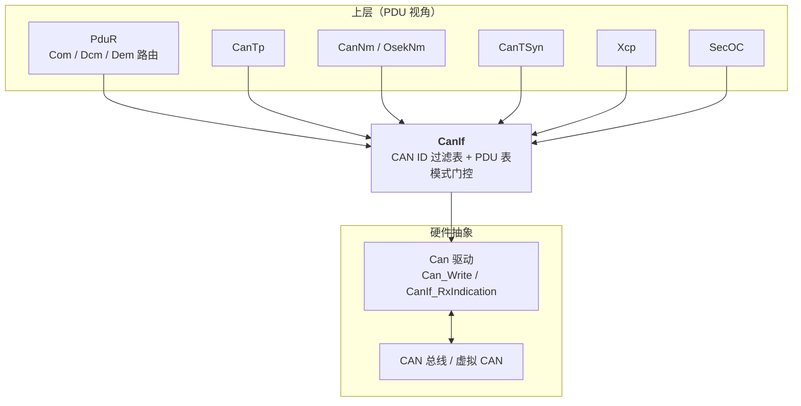
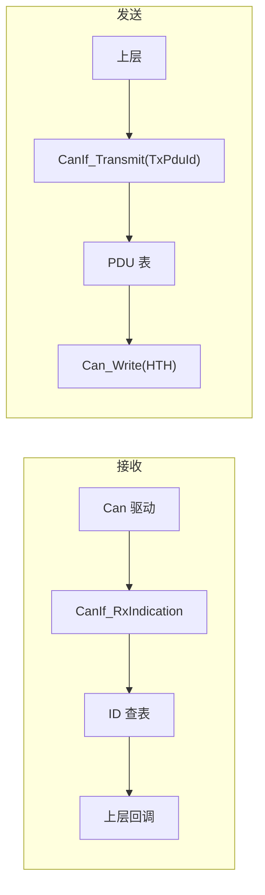
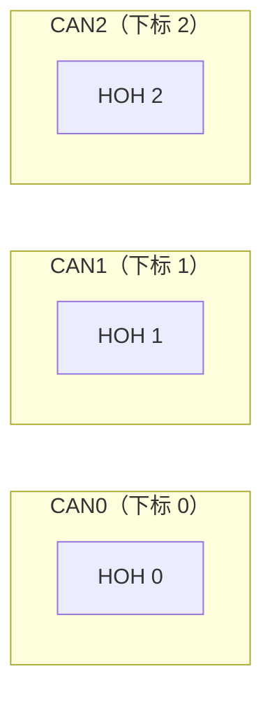
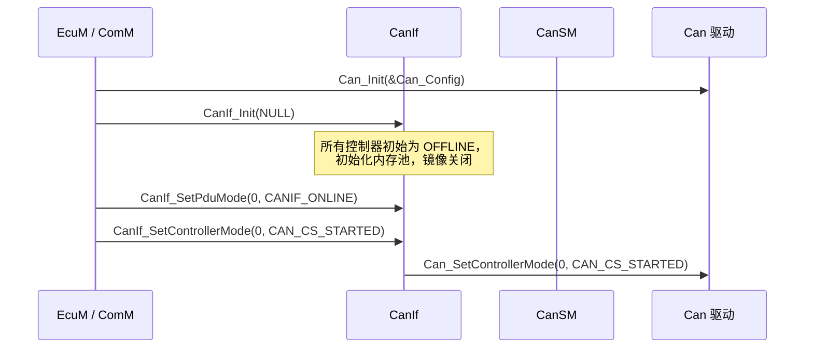
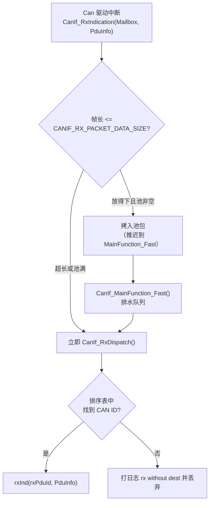
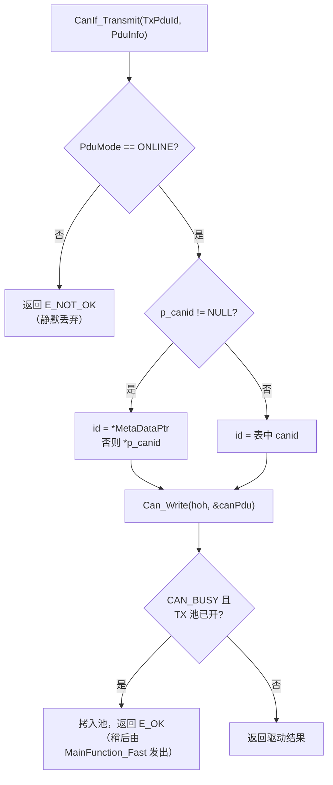

# CanIf - CAN 接口

> **一句话概括：** CanIf 维护 CAN ID 过滤表和静态 PDU 表，让上层只说"发送 5 号 PDU"
> 而不用关心"用 0x732 这个 ID 发帧"，也让 CAN 驱动只说"收到一帧 ID 0x731"而不用
> 直接调用 Dcm。

| 项目 | 值 |
| --- | --- |
| 模块 | `infras/communication/CanIf`（API：`infras/include/CanIf.h`） |
| 层级 | 总线接口层，下方是 CAN 驱动，上方是 PduR / CanTp / CanNm / CanTSyn / Xcp / SecOC |
| 配置 | `app/app/config/Com/CanIf.json` |
| 生成器 | `tools/generator/CanIf.py` -> `GEN/CanIf_Cfg.c` / `GEN/CanIf_Cfg.h`（含中间文件 `GEN/CanIf.json`） |
| 标准 | AUTOSAR CP 4.4 CanIf（含 SSAS 扩展） |
| 演示 | `CanApp`；打开 `AS_LOG_CANIF` 可跟踪每一帧收发 |

**目录**

1. [模块用途](#1-模块用途)
2. [在协议栈中的位置](#2-在协议栈中的位置)
3. [配置](#3-配置)
4. [运行时行为](#4-运行时行为)
5. [公开 API](#5-公开-api)
6. [构建与运行演示](#6-构建与运行演示)
7. [关键注意事项](#7-关键注意事项)
8. [故障排查](#8-故障排查)
9. [已知局限](#9-已知局限)

---

## 1. 模块用途

CanIf 是 **"PDU"与"CAN 帧"之间的翻译层**：它之上大家只谈 PDU id，它之下全是
CAN ID、硬件对象和原始字节。CanIf 只做四件事：

* **接收过滤与分发** - 收到的帧在按 CAN ID 排序的表里查找，命中则调用配置的
  上层回调（`CanTp_RxIndication`、`PduR_CanIfRxIndication`、`CanNm_RxIndication`…）。
  没有命中的帧直接丢弃（带日志）。
* **发送 PDU 查表** - `CanIf_Transmit(TxPduId, ...)` 查出 CAN ID、HTH 和控制器号，
  调用 `Can_Write()`。
* **控制器/PDU 模式门控** - `CanIf_SetControllerMode()` 透传给驱动；
  `CanIf_SetPduMode()` 决定该控制器是否允许发送。
* **总线级监控** - 面向 CanSM 的发送超时、BusOff 通知、可选的总线镜像。

它**不做**的事：

* 不做分段（那是 [CanTp](CanTp.md)）、不做路由（[PduR](PduR.md)）、不做信号打包
  （[Com](Com.md)）。
* 不配置波特率/引脚 - 那是 CAN 驱动和 Port 的事。
* 除 `Dynamic` 标志外不做动态 ID 仲裁；ID 要么编译进表，要么用
  `CanIf_SetDynamicTxId()` 修改。

---

## 2. 在协议栈中的位置



CanIf **同时位于 PduR 之下和 CanTp 之下**：CanTp 通过 `up: "CanTp"` 直接拥有自己的
PDU，不经过 PduR 上总线。所以同一个 CAN ID 在 `CanIf.json` 里只出现一次，却可能在
`PduR.json` 里被两个模块引用。

两个方向：



---

## 3. 配置

`app/app/config/Com/CanIf.json` 是手写的；`tools/generator/CanIf.py` 把它与 DBC
合并后生成 C 表。

### 3.1 顶层键

| 键 | 生成器默认值 | 生成结果 | 含义 |
| --- | --- | --- | --- |
| `MainFunctionPeriod` | **10** | `CANIF_MAIN_FUNCTION_PERIOD`（未定义时才生成）+ `CANIF_CONVERT_MS_TO_MAIN_CYCLES(x)` | `CanIf_MainFunction()` 周期（ms），用于发送超时 |
| `RxPacketPoolSize` | **0** | `CANIF_RX_PACKET_POOL_SIZE` | 中断与主函数之间可缓存的 Rx 包数量；0 = 在接收中断里立即分发 |
| `TxPacketPoolSize` | **0** | `CANIF_TX_PACKET_POOL_SIZE` | 驱动返回 `CAN_BUSY` 时可缓存的 Tx PDU 数量；0 = 无重发队列 |
| `RxPacketDataSize` | **64** | `CANIF_RX_PACKET_DATA_SIZE` | 每个缓存 Rx 包的负载字节数（64 覆盖 CAN FD） |
| `TxPacketDataSize` | **64** | `CANIF_TX_PACKET_DATA_SIZE` | 每个缓存 Tx 包的负载字节数 |
| `UsePostBuildConfig` | **false** | `#define CANIF_USE_PB_CONFIG`（false 时被注释） | `CanIf_Init()` 使用调用方传入的配置指针而非 `&CanIf_Config` |
| `UseTxCallout` | **false** | `CANIF_USE_TX_CALLOUT` | 每次 `Can_Write()` 前调用 `CanIf_UserTxCallout()` |
| `UseRxCallout` | **false** | `CANIF_USE_RX_CALLOUT` | 分发收到的帧之前调用 `CanIf_UserRxCallout()` |
| `Networks[]` | - | 每项生成一个 `CanIf_CtrlConfigType` | 每个 CAN 控制器一项；**数组下标就是控制器号** |

> 两个 callout 在本仓库里**没有实现** - 只在 `CanIf.h` 里声明，需要项目自己提供。
> 打开开关却没有实现会在链接期报错。

### 3.2 网络键

| 键 | 默认值 | 含义 |
| --- | --- | --- |
| `Name` | 必填 | 网络名；同时生成 `#define CANIF_CHL_<name> <index>`，即传给 `CanIf_SetPduMode()` / `CanIf_SetControllerMode()` 的控制器号 |
| `Me` | 使用 `Dbc` 时必填 | 本 ECU 在 DBC 中的节点名；`node == me` 的报文变成 Tx，其余变成 Rx |
| `Dbc` | 可选 | 自动导入 DBC；导入的 PDU 为 `up: "PduR"` 并顺序分配 HOH |
| `Ignore` | `[]` | 导入时跳过的 DBC 报文名 |
| `E2E` | `[]` | 名字有误导性，**这与 E2E 无关**：列出的 DBC 报文只会被加上 `UseTxPool: true` |
| `NumHrh` | **1** | 本网络保留的 Rx 硬件对象数；决定下一个网络的 HOH 基址 |
| `NumHth` | **1** | Tx 硬件对象同理 |
| `TxTimeout` | **100** | ms；任意网络配置非零值即全局打开 `CANIF_USE_TX_TIMEOUT` |
| `RxPdus` / `TxPdus` | `[]` | 显式 PDU 列表（见 3.3） |

DBC 导入只是便利手段，不是必需：演示配置既导入 `CAN0.dbc`（Com 信号），又显式列出
诊断、NM、XCP、SecOC 的帧，因为这些不能归 Com 管。请把它们从 DBC 中排除（或放进
`Ignore`），否则同一 CAN ID 出现两次，生成器会报 `Duplicate Rx Pdus` 中止。

### 3.3 RxPdu / TxPdu 键

| 键 | 默认值 | 适用 | 含义 |
| --- | --- | --- | --- |
| `Name` | 必填 | 两者 | 全局唯一的 PDU 名；同时生成宏 `CANIF_<NAME>` |
| `Id` | 必填 | 两者 | CAN ID（十六进制字符串或数字），Rx 侧会与 `0x1FFFFFFF` 相与 |
| `Mask` | 全 1（即精确匹配） | 仅 Rx | 满足 `received_canid == (id & mask)` 即命中 |
| `Hoh` | 本网络的第一个 HOH | 两者 | 硬件对象句柄；原样作为 `Can_Write()` 的 HTH，或在 `Mailbox->Hoh` 中返回 |
| `Up` | 必填 | 两者 | 上层模块，决定回调符号（见 3.4） |
| `Dynamic` | `false` | 仅 Tx | 生成 `static Can_IdType canidOf<NAME>` 和 `p_canid` 指针，可用 `CanIf_SetDynamicTxId()` 运行时改 ID |
| `UseTxPool` | `false` | 仅 Tx | **当前运行时无效果** - 会写进表但从不被读取 |

掩码接收示例：`{"name": "OSEKNM0_RX", "id": "0x400", "mask": "0x700"}` 接受
`0x400..0x4FF`，这样一个 NM PDU id 即可覆盖网段内所有节点。

### 3.4 `Up` 生成什么

`Up` 不只是注释 - 它决定回调函数和表项的第二个字段：

| `Up` | Rx 回调 | Tx 回调 | 第二字段（回调拿到的 id） |
| --- | --- | --- | --- |
| `PduR` | `PduR_CanIfRxIndication` | `PduR_CanIfTxConfirmation` | `<UP>_<NAME>`，如 `PDUR_CAN0_TX_MSG_TIME` |
| `CanTp` | `CanTp_RxIndication` | `CanTp_TxConfirmation` | `CANTP_<NAME>`，如 `CANTP_P2P_RX` |
| `SecOC` | `SecOC_RxIndication` | `SecOC_TxConfirmation` | `SECOC_<NAME>` |
| `J1939Tp` | `J1939Tp_RxIndication` | `J1939Tp_TxConfirmation` | `J1939TP_<NAME>` |
| `OsekNm` / `CanNm` / `CanTSyn` | `<UP>_RxIndication` | `<UP>_TxConfirmation` | **网络下标**，不是 PDU id |
| `Xcp` | `Xcp_CanIfRxIndication` | `Xcp_CanIfTxConfirmation` | **网络下标** |
| `User...` | `<UP>_RxIndication` | `<UP>_TxConfirmation` | `CANIF_<NAME>` |

生成器还会为每个 `Up` 追加 `#include "<up>.h"`，并且除 `OsekNm`、`CanNm`、
`CanTSyn`、`Xcp` 外再包含 `"<up>_Cfg.h"`。所以 `Up` 必须与模块头文件名完全一致。

用户回调的原型由生成器声明：

```c
void User0Rx_RxIndication(PduIdType RxPduId, const PduInfoType *PduInfoPtr);
void User0Tx_TxConfirmation(PduIdType TxPduId, Std_ReturnType result);
```

### 3.5 HOH 编号

HOH 是**全局编号**，不按控制器分：`NumHrh`/`NumHth` 按 `Networks[]` 顺序累加，
未显式写 `Hoh` 的 PDU 取本网络的第一个 HOH。三个网络且默认 `NumHrh: 1` 时：



该值会作为 `Can_Write()` 的 HTH 参数，因此必须与**驱动**的硬件对象表一致，
而不是 CanIf 自己的表。

### 3.6 生成结果

```c
/* CanIf_Cfg.h */
#define CANIF_CHL_CAN0 0u
#define CANIF_FW_CAN0_SECOC_MSG1_RX 0u /* CAN0 id=0x89 */
#define CANIF_P2P_RX 5u                /* CAN0 id=0x731 */
#define CANIF_MIRROR_TX 11u            /* CAN2 id=0x300 */
#define CANIF_USE_TX_TIMEOUT
// #define CANIF_USE_PB_CONFIG
#ifndef CANIF_RX_PACKET_POOL_SIZE
#define CANIF_RX_PACKET_POOL_SIZE 8u
#endif
```

`CanIf_Cfg.c` 里每个控制器一个 `CanIf_RxPdus_<network>[]` 数组（按 CAN ID 排序，
二分查找依赖它），外加**一个全局** `CanIf_TxPdus[]`，以及 `CanIf_CtrlContexts[]`
和 `CanIf_CtrlConfigs[]`。

注意两套 id 空间：`CANIF_P2P_RX` 和 `CANIF_P2P_TX` 都是 `5u`，因为 Rx 与 Tx 从 0
独立编号。把 Rx 的 id 传给 `CanIf_Transmit()` 会静默发出另一个 PDU - 请始终使用
`_TX` 宏。

---

## 4. 运行时行为

### 4.1 启动顺序



一帧报文发出前必须闭合两个独立开关：

1. `CanIf_SetControllerMode(CAN_CS_STARTED)` - 驱动脱离 STOPPED；
2. `CanIf_SetPduMode(CANIF_ONLINE)` - CanIf 允许发送。

`CanIf_Init()` 一律把 `PduMode` 置为 `CANIF_OFFLINE`，所以忘记
`CanIf_SetPduMode()` 的现象就是"协议栈在跑，但总线上什么都没有"。构建里若有
`USE_CANSM`，这两个调用由 CanSM 完成；没有 CanSM 时由应用自己做 - 见
`app/app/main.c` 的 `EcuM_AL_EnterRUN()`。

### 4.2 接收



* 查找是 `CanIf_RxPdus_<network>[]` 上的**二分搜索**，生成器已按 CAN ID 排序。
  在宿主构建（`linux` / `_WIN32`）下代码额外做一次线性扫描"因为表未排序" -
  这个兜底是给手写测试表用的，不是给生成表用的。
* 分发只看 CAN ID，`Mailbox->Hoh` 不参与。
* 镜像打开时，收到的帧和成功发送的帧都会上报 `Mirror_ReportCanFrame()`。

### 4.3 发送



`Can_Write()` 收到 `swPduHandle = TxPduId`；驱动确认后回调
`CanIf_TxConfirmation(swPduHandle)`，向配置的 `txConfirm` 转发 `E_OK` 并清除
发送超时定时器。

### 4.4 PDU 模式与发送超时

| 模式 | 值 | 本实现中的行为 |
| --- | --- | --- |
| `CANIF_OFFLINE` | 0 | 不发送，帧被静默丢弃 |
| `CANIF_TX_OFFLINE` | 1 | 同 offline（Rx **并不**被关闭） |
| `CANIF_TX_OFFLINE_ACTIVE` | 2 | `CanIf_SetPduMode()` 接受，但按 offline 处理 - 未实现 |
| `CANIF_ONLINE` | 3 | 允许发送 |

同时定义 `CANIF_USE_TX_TIMEOUT` **和** `USE_CANSM` 时，某控制器第一次
`Can_Write()` 成功即启动 `txTimeoutTimer = TxTimeout / MainFunctionPeriod` 个
周期；`CanIf_TxConfirmation()` 清零定时器。到期调用一次
`CanSM_TxTimeoutException(controller)`。`CANIF_MAIN_FUNCTION_PERIOD == 1` 时定时
器在 `CanIf_MainFunction_Fast()` 里递减，否则在 `CanIf_MainFunction()` 里递减。

---

## 5. 公开 API

| 函数 | 调用方 | 用途 |
| --- | --- | --- |
| `CanIf_Init(const CanIf_ConfigType*)` | EcuM | 复位上下文、初始化内存池；未开 `CANIF_USE_PB_CONFIG` 时参数被忽略 |
| `CanIf_SetControllerMode(id, mode)` | CanSM / EcuM | 向驱动转发 `STARTED` / `STOPPED` / `SLEEP` |
| `CanIf_GetControllerMode(id, *mode)` | CanSM / 应用 | 读取驱动状态 |
| `CanIf_SetPduMode(id, mode)` | CanSM / EcuM / 应用 | 按控制器门控发送；离开 `ONLINE` 会清空 TX 池 |
| `CanIf_GetPduMode(id, *mode)` | 应用 | 读取当前 PDU 模式 |
| `CanIf_Transmit(TxPduId, PduInfo)` | PduR、CanTp、CanNm、CanTSyn、Xcp、SecOC | PDU id 映射为 CAN ID 并调用 `Can_Write()` |
| `CanIf_SetDynamicTxId(TxPduId, CanId)` | CanNm、OsekNm、应用 | 修改 `Dynamic` Tx PDU 的 ID |
| `CanIf_TxConfirmation(CanTxPduId)` | Can 驱动 | 向上转发发送确认 |
| `CanIf_RxIndication(Mailbox, PduInfo)` | Can 驱动 | 过滤并分发收到的帧 |
| `CanIf_ControllerBusOff(id)` | Can 驱动 | 向 CanSM 和 Mirror 上报 BusOff |
| `CanIf_MainFunction()` | 调度器 | 周期非 1 ms 时的发送超时 |
| `CanIf_MainFunction_Fast()` | 调度器 | 排空 Rx/Tx 池；周期为 1 ms 时的发送超时 |
| `CanIf_EnableBusMirroring(id, active)` | 应用 | 打开某控制器的镜像（需 `USE_MIRROR`） |
| `CanIf_UserTxCallout/RxCallout` | CanIf 自身 | **用户实现**，仅 callout 开关打开时使用 |
| `CanIf_GetVersionInfo(info)` | 任意 | 模块版本 |

---

## 6. 构建与运行演示

```bash
# 构建演示 ECU 应用（含 CanIf、CanTp、Dcm、Com、SecOC 等）
scons --app=CanApp

# 带帧跟踪运行：打印每一帧收发
AS_LOG_CANIF=3 ./build/nt/GCC/CanApp/CanApp.exe

# 另开一个终端，通过虚拟 CAN 总线发送 UDS 请求
./build/nt/GCC/IsoTpSend/IsoTpSend.exe -v 22F15B
```

`CanApp` 窗口预期输出（每帧一行，只打印前 8 字节）：

```
CANIF   :RX CAN ID=0x00000731 LEN=8 DATA=[03 22 F1 5B ...]
CANIF   :RX CAN ID=0x00000732 LEN=8 DATA=[10 0D 62 F1 5B ...]
```

`AS_LOG_CANIF=3` 生效的原理：模块级日志（`CanIf.c:25` 的 `AS_LOG_CANIF 0`）会与
全局日志级别比较，把该环境变量设到全局级别（默认 `1` = INFO）之上即可打开打印。

---

## 7. 关键注意事项

1. **默认离线。** `CanIf_Init()` 把所有控制器置为 `CANIF_OFFLINE`，调用
   `CanIf_SetPduMode(id, CANIF_ONLINE)` 之前不会有任何帧发出。这是"协议栈没声音"
   的最常见原因。
2. **`Up` 是命名契约。** `up: "CanTp"` 会让生成器输出 `#include "CanTp.h"` 和
   `CanTp_RxIndication`。拼写错误会在链接期以缺失符号的形式暴露 - 这是好事，
   保持这种失败方式。
3. **一个 CAN ID 一个归属。** 一帧要么由 DBC 导入声明，要么显式声明，不能两者
   兼有。重复会在生成期报 `Duplicate Rx Pdus: ...`。
4. **掩码 PDU。** `Id` 是**基址**，匹配条件是 `received == (id & mask)`；`Id`
   本身必须已被掩码（生成器存的是 `id & 0x1FFFFFFF`）。掩码区间不能重叠 -
   生成器会拒绝重叠，二分查找也依赖这一点。
5. **`Hoh` 是驱动层编号**，跨网络累加。如果在 `Networks[]` 中间插入一个控制器，
   其后所有 HOH 都会平移 `NumHrh`/`NumHth`。
6. **`dynamic: true` 会为每个 PDU 生成一个 `static` 变量**并使 ID 可写。
   非 dynamic 的 PDU 调 `CanIf_SetDynamicTxId()` 会被忽略（只打 `CANIFE` 日志）。
7. **池的大小改变调用上下文。** `RxPacketPoolSize > 0` 时上层回调发生在
   `CanIf_MainFunction_Fast()` 而不是 CAN 接收中断里 - 延迟最多增加一个主函数
   周期，但中断不再重入协议栈。
8. **池非零就必须调度 `CanIf_MainFunction_Fast()`**，否则入队的帧永远发不出去
   （而 `CanIf_Transmit()` 已经返回了 `E_OK`）。

---

## 8. 故障排查

| 现象 | 可能原因 | 检查点 |
| --- | --- | --- |
| RX 帧被忽略，日志是 `rx without dest` | CAN ID 不在 `RxPdus`（或通道不对：CAN1 的 ID 写到了 CAN0） | `GEN/CanIf_Cfg.c` 的 `CanIf_RxPdus_CANx[]` |
| 不发送且无报错 | PDU 模式仍为 `OFFLINE`，或控制器未 `STARTED` | `CanIf_GetPduMode()`、`EcuM_AL_EnterRUN()` 的调用顺序 |
| `CanIf_Transmit()` 立即返回 `E_NOT_OK` | PDU 模式不在线，或 `TxPduId >= numOfTxPdus` | 传 `CANIF_<NAME>_TX` 宏，不要传 Rx 的 |
| `CanIf_Transmit()` 返回 `E_OK` 但总线上没帧 | 帧进了 TX 池而 `CanIf_MainFunction_Fast()` 未被调度 | 调度表 |
| 生成失败 `Duplicate Rx Pdus` | 同一 ID 被 DBC 导入与显式声明各写了一次 | 把报文加入 `Ignore` |
| 生成失败 `Invalid hoh` | 显式 `Hoh` 超出该网络 `[base, base+NumHrh)` | 调大 `NumHrh`/`NumHth` 或改值 |
| 链接报 `CanIf_UserTxCallout` 未定义 | `UseTxCallout: true` 但没有实现 | 提供函数或关闭开关 |
| 确认回调进了错误的模块 | 把 Rx 宏传给了 `CanIf_Transmit()`（Rx/Tx id 数值重叠） | 使用 `CANIF_*_TX` |

---

## 9. 已知局限

以下是对 `infras/communication/CanIf/CanIf.c` 的代码审查结论（已对照源码核实，
按严重程度排序）：

1. **`CanIf_GetPduMode()` 的 DET 条件写反了**（`CanIf.c:349`）：
   `DET_VALIDATE(NULL == PduModePtr, ...)`。开 `USE_DET` 时每一次**合法**调用都会
   上报 `CANIF_E_PARAM_POINTER` 并返回 `E_NOT_OK`，传 `NULL` 反而会解引用。应改为
   `NULL != PduModePtr`。
2. **TX 队列的排水代码套在 RX 池的宏里**（`CanIf.c:501`）：该循环的守卫是
   `#if CANIF_RX_PACKET_POOL_SIZE > 0`，而变量声明在
   `CANIF_TX_PACKET_POOL_SIZE > 0` 之下。后果有二：Rx 池 > 0 且 Tx 池 == 0 时
   编不过；Tx 池 > 0 且 Rx 池 == 0 时能编过但入队的 PDU 永远发不出去，而
   `CanIf_Transmit()` 仍返回 `E_OK`（静默丢帧）。
3. **`CanIf_SetTrcvMode()` / `CanIf_GetTrcvMode()` 实现在 CAN 驱动里**
   （`infras/mcal/Can/Can.c:123` 与 `:161`），不在 CanIf 中。DET 错误按
   `MODULE_ID_CAN` 上报；定义 `USE_THIRD_PARTY_CAN` 时 Can.c 不参与编译，这两个
   函数随之消失，任何调用方都会在链接期失败。
4. **`UseTxPool` / `E2E` 列表运行时无效果。** `bUseTxPool` 字段生成了、存下了，
   但从未被读取；`CanIf_Transmit()` 遇到 `CAN_BUSY` 时不看该标志一律入队。
   结合第 2 条，队列甚至可能根本不会被排水。
5. **入队 PDU 丢失各自的 CAN ID。** `CanIf_MainFunction_Fast()` 排水时传
   `MetaDataPtr = NULL`，`Dynamic` PDU 会按 `canidOf<NAME>` 的**当前值**发送，
   而不是入队时的值。对 ID 依赖 `NodeId` 的 NM 报文，可能以过期 ID 上总线。
6. **帧日志无条件读 8 字节**（`CanIf.c:85-88`）：2 字节的帧会越界读 6 字节。
   宿主上无碍，目标机上可能是硬错误；仅在 `AS_LOG_CANIF` 打开时触发。
7. **`CANIF_TX_OFFLINE_ACTIVE` 未实现**：`CanIf_SetPduMode()` 接受它，但发送
   路径只认 `CANIF_ONLINE`，AUTOSAR 语义（"允许发送、禁止接收"）没有兑现。
8. **生成器 HOH 范围检查差一**（`CanIf.py:257,262`）：`hh > (hrh + NumHrh)`
   会放行 `hh == hrh + NumHrh`，即越过一个网络的最后一个 HOH。
9. **生成器 `E2E` 键名有误导**（`CanIf.py:229`）：它只对导入的 Tx 报文设置
   `UseTxPool`。真正的 E2E 防护在 `E2E.json` 里配置，不在这里。
10. **生成器 DBC 导入给所有报文分配同一个 HOH**（`CanIf.py:230-235`，
    `hoh: hth`/`hrh` 不递增）：一个网络的全部导入报文共享同一个硬件过滤器，
    这是驱动所期望的，但也意味着导入流量无法使用多个 mailbox，除非手工修改
    `GEN/CanIf.json`。

**相关文档：** [CanTp](CanTp.md) - [PduR](PduR.md) - [Com](Com.md) -
[Dcm](Dcm.md) - [SecOC](SecOC.md) - [Mirror](Mirror.md) -
[虚拟 CAN 环境](virtual-can-env.md)
