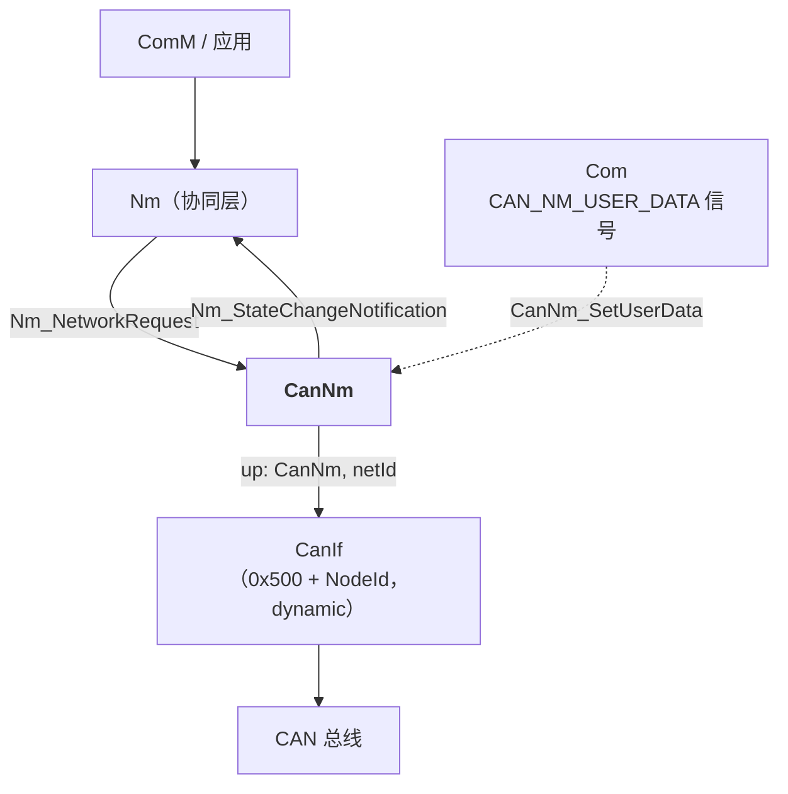
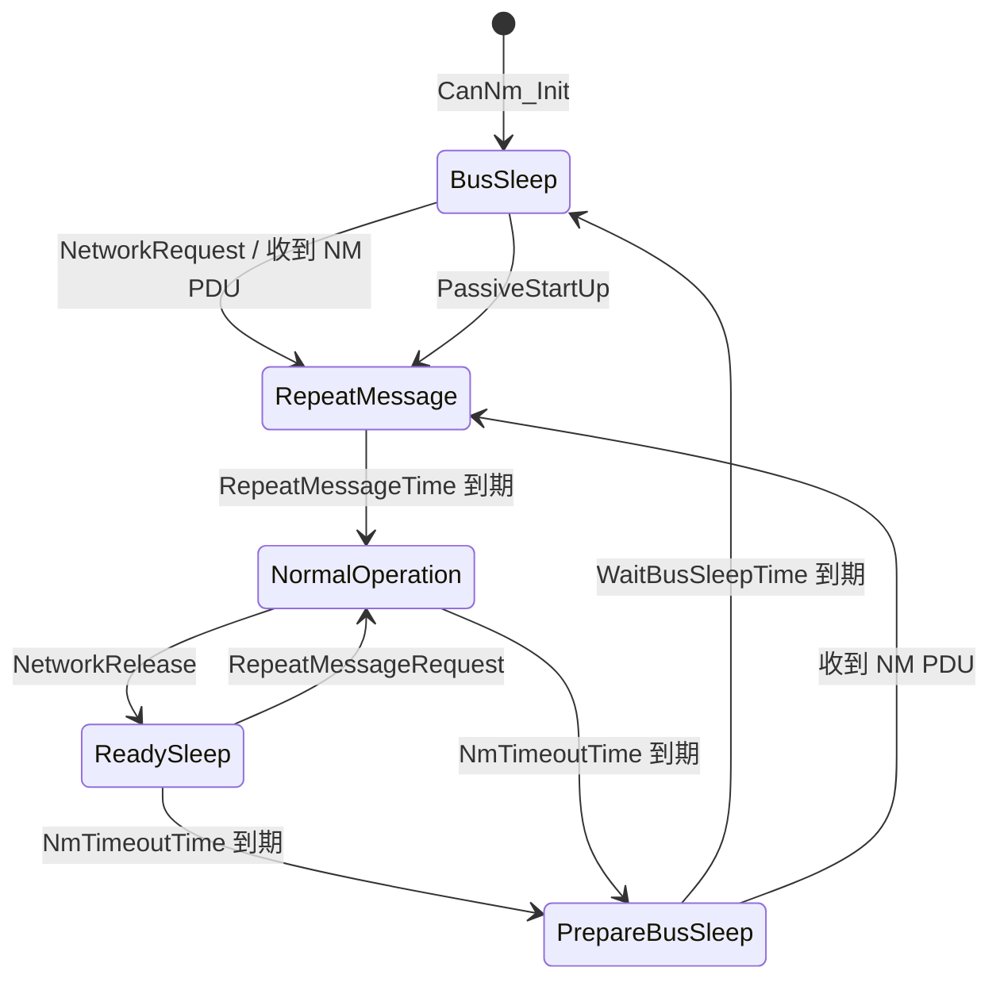

# CanNm - CAN 网络管理（AUTOSAR NM）

> **一句话概括：** CanNm 周期发送带节点 id 和用户数据的 NM PDU，让每个节点都知道
> 谁醒着；当最后一个节点释放网络后，所有节点一起倒计时 `WaitBusSleepTime` 然后休眠。

| 项目 | 值 |
| --- | --- |
| 模块 | `infras/communication/CanNm`（API：`infras/include/CanNm.h`） |
| 层级 | CanIf 之上（`up: "CanNm"`），[Nm](Nm.md) / [ComM](ComM.md) 之下 |
| 配置 | `app/app/config/Com/CanNm.json` |
| 生成器 | `tools/generator/CanNm.py` -> `GEN/CanNm_Cfg.c` / `GEN/CanNm_Cfg.h` |
| 标准 | AUTOSAR CP 4.4 CanNm（含 SSAS 扩展：部分组网、车辆唤醒） |
| 演示 | `scons --app=CanNm`（只有 NM 的最小应用）或 `CanApp` |

**目录**

1. [模块用途](#1-模块用途)
2. [在协议栈中的位置](#2-在协议栈中的位置)
3. [配置](#3-配置)
4. [运行时行为](#4-运行时行为)
5. [公开 API](#5-公开-api)
6. [构建与运行演示](#6-构建与运行演示)
7. [关键注意事项](#7-关键注意事项)
8. [故障排查](#8-故障排查)
9. [已知局限](#9-已知局限)

---

## 1. 模块用途

* **网络协同** - 每 `MsgCycleTime` 发一个 NM PDU 宣告"我醒着"。
* **休眠协同** - 释放网络后启动 `NmTimeoutTime`；期间收不到任何 NM PDU 就进入
  `WaitBusSleepTime` 倒计时，结束后休眠。
* **用户数据传输** - NM PDU 可捎带最多 6 字节负载（`ComUserDataSupport` +
  `UserDataTxPdu`），由 Com 信号 `CAN_NM_USER_DATA` 提供数据。
* **部分组网（PN）** - 按过滤规则匹配的 NM 报文才唤醒本节点（`PnEnabled`、
  `PnFilterMask`、`PnInfoOffset`）。
* **车辆唤醒** - NM PDU 中专用的位/字节可唤醒整车（`CarWakeupSupport`）。

---

## 2. 在协议栈中的位置



构建里没有 ComM/Nm 时，应用直接调用 `CanNm_*`（见 `EcuM_AL_EnterRUN()`）。

---

## 3. 配置

### 3.1 顶层开关

| 键 | 演示值 | 含义 |
| --- | --- | --- |
| `RemoteSleepIndEnabled` | true | 打开 `Nm_RemoteSleepIndication` 回调 |
| `CoordinatorSyncSupport` | true | NM 协调器睡眠同步 |
| `GlobalPnSupport` | false | 全局部分组网开关 |
| `CarWakeupSupport` | true | 车辆唤醒位处理 |
| `ComUserDataSupport` | true | NM PDU 携带 Com 用户数据 |
| `PassiveStartupRepeatEnabled` | true | 被动启动也发立即重复报文 |
| `RequestBitAutoSet` | true | 请求时自动在 CBV 中置 Repeat Message Request 位 |

### 3.2 网络键（`Networks[]`）

| 键 | 演示值 | 含义 |
| --- | --- | --- |
| `Name` | CANNM0 | 通道名；下标即 `NetworkHandleType` |
| `NodeId` | 0/1 | 源节点 id；NM CAN ID = `0x500 + NodeId` |
| `ImmediateNmCycleTime` / `ImmediateNmTransmissions` | 100 / 10 | 启动阶段快周期与次数 |
| `MsgCycleOffset` / `MsgCycleTime` / `MsgReducedTime` | 10 / 1000 / 500 | 正常发送周期（offset 是第一帧）；`MsgReducedTime` 用于降功耗模式 |
| `MsgTimeoutTime` | 10 | 发送确认超时（`TxTimeout` 报警） |
| `RepeatMessageTime` | 1050 | REPEAT_MESSAGE 状态持续时间 |
| `NmTimeoutTime` | 2000 | 收不到 NM PDU 后进入 PREPARE_BUS_SLEEP 的时间 |
| `WaitBusSleepTime` | 5000 | PREPARE_BUS_SLEEP 持续到 BUS_SLEEP 的时间 |
| `RemoteSleepIndTime` | 1500 | 触发远程睡眠指示的空闲时间 |
| `UserDataTxPdu` | `COM_CAN0_...` | 承载用户数据的 Com I-PDU id |
| `PduNidPosition` / `PduCbvPosition` | 0 / 1 | NM PDU 中节点 id / CBV 的字节位置 |
| `ActiveWakeupBitEnabled` / `RepeatMsgIndEnabled` / `NodeDetectionEnabled` / `PnEnabled` | true | 按通道的功能开关 |
| `AllNmMessagesKeepAwake` / `PnInfoOffset` / `PnFilterMask[]` | true / 4 / [0x55,0xAA] | 部分组网过滤 |
| `CarWakeUpRxEnabled`、`CarWakeUpBytePosition`、`CarWakeUpBitPosition`、`CarWakeUpFilterEnabled`、`CarWakeUpFilterNodeId`、`NodeMask` | - | 车辆唤醒检测 |

---

## 4. 运行时行为



* **发送** - RepeatMessage 状态下以 `ImmediateNmCycleTime` 连发
  `ImmediateNmTransmissions` 帧，之后每 `MsgCycleTime` 一帧。PDU 由 NodeId（
  `PduNidPosition` 字节）、CBV（`PduCbvPosition` 字节）和 Com 用户数据拼装。
  `MsgTimeoutTime` 监控发送确认。
* **接收** - 任何 NM PDU 都会重置 `NMTimeout` 报警；CBV 的
  Repeat-Message-Request 位强制进入 `RepeatMessage`；车辆唤醒位触发
  `Nm_CarWakeUpIndication`。
* **主函数** - `CanNm_MainFunction()` 处理所有报警（`Tx`、`TxTimeout`、
  `NMTimeout`、`RepeatMessage`、`WaitBusSleep`、`RemoteSleep`）并驱动状态迁移。

---

## 5. 公开 API

| 函数 | 调用方 | 用途 |
| --- | --- | --- |
| `CanNm_Init(config)` / `CanNm_DeInit()` | EcuM | 进入 BUS_SLEEP，清标志 |
| `CanNm_NetworkRequest(ch)` | Nm / ComM / 应用 | 主动要求保持唤醒（开始发送） |
| `CanNm_NetworkRelease(ch)` | Nm / ComM / 应用 | 释放网络（停止发送） |
| `CanNm_PassiveStartUp(ch)` | Nm | 被动唤醒（不发送） |
| `CanNm_DisableCommunication` / `CanNm_EnableCommunication(ch)` | ComM | 醒着但暂停 NM 发送（busoff 恢复） |
| `CanNm_SetUserData` / `CanNm_GetUserData(ch, ptr)` | Nm / 应用 | 6 字节 NM 用户数据 |
| `CanNm_RepeatMessageRequest(ch)` | 应用 | 强制所有节点进入 REPEAT_MESSAGE |
| `CanNm_SetSleepReadyBit(ch, bool)` | 应用 / 协调器 | 在 CBV 中标记"可以休眠" |
| `CanNm_GetState` / `CanNm_GetPduData` / `CanNm_GetNodeIdentifier` | 应用 / 测试 | 状态与最近收到的 PDU |
| `CanNm_CheckRemoteSleepIndication(ch, *state)` | 应用 | 远程睡眠状态 |
| `CanNm_RequestBusSynchronization(ch)` | 协调器 | Goto 同步位 |
| `CanNm_RxIndication` / `CanNm_TxConfirmation` | CanIf | 协议栈回调 |
| `CanNm_Transmit(TxPduId, PduInfo)` | Nm 垫片（`CanNm_Cfg.c`） | 未编入 CanIf 时的 NM 发送路径 |
| `CanNm_MainFunction()` | 调度器 | 报警处理 |

---

## 6. 构建与运行演示

```bash
# 只含 CanNm 的最小应用
scons --app=CanNm
./build/nt/GCC/CanNm/CanNm.exe

# 或完整协议栈
scons --app=CanApp
./build/nt/GCC/CanApp/CanApp.exe
AS_LOG_CANNM=3 ./build/nt/GCC/CanApp/CanApp.exe   # 打印状态迁移
```

虚拟总线上两个实例（CAN0 NodeId 0、CAN1 NodeId 1）展示 RepeatMessage ->
NormalOperation，以及 `NetworkRelease` 后沿 `NmTimeoutTime` -> `WaitBusSleepTime`
倒计时直到 `NM_STATE_BUS_SLEEP`。

---

## 7. 关键注意事项

1. **NM CAN ID = `0x500 + NodeId`**（`CanIf.json` 里 `CANNM0_RX`/`CANNM_TX` 用
   掩码 `0x700`）。改基址要同步改 CanIf、CanNm 生成器和 DBC。
2. **`CanNm_MainFunction()` 必须按 10 ms 调度** - JSON 里所有时间都按内置 10 ms
   周期换算。
3. **`CanNm_NetworkRequest` 是一票否决制**：只有所有节点都释放才会休眠。某节点
   异常挂起会让总线一直醒着，其他节点靠 `NmTimeoutTime` 自保。
4. **CanIf 垫片路径把控制器写死为 0** - 见已知局限第 2 条。
5. **PN 过滤字节**与 `PnInfoOffset` 处的用户数据比较；不匹配的 NM PDU 不唤醒本
   节点（`AllNmMessagesKeepAwake` 为 true 时仍会重置 NM 超时）。

---

## 8. 故障排查

| 现象 | 可能原因 | 检查点 |
| --- | --- | --- |
| 总线永不休眠 | 某节点还持着网络请求，或用户数据发送不断重置超时 | 逐节点 `CanNm_GetState` |
| 总线上没有 NM PDU | 通道未启动，或 `MsgCycleTime` 报警没走 | 调度器调用 `CanNm_MainFunction` |
| `TxTimeout` 报警触发 | NM 发送被阻塞（busoff / CanIf 离线） | CanIf PduMode、CanSM busoff |
| PN 唤醒无效 | 过滤掩码与发送端字节不匹配 | `PnFilterMask`、`PnInfoOffset` |
| 两个节点同 id | 配置里 `NodeId` 重复 | 都在发 `0x500+NodeId` |

---

## 9. 已知局限

1. **CanIf 垫片的发送路径把控制器写死为 0**（`GEN/CanNm_Cfg.c:171`，由
   `CanNm.py:199` 生成）：未编入 `USE_CANIF` 时 `CanNm_Transmit` 永远写控制器
   0，CAN1 上的 `CANNM1` 通道无法发送。
2. **NM PDU 固定 8 字节、经典 CAN** - 没有 CAN FD 版 NM PDU。
3. **`MsgReducedTime` 只被协调器同步路径使用**；常规降功耗模式未实现。
4. **PN 过滤每通道只支持一个 info 偏移** - 不支持 AUTOSAR 的多 PNI 位置。
5. **垫片路径的 `CanNm_Transmit` 忽略 `TxPduId`** - 没有 CanIf 时每通道只能有
   一个 NM PDU。

**相关文档：** [Nm](Nm.md) - [ComM](ComM.md) - [CanSM](CanSM.md) -
[CanIf](CanIf.md) - [can-oseknm](can-oseknm.md)
