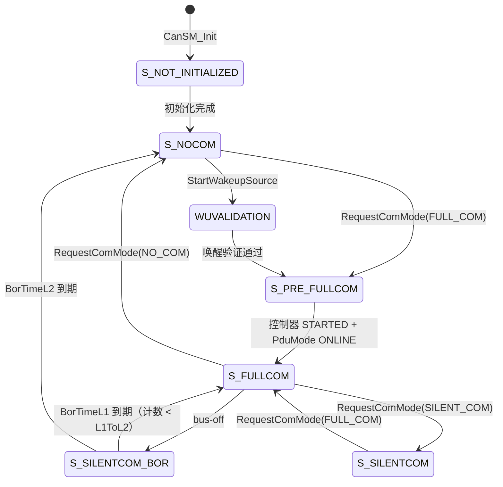

# CanSM - CAN 状态管理

> **一句话概括：** CanSM 把 ComM 的"我要全通信"翻译成对 CanIf 控制器/PDU 模式的
> 具体调用序列，并运行 bus-off 恢复状态机。

| 项目 | 值 |
| --- | --- |
| 模块 | `infras/communication/CanSM`（API：`infras/include/CanSM.h`） |
| 层级 | 上方是 [ComM](ComM.md)，下方是 [CanIf](CanIf.md) |
| 配置 | `app/app/config/Com/CanSM.json` |
| 生成器 | `tools/generator/CanSM.py` -> `GEN/CanSM_Cfg.c` / `GEN/CanSM_Cfg.h` |
| 标准 | AUTOSAR CP 4.4 CanSM（子集） |
| 演示 | `CanApp`（`EcuM_AL_EnterRUN()` 里经 ComM 启动） |

**目录**

1. [模块用途](#1-模块用途)
2. [配置](#2-配置)
3. [运行时行为](#3-运行时行为)
4. [公开 API](#4-公开-api)
5. [构建与运行演示](#5-构建与运行演示)
6. [关键注意事项](#6-关键注意事项)
7. [故障排查](#7-故障排查)
8. [已知局限](#8-已知局限)

---

## 1. 模块用途

* **模式仲裁** - `CanSM_RequestComMode(network, FULL_COM / SILENT_COM /
  NO_COM)` 按正确顺序驱动 `CanIf_SetControllerMode` + `CanIf_SetPduMode`，步骤
  之间等待 `TxRecoveryTime`。
* **Bus-off 恢复（BOR）** - 收到 `CanIf_ControllerBusOff()` 后重启控制器：L1
  恢复（`BorTimeL1`）最多 `BorCounterL1ToL2` 次，之后进入长恢复 L2
  （`BorTimeL2`）。
* **发送超时监控** - 配合 CanIf 的 `CANIF_USE_TX_TIMEOUT`，无确认的发送会触发
  `CanSM_TxTimeoutException()`。
* **唤醒验证** - `WUVALIDATION` 子状态把收发器置 NORMAL 并检查总线后才进入全
  通信。

---

## 2. 配置

`CanSM.json` - 每个网络一项：

| 键 | 演示值 | 含义 |
| --- | --- | --- |
| `Name` | CANSM0 | 网络名；下标即 `NetworkHandleType` |
| `BorTimeL1` | 1000 ms | 短 bus-off 恢复等待 |
| `BorTimeL2` | 5000 ms | 多次 bus-off 后的长恢复等待 |
| `BorCounterL1ToL2` | 5 | 切换到 L2 前允许的 L1 恢复次数 |
| `BorTimeTxEnsured` | 1000 ms | 计数器复位前无发送超时的时间 |
| `TxRecoveryTime` | 100 ms | 控制器重启后允许发送前的等待 |

网络下标必须与 CanIf 控制器号一致（`CANSM0` = 控制器 0）。

---

## 3. 运行时行为



* **FULL_COM 序列**：收发器 NORMAL（如配置）-> 控制器 `CAN_CS_STARTED` ->
  `CanIf_SetPduMode(CANIF_ONLINE)` -> 通知 ComM。
* **Bus-off**：`CanSM_ControllerBusOff()`（CanIf 调用）使网络进入恢复；
  `CanSM_TxTimeoutException()`（CanIf 主函数调用）走同一套机制。
* BSM 子状态（`S_RESTART_CC`、`S_BUS_OFF_CHECK`...）可用
  `CanSM_GetBusoff_Substate()` 观察。

---

## 4. 公开 API

| 函数 | 调用方 | 用途 |
| --- | --- | --- |
| `CanSM_Init(ConfigPtr)` / `CanSM_DeInit()` | EcuM | 所有网络进入 NO_COM |
| `CanSM_RequestComMode(network, mode)` | ComM | `COMM_FULL_COMMUNICATION` / `COMM_SILENT_COMMUNICATION` / `COMM_NO_COMMUNICATION` |
| `CanSM_GetCurrentComMode(network, *mode)` | ComM | 当前模式 |
| `CanSM_StartWakeupSource` / `CanSM_StopWakeupSource(network)` | ComM | 唤醒验证序列 |
| `CanSM_SetEcuPassive(passive)` | 应用 | 全局禁止发送 |
| `CanSM_ControllerBusOff(network)` | CanIf | BusOff 通知，启动 BOR |
| `CanSM_TxTimeoutException(network)` | CanIf | 发送超时通知 |
| `CanSM_GetBusoff_Substate(network, *substate)` | 测试 | BOR 进度 |
| `CanSM_MainFunction()` | 调度器 | 定时器与状态机 |
| `CanSM_GetVersionInfo` | 任意 | 版本 |

---

## 5. 构建与运行演示

```bash
scons --app=CanApp
./build/nt/GCC/CanApp/CanApp.exe
AS_LOG_CANSM=3 ./build/nt/GCC/CanApp/CanApp.exe
```

`EcuM_AL_EnterRUN()` 调用 `CanSM_RequestComMode(0, COMM_FULL_COMMUNICATION)`；
观察 BSM 迁移到 `S_FULLCOM`，之后 CanIf 才允许发送。模拟 bus-off 可停掉对端的
虚拟总线节点，让控制器积累发送错误。

---

## 6. 关键注意事项

1. **CanIf 的模式切换归 CanSM 管** - 定义了 `USE_CANSM` 后不要自己调
   `CanIf_SetControllerMode`/`SetPduMode`；CanSM 下一次状态迁移会覆盖你的设置。
2. **`CANIF_USE_TX_TIMEOUT` 只在 `USE_CANSM` 下生效** - CanIf 里的超时代码由
   两个宏共同控制。
3. **网络下标 = CanIf 控制器号** - `CanSM.json` 的顺序很重要。
4. **BOR 不复位 Can 驱动** - 只做 `Can_SetControllerMode(STOPPED/STARTED)`；
   驱动级故障需要 `Can_DeInit`（未接线）。

---

## 7. 故障排查

| 现象 | 可能原因 | 检查点 |
| --- | --- | --- |
| 卡在 `S_PRE_FULLCOM` | 控制器启动失败（波特率/引脚） | 驱动日志、`Can_SetControllerMode` 返回值 |
| bus-off 后不再恢复 | 进入 `BorTimeL2`（计数耗尽） | `CanSM_GetBusoff_Substate` |
| ComM 一直到不了 FULL_COM | CanSM 模式请求被拒绝 | `CanSM_RequestComMode` 返回值 |
| 发送超时异常循环 | 确认永远不来（HTH 配错） | CanIf `Hoh`、驱动确认路径 |

---

## 8. 已知局限

1. **不支持改波特率** - `S_CHANGE_BAUDRATE` 状态存在，但 API
   （`CanSM_ChangeBaudrate`）未实现。
2. **BOR 计数按网络、8 位** - 超过 255 次 L1 恢复会回绕。
3. **无 `USE_PORT` 时收发器不受控** - WUVALIDATION 的收发器步骤依赖驱动的
   收发器引脚支持。
4. **`CanSM_SetEcuPassive` 全局禁止发送但不会跨 `CanSM_DeInit/Init` 保持**。

**相关文档：** [ComM](ComM.md) - [CanIf](CanIf.md) - [CanNm](CanNm.md)
