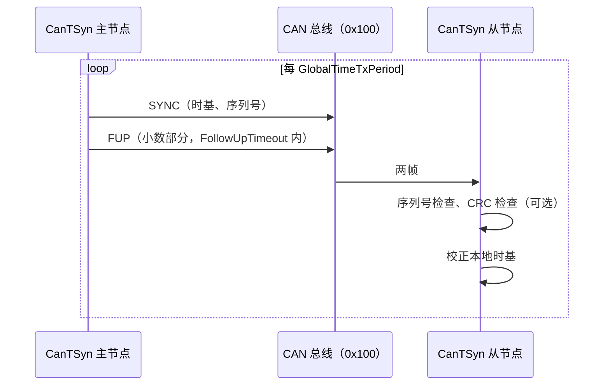

# CanTSyn - CAN 时间同步

> **一句话概括：** CanTSyn 主节点周期性地把当前时间（可选带 CRC）广播到 CAN 帧
> 中；从节点据此校正本地时基。

| 项目 | 值 |
| --- | --- |
| 模块 | `infras/communication/CanTSyn`（API：`infras/include/CanTSyn.h`） |
| 层级 | CanIf 之上（`up: "CanTSyn"`），数据来自本地时基 |
| 配置 | **手写 C，没有 JSON**：`app/app/config/CanTSyn/{master,slave}/CanTSyn_Cfg.c` |
| 生成器 | 无 - 配置是静态 C 文件，直接在 `app/app/SConscript` 中注册 |
| 标准 | AUTOSAR CP 4.4 CanTSyn（子集：FUP/CRC 元素） |
| 演示 | `CanApp` 在虚拟总线上使用 **slave** 配置 |

**目录**

1. [模块用途](#1-模块用途)
2. [配置](#2-配置)
3. [运行时行为](#3-运行时行为)
4. [公开 API](#4-公开-api)
5. [关键注意事项](#5-关键注意事项)
6. [已知局限](#6-已知局限)

---

## 1. 模块用途

* **主节点角色**（`CANTSYN_MASTER`）- 每 `GlobalTimeTxPeriod` 把当前
  `SynchronizedTimeBase` 打包进 SYNC 报文（演示用 0x100）发送；FUP（跟随）报文
  携带小数部分。
* **从节点角色**（`CANTSYN_SLAVE`）- 接收 SYNC/FUP，校验序列号跳变和可选 CRC，
  并经类 StbM 接口（`CanTSyn_SlaveContextType`）更新本地时基。
* 时基的读/写由配置 C 文件中的回调对提供（`SynchronizedTimeBaseRef` 指向你的
  时间函数）。

---

## 2. 配置

没有 JSON - 直接改 C 文件。从节点示例
（`app/app/config/CanTSyn/slave/CanTSyn_Cfg.c`）：

```c
static const CanTSyn_GlobalTimeSlaveType CanTSyn_GlobalTimeSlave0 = {
  CANTSYN_CONVERT_MS_TO_MAIN_CYCLES(100), /* GlobalTimeFollowUpTimeout */
  CANTSYN_CONVERT_MS_TO_MAIN_CYCLES(10),  /* GlobalTimeMinMsgGap */
  3,                                      /* GlobalTimeSequenceCounterJumpWidth */
  CANTSYN_CRC_IGNORED,                    /* RxCrcValidated */
  FALSE,                                  /* RxTmacValidated */
};
static const CanTSyn_GlobalTimeDomainType CanTSyn_GlobalTimeDomains[1] = {
  { {{&CanTSyn_SlaveContext0, &CanTSyn_GlobalTimeSlave0}},
    FALSE, /* EnableTimeValidation */
    0, 0, 0, FALSE, 0,
    CANTSYN_SLAVE },
};
```

| 从节点参数 | 含义 |
| --- | --- |
| `GlobalTimeFollowUpTimeout` | SYNC 与其 FUP 之间的最大间隔 |
| `GlobalTimeMinMsgGap` | 两次 SYNC 之间的最小间隔 |
| `GlobalTimeSequenceCounterJumpWidth` | 重新同步时允许的序列号跳变 |
| `RxCrcValidated` | `CANTSYN_CRC_IGNORED` / `CANTSYN_CRC_OPTIONAL` / `CANTSYN_CRC_MANDATORY` |
| `RxTmacValidated` | 认证时间（TMAC）校验，依赖 Csm |

主节点对应文件（`master/CanTSyn_Cfg.c`）：`GlobalTimeTxPeriod`（演示 5000 ms）
加相同的域头，角色为 `CANTSYN_MASTER`。

| 域字段 | 含义 |
| --- | --- |
| `GlobalTimeDomainId` / `GlobalTimeNetworkSegmentId` | 报文头携带的 id |
| `UseExtendedMsgFormat` | 29 位寻址变体 |
| `SynchronizedTimeBaseRef` | 本地时基索引 |

主/从切换通过在 `app/app/SConscript` 里选择配置目录实现
（`"CanTSyn": Glob("config/CanTSyn/slave/CanTSyn_Cfg.c")`）。

---

## 3. 运行时行为



* `CanTSyn_MainFunction()` 同时驱动两种角色（主节点的发送定时器、从节点的
  FUP 超时）。
* 发送模式按控制器控制：`CanTSyn_SetTransmissionMode(CtrlIdx,
  CANTSYN_TX_ON/OFF)` - 一般由 ComM 状态变化驱动。

---

## 4. 公开 API

| 函数 | 调用方 | 用途 |
| --- | --- | --- |
| `CanTSyn_Init(ConfigPtr)` | EcuM | 建立域/上下文 |
| `CanTSyn_SetTransmissionMode(CtrlIdx, mode)` | ComM / 应用 | 允许/禁止主节点发送 |
| `CanTSyn_RxIndication(RxPduId, PduInfo)` | CanIf | SYNC/FUP 接收 |
| `CanTSyn_TxConfirmation(TxPduId, result)` | CanIf | 主节点发送确认 |
| `CanTSyn_MainFunction()` | 调度器 | 定时器 |
| `CanTSyn_GetVersionInfo` | 任意 | 版本 |

**时基读/写回调**（获取/设置同步时间）是配置结构体的一部分 - 请对着你的
RTC/计数器实现（本仓库没有独立的 StbM 模块）。

---

## 5. 关键注意事项

1. **没有 JSON、没有生成器** - 配置是纯 C；写错是编译错误，这反而是好事。
2. **演示用 CAN ID 0x100** 作为 `CanIf.json` 的 `CANTSYN_RX`/`CANTSYN_TX` -
   集群使用别的同步 ID 时两处都要改。
3. **强制 CRC 依赖 Csm** - 没有加密栈时 `CANTSYN_CRC_MANDATORY` 会拒绝所有帧；
   先用 `CANTSYN_CRC_IGNORED`。
4. **主/从是两种不同的构建**，不是运行时角色 - 每个应用选一个配置目录。
5. **TMAC 风格的保护在没有 Csm 时是空架子**。

---

## 6. 已知局限

1. **没有 StbM 模块** - 时基就是配置里的回调对；除直接设置外没有速率校正/
   偏移滤波。
2. **演示中每个配置文件实例只有一个域**（数组支持多个，但回调是共享的）。
3. **CRC 校验只覆盖全局时间元素**；AUTOSAR 完整的 `CrcValidation` 矩阵未实现。
4. **没有 LinTSyn / 以太网 TSyn** - 仅支持 CAN。

**相关文档：** [CanIf](CanIf.md) - [ComM](ComM.md) - [Com](Com.md)
