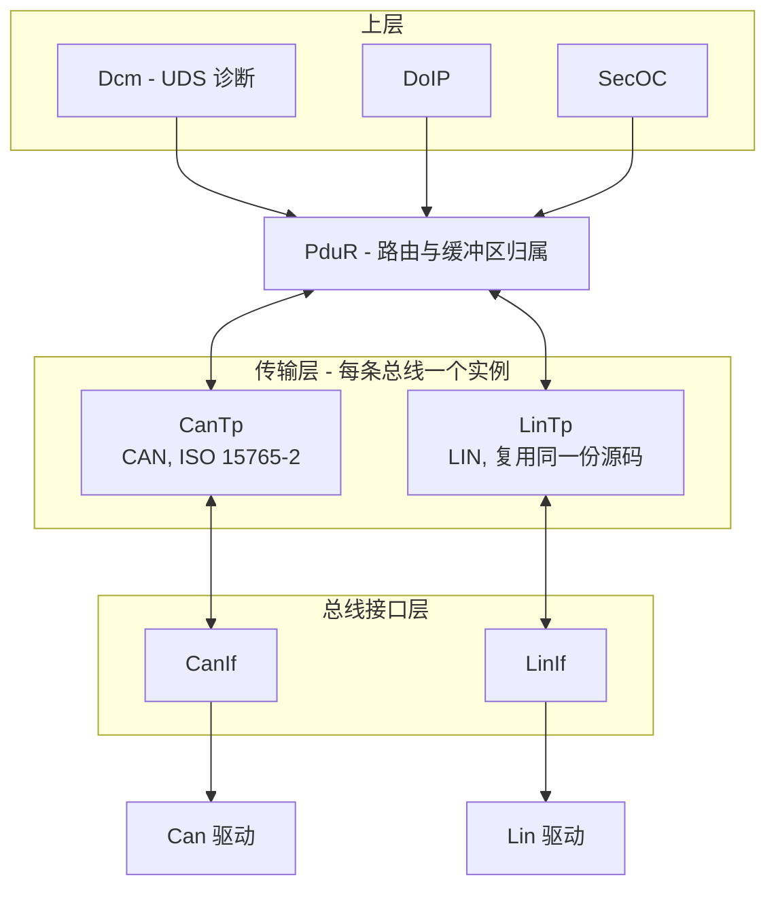
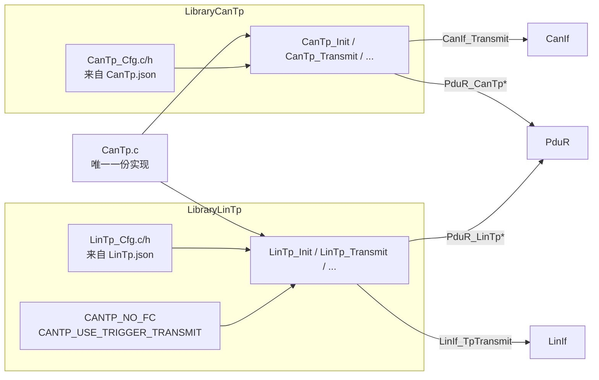
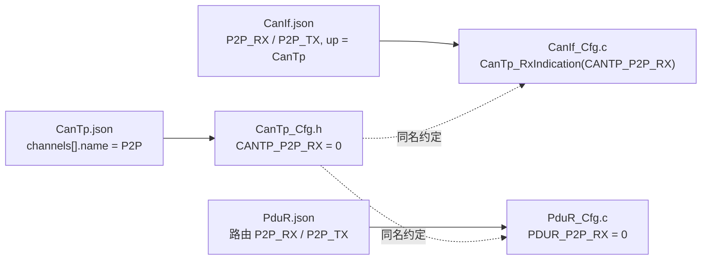
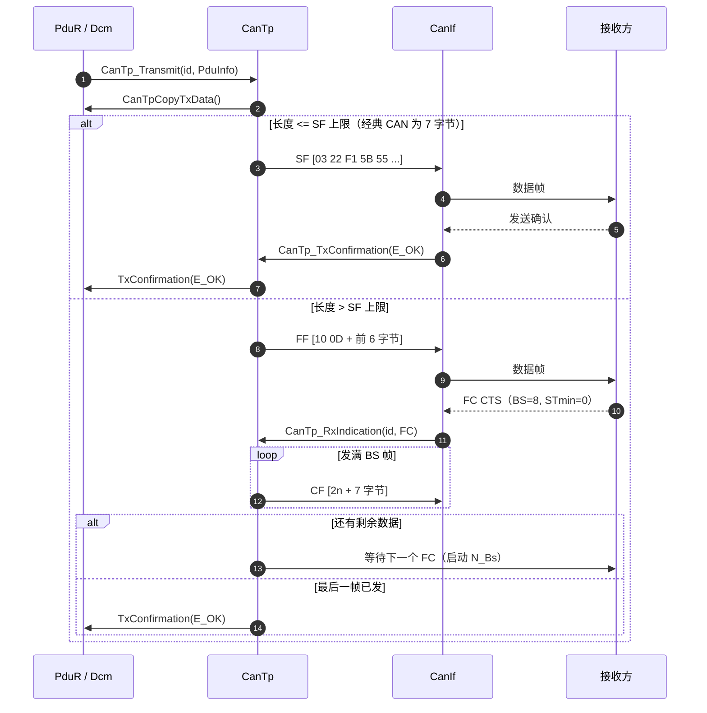
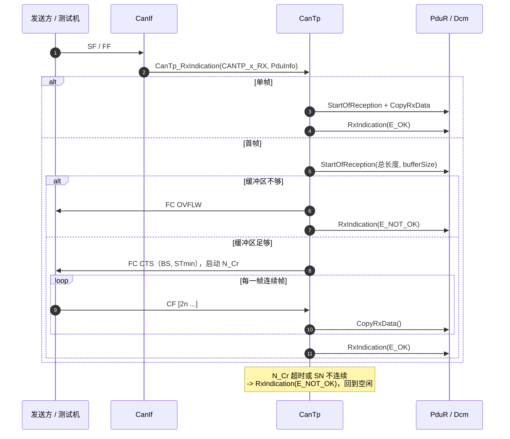
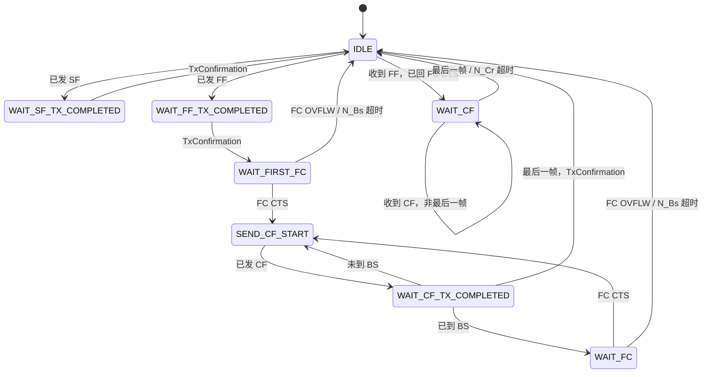

# CanTp - CAN 传输层（ISO 15765-2）

> **一句话说明：** CanTp 在发送时把超过一帧 CAN 报文长度的消息拆成多帧，在接收时把
> 多帧重新拼成一条完整消息。

| 项目 | 内容 |
| --- | --- |
| 模块 | `infras/communication/CanTp`（对外接口：`infras/include/CanTp.h`） |
| 所处层次 | 传输层，下接 CanIf，上接 PduR |
| 配置文件 | `app/app/config/CanTp/CanTp.json` |
| 生成器 | `tools/generator/CanTp.py` -> `GEN/CanTp_Cfg.c` / `GEN/CanTp_Cfg.h` |
| 相关标准 | ISO 15765-2（AUTOSAR CP 4.4 CanTp） |
| 示例程序 | `CanApp`（ECU 侧）+ `IsoTpSend`（测试机侧），跑在虚拟 CAN 总线上 |

**目录**

1. [模块是做什么的](#1-模块是做什么的)
2. [在协议栈中的位置](#2-在协议栈中的位置)
3. [配置说明](#3-配置说明)
4. [运行机制](#4-运行机制)
5. [对外接口](#5-对外接口)
6. [编译与运行示例](#6-编译与运行示例)
7. [关键注意事项](#7-关键注意事项)
8. [常见问题排查](#8-常见问题排查)
9. [已知限制](#9-已知限制)

---

## 1. 模块是做什么的

经典 CAN 一帧最多 8 字节数据（CAN FD 为 64 字节）。一条 UDS 请求可能很短，但
**响应**以及刷写数据往往有几百字节。CanTp 补上了 CAN 驱动与上层协议栈之间缺失的
寻址与分段能力：

* **发送分段** - 把 N-SDU 拆成首帧（FF）和连续帧（CF），并根据接收方的流控帧（FC）
  调整发送节奏。
* **接收重组** - 解析单帧（SF）、首帧、连续帧，向 PduR 申请缓冲区，收齐后一次性上交。
* **时序监控** - `N_As`、`N_Bs`、`N_Cr` 三个定时器负责发现并终止异常的传输。
* **流控** - 用 `BS`（块大小）和 `STmin`（帧间隔）限制发送速率。
* **功能寻址** - 在 `FUNCTIONAL` 通道上只支持单帧广播请求（CAN ID `0x7DF`）。

它**不负责**：

* 不关心 UDS 服务、会话、安全访问 —— 那是 [Dcm](Dcm.md) 的职责；
* 不做模块之间的 PDU 路由 —— 那是 [PduR](PduR.md) 的职责；
* 不直接操作 CAN ID —— 通道对应的报文在 [CanIf](CanIf.md) 中声明。

## 2. 在协议栈中的位置



`CanTp` 与 `LinTp` 是**并列关系，不是上下层**：它们是同一个传输层状态机的两个实例，
各自服务一条总线。`LinTp` 实际上就是把 `CanTp.c` 换一套名字再编译一次，详见
[第 2.1 节](#21-为什么-lintp-不在-cantp-之上)。

每条箭头都是一个配置好的 PDU：一条 CanTp 通道 = CanIf 里的一个 RxPdu 和一个 TxPdu，
以及 PduR 里的一条 Rx 和一条 Tx 路由。三份配置必须按名字对齐，见[第 3.4 节](#34-与-canif-的耦合规则)。

### 2.1 为什么 LinTp 不在 CanTp 之上

`infras/communication/LinTp/LinTp.c` 里没有任何逻辑，只是把 CanTp 的实现换一套符号
前缀重新引入：

```c
#define CANTP_CFG_H                  /* 改用 LinTp_Cfg.h */
#define CANTP_NO_FC                  /* LIN 没有流控帧 */
#define CANTP_USE_TRIGGER_TRANSMIT   /* 由 LinIf 触发取帧，无发送确认 */
#include "CanTp.c"
```



重命名由 `LinTp.h` / `LinTp_Priv.h` 完成：

| CanTp 符号 | LinTp 符号 |
| --- | --- |
| `CanTp_Init` / `Transmit` / `RxIndication` / `TxConfirmation` / `MainFunction` | `LinTp_*` |
| `CanIf_Transmit` | `LinIf_TpTransmit` |
| `PduR_CanTp*` | `PduR_LinTp*` |
| `CanTp_ChannelConfigType`、`CanTp_ChannelContextType` | `LinTp_ChannelConfigType` 等 |

由此可以得出几个结论：

* 本文关于分段、`N_Cr`、`STmin` 节拍、缓冲区的内容对 LIN 同样成立；但 LIN 上
  **`BS`、`STmin`、`WFT`、`N_Bs` 都不起作用**，因为流控被 `CANTP_NO_FC` 编译掉了。
* `LinTp` 有独立的配置和生成器（`app/bootloader/config/LinTp/LinTp.json`），不是通过
  `CanTp.json` 配置的。
* 同时需要两种总线的工程会把 `CanTp` 和 `LinTp` 链接成两个库：共享源码，不共享实例。
* 由于 `LinTp` 始终打开 `CANTP_USE_TRIGGER_TRANSMIT`，[第 9 节](#9-已知限制)提到的
  `CanTp_TriggerTransmit()` 缺少原型的问题只影响 CAN 侧。

## 3. 配置说明

### 3.1 最小示例

参考应用的配置 `app/app/config/CanTp/CanTp.json`：

```json
{
  "Class": "CanTp",
  "Channels": [
    { "Name": "P2P" },
    { "Name": "P2A", "ComType": "FUNCTIONAL" },
    { "Name": "P2A_FW", "ComType": "FUNCTIONAL" }
  ]
}
```

`Channels` 的每一项创建**一条逻辑 CanTp 通道**，一条通道固定包含一条接收路径和一条
发送路径。真正把各层粘在一起的是命名规则：

| 派生符号 | 使用位置 | 含义 |
| --- | --- | --- |
| `CANTP_<name>_RX` / `CANTP_<name>_TX` | `CanIf_Cfg.c` 调用 `CanTp_RxIndication(CANTP_<name>_RX, ...)` | 通道索引，同时作为 CanTp 的 PDU id |
| `CANIF_<name>_RX` / `CANIF_<name>_TX` | `CanTp_Cfg.c` 调用 `CanIf_Transmit(CANIF_<name>_TX, ...)` | CanIf 的 PDU id |
| `PDUR_<name>_RX` / `PDUR_<name>_TX` | `CanTp_Cfg.c` 调用 `PduR_CanTp*` | PduR 的路由 id |

因此一个名为 `P2P` 的通道，要求 CanIf.json 中存在 `P2P_RX`、`P2P_TX` 两个 PDU 且
`"up": "CanTp"`；PduR.json 中存在 `P2P_RX`、`P2P_TX` 两条路由：

```json
/* CanIf.json */
"RxPdus": [ { "Name": "P2P_RX", "Id": "0x731", "Hoh": 0, "Up": "CanTp" } ],
"TxPdus": [ { "Name": "P2P_TX", "Id": "0x732", "Hoh": 0, "Up": "CanTp" } ]

/* PduR.json - 路由 P2P_RX：from CanTp to Dcm；路由 P2P_TX：from Dcm to CanTp */
```

### 3.2 通道字段

除 `Name` 外全部可选。下表默认值与生成器（`tools/generator/CanTp.py`）及实际生成的
`CanTp_Cfg.c` 完全一致：

| 字段 | 默认值 | 单位 | 说明 |
| --- | --- | --- | --- |
| `Name` | 必填 | - | 通道名，同时是 PDU 名的主干。必须是合法 C 标识符，且**不要**自带 `_RX`/`_TX` 后缀 |
| `ComType` | `PHYSICAL` | - | `PHYSICAL` 一对一寻址；`FUNCTIONAL` 广播寻址，仅支持单帧 |
| `N_As` | **25** | ms | 发送方：一帧 N-PDU 的发送确认超时（SF/FF/CF 均适用） |
| `N_Bs` | **1000** | ms | 发送方：等待下一个流控帧的超时 |
| `N_Cr` | **1000** | ms | 接收方：等待下一个连续帧的超时 |
| `STmin` | **0** | ms | 本 ECU 发送两个连续帧之间的最小间隔 |
| `BS` | **8** | 帧 | 本 ECU 发出的流控帧中携带的块大小 |
| `WftMax` | **8** | 帧 | 最多容忍几个 WAIT 流控帧（0 表示一个都不允许） |
| `LinkLayerDataLength` | `CANTP_LINK_LAYER_DATA_LENGTH`（**8**） | 字节 | 底层数据长度：经典 CAN 为 8，CAN FD 为 64 |
| `Padding` | `0x55` | 字节 | 帧尾未使用字节的填充值 |
| `N_TA` | 不配置 | 字节 | **只要出现该字段，通道即切换为扩展寻址**；其值用于和第一个数据字节比较 |

生成器还支持两个较少使用的字段：

| 字段 | 默认值 | 说明 |
| --- | --- | --- |
| `RxPduId` / `TxPduId` | `<name>_RX` / `<name>_TX` | 覆盖本通道使用的 PduR 符号名，适用于 PduR 路由名与通道名不一致的情况 |
| `N_TA` | - | 见上；JSON 中没有单独的“寻址格式”开关 |

### 3.3 顶层字段

| 字段 | 默认值 | 说明 |
| --- | --- | --- |
| `MainFunctionPeriod` | **10** | `CanTp_MainFunction()` 的调用周期（ms），所有定时器都按该周期计数 |
| `STMinAdjust` | **0** | 对协商得到的 STmin 叠加的固定修正量（ms），用于补偿对端定时精度 |
| `UseTxConfirmation` | **true** | 置为 false 时注释掉 `CANTP_USE_TX_CONFIRMATION`，`CanIf_Transmit()` 返回后立即回到空闲态 |
| `UsePostBuildConfig` | **false** | 打开 `CANTP_USE_PB_CONFIG`（从后构建结构体加载通道表） |

### 3.4 与 CanIf 的耦合规则

生成的 `CanTp_Cfg.h` 把通道索引发布为 PDU id，而 `CanIf_Cfg.c` 是**按名字**引用它的：

```c
#define CANTP_P2P_RX 0
#define CANTP_P2P_TX 0
#ifndef USE_CANIF                 /* 仅当不把 CanIf 编进构建时使用 */
#define CANIF_P2P_TX (CANIF_CANTP_BASEID+0)
#endif
```

三份 JSON 与它们的生成结果构成一条接线链，改一个名字要同步改三处：



因此对任意通道 `X`：

1. CanIf 中必须有 `X_RX`、`X_TX` 两个 PDU 且 `"up": "CanTp"` —— 起约束作用的是
   名字，不是顺序；
2. CanIf 调用 `CanTp_RxIndication(CANTP_X_RX, ...)`，也就是说 CanTp 收到的 id 是
   **通道索引**，而不是 CanIf 全局 PDU id；
3. PduR 中需要有 `X_RX`（CanTp -> 上层）和 `X_TX`（上层 -> CanTp）两条路由，或者用
   `RxPduId`/`TxPduId` 覆盖成真实的符号名。

名字写错时会直接编译报错 `CANTP_<name>_RX` 未定义 —— 这是最省事的失败方式，请保持
命名规则。

### 3.5 生成结果

`GEN/CanTp_Cfg.h`：上述宏之外还有

```c
#define CANTP_USE_TX_CONFIRMATION
#define CANTP_STMIN_ADJUST 0u
#define CANTP_MAIN_FUNCTION_PERIOD 10u
#define CANTP_CONVERT_MS_TO_MAIN_CYCLES(x) \
  ((x + CANTP_MAIN_FUNCTION_PERIOD - 1u) / CANTP_MAIN_FUNCTION_PERIOD)
// #define CANTP_USE_PB_CONFIG
```

`GEN/CanTp_Cfg.c`：通道表。`CanTp_ChannelConfigType`
（`infras/communication/CanTp/CanTp_Priv.h`）的字段顺序为：

```c
typedef struct {
  uint8_t *Data;                  /* 每个通道一份 LinkLayerDataLength 大小的发送缓冲 */
  CanTp_AddressingFormatType AddressingFormat;  /* CANTP_STANDARD / CANTP_EXTENDED */
  PduIdType CanIfTxPduId;
  PduIdType PduR_RxPduId;
  PduIdType PduR_TxPduId;
  uint16_t N_As;                  /* 已换算为 MainFunction 周期数 */
  uint16_t N_Bs;
  uint16_t N_Cr;
  uint8_t STmin;
  uint8_t BS;
  uint8_t N_TA;                   /* 仅 CANTP_EXTENDED 使用；LIN 中 0 保留给休眠命令 */
  uint8_t CanTpRxWftMax;          /* 不能为 0xFF */
  uint8_t LinkLayerDataLength;
  uint8_t Padding;
  CanTp_CommunicationType ComType;
} CanTp_ChannelConfigType;
```

由于 `N_As`/`N_Bs`/`N_Cr` 用 `CANTP_CONVERT_MS_TO_MAIN_CYCLES` 换算，它们会被**向上**
取整到整数个主函数周期：周期 10 ms 时 `N_As = 25` 实际为 3 个周期 = 30 ms，而任何
小于 10 ms 的值都变成 1 个周期。

## 4. 运行机制

### 4.1 发送（本 ECU 发送长消息）



* `N_As` 在帧发送期间计时，超时说明 CanIf/驱动没有回确认，通道被复位；
* `N_Bs` 在等待 FC 期间计时，超时则终止传输并向 PduR 上报 `E_NOT_OK`；
* `STmin` 作用于两帧 CF 之间，按
  `CANTP_CONVERT_MS_TO_MAIN_CYCLES(STmin + CANTP_STMIN_ADJUST)` 计算。

### 4.2 接收（本 ECU 接收长消息）



如果接收还没结束时又来了新帧，未完成的接收会先以 `E_NOT_OK` 上报并复位，然后重新
开始 —— 这就是测试机重发请求能“抢断”陈旧传输的机制。

### 4.3 通道状态机



### 4.4 帧格式速查（经典 CAN、标准寻址）

| 类型 | 字节 0 | 字节 1..7 |
| --- | --- | --- |
| SF，3 字节数据 | `03` | `22 F1 5B` + 填充 |
| FF，共 13 字节 | `10 0D` | 前 6 个数据字节 |
| 第 1 个 CF | `21` | 后 7 个数据字节 |
| 第 2 个 CF | `22` | 再 7 个数据字节 |
| 接收方回 FC | `30 08 00` | BS = 8，STmin = 0 |

## 5. 对外接口

`infras/include/CanTp.h`：

| 函数 | 由谁调用 | 作用 |
| --- | --- | --- |
| `CanTp_Init(const CanTp_ConfigType *)` | EcuM | 一次性初始化所有通道 |
| `CanTp_InitChannel(uint8_t)` | EcuM / 测试代码 | 把单条通道复位到空闲 |
| `CanTp_RxIndication(PduIdType, const PduInfoType *)` | CanIf | 收到本通道的一帧 |
| `CanTp_TxConfirmation(PduIdType, Std_ReturnType)` | CanIf | 一帧发送完成（或失败） |
| `CanTp_Transmit(PduIdType, const PduInfoType *)` | PduR | 开始发送一条 N-SDU |
| `CanTp_MainFunction(void)` | 调度器，周期 `MainFunctionPeriod` | 定时器、流控、CF 节拍 |
| `CanTp_MainFunction_Fast(void)` | 调度器，快周期 | 同上，只处理需要更细 STmin 的通道 |
| `CanTp_TriggerTransmit()` | CanIf | 触发发送模式下预装一帧。**该函数未在 `CanTp.h` 中声明**，仅在定义 `CANTP_USE_TRIGGER_TRANSMIT` 时编译进来，目前只被 `LinTp.h` 的别名使用；若在自定义 CanIf 中调用需自行添加声明 |

错误码（`CANTP_E_*`）通过 DET 上报；`CANTP_E_INVALID_RX_ID` / `CANTP_E_INVALID_TX_ID`
几乎总是意味着 CanTp 与 CanIf 之间的名字没对齐。

## 6. 编译与运行示例

参考应用 `CanApp` 中包含 `P2P`（物理寻址，`0x731`/`0x732`）和 `P2A`（功能寻址
`0x7DF`）两条通道，`IsoTpSend` 则是现成的测试机。

```sh
# app 标签页 - 编译 ECU 与测试机
scons --app=CanApp
scons --app=IsoTpSend

# app 标签页 - 运行 ECU（监听 0 号虚拟 CAN 总线）
build/nt/GCC/CanApp/CanApp.exe

# boot 标签页 - 读 DID 0xF15B（返回 10 字节，必然触发多帧响应）
build/nt/GCC/IsoTpSend/IsoTpSend.exe -v 22F15B
```

`IsoTpSend` 的默认参数就是参考配置：`-d CAN.simulator_v2 -p 0 -r 0x732 -t 0x731 -l 8`。
预期报文：

```
TX: 03 22 F1 5B 55 55 55 55        <- 单帧请求
RX: 10 0D 62 F1 5B A5 A5 A5 ...    <- 首帧，声明共 13 字节
TX: 30 08 00 55 55 55 55 55        <- 流控帧，BS=8，STmin=0
RX: 21 A5 A5 A5 A5 A5 A5 A5        <- 连续帧 1
RX: 22 A5 A5 55 55 55 55 55        <- 连续帧 2，最后一帧
```

常用参数：

| 参数 | 含义 |
| --- | --- |
| `-v <hex>` | 请求字节 |
| `-r` / `-t` | 接收 / 发送 CAN ID（测试机 rx 即 ECU tx） |
| `-l <n>` | `linkLayerDataLength`：填 64 即可用同一份代码验证 CAN FD |
| `-d CAN.simulator` | 改用 v1 模拟器而不是 `simulator_v2` |
| `-w` | 等待响应并持续监听 |

如果想不改配置就把整个协议栈切到 CAN FD，可在启动 `CanApp` 前设置环境变量
`CANTP_LINK_LAYER_DATA_LENGTH=64`：生成的构造函数会在进程启动时覆盖所有通道的 `LinkLayerDataLength`
（旧名 `LINK_LAYER_DATA_LENGTH`、`LL_DL` 仍然兼容，但优先级低于 `CANTP_` 专用名）。

需要看原始报文时，在同一条总线上启动 `CanDump`（见[虚拟 CAN 环境](virtual-can-env.md)）。

## 7. 关键注意事项

1. **帧必须填充到合法 DLC。** CanTp 只接受恰好为 8/12/16/20/24/32/48/64 字节的
   SduLength，收到 3 字节的未填充帧会打印 `RX with invalid DLC` 并丢弃，测试机侧
   表现为超时无响应。出现“测试机收不到响应”时，先查 CanIf/Can 驱动侧的填充。
2. **`STmin` 的分辨率等于主函数周期。** `MainFunctionPeriod = 10` 时，任何小于
   10 ms 的 STmin 都变成 10 ms。需要更细节拍时请使用 `CanTp_MainFunction_Fast()`
   （配合 `CANTP_USE_STD_TIMER`）。
3. **`BS = 0` 表示“不再等流控帧，一口气发完”。** 这样最快也合法，但缓冲小的接收方
   会溢出，默认的 `BS = 8` 更安全。
4. **功能寻址通道只支持单帧。** 在 `FUNCTIONAL` 通道上收到非 SF 的 PCI 会被丢弃
   （`E_NOT_OK`）。所以功能响应必须很短；此外对长 DID 做功能读会让所有 ECU 同时
   应答而在总线上冲突，正确做法是在 Dcm 里用会话/安全条件限制该 DID。
5. **配置了 `N_TA` 就是扩展寻址。** JSON 中没有独立的寻址格式字段，`N_TA` 的存在
   即代表选择扩展寻址。LIN 场景下 `N_TA = 0` 保留给休眠命令，请使用非 0 值。
6. **每条通道只有一个发送缓冲**，大小为 `LinkLayerDataLength`。上层数据是逐帧拷入通道缓冲的，
   所以 N-SDU 大于 `LinkLayerDataLength` 没问题，但一条通道不能同时交错发送两条 SDU。
7. **CanTp 的报文永远不会出现在 DBC/LDF 中**，因为其内容不是信号布局，必须在
   `CanIf.json` 中手写声明。
8. **`CanTp_Transmit()` 立即返回**，`E_OK` 只代表“已接受并开始发送”，发送完成通过
   `PduR_CanTpTxConfirmation()` 通知。
9. **构建接入**：在 `app/SConscript` 的 libs 字典里加一行即可启用一个模块：

   ```python
   "CanTp": Glob("config/CanTp/CanTp.json"),
   ```

   `RegisterConfig()` 会调用生成器、定义 `USE_CANTP`、把 `$CanTp_Cfg` 加入头文件
   搜索路径。CanTp **不会**自动带入 CanIf/PduR —— 它们的条目（以及对应 JSON）
   必须在同一个字典里，否则编译时会缺少 `CANIF_*` / `PDUR_*` 宏。

## 8. 常见问题排查

| 现象 | 可能原因 | 检查点 |
| --- | --- | --- |
| 编译报 `CANTP_xxx_RX` 未定义 | CanIf 的 PDU 名与通道名不一致 | `CanIf.json` 中必须是 `<通道名>_RX` / `<通道名>_TX` |
| 测试机超时，日志出现 `RX with invalid DLC` | 帧未填充，或 `LinkLayerDataLength` 不匹配 | 填充到 8 字节（CAN FD 时设置 `CANTP_LINK_LAYER_DATA_LENGTH=64`） |
| 日志出现 `FC received when in state N` | 测试机重复发流控帧，或 FC 与重发竞争 | 通常无害；若状态卡死，说明之前的 `N_Bs` 已超时 |
| 约 1 秒后传输以 `E_NOT_OK` 结束 | `N_Bs`/`N_Cr` 超时 | 增大 `N_Bs`/`N_Cr`，或确认对端是否回 FC |
| 单帧请求正常，多帧请求无响应 | 通道是 `FUNCTIONAL` | 分段传输必须使用 `PHYSICAL` 通道 |
| 响应在 7 字节处被截断 | Dcm/Com 的缓冲区不够，不是 CanTp 问题 | 参见 [Dcm](Dcm.md) 的缓冲区章节 |

## 9. 已知限制

* 流控帧里收到的 `STmin` 被直接当作毫秒使用：`0xF1..0xF9`（100..900 微秒）会被算成
  241..249 ms，且大于 `0x7F` 的值不会按 ISO 15765-2 的建议钳到 `0x7F`。与本协议栈
  对接时建议只在 `0x00..0x7F` 范围内协商。
* 定时器精度等于 `MainFunctionPeriod`，默认配置下无法表达 10 ms 以下的时间参数。
* 生成器引用了 `PDUR_DCM_CANTP_ZERO_COST`（跳过 PduR 的 CanTp -> Dcm 快捷路径），
  但该宏没有任何地方定义，因此始终走标准 PduR 路径。
* 代码支持后构建配置（`CANTP_USE_PB_CONFIG`），但生成器尚未输出相应内容。
* `CanTp_TriggerTransmit()` 在 `CanTp.h` 中没有原型（见接口表），触发发送需要手工
  接线。

## 相关文档

* [CanIf](CanIf.md) —— CanTp 下方的 CAN ID 与 PDU 接线
* [PduR](PduR.md) —— CanTp 上方的路由
* [Dcm](Dcm.md) —— 最常见的上层模块
* [虚拟 CAN 环境](virtual-can-env.md) —— 示例所用的总线模拟器
* [开发环境搭建](build-env-setup.md) —— 工具链与 `scons` 目标
