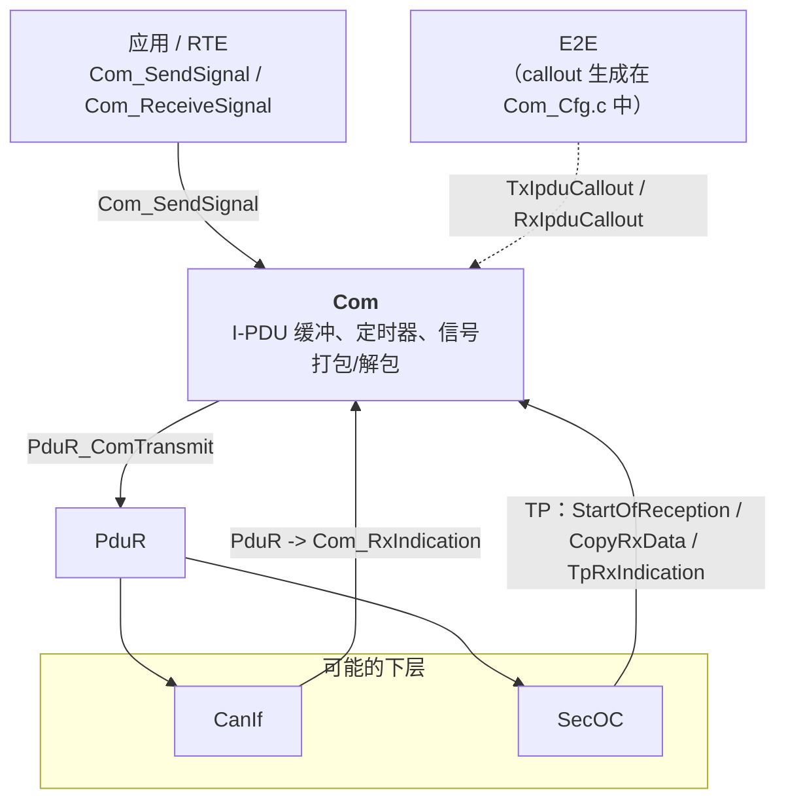
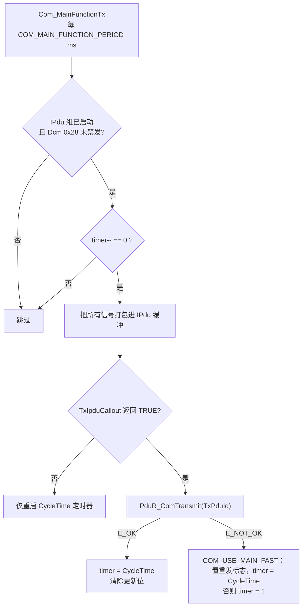
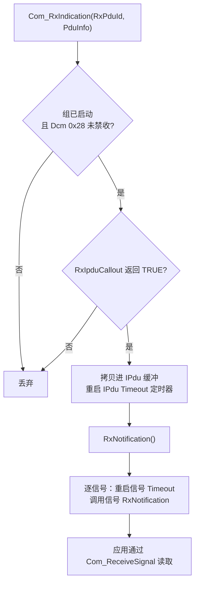
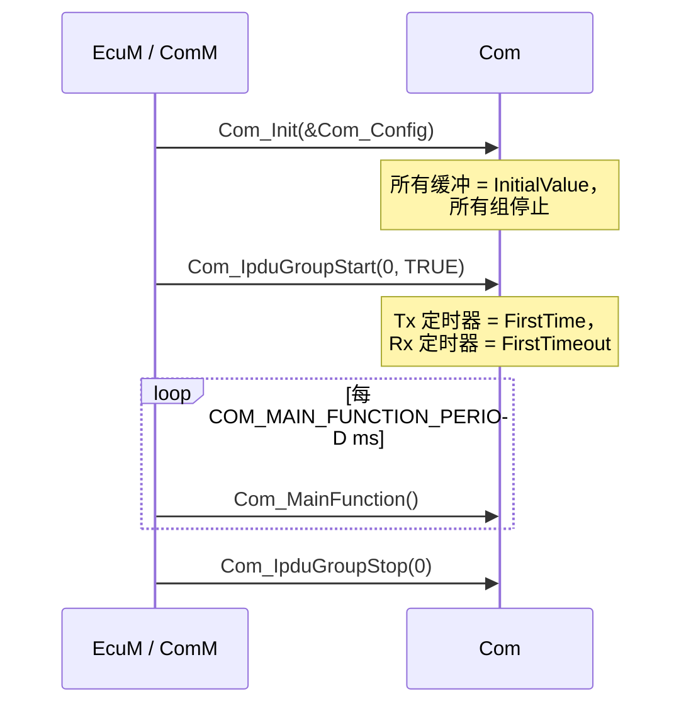

# Com - 信号通信（打包、调度、监控）

> **一句话概括：** Com 把有名字的信号打包成 I-PDU 周期发送，把收到的 PDU 拆回信号，
> 并在期望报文停止到来时产生超时。

| 项目 | 值 |
| --- | --- |
| 模块 | `infras/communication/Com`（API：`infras/include/Com.h`） |
| 层级 | 上方是应用/RTE，下方是 PduR |
| 配置 | `app/app/config/Com/Com.json` |
| 生成器 | `tools/generator/Com.py` -> `GEN/Com_Cfg.c` / `GEN/Com_Cfg.h` + 中间文件 `GEN/Com.json` + `GEN/bswcom.py`（RTE 辅助） |
| 标准 | AUTOSAR CP 4.4 Com（含 SSAS 扩展） |
| 演示 | `CanApp` - 虚拟 CAN 总线上的 `MsgTime` / `MsgAbsInfo` 报文 |

**目录**

1. [模块用途](#1-模块用途)
2. [在协议栈中的位置](#2-在协议栈中的位置)
3. [配置](#3-配置)
4. [运行时行为](#4-运行时行为)
5. [公开 API](#5-公开-api)
6. [构建与运行演示](#6-构建与运行演示)
7. [关键注意事项](#7-关键注意事项)
8. [故障排查](#8-故障排查)
9. [已知局限](#9-已知局限)

---

## 1. 模块用途

* **信号打包/解包** - 生成器为每个信号生成打包/解包代码（起始位、位长、字节序、
  符号、factor、offset）。
* **周期发送** - 每个 Tx I-PDU 有 `CycleTime`；`Com_MainFunctionTx()` 减计数到 0
  后调用 `PduR_ComTransmit()`。
* **死线监控** - 每个 Rx I-PDU 和每个 Rx 信号都有 `FirstTimeout` / `Timeout`；
  超时后由 `RxDataTimeoutAction` 决定信号的处理方式。
* **信号组** - 一致地读写同一 PDU 内的多个信号（JSON 的 `Groups`，演示里的
  `SystemTime`）。
* **触发发送** - `Trigger` 列表里的报文不周期发送，通过 `Com_TriggerIPDUSend()` 发出。
* **E2E 挂钩** - 每个带 `E2E` 条目的报文，生成器会写出调用 `E2E_PxxProtect/Check`
  的 `*_TxIpduCallout` / `*_RxIpduCallout`。

它**不做**的事：

* 不直接访问总线 - 打包后的 PDU 只交给 [PduR](PduR.md)。
* 不做模式管理 - 必须有人调用 `Com_IpduGroupStart()`（[ComM](ComM.md) 或应用）。
* 不做故障码逻辑 - 那是 [Dem](Dem.md) 的事。

---

## 2. 在协议栈中的位置



IF 路径（`Com_RxIndication`，单帧）和 TP 路径（`Com_StartOfReception` +
`Com_CopyRxData` + `Com_TpRxIndication`，多帧，例如大的加密 PDU）都支持；
PduR 的 API 表按路由路径选择。

---

## 3. 配置

### 3.1 顶层键

| 键 | 默认值 | 含义 |
| --- | --- | --- |
| `MainFunctionPeriod` | **10** | ms；生成 `COM_MAIN_FUNCTION_PERIOD`，也是 `COM_CONVERT_MS_TO_MAIN_CYCLES()` 的基准 |
| `UsePostBuildConfig` | **false** | 生成 `COM_USE_PB_CONFIG` |
| `E2E` | - | `E2E.json` 的路径；合并 E2E 配置，使报文的 `E2E` 条目能解析到 `E2E_PxxProtect/Check`（需 `USE_E2E`） |
| `Networks[]` | - | 每个物理网络一项（CAN 或 LIN） |

### 3.2 网络键

| 键 | 默认值 | 含义 |
| --- | --- | --- |
| `Name` | 必填 | 网络名；必须与 `CanIf.json`/`PduR.json` 一致 |
| `Network` | 必填 | `"CAN"` 或 `"LIN"` |
| `Me` | 必填 | DBC/LDF 中本 ECU 的节点名 |
| `UseDbc` | 可选 | 导入 DBC 中节点 `Me` 的所有报文 |
| `Dbc` / `Ldf` | 可选 | 数据库文件；LIN 会先转换成 DBC 再处理 |
| `Groups` | `{}` | `{组名: [信号...]}` - AUTOSAR 信号组 |
| `Trigger` | `[]` | 只通过 `Com_TriggerIPDUSend()` 发送的报文名 |
| `Messages` | `[]` | 手写报文（叠加在导入之上），例如 SecOC PDU |
| `E2E` | `[]` | 每报文 E2E 配置：`{"name": "TxMsgTime", "profile": "P11"}` |
| `timeout_factor` | - | 对未显式写 `Timeout` 的 Rx 报文自动设 `Timeout = factor * CycleTime` |
| `EnableMessageTxCallout` | **false** | 为所有 Tx 报文自动生成 `TxIpduCallout` 名字 |
| `enable_message_rx_callout` | **false** | 为所有 Rx 报文自动生成 `RxIpduCallout` 名字 |
| `enable_message_rx_notification` | **false** | 自动生成 Rx 通知回调名 |
| `enable_message_rx_timeout_notification` | **false** | 自动生成 `RxTOut` 回调名 |
| `enable_signal_rx_notification` | **false** | 自动生成信号级 Rx 通知名 |
| `enable_signal_rx_timeout_notification` | **false** | 自动生成信号级 `RxTOut` 名 |

> `Com.json` 里出现的 `Device`、`Port`、`Baudrate` **不被 `Com.py` 读取** -
> CAN 硬件在别处（驱动/Network 配置）配置。它们是遗留字段，可以删掉。

### 3.3 报文键

| 键 | 默认值 | 含义 |
| --- | --- | --- |
| `Name` | 必填 | 报文名；重名时自动加网络名前缀 |
| `Id` | 必填 | CAN/LIN 帧 ID |
| `Dlc` | 必填 | PDU 长度（字节） |
| `Node` | 必填 | 发送节点（`Me` 表示本 ECU 发送） |
| `CycleTime` | **0** | 发送周期（ms）；0 = 仅触发发送 |
| `FirstTime` | **0** | `Com_IpduGroupStart()` 后到第一次发送的毫秒数 |
| `FirstTimeout` | **0** | ms；第一次接收的死线（0 = 使用 `Timeout`） |
| `Timeout` | **0** | ms；后续接收的死线；0 = 不监控 |
| `RxTOut` | `"NULL"` | 接收超时回调（函数名或 `"NULL"`） |
| `RxNotification` | `"NULL"` | 每次接收都调用的回调 |
| `RxIpduCallout` | `"NULL"` | `boolean f(PduIdType, PduInfoType*)`；返回 FALSE 丢帧 |
| `TxIpduCallout` | `"NULL"` | `boolean f(PduIdType, PduInfoType*)`；返回 FALSE 取消本次发送 |
| `TxNotification` / `ErrorNotification` | `"NULL"` | 发送成功/失败回调 |
| `Trigger` | **false** | 与网络级 `Trigger` 列表等效 |
| `E2E` | - | `{"name": ..., "profile": "P11"}` - 生成 E2E callout 函数体 |

### 3.4 信号键

| 键 | 默认值 | 含义 |
| --- | --- | --- |
| `Name` | 必填 | 信号名（API 句柄：`Com_SendSignal(COM_<name>, ...)` 使用 `COM_<NAME>`） |
| `Start` / `Size` | 必填 | 在 PDU 内的起始位与位长 |
| `Endian` | - | `big` 或 `little` |
| `Sign` | `"+"` | `"+"` 无符号 / `"-"` 有符号 |
| `Factor`, `Offset`, `Min`, `Max` | - | 物理标定（进入打包/解包代码） |
| `InitialValue` | `0` / `[0]` | 初始值或字节数组；用于 init、`REPLACE` 超时和失效恢复 |
| `UpdateBit` | `COM_UPDATE_BIT_NOT_USED` | 更新位在 PDU 内的位置；整数则相对信号起始位 |
| `dyn` | **false** | 放在**最后一个**信号上：PDU 长度动态（`Com_SendDynSignal`） |
| `isGroup` | **false** | 内部使用：标记组头 |
| `RxDataTimeoutAction` | `"NONE"` | `NONE` / `REPLACE`（恢复 `InitialValue`）/ `SUBSTITUTE`（写入 `TimeoutSubstitutionValue`） |
| `TimeoutSubstitutionValue` | `[0]` / `0` | `SUBSTITUTE` 使用的值 |
| `DataInvalidAction` | `"NOTIFY"` | 会生成 `COM_ACTION_*`，但 **Com.c 目前从不读取** |
| `InvalidNotification` | `"NULL"` | 预留给失效通知的回调（当前未接线） |
| `RxNotification`, `RxTOut` | `"NULL"` | 信号级回调（自动命名见 `enable_signal_*`） |

### 3.5 生成符号

```c
/* Com_Cfg.h */
#define COM_MAIN_FUNCTION_PERIOD 10u
#define COM_USE_SIGNAL_CONFIG
#define COM_USE_SIGNAL_UPDATE_BIT
#define COM_CAN0_TX_MSG_TIME 2      /* 在 PduR 中使用的 TxPduId/RxPduId */
#define COM_CAN0_RX_MSG_ABS_INFO 4
```

信号句柄是 `Com_Cfg.c` 里的 `COM_S<ID>_<NAME>` / `COM_G<ID>_<NAME>`（HandleId）-
请使用宏而不是数字 id。通知回调生成在 `#ifdef COM_USE_SIGNAL_RX_NOTIFICATION`
等条件编译之下，所以只有配置了至少一个使用者，回调才存在。

---

## 4. 运行时行为

### 4.1 发送调度



`Com_TriggerIPDUSend(PduId)` 立即发送（同样的门控条件）并随后重启周期定时器 -
适合把事件驱动与周期行为结合。

### 4.2 接收与死线监控



`Com_MainFunctionRx()` 对已启动的 Rx IPdu 定时器减计数。到期时调用 IPdu 级
`RxTOut` 回调，并按信号应用 `RxDataTimeoutAction`：

| 动作 | 超时后的效果 |
| --- | --- |
| `NONE`（默认） | 仅重启定时器 |
| `REPLACE` | `Com_SendSignal(signal, InitialValue)` - 恢复初值 |
| `SUBSTITUTE` | `Com_SendSignal(signal, TimeoutSubstitutionValue)` |

`FirstTimeout` 覆盖从 `Com_IpduGroupStart()` 到第一帧的时间；`Timeout` 覆盖此后
帧与帧之间的间隔。

### 4.3 启动流程



`Com_IpduGroupStart(0, TRUE)`（本实现中组 id 0 = 全部 IPdu）由 ComM 在
FULL_COMMUNICATION 时调用；没有 ComM 时由 `EcuM_AL_EnterRUN()` 直接调用。

---

## 5. 公开 API

| 函数 | 调用方 | 用途 |
| --- | --- | --- |
| `Com_Init(config)` / `Com_DeInit()` | EcuM | 初始化缓冲与定时器 |
| `Com_IpduGroupStart(id, initialize)` | ComM / EcuM | 激活一个组的收发 |
| `Com_IpduGroupStop(id)` | ComM / EcuM | 停用 |
| `Com_EnableReceptionDM` / `Com_DisableReceptionDM(id)` | Dcm 0x28 处理 | 停止时对死线监控缓冲的控制 |
| `Com_SendSignal(SignalId, ptr)` | 应用 | 把信号拷入 IPdu 缓冲并置更新位 |
| `Com_SendDynSignal(SignalId, ptr, len)` | 应用 | 动态长度版本 |
| `Com_ReceiveSignal(SignalId, ptr)` | 应用 | 从 IPdu 缓冲拷出信号 |
| `Com_ReceiveDynSignal(SignalId, ptr, *len)` | 应用 | 动态长度版本 |
| `Com_SendSignalGroup` / `Com_ReceiveSignalGroup(id)` | 应用 | 组的一致性访问 |
| `Com_SendSignalGroupArray` / `Com_ReceiveSignalGroupArray(id, ptr, size)` | 应用 | 组的字节数组访问 |
| `Com_TriggerIPDUSend(PduId)` | 应用 / CanNm | 立即发送一个 IPdu |
| `Com_TriggerIPDUSendWithMetaData(PduId, meta)` | 应用 | 带元数据版本 |
| `Com_RxIndication` / `Com_TxConfirmation` / `Com_TpRxIndication` / `Com_TpTxConfirmation` | PduR | 协议栈回调 |
| `Com_MainFunction()` | 调度器 | `Rx` + `Tx` |
| `Com_MainFunction_Fast()` | 调度器 | 重发排队失败的 Tx（`COM_USE_MAIN_FAST`） |
| `Com_DcmCommunicationControl(mode)` | Dcm 0x28 | 全局允许/禁止收发 |
| `Com_GetVersionInfo` | 任意 | 版本 |

---

## 6. 构建与运行演示

```bash
scons --app=CanApp
./build/nt/GCC/CanApp/CanApp.exe
```

演示配置以 `CycleTime` 发送 `CAN0_TX_MSG_TIME`（id `0x101`），并期望收到
`CAN0_RX_MSG_ABS_INFO`（id `0x102`）。观察周期发送可用测试端程序，或打开 Com 日志：

```bash
AS_LOG_COM=3 ./build/nt/GCC/CanApp/CanApp.exe
```

最小接收测试用 `scons --app=CanIC` 加 VicServer 的 SWC 信号 - 见
[Com SWC 演示](../../app/app/config/SWC)。

---

## 7. 关键注意事项

1. **组不启动就什么都不会发。** 所有收发路径都检查 `GroupStatus`；忘了
   `Com_IpduGroupStart()`，Com 就是一个黑洞。
2. **`CycleTime: 0` 表示"永不周期发送"** - 这类报文需要 `Com_TriggerIPDUSend()`
   或放进 `Trigger` 列表。
3. **超时单位是 ms**，经 `COM_CONVERT_MS_TO_MAIN_CYCLES()` 换算；小于
   `MainFunctionPeriod`（默认 10 ms）的值向上取整为一个周期。
4. **信号名是全局的。** 重名时生成器自动加报文名、必要时再加网络名前缀 - 代码里
   的宏是 `COM_<最终名>`，改名后请查看 `GEN/Com_Cfg.c`。
5. **IPdu 缓冲就是 API。** `Com_SendSignal` 只写缓冲；帧在下一个定时器节拍才离开。
   需要立即发送用 `Com_TriggerIPDUSend()`。
6. **Dcm 0x28 优先。** `Com_DcmCommunicationControl()` 会无视组状态禁用收发。
7. **更新位由 Com 在每次发送成功后清除**、由 `Com_SendSignal` 置位 - 接收方可以用
   它判断数据是否为新。
8. **E2E callout 是生成的，不是手写的。** `enable_message_*_callout` 负责自动命名，
   函数体调用 `E2E.json` 中配置的 `E2E_PxxProtect/Check`。callout 返回 FALSE 丢帧
   时不打任何日志 - "报文消失"时先查 callout。

---

## 8. 故障排查

| 现象 | 可能原因 | 检查点 |
| --- | --- | --- |
| 信号永远发不出 | 组未启动，或 `CycleTime` 为 0 且未触发 | `Com_IpduGroupStart`、`GEN/Com_Cfg.c` 的定时器值 |
| 什么都收不到 | PduR 缺少该 Rx PDU 的路由，或 `Up` 链断了 | `GEN/PduR_Cfg.c` 路由表、`CanIf.json` |
| 总线上有帧但信号没更新 | `Start`/`Endian` 写错，或 Rx PDU id 不匹配 | 对照 `Com_Cfg.c` 信号表与 DBC |
| 帧在到达但超时回调仍触发 | `Timeout` 短于发送方 `CycleTime` + 抖动 | 用 `timeout_factor`（如 3） |
| `SUBSTITUTE` 的值没有生效 | 动作拼写错误（只映射 `NONE/REPLACE/SUBSTITUTE`） | `GEN/Com_Cfg.c` 的 `/* RxDataTimeoutAction */` |
| `Com_SendSignal(COM_X)` 链接报错 | 信号被重名规则改名 | 在 `GEN/Com_Cfg.c` 搜 `COM_.*X` |
| Tester present 之后发送停止 | Dcm 0x28 禁了通信且没人恢复 | Dcm.c 中的 `Com_DcmCommunicationControl` 调用 |

---

## 9. 已知局限

以下是对 `infras/communication/Com/Com.c` 与 `tools/generator/Com.py` 的代码审查
结论（已核实）：

1. **四个已声明的 API 没有实现**：`Com_InvalidateSignal`、
   `Com_InvalidateSignalGroup`、`Com_SwitchIpduTxMode`、`Com_GetStatus` 只存在于
   `Com.h` - 一旦使用就是链接错误。
2. **`DataInvalidAction` 是死配置**：会生成 `COM_ACTION_*` 写进信号表，但 `Com.c`
   从不读取（只解析了 Rx 超时动作）。`InvalidNotification` 同理。
3. **`Com.json` 中的 `Device`、`Port`、`Baudrate` 被忽略**：看似有意义，实际 CAN
   设备在别处配置。
4. **`Com_MainFunctionRx` 先重启定时器再执行动作**：到期时先重装定时器，回调即使
   阻塞多个周期也能保持名义周期 - 但长回调会拖慢同一循环里后面的 IPdu（单线程
   顺序扫描，没有逐 PDU 相位）。
5. **`Com_TriggerIPDUSend` 把发送失败当成功**（`timer = 1` 并返回 `E_OK`）：
   未开 `COM_USE_MAIN_FAST` 时重发发生在一个周期之后；调用方无法区分"已发"与
   "已排队"。
6. **`Com_CopyRxData` 无条件要求 `MetaDataPtr`**（偏移）- 只能在提供偏移的 TP 模块
   之后使用（SecOC/CanTp 网关路径）。
7. **生成器：`enable_*` 开关只自动生成名字**，不校验函数是否真的存在 - 回调名打错
   也要到链接期才暴露。
8. **生成器：LIN 网络的 Tx 被静默丢弃**（LIN 的 `COM_TX_FOR_*` 宏生成的是空体）；
   LIN 发送依赖 LinIf 的触发发送。

**相关文档：** [PduR](PduR.md) - [CanIf](CanIf.md) - [E2E](E2E.md) -
[ComM](ComM.md) - [SecOC](SecOC.md) - [Dcm](Dcm.md)
