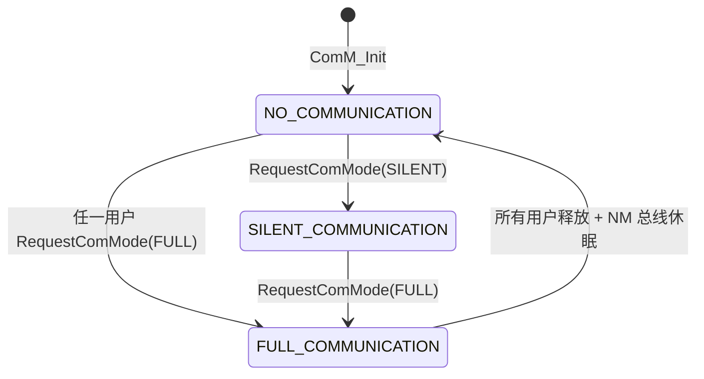

# ComM - 通信管理器

> **一句话概括：** ComM 收集各个用户（应用、Dcm、Nm）的通信诉求，按通道仲裁，
> 然后指挥总线状态管理器（CanSM）和 Com（`Com_IpduGroupStart/Stop`）。

| 项目 | 值 |
| --- | --- |
| 模块 | `infras/communication/ComM`（API：`infras/include/ComM.h`） |
| 层级 | CanSM/[Nm](Nm.md)/[Com](Com.md) 之上；各用户向它请求模式 |
| 配置 | `app/app/config/Com/ComM.json` |
| 生成器 | `tools/generator/ComM.py` -> `GEN/ComM_Cfg.c` / `GEN/ComM_Cfg.h` |
| 标准 | AUTOSAR CP 4.4 ComM（子集） |
| 演示 | `CanApp` - `EcuM_AL_EnterRUN()` 请求 FULL_COMMUNICATION |

**目录**

1. [模块用途](#1-模块用途)
2. [配置](#2-配置)
3. [运行时行为](#3-运行时行为)
4. [公开 API](#4-公开-api)
5. [构建与运行演示](#5-构建与运行演示)
6. [关键注意事项](#6-关键注意事项)
7. [故障排查](#7-故障排查)
8. [已知局限](#8-已知局限)

---

## 1. 模块用途

* **用户仲裁** - 多个用户可共享一个通道，取请求的最高模式；全部释放并完成 NM
  握手后通道进入 NO_COM。
* **Com IPdu 组控制** - 进入 FULL_COMMUNICATION 时启动所配置的 `IpduGroupIds`
  （`Com_IpduGroupStart`），NO_COM 时停止。
* **NM 交互** - `variant: FULL` 时 ComM 经 Nm 请求/释放网络，并响应
  `Nm_NetworkMode` / `Nm_BusSleepMode` 指示。
* **抑制机制** - `ComM_PreventWakeUp`、`ComM_LimitChannelToNoComMode`、
  `ComM_LimitECUToNoComMode` 服务于诊断与测试。

---

## 2. 配置

```json
{
  "Class": "ComM",
  "Chanels": [
    { "Name": "CAN0", "Type": "CAN", "Variant": "FULL", "IpduGroupIds": ["COM_GROUP_ID_CAN0"] },
    { "Name": "CAN1", "Type": "CAN", "Variant": "FULL", "IpduGroupIds": ["COM_GROUP_ID_CAN1"] }
  ],
  "Users": [ { "Name": "User0", "Chanels": ["CAN0", "CAN1"] } ]
}
```

| 键 | 含义 |
| --- | --- |
| `Chanels[]` | **键名就是 `Chanels`** - 生成器按这个拼写解析；不要"修正"为 `channels` |
| `Chanels[].Name` | 通道名；下标即 `NetworkHandleType`，必须与 CanSM/Nm 的通道下标一致 |
| `Chanels[].Type` | `CAN`（类型定义里还有 `LIN`、`ETH`） |
| `Chanels[].Variant` | NM 变体：`FULL`（主动 NM）、`LIGHT`、`NONE`、`PASSIVE` |
| `Chanels[].IpduGroupIds[]` | Com 组 id 符号；来自 Com 生成器的 `COM_GROUP_ID_<network>` |
| `Users[]` | 模式请求者；`Users[].Chanels[]` 列出该用户覆盖的通道名 |

`COM_GROUP_ID_<name>` 由 `Com.py` 按网络生成，因此通道的 `IpduGroupIds` 必须引用
`Com.json` 里存在的网络。

---

## 3. 运行时行为



* `ComM_RequestComMode(user, mode)` 记录用户意愿；通道模式取所有用户的最大值。
* 进入 FULL_COMMUNICATION：对通道的每个组调 `Com_IpduGroupStart(id, TRUE)`，再
  `Nm_NetworkRequest`（variant FULL）或 `CanSM_RequestComMode`（variant NONE）。
* 退出时按相反顺序：`Com_IpduGroupStop`、`Nm_NetworkRelease`，等
  `Nm_BusSleepMode` 后才宣布 NO_COM。
* `ComM_Nm_NetworkStartIndication` / `Nm_NetworkMode` / `Nm_BusSleepMode` 是 NM
  侧更新通道状态的回调。

---

## 4. 公开 API

| 函数 | 调用方 | 用途 |
| --- | --- | --- |
| `ComM_Init(ConfigPtr)` / `ComM_DeInit()` | EcuM | 所有通道进入 NO_COM |
| `ComM_RequestComMode(User, mode)` | 应用、Dcm | 请求 `COMM_FULL_COMMUNICATION` / `COMM_SILENT_COMMUNICATION` / `COMM_NO_COMMUNICATION` |
| `ComM_GetRequestedComMode` / `ComM_GetCurrentComMode(User, *mode)` | 应用 | 查询 |
| `ComM_GetState(Channel, *state)` / `ComM_GetInhibitionStatus` | 测试 | 详细状态 |
| `ComM_PreventWakeUp(Channel, status)` | 应用 | 忽略唤醒请求 |
| `ComM_LimitChannelToNoComMode(Channel, status)` | Dcm 0x28 / 测试 | 强制单通道下线 |
| `ComM_LimitECUToNoComMode(status)` | 测试 | 强制整机下线 |
| `ComM_ReadInhibitCounter` / `ComM_ResetInhibitCounter()` | 测试 | 抑制统计 |
| `ComM_SetECUGroupClassification(status)` | 应用 | ECU 组配置 |
| `ComM_Nm_NetworkStartIndication` / `Nm_NetworkMode` / `Nm_BusSleepMode` / `Nm_PrepareBusSleepMode` | Nm | NM 回调 |
| `ComM_MainFunction()` | 调度器 | 状态机 |

---

## 5. 构建与运行演示

```bash
scons --app=CanApp
./build/nt/GCC/CanApp/CanApp.exe
AS_LOG_COMM=3 ./build/nt/GCC/CanApp/CanApp.exe
```

`EcuM_AL_EnterRUN()` 为 `User0` 请求 `COMM_FULL_COMMUNICATION`，启动两个 Com
IPdu 组并把 CanSM 带到 FULL_COM。在 shell 里可用 `ComM_GetState` 观察状态。

---

## 6. 关键注意事项

1. **JSON 键是 `Chanels`（原文如此）** - 改成 `channels` 会让生成器产出空配置
   且不报任何错误。
2. **通道下标必须与 CanSM/Nm/CanIf 一致** - 四份配置的网络顺序要相同。
3. **Com 组 id 按网络划分** - 一个 ComM 通道可引用多个组（如网关 ECU 在两个网络
   之间转发）。
4. **用户句柄就是 `Users[]` 的下标** - `ComM_RequestComMode(0, ...)` 指 `User0`。
5. **`variant: NONE` 绕过 Nm** - 通道直接经 CanSM 驱动，适合测试台架。

---

## 7. 故障排查

| 现象 | 可能原因 | 检查点 |
| --- | --- | --- |
| Com 信号一直不发 | ComM 没到 FULL_COM | `AS_LOG_COMM=3`、`ComM_GetCurrentComMode` |
| 通道停在 NO_COM | 用户下标错误，或所有用户都已释放 | `ComM_RequestComMode` 的用户下标 |
| 释放后总线不休眠 | NM 握手未完成（`variant: FULL` 但构建里没有 Nm） | variant 与构建配置 |
| `COM_GROUP_ID_CAN0 undeclared` | IpduGroupIds 引用的名字 Com 没生成 | `Com.json` 的网络名 |

---

## 8. 已知局限

1. **JSON 键名是 `Chanels`** - `ComM.py` 保留的拼写错误，属于文件格式的一部分，
   不宜悄悄"修复"。
2. **ComM 层没有 `COMM_PNC_SHUTDOWN` / 部分组网协同**。
3. **`PrepareBusSleep` 处理极简** - 收到 `Nm_BusSleepMode` 即进入 NO_COM，没有
   可配置延时。
4. **所有通道共用一个用户句柄命名空间** - 用户不能按通道请求不同模式（请求
   作用于该用户的全部通道）。

**相关文档：** [CanSM](CanSM.md) - [Nm](Nm.md) - [Com](Com.md) -
[CanNm](CanNm.md)
