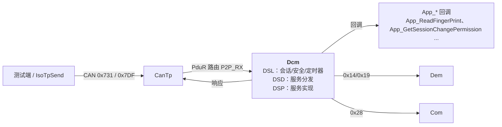
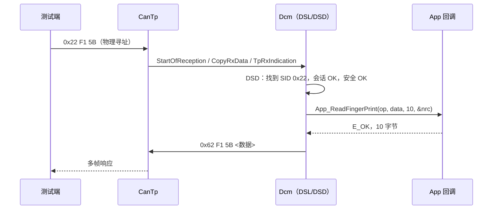

# Dcm - 诊断通信管理（UDS 服务器）

> **一句话概括：** Dcm 是 UDS（ISO 14229）服务器：解析诊断请求，检查会话/安全
> 权限，调用应用的 `App_*` 回调并组装响应。

| 项目 | 值 |
| --- | --- |
| 模块 | `infras/diagnostic/Dcm`（`Dcm.c`、`Dcm_Dsl.c`、`Dcm_Dsd.c`、`Dcm_Dsp.c`；API：`infras/include/Dcm.h`） |
| 层级 | 下方经 PduR（走 CanTp），上方是应用回调 |
| 配置 | `app/app/config/Dcm/Dcm.json` |
| 生成器 | `tools/generator/Dcm.py` -> `GEN/Dcm_Cfg.c` / `GEN/Dcm_Cfg.h` |
| 标准 | ISO 14229 / AUTOSAR CP 4.4 Dcm |
| 演示 | `CanApp` + `IsoTpSend -v 22F15B`（读 DID FingerPrint） |

**目录**

1. [模块用途](#1-模块用途)
2. [在协议栈中的位置](#2-在协议栈中的位置)
3. [配置](#3-配置)
4. [运行时行为](#4-运行时行为)
5. [公开 API](#5-公开-api)
6. [构建与运行演示](#6-构建与运行演示)
7. [关键注意事项](#7-关键注意事项)
8. [故障排查](#8-故障排查)
9. [已知局限](#9-已知局限)

---

## 1. 模块用途

* **会话管理（0x10）** - Default / Program / Extended / Factory 会话，S3 超时自动
  回退到 Default。
* **安全访问（0x27）** - 每个级别一组 seed/key，`NumAtt` 次失败后锁定
  `DelayTime` ms。
* **数据服务** - 读 DID（0x22）、写 DID（0x2E）、读 Scaling DID（0x24）、周期 DID
  （0x2A）、动态定义 DID（0x2C）、IO 控制（0x2F）。
* **内存服务** - 读内存（0x23）、写内存（0x3D）、请求下载（0x34）/传输数据
  （0x36）/退出传输（0x37），带按区间的 `Sessions`/`Securities`/`Attr` 校验。
* **例程控制（0x31）** - 每个例程 start/stop/result 回调。
* **ECU 复位（0x11）**、Tester Present（0x3E）、通信控制（0x28）、清/读 DTC
  （0x14/0x19，转发给 [Dem](Dem.md)）、身份认证（0x29，需 `USE_CRYPTO`）。

它**不做**的事：

* 不做传输 - 分段与时序由 [CanTp](CanTp.md) 完成。
* 不存故障码 - 那是 [Dem](Dem.md) 的事；Dcm 只转发请求。
* 不做报文签名 - SecOC 在更下层。

---

## 2. 在协议栈中的位置



内部按 AUTOSAR 分层：

* **DSL**（会话层）- 会话、安全状态、P2/P2*/S3 定时器、缓冲。
* **DSD**（分发层）- SID 查表、会话/安全/寻址检查、NRC 0x11/0x12/0x31/0x7F。
* **DSP**（服务层）- 各服务实现，调用你的 API。

---

## 3. 配置

全部内容都在一个 JSON（`Dcm.json`）里。同一份配置也可以写成 Excel 工作簿用于
评审；**`ServiceMap` 是 Excel 的页签名 - JSON 里的键叫 `Services`**。

### 3.1 顶层键

| 键 | 默认值 | 含义 |
| --- | --- | --- |
| `MainFunctionPeriod` | **10** | ms；`DCM_MAIN_FUNCTION_PERIOD`，是 `DCM_CONVERT_MS_TO_MAIN_CYCLES()` 的基准 |
| `Timings` | 见 3.2 | P2/P2*/S3 超时 |
| `Security` | `{NumAtt: 3, DelayTime: 3000, SeedProtection: true}` | 全局锁定策略 |
| `Buffer` | 必填 | `{Rx, Tx}` UDS 缓冲大小（字节） |
| `Channels` | `[{Name: P2P}, {Name: P2A}]` | 诊断通道；名字含 `P2A` 的为**功能寻址**通道（如 0x7DF），其余为物理寻址（0x731）。每个通道有 `DCM_P2P_PDU` / `DCM_P2A_PDU` 上下文 |
| `Sessions[]` | 必填 | 会话表 |
| `Securities[]` | 必填 | 安全级别表 |
| `Services[]` | 必填 | 服务表（见 3.3） |
| `Memories[]` | 可选 | 0x23/0x3D/0x34/0x36/0x37 的内存区间 |
| `memory.format` | `[0x44]` | 允许的 AddressAndLengthFormatIdentifier；`0x44` = 4 字节地址 + 4 字节长度 |

### 3.2 `Timings`

| 参数 | 演示值 | 用途 |
| --- | --- | --- |
| `S3Server` | 5000 ms | 空闲该时长后回退到 Default 会话 |
| `P2ServerMax` | 50 ms | 请求的响应死线 |
| `P2StarServerMax` | 5000 ms | 发出 NRC 0x78（响应挂起）后的死线 |
| `P2ServerAdjust` / `P2StarServerAdjust` | 20/20 ms | 调度抖动余量 |

所有值在构建期换算成 `Dcm_MainFunction()` 周期数；没有运行时重配置。

### 3.3 `Sessions[]` / `Securities[]`

```json
"Sessions":  [ { "Name": "Default", "Id": "0x01" }, { "Name": "Program", "Id": "0x02" } ],
"Securities": [ { "Name": "Extended", "Level": "1", "Size": "4", "Sessions": ["Extended"],
                  "API": { "Seed": "App_GetExtendedLevelSeed", "Key": "App_CompareExtendedLevelKey" } } ]
```

* 会话 id 就是 0x10 请求值；生成器输出位掩码（`DCM_DEFAULT_MASK = 0x1`...）。
* 安全 `Level` 是 0x27 的奇数级别号（1、2、3...）；`Size` 是 seed/key 长度；
  `Sessions` 限制该级别可在哪些会话请求。
* seed/key 比较完全委托给应用 - Dcm 只统计尝试次数并执行延时。
* `security.NumAtt`（默认 3）次错误 key 后，该级别锁定 `security.DelayTime`
  （默认 3000 ms）。`SeedProtection: true` 时重复 `27 xx` 返回缓存的同一 seed。

### 3.4 `Services[]`

| 键 | 含义 |
| --- | --- |
| `Name` | 文档名 |
| `Id` | UDS SID（`0x10`、`0x22`...） |
| `Access` | `"physical"` / `"functional"` 或两者 |
| `Sessions` | 允许的会话；空 = 全部 |
| `Securities` | 需要的安全级别；空 = 不需要 |
| `API` | 服务级权限回调，如 0x10 的 `App_GetSessionChangePermission` |
| `Delay` | ms；该服务再次被请求的最小间隔（0x11：复位延时） |
| `Functions[]` | 子功能表，含每个子功能的 `API`（0x28）或预定义子功能（0x29） |
| `DIDs[]` | 0x22/0x2E/0x24/0x2A 的 DID 表 |
| `Routines[]` | 0x31 的例程表 |
| `IOCTLs[]` | 0x2F 的 IO 控制表 |

**DID 键**（`Services[Id=0x22].DIDs[]`）：

| 键 | 含义 |
| --- | --- |
| `Name` | 符号名（`DCM_RDID_F15B_INDEX` 由它派生） |
| `Id` | DID 值，如 `"0xF15B"` |
| `Size` | 固定数据长度（字节） |
| `API` | 读回调：`Std_ReturnType f(Dcm_OpStatusType, uint8_t *data, uint16_t length, Dcm_NegativeResponseCodeType *nrc)` - 0x2E 用同一签名执行写入 |
| `DynamicLength` | 可选；回调加 `WithDynamicLength` 后缀，并在固定部分后追加真实长度（2 字节） |
| `Sessions`, `Securities`, `Access` | 按 DID 覆盖权限 |
| `sourceDID` | 0x2A：周期发送其数据的静态 DID |

周期 DID（0x2A）引用一个源 DID，Dcm 按调度周期复制其数据。动态定义的 DID
（0x2C）放在 TX 缓冲尾部 - 请相应加大 `buffer.tx`。

**例程**（`Services[Id=0x31].Routines[]`）：

| 键 | 含义 |
| --- | --- |
| `Id` | 例程标识，如 `"0xFEEF"` |
| `API.start` / `API.stop` / `API.result` | 0x01/0x02/0x03 子功能回调；不需要的省略 |
| `Sessions`, `Securities`, `Access` | 权限覆盖 |

**IOCTL**（`Services[Id=0x2F].IOCTLs[]`）：`Id` + `Actions[]`（每项
`{id: <子功能>, API: <回调>}`；0x00 = ReturnControlToEcu，0x03 =
ShortTermAdjustment）。

**内存区间**（`Memories[]`）：

| 键 | 含义 |
| --- | --- |
| `Name` | 文档名 |
| `Low` / `High` | 地址区间，`High` 不含 |
| `Attr` | `"r"`、`"w"` 或 `"rw"` - **键名是 `Attr`，不是 `attribute`** |
| `Access` | `"physical"` / `"functional"` |
| `Sessions`, `Securities` | 该区间的权限覆盖 |

每个 0x23/0x3D/0x34 请求都经 `Dcm_DspIsMemoryValid()` 运行时校验：格式 id 必须在
`memory.format` 中，地址必须完整落在属性匹配的区间内，且区间的会话/安全条件
满足。

---

## 4. 运行时行为



* **P2 处理**：响应必须在 `P2ServerMax` 内就绪；需要更久的处理器返回挂起 NRC
  （`DCM_E_PENDING`），Dcm 发 0x78，死线延长到 `P2StarServerMax`。
* **S3 超时**：`S3Server` ms 内无请求则回退 Default 会话，所有已解锁的安全级别
  一并失效。
* **安全锁定**：`NumAtt` 次错误 key 后，该级别返回 NRC 0x36/0x37（超过尝试次数 /
  需要延时），直到 `DelayTime` 结束。
* **双通道**：功能寻址请求（P2A）仅当服务允许 `functional` 时才响应；响应走
  物理通道返回。
* **`Dcm_MainFunction()`** 驱动 DSL 定时器和挂起响应状态机；
  `Dcm_MainFunction_Request/Response` 供拆分调度使用。

---

## 5. 公开 API

| 函数 | 调用方 | 用途 |
| --- | --- | --- |
| `Dcm_Init(ConfigPtr)` / `Dcm_MainFunction()` | EcuM / 调度器 | 初始化，定时器 + 挂起响应处理 |
| `Dcm_StartOfReception` / `Dcm_CopyRxData` / `Dcm_TpRxIndication` | PduR | TP 接收链 |
| `Dcm_CopyTxData` / `Dcm_TpTxConfirmation` / `Dcm_TxConfirmation` | PduR | TP 发送链 |
| `Dcm_GetSecurityLevel` / `Dcm_SetSecurityLevel` | 应用 / 引导程序 | 查询或强制安全级别 |
| `Dcm_GetSesCtrlType` / `Dcm_SetSesCtrlType` / `Dcm_ResetToDefaultSession` | 应用 / 引导程序 | 查询或强制会话 |
| `Dcm_SessionChangeIndication` | DSL 内部 | 会话切换钩子 |
| `Dcm_PerformReset(resetType)` | DSP 0x11 | 执行配置的复位 |
| `Dcm_GetVin(Data)` | 应用 | 读 VIN DID（如已配置） |
| `Dcm_ReadMemory` / `Dcm_WriteMemory` | DSP 内存服务 | 带区间检查的内存访问 |
| `Dcm_Authentication*` | DSP 0x29 | 证书/挑战处理（`USE_CRYPTO`） |
| `Dcm_GetRxPduId` | 应用 | 当前通道 PDU id |
| `Dcm_Transmit(buffer, len, functional)` | 应用 / 引导程序 | 异步推送响应 |
| `Dcm_GetVersionInfo` | 任意 | 版本 |

应用侧回调（`App_*`）由生成器在 `Dcm_Cfg.c` 中声明 - 具体签名取决于 JSON 里的
`API` 条目。

---

## 6. 构建与运行演示

```bash
scons --app=CanApp
./build/nt/GCC/CanApp/CanApp.exe                       # ECU 侧

./build/nt/GCC/IsoTpSend/IsoTpSend.exe -v 22F15B       # 读 DID 0xF15B
./build/nt/GCC/IsoTpSend/IsoTpSend.exe -v 1001         # 默认会话
./build/nt/GCC/IsoTpSend/IsoTpSend.exe -v 1003         # 扩展会话
./build/nt/GCC/IsoTpSend/IsoTpSend.exe -v 2701         # 请求 level 1 的 seed
./build/nt/GCC/IsoTpSend/IsoTpSend.exe -v 3100FEEF     # 启动 NvmTest 例程
```

演示配置下的预期行为：

* `22 F1 5B` 返回 `62 F1 5B` + 10 字节指纹（来自 `App_ReadFingerPrint()`）。
* `10 03` 回 `50 03 ...`，带配置的 P2/P2* 值。
* 发 key 之前再发一次 `27 01`，返回**同一个**缓存 seed（seed 保护）。
* 三次错误 key 后 level 1 锁定 3 秒 - 之后 `27 xx` 得到 NRC 0x36/0x37。

---

## 7. 关键注意事项

1. **JSON 键名必须精确**：`Services`（不是 `ServiceMap` - 那是 Excel 页签名）、
   DID 的 `Id`/`Size`（不是 `ID`/`length`）、内存的 `Attr`（不是 `attribute`）。
   生成器会静默忽略未知键，权限键拼错 = 静默放开到默认值。
2. **空的 `Sessions`/`Securities` = 永远允许。** 忘了写列表，该服务/DID/例程在
   Default 会话、无安全状态下就能访问。
3. **TX 缓冲同时承载动态 DID** - 大量使用 0x2C 时请把总大小加进 `buffer.tx`。
4. **`P2ServerMax` 是硬死线。** 长操作（Flash 擦写）必须返回 `DCM_E_PENDING` 并
   在 `P2StarServerMax` 内完成。
5. **0x29 Authentication 仅在 `USE_CRYPTO` 下编译**，且依赖 Csm 栈。
6. **功能寻址响应被抑制**：服务未标 `functional` 时，测试端往 0x7DF 发 `10 03`
   不会有任何应答。
7. **引导程序有自己的 Dcm.json**（`app/bootloader/config/Dcm/Dcm.json`），服务更
   少 - 不要在 BL 和 app 之间盲目共用一份。
8. **应用可调用 `Dcm_Transmit()`** 推送非请求响应（例如 E2E 校验异步完成后再
   回复）。

---

## 8. 故障排查

| 现象 | 可能原因 | 检查点 |
| --- | --- | --- |
| NRC 0x11（服务不支持） | `Services[]` 缺该服务或 `Id` 打错 | `GEN/Dcm_Cfg.c` 服务表 |
| NRC 0x12（子功能不支持） | 缺 `Functions[]` 条目 | 服务 JSON |
| NRC 0x22 / 0x7F（条件不满足/被拒绝） | `App_GetSessionChangePermission` 或服务 `API` 返回 E_NOT_OK | 你的回调 |
| 0x23 出 NRC 0x31（超范围） | 地址不在 `Memories[]`、`Attr` 不符，或格式 id 不在 `memory.format` | `Dcm_DspIsMemoryValid` 的输入 |
| NRC 0x33（安全拒绝） | 服务要求 `Securities[]` 且级别未解锁 | `27 xx` 状态 |
| 三次 key 后 NRC 0x36/0x37 | 安全锁定生效中 | 等待 `DelayTime` ms |
| 无响应也无 NRC | 处理器返回 `DCM_E_PENDING` 后没有完成 | 挂起状态机、`P2StarServerMax` |
| DID 读回乱码 | JSON 的 `Size` 小于回调实际写入的长度 | 回调 vs `Size` |

---

## 9. 已知局限

以下是对 `infras/diagnostic/Dcm/*` 与 `tools/generator/Dcm.py` 的代码审查结论
（已核实）：

1. **内存区间检查可能整数溢出**（`Dcm_Dsp.c:1882`）：
   `(memoryAddress + memorySize) <= Mems[i].high` - 地址接近 `0xFFFFFFFF` 时
   回绕后区间检查被绕过。虽然允许的 `memory.format` 缩小了影响面，但检查本身
   应写成 `memoryAddress <= high - memorySize`。
2. **权限键拼写错误被静默接受**：生成器以"空 = 全部允许"为默认读取
   `Sessions`/`Securities`/`Access`；DID 的 `Sessions` 列表打错不会导致构建失败。
3. **`security.SeedProtection` 默认为 `true`** - seed 被缓存，重复 `27 xx` 返回
   同一个 seed；需要每次新 seed 的实现必须显式关闭。
4. **动态长度 DID 包装器追加 2 字节**（`data[length]`、`data[length+1]`）-
   上界受 `Dcm_Dsp.c:224` 的 `resMaxDataLen` 约束，但配置的 DID `Size` 必须为
   响应中的 2 字节长度留出空间。
5. **0x29 Authentication 生成的若干函数依赖 `USE_CRYPTO` + Csm**，并非所有构建
   都包含 - 打开服务而无协议栈时会在链接期失败。
6. **`Dcm_Transmit(buffer, len, functional)` 收裸缓冲**，长度没有对照
   `buffer.tx` 做检查 - 调用方不得越界。
7. **生成器：Excel（`ServiceMap`）与 JSON 两条路径需手工同步**，没有从工作簿
   再生 JSON 的工具。

**相关文档：** [CanTp](CanTp.md) - [PduR](PduR.md) - [Dem](Dem.md) -
[Com](Com.md) - [can-bootloader](can-bootloader.md)
