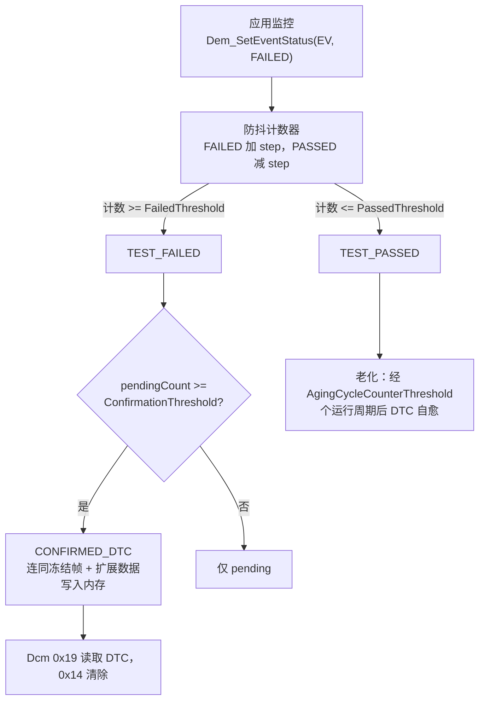

# Dem - 诊断事件管理（DTC 存储）

> **一句话概括：** 应用向 Dem 上报事件通过/失败；Dem 经防抖后生成 UDS 状态字节，
> 把 DTC 连同冻结帧与扩展数据存入事件内存，并供 Dcm 读取（0x14 / 0x19）。

| 项目 | 值 |
| --- | --- |
| 模块 | `infras/diagnostic/Dem`（API：`infras/include/Dem.h`） |
| 层级 | 下方是 Dcm（0x14/0x19），上方是应用监控逻辑 |
| 配置 | `app/app/config/Dcm/Dem.json` |
| 生成器 | `tools/generator/Dem.py` -> `GEN/Dem_Cfg.c` / `GEN/Dem_Cfg.h` |
| 标准 | AUTOSAR CP 4.4 Dem（子集） |
| 演示 | `CanApp` - 例程 `31 01 DEED`（`Dem_TestStart`）触发一个模拟事件 |

**目录**

1. [模块用途](#1-模块用途)
2. [运行时行为](#2-运行时行为)
3. [配置](#3-配置)
4. [公开 API](#4-公开-api)
5. [构建与运行演示](#5-构建与运行演示)
6. [关键注意事项](#6-关键注意事项)
7. [故障排查](#7-故障排查)
8. [已知局限](#8-已知局限)

---

## 1. 模块用途

* **事件状态跟踪** - `Dem_SetEventStatus(EventId, PASSED/FAILED/...)` 输入到基于
  计数器的防抖状态机。
* **DTC 存储** - 确认的 DTC 带着状态字节、发生计数与老化信息写入一个或多个事件
  内存（Primary、Mirror）。
* **冻结帧** - 故障发生时刻所配置环境数据的快照。
* **扩展数据** - 每个 DTC 的附加记录（如发生计数），由应用回调填充。
* **DTC 服务后端** - 清除 DTC（0x14）、读 DTC（0x19 各子功能）、DTC 设置控制
  （0x85）。

它**不做**的事：不做总线 IO（唯一客户端是 Dcm），不做监控算法（通过/失败由应用
判断）。

---

## 2. 运行时行为



* **运行周期**（`IGNITION` 等）门控老化与发生计数：
  `Dem_RestartOperationCycle()` / `Dem_SetOperationCycleState()`。
* **使能条件**（JSON 的 `Conditions`，如 `BatteryNormal`）必须先经
  `Dem_SetEnableCondition()` 上报 `TRUE`，事件才会被处理。
* **存储条件**经 `Dem_SetStorageCondition()` 门控是否写内存。

---

## 3. 配置

### 3.1 顶层键

| 键 | 默认值 | 含义 |
| --- | --- | --- |
| `Memories[]` | `[{Name: Primary, Origin: 0x0001}]` | 事件内存；`Origin` 是 0x19 使用的 DTCOrigin（1=Primary，2=Mirror...） |
| `General` | 见 3.2 | 防抖/老化/确认策略 |
| `DTCs[]` | 必填 | DTC 表（见 3.3） |
| `Environments[]` | `[]` | 冻结帧（FFD）数据记录 |
| `ExtendedDatas[]` | `[]` | 扩展数据（EXTD）记录 |
| `MaxFreezeFrameNum` | **2** | 每个 DTC 的冻结帧记录数 |
| `StatusAvailabilityMask` | **0x7F** | 支持哪些 UDS 状态位 |
| `UsePostBuildConfig` | **false** | 生成 `DEM_USE_PB_CONFIG` |

### 3.2 `General`

| 键 | 演示值 | 含义 |
| --- | --- | --- |
| `DebounceCounterFailedThreshold` | 10 | 置 TEST_FAILED 的计数值 |
| `DebounceCounterPassedThreshold` | -10 | 置 TEST_PASSED 的计数值 |
| `DebounceCounterIncrementStepSize` / `DecrementStepSize` | 1 / 2 | 每次 FAILED / PASSED 上报的步进 |
| `DebounceCounterJumpDown` / `JumpDownValue` | false / 0 | 通过时直接跳到某值 |
| `DebounceCounterJumpUp` / `JumpUpValue` | true / 0 | 失败时直接跳到某值 |
| `ConfirmationThreshold` | 2 | DTC 确认前需连续失败的运行周期数 |
| `AgingCycleCounterThreshold` | 5 | 确认 DTC 老化清除前需通过的运行周期数 |
| `OccurrenceCounterProcessing` | `"TF"` | 在 TEST_FAILED 时累计发生计数 |
| `FreezeFrameRecordTrigger` | `"TEST_FAILED"` | 何时抓取冻结帧 |
| `ExtendedDataRecordTrigger` | `"TEST_FAILED"` | 何时更新扩展数据 |

### 3.3 `DTCs[]`

| 键 | 含义 |
| --- | --- |
| `Name` | 符号名 - 生成 `DEM_EVENT_ID_<NAME>`；组合 DTC 经 `Events[]` 包含多个事件 |
| `Number` | 3 字节 DTC 编号，如 `"0x112200"` |
| `Conditions` | 使能条件名；所有名字的并集生成 `DEM_NUM_OF_ENABLE_CONDITION` |
| `Destination` | 存入哪些内存，如 `["Primary", "Mirror"]` |
| `Priority` | 数值越小优先级越高（清除/溢出行为） |
| `OperationCycleRef` | 周期名，默认 `IGNITION` |
| `Events[]` | 组合 DTC 的子事件（演示中的 `DTC_COMB0`） |
| `Environments` / `FreezeFrameRecNums` | 按 DTC 覆盖冻结帧内容/记录号 |

### 3.4 `Environments[]` / `ExtendedDatas[]`

每条记录是 `{Name, Id, Type, Unit?}`（`uint8`/`uint16`...）。对每条记录，生成器
会**声明一个应用必须实现的回调**：

```c
Std_ReturnType Dem_FFD_GetBattery(Dem_DtcIdType EventId, uint8_t *data, Dem_DTCOriginType DTCOrigin);
Std_ReturnType Dem_EXTD_GetFaultOccuranceCounter(Dem_DtcIdType EventId, uint8_t *data, Dem_DTCOriginType origin);
```

缺实现是链接错误；`Type` 大小写错会破坏记录布局。

---

## 4. 公开 API

| 函数 | 调用方 | 用途 |
| --- | --- | --- |
| `Dem_PreInit()` / `Dem_Init(ConfigPtr)` / `Dem_Shutdown()` | EcuM | PreInit 从 NvM 恢复，Init 激活 |
| `Dem_SetEventStatus(EventId, status)` | 应用监控 | 上报 `PASSED` / `FAILED` / `PREPASSED` / `PREFAILED` |
| `Dem_SetEventStatusWithMonitorData(...)` | 应用 | 同上，附带监控数据作为扩展数据 |
| `Dem_ResetEventStatus(EventId)` | 应用 | 复位防抖状态 |
| `Dem_SetEnableCondition(id, bool)` | 应用 | 上报 `BatteryNormal` 等 |
| `Dem_SetStorageCondition(id, bool)` | 应用 | 门控内存写入 |
| `Dem_SetOperationCycleState` / `Dem_RestartOperationCycle(id)` | 应用 / EcuM | 驱动 `IGNITION` 周期 |
| `Dem_SetEventAvailable(EventId, bool)` | 应用 | 屏蔽单个事件 |
| `Dem_GetEventUdsStatus(EventId, *byte)` | 应用 | 当前 UDS 状态字节 |
| `Dem_GetFaultDetectionCounter(EventId, *counter)` | 应用 | 防抖计数器（测试用） |
| `Dem_SetDTCFilter` / `Dem_GetNumberOfFilteredDTC` / `Dem_GetNextFilteredDTC`（+ `AndFDC`、`AndSeverity`） | Dcm 0x19 | DTC 报告遍历 |
| `Dem_SetFreezeFrameRecordFilter` / `Dem_GetNextFilteredRecord` | Dcm 0x19/0x04 | 冻结帧遍历 |
| `Dem_SelectDTC` / `Dem_ClearDTC(ClientId)` | Dcm 0x14 | 在所选 origin 中清除 DTC |
| `Dem_SelectFreezeFrameData` / `Dem_GetNextFreezeFrameData` | Dcm 0x19/0x04 | 冻结帧读取 |
| `Dem_SelectExtendedDataRecord` / `Dem_GetNextExtendedDataRecord` / `Dem_GetSizeOfExtendedDataRecordSelection` | Dcm 0x19/0x06 | 扩展数据读取 |
| `Dem_DisableDTCSetting` / `Dem_EnableDTCSetting(ClientId)` | Dcm 0x85 | 停止/恢复事件存储 |
| `Dem_GetDTCStatusAvailabilityMask` | Dcm 0x19 | 状态可用性掩码 |
| `Dem_MainFunction()` | 调度器 | 防抖 + 老化处理 |

---

## 5. 构建与运行演示

```bash
scons --app=CanApp
./build/nt/GCC/CanApp/CanApp.exe
./build/nt/GCC/IsoTpSend/IsoTpSend.exe -v 1902FF      # 按掩码 0xFF 读 DTC 状态
./build/nt/GCC/IsoTpSend/IsoTpSend.exe -v 3101DEED    # 例程：Dem_TestStart
./build/nt/GCC/IsoTpSend/IsoTpSend.exe -v 1902FF      # 此时 DTC 已存储
./build/nt/GCC/IsoTpSend/IsoTpSend.exe -v 14FFFFFF    # 清除全部 DTC
```

演示 DTC 是 `0x112200` ... `0x112204` 加组合 `DTC_COMB0`；例程 `0xDEED`
（`Dem_TestStart`）上报一个 FAILED 事件，可以完整观察：事件 -> 防抖 -> 确认 ->
冻结帧 -> 0x19 报告 -> 0x14 清除。

---

## 6. 关键注意事项

1. **事件 id 由名字生成** - `DEM_EVENT_ID_DTC0` 等。应用包含 `Dem_Cfg.h` 并用这些
   宏上报；DTC 重新排序时编号会静默变化。
2. **组合 DTC 共享一个存储条目** - `Events[]` 的所有事件映射到同一个 DTC 编号；
   任一事件失败即确认该 DTC。
3. **使能条件必须在启动时上报** - 配了 `conditions: ["BatteryNormal"]` 而不调
   `Dem_SetEnableCondition(0, TRUE)`，所有事件上报都会被忽略。
4. **老化按运行周期计，不按时间** - 在点火 off/on 时调用
   `Dem_RestartOperationCycle()`，否则确认的 DTC 永远不会老化。
5. **每条 FFD/EXTD 记录都必须有回调** - 生成器输出原型；演示实现位于
   `app/app/src`。
6. **内存由 NvM 支撑** - 经 NvM 配置的 `NvmBlock` 挂钩；NvM 不可用时内存只在 RAM
   （断电丢失）。
7. **`Priority` 影响溢出** - 内存满时被替换的是优先级最低的 DTC。

---

## 7. 故障排查

| 现象 | 可能原因 | 检查点 |
| --- | --- | --- |
| 事件在失败但 0x19 无 DTC | 使能条件未置位，或事件还在防抖中 | `Dem_SetEnableCondition`、`Dem_GetFaultDetectionCounter` |
| 0x14 清不掉 | DTC setting 被禁（0x85）或 DTCOrigin 不对 | `Dem_DisableDTCSetting` 状态、`Origin` |
| 冻结帧为空 | 未达到 `FreezeFrameRecordTrigger`，或 FFD 回调返回 E_NOT_OK | 回调返回值 |
| 链接错误 `Dem_FFD_GetX` | JSON 声明了记录但没实现 | 实现或删除记录 |
| 复位后 DTC 丢失 | NvM 未存储该内存块 | NvM.json、`Dem_PreInit` 顺序 |
| 组合 DTC 只显示一个事件 | `Events[]` 名字重复 | DTC JSON |

---

## 8. 已知局限

以下是对 `infras/diagnostic/Dem/Dem.c` 与 `tools/generator/Dem.py` 的代码审查
结论（已核实）：

1. **只有两个运行周期** - `Dem_OperationCycleStates[2]` 是硬编码的；JSON 引用
   超过 `IGNITION` 加一个周期的更多周期时，不会得到自己的状态存储。
2. **只实现了计数器防抖** - 没有基于时间的防抖，也没有监控内部防抖；
   `Dem_ResetEventDebounceStatus` 是唯一的复位路径。
3. **`OccurrenceCounterProcessing: "TF"` 是唯一实现的策略**；其它 AUTOSAR 策略
   未接线。
4. **`MaxFreezeFrameNum` 全局默认 2**；按 DTC 的 `FreezeFrameRecNums` 默认为
   `1..MaxFreezeFrameNum` - 单个 DTC 不能超过全局上限。
5. **生成器对重名记录静默改名**；两条 `Environments[]` 同名会产生冲突的
   `Dem_FFD_Get*` 回调。
6. **`StatusAvailabilityMask` 默认 0x7F 宣告了子集可能未完全实现的位**
   （如与 severity 相关的位）- 严格的测试端可能判定不一致。

**相关文档：** [Dcm](Dcm.md) - [NvM](NvM.md) - [CanTp](CanTp.md)
