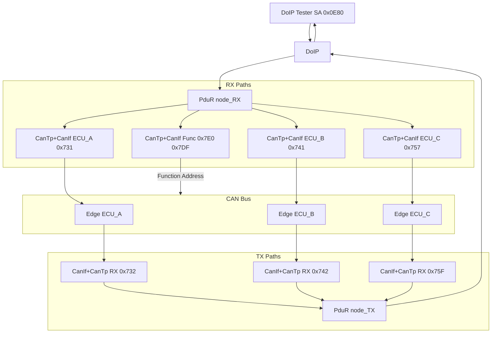

# DoIP 到 CAN TP 网关 - 路由矩阵生成与主机演示

## 目录

1. [简介](#1-简介)
2. [诊断路由表模型](#2-诊断路由表模型)
3. [网关网络配置](#3-网关网络配置)
4. [运行时路由行为](#4-运行时路由行为)
5. [模拟边缘 CAN TP 节点](#5-模拟边缘-can-tp-节点)
6. [主机演示](#6-主机演示)

## 1. 简介

中央网关把以太网侧的 DoIP 诊断仪与分布在多条 CAN/CAN FD 总线上的众多边缘 ECU 连接起来。诊断路由通常由系统工程师在诊断矩阵（表格形式）中维护。AS 提供：

- 运行时模块（`DoIP` + `PduR` 网关路由 + `CanTp` + `CanIf`）：执行实际的 DoIP 到 CAN TP 转发；
- Python 脚本 [`dummy_ecu.py`](../../app/app/config/DoIPGW/dummy_ecu.py)：模拟边缘 CAN TP 节点，对每个 UDS 请求给出假的正响应， 从而无需真实 ECU 即可在主机上测试整个网关。

本文档使用**典型的、虚构化的示例**说明路由表模型、网关配置以及运行时数据流。 对应的示例配置文件位于 [`app/app/config/DoIPGW/`](../../app/app/config/DoIPGW/)。

## 2. 诊断路由表模型

下面给出典型的诊断路由表示例，使用常见的总线、ECU 与地址。

### 2.1 表结构

诊断路由表每行描述一条路由规则，分为 DoIP 侧与 CAN 侧两半：

| 一侧 | 含义 |
| --- | --- |
| DoIP 侧 | 诊断仪 `Source`、诊断仪 DoIP `SA`（源逻辑地址）、DoIP `TA`（目标逻辑地址） |
| CAN 侧 | `Target` 总线、CAN 请求/响应 `Message ID`、CAN 段上可选的 DoIP SA/TA |
| 元信息 | 网关 ECU、注释、变更记录 |

该表包含两段，列语义互为镜像：

- **请求段**（诊断仪 -> ECU）：CAN 报文 id 位于 CAN 侧 id 列。
- **响应段**（ECU -> 诊断仪）：CAN 报文 id 位于 DoIP 侧 id 列，DoIP SA/TA 列分别携带 ECU 地址与诊断仪地址。

### 2.2 典型请求表

示例：诊断仪 SA `0x0E80`，一个功能组 TA `0xE001`，三个物理 ECU。

| DoIP SA | DoIP TA | 目标总线 | CAN 请求 ID | 注释 |
| --- | --- | --- | --- | --- |
| `0x0E80` | `0xE001` | PT_CANFD | `0x7E0` | 功能组（扇出到 CAN FD） |
| `0x0E80` | `0xE001` | CL1_CAN | `0x7DF` | 功能组（经典 CAN 功能寻址 ID） |
| `0x0E80` | `0x004A` | PT_CANFD | `0x731` | ECU_A，物理寻址 |
| `0x0E80` | `0x0053` | BD_CANFD | `0x741` | ECU_B，物理寻址 |
| `0x0E80` | `0x0757` | CL1_CAN | `0x757` | ECU_C，物理寻址（11 位 ID） |

规则：

- **物理**请求拥有唯一的 DoIP TA（一个 ECU）和唯一的 CAN 请求 ID。
- **功能**请求使用一个 DoIP 组 TA（如 `0xE001`）并扇出到多条总线。判定特征： **同一个 DoIP TA 在多行中对应不同的目标总线/CAN ID**。上表中 TA `0xE001` 对应两行（PT_CANFD、CL1_CAN），CAN ID 分别为 `0x7E0`（CAN FD）与 `0x7DF`（经典 CAN）， 表示功能寻址在不同总线上的扇出。
- 本示例统一使用 11 位标准（CAN STD）ID：CAN FD 与经典 CAN 均采用 11 位 ID，二者仅 通过 `LL_DL`（64 与 8）区分；例如 ECU_A 请求 `0x731` / 响应 `0x732`， ECU_B 请求 `0x741` / 响应 `0x742`，功能 ID `0x7DF` / `0x7E0`。

第二段通常列出远程/OTA 诊断仪，使用不同的 SA（如 `0x0F00`）及其各自的功能组 （例如高压组与低压组路由到不同的总线子集）。每个诊断仪 SA 在 DoIP 配置中对应一个 诊断仪/例程（tester/routine）对。

### 2.3 典型响应表

| 源总线 | CAN 响应 ID | DoIP SA | DoIP TA | 注释 |
| --- | --- | --- | --- | --- |
| PT_CANFD | `0x732` | `0x004A` | `0x0E80` | ECU_A -> 诊断仪 |
| BD_CANFD | `0x742` | `0x0053` | `0x0E80` | ECU_B -> 诊断仪 |
| CL1_CAN | `0x75F` | `0x0757` | `0x0E80` | ECU_C -> 诊断仪 |

响应表用于推导各节点在网关上的 CAN **接收（RX）** id：网关在 `0x732` 上接收 响应，而在 `0x731` 上发送请求。功能组没有响应行：功能 UDS 请求通常置位 响应抑制位，因此没有边缘节点应答。

## 3. 网关网络配置

第 2 节示例对应的网关配置文件位于 [`app/app/config/DoIPGW/`](../../app/app/config/DoIPGW/)，包含以下文件：

| 文件 | 内容 |
| --- | --- |
| [`Network.json`](../../app/app/config/DoIPGW/Network.json) | DoIP 模块：发现地址、`max_connections`、目标（物理 + 功能组）、例程、诊断仪 |
| [`PduR.json`](../../app/app/config/DoIPGW/PduR.json) | PduR 网关路由：每个节点的 `_RX`/`_TX`，功能目标带 `destinations` 扇出与 `DestBuffer` |
| [`CanTp.json`](../../app/app/config/DoIPGW/CanTp.json) | 每个节点一个 CanTp 通道，CAN FD 的 `LL_DL` 为 64，经典 CAN 为 8 |
| [`CanIf.json`](../../app/app/config/DoIPGW/CanIf.json) | 总线报文 ID：TX PDU = 请求 ID，RX PDU = 响应 ID，全部 11 位标准 ID |
| [`Mempool.json`](../../app/app/config/DoIPGW/Mempool.json) | SoAd/DoIP 使用的内存池 |

### 3.1 CanIf 与 CanTp 的 PDU 方向说明

本项目的 DoIP-CAN 网关配置中，PduR 路由路径按命名约定区分方向：`_RX` 表示“从诊断仪到 ECU”（请求路径），`_TX` 表示“从 ECU 到诊断仪”（响应路径）。CanTp 的配置需与 PduR 的 PDU ID 保持一致。

以生成的配置为例（参见 `tools/generator/CanTp.py`、`app/app/config/DoIPGW/GEN/CanTp_Cfg.c`、`GEN/PduR_Cfg.h`）：

- 对于通道 `PT_CANFD_E001`，CanTp 配置中 `PduR_RxPduId = PDUR_PT_CANFD_E001_TX`，`PduR_TxPduId = PDUR_PT_CANFD_E001_RX`。
- PduR 路由路径：请求路径为 `PT_CANFD_E001_RX`（DoIP → CanTp），响应路径为 `PT_CANFD_E001_TX`（CanTp → DoIP）。
- 同时，CanTp 发送到 CAN 总线时使用 `CANIF_PT_CANFD_E001_TX`（对应 CanIf 的网关 TX 帧），从 CAN 总线接收的响应由对应的 CanIf RX 帧传递给 CanTp。

在 `CanTp.json` 中：
```json
{ "name": "PT_CANFD_E001", "RxPduId": "PT_CANFD_E001_TX", "TxPduId": "PT_CANFD_E001_RX", "LL_DL": 64 }
```

生成器的映射规则（`tools/generator/CanTp.py`）为：
- `CanIfTxPduId = CANIF_<name>_TX`
- `PduR_RxPduId = PDUR_<RxPduId>`（来自 JSON 的 `RxPduId`）
- `PduR_TxPduId = PDUR_<TxPduId>`（来自 JSON 的 `TxPduId`）

因此，JSON 中的 `RxPduId` 并非“CanTp 从 CanIf 接收”的总线 RX 名称，而是用来推导 CanTp 与 PduR 交互所用的 PDU ID 名称。对于功能组通道（如 `PT_CANFD_E001`、`CL1_E001`），虽然响应路径（`*_RX`）实际不会被使用，但仍保留 `TxPduId` 以保持所有通道配置结构一致。

### 3.2 配置要点

- **物理目标**：一个 DoIP TA 映射到一个 CanTp 通道。**功能目标**：一个 DoIP TA 带 `nodes` 数组（DoIP 接收一次请求，由 PduR 复制到每个节点）。DoIP 响应匹配使用节点自身的 `doipTxPduId`，避免响应混淆。
- **功能扇出**：功能目标的请求路由带 `destinations`，同一缓冲请求被转发到各 CanTp 通道。
- **目的缓冲必需**：TP 网关**必须**配置目的缓冲（`DestBuffer` + `buffers` 条目）。否则 `PduR_GwStartOfReception` 拒绝报文，DoIP 返回 NACK `0x08`（`DOIP_E_DIAG_TP_ERROR`）。按最大预期 UDS 报文大小配置（如烧写用 4096）。
- **ID 格式**：全部 11 位标准 ID，原样书写，不使用扩展帧标志。
- **主机模拟**：所有虚拟节点共享 `simulator_v2` 总线，通过 CAN ID 过滤区分；`networks` 对物理控制器的划分仅在真实硬件上有意义。

## 4. 运行时路由行为



- **请求**：DoIP 诊断报文（payload type `0x8001`）按目标地址匹配；目标的 `RxPduId` 选择 PduR 网关路由。对于功能目标，PduR 使用共享网关缓冲为每个目的节点各启动一次 TP 接收。
- **响应**：边缘节点在其 CAN 响应 id 上应答；CanTp 重组报文，PduR 经 `<node>_TX` 转发给 DoIP，DoIP 按节点的 `doipTxPduId` 匹配等待中的连接，然后以 ECU 地址作为 DoIP SA、诊断仪作为 DoIP TA 回发。
- **功能请求**（`0xE001`）被复制到每个节点；通常置位正响应抑制位（如 `0x28 0x83 0x03`、`0x10 0x83`、`0x3E 0x80`），没有边缘节点应答，从而避免多个 ECU 共享同一功能 ID 时发生响应冲突。
- DoIP 诊断 ACK（`0x8002`）先于 UDS 响应；按 ISO 13400 它可以回显请求的前几个 字节 —— 该回显不是 UDS 响应。

## 5. 模拟边缘 CAN TP 节点

[`dummy_ecu.py`](../../app/app/config/DoIPGW/dummy_ecu.py) 基于主机模拟器绑定 `one.AsPy.isotp`，每个 ECU 一个独立进程（无需线程），由命令行参数 `--rxid`/`--txid`/`--ll-dl` 指定。id 方向以 ECU 视角定义：

- `rxid` = 发往该 ECU 的请求 CAN id（= 网关 CanIf 的 **TX** id）；
- `txid` = 该 ECU 发回响应的 CAN id（= 网关 CanIf 的 **RX** id）。

假响应器对每个请求回正响应（`SID | 0x40`）并回显其余字节；对 `0x10`（会话控制）附加 P2/P2* 定时字节 `00 32 01 F4`（P2=50ms、P2*=5s）。功能寻址节点（`0x7E0`/`0x7DF`）不模拟：功能请求置位正响应抑制位，无需应答。

### 5.1 节点与 CAN id 对照表

| 节点 | 总线 | 请求 id（网关 TX PDU） | 响应 id（网关 RX PDU） | `LL_DL` |
| --- | --- | --- | --- | --- |
| ECU_A | PT_CANFD | `0x731` `PT_CANFD_004A_TX` | `0x732` `PT_CANFD_004A_RX` | 64 |
| ECU_B | BD_CANFD | `0x741` `BD_CANFD_0053_TX` | `0x742` `BD_CANFD_0053_RX` | 64 |
| ECU_C | CL1_CAN（经典） | `0x757` `CL1_0757_TX` | `0x75F` `CL1_0757_RX` | 8 |
| 功能组 | PT_CANFD | `0x7E0` `PT_CANFD_E001_TX` | -（不应答） | 64 |
| 功能组 | CL1_CAN（经典） | `0x7DF` `CL1_E001_TX` | -（不应答） | 8 |

### 5.2 DoIP 诊断仪侧

命令行工具 `DoIPSend` 自动完成车辆发现、TCP 连接、路由激活，发送单条 UDS 请求并打印响应。选项：`-v` UDS 十六进制串、`-s` 诊断仪 SA、`-t` 目标 TA，`-i`/`-p` 可改发现地址与端口。

## 6. 主机演示

以下步骤在主机上运行网关演示，并用 `CanDump` 观察 CAN 报文。

> 运行前确保 MSYS2 `mingw64\bin` 与 `build\nt\GCC\one` 已加入 `PATH`。

**步骤 1 — 构建：**

```sh
scons --app=DoIPGW      # 网关
scons --app=CanDump     # CAN 监听
scons --app=DoIPSend    # DoIP 客户端
```

**步骤 2 — 各占一个 Shell 启动：**

```sh
# Shell 1：网关（打开 DoIP UDP/TCP 13400 端口）
build\nt\GCC\DoIPGW\DoIPGW.exe

# Shell 2：CAN 监听，与网关共享 simulator_v2 虚拟总线
build\nt\GCC\one\CanDump.exe -d simulator_v2 -p 0

# Shell 3：三个边缘 ECU
python app/app/config/DoIPGW/dummy_ecu.py --rxid 0x731 --txid 0x732 --ll-dl 64 --name ECU_A
python app/app/config/DoIPGW/dummy_ecu.py --rxid 0x741 --txid 0x742 --ll-dl 64 --name ECU_B
python app/app/config/DoIPGW/dummy_ecu.py --rxid 0x757 --txid 0x75F --ll-dl 8  --name ECU_C
```

**步骤 3 — 发送请求并观察 `CanDump` 输出：**

#### 场景 1：物理请求 ECU_A（TA `0x004A`），UDS `10 01`

```sh
build\nt\GCC\DoIPSend\DoIPSend.exe -v 1001 -s 0x0E80 -t 0x004A
```

```
canid=00000731,dlc=08,data=[02,10,01,55,55,55,55,55,] [...UUUUU] @ 0.808733 s rel 0.00 ms
canid=00000732,dlc=08,data=[06,50,01,00,32,01,F4,55,] [P.2.U] @ 0.812000 s rel 3.27 ms
```

请求帧 `0x731` 为 ISO-TP 单帧（PCI=`0x02`，`10 01`，`0x55` 填充到 8 字节）；响应帧 `0x732` 为正响应 `50 01 00 32 01 F4`（会话控制正响应 + P2/P2* 定时）。

#### 场景 2：物理请求 ECU_C（TA `0x0757`，经典 CAN），UDS `10 01`

```sh
build\nt\GCC\DoIPSend\DoIPSend.exe -v 1001 -s 0x0E80 -t 0x0757
```

```
canid=00000757,dlc=08,data=[02,10,01,55,55,55,55,55,] [...UUUUU] @ 7.120599 s rel 0.00 ms
canid=0000075F,dlc=08,data=[06,50,01,00,32,01,F4,55,] [P.2.U] @ 7.124000 s rel 3.40 ms
```

格式与场景 1 一致；经典 CAN 固定 8 字节帧。

#### 场景 3：功能请求（TA `0xE001`），UDS `28 83 03`（正响应抑制）

```sh
build\nt\GCC\DoIPSend\DoIPSend.exe -v 288303 -s 0x0E80 -t 0xE001
```

```
canid=000007E0,dlc=08,data=[03,28,83,03,55,55,55,55,] [.(..UUUU] @ 13.416609 s rel 0.00 ms
canid=000007DF,dlc=08,data=[03,28,83,03,55,55,55,55,] [.(..UUUU] @ 13.417583 s rel 0.97 ms
```

请求被扇出到两个功能 id：`0x7E0`（FD）与 `0x7DF`（经典）；置位了正响应抑制位，只有请求帧、无响应帧。
