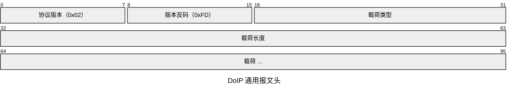
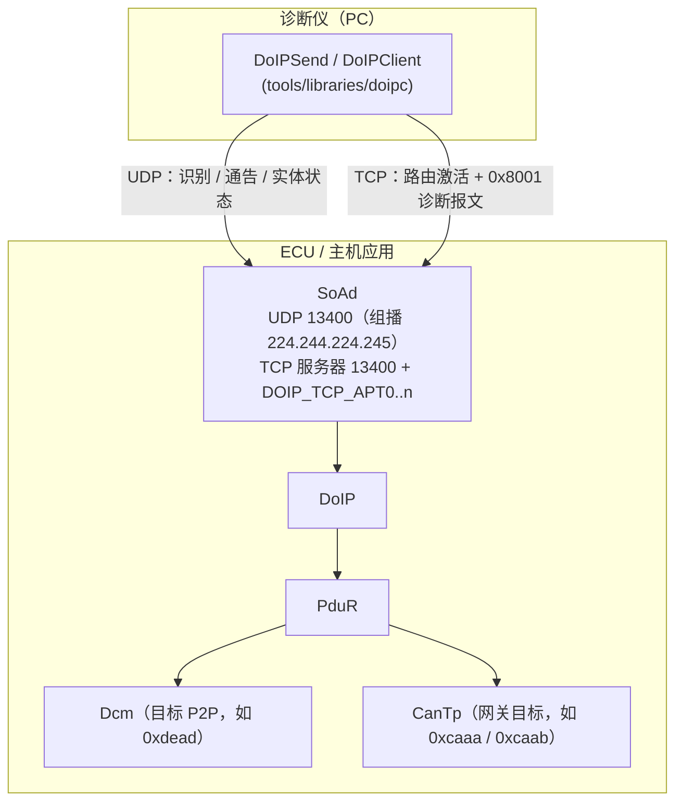
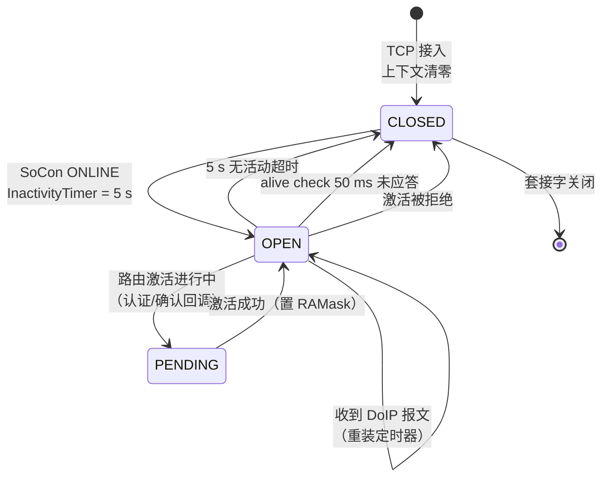
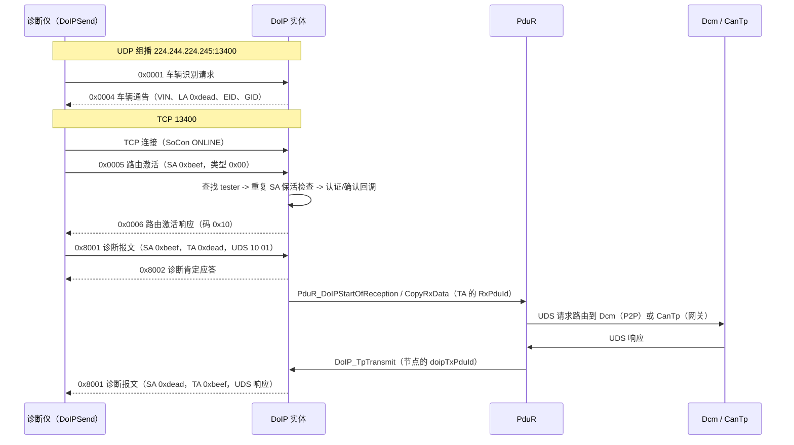
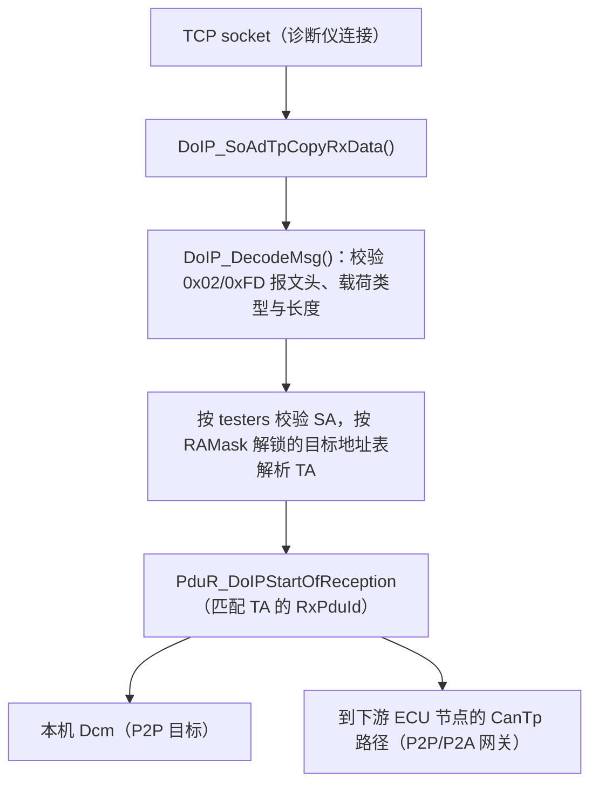
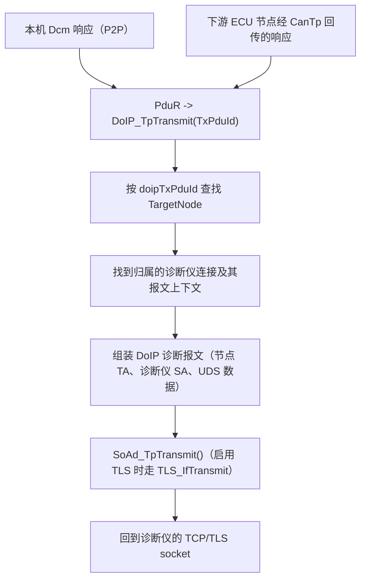
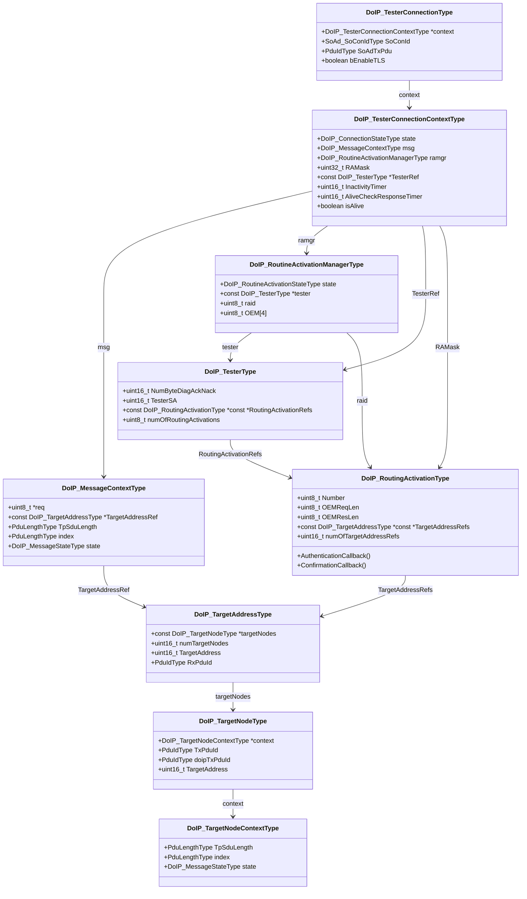

# DoIP - 以太网上的 UDS 诊断

> **一句话**：DoIP（Diagnostics over IP，ISO 13400 / AUTOSAR CP 4.4）在以太网上承载 UDS 诊断流量：诊断仪通过 UDP 组播发现 ECU，经 TCP 激活诊断路由，随后收发的 UDS 报文既可以在本机 Dcm 内终结，也可以作为网关经 CAN 转发给其他 ECU。

| | |
| --- | --- |
| 模块 | `infras/communication/DoIP`（v4.0.5） |
| 层次 | 通信服务，位于 SoAd 之上，与 PduR 对等 |
| 配置 | `Network.json` 中的 `DoIp` 模块（class `Net`）→ `tools/generator/DoIp.py` |
| 标准 | ISO 13400-2，AUTOSAR CP 4.4.0 SWS_DoIP |
| 诊断仪库 | `tools/libraries/doipc`（`DoIPClient`），命令行工具 `DoIPSend` |
| 演示 | 主机：`NetApp` + `DoIPSend` / `CanApp`；真实 ECU：`tc3x7 AsDemo` |

## 目录

1. [协议基础](#1-协议基础)
2. [在协议栈中的位置](#2-在协议栈中的位置)
3. [配置](#3-配置)
4. [运行时行为](#4-运行时行为)
5. [对外接口与调度](#5-对外接口与调度)
6. [构建与运行](#6-构建与运行)
7. [关键要点与易错点](#7-关键要点与易错点)
8. [排错](#8-排错)
9. [已知限制与代码审查发现](#9-已知限制与代码审查发现)
10. [相关文档](#10-相关文档)

## 1. 协议基础

每条 DoIP 报文都由 8 字节通用报文头加载荷组成：



版本字节必须为 `0x02` 和 `0xFD`（按位取反），否则会收到通用报文头否定应答（载荷类型 `0x0000`），见 [DoIP.c](../../infras/communication/DoIP/DoIP.c) 的 `DoIP_FillHeader()` / `DoIP_DecodeMsg()`。

已实现的载荷类型（见 [DoIP_Priv.h](../../infras/communication/DoIP/DoIP_Priv.h)）：

| 载荷类型 | 值 | 传输 | 作用 |
| --- | --- | --- | --- |
| 通用报文头 NACK | 0x0000 | UDP/TCP | 报文头错误 / 未知类型 / 长度非法 |
| 车辆识别请求 | 0x0001/0x0002/0x0003 | UDP | 广播识别、按 EID/VIN 识别 |
| 车辆通告 / VIN 响应 | 0x0004 | UDP | VIN(17) + LA + EID(6) + GID(6) + 同步状态 |
| 路由激活请求 / 响应 | 0x0005 / 0x0006 | TCP | 诊断仪请求开通诊断路由 |
| Alive check 请求 / 响应 | 0x0007 / 0x0008 | TCP | 连接保活监控 |
| 实体状态请求 / 响应 | 0x4001 / 0x4002 | UDP | 节点类型、最大/已开连接数 |
| 电源模式请求 / 响应 | 0x4003 / 0x4004 | UDP | 电源模式状态 |
| 诊断报文 | 0x8001 | TCP | UDS 请求（SA + TA + 用户数据） |
| 诊断报文肯定应答 | 0x8002 | TCP | 请求已接受并开始路由 |
| 诊断报文否定应答 | 0x8003 | TCP | SA 非法 / TA 未知 / 过大 / 不可达 / TP 错误 |

`0x0000` 通用报文头 NACK 的 1 字节载荷：`0x00` 协议非法、`0x01` 未知载荷类型、`0x02` 载荷过多、`0x03` 无缓冲、`0x04` 载荷长度非法。

路由激活响应码：`0x00` 未知 SA、`0x02` 连接已被占用、`0x03` SA 已激活、`0x04` 认证失败、`0x05` 确认被拒绝、`0x06` 不支持的激活类型、`0x10` 成功、`0x11` 等待确认。

诊断报文否定应答码：`0x02` SA 非法、`0x03` TA 未知、`0x06` 目标不可达、`0x08` TP 错误。

## 2. 在协议栈中的位置



套接字（由配置中的 `Discovery` / `MaxConnections` 生成，见 [Net.py ProcDoIp](../../tools/generator/Net.py)）：

* **UDP 13400**，组播组 `224.244.224.245`：车辆识别请求/响应与周期性车辆通告；
* **TCP 服务器 13400**：接受诊断仪连接，最多支持 `MaxConnections` 个并发诊断仪套接字（`DOIP_TCP_APT0..n`）。

DoIP 实体在应用调用 `DoIP_ActivationLineSwitchActive()`（[DoIP.c](../../infras/communication/DoIP/DoIP.c)）之前**保持静默**：在此之前收到的所有 DoIP 报文都会被静默丢弃，套接字也不会打开。真实 ECU 上该调用与 KL15/激活线状态绑定；主机模拟器应用中绑定在 **`d`** 按键（[Key.cpp](../../app/platform/simulator/src/Key.cpp)）。

## 3. 配置

DoIP 由 `Network.json`（class 为 `Net`）中的 `DoIp` 模块配置。以下示例取自 [app/app/config/Net/Network.json](../../app/app/config/Net/Network.json)：

```json
{
  "Name": "DoIp",
  "Class": "DoIp",
  "Discovery": "224.244.224.245:13400",
  "EnableTLS": false,
  "MaxConnections": 3,
  "Targets": [
    { "Name": "P2P",    "Address": "0xdead" },
    { "Name": "GW_P2P", "Address": "0xcaaa" },
    { "Name": "GW_P2A",  "Address": "0xcaab",
      "Nodes": [
        { "Name": "GW_P2A0", "Address": "0xcaa0" },
        { "Name": "GW_P2A1", "Address": "0xcaa1" }
      ]
    }
  ],
  "Routines": [
    { "Name": "default", "Number": "0x00", "Targets": ["P2P", "GW_P2P", "GW_P2A"] }
  ],
  "Testers": [
    { "Name": "default", "Address": "0xbeef", "Routines": ["default"] }
  ]
}
```

| 字段 | 含义 |
| --- | --- |
| `Discovery` | 车辆识别/通告使用的组播组与 UDP 端口 |
| `EnableTLS` | 是否在 DoIP TCP 连接外包裹 TLS（需要 TLS.json 配置和 mbedTLS），默认 `false` |
| `MaxConnections` | 诊断仪并发 TCP 连接上限，同时也是 TCP listen 队列长度 |
| `Targets[].address` | 诊断仪可以寻址的目标地址（TA） |
| `Targets[].nodes[]` | 可选：同一个 TA 由多个下游节点提供服务（一对多网关），每个节点有独立的 PduR 路由 |
| `Routines[]` | 路由激活类型（`Number`）及其开放的目标地址 |
| `Testers[]` | 受信任的诊断仪源地址（SA）及其允许激活的路由类型 |

生成器 [DoIp.py](../../tools/generator/DoIp.py) 据此产出 `DoIP_Cfg.c/.h`。JSON 只决定目标/节点、诊断仪与路由激活；其余参数大多**硬编码在生成代码里**：

| 生成值 | 数值 | 说明 |
| --- | --- | --- |
| `LogicalAddress` | `0xdead` | **硬编码**，不从 targets 推导，见易错点 7.1 |
| `NumByteDiagAckNack` | 8 | 0x8002/0x8003 应答最多回显 8 字节请求载荷 |
| `NodeType` | `DOIP_GATEWAY`（0x00） | 0x4001 实体状态响应上报的节点类型 |
| `EntityStatusMaxByteFieldUse` | `TRUE` | 实体状态带 4 字节最大长度字段（`MEMPOOL_NET_MAX_SIZE`） |
| `VinInvalidityPattern` | `0xFF` | `Dcm_GetVin` 失败时使用 |
| 初始/常规非活动超时 | 5000 ms | 5 秒无报文即关闭连接 |
| alive check 响应超时 | 50 ms | |
| 车辆通告 | 初始延时 50 ms、间隔 200 ms、共 3 次 | 发送失败（如 netif 未 up）则每个周期重试 |
| `MainFunctionPeriod` | 10 ms | JSON 键 `MainFunctionPeriod`，仅用于把上面的 ms 值换算成 tick |
| `RxPduIdToConnectionMap` | UDP → 非法，TCP i → 连接 i | 把 SoAd RxPduId 映射到诊断仪连接 |

### 3.1 PduR 路由：本机 Dcm 与 CAN 网关

诊断报文的去向由 [PduR.json](../../app/app/config/Net/PduR.json) 决定：

* **P2P（点对点）**：`DoIP <-> Dcm`，UDS 请求在本 ECU 内终结（目标 `0xdead`）；
* **GW_P2P**：`DoIP <-> CanTp`，转发给唯一的一个 CAN ECU（目标 `0xcaaa`）；
* **GW_P2A（point-to-any，一对多）**：一个 DoIP 目标（`0xcaab`）扇出到多个 CAN 节点（`0xcaa0`、`0xcaa1`……），共享 4096 字节路由缓冲区，由实际应答的节点回传响应。

### 3.2 必须提供的用户回调

生成代码以 `extern` 方式引用下列函数，应用**必须**实现它们，否则链接失败（参考实现：[app/app/src/doip.c](../../app/app/src/doip.c)）：

| 回调 | 用途 |
| --- | --- |
| `DoIP_<routine>_RoutingActivationAuthenticationCallback` | 每个路由激活类型一个；返回 `E_OK` 且 `*Authentified=TRUE` 表示通过，返回 `DOIP_E_PENDING` 表示稍后再答 |
| `DoIP_<routine>_RoutingActivationConfirmationCallback` | 确认回调，模式相同；`*Confirmed=TRUE` 后路由正式生效 |
| `DoIP_UserGetEID` / `DoIP_UserGetGID` | 6 字节实体标识 / 组标识 |
| `DoIP_UserGetPowerModeStatus` | 0x4004 上报的电源模式 |
| `DoIP_UserGetRoutingActivationResponseOem` | 返回 `E_OK` 时在 0x0006 响应后附加 4 字节 OEM 字段 |
| `Dcm_GetVin` | 识别与通告使用的 17 字节 VIN |

演示应用直接返回 `*Authentified = TRUE` / `*Confirmed = TRUE`；`DoIP_UserGetRoutingActivationResponseOem` 返回 `E_NOT_OK`，因此响应不带 OEM 字段。

### 3.3 TLS

当 `EnableTLS` 为 true 时，TCP 服务器套接字改由 TLS 层持有，证书文件由 [TLS.json](../../app/app/config/Net/TLS.json) 指定（[config/Net/Cert](../../app/app/config/Net/Cert) 下的 `TLS0_ServerCerts.pem`、`TLS0_ServerKey.pem`、`TLS0_CasCerts.pem`）。诊断仪侧通过 `-T` 参数传入 CA 证书 PEM 来校验服务端证书（客户端基于 mbedTLS，见 [doip_client.cpp](../../tools/libraries/doipc/src/doip_client.cpp)）。

## 4. 运行时行为

### 4.1 连接生命周期



定时器（均按 `DOIP_MAIN_FUNCTION_PERIOD` = 10 ms 换算成 tick）：`InitialInactivityTime` 5000 ms（新连接须在 5 秒内完成激活）、`GeneralInactivityTime` 5000 ms（每收到一条 DoIP 报文重装）、`AliveCheckResponseTimeout` 50 ms。

### 4.2 路由激活与诊断报文往返



### 4.3 UDS 报文接收（诊断仪 -> ECU）

所有诊断流量复用同一个 TCP 连接。DoIP 解码报文头，把 TA 解析为配置中的目标地址，并在该目标的 RxPduId 上启动一次 PduR TP 接收；随后 PduR 把组装完成的 UDS 报文路由给本机 Dcm（P2P）或一条/多条 CanTp 路径（网关）。



### 4.4 UDS 应答（ECU -> 诊断仪）

下游 UDS 响应经 PduR 进入 `DoIP_TpTransmit`。DoIP 通过 `doipTxPduId` 反查目标节点，找到此前发起该路由的诊断仪连接及其报文上下文，用节点 TA 与诊断仪 SA 重新组装诊断报文，并沿同一条 TCP（或 TLS）连接发回。若响应超过一个 `Net_Mem` 内存块，余下部分应由主函数中的 `doipHandleDiagMsgResponse()` 续发——见限制 9.1。



### 4.5 内部数据模型



## 5. 对外接口与调度

| API | 用途 |
| --- | --- |
| `DoIP_Init(ConfigPtr)` | 清零所有连接/目标节点上下文（配置取自生成的全局变量） |
| `DoIP_ActivationLineSwitchActive/Inactive()` | 打开/关闭 DoIP 套接字；激活前实体保持静默 |
| `DoIP_ActivationLineSwitch(InterfaceId, *Active)` | 查询并设置激活线（带 DET 校验，仅支持 1 个接口） |
| `DoIP_TriggerVehicleAnnouncement(InterfaceId)` | 重新发起 3 次车辆通告 |
| `DoIP_MainFunction()` | 非活动/保活定时器、车辆通告、响应续发、未完成的激活处理 |
| `DoIP_TpTransmit(TxPduId, PduInfoPtr)` | 由 PduR 调用，递交某目标节点的 UDS 响应 |
| `DoIP_RxIndication` / `DoIP_SoAdIfRxIndication` / `DoIP_SoAdTpStartOfReception` / `DoIP_SoAdTpCopyRxData` | SoAd 回调（UDP IF + TCP TP） |
| `DoIP_HeaderIndication(RxPduId, info, *payloadLength)` | 可选的 SoAd 报文头指示支持 |
| `DoIP_SoConModeChg(SoConId, Mode)` | SoAd 套接字状态变化回调 |
| `DoIP_GetVersionInfo()` | 4.0.5 |

调度：链接 DoIP 库后构建系统自动定义 `USE_DOIP`，[EcuM_Cfg.c](../../infras/system/EcuM/config/EcuM_Cfg.c) 随即在初始化列表中调用 `DoIP_Init()`，并在 `EcuM_DriverMainList`（每 10 ms 经 `EcuM_BswService()`）中周期调度 `DoIP_MainFunction()`。

调试日志：`AS_LOG_DOIP`（0，详细跟踪）与 `AS_LOG_DOIPE`（2，错误）。例如 `AS_LOG_DOIP=3`。

## 6. 构建与运行

### 6.1 主机实验

本章全部内容直接使用 OSAL 原生套接字在主机上运行，不需要 LWIP、VirtualBox 或 PCAP。

```sh
# ECU 侧：集成应用（SOME/IP + DoIP + CAN 协议栈）
scons --app=NetApp --os=OSAL

# CAN 边缘节点 ECU，用于响应网关转发（可选，对应 -t caaa/caab）
scons --app=CanApp

# 独立 DoIP 诊断仪
scons --app=DoIPSend
```

在主机应用中激活 DoIP：链接 DoIP 库后构建系统会自动定义 `USE_DOIP`，EcuM 已经会自动调用 `DoIP_Init()` 并周期调度 `DoIP_MainFunction()`。但应用仍需在运行时主动切换一次激活线——模拟器应用按 **`d`** 键（[Key.cpp](../../app/platform/simulator/src/Key.cpp)）；真实 ECU 集成则在 `EcuM_AL_EnterRUN()` 中调用 `DoIP_ActivationLineSwitchActive()`（见 [AsDemo main.c](../../app/platform/tc3x7/AsDemo/src/main.c)）：

```c
#ifdef USE_DOIP
  DoIP_ActivationLineSwitchActive();
#endif
```

运行：

```sh
# 终端 1：DoIP ECU（按 d 激活 DoIP）
build/nt/GCC/NetApp/NetApp.exe

# 终端 2（可选）：CAN 边缘节点
build/nt/GCC/CanApp/CanApp.exe -d simulator_v2

# 终端 3：诊断仪 - 向本机目标 0xdead 发送 UDS 10 01（进入默认会话）
build/nt/GCC/DoIPSend/DoIPSend.exe -v 1001
```

DoIPSend 会先在组播组上等待车辆通告，超时后改为主动发送车辆识别请求；随后打开 TCP 13400、完成路由激活、发送**一条** UDS 请求并打印响应。

> Windows 下诊断仪/ECU 应用需要把 `C:\msys64\mingw64\bin` 与 `build\nt\GCC\one`（`AsOne.dll`）加入 `PATH`。若收不到通告，请在**两侧**都设置 `AS_LOCAL_IP` 为同一块网卡（如 `127.0.0.1`）——网卡选择规则见 [virtual-can-env](virtual-can-env.md)。

### 6.2 DoIPSend 命令行

源码：[doip_send.c](../../tools/libraries/doipc/utils/doip_send.c)。

| 选项 | 默认值 | 含义 |
| --- | --- | --- |
| `-v <hex>` | （必填） | 十六进制字符串表示的 UDS 请求，如 `1001` 表示 DiagnosticSessionControl 默认会话 |
| `-i <ip>` | `224.244.224.245` | 车辆识别使用的 IP / 组播组 |
| `-p <port>` | `13400` | DoIP UDP/TCP 端口 |
| `-s <hex>` | `beef` | 诊断仪源地址（SA） |
| `-a <hex>` | `00` | 路由激活类型 |
| `-t <hex>` | `dead` | 目标地址（TA） |
| `-T <pem>` | 无 | CA 证书 PEM；指定后诊断仪使用 TLS（mbedTLS）连接 |

更多示例：

```sh
# 网关测试：UDS 10 01 经 CAN 路由给 TA 0xcaaa 的边缘节点
build/nt/GCC/DoIPSend/DoIPSend.exe -v 1001 -t caaa

# 加密连接（需先把 Network.json 中 EnableTLS 置为 true 并重新编译 NetApp）
build/nt/GCC/DoIPSend/DoIPSend.exe -v 1001 -T app/app/config/Net/Cert/TLS0_CasCerts.pem
```

除 CanApp 外，也可以用 Python 仿真下游 CAN ECU：[TestDoIP_CANTP_GW.py](../../app/app/config/Net/TestDoIP_CANTP_GW.py) 在 v2 组播 CAN 总线上模拟了两个 ISO-TP 响应节点（rxid/txid 为 0x7E0/0x7D0 和 0x7E1/0x7D1）。

PC 工具还可以通过 DoIPClient 库（[doip_client.h](../../tools/libraries/doipc/include/doip_client.h)）使用同样的客户端能力：`doip_create_client()`、`doip_await_vehicle_announcement()`、`doip_request()`、`doip_connect()`、`doip_activate()`、`doip_transmit()`。

### 6.3 真实 ECU 集成：AURIX TC3x7 AsDemo

[tc3x7 AsDemo](../../app/platform/tc3x7/AsDemo/SConscript) 是一个贴近量产形态的示例：DoIP 运行在以太网上，30 多个目标地址被网关路由到 CAN/CAN FD ECU（其中 P2A 目标 `MCANFD_E400` 还扇出到两个使用不同 CAN TxId 的节点）。DoIP 在启动时自动激活（[main.c](../../app/platform/tc3x7/AsDemo/src/main.c) 的 `EcuM_AL_EnterRUN`，`USE_DOIP` 条件内）。其 SConscript 中注册的诊断仪调用示例：

```sh
# 本机 ECU（TA 0xE400），诊断仪 SA 0x0E80
DoIPSend.exe -v 1001 -s 0x0E80 -t 0xE400
# 网关到 CAN TA 0x0724
DoIPSend.exe -v 1001 -s 0x0E80 -t 0x724
# 第二个诊断仪 SA，目标 TA 0x0757
DoIPSend.exe -v 1001 -s 0x0F00 -t 0x757
```

同一套协议栈的 Bootloader 版本见 [BL-DoIP.md](BL-DoIP.md)（主机）与 [BL-DoIP-QEMU.md](BL-DoIP-QEMU.md)（QEMU versatilepb + lwIP）。

## 7. 关键要点与易错点

* **激活前静默**：所有套接字只有在 `DoIP_ActivationLineSwitchActive()` 之后才会打开；此前所有请求被静默丢弃（`DOIP_E_NOT_OK_SILENT`）。
* **7.1 实体逻辑地址硬编码为 `0xdead`**（生成的 `DoIP_Config`）：如果主 P2P 目标地址不是 `0xdead`，通告/激活响应会通告错误的实体地址。要么保持实体地址与 P2P 目标一致，要么修改 `DoIp.py`。
* **5 秒非活动超时**：新连接必须在 5 秒内完成路由激活；已激活连接 5 秒无任何 DoIP 报文即被关闭。空闲较久的诊断仪必须能响应 alive check（`0x0007`，50 ms 内应答）。
* **一个 SA 只能属于一个连接**：同一诊断仪 SA 在第二个连接上激活时，会对第一个连接发起保活检查；若其应答，新激活被拒（`0x03`，SA 已激活）。
* **TCP 只收诊断报文**：TCP 上只接受 `0x8001` 诊断报文与路由激活/保活报文；识别/实体状态/电源模式只在 UDP 上。UDP 请求的响应固定从唯一的 UDP 套接字（`UdpConnections[0]`）发出。
* **应答回显长度**：0x8002/0x8003 最多回显 `NumByteDiagAckNack` = 8 字节原始请求。
* **TA 可达性受路由激活约束**：只有已激活路由类型解锁的 TA 才可寻址（经 `RAMask` 检查）；已配置但未解锁的 TA 返回 `0x06` 不可达，未配置的 TA 返回 `0x03`。
* **P2A 共享一块缓冲**：一对多目标的所有节点共享 4096 字节 PduR 缓冲；响应由实际应答的节点回传。
* **TLS 是编译期特性**：`EnableTLS` 需要 TLS 库（`USE_TLS`）与证书；否则诊断仪连接是明文 TCP。

## 8. 排错

| 现象 | 原因与处理 |
| --- | --- |
| DoIPSend 打印 `target is not reachable` | 没收到车辆通告：NetApp 未启动、DoIP 未激活（按 `d`）、两侧 `AS_LOCAL_IP` 选择的网卡不一致，或防火墙拦截组播 `224.244.224.245` |
| 路由激活响应码 `0x00`（未知 SA） | 诊断仪 SA 未列入 `Testers[]` |
| 路由激活响应码 `0x02` / `0x03` | 同一 SA 已在另一连接激活（保活检查有应答），或本连接已为其他 tester 激活 |
| 路由激活响应码 `0x04` / `0x05` | 应用的认证/确认回调拒绝了激活 |
| 路由激活响应码 `0x06` | 激活类型不支持；`-a` 必须匹配 `Routines[]` 中某个 `Number` |
| 0x8003 否定应答 `0x02` / `0x03` / `0x06` | SA 不匹配、TA 未配置，或 TA 已配置但未被当前激活的路由解锁 |
| 0x8003 否定应答 `0x08` | PduR/Dcm 缓冲问题（`StartOfReception`/`CopyRxData` 失败） |
| 激活后约 5 秒连接被断开 | 非活动超时——诊断仪不发数据时属正常；保持流量或响应 alive check 即可 |
| 网关测试（`-t caaa`）无响应 | CanApp 未运行（`-d simulator_v2`）、CAN ID 与 PduR.json 不匹配，或 P2A 缓冲被上一次未完成的请求占用 |
| TLS 握手失败 | `-T` 传入的 CA PEM 不对、证书过期，或 NetApp 重编译时未开 `EnableTLS` |
| 小的 UDS 响应正常、大的 UDS 响应收不到 | 超过一个 `Net_Mem` 内存的响应需要续发路径——见限制 9.1 |
| 链接错误 `DoIP_<name>_RoutingActivationAuthenticationCallback` 未定义 | `Routines[]` 里每个路由激活都需要应用实现两个回调 |

## 9. 已知限制与代码审查发现

功能限制：

* 仅支持单个 DoIP 实体（单配置、单 UDP 套接字）；`DoIP_ActivationLineSwitch` 只接受 `InterfaceId == 0`。
* 路由激活的认证按激活类型一票通过，没有按报文级的安全机制；需要时报文安全请用 SecOC，通道安全请用 TLS。
* 车辆通告始终通告完整 VIN/EID/GID；未实现 VIN/GID 管理（0x0008-0x0011 同步）。

代码审查发现（基于 v4.0.5，`infras/communication/DoIP/DoIP.c`）：

| # | 位置 | 发现 |
| --- | --- | --- |
| 1 | DoIP.c:1011 | `doipHandleDiagMsgResponse()` 在循环体开头就给 `connection` 赋值，导致外层（`NULL == connection`）与内层循环条件永远不成立——该函数永远找不到处于 `DOIP_MSG_TX` 状态的节点，实际上是死代码。后果：超过一个 `Net_Mem` 内存块大小的 UDS 响应（由 `DoIP_TpTransmit` 启动续发、置状态 `DOIP_MSG_TX`）永远不会续传完成——响应卡死 |
| 2 | DoIP.c:849 | `doipHandleAliveCheckResponse()` 解引用 `connection->context->TesterRef->TesterSA` 前没有判空；`TesterRef` 只有路由激活成功后才置位，因此在新建连接上收到一条未经请求的 `0x0008` 会造成空指针崩溃 |
| 3 | DoIP.c:501 | 路由激活允许 `payloadLength` 为 7（无 OEM），但 `memcpy(..., &msg->req[7], 4)` 无条件读取载荷之后 4 字节（越界读入 `ramgr.OEM`） |
| 4 | DoIP.c:733/810 | `sa`/`ta` 只在 `DOIP_MSG_IDLE` 分支赋值；TP 续发路径上发出 0x8003 否定应答时使用的是未初始化值 |
| 5 | DoIp.py:214 | 生成配置中的 `LogicalAddress` 硬编码为 `0xdead`，没有从配置的 targets 推导 |
| 6 | DoIP.c:265-280 | `doipFindRoutingActivation()` 命中后不跳出；若两个路由激活的 `Number` 相同，后面的会静默覆盖前面的 |
| 7 | DoIP.c:800-803 | 肯定应答被构造两次（先内联填充、随后 `doipReplyDiagMsg()` 整体覆盖）——冗余但无害 |
| 8 | DoIP.c:1276 | `DoIP_SoAdIfRxIndication()` 固定用 `UdpConnections[0]` 回复（代码有注释说明）——仅在当前单 UDP 套接字设计下成立 |
| 9 | DoIP.c:1065 | `DoIP_Init()` 忽略入参 `ConfigPtr`，直接使用全局 `DoIP_Config` |
| 10 | DoIP.c:73 | 报文头检查只接受版本 `0x02`；ISO 13400 还定义了 `0x03` 及 UDP 发现报文的 `0x0E..0x0F`——使用这些版本的诊断仪会收到报文头 NACK |

## 10. 相关文档

* [PduR](PduR.md) - 诊断报文的路由
* [Dcm](Dcm.md) - DoIP 背后的 UDS 处理
* [DoIP-CAN-Gateway](DoIP-CAN-Gateway.md) - 网关路由矩阵详解
* [BL-DoIP](BL-DoIP.md) / [BL-DoIP-QEMU](BL-DoIP-QEMU.md) - 基于 DoIP 的 Bootloader
* [TLS](TLS.md) / [HowToCreateCA](HowToCreateCA.md) - DoIP TCP 连接加密
