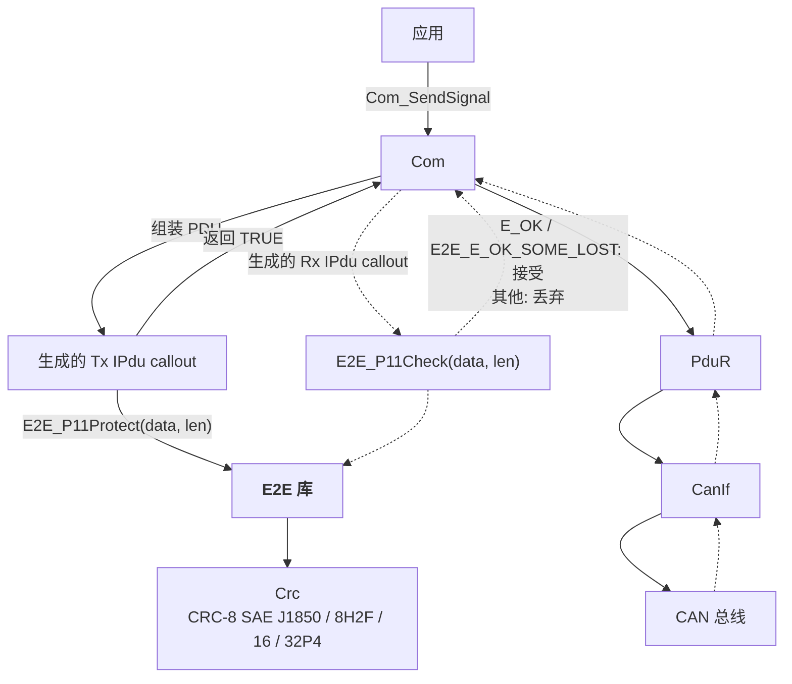
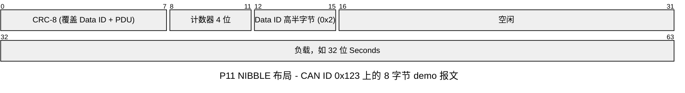
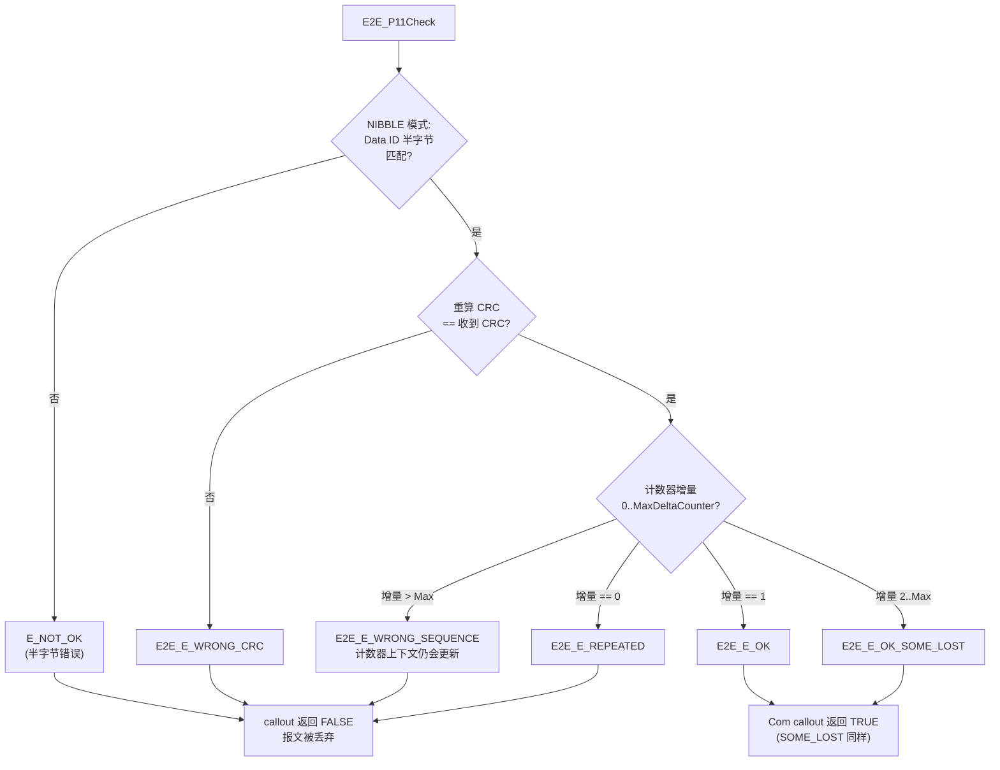
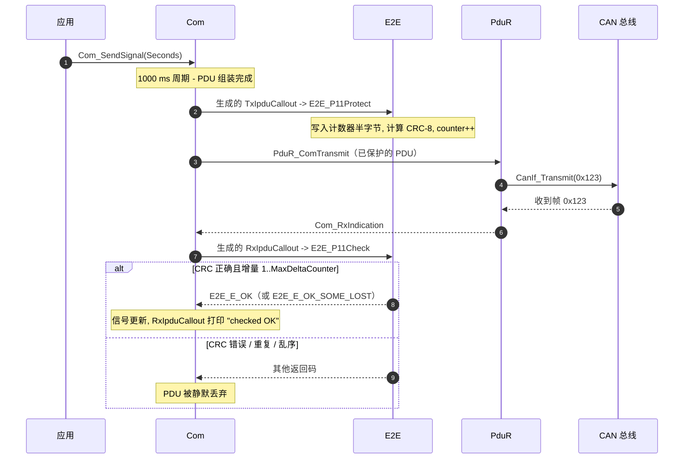

# E2E - 端到端保护

> **一句话概括：** E2E 为选定的 Com 报文追加 CRC 与 4 位序列计数器，使接收端
> 能够检测两个 ECU 之间任何位置发生的数据损坏、丢失、重复与乱序——它是功能
> 安全机制而非信息安全机制（无密钥、无 MAC；防攻击请用 [SecOC](SecOC.md)）。

| 项目 | 值 |
| --- | --- |
| 模块代码 | `infras/communication/E2E`（API：`infras/include/E2E.h`） |
| 所处层次 | 由 [Com](Com.md) 内部调用的**库**，不是独立的协议栈层 |
| 配置文件 | `app/app/config/E2E/E2E.json` + `Com.json` 中的 `"E2E"` 段 |
| 代码生成器 | `tools/generator/E2E.py` -> `GEN/E2E_Cfg.c` / `GEN/E2E_Cfg.h`；callout 代码由 `tools/generator/Com.py` 生成 |
| 规范依据 | AUTOSAR R23-11 PRS E2E Protocol（代码标注 `@PRS_E2E_*`），支持 P11 / P22 / P44 / P05 |
| 示例 | `scons --app=E2EDemoTx` / `E2EDemoRx` |

**目录**

1. [模块用途](#1-模块用途)
2. [在协议栈中的位置](#2-在协议栈中的位置)
3. [配置](#3-配置)
4. [运行时行为](#4-运行时行为)
5. [公开 API](#5-公开-api)
6. [构建与运行示例](#6-构建与运行示例)
7. [关键注意事项](#7-关键注意事项)
8. [问题排查](#8-问题排查)
9. [已知限制与代码评审发现](#9-已知限制与代码评审发现)
10. [相关文档](#10-相关文档)

---

## 1. 模块用途

安全功能读取一个信号前，必须知道该值是否就是发送端发出的值。故障可能来自
发送方软件、Com 协议栈、网关、收发器或线束上的 EMC 干扰——E2E 通过在 PDU
中放入两样东西来端到端地覆盖所有这些环节：

* **CRC** —— 对负载加（部分）Data ID 的校验和，任何比特损坏都能被发现；
* **序列计数器** —— 4 位（P11/P22）、16 位（P44）或 8 位（P05）计数器，
  用于检测丢失、重复与乱序。

接收端将校验结论与自己的计数器历史比对，返回 `E2E_E_OK`、
`E2E_E_OK_SOME_LOST`、`E2E_E_REPEATED`、`E2E_E_WRONG_CRC`、
`E2E_E_WRONG_SEQUENCE` 之一。只有 `E2E_E_OK` 与 `E2E_E_OK_SOME_LOST` 视为
"接受数据"。

已实现 4 个 Profile：

| Profile | CRC | 计数器 | Data ID 保护方式 | 典型用途 |
| --- | --- | --- | --- | --- |
| **P11** | CRC-8 SAE J1850 | 4 位，0..14 | 16 位或 12 位（NIBBLE 模式仅 4 位上总线） | 8 字节经典 CAN 报文 |
| **P22** | CRC-8H2F | 4 位 | 16 项 Data ID 列表 | 小报文，Data ID 随计数器轮换 |
| **P44** | CRC-32P4 | 16 位 | 32 位，随 PDU 携带 | 大报文/CAN FD，同时携带长度 |
| **P05** | CRC-16 | 8 位 | 16 位，仅进 CRC | CRC 与计数器字节对齐的报文 |

仓库现有配置（`config/E2E/E2E.json` 与各 demo）只使用了 **P11**；其余三个
Profile 只有在配置后才会参与编译。

---

## 2. 在协议栈中的位置

E2E 不是一个协议栈层。它是一个库，Protect/Check 调用由 Com 生成器**生成到
Com 的 IPdu callout 中**，数据通路本身不变：



实际效果：

* 除这个小库之外，**无需额外链接任何 BSW 模块**；PduR 路由表完全不知道 E2E。
* **没有 MainFunction** —— 保护在 `Com_TriggerIPDUSend` / `Com_RxIndication`
  中同步执行。
* 应用层照常收发信号，什么都不用做。

---

## 3. 配置

E2E 需要**两个**文件，且二者必须互相一致：

1. `E2E.json` —— Profile 参数（CRC 偏移、计数器偏移、Data ID）；
2. `Com.json` —— 哪条报文使用哪个 Profile。

### 3.1 `E2E.json`

`app/app/config/E2E/E2E.json`（各 demo 有独立副本）：

```json
{
    "Class": "E2E",
    "ProtectP11": [
        { "Name": "MSG_TIME", "DataID": "0x1234", "DataIDMode": "NIBBLE",
          "CRCOffset": 0, "CounterOffset": 8, "DataIDNibbleOffset": 12 }
    ],
    "CheckP11": [
        { "Name": "MSG_TIME", "DataID": "0x5678", "DataIDMode": "NIBBLE",
          "CRCOffset": 48, "CounterOffset": 56, "DataIDNibbleOffset": 60 }
    ]
}
```

| 键 | 适用 | 含义 |
| --- | --- | --- |
| `Class` | 全部 | 选择 `E2E.py` |
| `ProtectP11[]` / `ProtectP22[]` / `ProtectP44[]` / `ProtectP05[]` | 全部 | 每条被保护报文一项；**`Name` 必须等于 Com 报文名**（生成器生成 `E2E_PROTECT_P11_<NAME>`，Com 按报文名查找） |
| `CheckP11[]` / `CheckP22[]` / `CheckP44[]` / `CheckP05[]` | 全部 | 每条被校验报文一项，命名规则相同（`E2E_CHECK_P11_<NAME>`） |
| `DataID` | 全部 | P11/P05：16 位；P22：改用 16 项 `DataIDList[]`；P44：32 位 |
| `DataIDMode` | P11 | `BOTH`、`ALT`、`LOW` 或 `NIBBLE`，见 4.1 节 |
| `CRCOffset` | P11 | CRC 字节的比特偏移，默认 `0` |
| `CounterOffset` | P11 | 4 位计数器的比特偏移，默认 `8` |
| `DataIDNibbleOffset` | P11 | 4 位 Data ID 半字节的比特偏移（仅 NIBBLE 模式），默认 `12` |
| `Offset` | P22/P44/P05 | CRC 的比特偏移（P22：计数器在随后的半字节），默认 `0` |
| `MaxDeltaCounter` | 所有 Check 项 | 允许的最大计数器增量；默认 `1`（丢一帧即 `E2E_E_WRONG_SEQUENCE`） |
| `UsePostBuildConfig` | 全部 | 默认 `false`；生成 `E2E_USE_PB_CONFIG`（其占位宏误名为 `cantpConfig`，见第 9 节） |

所有偏移单位均为**比特**，不是字节。

### 3.2 `Com.json` 接线

```json
{
  "Class": "Com",
  "E2E": "E2E.json",
  "Networks": [
    {
      "Name": "CAN0", "...": "...",
      "EnableMessageTxCallout": true,
      "Messages": [
        { "Name": "MSG_TIME", "Id": "0x123", "Dlc": 8, "Node": "AS", "...": "..." }
      ],
      "E2E": [ { "Name": "MSG_TIME", "Profile": "P11" } ]
    }
  ]
}
```

`Com.py` 中发生三件事：

1. 顶层 `"E2E": "<路径>"` 从指定 JSON 加载 Profile 参数并合并进报文条目；
2. 网络级 `E2E[]` 数组把报文名映射到 Profile（`P11`、`P22`、`P44`、`P05`）；
   `Node` 等于网络 `Me` 的报文走 **Protect**，其余走 **Check**；
3. 对每个映射的报文，生成器写出完整的 IPdu callout：

```c
/* 生成到 GEN/Com_Cfg.c，包裹在 #ifdef USE_E2E 中 */
boolean CAN0_MSG_TIME_TX_TxIpduCallout(PduIdType PduId, const PduInfoType *PduInfoPtr) {
  Std_ReturnType ret;
  ret = E2E_P11Protect(E2E_PROTECT_P11_MSG_TIME, PduInfoPtr->SduDataPtr,
                       PduInfoPtr->SduLength);
  return (E_OK == ret);
}

boolean CAN0_MSG_TIME_RX_RxIpduCallout(PduIdType PduId, const PduInfoType *PduInfoPtr) {
  Std_ReturnType ret;
  ret = E2E_P11Check(E2E_CHECK_P11_MSG_TIME, PduInfoPtr->SduDataPtr,
                     PduInfoPtr->SduLength);
  return ((E_OK == ret) || (E2E_E_OK_SOME_LOST == ret));
}
```

如果报文同时声明了自己的 `TxIpduCallout` / `RxIpduCallout` **和** E2E 映射，
生成器会用 E2E 版本覆盖你的 callout——同一个 callout 无法两者兼得。

### 3.3 生成代码

`GEN/E2E_Cfg.h` 为每个 Profile 条目定义一个宏，且只为 JSON 中出现的 Profile
开启编译开关：

```c
#define E2E_USE_PROTECT_P11
#define E2E_PROTECT_P11_MSG_TIME 0u
#define E2E_USE_CHECK_P11
#define E2E_CHECK_P11_MSG_TIME   0u
```

`GEN/E2E_Cfg.c` 为每个条目持有一个上下文变量（计数器）和一个配置结构体；
`E2E_Config` 按 Profile 顺序聚合（P11 protect、P11 check、P22 protect、……
P05 check）。

`E2E_Init(NULL)` 由 EcuM 在启动时调用
（`infras/system/EcuM/config/EcuM_Cfg.c`），把所有计数器上下文清零并清除
`bSynced` 标志。

---

## 4. 运行时行为

### 4.1 P11 总线格式

以 demo 配置（NIBBLE 模式，`CRCOffset 0`、`CounterOffset 8`、
`DataIDNibbleOffset 12`、`DataID 0x1234`）为例，8 字节报文如下：



* 字节 0：CRC-8 SAE J1850，输入为除 CRC 字节外的**整个** PDU，种子按
  `DataIDMode` 由 Data ID 字节构成；
* 字节 1 低半字节：序列计数器 0..14（从 14 回绕到 0，15 非法）；
* 字节 1 高半字节：Data ID 的高半字节（仅 NIBBLE 模式）——低字节 `0x34`
  从不上总线，只参与 CRC。

`DataIDMode` 决定 CRC 种子内容（`E2E.c` 的 `E2E_ComputeP11Crc`）：

| 模式 | CRC 种子 | 上总线内容 |
| --- | --- | --- |
| `BOTH` | Data ID 低字节 + 高字节 | 无 |
| `ALT` | 按计数器奇偶轮流取低字节/高字节 | 无 |
| `LOW` | 仅低字节 | 无 |
| `NIBBLE` | 低字节 + 一个零字节 | 高字节的 4 位 |

### 4.2 Protect（发送）

`E2E_P11Protect` 在 PDU 缓冲区上**就地**执行三步：

1. NIBBLE 模式：清零 Data ID 半字节并写入 `(DataID >> 8) & 0xF`；
2. 清零计数器半字节并写入上下文计数器；
3. 计算 CRC 并写到 `CRCOffset`；随后计数器自增（到 14 回绕）。

Com 生成器在 PDU 交给 PduR 之前的 Tx IPdu callout 中调用它。

### 4.3 Check（接收）



重要细节：

* 初始化后的**第一帧**按增量 1 处理（直接接受）。
* 每个 CRC 正确的帧都会更新计数器上下文——即使是 `WRONG_SEQUENCE` 的帧——
  因此一连串丢帧后，只要来了一帧增量 <= `MaxDeltaCounter` 就会重新同步。
* `E2E_E_REPEATED`（增量 0）CRC 是对的，但生成的 callout 仍然丢弃该帧。
* Check 从不修改负载——收到的 CRC 字节只用于比较。

### 4.4 一次完整收发



---

## 5. 公开 API

| 函数 | 用途 |
| --- | --- |
| `E2E_Init(config)` | 复位计数器/同步标志；EcuM 传入 `NULL` 调用 |
| `E2E_P11Protect(profileId, data, length)` | 就地追加 CRC + 计数器（P11） |
| `E2E_P11Check(profileId, data, length)` | 校验 CRC + 计数器（P11） |
| `E2E_P22Protect` / `E2E_P22Check` | Profile 22，CRC-8H2F + Data ID 列表 |
| `E2E_P44Protect` / `E2E_P44Check` | Profile 44，CRC-32P4、16 位计数器，长度与 Data ID 随 PDU 携带 |
| `E2E_P05Protect` / `E2E_P05Check` | Profile 05，CRC-16、8 位计数器 |

返回码（`E2E.h`）：`E2E_E_OK`、`E2E_E_OK_SOME_LOST`（0xE0）、
`E2E_E_REPEATED`（0xE1）、`E2E_E_WRONG_CRC`（0xE2）、`E2E_E_WRONG_SEQUENCE`
（0xE3）。状态机返回码（`E2E_E_SM_*`）已定义，但对应的 E2E SM API 未实现。

`profileId` 是生成的 `E2E_PROTECT_P<xx>_<NAME>` / `E2E_CHECK_P<xx>_<NAME>`
索引——不要手写数字。

---

## 6. 构建与运行示例

### 6.1 示例应用

| 应用 | 方向 | 配置 / 源码 |
| --- | --- | --- |
| `E2EDemoTx` | 用 P11 NIBBLE 保护 `MSG_TIME` | [`config/E2E/DemoTx`](../../app/app/config/E2E/DemoTx) |
| `E2EDemoRx` | 校验 `MSG_TIME` | [`config/E2E/DemoRx`](../../app/app/config/E2E/DemoRx) |

两者收发 `MSG_TIME`，CAN ID `0x123`，8 字节，一个 32 位 `Seconds` 信号，
周期 1000 ms。各目录包含 `E2E.json`、`Com.json`、`PduR.json`、`CanIf.json`
与胶水源码（`e2etx_demo.c` / `e2erx_demo.c`）。应用**不实现任何 callout**
——callout 全部由生成器产出。

```bash
scons --app=E2EDemoTx -j8
scons --app=E2EDemoRx -j8
```

### 6.2 预期输出

先启动接收端，再启动发送端（虚拟 CAN，bus 0）：

```
INFO    :[DemoTx] E2E P11 transmit demo, MSG_TIME on CAN ID 0x123
DEMO    :[DemoTx] send MSG_TIME.Seconds=604796
```

接收端——打开 `AS_LOG_E2E=2` 后，库会 dump 每个被校验的 PDU：

```
INFO    :[DemoRx] E2E P11 receive demo, MSG_TIME on CAN ID 0x123
E2E     :[0]: P11 crc=0x81 DataId=0x1234 Mode=3 Counter=0
  00000000 81 20 00 00 00 09 3A 7C
DEMO    :[DemoRx] MSG_TIME checked OK, Seconds=604796
E2E     :[0]: P11 crc=0xc1 DataId=0x1234 Mode=3 Counter=128
  00000000 C1 21 00 00 00 09 3A 7D
DEMO    :[DemoRx] MSG_TIME checked OK, Seconds=604797
```

如何解读 dump：

* 字节 0 是 CRC（随计数器与负载变化）；
* 字节 1 = `0x20`、`0x21`、`0x22`、…… 高半字节 `2` 是 Data ID 高半字节，
  低半字节是计数器 0、1、2、……；
* 字节 4..7 是 `Seconds` 负载。

日志中的 `Counter=128, 129, ...` 是 Check 上下文：bit7 是内部
`E2E_CHECK_DONE_ONCE` 标志，低半字节是最近一次接受的计数器。

### 6.3 验证保护确实生效

停掉发送端、在 `e2etx_demo.c` 中改动负载内容，或直接重放旧帧：接收端不再
打印 "checked OK"，打开 `AS_LOG_E2EE=2` 后 `E2EE` 日志会给出原因——
`P11 Wrong Crc`、`P11 repeat` 或 `P11 wrong sequence`。

---

## 7. 关键注意事项

* **E2E 在两处配置**（`E2E.json` + `Com.json`），Profile 条目的 `Name` 必须
  等于 Com 报文名，否则生成期直接报
  `E2E profile P11 <name> for <msg> is not configured`。
* **所有偏移单位是比特。** `CRCOffset 48` 指的是第 6 字节。
* **P11/P22 计数器只有 4 位且 14 -> 0 回绕**（按规范 0xF 非法）。100 ms 周期
  下只有 1.4 秒历史——`MaxDeltaCounter` 应保持较小。
* **`MaxDeltaCounter` 默认为 1。** 默认值下丢一帧后，下一帧会因
  `E2E_E_WRONG_SEQUENCE`（增量 2 > 1）被丢弃，但计数器上下文已更新，因此再
  下一帧重新被接受。若设计允许偶发丢帧，请把 `MaxDeltaCounter` 设为允许的
  丢失预算。
* **生成的 callout 会覆盖自定义 callout。** 同一报文无法在同一个 callout 里
  既做用户逻辑又做 E2E 校验；两者都要时，请在自己的 callout 里手动调用
  `E2E_PxxCheck`，不要用映射。
* **`E2E_E_OK_SOME_LOST` 必须当作 `E_OK` 接受**——生成的 callout 已经这样
  处理；直接调用 `E2E_P11Check` 的代码不要遗漏。
* **Protect 就地修改缓冲区。** CRC 写进的就是 Com 的 TX 缓冲区——不要再把
  需要保持原样的缓冲区传给 Protect。
* **P44 在 `Offset` 处写入长度、计数器、Data ID 和 CRC**——负载至少要有
  `Offset/8 + 12` 字节，应用不得占用这些字节。
* **P11 以外的 Profile 只有配置后才会编译。** `#ifdef` 开关意味着配置里没有
  P05 条目却引用 P05 会得到链接错误而非运行时错误。

---

## 8. 问题排查

| 现象 | 可能原因 |
| --- | --- |
| 生成失败：`E2E profile P11 <name> for <msg> is not configured` | `CheckP11[]`/`ProtectP11[]` 条目的 name 与 `Com.json` 报文名不一致 |
| 生成失败：`KeyError: 'DataIDList'` | P22 条目缺少 `DataIDList` |
| 接收端每帧都打 `P11 Wrong Crc` | 两端 `CRCOffset`、`DataIDMode`、`DataID` 或负载布局不一致——所有偏移必须逐比特一致 |
| 每丢一帧后就打 `P11 wrong sequence` | `MaxDeltaCounter` 太小（默认 1） |
| 接收端打 `P11 Nibble <x> not correct` | NIBBLE 模式：收到字节的 Data ID 高半字节与接收端 `(DataID >> 8) & 0xF` 不符 |
| 明明该 CRC 失败却全部通过 | 你看的是发送端——只有 Check 产生结论 |
| `E2E_CheckProfile05Configs` 链接错误 | 生成器缺陷：`E2E_USE_CHECK_P05` 只在 `CheckP44` 非空时生成（见第 9 节） |
| 帧被丢弃且没有任何 E2E 日志 | 打开 `AS_LOG_E2EE=2`；同时确认报文在 `Com.json` 中确有 `E2E` 映射 |

---

## 9. 已知限制与代码评审发现

### 9.1 功能限制

* **没有 E2E 状态机（SM）API。** `E2E.h` 定义了 `E2E_E_SM_*` 返回码，但
  `E2E_PxxCheck` 是裸用的；没有 `E2E_ExxxCheckSMInitialize`，没有状态窗口，
  除"首帧规则"外也没有数据过期跟踪。
* **仓库中只有 P11 被使用和验证**；P22/P44/P05 未配置时不参与编译。
* **没有变换层（E2EXf）**——被保护的 PDU 就是 Com 的 PDU；SWC 层面没有
  "E2E 头"与信号负载的分离。
* **除 CRC 字节外的整个 PDU 都参与 CRC**——对 P11 符合 Profile 示例，但也
  意味着 Com 层任何变化（填充、DLC）都会改变 CRC；两端 DLC 必须完全一致。
* **每个条目只有一个计数器上下文变量**——对单线程的 Com 主函数没问题，但
  若从不同上下文调用 Protect/Check 则不安全。

### 9.2 代码评审发现

| # | 位置 | 发现 |
| --- | --- | --- |
| 1 | `E2E.py:49` | **`E2E_USE_CHECK_P05` 只在 `CheckP44` 非空时生成**（`if len(cfg.get("CheckP44", [])):` 应为 `CheckP05`）。只配 P05 校验、不配 P44 时该宏永远不会定义，`E2E_P05Check` 不参与编译，而 `E2E_Cfg.c` 仍引用 `E2E_CheckProfile05Configs`——直接编译失败。 |
| 2 | `E2E.c:318` | `E2E_P22Protect` 校验的是 `profileId < numOfProtectP11`——从 P11 复制粘贴的错误。P11 与 P22 同时配置时边界错误（`numOfProtectP22 > numOfProtectP11` 时放行越界 id，否则拒绝合法 id）；只配 P22 时该结构体成员甚至不存在。 |
| 3 | `E2E.c:462` | `E2E_P44Check` 使用 `offset = config->P44.Offset`，漏了 `>> 3`，而 `E2E_P44Protect` 用的是 `Offset >> 3`。任何非零（或非字节对齐）的偏移都会让 Check 从错误的字节读长度/计数器/DataID/CRC。demo 之所以正常，仅仅因为 `Offset = 0`。 |
| 4 | `E2E.c:16` | `E2E_USE_PB_CONFIG` 下 `#define E2E_CONFIG cantpConfig`——占位宏沿用了 CanTp 模块名（复制粘贴痕迹）。单独对 E2E 做 post-build 构建会链接失败。 |
| 5 | `E2E.c:49-60` | `ALT` 模式下计数器为奇数时代码混入 Data ID **低**字节，而其自身注释（及 `PRS_E2E_00634` 变体 1B）说偶数计数器取低字节。Protect 与 Check 共用该函数，SSAS 对 SSAS 永远一致，但与符合规范的协议栈互通时奇数计数器会校验失败。 |
| 6 | `E2E.c:289-307` | `E2E_E_WRONG_SEQUENCE` 之后计数器上下文仍用收到的值更新。这是有意为之（快速重同步），但与要求显式 `E2E_ExxxCheckSM...` 重启的更严格实现不同，功能安全论证中需要说明。 |
| 7 | `E2E.c:465` | P44 长度检查是 `(ReceivedLength < length)` 即失败，正确的要求应是相等；比携带长度**长**的帧反而通过。 |
| 8 | `Com.py:583-614` | 只要报文有 `E2E` 键且相应 `TxIpduCallout`/`RxIpduCallout` 名字已设置就会生成 E2E callout——用户同名 callout 会在链接期撞符号（重复定义），而不是在生成期被拒绝。 |
| 9 | `E2E.c:220` | P11 计数器按规范在 14 后回绕（`> 0x0E`）；但配置中的 `MaxDeltaCounter` 可以大于 15 而没有范围校验，会让 `E2E_E_WRONG_SEQUENCE` 永远不可能出现。 |
| 10 | `E2E.py:118,134` | 对 JSON 的 `DataIDList` 执行 `eval(str(dl))`——数字列表没问题，但配置文件中嵌入的任意 Python 代码也会被执行。 |

---

## 10. 相关文档

* [Com](Com.md) —— 在 IPdu callout 中调用 Protect/Check 的模块
* [SecOC](SecOC.md) —— 防攻击的密码学保护（E2E 只检测故障，不检测攻击）
* [CanIf](CanIf.md) / [PduR](PduR.md) —— 不变的传输路径
* 代码：[E2E.c](../../infras/communication/E2E/E2E.c)、
  [E2E_Priv.h](../../infras/communication/E2E/E2E_Priv.h)、
  [E2E.h](../../infras/include/E2E.h)、
  [E2E.py](../../tools/generator/E2E.py)、
  [Com.py](../../tools/generator/Com.py) 中的 callout 生成逻辑
* AUTOSAR R23-11 - PRS_E2EProtocol
