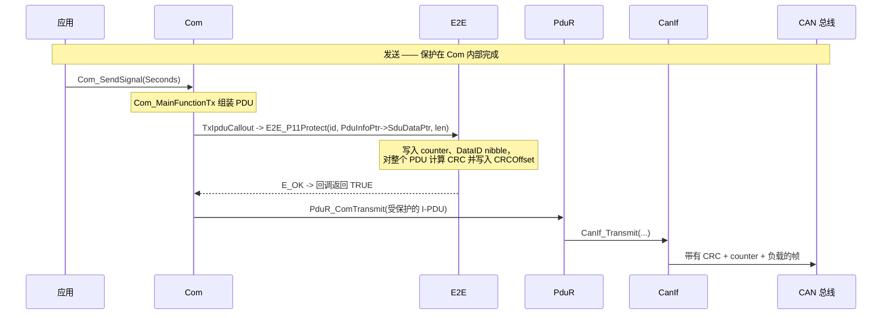
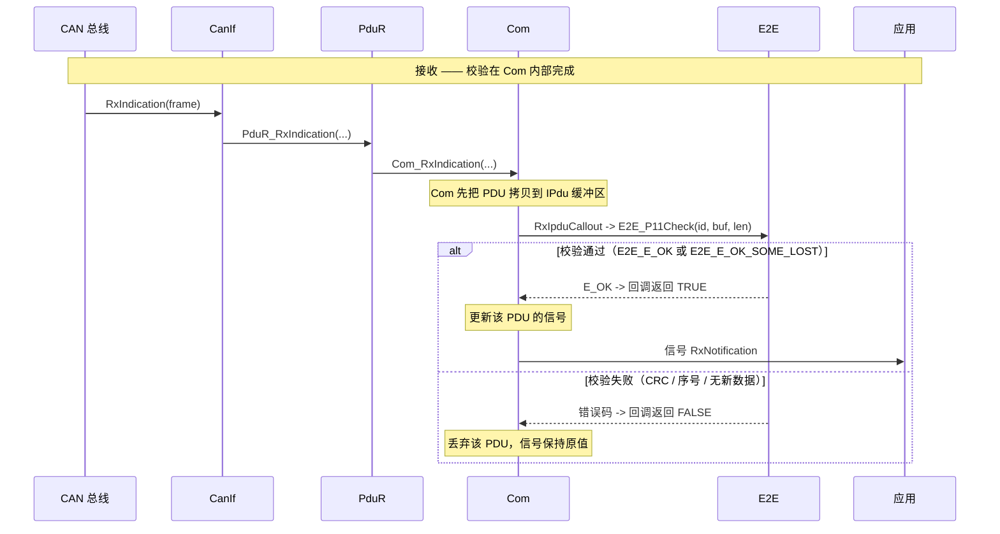
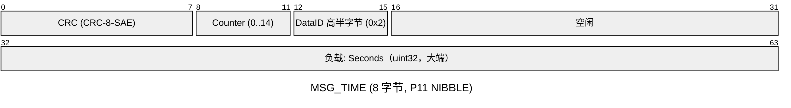
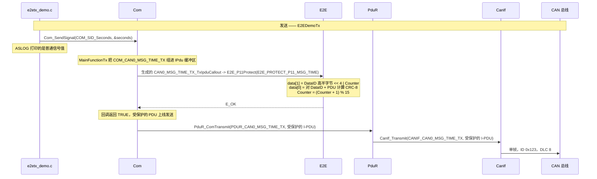
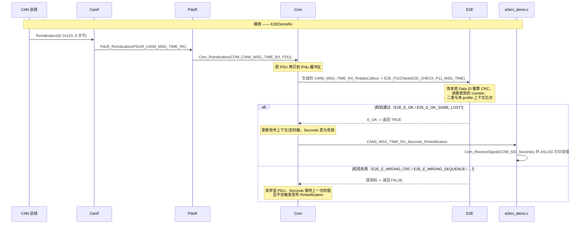

# AUTOSAR E2E - 端到端保护概览

**E2E**（End-to-End Protection，端到端保护）用于保护安全相关的通信，防御**两个软件组件之间整条路径上**可能出现的故障：ECU 内部的数据损坏、网关中的损坏、总线上的损坏，以及报文丢失、重复、延迟和乱序。与 SecOC 不同，E2E **不是**安全机制——它不使用密钥、不做认证，只是让故障变得**可检测**，以便消费方丢弃不可信的数据。

在 AS 中，E2E **不是一个由 MainFunction 驱动的独立 BSW 模块**，而是位于 `infras/communication/E2E` 的一个小型库，其 Protect/Check 函数**由 Com 内部调用**，且 Com 生成器会自动把这些调用写入 Com IPdu 回调（callout）。也就是说，一条受 E2E 保护的报文**不需要在协议栈中增加任何模块**：数据通路仍然是 `Com → PduR → CanIf`，保护逻辑只是挂在 Com IPdu 上的一个回调钩子。

- 实现：[infras/communication/E2E/E2E.c](../../infras/communication/E2E/E2E.c)
- 头文件：[infras/include/E2E.h](../../infras/include/E2E.h)
- 私有配置类型：[infras/communication/E2E/E2E_Priv.h](../../infras/communication/E2E/E2E_Priv.h)
- 生成器：[tools/generator/E2E.py](../../tools/generator/E2E.py)（profile 配置）与 [tools/generator/Com.py](../../tools/generator/Com.py)（回调生成）
- 演示应用：[E2EDemoTx / E2EDemoRx](../../app/app/config/E2E)

## 1. 核心概念

### 1.1 设计目标
- 检测整条端到端路径上的数据损坏（而不只是某一段总线）
- 通过序号计数器检测报文丢失、重复、延迟与乱序
- 通过 Data ID 区分报文的发送方/消费方
- 尽可能不改变负载：保护字段按配置的比特偏移放置
- 不进入安全域——E2E 与 SecOC 互补，而非替代

### 1.2 关键术语

| 术语 | 说明 |
|---|---|
| E2E profile | 具有确定头部布局与算法的保护方案（P11、P22、P44、P05 等） |
| CRC | 对 PDU（及 Data ID）计算的校验和，用于检测损坏 |
| Counter | 4 位（P11/P22）或 8/16 位（P05/P44）序号，检测丢失/重复/乱序 |
| Data ID | 报文的 16 位标识，用于区分使用同一 profile 的不同 PDU |
| Protect | 发送侧：把 CRC/counter/Data ID 写入 PDU |
| Check | 接收侧：把 CRC/counter/Data ID 与本 profile 上下文比对 |
| Offset | 字段在 PDU 中的比特位置（E2E 的所有偏移都以**比特**为单位） |

### 1.3 支持的 Profile

| Profile | CRC | 计数器宽度 | PDU 中的头部字段 | 配置字段 |
|---|---|---|---|---|
| **P11** | CRC-8-SAE J1850 | 4 位（0..14 循环） | CRC、counter、Data ID nibble（依模式而定） | `DataID`、`DataIDMode`、`CRCOffset`、`CounterOffset`、`DataIDNibbleOffset` |
| **P22** | CRC-8H2F | 4 位 | CRC、counter | `Offset`、`DataIDList` |
| **P44** | CRC-32P4 | 16 位 | 长度 + counter + Data ID + CRC | `DataID`、`Offset` |
| **P05** | CRC-16 | 8 位 | CRC、counter | `DataID`、`Offset` |

`E2E.py` 接受五个顶层键，每个都是一组 profile 列表：`ProtectP11`、`CheckP11`、`ProtectP22`、`CheckP22`、`ProtectP44`、`CheckP44`、`ProtectP05`、`CheckP05`。**profile 的名字必须等于它所保护的 Com 报文名**——`Com.py` 正是据此进行匹配的（见 4.2 节）。

P11 的 `DataIDMode` 决定 Data ID 如何参与 CRC 以及是否出现在 PDU 中：

| 模式 | CRC 中的 Data ID | PDU 中的 Data ID |
|---|---|---|
| `BOTH` | 先低字节、再高字节 | 不出现 |
| `ALT` | 偶数 counter 用低字节，奇数 counter 用高字节 | 不出现 |
| `LOW` | 仅低字节 | 不出现 |
| `NIBBLE` | 低字节 | **高半字节**放在 `DataIDNibbleOffset` |

### 1.4 与 AUTOSAR 协议栈的集成

E2E 由 Com 调用，因此数据通路中**不增加任何模块**。Com IPdu 回调是收发两个方向唯一的扩展点：

| 方向 | 路径 | E2E 执行位置 |
|---|---|---|
| **发送** | Com → PduR → CanIf | `TxIpduCallout`（在 `PduR_ComTransmit` 之前），调用 `E2E_<P>Protect` |
| **接收** | CanIf → PduR → Com | `RxIpduCallout`（报文接收之后），调用 `E2E_<P>Check` |





分步的详细流程见第 2 节的两个演示：
- **发送演示（E2EDemoTx）**——见 [2.2](#22-发送演示--e2edemotx)；
- **接收演示（E2EDemoRx）**——见 [2.3](#23-接收演示--e2edemorx)。

## 2. 演示概览

本仓库中所有 E2E 配置都组织为**恰好两种演示**——一个发送应用和一个接收应用——两者之间传递**一条**受 E2E 保护的报文：

| # | 类型 | 应用 | 保护逻辑所在位置 |
|---|---|---|---|
| 1 | **发送演示** | [E2EDemoTx](../../app/app/config/E2E/DemoTx) | 生成的 `CAN0_MSG_TIME_TX_TxIpduCallout` → `E2E_P11Protect` |
| 2 | **接收演示** | [E2EDemoRx](../../app/app/config/E2E/DemoRx) | 生成的 `CAN0_MSG_TIME_RX_RxIpduCallout` → `E2E_P11Check` |

两者的共同点：

- 两侧传递同一条报文 `MSG_TIME`（DLC 8），包含一个 32 位的 `Seconds` 信号；
- 两侧都使用 **P11** profile，`DataID`（`0x1234`）与比特偏移完全一致，因此两个 profile 互为镜像；
- 两侧都由生成器产生 Com IPdu 回调，应用只打印 `Seconds` 信号值，因此两份日志可以逐行对照，中间的保护过程则由 `E2E` 跟踪行体现；
- 两者都在 [app/app/SConscript](../../app/app/SConscript) 中注册，构建方式与其他应用完全相同。

每个演示目录都包含 `E2E.json`（profile）、`Com.json`（报文与回调接线）、`PduR.json`、`CanIf.json` 以及胶水源码。这里**没有** `E2E.c` 胶水、也**没有** MainFunction——EcuM 只会调用一次 `E2E_Init`，回调本身则由 `Com.py` 生成。

### 2.1 报文与 E2E Profile 配置

`MSG_TIME`（DLC 8，CAN ID `0x123`）携带一个 32 位大端 `Seconds` 信号，被分配在最后四个字节（字节 4..7）。P11 头部只需要前两个字节，也不会与其他字段重叠，因此字节 2..3 直接留空、负载无需移动；profile 完全由三个偏移描述：

| 配置项 | 取值 | 含义 |
|---|---|---|
| Profile | P11 | CRC-8-SAE J1850 + 4 位计数器 |
| DataID | `0x1234` | 标识该报文 |
| DataIDMode | `NIBBLE` | 高半字节 `0x2` 写入 PDU，低字节 `0x34` 参与 CRC |
| CRCOffset | 0 | CRC 位于**比特** 0..7 → 字节 0 |
| CounterOffset | 8 | counter 位于**比特** 8..11 → 字节 1 的低半字节 |
| DataIDNibbleOffset | 12 | Data ID 半字节位于**比特** 12..15 → 字节 1 的高半字节 |

8 字节 PDU 的实际线上布局：



Data ID 的低字节（`0x34`）不会出现在总线上——NIBBLE 模式下只有高半字节嵌入 PDU，其余部分参与 CRC（`E2E_ComputeP11Crc`）。第 5 节的演示日志正是这一布局。

`Seconds` 信号在 `Com.json` 中声明为：

```json
{ "name": "Seconds", "start": 39, "size": 32, "endian": "big",
  "sign": "+", "factor": 1, "offset": 0, "min": 0, "max": 4294967295, "node": [ "Other"] }
```

`start` 是**最高位**（MSB）所在的位置：bit 39 是字节 4 的最高位，信号由此向下跨越字节 5..7，因此 `size: 32` 覆盖 bit 32..63，正好是最后四个字节。`Com.py` 会据此生成 4 字节指针（`&Com_PduData_MSG_TIME_TX[4]`）以及 `BitSize 32`、类型 `COM_UINT32`、`BitPosition 7`。

发送侧的 `E2E.json`（接收侧是同一 profile，只是换成 `CheckP11` 键）：

```json
{
    "class": "E2E",
    "ProtectP11": [
        { "name": "MSG_TIME", "DataID": "0x1234", "DataIDMode": "NIBBLE",
          "CRCOffset": 0, "CounterOffset": 8, "DataIDNibbleOffset": 12 }
    ]
}
```

### 2.2 发送演示 — E2EDemoTx

应用只更新 `Seconds` 这个 Com 信号并打印它的值；Com 组装 PDU，运行**生成的**发送侧 IPdu 回调（在其中完成保护），然后交给 PduR。

| 项目 | 取值 |
|---|---|
| 方向 | Com →（E2E protect）→ PduR → CanIf |
| 报文 | `MSG_TIME`，CAN ID `0x123`，DLC 8 |
| Profile | P11，`DataID 0x1234`，`DataIDMode NIBBLE` |
| 配置/源码 | [DemoTx](../../app/app/config/E2E/DemoTx)（`E2E.json`、`Com.json`、`PduR.json`、`CanIf.json`、`e2etx_demo.c`） |

`Com.json` 引用 profile 文件、在网络级的 `E2E` 数组中登记该报文，并打开报文发送回调——除此之外不需要做别的，回调函数体由生成器产出：

```json
{
  "class": "Com",
  "E2E": "E2E.json",
  "networks": [
    {
      "name": "CAN0", "network": "CAN", "device": "simulator_v2", "port": 0,
      "baudrate": 500000, "me": "AS",
      "enable_message_tx_callout": true,
      "messages": [
        {
          "name": "MSG_TIME", "id": "0x123", "dlc": 8,
          "node": "AS", "CycleTime": 1000,
          "signals": [
            { "name": "Seconds", "start": 39, "size": 32, "endian": "big",
              "sign": "+", "factor": 1, "offset": 0, "min": 0, "max": 4294967295, "node": [ "Other"] }
          ]
        }
      ],
      "E2E": [ { "name": "MSG_TIME", "profile": "P11" } ]
    }
  ]
}
```

胶水源码（`e2etx_demo.c`）只负责赋值信号并打印其值：

```c
void E2E_DemoTx_Transmit(void) {
  ASLOG(DEMO, ("[DemoTx] send MSG_TIME.Seconds=%u\n", (unsigned)seconds));

  (void)Com_SendSignal(COM_SID_Seconds, &seconds);

  seconds++;
}
```

```bash
scons --app=E2EDemoTx
```

由于 v2 模拟器使用 UDP 组播（无需服务端），同时运行接收侧应用即可观察到完整流程。



### 2.3 接收演示 — E2EDemoRx

CanIf 在同一个 CAN ID `0x123` 上收到该帧，经 PduR 交给 Com。Com 先把 PDU 拷贝到 IPdu 缓冲区，然后运行**生成的**接收侧 IPdu 回调——正是它决定接收还是丢弃：只有 `E2E_P11Check` 返回可接受的结果后，信号才会被更新，也才轮到信号级 `RxNotification` 被调用。

| 项目 | 取值 |
|---|---|
| 方向 | CanIf → PduR → Com（E2E check） |
| 报文 | `MSG_TIME`，CAN ID `0x123`，DLC 8 |
| Profile | P11，`DataID 0x1234`，`DataIDMode NIBBLE`——**必须与发送侧一致** |
| 配置/源码 | [DemoRx](../../app/app/config/E2E/DemoRx)（`E2E.json`、`Com.json`、`PduR.json`、`CanIf.json`、`e2erx_demo.c`） |

接收侧的 `Com.json` 与发送侧镜像，但有两点不同：报文归属对端（`"node": "Other"`，即在本节点上是接收报文），并且不手写回调，而是让生成器产生回调，同时向 Com 申请**信号级通知**：

```json
{
  "name": "CAN0", "network": "CAN", "device": "simulator_v2", "port": 0,
  "baudrate": 500000, "me": "AS",
  "enable_message_rx_callout": true,
  "enable_signal_rx_notification": true,
  ...
  "E2E": [ { "name": "MSG_TIME", "profile": "P11" } ]
}
```

- `"E2E": [ { "name": "MSG_TIME", "profile": "P11" } ]`——网络级 E2E 列表；`Com.py` 发现 `MSG_TIME` 归属*对端*，于是为该报文的 `RxIpduCallout` 生成 `Check` 回调（`E2E_P11Check(E2E_CHECK_P11_MSG_TIME, ...)`）。
- `enable_signal_rx_notification`——让 `Com.py` 同时生成逐信号的通知声明，应用因此可以挂接**信号**而不是 IPdu。

胶水源码（`e2erx_demo.c`）于是只实现这个信号通知。Com **先**调用接收侧 IPdu 回调，只有它返回 `TRUE`（E2E 校验通过）时才会触发信号通知——所以在这里打印，含义就是“该报文已到达*且*通过了 E2E 校验”：

```c
void CAN0_MSG_TIME_RX_Seconds_RxNotification(void) {
  uint32_t seconds = 0;

  (void)Com_ReceiveSignal(COM_SID_Seconds, &seconds);

  ASLOG(DEMO, ("[DemoRx] MSG_TIME checked OK, Seconds=%u\n", (unsigned)seconds));
}
```

函数名正是 `Com.py` 对 `MSG_TIME` 的 `Seconds` 信号所期望的：`<网络名>_<报文名>_<信号名>_RxNotification`（`_RX` 方向后缀已包含在报文名里）。名字写错会在链接期报错，而不是运行期。

```bash
scons --app=E2EDemoRx
```



由于信号通知只有在校验**通过之后**才会被触达，应用无需检查任何返回值：每一次进入 `CAN0_MSG_TIME_RX_Seconds_RxNotification`，都意味着“收到了真实可信的报文”。

## 3. 工作原理

### 3.1 Profile 配置（E2E_Cfg.c/.h）

`E2E.py` 会把一个 `E2E.json` 转换成其旁 `GEN/` 目录下的两个文件：

- `E2E_Cfg.h`——每个 profile 的功能宏，以及每条配置一个**profile 索引宏**，例如发送演示中的

  ```c
  #define E2E_USE_PROTECT_P11
  #define E2E_PROTECT_P11_MSG_TIME 0u
  ```

  接收演示中则是 `E2E_USE_CHECK_P11` / `E2E_CHECK_P11_MSG_TIME 0u`。

- `E2E_Cfg.c`——每条 profile 一个静态上下文，加上配置表和顶层 `E2E_Config`：

  ```c
  static E2E_ProtectProfile11ContextType E2E_ProtectP11_MSG_TIME_Context;
  static const E2E_ProtectProfile11ConfigType E2E_ProtectProfile11Configs[] = {
    { /* MSG_TIME */
      &E2E_ProtectP11_MSG_TIME_Context,
      { /* P11 */
        0x1234u, /* DataID */
        0u,      /* CRCOffset */
        8u,      /* CounterOffset */
        12u,     /* DataIDNibbleOffset */
        E2E_P11_DATAID_NIBBLE,
      }
    },
  };

  const E2E_ConfigType E2E_Config = {
    E2E_ProtectProfile11Configs,
    ARRAY_SIZE(E2E_ProtectProfile11Configs),
  };
  ```

  `Check` 类 profile 还会额外带一个 `MaxDeltaCounter`（默认 1），即报文被判为丢失前允许的 counter 最大跳变。

`E2E.json` 中的全部偏移都以**比特**为单位；`DataID` 在 JSON 中可以写成十六进制字符串（`"0x1234"`），在 C 代码中则落地为整数。

### 3.2 由 Com 调用保护逻辑

`Com.py` 会把 `Com.json` 中网络级的 `E2E` 列表与所引用的 `E2E.json` 做匹配解析，并对每条命中的报文根据 `node` 与 `me` 判断方向：

- `msg["node"] == network["me"]` → 本节点**发送**该报文 → 需要 `Protect` profile；
- 否则 → 本节点**接收**该报文 → 需要 `Check` profile。

若 `E2E.json` 中缺少对应 profile，构建会提前失败：

```
Exception: E2E profile ProtectP11 MSG_TIME for MSG_TIME is not configured
```

随后生成器会在 Com 配置表之后**一次性**写入回调函数体，并用 `#ifdef USE_E2E` 保护：

```c
#ifdef USE_E2E
#include "E2E.h"
#include "E2E_Cfg.h"

boolean CAN0_MSG_TIME_TX_TxIpduCallout(PduIdType PduId, const PduInfoType *PduInfoPtr) {
  Std_ReturnType ret;
  ret = E2E_P11Protect(E2E_PROTECT_P11_MSG_TIME, PduInfoPtr->SduDataPtr, PduInfoPtr->SduLength);
  return (E_OK == ret);
}

boolean CAN0_MSG_TIME_RX_RxIpduCallout(PduIdType PduId, const PduInfoType *PduInfoPtr) {
  Std_ReturnType ret;
  ret = E2E_P11Check(E2E_CHECK_P11_MSG_TIME, PduInfoPtr->SduDataPtr, PduInfoPtr->SduLength);
  return ( (E_OK == ret) || (E2E_E_OK_SOME_LOST == ret));
}
#endif /* USE_E2E */
```

因此存在**两种接线方式**，两个演示都采用第一种（自动方式）：

1. **自动方式**——如本演示：把报文列入网络级 `E2E` 数组（`{ "name": "MSG_TIME", "profile": "P11" }`），由生成器写入回调函数体。profile 名必须等于报文名，其余无需处理——E2E 回调完全不会出现在应用代码里。
2. **显式方式**——在报文上声明 `TxIpduCallout` / `RxIpduCallout`，在应用中包含 `E2E.h` / `E2E_Cfg.h` 并自行调用 `E2E_<P>Protect` / `E2E_<P>Check`。效果相同，但可以在调用*前后*加入逻辑——代价是你要自己负责重试/丢弃的判定，而这恰恰是生成器已经正确处理的部分。

无论哪种方式，都是 profile 索引宏（`E2E_PROTECT_P11_MSG_TIME` / `E2E_CHECK_P11_MSG_TIME`）把 Com 与 E2E 配置表关联起来——profile 名与报文名不匹配会导致该宏未定义，从而在编译期直接暴露问题。

应用完全不需要接触 E2E：发送用 `Com_SendSignal`，接收用信号级 `RxNotification`（见 2.2 / 2.3）。

### 3.3 返回码

`E2E_<P>Check` 返回 `Std_ReturnType`，其中重要的取值有：

| 返回码 | 取值 | 含义 | Com 回调的典型处理 |
|---|---|---|---|
| `E2E_E_OK` | `E_OK`（0） | CRC、counter 与 Data ID 全部正确 | 接收 |
| `E2E_E_OK_SOME_LOST` | `0xE0` | 可接受，但发生了部分丢失（counter 在 `MaxDeltaCounter` 内跳变） | 接收 |
| `E2E_E_REPEATED` | `0xE1` | counter 与上次接受的值相同 | 丢弃或计为重复 |
| `E2E_E_WRONG_CRC` | `0xE2` | 校验和不匹配 | **丢弃** |
| `E2E_E_WRONG_SEQUENCE` | `0xE3` | counter 超出容差窗口 | **丢弃** |
| `E2E_E_NOT_AVAILABLE` | `0xE4` | profile 不可用/未初始化 | 丢弃 |
| `E2E_E_NO_NEWDATA` | `0xE5` | 自上次调用以来检查器没有新数据 | 丢弃 |

生成的回调只接受 `E2E_E_OK` 与 `E2E_E_OK_SOME_LOST`，其余情况下 Com 会丢弃该 PDU，因此该 PDU 的信号保持之前的值。

面向状态机式消费方的还有另一组返回码（`E2E_E_SM_VALID`、`E2E_E_SM_NODATA`、`E2E_E_SM_DEINIT`、`E2E_E_SM_INIT`、`E2E_E_SM_INVALID`），对应 `AUTOSAR_FO_PRS_E2EProtocol` 中 `E2E_P11StateMachine` 的语义；本演示未使用它们。

### 3.4 初始化与计数器

- `E2E_Init(&E2E_Config)` 由 EcuM 在驱动初始化列表中调用一次（`infras/system/EcuM/config/EcuM_Cfg.c`），并由 `#ifdef USE_E2E` 保护。演示应用**不会**自己调用它。
- 4 位计数器保存在 profile **上下文**中（每条 profile 配置一个）。发送方在每次 protect 之后自增，并在 14 → 0 处回绕；检查器把收到的 counter 与自己的上下文比较，从而分类出丢失/重复/序号错误。由于上下文是按 profile 存储的，**每条受保护的报文都需要自己的 profile 条目**，即使两条报文的布局完全相同。

## 4. 生成代码与 API

主要 API（见 [E2E.h](../../infras/include/E2E.h)）：

| API | 作用 |
|---|---|
| `E2E_Init` | 初始化所有 profile 上下文；由 EcuM 调用 |
| `E2E_P11Protect` / `E2E_P11Check` | CRC-8-SAE J1850 profile，4 位计数器 |
| `E2E_P22Protect` / `E2E_P22Check` | CRC-8H2F profile，4 位计数器 |
| `E2E_P44Protect` / `E2E_P44Check` | CRC-32P4 profile，16 位计数器，带长度 + Data ID 头 |
| `E2E_P05Protect` / `E2E_P05Check` | CRC-16 profile，8 位计数器 |

它们签名一致——`(profileId, data, length)`——并且**原地**作用于 PDU 缓冲区。`length` 是整个 PDU 的字节长度，偏移通过 `config->XXXOffset >> 3`（比特 → 字节）解析，半字节字段则以掩码方式写入目标字节。

演示胶水源码中**完全没有** E2E 代码。Com 层钩子全部由生成器产出：发送应用得到 `CAN0_MSG_TIME_TX_TxIpduCallout`，接收应用得到 `CAN0_MSG_TIME_RX_RxIpduCallout`。应用只用 Com 的信号 API——`e2etx_demo.c` 调用 `Com_SendSignal(COM_SID_Seconds, ...)` 并打印即将发送的值，`e2erx_demo.c` 实现生成的 `CAN0_MSG_TIME_RX_Seconds_RxNotification`，再用 `Com_ReceiveSignal(COM_SID_Seconds, ...)` 读回信号。

## 5. 构建与运行

EcuM 会自动调用 `E2E_Init`，且没有需要调度的 MainFunction：一切都在 Com 内部完成。按第 2 节所述同时构建并运行两个应用。现在两侧都在**应用层**（而不是回调里）打日志，因此两份日志讲的是信号；保护过程本身则体现在 E2E 库自己打印的 `E2E` 跟踪行中：

- 发送侧（`E2E_DemoTx_Transmit`，在 PDU 被保护**之前**）：`[DemoTx] send MSG_TIME.Seconds=<n>`
- 接收侧（信号 `RxNotification`，在 E2E check 接受该 PDU **之后**）：`[DemoRx] MSG_TIME checked OK, Seconds=<n>`

接收侧校验失败时，应用层面是**静默**的：Com 丢弃该 PDU，信号保持之前的值，也不会调用 `RxNotification`。唯一的证据是 E2E 库自己的跟踪行（`E2E` / `E2EE` 行，见 5.2 末尾的失败示例）。

### 5.1 发送演示 — 运行与典型日志

构建并运行：

```bash
scons --app=E2EDemoTx
scons --app=E2EDemoRx
build\nt\GCC\E2EDemoTx\E2EDemoTx.exe -v 0
build\nt\GCC\E2EDemoRx\E2EDemoRx.exe -v 0
```

**发送应用**（`E2EDemoTx.exe -v 0`）——应用行显示交给 Com 的普通信号值；紧随其后的 `E2E` 调试行是 `E2E_P11Protect` 内部的 trace，显示受保护的头部（CRC、Data ID、counter）与最终 PDU 字节。注意字节 0（CRC，每周期变化）、字节 1（高半字节 `2` 为 Data ID 高半字节，低半字节为 counter `0,1,2,...`）以及字节 4..7（32 位的 `Seconds`）：

```
INFO    :[DemoTx] E2E P11 transmit demo, MSG_TIME on CAN ID 0x123
ECUM    :Enter Run
DEMO    :[DemoTx] send MSG_TIME.Seconds=0
E2E     :[0]: P11 crc=0xc4 DataId=0x1234 Mode=3 Counter=0
  00000000 C4 20 00 00 00 00 00 00
PDUR    :PduR_Transmit 0
DEMO    :[DemoTx] send MSG_TIME.Seconds=1
E2E     :[0]: P11 crc=0x84 DataId=0x1234 Mode=3 Counter=1
  00000000 84 21 00 00 00 00 00 01
PDUR    :PduR_Transmit 0
DEMO    :[DemoTx] send MSG_TIME.Seconds=2
E2E     :[0]: P11 crc=0x44 DataId=0x1234 Mode=3 Counter=2
  00000000 44 22 00 00 00 00 00 02
PDUR    :PduR_Transmit 0
```

（`Mode=3` 即 `E2E_P11_DATAID_NIBBLE`；那段十六进制 dump 属于 E2E 跟踪行，而不是应用日志——应用只打印信号值。）

由于 `Seconds` 是 32 位，小计数值只会填满最后一个字节。换用一个真实一点的值如 `604796`（`0x00093A7C`）就能看到高位字节也在承载数据，以及在 7 天边界处向字节 4 的进位：

```
DEMO    :[DemoTx] send MSG_TIME.Seconds=604799
E2E     :[0]: P11 crc=0x41 DataId=0x1234 Mode=3 Counter=3
  00000000 41 23 00 00 00 09 3A 7F
PDUR    :PduR_Transmit 0
DEMO    :[DemoTx] send MSG_TIME.Seconds=604800
E2E     :[0]: P11 crc=0xb  DataId=0x1234 Mode=3 Counter=4
  00000000 0B 24 00 00 00 09 3A 80
PDUR    :PduR_Transmit 0
```

### 5.2 接收演示 — 运行与典型日志

**接收应用**（`E2EDemoRx.exe -v 0`）——CanIf 在 ID `0x123` 上收到的正是发送侧发出的那些字节，`E2E_P11Check` 重算 CRC 并比较 counter，只有校验返回 `TRUE` **之后**，Com 才会调用那个产生 `DEMO` 行的信号通知：

```
INFO    :[DemoRx] E2E P11 receive demo, MSG_TIME on CAN ID 0x123
ECUM    :Enter Run
CANIF   :RX CAN ID=0x00000123 LEN=8 DATA=[81 20 00 00 00 09 3A 7C]
E2E     :[0]: P11 crc=0x81 DataId=0x1234 Mode=3 Counter=0
DEMO    :[DemoRx] MSG_TIME checked OK, Seconds=604796
CANIF   :RX CAN ID=0x00000123 LEN=8 DATA=[C1 21 00 00 00 09 3A 7D]
E2E     :[0]: P11 crc=0xc1 DataId=0x1234 Mode=3 Counter=128
DEMO    :[DemoRx] MSG_TIME checked OK, Seconds=604797
CANIF   :RX CAN ID=0x00000123 LEN=8 DATA=[0B 24 00 00 00 09 3A 80]
E2E     :[0]: P11 crc=0xb  DataId=0x1234 Mode=3 Counter=130
DEMO    :[DemoRx] MSG_TIME checked OK, Seconds=604800
```

两者对照可读出：

- `DEMO` 行出现在对应的 `E2E` 校验行**之后**，且报出的 `Seconds` 值与发送侧放进负载的值一致——这是数据完整走完一个来回的信号级证据；
- `00 09 3A 7C` = `604796`、`00 09 3A 80` = `604800`，说明四个负载字节全部用上，且大端编码的字节序正确；
- `CANIF :RX ... DATA=[...]` 与发送侧受保护的字节**逐字节一致**——与 SecOC 不同，E2E 在线上传的 PDU **就是**受保护的负载：下层模块不会额外附加头部，保护字段本身就位于应用负载之内；
- counter 在字节 1 的低半字节可见：`0x20 → 0x21 → 0x24`（高半字节 `2` 为 Data ID 半字节）；
- 字节 2..3 始终为 `00 00`，因为 P11 头部只占字节 0..1，而负载从字节 4 开始；
- E2E trace 中接收侧的 `Counter` 值（`0`，随后 `128`、`130`…）是*检查器上下文*的 counter，其最高位是内部 `E2E_CHECK_DONE_ONCE` 标志——第一条报文只是完成上下文同步，因此显示为 `0`，之后才正常递增。

配对错误在 E2E trace 中很容易被发现，但要注意**应用层保持静默**——PDU 在信号通知运行之前就被丢弃了。本演示曾与一个 `DataIDMode` 不同的发送应用（`BOTH` 而非 `NIBBLE`）对跑，日志变为：

```
CANIF   :RX CAN ID=0x00000123 LEN=8 DATA=[81 20 00 00 00 09 3A 7C]
E2EE    :[0] P11 Wrong Crc e3 != 81
```

完全没有 `DEMO` 行。若 `DataID` 不同，则会更早地在 Data ID 半字节比较处失败：

```
CANIF   :RX CAN ID=0x00000123 LEN=8 DATA=[81 20 00 00 00 09 3A 7C]
E2E     :[0]: P11 crc=0x81 DataId=0x9999 Mode=3 Counter=0
E2EE    :[0] P11 Nibble 2 not correct: 9999
```

两种情况都会丢弃该 PDU，`Seconds` 信号保持之前的值，且应用完全不会收到通知——这正是 E2E 要达到的效果。

## 6. 查看真实的 CAN 帧

与 SecOC 不同，E2E 在 Com 与 CanIf 之间没有额外模块，因此生成器发送侧回调交给 PduR 的受保护 PDU 已经是完整的线上帧——接收侧自己的 `CANIF :RX ... DATA=[...]` 行已经逐字节证实了这一点。所以本演示没有单独的 CanDump 小节；只有在需要时间戳时才需要挂上嗅探器：

```bash
scons --app=CanDump
build\nt\GCC\CanDump\CanDump.exe -d simulator_v2 -p 0
```

## 7. 参考资料

- AUTOSAR FO R23-11 E2E Protocol 规范（`AUTOSAR_FO_PRS_E2EProtocol.pdf`）
- 代码：[E2E.c](../../infras/communication/E2E/E2E.c)、[E2E.h](../../infras/include/E2E.h)、[E2E_Priv.h](../../infras/communication/E2E/E2E_Priv.h)
- 生成器：[E2E.py](../../tools/generator/E2E.py)、Com 集成 [Com.py](../../tools/generator/Com.py)
- Com 文档：[Com.md](Com.md)，CanIf 文档：[CanIf.md](CanIf.md)
- 发送演示：[DemoTx](../../app/app/config/E2E/DemoTx)，接收演示：[DemoRx](../../app/app/config/E2E/DemoRx)
- 作为对比的 SecOC over CanIf/CanTp：[SecOC.md](SecOC.md)
