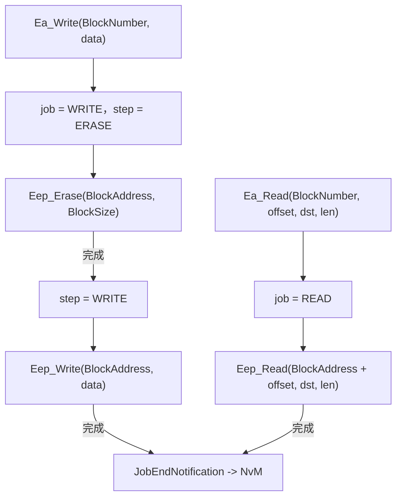

# Ea - EEPROM 抽象层

> **一句话概括：** Ea 把 NvM 块号映射到真实 EEPROM 里的固定地址：写 = 擦除 +
> 编程该块，读 = 读该块（CRC 计入大小）。

| 项目 | 值 |
| --- | --- |
| 模块 | `infras/memory/Ea`（API：`infras/include/Ea.h`） |
| 层级 | Eep 之上，[NvM](NvM.md)（经 MemIf）之下 |
| 配置 | 由 `tools/generator/NvM.py` 生成到 `GEN/Ea_Cfg.c`（`Ea_BlockConfigs[]`） |
| 标准 | AUTOSAR CP 4.4 Ea（子集） |
| 演示 | 以 `NVM_TARGET=Ea` 构建（或 `NvM.json` 里 `target: "Ea"`） |

**目录**

1. [模块用途](#1-模块用途)
2. [配置](#2-配置)
3. [运行时行为](#3-运行时行为)
4. [公开 API](#4-公开-api)
5. [关键注意事项](#5-关键注意事项)
6. [已知局限](#6-已知局限)

---

## 1. 模块用途

* **地址映射** - 每个 NvM 块在 EEPROM 中有固定 `BlockAddress`；`Ea_Write` 执行
  EEPROM 要求的先擦后写序列。
* **作业状态机** - 一次一个作业（`EA_JOB_READ`/`EA_JOB_WRITE`），在
  `Ea_MainFunction()` 中分步推进直到 `Eep` 完成。
* **耐久度记录** - 每块的 `NumberOfWriteCycles` 存于配置（信息用途）。

选 Ea 还是 [Fee](Fee.md)：板上有真实 EEPROM（I2C/SPI）、块布局稳定、且单地址
磨损可接受时选 Ea。

---

## 2. 配置

生成的 `Ea_BlockConfigs[]`（来自 `NvM.json` 的 `blocks[]`）：

```c
typedef struct {
  uint16_t BlockNumber;
  uint16_t BlockAddress;   /* EEPROM 内偏移 */
  uint16_t BlockSize;      /* 含 CRC */
  uint32_t NumberOfWriteCycles;
} Ea_BlockConfigType;
```

地址由生成器按 `config/NvM/Eep_Cfg.c` 声明的 EEPROM 大小顺序分配。块号 `0x0000`
与 `0xFFFF` 保留。

---

## 3. 运行时行为



一次一个作业；`Ea_Cancel()` 中止当前作业并向 NvM 报错。

---

## 4. 公开 API

| 函数 | 用途 |
| --- | --- |
| `Ea_Init(ConfigPtr)` | 注册作业回调 |
| `Ea_Read(BlockNumber, offset, dst, len)` | 异步读作业 |
| `Ea_Write(BlockNumber, src)` | 异步擦除+写作业 |
| `Ea_InvalidateBlock` / `Ea_EraseImmediateBlock(BlockNumber)` | 擦除辅助 |
| `Ea_Cancel()` / `Ea_SetMode(Mode)` | 作业控制 |
| `Ea_JobEndNotification` / `Ea_JobErrorNotification()` | Eep 回调 |
| `Ea_MainFunction()` | 作业执行 |
| `Ea_GetVersionInfo` | 版本 |

---

## 5. 关键注意事项

1. **`BlockSize` 含 CRC** - 打开 `UseContextCrc` 时，可用负载小于你在
   `NvM.json` 里声明的结构体大小。
2. **固定地址即固定磨损** - 热块（如安全访问尝试计数器）会磨穿自己的存储单元；
   Fee 用追加写规避这一点。
3. **作业串行** - 一次长擦除会阻塞后面所有作业。
4. **Eep 驱动质量决定一切** - I2C/SPI 驱动超时会变成
   `Ea_JobErrorNotification` -> `NVM_REQ_NOT_OK`。

---

## 6. 已知局限

1. **块没有冗余** - 写失败会让块变空/变脏；NvM 的 CRC 能检测，但 Ea 不重试。
2. **没有磨损均衡** - 设计如此（固定映射）。
3. **`Ea_SetMode` 无效果**（没有 FAST/SLOW 处理）。
4. **没有 immediate-data 特殊处理**（配置类型里 `ImmediateData` 被注释掉了）。

**相关文档：** [NvM](NvM.md) - [Fee](Fee.md)
