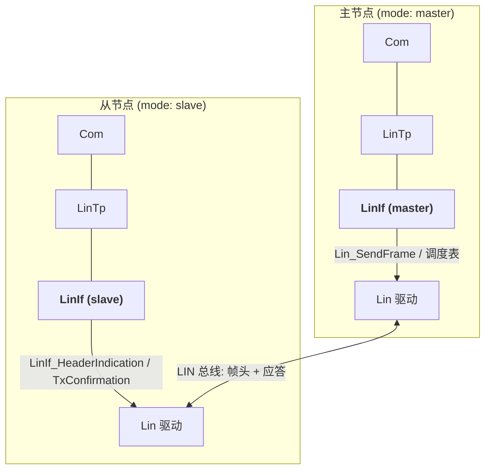
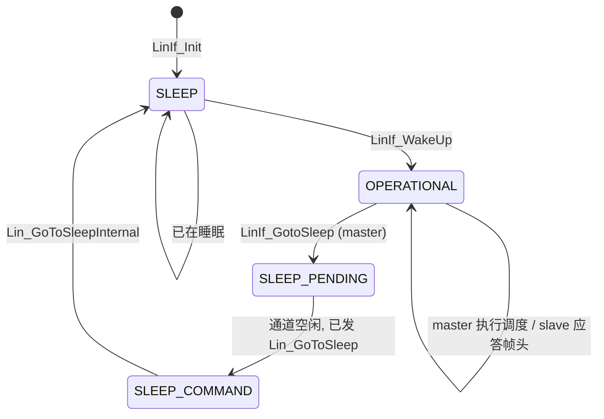
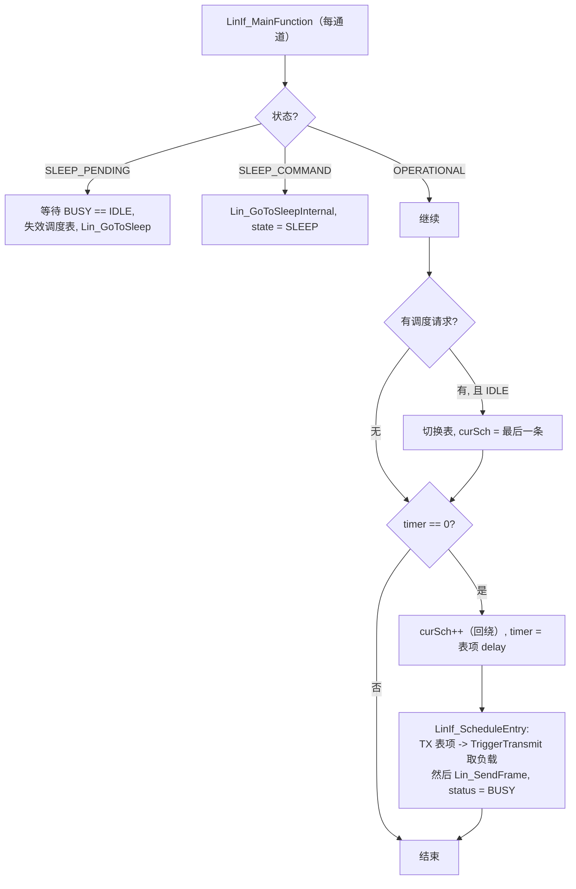
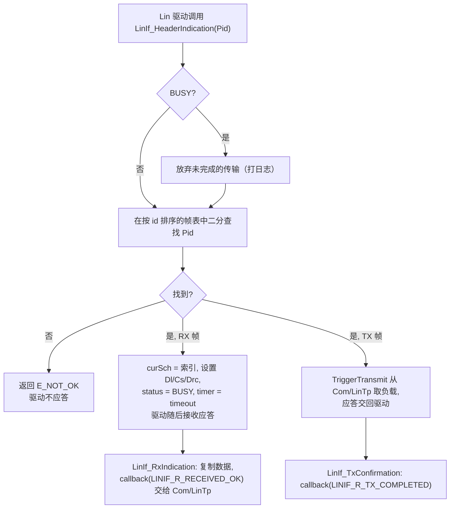
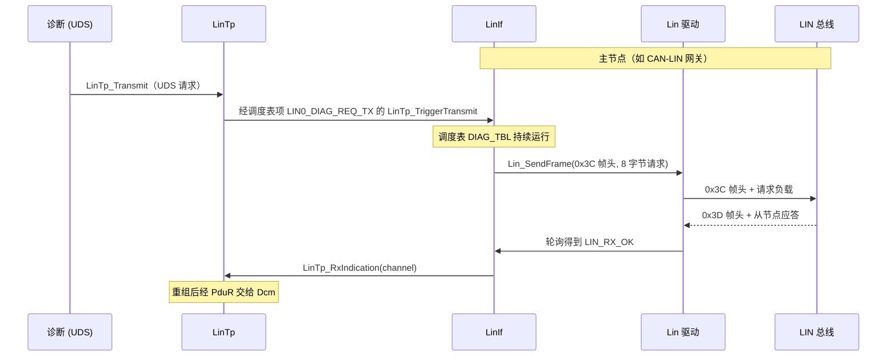

# LinIf - LIN 接口

> **一句话概括：** LinIf 把原始 LIN 帧变成配置化的 PDU：**主节点**按调度表逐
> 条发送帧头，**从节点**把收到的每个帧头与自己的帧表匹配并给出应答——而诊断
> 帧（0x3C/0x3D）则整体交给 [LinTp](LinTp.md) 处理。

| 项目 | 值 |
| --- | --- |
| 模块代码 | `infras/communication/LinIf`（API：`infras/include/LinIf.h`） |
| 所处层次 | Lin 驱动之上，[LinTp](LinTp.md) 与 [Com](Com.md) 之下 |
| 配置文件 | `LinIf.json`（如 `app/bootloader/config/LinIf/LinIf.json`，平台配置在 `app/platform/*/config/Com/LinIf.json`） |
| 代码生成器 | `tools/generator/LinIf.py` -> `GEN/LinIf_Cfg.c` / `GEN/LinIf_Cfg.h`（支持 LDF 导入） |
| 规范依据 | AUTOSAR CP 4.4 LinIf（简化版：仅 2 个总线状态，无完整调度表运行时校验） |
| 示例 | `scons --app=LinApp`（LIN 从节点 + 诊断帧 + Mirror） |

**目录**

1. [模块用途](#1-模块用途)
2. [在协议栈中的位置](#2-在协议栈中的位置)
3. [配置](#3-配置)
4. [运行时行为](#4-运行时行为)
5. [公开 API](#5-公开-api)
6. [构建与运行示例](#6-构建与运行示例)
7. [关键注意事项](#7-关键注意事项)
8. [问题排查](#8-问题排查)
9. [已知限制与代码评审发现](#9-已知限制与代码评审发现)
10. [相关文档](#10-相关文档)

---

## 1. 模块用途

LIN 是主从总线：只有主机发帧头，从机填充应答。LinIf 在两种角色上分别承担：

* **主节点** —— 执行 LDF 中的**调度表**：每个 `MainFunction` tick 取下一条
  表项，向 Com/LinTp 索取负载（`TriggerTransmit`），经 Lin 驱动发送帧头与
  数据；`Delay` 维护表项之间的时序。
* **从节点** —— 对 Lin 驱动上报的每个帧头（`LinIf_HeaderIndication`）在帧表
  中查找：自身 TX 帧则向 Com/LinTp 取负载应答，RX 帧则准备接收并把结果交给
  Com/LinTp。
* **诊断** —— `DIAG_MRF`（0x3C 主请求）与 `DIAG_SRF`（0x3D 从应答）帧路由到
  LinTp 而非 Com，因此 UDS-over-LIN 无需改动即可工作。
* **总线镜像** —— 开启 `USE_MIRROR` 时，每个完成的帧（收发/错误）通过
  `Mirror_ReportLinFrame` 上报给 [Mirror](Mirror.md)。

---

## 2. 在协议栈中的位置



生成的用户回调把 LinIf 与上层模块连接起来，每个 PDU 的 `Up` 字段决定调用谁：

| PDU 方向 | `up: "Com"` | `up: "LinTp"` |
| --- | --- | --- |
| RX（`*_RX`） | `Com_RxIndication(COM_<name>)` | `LinTp_RxIndication(channel)` |
| TX（`*_TX`） | `Com_TriggerTransmit(COM_<name>)` | `LinTp_TriggerTransmit(channel)` |

与 CanIf 不同，PDU id **不会**向上传递：LinTp 的 RX 只用通道索引区分
（见第 7 节）。

---

## 3. 配置

### 3.1 顶层配置项

| 键 | 默认 | 含义 |
| --- | --- | --- |
| `Class` | - | 选择 `LinIf.py` |
| `SchedMode` | `POLLING` | `POLLING`：在 `LinIf_MainFunction_Read` 中轮询结果；`INTERRUPT`：Lin 驱动直接调用 `LinIf_RxIndication` / `LinIf_TxConfirmation`（ac7840x 使用） |
| `ProcessParity` | `false` | 为 `true` 时生成器写入**PID**（6 位 id + 校验位 P0/P1）而非原始 id——当 Lin 驱动要求完整 PID 时需要 |
| `MainFunctionPeriod` | `10` | 毫秒；仅生成 `LINIF_MAIN_FUNCTION_PERIOD` 与换算宏 |
| `UsePostBuildConfig` | `false` | 生成 `LINIF_USE_PB_CONFIG` |
| `Networks[]` | 必填 | 每个 LIN 通道一项 |

### 3.2 网络配置项

| 键 | 含义 |
| --- | --- |
| `Name` | 网络名，如 `LIN0` |
| `Me` | 本节点名；LDF 导入时据此判定主/从 |
| `Mode` | `master` 或 `slave`（LDF 导入时自动推导） |
| `Timeout` | 默认 `100`（毫秒）；从节点应答超时与主节点单条表项超时 |
| `Ldf` | 可选：`.ldf` 文件路径，见 3.3 |
| `TxPdus[]` / `RxPdus[]` | 帧配置，见 3.4 |
| `ScheduleTables[]` | 仅主节点，见 3.5 |

### 3.3 LDF 导入

网络带 `Ldf` 键时，生成器（`extract` 函数）一次性导入 LDF，并在 GEN 目录写出
展开后的 `GEN/LinIf.json`：

* LDF 的 master 节点等于 `Me` 则 `mode = master`，否则 `slave`；
* 每个 LDF 信号报文生成一个 `UNCONDITIONAL` PDU，名为 `<NET>_<MESSAGE>_TX`
  或 `_RX`，`up: "Com"`，enhanced 校验和；
* 诊断帧生成 `DIAG_MRF` / `DIAG_SRF` PDU，classic 校验和，`up: "LinTp"`
  （方向取决于节点角色）；
* 主节点会把 LDF 调度表导入为 `ScheduleTables`，外加一张 20 ms 周期的
  `DIAG_REQ` / `DIAG_RES` 诊断表；
* 从节点自动生成一张包含全部 PDU（按 id 排序）的隐式调度表——从节点不发帧
  头，这张"表"只是帧查找列表。

### 3.4 PDU 配置项（`TxPdus[]` / `RxPdus[]`）

| 键 | 含义 |
| --- | --- |
| `Name` | **必须以 `_TX` 或 `_RX` 结尾**——生成器从名称最后两个字符推导应答方向，并生成 `COM_<name>` 与回调名 |
| `Id` | 帧 id（6 位）；`ProcessParity` 开启时校验位在生成期计算 |
| `Type` | `UNCONDITIONAL`、`DIAG_MRF`、`DIAG_SRF`（生成为 `LINIF_<type>`） |
| `Checksum` | `enhanced`（默认）或 `classic` |
| `Dlc` | 负载长度 1..8（`LINIF_MAX_DATA_LENGHT = 8`） |
| `Up` | `Com` 或 `LinTp` |

### 3.5 调度表（仅主节点）

```json
"ScheduleTables": [
  { "Name": "DIAG_TBL",
    "Tables": [
      { "Name": "LIN0_DIAG_REQ_TX", "Delay": "10" },
      { "Name": "LIN0_DIAG_RES_RX", "Delay": "10" }
    ] }
]
```

* 每条表项按 `Name` 引用一个 PDU，并带 `Delay`（**毫秒**）；
* 生成 `LINIF_SCHTBL_<NET>_<TBL>` 索引宏，供 `LinIf_ScheduleRequest` 使用；
* `_WIN32` 构建中 `LINIF_DELAY_UINT` 为 10，因此所有 delay 与网络 `Timeout`
  内部都乘以 10（一个"tick" = 10 ms）；
* 空表在运行期被拒绝（切换时返回 `E_NOT_OK`）。

### 3.6 生成代码

`GEN/LinIf_Cfg.h`：

```c
#define LINIF_SCHTBL_LIN0 0              /* 从节点: 每网络一张表   */
#define LINIF_SCHTBL_LIN0_DIAG_TBL 0     /* 主节点: 每调度表一个宏 */
#define LINIF_VARIANT LINIF_VARIANT_SLAVE   /* MASTER / SLAVE / BOTH */
#define LINIF_MAIN_FUNCTION_PERIOD 10u
#define LINIF_SCHED_MODE_POLLING
```

`GEN/LinIf_Cfg.c` 为每帧生成一个 `LinIf_ScheduleTableEntryType`（id、dlc、
类型、校验和、方向、回调、delay）、表数组，以及每网络一个
`LinIf_ChannelConfigType`。每个 PDU 生成一个 `LinIf_UserCallback_<name>`，
实现上表的路由规则。

---

## 4. 运行时行为

### 4.1 通道状态



每个通道只有两个传输状态（`LINIF_STATUS_IDLE` / `BUSY`）——比完整 AUTOSAR
刻意简化。

### 4.2 主节点：调度执行



结果获取取决于 `SchedMode`：

* `POLLING`：`LinIf_MainFunction_Read` 调用 `Lin_GetStatus`；`LIN_TX_OK` 完成
  一个 TX 表项，`LIN_RX_OK` 完成 RX 表项并先复制数据再调用用户回调；
* `INTERRUPT`：Lin 驱动直接调用 `LinIf_TxConfirmation` /（从节点 RX）
  `LinIf_RxIndication`。

两条路径最终都以 `LINIF_R_TX_COMPLETED` 或 `LINIF_R_RECEIVED_OK` 调用用户
回调，通道回到 `IDLE`。

### 4.3 从节点：帧头匹配



若从节点始终没等到应答完成，`LinIf_MainFunction` 中的 `timeout` 定时器超时，
把通道复位为 `IDLE` 并以 `LINIF_R_NOT_OK` 通知回调（release note 4.0.2）。

### 4.4 诊断往返



---

## 5. 公开 API

| 函数 | 角色 | 用途 |
| --- | --- | --- |
| `LinIf_Init(ConfigPtr)` | 双方 | 复位上下文，进入 `SLEEP` |
| `LinIf_DeInit()` | 双方 | 回到 `UNINIT`，强制睡眠 |
| `LinIf_ScheduleRequest(Channel, Schedule)` | 主节点 | 切换调度表（对 `numOfSchTbls` 校验，仅 `OPERATIONAL` 状态） |
| `LinIf_GotoSleep(Channel)` | 双方 | 主节点：优雅睡眠（`SLEEP_PENDING`，等当前帧完成）；从节点：立即 `Lin_GoToSleepInternal` |
| `LinIf_WakeUp(Channel)` | 双方 | `SLEEP -> OPERATIONAL`，发出 LIN 唤醒脉冲 |
| `LinIf_MainFunction()` | 双方 | 主节点调度引擎 / 从节点超时监督 |
| `LinIf_MainFunction_Read()` | 主节点 | POLLING 模式的结果轮询 |
| `LinIf_HeaderIndication(Channel, PduPtr)` | 从节点 | Lin 驱动对每个帧头调用；返回应答或准备接收 |
| `LinIf_RxIndication(Channel, SduPtr)` | 双方 | 应答数据已收到 |
| `LinIf_TxConfirmation(Channel)` | 双方 | 应答已发送 |
| `LinIf_EnableBusMirroring(Channel, Active)` | 双方 | 配合 `USE_MIRROR`：向 Mirror 上报帧 |
| `LinIf_GetVersionInfo(info)` | 双方 | 版本 4.0.2 |

`LinIf_Transmit` 与 `LinIf_LinErrorIndication` 在 `LinIf.h` 中有声明但
**没有实现**（见第 9 节）。

### 调度方式

`LinIf_MainFunction` 与 `LinIf_MainFunction_Read` 注册在 EcuM 主函数表中
（`EcuM_Cfg.c`，由 `USE_LINIF` 守卫）；Lin 驱动的 `Lin_MainFunction` /
`Lin_MainFunction_Read` 在 fast 表中与它们并行运行。

---

## 6. 构建与运行示例

`scons --app=LinApp` 构建 LIN 示例应用（`app/app/SConscript` 中的
`ApplicationLinApp`）。它链接：

* `LinIf` + `LinTp`，使用
  [`app/bootloader/config/LinIf/LinIf.json`](../../app/bootloader/config/LinIf/LinIf.json)
  的**从节点**配置（诊断帧 0x3C RX / 0x3D TX，`up: LinTp`，调度表 `DIAG_TBL`）；
* `Mirror`（`config/Mirror/Mirror.json`，LIN 源网络，用于总线镜像）。

应用启动后作为 LIN 从节点处于 `SLEEP`；`LinIf_WakeUp` 之后等待帧头：

```bash
scons --app=LinApp -j8
AS_LOG_LINIF=3 AS_LOG_LINTP=3 build\nt\GCC\LinApp\LinApp.exe
```

单独运行它不会有输出——LIN 从节点只有在主机发帧头时才说话。按
[virtual-lin-env](virtual-lin-env.md) 描述的虚拟 LIN 环境启动一个主节点
（如 `tools/libraries/Lin` 中的 `Lin` 工具）发送 `0x3C` 诊断请求，LinApp
控制台即会显示收到的帧与 LinTp 活动。真实硬件上，同样的配置被 bootloader
变体使用（`app/platform/ac7840x/app0/config/Com/LinIf.json`，两个由 LDF
导入的网络，`SchedMode: INTERRUPT`）。

---

## 7. 关键注意事项

* **PDU 名称必须以 `_TX` / `_RX` 结尾。** 生成器从名称最后两个字符读取方向
  （`name[-2:]`），否则生成期报错。LDF 导入会自动保证这一点。
* **`up: "LinTp"` 的路由不携带 PDU id。** RX 走
  `LinTp_RxIndication(<通道索引>)`，多通道 LinTp 配置按位置而非名称映射。
* **JSON 里 `Delay` 单位是毫秒，但内部乘以 `LINIF_DELAY_UINT`**
  （目标板 1 ms，`_WIN32` 仿真 10 ms）。`delay: "10"` 在仿真中等 100 ms——
  别因为仿真慢就去"修"LDF。
* **从节点表按 id 排序并二分查找**——GEN 文件保持有序（生成器已做），且查找
  匹配的是**原始 6 位 id**，除非开启 `ProcessParity`。
* **`ProcessParity` 必须与 Lin 驱动一致。** 若驱动要求完整 PID（bit6/7 为
  P0/P1）而表里存的是原始 id，则从节点永远不会应答——典型表现是仿真正常、
  真实硬件上"无应答"。
* **每个帧头只应答一次。** 应答未完成时来了新帧头，LinIf 丢弃旧传输并跟随
  新帧头。
* **主节点优雅睡眠，从节点立即睡眠。** 主节点的 `LinIf_GotoSleep` 等待
  `IDLE`、失效调度表再发睡眠命令——最多占两个主循环周期。
* **`Timeout` 双角色共用**（主节点单表项超时、从节点应答超时），同样按
  `LINIF_DELAY_UINT` 换算。

---

## 8. 问题排查

| 现象 | 可能原因 |
| --- | --- |
| 从节点从不应答 | `ProcessParity` 与驱动不一致，或该 PDU id 不在从节点表里（查 `GEN/LinIf_Cfg.c`） |
| `LINIFE: context buffer too small` | PDU 的 `dlc > 8`（`LINIF_MAX_DATA_LENGHT`）；LIN 经典帧最大 8 字节 |
| `LINIFE: <ch> slave timeout` | 主机发了帧头但应答没完成（接线、校验和不匹配，或上层没给负载） |
| `LINIFE: <ch> master timeout` | 某个调度表项一直未完成——检查 Lin 驱动状态处理 / `SchedMode` 是否一致 |
| `LINIFE: <ch> get data in idle` | 没有挂起的帧头却收到 `LinIf_RxIndication`——驱动配置不匹配，或配了 `INTERRUPT` 而驱动在轮询 |
| 调度表一直不启动 | `LinIf_ScheduleRequest` 仅在 `OPERATIONAL` 有效——先 `LinIf_WakeUp`；并确认表非空 |
| 仿真中时序慢 10 倍 | 这是 `_WIN32` 的 `LINIF_DELAY_UINT = 10`——设计如此 |
| 重复符号 `LinIf_UserCallback_...` | JSON 中有两个同名 PDU 条目 |

---

## 9. 已知限制与代码评审发现

### 9.1 功能限制

* **没有 `LinIf_Transmit`。** 在 `LinIf.h` 中有声明但没有实现——本架构中 PDU
  总是按调度（主节点）或按帧头（从节点）触发，Com/LinTp 从不按 id 主动推送
  PDU。
* **`LinIf_LinErrorIndication` 只有声明没有实现**——总线错误只能通过超时
  体现。
* **没有完整规范的总线空闲/调度表运行时语义**：没有调度表事件、`scheduleRequested`
  只有一个槽位（排队多次请求会覆盖）、唤醒后不恢复切换前的表项位置（从最后
  一项重新开始）。
* **最多 8 个数据字节**（`LINIF_MAX_DATA_LENGHT`，不支持 LIN 2.1+ 的
  16/24 字节快帧）。
* **主节点切换表时从"最后一项"起步**（`curSch = numOfEntries - 1`，随后
  `curSch++` 回绕到 0），因此第一条表项立即执行——行为正确但隐晦；release
  note 4.0.1 记录了相关的唤醒修复。

### 9.2 代码评审发现

| # | 位置 | 发现 |
| --- | --- | --- |
| 1 | `LinIf.c:435` | `LinIf_HeaderIndication` 在 `uint16_t` 上计算 `h = numOfEntries - 1`：**空的从节点表**（LDF 导入后可能没有任何 PDU 的从节点）会下溢为 65535，随后的二分查找将越界读。目前只靠"生成器总会生成诊断 PDU"这一事实兜底。 |
| 2 | `LinIf.c:89-102` | POLLING 模式下 `Lin_GetStatus` 返回 RX 缓冲区指针，而 8 字节日志 dump **无条件**读取 `SduPtr[0..7]`——`Dl < 8` 的帧会越界读驱动缓冲区（与 CanIf 的日志 bug 同一模式）。 |
| 3 | `LinIf.c:543` | `memcpy(context->frame.SduPtr, Lin_SduPtr, entry->dlc)` 按 `entry->dlc` 复制，而驱动并未报告实际收到的字节数；应答方 DLC 不一致时会污染缓冲区或越界读。 |
| 4 | `LinIf.c:38-75` | `LinIf_ScheduleEntry` 把 `TriggerTransmit` 失败（`FAIL to provide Tx buffer`）当作该表项的 `E_NOT_OK`，但**不推进也不跳过**——同一表项在 `timer` 超时后经主超时路径重试，且没有重试计数。上层永久无响应时，整个调度表卡死（后续表项永不执行）。 |
| 5 | `LinIf.c:111-121` | `LinIf_CheckEntry` 中镜像上报对**任何**最终状态（含 `LIN_TX_ERROR` / `RX_NO_RESPONSE`）都执行，但上报的是 `context->data`——RX 无应答时缓冲区是残留数据，镜像会为失败帧显示乱码字节。 |
| 6 | `LinIf.c:17-18` | `AS_LOG_LINIFE`（错误通道）默认 **0**，即不设 `AS_LOG_LINIF`/`AS_LOG_LINIFE` 环境变量时所有 LinIf 错误都不可见。"我的 LIN 不工作"的大多数场景默认完全不产生输出。 |
| 7 | `LinIf.c:246-259` | `LinIf_Init` 用 `int i` 遍历 `numOfChannels`（uint16）——无害，但与代码库其余部分不一致。 |
| 8 | `LinIf.py:112-121` | 调度表项的 `Drc` 由 PDU **名称后缀**（`name[-2:]`）推导，而不是看它属于 `RxPdus` 还是 `TxPdus`。把名为 `FOO_TX` 的 PDU 放进 `RxPdus` 会静默生成 TX 回调，对 RX 的 Com PDU 符号调用 `Com_TriggerTransmit`——生成期成功，运行期行为错误。 |
| 9 | `LinIf.py:82-87` | `LINIF_DELAY_UINT` 在 `_WIN32`（10）与目标板（1）静默不同；同一 JSON 在两侧产生不同的绝对时序，且生成头文件中无说明。 |
| 10 | `LinIf.py:388-389` | `extract()` 按 `toNum(id) & 0x1FFFFFFF` 排序 PDU，但 `ScheduleTables` 表项按名称引用 PDU 且保持 LDF 顺序不重排——二分查找的前提（有序表）只对从节点的隐式表成立，主节点表不一定有序。 |

---

## 10. 相关文档

* [LinTp](LinTp.md) —— 运行在诊断帧之上的传输层（复用 CanTp 代码）
* [Com](Com.md) —— UNCONDITIONAL 帧的信号层
* [Mirror](Mirror.md) —— 总线镜像，`Mirror_ReportLinFrame`
* [virtual-lin-env](virtual-lin-env.md) —— 如何在主机上模拟带主节点的
  LIN 总线
* 代码：[LinIf.c](../../infras/communication/LinIf/LinIf.c)、
  [LinIf_Priv.h](../../infras/communication/LinIf/LinIf_Priv.h)、
  [LinIf.h](../../infras/include/LinIf.h)、
  [LinIf.py](../../tools/generator/LinIf.py)
* AUTOSAR CP 4.4 - Specification of LIN Interface
