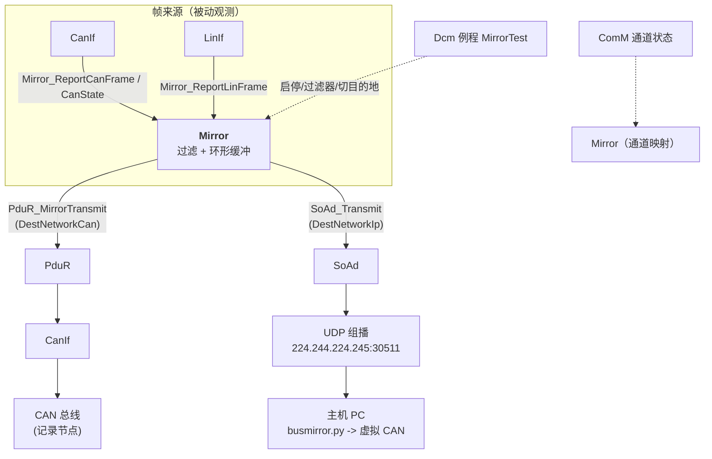
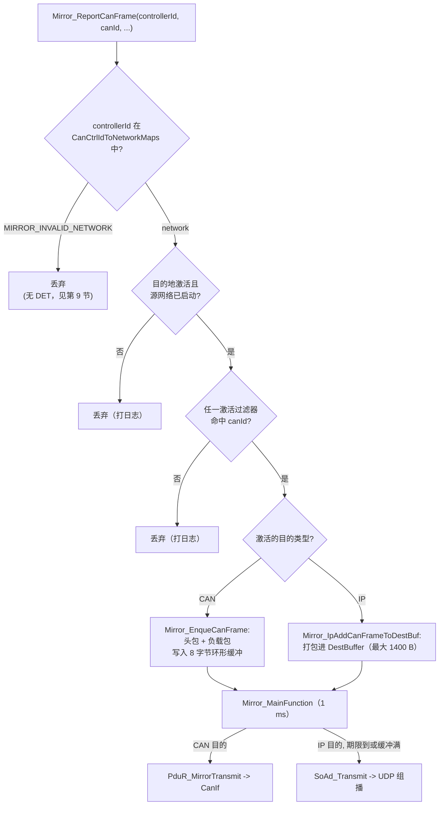
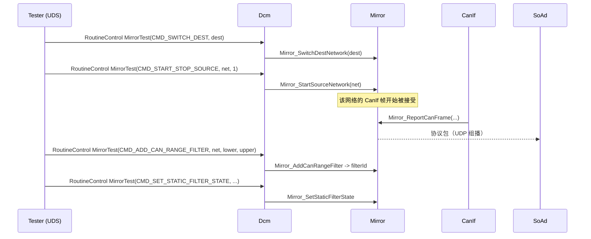

# Mirror - 总线镜像

> **一句话概括：** Mirror 把流经 CanIf/LinIf 的每个 CAN 与 LIN 帧记录下来，
> 过滤后封装成 AUTOSAR 总线镜像协议，并通过 **以太网 UDP 组播**（SoAd，供
> 主机 PC 工具消费）或 **CAN 帧**（PduR，供车载数据记录仪）发出——测试工程师
> 可以从一个观测点看到整车所有总线的原始流量。

| 项目 | 值 |
| --- | --- |
| 模块代码 | `infras/diagnostic/Mirror`（API：`infras/include/Mirror.h`） |
| 所处层次 | 诊断域；挂钩 [CanIf](CanIf.md) / [LinIf](LinIf.md)，经 [SoAd](virtual-can-env.md) 或 [PduR](PduR.md) 发送 |
| 配置文件 | `app/app/config/Mirror/Mirror.json` + `config/Mirror/Network/Network.json`（SoAd 套接字） |
| 代码生成器 | `tools/generator/Mirror.py` -> `GEN/Mirror_Cfg.c` / `GEN/Mirror_Cfg.h` |
| 规范依据 | AUTOSAR CP 4.4 Mirror（镜像协议见 `@SWS_Mirror_*`） |
| 主机工具 | `tools/libraries/python/mirror/busmirror.py` |
| 示例 | `CanApp` / `LinApp` 内置；通过 Dcm 例程 `MirrorTest` 远程控制 |

**目录**

1. [模块用途](#1-模块用途)
2. [在协议栈中的位置](#2-在协议栈中的位置)
3. [配置](#3-配置)
4. [运行时行为](#4-运行时行为)
5. [公开 API](#5-公开-api)
6. [构建与运行示例](#6-构建与运行示例)
7. [关键注意事项](#7-关键注意事项)
8. [问题排查](#8-问题排查)
9. [已知限制与代码评审发现](#9-已知限制与代码评审发现)
10. [相关文档](#10-相关文档)

---

## 1. 模块用途

残余总线仿真、EMC 测量与现场诊断都需要同一样东西：在不干扰节点的前提下
获得总线的原始流量副本。Mirror 在 ECU 内部完成这件事：

* **采集** —— CanIf 对每个收/发帧调用 `Mirror_ReportCanFrame`（总线状态变化
  调用 `Mirror_ReportCanState`）；LinIf 调用 `Mirror_ReportLinFrame`。
* **过滤** —— 静态过滤器（构建期配置的 range/mask）加动态过滤器（运行期经
  API 或诊断添加）决定哪些帧被镜像。
* **封装** —— 每帧变为若干 8 字节协议包：头包（`type | NetworkId | 长度 |
  ID 标志 + ID`）加负载包，与 AUTOSAR 镜像协议一致（扩展 ID 与 CAN FD 标志
  见 `@SWS_Mirror_00098/00099`）。
* **投递** —— 数据包按目的网络排队：CAN 目的（环形缓冲 -> PduR -> CanIf）
  或 IP 目的（大缓冲 -> SoAd -> UDP 组播），IP 路径带发送期限。
* **控制** —— Dcm 例程（`MirrorTest`）允许诊断 tester 远程切换目的地、
  启停源网络、管理过滤器。

---

## 2. 在协议栈中的位置



两个目的地可以同时配置，`Mirror_SwitchDestNetwork` 选择当前激活者。Mirror
是纯观察者，不修改被镜像总线上的任何数据。

---

## 3. 配置

### 3.1 顶层配置项

| 键 | Demo | 含义 |
| --- | --- | --- |
| `Class` | `"Mirror"` | 选择 `Mirror.py` |
| `MainFunctionPeriod` | 无 | 默认 `1` ms；生成 `MIRROR_MAIN_FUNCTION_PERIOD`（IP 目的的期限处理） |
| `UsePostBuildConfig` | 无 | 默认 `false`；生成 `MIRROR_USE_PB_CONFIG` |
| `SourceNetworkCan[]` | 1（CAN0） | 被观测的 CAN 总线 |
| `SourceNetworkLin[]` | 1（LIN0） | 被观测的 LIN 总线 |
| `DestNetworkCan[]` | 1（AS） | CAN 目的 |
| `DestNetworkIp[]` | 1（AS） | 以太网目的 |

四个列表都可为空，但至少要有一个目的地。网络句柄索引按此顺序分配：CAN 源、
LIN 源、CAN 目的、IP 目的（对应宏 `MIRROR_SRC_NT_CAN_*`、`MIRROR_SRC_NT_LIN_*`、
`MIRROR_DST_NT_CAN_*`、`MIRROR_DST_NT_IP_*`）。

### 3.2 `SourceNetworkCan[]` / `SourceNetworkLin[]`

| 键 | Demo CAN | Demo LIN | 含义 |
| --- | --- | --- | --- |
| `Name` | `CAN0` | `LIN0` | 符号名，生成 `MIRROR_SRC_NT_CAN_<NAME>` |
| `ControllerId` | `0` | `0` | 该总线对应的 Can/Lin 控制器；用于生成 `CanCtrlIdToNetworkMaps` / `LinCtrlIdToNetworkMaps` 供 Report API 查找 |
| `NetworkId` | `3` | `5` | 镜像协议包中携带的总线标识——由集成者约定，收集端据此区分总线（主机工具转发到虚拟总线 `10 + NetworkId`） |
| `StaticFilters[]` | 2 | 2 | 构建期过滤器；每条为 `{"type": "range", "lower": .., "upper": ..}` 或 `{"type": "mask", "code": .., "mask": ..}`。任一**激活的**过滤器命中即通过 |
| `MaxDynamicFilters` | `128` | `32` | 运行期添加过滤器的 RAM 槽位（`Mirror_AddCanRangeFilter` 等）；默认 CAN 128 / LIN 32 |
| `SingleIdMappings[]` | - | - | 仅 CAN：`SourceCanId -> DestCanId` 一对一重映射（CAN 目的） |
| `MaskBasedIdMappings[]` | - | - | 仅 CAN：`DestBaseId + SourceCanIdCode/Mask` 重映射 |
| `SourceLinToCanIdMappings[]` | - | - | 仅 LIN：`LinId -> CanId` 映射表，用于把 LIN 帧装进面向 CAN 的协议包 |
| `SourceLinToCanBaseId` | - | `0` | 仅 LIN：无映射表时的基础 CAN id |

### 3.3 `DestNetworkCan[]`

| 键 | Demo | 含义 |
| --- | --- | --- |
| `Name` | `AS` | 生成 `MIRROR_DST_NT_CAN_<NAME>` |
| `DestQueueSize` | `128` | 环形缓冲条目数；生成器会**翻倍**且必须为 2 的幂（有 assert） |
| `TxPduId` | `MIRROR_TX` | PduR 路由名 `PDUR_MIRROR_TX`（PduR.json 中 `{ "Name": "MIRROR_TX", "From": "Mirror", "To": "CanIf" }`） |
| `MirrorStatusCanId` | `0xFFFFFFFF` | 镜像状态帧的 CAN id（无效值 = 关闭） |

### 3.4 `DestNetworkIp[]`

| 键 | Demo | 含义 |
| --- | --- | --- |
| `Name` | `AS` | 生成 `MIRROR_DST_NT_IP_<NAME>` |
| `DestQueueSize` | `2` | 大缓冲区个数（2 的幂，有 assert） |
| `DestBufferSize` | `1400` | 每个缓冲区字节数（一个 UDP 负载） |
| `SoAd` | `SOAD_TX_PID_MIRROR_CLIENT_0` | SoAd TX PDU id；套接字定义在 `config/Mirror/Network/Network.json`：UDP 组播客户端 `224.244.224.245:30511`，`up: "Mirror"` |
| `MirrorDestTransmissionDeadline` | 无（`655` ms） | `Mirror_MainFunction` 冲刷超龄缓冲数据的期限 |

### 3.5 生成代码

`GEN/Mirror_Cfg.h` 生成 `MIRROR_USE_SOURCE_CAN`、`MIRROR_USE_SOURCE_LIN`、
`MIRROR_USE_DEST_CAN`、`MIRROR_USE_DEST_IP` 以及每个网络的索引宏——整个模块
按配置用 `#ifdef` 裁剪。`GEN/Mirror_Cfg.c` 包含过滤器表、环形缓冲、
控制器->网络查找映射与 `Mirror_ComChannelMaps`（供 ComM 集成与
`Mirror_GetNetworkHandle` 使用）。

---

## 4. 运行时行为

### 4.1 帧路径



LIN 帧经 `Mirror_ReportLinFrame` 走同样流程，打包前可选用 LIN->CAN id 映射。

### 4.2 镜像协议包

一个 CAN 帧占用 `ceil((length + 8) / 8)` 个环形缓冲槽（头 + 负载）：

| 字节 | 头包 | 负载包 |
| --- | --- | --- |
| 0 | `MIRROR_NT_CAN`（或 `MIRROR_NT_LIN`） | 负载字节 |
| 1 | `NetworkId` | 负载字节 |
| 2 | 保留 | 负载字节 |
| 3 | 长度 | 负载字节 |
| 4 | 标志：bit7 扩展 ID，bit6 CAN FD，bit4..0 = ID 的 28..24 位 | 负载字节 |
| 5..7 | ID 的 23..0 位 | 负载字节 |

IP 目的会在前面加上头时间戳（48 位秒 + 32 位纳秒）与序列号——`busmirror.py`
正是按此解码。

### 4.3 状态与控制



`Mirror_Offline()` 全部停止；`Mirror_IsMirrorActive()` 告知调用方镜像当前
是否开启。构建含 ComM 时，Mirror 经 `Mirror_ComChannelMaps` 跟随 ComM 通道
模式。

---

## 5. 公开 API

| 函数 | 用途 |
| --- | --- |
| `Mirror_Init` / `Mirror_DeInit` | 生命周期 |
| `Mirror_ReportCanFrame(controllerId, canId, length, payload)` | 由 CanIf 对收/发帧调用 |
| `Mirror_ReportCanState(controllerId, state)` | AS 扩展：总线在线/错误被动/总线关闭 + 发送错误计数/8 |
| `Mirror_ReportLinFrame(controllerId, pid, PduInfo, status)` | 由 LinIf 调用 |
| `Mirror_GetStaticFilterState` / `Mirror_SetStaticFilterState` | 查询/启停一个构建期过滤器 |
| `Mirror_AddCanRangeFilter` / `Mirror_AddCanMaskFilter` / `Mirror_AddLinRangeFilter` / `Mirror_AddLinMaskFilter` / `Mirror_RemoveFilter` | 运行期过滤器管理（返回 filterId） |
| `Mirror_SwitchDestNetwork(network)` / `Mirror_GetDestNetwork` | 选择激活目的地 |
| `Mirror_StartSourceNetwork` / `Mirror_StopSourceNetwork` / `Mirror_IsSourceNetworkStarted` | 按源启停 |
| `Mirror_GetNetworkType` / `Mirror_GetNetworkId` / `Mirror_GetNetworkHandle` | 网络句柄 <-> 类型/ID 映射 |
| `Mirror_IsMirrorActive` / `Mirror_Offline` | 全局开关 |
| `Mirror_MainFunction` | 排空目的地（EcuM fast 表，`USE_MIRROR`） |
| `Mirror_TestStart(...)` | `MirrorTest` 服务的 Dcm 例程（命令 0..8） |

---

## 6. 构建与运行示例

`CanApp` 已经用源网络与双目的地链接了 Mirror（`app/app/config/Mirror/Mirror.json`）；
SoAd 套接字配置来自 `config/Mirror/Network/Network.json` + `Mempool.json`，
由 `ApplicationApp.gencfg()` 生成。

在主机上观察镜像流量：

```bash
# 1. 构建并运行 CanApp（任何链接了 Mirror + SoAd 的应用）
scons --app=CanApp -j8
build\nt\GCC\one\one.exe

# 2. 另一个终端运行收集器
python tools/libraries/python/mirror/busmirror.py
```

收集器加入组播组 `224.244.224.245:30511`，解码镜像协议包并把每个镜像帧
**转发到虚拟 CAN 总线** `simulator_v2` 的端口 `10 + NetworkId`（即 `NetworkId 3`
的 CAN0 出现在端口 13）。随后可用 `CanDump` 打开该端口：

```bash
build\nt\GCC\one\CanDump.exe -d simulator_v2 -p 13
```

要远程控制镜像，使用 `Dcm.json` 中注册的 UDS 例程 `MirrorTest`
（`"name": "MirrorTest"`，`"start": "Mirror_TestStart"`）；命令字节选择
[Mirror_Test.c](../../infras/diagnostic/Mirror/Mirror_Test.c) 中列出的 9 种
操作之一。

---

## 7. 关键注意事项

* **Mirror 是被动的，但不是免费的。** 每帧至少被 memcpy 两次（CanIf 上报 ->
  环形缓冲/缓冲区 -> SoAd）；繁忙总线上开启镜像的 CPU 开销可测量。过滤器要
  收紧。
* **`NetworkId` 是约定值，不是固定值。** demo 用 3 表示 CAN、5 表示 LIN，
  因为主机工具与残余总线脚本按此约定；若修改，请同步修改 `busmirror.py` 的
  用法（转发到 `10 + NetworkId`）。
* **过滤器只在源网络启动后才生效。** 启动后若没有任何激活过滤器，则镜像
  **所有**帧（`MaxActiveFilterId == 0 -> 全部接受`）；一旦有一个过滤器激活，
  帧必须命中至少一个激活过滤器。
* **CAN 目的的环形缓冲较小。** `DestQueueSize` 翻倍为 2 的幂；溢出时丢帧，
  仅打一条 `MIRRORE: No free space`——没有计数器。
* **IP 期限默认 655 ms。** 总线安静时最长 655 ms 无数据发出；不要把这种
  静默当成套接字故障。
* **`Mirror_ReportCanFrame` 会以 `AS_LOG_MIRROR` 打印每个被接受的帧**——调试
  有用，但输出量很大。
* **SoAd 配置在另一个 JSON。** 只有 Mirror.json 不够：UDP 组播套接字在
  `config/Mirror/Network/Network.json`，由 `Net` 类生成。
* **LIN 帧装在面向 CAN 的包格式里。** 配置 `SourceLinToCanIdMappings` 时每个
  LIN 帧得到一个 CAN id；不配置时用 `SourceLinToCanBaseId + LinId`。

---

## 8. 问题排查

| 现象 | 可能原因 |
| --- | --- |
| 收集器收不到任何数据 | 目的地未激活（`Mirror_SwitchDestNetwork`）、源网络未启动，或 SoAd 套接字配置（`Network.json`）缺失/不匹配 |
| `MIRRORE: No free space` | CAN 目的环形缓冲对过滤后的流量太小；增大 `DestQueueSize`（2 的幂）或收紧过滤器 |
| 总线繁忙但帧缺失 | 某个过滤器把它排除了——记住"任一激活过滤器命中即通过"；用 `Mirror_GetStaticFilterState` 检查 |
| 疑似 `Mirror_ReportCanFrame` 从未被调用 | 该控制器 id 不在 `CanCtrlIdToNetworkMaps`（没有对应 `ControllerId` 的 `SourceNetworkCan` 条目） |
| 主机工具解码出乱码 | ECU 配置与 `busmirror.py` 期望的 `NetworkId`/标志字节不一致 |
| UDS `MirrorTest` 返回 NRC 0x31 | 例程未注册到 `Dcm.json`，或命令/长度组合与 `Mirror_Test.c` 的表不符 |
| LIN 帧出现错误的 CAN id | 缺少 `SourceLinToCanIdMappings` 且 `SourceLinToCanBaseId` 不合适 |

---

## 9. 已知限制与代码评审发现

### 9.1 功能限制

* **未实现完整规范的 MirrorOverEthernet 状态机**——模块实现了帧/状态上报与
  两种目的地，但没有端口代理/网络配置对话，没有 PNC 网关协同。
* **同一时刻只有一个激活目的地。**
* **`Mirror_ReportCanState` 是 AS 扩展**（位定义见 `Mirror.h`），不是 AUTOSAR
  的 CAN 状态映射。
* **只有 CanIf 与 LinIf 供数**——以太网（EthIf）源未实现。
* **CAN 目的环形缓冲无溢出统计。**
* **时间戳只在 IP 路径存在**（主机解码头时间戳）；CAN 目的不带时间信息。

### 9.2 代码评审发现

| # | 位置 | 发现 |
| --- | --- | --- |
| 1 | `Mirror.c:1133-1134` | `Mirror_GetNetworkHandle` 查找的是 `MIRROR_CONFIG->ComChannelMaps[network]` 而非 `[i]`——每次迭代都检查同一个（初值为 `MIRROR_INVALID_NETWORK`）元素，因此该函数永远找不到匹配，且首次迭代就越界读 `ComChannelMaps[0xFF]`。变量遮蔽/复制粘贴错误；依赖此 API 的调用方只会得到 `MIRROR_INVALID_NETWORK` 或崩溃。 |
| 2 | `Mirror.c:1170-1172` | `Mirror_ReportCanFrame` 用 `CanCtrlIdToNetworkMaps` 映射 `controllerId` 后未检查 `MIRROR_INVALID_NETWORK`；未配置为镜像源的 CAN 控制器会得到 `config = &SourceNetworkCans[<超大值>]`（越界指针），而 `bStarted` 检查来不及救场。CanIf 对**系统中每个**控制器都会调用此 API。 |
| 3 | `Mirror.c:1176-1188` | 过滤循环条件 `i < config->context->MaxActiveFilterId` 加上 `MaxActiveFilterId == 0 -> 全部接受`意味着：添加一个过滤器再停用它**不能**恢复"全部接受"——只有初始状态才全收。`Mirror_RemoveFilter` 会紧凑化 `MaxActiveFilterId`，被删过滤器曾经放行的帧会静默重新出现。 |
| 4 | `Mirror.c:335-390` | `Mirror_EnqueCanFrame` 先按 `numPackets` 做容量检查再逐包写入；只要 `in - out <= NumOfDataElements` 不变式成立就正确——但容量算式（`0xFFFFul - out + 1u + in`）只在 in/out 差值小于 65536 时成立。uint16 计数器下长期运行成立，但代码缺少注释；任何一处误增都会静默破坏该不变式。 |
| 5 | `Mirror.c:201-216` | LIN 的 range 与 mask 过滤共用 `Mirror_ValidateLinFilter`，而 CAN 是两条独立路径；LIN mask 语义（对 6 位 PID 做 `code/mask`）与 CAN 有细微差别——很容易配出一个永不命中的 LIN mask。 |
| 6 | `Mirror.c`（全文 1549 行） | 20 多个 static 函数被不同的 `#ifdef` 组合（`MIRROR_USE_SOURCE_CAN`、`MIRROR_USE_DEST_CAN`、`USE_SOAD`……）门控，树内只有 `test/mirror_test.cpp` 一个测试；多数组合（如 LIN 源 + CAN 目的）只被硬件 demo 覆盖。 |
| 7 | `Mirror.py:44` | 为 `TxPduId` 生成 `#define MIRROR_%s %su`——`TxPduId: "MIRROR_TX"` 会生成冗余的 `MIRROR_MIRROR_TX`（无害）；但 `TxPduId` 名与网络名撞名时会静默产生重复宏。 |
| 8 | `Mirror.py:249-251` | CAN 目的的 `DestQueueSize` 被**翻倍**（128 -> 256 槽）并 assert 2 的幂；RAM 按翻倍值分配，但 JSON 里的 `DestQueueSize` 看起来像槽数。IP 目的则用原始值。不一致且无文档。 |
| 9 | `Mirror.c:293` | `Mirror_SetNetworkLinFilterState` 与 CAN 版本把同样的边界逻辑重复了四次（get/set x CAN/LIN）——离重蹈 `GetNetworkHandle` 覆辙只差一次重构。 |
| 10 | `Mirror_Test.c` | `Mirror_TestStart` 依赖 `*currentDataLength` 分发命令，但部分命令在只检查部分长度的情况下读取固定偏移（`dataIn[1..3]`）；现有命令没有越界，但新增命令若不同样小心就会读越界。 |

---

## 10. 相关文档

* [CanIf](CanIf.md) —— CAN 帧来源（`Mirror_ReportCanFrame` /
  `Mirror_ReportCanState`）
* [LinIf](LinIf.md) —— LIN 帧来源（`Mirror_ReportLinFrame`）
* [PduR](PduR.md) —— CAN 目的路由（`MIRROR_TX`）
* [Dcm](Dcm.md) —— `MirrorTest` 诊断例程
* 主机收集器：[busmirror.py](../../tools/libraries/python/mirror/busmirror.py)
* 代码：[Mirror.c](../../infras/diagnostic/Mirror/Mirror.c)、
  [Mirror_Priv.h](../../infras/diagnostic/Mirror/Mirror_Priv.h)、
  [Mirror.h](../../infras/include/Mirror.h)、
  [Mirror.py](../../tools/generator/Mirror.py)
* AUTOSAR CP 4.4 - Specification of Mirror
