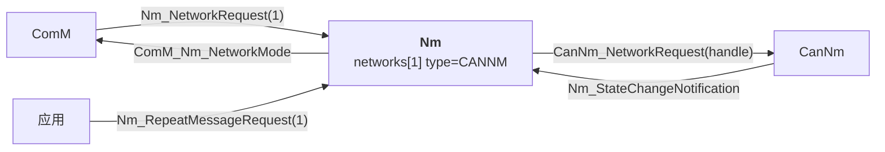

# Nm - 网络管理接口（分发层）

> **一句话概括：** Nm 是一个很薄的分发层：每个 API 调用按网络配置转发给具体的
> 总线 NM 模块（CanNm、UdpNm、OsekNm），它们的指示再向上转发给 ComM。

| 项目 | 值 |
| --- | --- |
| 模块 | `infras/communication/Nm`（API：`infras/include/Nm.h`） |
| 层级 | 下方是 [CanNm](CanNm.md)/UdpNm/OsekNm，上方是 [ComM](ComM.md) |
| 配置 | `app/app/config/Com/Nm.json` |
| 生成器 | `tools/generator/Nm.py` -> `GEN/Nm_Cfg.c` / `GEN/Nm_Cfg.h` |
| 标准 | AUTOSAR CP 4.4 Nm |
| 演示 | `CanApp` |

**目录**

1. [模块用途](#1-模块用途)
2. [配置](#2-配置)
3. [运行时行为](#3-运行时行为)
4. [公开 API](#4-公开-api)
5. [关键注意事项](#5-关键注意事项)

---

## 1. 模块用途

* **一套 API，多种总线** - ComM 和应用从不直接调 `CanNm_*`；它们调 `Nm_*`，由
  配置决定落到哪个模块。
* **回调汇聚** - CanNm 通过 `Nm_StateChangeNotification`、
  `Nm_CarWakeUpIndication` 等上报状态变化；Nm 转发给 ComM（`ComM_Nm_*`）。

---

## 2. 配置

```json
{
  "Class": "Nm",
  "Networks": [
    { "Name": "CANNM0", "Type": "CANNM" },
    { "Name": "CANNM1", "Type": "CANNM" }
  ]
}
```

| 键 | 含义 |
| --- | --- |
| `Networks[].name` | 网络名；下标即 `NetworkHandleType` |
| `Networks[].type` | `CANNM` -> `CanNm_*`，`UDPNM` -> `UdpNm_*`，`OSEKNM` -> `OsekNm_*` |

传给 `Nm_*` 的网络句柄会被翻译成底层模块自己的通道句柄（`config->handle`）。

---

## 3. 运行时行为



`Nm.c` 约 200 行：每个函数就是 DET 保护下的查表加一次调用，自身没有任何状态。

---

## 4. 公开 API

| 函数 | 方向 | 用途 |
| --- | --- | --- |
| `Nm_Init(ConfigPtr)` | EcuM | （分发；底层模块已自行初始化） |
| `Nm_PassiveStartUp` / `Nm_NetworkRequest` / `Nm_NetworkRelease` / `Nm_DisableCommunication` / `Nm_EnableCommunication` | 下行 | 模式请求 |
| `Nm_SetUserData` / `Nm_GetUserData` | 下行 | NM 用户数据 |
| `Nm_RepeatMessageRequest` / `Nm_RequestBusSynchronization` / `Nm_SetSleepReadyBit` | 下行 | NM 功能请求 |
| `Nm_GetState` / `Nm_GetNodeIdentifier` / `Nm_GetLocalNodeIdentifier` / `Nm_GetPduData` | 下行 | 查询 |
| `Nm_CheckRemoteSleepIndication` | 下行 | 远程睡眠查询 |
| `Nm_NetworkStartIndication` / `Nm_NetworkMode` / `Nm_BusSleepMode` / `Nm_PrepareBusSleepMode` | 上行 | 总线 NM -> ComM |
| `Nm_TxTimeoutException` | 上行 | 总线 NM -> CanSM/ComM |
| `Nm_StateChangeNotification` | 上行 | 状态机轨迹 |
| `Nm_CarWakeUpIndication` / `Nm_RemoteSleepIndication` / `Nm_RemoteSleepCancellation` / `Nm_CoordReadyToSleepIndication` / `Nm_CoordReadyToSleepCancellation` | 上行 | 功能指示 |
| `Nm_MainFunction()` | 调度器 | 分发 |

---

## 5. 关键注意事项

1. **两张表必须对齐**：`Nm.json` 的 `Networks[]` 顺序要与
   `CanNm.json`/`ComM.json`/`CanSM.json` 的通道顺序一致 - 所有句柄都是纯下标。
2. **`OSEKNM` 分发时 `Nm_PassiveStartUp` 也会调 `OsekNm_NetworkRequest`**
   （OsekNm API 没有被动启动）- 见 `Nm.c:36-41`。
3. **Nm 没有定时器** - 所有时序都在 CanNm/UdpNm/OsekNm 里。
4. **新增总线 NM**（如自定义模块）需要改 `Nm.c` - 分发是硬编码 switch，不是
   函数指针表。

**相关文档：** [CanNm](CanNm.md) - [ComM](ComM.md) - [can-oseknm](can-oseknm.md)
