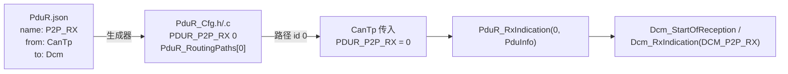
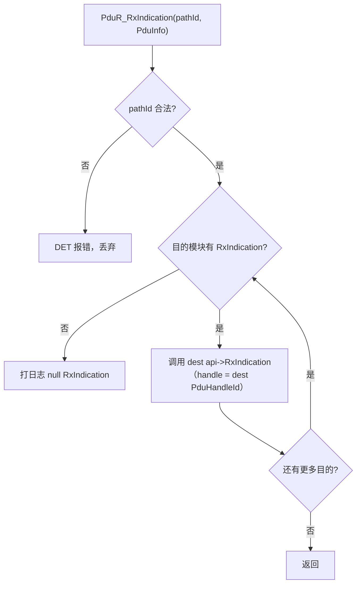
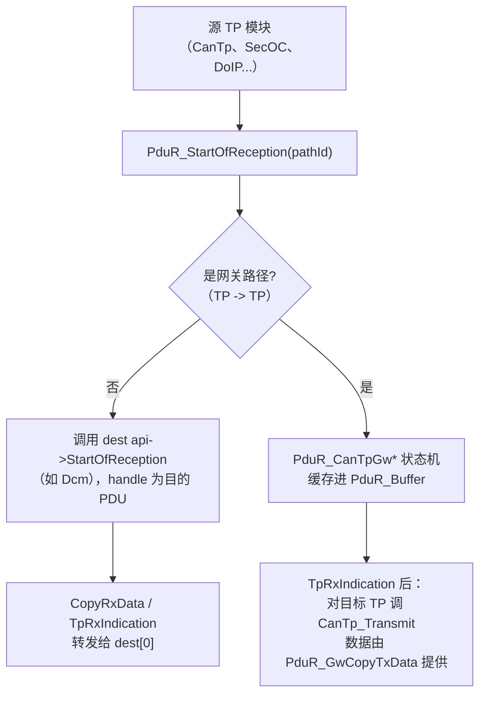
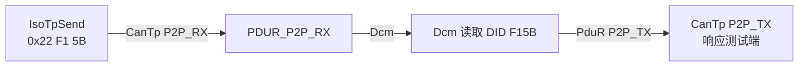

# PduR - PDU 路由器

> **一句话概括：** PduR 是协议栈的总机：每条路由路径就是一对 `From` 模块 + `To`
> 模块，PduR 沿着它们转发接收指示和发送请求 - 包括一对多多播和 TP 到 TP 的网关。

| 项目 | 值 |
| --- | --- |
| 模块 | `infras/communication/PduR`（API：`infras/include/PduR.h`） |
| 层级 | 贯穿所有模块；下方是 Com/Dcm/SecOC，上方是 CanTp/CanIf/LinTp/... |
| 配置 | `app/app/config/Com/PduR.json` |
| 生成器 | `tools/generator/PduR.py` -> `GEN/PduR_Cfg.c` / `GEN/PduR_Cfg.h` |
| 标准 | AUTOSAR CP 4.4 PduR（含 SSAS 扩展） |
| 演示 | `CanApp`：CanTp <-> Dcm 的 P2P 路由、Com -> SecOC -> CanIf 的加密发送 |

**目录**

1. [模块用途](#1-模块用途)
2. [路由路径如何接线](#2-路由路径如何接线)
3. [配置](#3-配置)
4. [运行时行为](#4-运行时行为)
5. [公开 API](#5-公开-api)
6. [构建与运行演示](#6-构建与运行演示)
7. [关键注意事项](#7-关键注意事项)
8. [故障排查](#8-故障排查)
9. [已知局限](#9-已知局限)

---

## 1. 模块用途

* **IF 路由** - 转发单帧 PDU：`PduR_RxIndication(pathId, ...)` 把同一个
  `PduInfoType` 扇出到所有目的模块。
* **TP 路由** - 转发多帧 PDU：`StartOfReception` / `CopyRxData` /
  `TpRxIndication` 与 `CopyTxData` / `TpTxConfirmation`。
* **TP 网关** - 从一个传输模块（如 CanTp）收到长报文，经中间缓冲后用另一个传输
  模块（如 LinTp）发出（`PDUR_USE_TP_GATEWAY`）。
* **给上层一个统一 id 空间** - 上层模块传 `PDUR_<ROUTINE_NAME>`，PduR 把它映射为
  目的模块的 PDU id。

PduR **没有队列也没有定时器**（网关中间缓冲除外），它是纯函数指针路由器。目的
模块收不下就向源模块返回失败 - 不会缓存任何数据。

---

## 2. 路由路径如何接线

`Routines[]` 的一条记录生成一个 id 加一条路由路径：



让整个协议栈编译通过的三条约定：

1. **源模块**必须能产生 `PDUR_<NAME>` 这个 id。CanIf 通过 `up: "PduR"` 实现
   （`CANIF_<NAME>` 与 `PDUR_<NAME>` 相等，因为两个生成器按同一份 routine 表
   编号），Com 通过 `txConfig->TxPduId`。
2. **目的模块**必须拥有与 routine 同名（或 `Dest`/`Fake` 别名）的 PDU，例如
   `CANTP_P2P_TX`、`DCM_P2P_RX`、`SECOC_...`。
3. 函数指针来自生成器里**硬编码的 API 表**（`PduR_DcmApi`、`PduR_ComApi`、
   `PduR_CanTpApi`、`PduR_CanIfApi`、`PduR_SecOCApi`...）。不在此列表中的模块
   无法参与路由。

---

## 3. 配置

### 3.1 顶层键

| 键 | 默认值 | 含义 |
| --- | --- | --- |
| `Routines[]` | 必填 | 路由路径（见 3.2） |
| `Networks[]` | 可选 | DBC 导入；每条 DBC 报文生成一条 routine（`Com <-> CanIf/LinIf`） |
| `Memory[]` | 可选 | 中间缓冲内存池 `{Name, Size, Number}`；生成 `PDUR_USE_MEMPOOL` 和 MemCluster 定义 |
| `buffers[]` | 可选 | 命名的网关字节缓冲 `{Name, Size}`，供 `DestBuffer` 引用 |
| `enable_base_id` | **true** | **死键** - 在 `PduR.py` 中赋值但从未被使用 |
| `UsePostBuildConfig` | **true** | 生成 `PDUR_USE_PB_CONFIG`，但 `PduR.c` 恒用 `&PduR_Config` - 目前只是摆设 |

### 3.2 Routine 键

| 键 | 默认值 | 含义 |
| --- | --- | --- |
| `Name` | 必填 | routine 名；生成 `PDUR_<NAME>` = 路由路径下标 |
| `From` | 必填 | 源模块：`Com`、`Dcm`、`SecOC`、`Mirror`、`DoIP`、`CanTp`、`LinTp`、`J1939Tp`、`CanIf` |
| `To` | 必填 | 目的模块（同一列表） |
| `Dest` | `Name` | 目的 PDU 名与 routine 名不同时使用（同时生成别名 `PDUR_<dest>`） |
| `Destinations[]` | `[]` | 多播：附加目的 `{Name, To, Fake?}` |
| `Fake` | - | 同一路径的附加别名宏 `PDUR_<fake>` |
| `DestBufferSize` | 0 | 网关静态缓冲字节数（`PduR_GwBuffer_<name>`） |
| `DestBuffer` | - | 改为引用 `buffers[]` 中的条目 |
| `Id` | 可选 | DBC 报文 id，仅供参考 |

演示中多播 + 别名的例子：

```json
{ "Name": "P2A_RX", "From": "CanTp", "To": "Dcm",
  "Destinations": [ { "Name": "P2A_FW_TX", "To": "CanTp", "Fake": "P2A_FW_RX" } ] }
```

生成 `PDUR_P2A_RX 1`、`PDUR_P2A_FW_TX 1`、`PDUR_P2A_FW_RX 1` - 一条路径三个名字。
功能寻址请求会**同时**回给 CanTp（`P2A_FW_TX`）并交给 Dcm。

### 3.3 DBC 导入

`Networks[]` 中带 `Dbc` + `Me` + `network: "CAN"|"LIN"` 的条目会为每条报文生成
一条 routine：`node == me` 生成 `from: Com, to: CanIf/LinIf`（`_TX` 后缀），否则
`from: CanIf/LinIf, to: Com`（`_RX` 后缀）。用 `Ignore` 排除已显式路由的报文
（NM、诊断、SecOC）。

### 3.4 生成结果

```c
/* PduR_Cfg.h */
#define PDUR_USE_MEMPOOL
#define PDUR_USE_TP_GATEWAY
#define PDUR_P2P_RX 0
#define PDUR_P2A_RX 1
#define PDUR_P2P_TX 2
```

`PduR_Cfg.c` 包含每个模块的 `PduR_<Mod>Api` 函数表、每条路径的
`PduR_SrcPdu_*` / `PduR_DstPdu_*[]` 数组、可选的 `PduR_Buffer_<name>` 网关缓冲，
以及 `PduR.c` 最终消费的 `PduR_RoutingPaths[]`。

> 路径下标等于它在 `PduR_RoutingPaths[]` 中的位置，但生成器**按 (from, to) 模块
> 对分组**，并不按 `Routines[]` 的书写顺序。永远不要硬编码数字 - 一律使用
> `PDUR_<NAME>` 宏。

---

## 4. 运行时行为

### 4.1 IF 接收（多播扇出）



所有目的拿到的是**同一个缓冲指针** - 需要保留数据的目的必须自己拷贝（Com、Dcm、
SecOC 都拷贝进各自的缓冲）。

### 4.2 IF 发送

`PduR_Transmit(pathId, PduInfo)` 调用每个目的的 `Transmit`（`CanIf_Transmit`、
`CanTp_Transmit`、`SecOC_IfTransmit`...）。返回值是**第一个失败**（或 `E_OK`）；
没有重试。

### 4.3 TP 接收与网关



* IF 与 TP 回调由生成的 API 表按模块选择。
* TP 路径**只用 `DestPduRef[0]`** - 多播 TP 未实现（见已知局限）。
* 网关缓冲是 `PduR_Buffer_<name>`（路由路径里的 `DestTxBufferRef`）；
  `PduR_GwCopyTxData` 按 `info->MetaDataPtr` 中的偏移为目标 TP 提供数据。

### 4.4 发送确认

`PduR_TxConfirmation(pathId, result)` 调用**源模块**的确认。网关路径传入的
handle 是 `pathId`（网关缓冲上下文），否则是源模块自己的 PDU id。

---

## 5. 公开 API

| 函数 | 调用方 | 用途 |
| --- | --- | --- |
| `PduR_Init(ConfigPtr)` | EcuM | 初始化路由表与网关缓冲 |
| `PduR_RxIndication(pathId, PduInfo)` | 下层模块（CanIf、CanTp、SecOC） | 一帧扇出到所有目的 |
| `PduR_Transmit(pathId, PduInfo)` | 上层模块（Com、Dcm、SecOC） | 发给所有目的，返回第一个失败 |
| `PduR_TxConfirmation(pathId, result)` | 下层模块 | 把确认转给源模块 |
| `PduR_StartOfReception` / `PduR_CopyRxData` / `PduR_TpRxIndication` | TP 模块 | TP 接收链 |
| `PduR_CopyTxData` / `PduR_TpTxConfirmation` | TP 模块 | TP 发送链 |
| `PduR_GwCopyTxData` / `PduR_GwTxConfirmation` | 网关 TP | 提供中间缓冲数据 |
| `PduR_EnableRouting` / `PduR_DisableRouting(id, initialize)` | 仅声明 | **未实现** - 使用即链接错误 |
| `PduR_GetVersionInfo` | 任意 | 版本 |

`PduR_CanIfRxIndication`、`PduR_CanIfTxConfirmation` 等（位于 `PduR_CanIf.c`、
`PduR_Com.c`...）是薄适配层，供生成的表引用。

---

## 6. 构建与运行演示

```bash
scons --app=CanApp
./build/nt/GCC/CanApp/CanApp.exe          # ECU 侧
./build/nt/GCC/IsoTpSend/IsoTpSend.exe -v 22F15B   # 测试端
```

这条 UDS 请求会走完整条路由链：



用 `AS_LOG_PDUR=3` 打开跟踪，每一跳都有 `PduR_RxIndication <id>` /
`PduR_Transmit <id>` 日志。

---

## 7. 关键注意事项

1. **`PDUR_<NAME>` 是唯一稳定的句柄。** 数字 id 取决于生成器的分组顺序；在
   `PduR.json` 中间插入一条 routine，其后所有 id 都会变。
2. **两端名字必须对上。** `To` 模块必须拥有生成符号为 `<TO>_<NAME>`（或 `Dest`
   别名）的 PDU。不匹配是 `PduR_Cfg.c` 的编译错误 - 便宜且响亮。
3. **多播仅限 IF。** `PduR_RxIndication` 和 `PduR_Transmit` 会扇出；TP 链只用
   `DestPduRef[0]`。
4. **PduR 是同步、零拷贝的**（网关除外）。目的模块慢会阻塞源的
   中断/主函数上下文。
5. **`From`/`To` 决定 API 表** - 两者都必须在生成器的硬编码列表里。例如 `Mirror`
   只提供 `TxConfirmation`。
6. **TP 网关需要内存。** 没有 `Memory[]` 时网关中间缓冲是个无数据的静态
   `PduR_BufferType`；请用 `DestBufferSize`/`buffers[]` 按最大 N-SDU 配置。
7. **CAN FD / 大 PDU**：演示的中间池是 64 字节 x 2；路由更大的 PDU 需要更大的
   `Memory[]` cluster。

---

## 8. 故障排查

| 现象 | 可能原因 | 检查点 |
| --- | --- | --- |
| `CanIf_Cfg.c`/`Com_Cfg.c` 编译报 `PDUR_X undeclared` | routine 在 `PduR.json` 里被改名或删除 | 同步维护 `CanIf.json`、`Com.json`、`PduR.json` 三处名字 |
| `PduR_EnableRouting` 链接错误 | API 只有声明没有实现 | 自行实现或删掉调用 |
| `PduR_RxIndication` DET 报错 | 传入的 `CANIF_*` id 不是 `up: "PduR"` | 检查 `CanIf.json` 的 `Up` 字段 |
| 日志出现 `null RxIndication` | 目的模块没有 IF 回调（如纯 TP 模块） | 改走 TP 路径或补模块 API |
| 网关发出乱码 | 中间缓冲太小/未分配 | `DestBufferSize` 或 `Memory[]` |
| 确认永远不来 | `To` 模块从不确认（如 `Mirror` 没有 Transmit） | 查看 `PduR_MirrorApi` |

---

## 9. 已知局限

以下是对 `infras/communication/PduR/PduR.c` 与 `tools/generator/PduR.py` 的代码
审查结论（已核实）：

1. **`PduR_EnableRouting()` / `PduR_DisableRouting()` 只有声明没有实现** -
   任何调用都会链接失败；路由永远处于使能状态。
2. **TP 路径只用第一个目的**（`StartOfReception` / `CopyRxData` /
   `TpRxIndication` 中的 `DestPduRef[0]`）；TP 路径上的 `Destinations[]` 第 2 个
   及以后被静默忽略。
3. **`UsePostBuildConfig` / `PDUR_USE_PB_CONFIG` 是死的**：`PduR_Priv.h` 把
   `PDUR_CONFIG` 硬编码为 `&PduR_Config`。
4. **`enable_base_id` 是死键**：`PduR.py:317` 读入全局变量后从未使用。
5. **`PduR_Transmit` 只返回第一个目的的失败** - 多播时无法区分是哪个目的失败；
   日志里只带目的下标。
6. **网关缓冲溢出没有 DET/ASLOG**：`PduR_GwCopyTxData` 在 `buffer->data == NULL`
   时直接返回 `BUFREQ_E_NOT_OK`，无任何诊断输出。
7. **生成器为每个路由模块写 `#include "<mod>.h"` + `"<mod>_Cfg.h"`** - 从构建中
   移除某模块时必须同时删掉它的路由路径，否则生成文件编不过。
8. **`Comments` 字段被接受但忽略**（如
   `backup-routines-secoc-test-over-cantp` 里）- 无害，但未写进文档。

**相关文档：** [CanIf](CanIf.md) - [CanTp](CanTp.md) - [Com](Com.md) -
[Dcm](Dcm.md) - [SecOC](SecOC.md) - [Mirror](Mirror.md)
