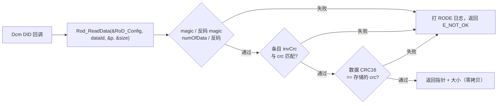

# RoD - 只读数据

> **一句话概括：** RoD 是一个小型库，直接从 Flash 提供常量数据（标定值、DID
> 负载），用 magic 数字和 CRC16 保护 - 表损坏时返回错误而不是给出坏数据。

| 项目 | 值 |
| --- | --- |
| 模块 | `infras/memory/RoD`（46 行；API：`infras/include/RoD.h`） |
| 层级 | 库；典型用法是 Dcm 的 DID 读回调（0x22） |
| 配置 | 经 `tools/generator/RoD.py` 从 JSON 描述生成表 |
| 标准 | SSAS 专有（无 AUTOSAR 对应模块） |
| 演示 | 读取常量数据的 Dcm DID 处理器 |

**目录**

1. [用途](#1-用途)
2. [工作方式](#2-工作方式)
3. [公开 API](#3-公开-api)
4. [关键注意事项](#4-关键注意事项)
5. [已知局限](#5-已知局限)

---

## 1. 用途

标定/身份数据不拷进 RAM，而是放在 Flash 里，每次读取时校验：

* `RoD_DataType` - 一个条目：`{数据指针, size, crc, ~crc}`。
* `RoD_ConfigType` - 表本体：`{datas[], magic, ~magic, numOfData, ~numOfData}`。

所有字段都是 `const`，放在 `ROD_ENTRY` / `ROD_CONST` 链接段（ARM/GCC
`__attribute__((section))`），表随应用镜像一起烧写。

---

## 2. 工作方式

CRC 是 CRC16-CCITT（poly `0x1021`，初值 `0xFFFF`，不反射），构建期由
`tools/generator/RoD.py` 计算，运行期校验。

`RoD.py` 生成：

* 从嵌套 JSON 描述生成结构体/typedef 定义（含经 `Return`/`Args` 描述的函数指针
  字段），
* 带预计算 CRC 的 const 数据表，
* 兼顾 MemMap 的放置（`#define ROD_CONST_START/STOP` 段）。

---

## 3. 公开 API

| 函数 | 用途 |
| --- | --- |
| `Rod_ReadData(config, dataId, **pData, *size)` | 校验并返回常量数据指针（零拷贝） |

整个 API 就这一个函数。

---

## 4. 关键注意事项

1. **dataId 就是数组下标** - 重排 JSON 表会改动所有 id；Dcm DID 映射必须一并
   重新生成。
2. **损坏语义**：任何不匹配都打 `RODE` 日志并返回 `E_NOT_OK` - 调用方（Dcm）
   回 NRC，而不是给出坏数据。
3. **反码字段**（`invMagic`、`invNumOfData`、`invCrc`）的作用是让全 `0xFF` 的
   擦除态 Flash 永远校验不过。
4. **数据是真 const** - 写入请走别的机制（NvM/Fee）；不要把指针强转掉。

---

## 5. 已知局限

1. **零拷贝意味着调用方不得修改数据** - API 返回 `const void *`，但除类型系统
   外没有强制。
2. **每次访问都校验 CRC** - 大表在慢核上是每次读取的运行时开销；必要时可缓存
   校验结果。
3. **生成器只支持 JSON 进 C 出** - 生成的表不能回编辑。
4. **链接段** `ROD_ENTRY`/`ROD_CONST` 在目标机构建时必须存在于链接脚本；宿主上
   回退到默认段。

**相关文档：** [NvM](NvM.md) - [Dcm](Dcm.md)
