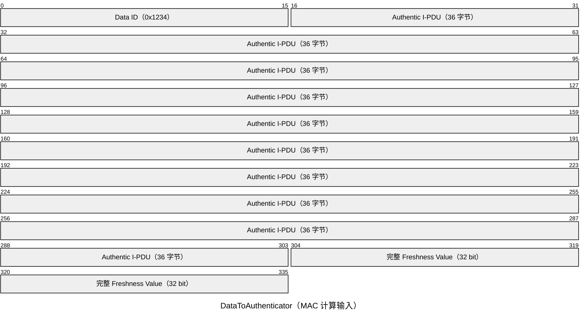
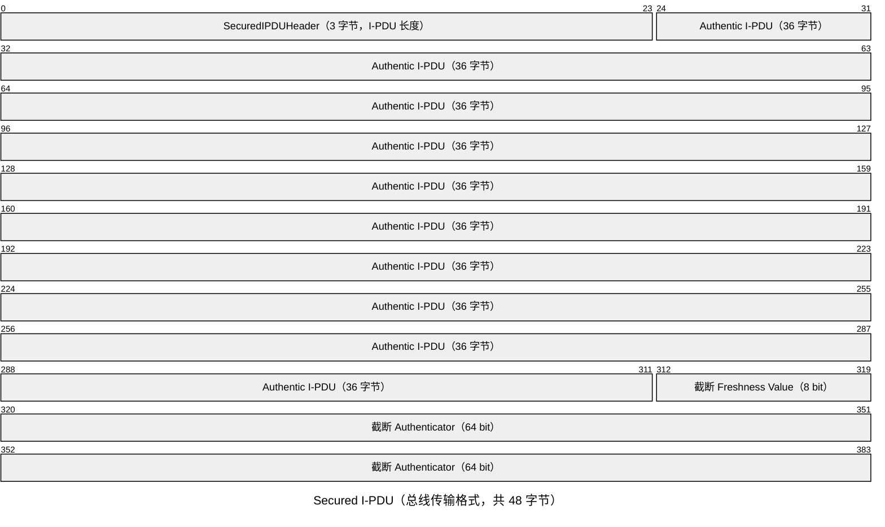
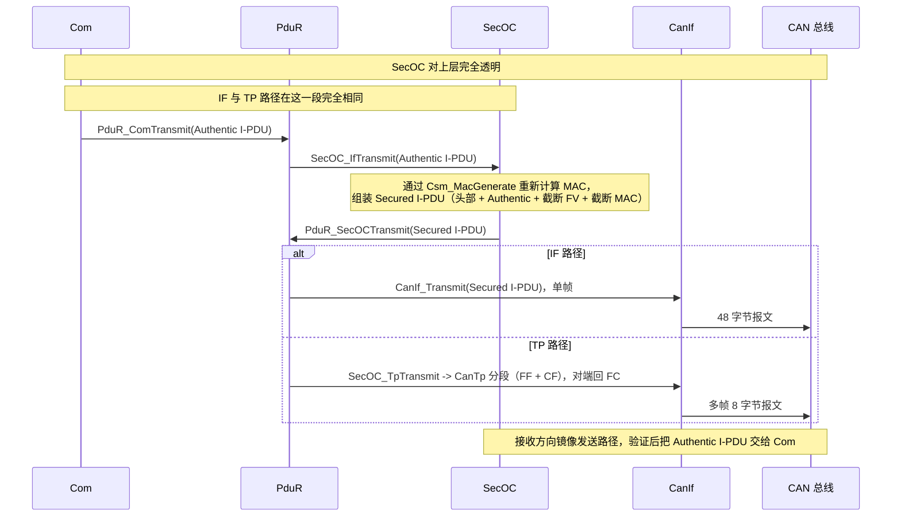
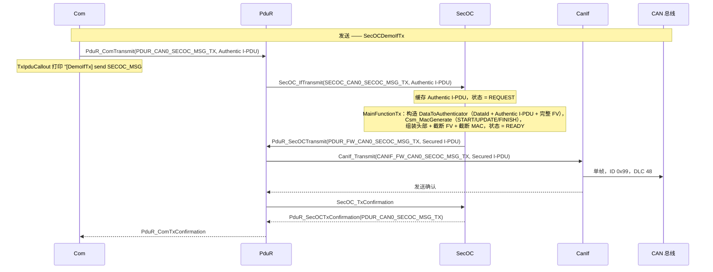
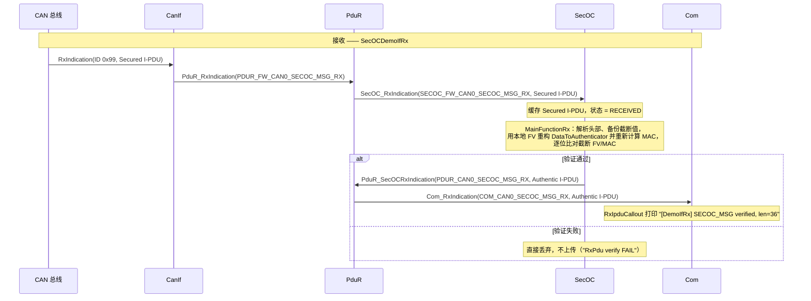
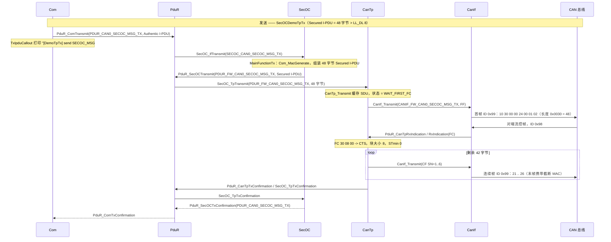
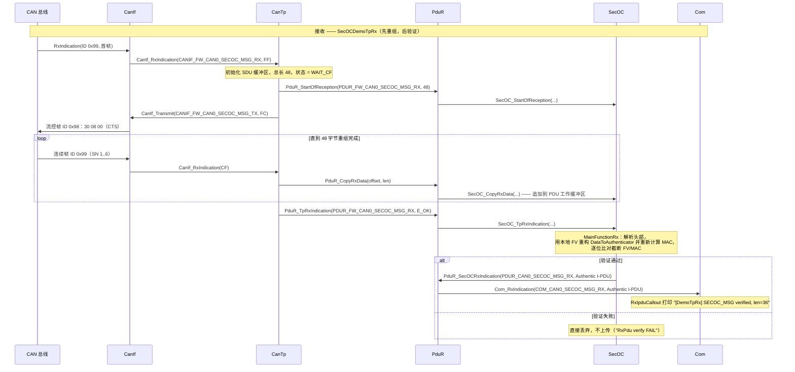

---  
layout: post
title: AUTOSAR SecOC (Secure Onboard Communication) 安全车载通信
category: AUTOSAR
comments: true  
---

# AUTOSAR SecOC - 安全车载通信概述

**SecOC** (Secure Onboard Communication) 是 AUTOSAR CP 对车载网络报文防篡改与认证的安全机制。其目的是在不改变现有上层模块接口的前提下，为 CAN/LIN 等总线上的 I-PDU 添加认证信息（Authenticator/MAC）和新鲜度值（Freshness Value），从而确保接收端能够验证报文的完整性与真实性，并拒绝被重放或伪造的报文。

AS 中的 SecOC 实现参考 AUTOSAR CP R23-11 规范（代码注释中标注了对应的 `@SWS_SecOC_*` 需求），支持基于 IF（Immediate）传输的 PDU 认证处理，通过与 **Csm**（Crypto Service Manager）配合完成 MAC 生成/验证，并与 **PduR**、**Com**、**CanIf**（以及 TP 路径下的 CanTp）等模块联动。

- 代码实现：[infras/communication/SecOC/SecOC.c](../../infras/communication/SecOC/SecOC.c)
- 头文件接口：[infras/include/SecOC.h](../../infras/include/SecOC.h)
- 配置生成工具：[tools/generator/SecOC.py](../../tools/generator/SecOC.py)
- 演示应用：[SecOCDemoIfTx / SecOCDemoIfRx / SecOCDemoTpTx / SecOCDemoTpRx](../../app/app/config/SecOC)

## 1. 核心概念

### 1.1 设计目标

- 报文认证：对发送的 I-PDU 计算 MAC 并附加认证信息
- 新鲜度保护：使用新鲜度值防止重放攻击
- 路由透明：通过 PduR 联动，上层模块（如 Com）几乎无感知
- 灵活截断：支持对 Authenticator/FV 截断以节省总线带宽
- CSM 集成：复用 AUTOSAR 密码学服务（SecOC 内部不实现密码算法）

### 1.2 关键术语

| 术语                   | 说明                             |
| -------------------- | ------------------------------ |
| Authentic I-PDU      | 待保护的原始应用层 PDU                  |
| Secured I-PDU        | 添加截断 Authenticator 和新鲜度值后的 PDU |
| Authenticator (MAC)  | 基于密钥的 MAC，用于完整性/真实性校验          |
| Freshness Value (FV) | 新鲜度值，计数器/时间戳，用于防重放             |
| Data ID              | 用于区分不同 PDU 的标识符，参与 MAC 计算      |
| 截断 (Truncation)      | 对 Authenticator/FV 截断以节省带宽     |

### 1.3 PDU 格式

有两个关键布局（长度定义遵循 AUTOSAR 规范）：

- **DataToAuthenticator**（MAC 计算输入）= `Data ID (2 字节) | Authentic I-PDU | 完整新鲜度值`（`@SWS_SecOC_00034`）
- **Secured I-PDU**（总线上实际传输的报文）= `SecuredIPDUHeader（可选，包含 Authentic I-PDU 长度） | Authentic I-PDU | FreshnessValue [SecOCFreshnessValueTruncLength]（可选） | Authenticator [SecOCAuthInfoTruncLength]`（`@SWS_SecOC_00261`）

> 注意：在 `SecOC.json` 中，`AuthInfoLength`/`AuthInfoTruncLength`/`FreshnessValueTruncLength` 及新鲜度值长度单位为 **bit**，而 `AuthenticIPduLength`（Authentic I-PDU 最大长度，用于分配工作缓冲区）单位为 **字节**。

以演示配置为例：MAC 128 bit 截断为 64 bit，FV 32 bit 截断为 8 bit，头部 3 字节，因此 36 字节的 Authentic I-PDU 组装后为 48 字节的 Secured I-PDU。

用报文布局图表示（以演示数值为例）：





### 1.4 与 AUTOSAR 协议栈的集成

SecOC 作为中间层存在：发送方向上是 PduR 的上层客户，接收方向下是 PduR 的下层模块。密码学服务通过 CSM 的 MAC 生成接口调用。

**两种演示的数据通路完全相同**，唯一区别在于 PduR 另一侧的下层模块 —— **IF** 路径是 `CanIf`，**TP** 路径是 `CanTp`：

| 路径 | 发送 | 接收 |
|---|---|---|
| **IF**（Immediate，立即传输） | Com → PduR → SecOC → PduR → **CanIf** | **CanIf** → PduR → SecOC → PduR → Com |
| **TP**（Transport Protocol，传输协议） | Com → PduR → SecOC → PduR → **CanTp** → CanIf | CanIf → **CanTp** → PduR → SecOC → PduR → Com |



两种演示的详细分步时序见第 2 节：
- **IF 演示（DemoIfTx / DemoIfRx）** —— 见 [2.2](#22-if-演示--secocemoiftx--secocemoifrx)；
- **TP 演示（DemoTpTx / DemoTpRx）** —— 见 [2.3](#23-tp-演示--secocemotptx--secocemotprx)。

## 2. 演示概览

本仓库中所有 SecOC 配置都归纳为**两种演示**，它们共用完全相同的上层协议栈，区别仅在于 Secured I-PDU 如何到达总线。每种演示都由一个发送应用和一个接收应用组成：

| # | 演示类型 | 应用 | Secured I-PDU 的传输方式 |
|---|---|---|---|
| 1 | **IF 演示** | [SecOCDemoIfTx](../../app/app/config/SecOC/DemoIfTx) / [SecOCDemoIfRx](../../app/app/config/SecOC/DemoIfRx) | `CanIf` 直接以**单个 CAN 帧**收发 |
| 2 | **TP 演示** | [SecOCDemoTpTx](../../app/app/config/SecOC/DemoTpTx) / [SecOCDemoTpRx](../../app/app/config/SecOC/DemoTpRx) | `CanTp`（ISO 15765-2）**分段/重组**为多帧 |

两种演示的共同点：

- 两侧承载同一条报文 `SECOC_MSG`，携带一个 288 bit（36 字节）大端信号 `VehicleConfig`；
- **两侧的 CSM 作业都是同一个 `MAC_GENERATE` 作业**（见第 3 节）—— SecOC 在接收端通过重新生成 MAC 来完成验证，而不是调用 verify 接口；
- 两侧都在各自的 Com IPdu Callout 中打印报文，日志可以逐行比对；
- 均在 [app/app/SConscript](../../app/app/SConscript) 中注册，构建方式与其他应用一致。

### 2.1 报文与 SecOC 配置

`SECOC_MSG`（DLC 36）携带一个 288 bit 大端信号 `VehicleConfig`。DLC 只覆盖 **Authentic** I-PDU；SecOC 组装 48 字节 Secured I-PDU 时会追加 3 字节头部、8 bit 截断 FV 和 64 bit 截断 MAC。

| 配置项 | 取值 |
|---|---|
| DataId | `0x1234` |
| AuthInfoLength / AuthInfoTruncLength | 128 / 64 bit |
| FreshnessValue 长度 / FreshnessValueTruncLength | 32 / 8 bit |
| AuthPduHeaderLength | 3 字节 |
| AuthenticIPduLength | 64 字节（用于分配缓冲区） |

每个演示目录都包含 `SecOC.json`、`Csm.json`、`PduR.json`、`Com.json`、`CanIf.json`、胶水代码；TP 演示额外多一个 `CanTp.json`。

### 2.2 IF 演示 —— SecOCDemoIfTx / SecOCDemoIfRx

Secured I-PDU 直接交给 `CanIf`，作为**单个 48 字节 CAN 帧**发送到总线。两侧使用**同一个 CAN ID `0x99`**，因此同时运行两个应用即可演示完整往返流程：Tx 应用加签并发送，Rx 应用验证并把 Authentic I-PDU 转发给 Com。

| 应用 | 数据流方向 | 配置 / 源码 |
|---|---|---|
| `SecOCDemoIfTx` | Com → PduR → SecOC → PduR → CanIf | [DemoIfTx](../../app/app/config/SecOC/DemoIfTx) |
| `SecOCDemoIfRx` | CanIf → PduR → SecOC → PduR → Com | [DemoIfRx](../../app/app/config/SecOC/DemoIfRx) |

胶水代码（`secoctx_demo.c` / `secocrx_demo.c`）提供 `User_Init` / `User_MainTask10ms` 两个钩子。为保持两侧对称，**两边都在各自的 Com IPdu Callout 中打印报文**：

- Tx 侧：`Com.json` 中的 `enable_message_tx_callout` 使能 `CAN0_SECOC_MSG_TX_TxIpduCallout`。Com 在把 Authentic I-PDU 交给 PduR 之前（即 SecOC 加签之前）调用它；返回 `TRUE` 则允许继续发送。
- Rx 侧：`enable_message_rx_callout` 使能 `CAN0_SECOC_MSG_RX_RxIpduCallout`。Com 只有在 SecOC 验证 MAC 与新鲜度通过并转发 Authentic I-PDU 之后才调用它，因此凡是打印出来的报文必然已通过校验。

```bash
scons --app=SecOCDemoIfTx
scons --app=SecOCDemoIfRx
```

由于 v2 模拟器采用 UDP 组播（无需启动服务端），同时运行两个应用即可观察到完整流程。还可再启动一个 `CanDump` 嗅探进程挂到同一条总线上观察加签后的报文，详见 6.3 节。

IF 演示的完整时序（使用真实的 PduR 路由名）：





### 2.3 TP 演示 —— SecOCDemoTpTx / SecOCDemoTpRx

48 字节的 Secured I-PDU 无法装入单个经典 CAN 帧，因此也可以交给 **CanTp**（ISO 15765-2），由传输层将其拆分为首帧（First Frame）加若干连续帧（Consecutive Frame）。

| 应用 | 数据流方向 | 配置 / 源码 |
|---|---|---|
| `SecOCDemoTpTx` | Com → PduR → SecOC → PduR → CanTp → CanIf | [DemoTpTx](../../app/app/config/SecOC/DemoTpTx) |
| `SecOCDemoTpRx` | CanIf → CanTp → PduR → SecOC → PduR → Com | [DemoTpRx](../../app/app/config/SecOC/DemoTpRx) |

每个目录包含 `SecOC.json`、`Csm.json`、`PduR.json`、`CanTp.json`、`CanIf.json`、`Com.json` 以及胶水代码（`secoctp_demo.c` / `secocrxtp_demo.c`）。Com Callout、CSM 作业（两侧均为 `MAC_GENERATE`）以及 SecOC 处理块与 IF 演示**完全相同**，只有三处不同：

1. `PduR.json` 把 SecOC 路由到 **CanTp**（而非 CanIf）；
2. 多出一个 `CanTp.json` 配置 ISO-TP 通道；
3. CanIf PDU 的 `up` 字段为 `CanTp`。

由于 ISO-TP 本质上是双向的 —— 发送端必须等待对端的流控帧 —— 两个节点使用**两个 CAN ID**：数据方向（首帧/连续帧，Tx → Rx）使用 `0x99`，接收端回送的**流控帧**（Flow Control）使用 `0x98`。因此每个 CanTp 通道都同时具有 `TxPduId`（数据发送）与 `RxPduId`（流控接收），与普通 ISO-TP 点对点通道一致；两侧各自未使用的那一个 SDU 级 `PduR_*PduId` 直接复用已有路由，以保证生成的宏可解析。

```bash
scons --app=SecOCDemoTpTx
scons --app=SecOCDemoTpRx
```

TP 时序在两端额外增加了分段/重组 —— 发送端为 `SecOC_TpTransmit`，接收端为 `SecOC_StartOfReception` / `SecOC_CopyRxData` / `SecOC_TpRxIndication` —— 以及流控握手：





## 3. CSM 配置

`Csm.json` 定义了一个 MAC 算法，以及两种演示共用的一个作业：

- **MACGEN0**：AES 家族、ECB 模式、128 位密钥（`0x00..0x0f`），使能校验。AES-ECB 由 CSM 驱动用作类 CMAC 的 MAC 原语。
- **SECOC_MACGEN_0**：`MAC_GENERATE` 作业，引用 MACGEN0。

**IF 演示与 TP 演示中，收发两侧都只声明这同一个 `MAC_GENERATE` 作业（`SECOC_MACGEN_0`）。**

AS 在接收端通过**重新生成** MAC 来完成验证：接收端用本地 FV 重构出相同的 DataToAuthenticator，再与总线上收到的截断 FV + MAC 逐位比对。`Csm_MacGenerate` 与 `Csm_MacVerify` 底层都由 MAC 原语支撑，且都可以挂到声明为 `MAC_GENERATE` 或 `MAC_VERIFY` 的作业上 —— 因此纯接收节点可以只配置一个 verify 作业，而发送节点只保留一个 generate 作业。

## 4. 工作原理

### 4.1 发送处理（SecOC_MainFunctionTx）

每个 PDU 的发送状态机：`IDLE → REQUEST → ASSEMBLE → READY → WAIT_TX_DONE → IDLE`。

1. **REQUEST**：PduR 调用 `SecOC_IfTransmit`，将 Authentic I-PDU 拷贝到该 PDU 的工作缓冲区，状态置为 REQUEST。
2. `SecOC_ProcTx` 写入 2 字节 Data ID，通过 `SecOC_GetTxFreshness` 获取完整 FV，对 DataToAuthenticator 调用三次 `Csm_MacGenerate`（START/UPDATE/FINISH）计算 MAC。
3. **ASSEMBLE**：构造 SecuredIPDUHeader（`@SWS_SecOC_00262`），再用位级搬移（`Std_BitCopy`）将 FV 截断到 `FreshnessValueTruncLength`、MAC 截断到 `AuthInfoTruncLength`（`@SWS_SecOC_00261`），状态置为 READY。
4. **READY**：通过 `PduR_SecOCTransmit` 发送 Secured I-PDU；发送确认后状态回到 IDLE，并向上转发确认。

### 4.2 接收处理（SecOC_MainFunctionRx）

1. PduR 调用 `SecOC_RxIndication`，缓存 Secured I-PDU，状态 = RECEIVED。
2. `SecOC_ProcRx` 解析头部得到 Authentic I-PDU 长度，将末尾的截断 FV + MAC 备份到工作缓冲区尾部，写入 2 字节 Data ID，并获取本地 FV。
3. 对重构出的 DataToAuthenticator 重新计算 MAC，并与截断 FV + MAC 逐位比对。
4. 验证通过则经 `PduR_SecOCRxIndication` 上传 Authentic I-PDU；失败则直接丢弃（输出一条日志）。

### 4.3 新鲜度值

生成器生成的 `SecOC_GetFreshness_FreshnessValue0` 弱函数是**演示占位实现**：返回一个递增计数器（前两字节大端存放 counter/2），每次调用自增。实际 ECU 上应替换为自己的 FV 管理器（计数器同步、安全时间戳或 SecOC 自带的 FVM）。由于同一节点上 Tx/Rx 查询的是同一个计数器，配合 `SECOC_SELF_TEST` 可直接验证通过。

### 4.4 TP 路径与自测

- 已实现完整 TP 接口（`SecOC_TpTransmit`、`SecOC_StartOfReception`、`SecOC_CopyRxData`、`SecOC_CopyTxData`、`SecOC_TpRxIndication`、`SecOC_TpTxConfirmation`），Secured PDU 可经 CanTp 传输 —— **TP 演示（2.3 节）** 正是基于这条路径。
- 编译开启 `SECOC_SELF_TEST` 后，发送路径会将自身的 Secured PDU 回灌给 `SecOC_RxIndication`，无需总线即可完成回环验证。

## 5. 生成代码与接口

生成器（[tools/generator/SecOC.py](../../tools/generator/SecOC.py)）根据 SecOC.json 生成 `SecOC_Cfg.c/.h`：

- `SecOC_<Pdu名>` / `SECOC_FW_<Pdu名>` PDU ID 宏，用于 PduR 关联
- 按 `AuthenticIPduLength` + MAC + FV 长度分配的每 PDU 工作缓冲区（如示例 Tx PDU 为 87 字节）
- `SecOC_TxPduProcs` / `SecOC_RxPduProcs` 配置表及每 PDU 上下文
- 对 `GenDummy: true` 的 FV 生成 `__weak SecOC_GetFreshness_<FV名>` 占位实现
- `SECOC_MAIN_FUNCTION_PERIOD`（默认 10 ms）


主要接口（见 [SecOC.h](../../infras/include/SecOC.h)）：

| 接口                                                                                                | 作用                          |
| ------------------------------------------------------------------------------------------------- | --------------------------- |
| SecOC_Init                                                                                        | 初始化所有 PDU 处理上下文             |
| SecOC_IfTransmit                                                                                  | IF 发送入口（PduR 调用）            |
| SecOC_RxIndication / SecOC_TxConfirmation                                                         | IF 接收入口 / 发送确认              |
| SecOC_MainFunctionTx / SecOC_MainFunctionRx                                                       | 周期性 MAC 生成、组装与验证            |
| SecOC_GetTxFreshness                                                                              | FV 提供者（实现在 SecOC_Callout.c） |
| SecOC_TpTransmit / StartOfReception / CopyTxData / CopyRxData / TpRxIndication / TpTxConfirmation | TP 路径支持                     |

演示胶水代码提供了 Com 层钩子：Tx 应用在 `secoctx_demo.c` / `secoctp_demo.c` 中实现 `CAN0_SECOC_MSG_TX_TxIpduCallout`，Rx 应用在 `secocrx_demo.c` / `secocrxtp_demo.c` 中实现 `CAN0_SECOC_MSG_RX_RxIpduCallout`，二者都会打印报文以便观察。

## 6. 构建与运行

EcuM 会自动调用 SecOC_Init 并调度 SecOC_MainFunctionTx/Rx。按第 2 节说明构建并同时运行**某一种演示**的两个应用；两侧都在各自的 Com IPdu Callout 中打印报文，且格式一致（一行摘要 + 一段十六进制 dump），便于逐行对比两侧日志：

- Tx（Com 发送 IPdu Callout，位于 SecOC 加签之前）：`[Demo<Kind>Tx] send SECOC_MSG #<n>, len=<n> data:` + 十六进制 dump
- Rx（Com 接收 IPdu Callout，位于 SecOC 验证通过之后）：`[Demo<Kind>Rx] SECOC_MSG verified, len=<n> data:` + 十六进制 dump

若 Rx 验证失败（例如新鲜度计数器未同步），则显示 `RxPdu verify FAIL`。

下面给出两种演示各自的典型运行日志（均为真实抓取输出），对照 `-v 0` 的日志级别可以直接判断运行是否正常。

### 6.1 IF 演示的运行与典型日志

构建并运行：

```bash
scons --app=SecOCDemoIfTx
scons --app=SecOCDemoIfRx
build/nt/GCC/SecOCDemoIfTx/SecOCDemoIfTx.exe -v 0
build/nt/GCC/SecOCDemoIfRx/SecOCDemoIfRx.exe -v 0
```

**Tx 应用**（`SecOCDemoIfTx.exe -v 0`）——由 Com 发送 IPdu Callout 在 SecOC 加签之前打印 Authentic I-PDU：

```
DEMO    :[DemoIfTx] send SECOC_MSG #1, len=36 data:
DEMO    :
  00000000 00 01 02 03 04 05 06 07 08 09 0A 0B 0C 0D 0E 0F 10 11 12 13 14 15 16 17 18 19 1A 1B 1C 1D 1E 1F
DEMO    :[DemoIfTx] send SECOC_MSG #2, len=36 data:
DEMO    :
  00000000 01 02 03 04 05 06 07 08 09 0A 0B 0C 0D 0E 0F 10 11 12 13 14 15 16 17 18 19 1A 1B 1C 1D 1E 1F 20
```

**Rx 应用**（`SecOCDemoIfRx.exe -v 0`）——CanIf 收到单帧 48 字节 Secured I-PDU，SecOC 验证通过后由 Com 接收 IPdu Callout 打印 Authentic I-PDU：

```
CANIF   :RX CAN ID=0x00000099 LEN=48 DATA=[00 00 24 00 01 02 03 04]
SECOC   :[0] RxPdu data length = 36, backup 9 auth info to pos 80
SECOC   :[0] RxPdu verify PASS
PDUR    :PduR_RxIndication 1
DEMO    :[DemoIfRx] SECOC_MSG verified, len=36 data:
DEMO    :
  00000000 00 01 02 03 04 05 06 07 08 09 0A 0B 0C 0D 0E 0F 10 11 12 13 14 15 16 17 18 19 1A 1B 1C 1D 1E 1F
```

**CanDump**（`CanDump.exe -d simulator_v2 -p 0 -f 7FF#099`，见 6.3 节）——总线上真实的 Secured I-PDU，一个 CAN 帧即承载全部 48 字节：

```
canid=00000099,dlc=48,data=[00,00,24,00,01,...,23,00,19,43,F8,77,9E,D9,77,AB,] [...] @ 2.375215 s rel 0.00 ms
canid=00000099,dlc=48,data=[00,00,24,01,02,...,24,00,CE,41,A8,A4,3B,0A,3A,69,] [...] @ 3.375162 s rel 999.95 ms
```

对照三份输出：Tx Callout 的载荷 `00 01 … 1F 20 21 22 23`，正是 Rx 在 `verify PASS` 之后打印的那 36 字节；CanDump 则把这 36 字节包裹为 `SecuredIPDUHeader (00 00 24) | Authentic I-PDU | 截断 FV (00) | 截断 MAC`。MAC 每个周期都在变化（例如 `19 43 F8 77 9E D9 77 AB`，随后是 `CE 41 A8 A4 3B 0A 3A 69`），这是因为新鲜度值每次发送都会变化；而在本 demo 的 dummy FV 下，截断 FV 字节始终保持为 `00`。

### 6.2 TP 演示的运行与典型日志

构建并运行：

```bash
scons --app=SecOCDemoTpTx
scons --app=SecOCDemoTpRx
build/nt/GCC/SecOCDemoTpTx/SecOCDemoTpTx.exe -v 0
build/nt/GCC/SecOCDemoTpRx/SecOCDemoTpRx.exe -v 0
```

**Tx 应用**——48 字节 Secured I-PDU 先由 CanTp 缓存，随后发送首帧（`10 30 ...`，长度 `0x0030` = 48）并**等待流控帧**；收到对端在 `0x98` 上回送的 FC（`30 08 00`，CTS、块大小 8、STmin 0）后，才开始按 `21`…`26` 递增序号发送连续帧，末帧携带截断 MAC：

```
DEMO    :[DemoTpTx] send SECOC_MSG #1, len=36 data:
DEMO    :
  00000000 00 01 02 03 04 05 06 07 08 09 0A 0B 0C 0D 0E 0F 10 11 12 13 14 15 16 17 18 19 1A 1B 1C 1D 1E 1F
  00000020 20 21 22 23
PDUR    :PduR_Transmit 0
PDUR    :PduR_Transmit 1
PDUR    :PduR_CopyTxData 1
CANTPI  :[0]TX len=8 data=[10,30,00,00,24,00,01,02]      <-- First Frame (FF)，长度 0x0030 = 48
CANIF   :RX CAN ID=0x00000098 LEN=8 DATA=[30 08 00 55 55 55 55 55]
CANTPI  :[0]RX len=8 data=[30,08,00,55,55,55,55,55], state=2 left=42   <-- Flow Control，CTS BS=8
PDUR    :PduR_CopyTxData 1
CANTPI  :[0]TX len=8 data=[21,03,04,05,06,07,08,09]      <-- Consecutive Frame SN=1
...
CANTPI  :[0]TX len=8 data=[26,43,F8,77,9E,D9,77,AB]      <-- 末帧携带截断 MAC
PDUR    :PduR_TxConfirmation 1
SECOC   :[0] Tx Confirm result=0
PDUR    :PduR_TxConfirmation 0
```

**Rx 应用**——CanIf 逐帧收到 N-PDU，CanTp 重组 48 字节：首帧触发 `PduR_StartOfReception`，随后通过 `0x98` 回送流控帧，再逐帧 `PduR_CopyRxData` 填充缓冲区（`left` 从 42 递减），收齐后触发 `PduR_TpRxIndication`，SecOC 此时才开始验证：

```
CANIF   :RX CAN ID=0x00000099 LEN=8 DATA=[10 30 00 00 24 00 01 02]
CANTPI  :[0]RX len=8 data=[10,30,00,00,24,00,01,02], state=0 left=0
PDUR    :PduR_StartOfReception 0
PDUR    :PduR_CopyRxData 0
CANTPI  :[0]TX len=8 data=[30,08,00,55,55,55,55,55]      <-- 通过 0x98 回送流控帧
CANIF   :RX CAN ID=0x00000099 LEN=8 DATA=[21 03 04 05 06 07 08 09]
CANTPI  :[0]RX len=8 data=[21,03,04,05,06,07,08,09], state=1 left=42
PDUR    :PduR_CopyRxData 0
...
CANIF   :RX CAN ID=0x00000099 LEN=8 DATA=[26 43 F8 77 9E D9 77 AB]
CANTPI  :[0]RX len=8 data=[26,43,F8,77,9E,D9,77,AB], state=1 left=7
PDUR    :PduR_CopyRxData 0
PDUR    :PduR_TpRxIndication 0
SECOC   :[0] RxPdu data length = 36, backup 9 auth info to pos 80
SECOC   :[0] RxPdu verify PASS
PDUR    :PduR_RxIndication 1
DEMO    :[DemoTpRx] SECOC_MSG verified, len=36 data:
DEMO    :
  00000000 00 01 02 03 04 05 06 07 08 09 0A 0B 0C 0D 0E 0F 10 11 12 13 14 15 16 17 18 19 1A 1B 1C 1D 1E 1F
  00000020 20 21 22 23
```

**CanDump**——TP 演示下总线上看到的是 8 字节的 N-PDU 序列而非单帧 48 字节报文（`-f 7FF#099` 只看数据方向，流控帧在 `0x98`）：

```
canid=00000099,dlc=8,data=[10,30,00,00,24,00,01,02,] [...] @ 1.208061 s rel 0.00 ms   <-- FF
canid=00000099,dlc=8,data=[21,03,04,05,06,07,08,09,] [...] @ 1.208563 s rel 0.50 ms   <-- CF SN=1
canid=00000099,dlc=8,data=[22,0A,0B,0C,0D,0E,0F,10,] [...] @ 1.208565 s rel 0.00 ms
canid=00000099,dlc=8,data=[23,11,12,13,14,15,16,17,] [...] @ 1.208566 s rel 0.00 ms
canid=00000099,dlc=8,data=[24,18,19,1A,1B,1C,1D,1E,] [...] @ 1.208568 s rel 0.00 ms
canid=00000099,dlc=8,data=[25,1F,20,21,22,23,00,19,] [...] @ 1.208570 s rel 0.00 ms
canid=00000099,dlc=8,data=[26,43,F8,77,9E,D9,77,AB,] [...] @ 1.208572 s rel 0.00 ms   <-- 末帧
```

对照可见：Tx 侧的 `CANTPI :[0]TX` 各行与 CanDump 抓到的帧一一对应（首帧 + 6 个连续帧 = 7 帧 × 8 字节 = 56 字节，其中首帧头部 2 字节 + 6 帧顺序号 `21`…`26` 各 1 字节，净荷正好 48 字节）；Rx 侧 `state` 由 `0`（等待首帧）变为 `1`（收连续帧）、`left` 从 42 递减到 7，最终重组完成并 `verify PASS`。若对端未回送流控帧，Tx 会一直停在 `WAIT_FIRST_FC`，不会发出任何连续帧。

### 6.3 用 CanDump 抓取真实 CAN 报文

上面的 Com Callout 打印的是 **Authentic I-PDU**（36 字节，加签前/验签后）。若想看清总线上真正传输的内容——即包含 SecuredIPDUHeader、截断新鲜度值、截断认证符的 **Secured I-PDU**——可在演示运行期间，用 CAN 嗅探工具 `CanDump` 挂到同一条虚拟总线上：

```bash
scons --app=CanDump
build\nt\GCC\one\CanDump.exe -d simulator_v2 -p 0
```

`-d simulator_v2` 指定 UDP 组播虚拟 CAN 驱动，`-p 0` 指定总线 0（即 `Com.json` 中 network 的 `port` 字段）。CanDump 无需服务端，可与 Tx/Rx 应用并行在第三个终端中运行。IF 演示报文的典型输出如下（TP 演示为 8 字节 N-PDU 序列，见 6.2 节）：

```
canid=00000099,dlc=48,data=[00,00,24,01,02,03,04,05,...,24,00,CE,41,A8,A4,3B,0A,3A,69,] [...] @ 0.608061 s rel 0.00 ms
```

将该帧对应到 1.3 节的 SecOC 报文格式：

| 字节                        | 字段                      | 取值                        |
| ------------------------- | ----------------------- | ------------------------- |
| `00 00 24`                | SecuredIPDUHeader（3 字节） | I-PDU 长度 `0x24` = 36      |
| `01 02 … 24`              | Authentic I-PDU         | 36 字节的 `VehicleConfig` 载荷 |
| `00`                      | 截断新鲜度值（8 bit）           | 32 位 FV 的截断               |
| `CE 41 A8 A4 3B 0A 3A 69` | 截断认证符（64 bit）           | 128 位 MAC 的截断             |

注意 Data ID（`0x1234`）**不会**出现在总线上——它只作为 MAC 计算的输入参与运算（见 1.3 节）。

## 7. 参考资料

- AUTOSAR CP R23-11 SecOC 规范
- 代码：[SecOC.c](../../infras/communication/SecOC/SecOC.c)、[SecOC.h](../../infras/include/SecOC.h)、[Csm.c](../../infras/crypto/Csm/Csm.c)
- 两种演示共用的运行期配置：[Csm.json](../../app/app/config/Csm/Csm.json)
- IF 演示（每个 Secured I-PDU 单帧发送）：[DemoIfTx](../../app/app/config/SecOC/DemoIfTx)、[DemoIfRx](../../app/app/config/SecOC/DemoIfRx)
- TP 演示（ISO 15765-2 分段传输）：[DemoTpTx](../../app/app/config/SecOC/DemoTpTx)、[DemoTpRx](../../app/app/config/SecOC/DemoTpRx)
- 用于抓取总线的 CAN 嗅探工具：[can\_dump.cpp](../../tools/libraries/Can/utils/can_dump.cpp)
