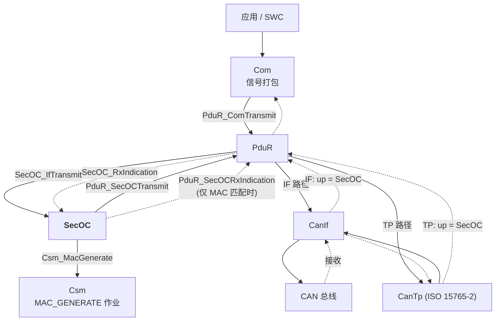
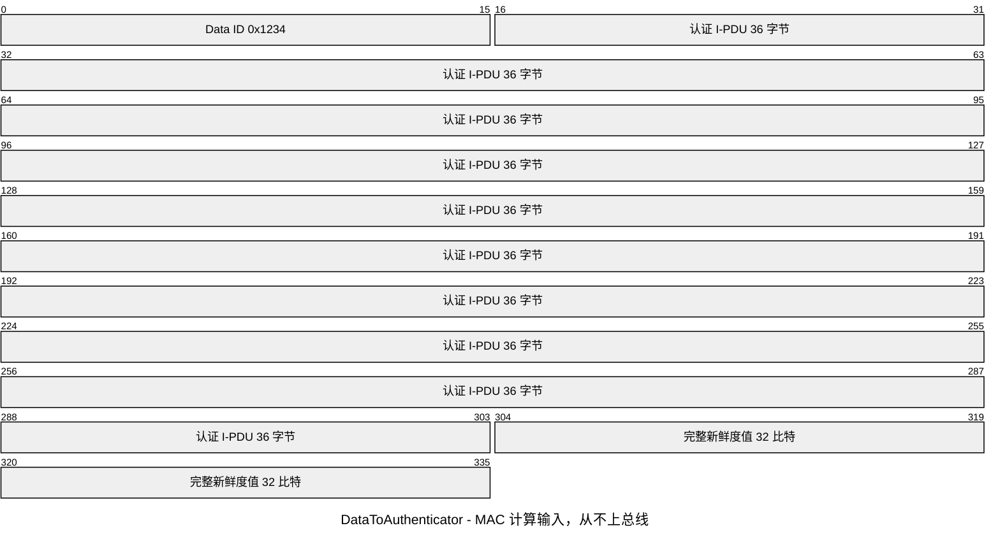
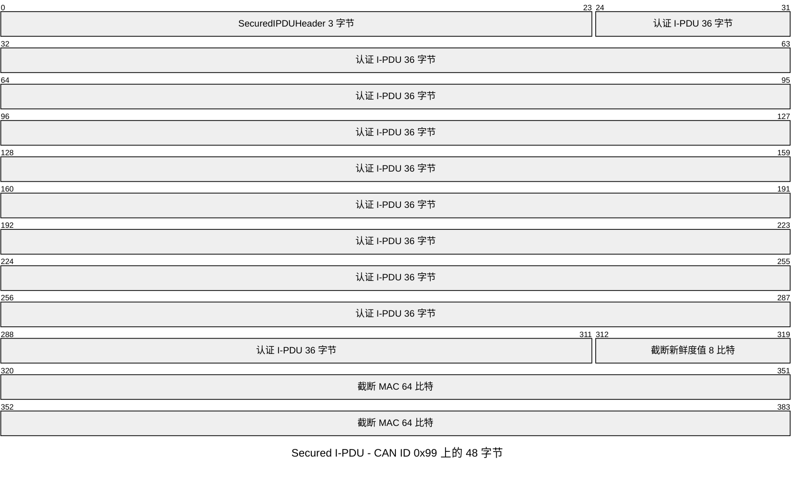
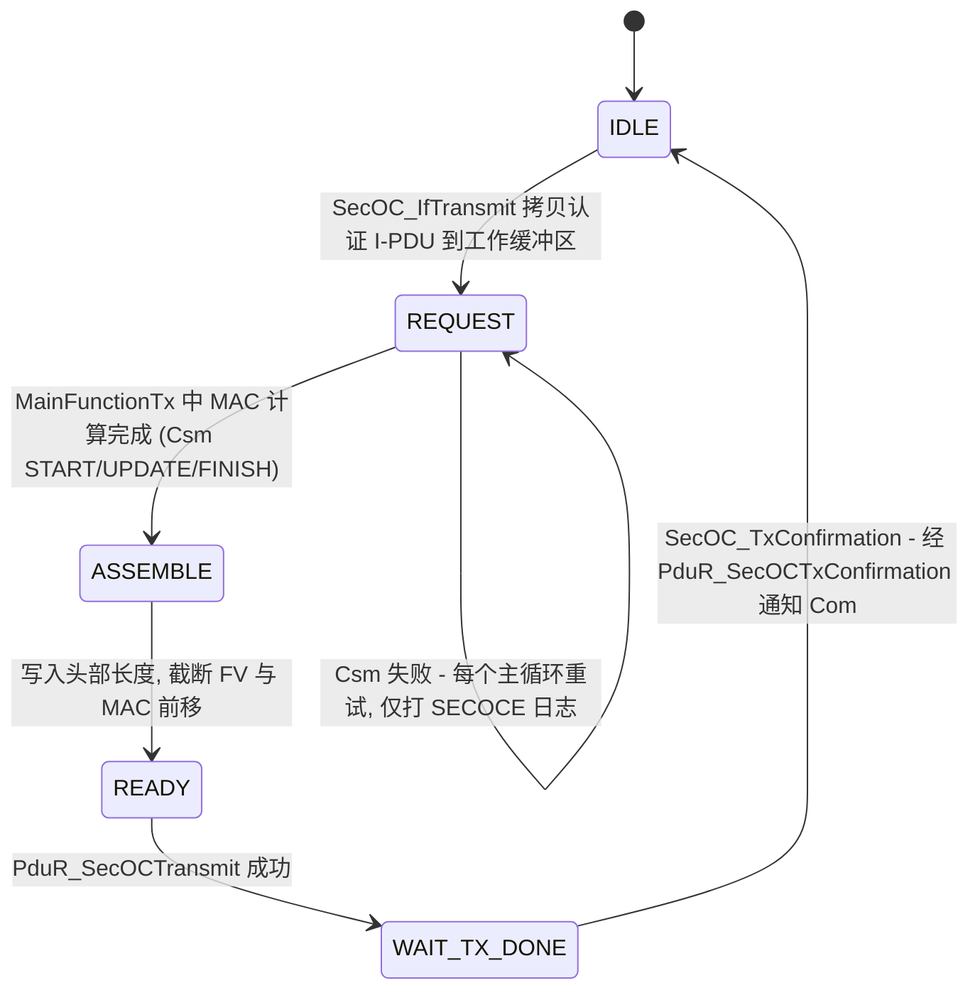
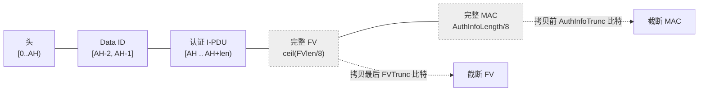
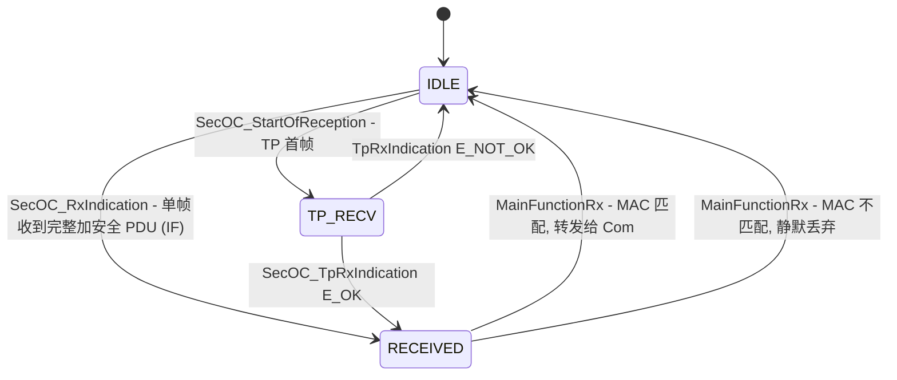
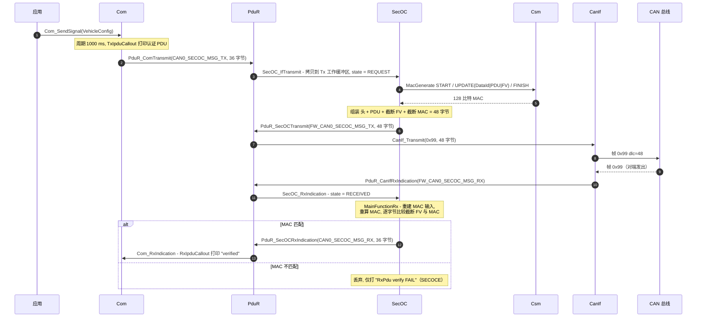

# SecOC - 安全车载通信

> **一句话概括：** SecOC 位于 Com 与总线之间：发送方向为每个 I-PDU 追加截断的
> 认证器（MAC）与截断的新鲜度值；接收方向重新计算该认证器，MAC 不匹配的报文被
> 静默丢弃——伪造与重放的帧永远到不了 Com。

| 项目 | 值 |
| --- | --- |
| 模块代码 | `infras/communication/SecOC`（API：`infras/include/SecOC.h`） |
| 所处层次 | 总线/TP 层之上，[PduR](PduR.md) 与 [Com](Com.md) 之下 |
| 配置文件 | `app/app/config/SecOC/SecOC.json` |
| 代码生成器 | `tools/generator/SecOC.py` -> `GEN/SecOC_Cfg.c` / `GEN/SecOC_Cfg.h` |
| 加密后端 | Csm `MAC_GENERATE` 作业（SecOC 内不含任何加密算法代码） |
| 规范依据 | AUTOSAR CP R23-11 SecOC（代码注释标注 `@SWS_SecOC_*`） |
| 示例 | `scons --app=SecOCDemoIfTx` / `SecOCDemoIfRx` / `SecOCDemoTpTx` / `SecOCDemoTpRx` |

**目录**

1. [模块用途](#1-模块用途)
2. [在协议栈中的位置](#2-在协议栈中的位置)
3. [配置](#3-配置)
4. [运行时行为](#4-运行时行为)
5. [公开 API](#5-公开-api)
6. [构建与运行示例](#6-构建与运行示例)
7. [关键注意事项](#7-关键注意事项)
8. [问题排查](#8-问题排查)
9. [已知限制与代码评审发现](#9-已知限制与代码评审发现)
10. [相关文档](#10-相关文档)

---

## 1. 模块用途

经典 AUTOSAR 无法区分"真报文"与"重放报文"：一个 CAN ID 加一段负载可以随时被
录制后原样重发。SecOC 在不改动应用代码的前提下补上这个缺口：

* **真实性认证** —— 对 `Data ID | 认证 I-PDU | 新鲜度值` 计算带密钥的 MAC，
  证明报文来自持有密钥的节点。
* **完整性保护** —— 负载任何一个比特被篡改，MAC 即失效。
* **防重放** —— 新鲜度值参与 MAC 计算，接收端计数器前进后旧帧自然失效。
* **节省总线带宽** —— MAC 与新鲜度值在总线上都是截断传输，完整值只存在于
  MAC 计算过程中。
* **对上层透明** —— Com 与应用完全无感，SecOC 只是 PduR 路由中的一跳。

本实现**不**做两件事：密钥管理（那是 Csm 的职责）、通过 Csm 的 verify API 验证
MAC（SecOC 自己重新生成 MAC 再逐字节比较）。

---

## 2. 在协议栈中的位置

SecOC 是一个"路由型"模块：PduR 把 PDU 交给它，它把加安全头的 PDU 交回 PduR，
由 PduR 决定下一跳——单帧走 CanIf，需要分段时走 CanTp。



同一个 SecOC 代码服务两种路径，唯一区别是 PduR 路由表把 `PduR_SecOCTransmit`
映射到哪个 PDU：

| 路径 | 发送路由 | 接收路由 |
| --- | --- | --- |
| **IF**（单帧） | `Com -> SecOC -> CanIf` | `CanIf -> SecOC -> Com` |
| **TP**（分段） | `Com -> SecOC -> CanTp -> CanIf` | `CanIf -> CanTp -> SecOC -> Com` |

---

## 3. 配置

### 3.1 顶层配置项

`app/app/config/SecOC/SecOC.json`（每个应用一份；4 个 demo 各自在
`config/SecOC/<Demo>/` 下有独立副本）：

| 键 | Demo 取值 | 生成器默认 | 含义 |
| --- | --- | --- | --- |
| `Class` | `"SecOC"` | - | 选择 `SecOC.py` 生成器 |
| `MainFunctionPeriod` | 无 | `10` | 毫秒；仅生成 `SECOC_MAIN_FUNCTION_PERIOD` 与换算宏。SecOC 自身没有周期定时器，该值仅供参考 |
| `UsePostBuildConfig` | 无 | `false` | 为 `true` 时生成 `SECOC_USE_PB_CONFIG`，此时 `SecOC_Init(config)` 才真正使用传入指针 |
| `SELF_TEST` | 无 | `false` | 生成 `SECOC_SELF_TEST`：每个发送的加安全 PDU 会回灌到本实例的 `SecOC_RxIndication()` |
| `FreshnessValueManager[]` | 1 项 | 必填 | 新鲜度值来源列表 |
| `TxProc[]` | 1 项 | 可选 | 每个**待保护**的认证 I-PDU 一项 |
| `RxProc[]` | 1 项 | 可选 | 每个**待验证**的加安全 I-PDU 一项 |

`FreshnessValueManager[]`：

| 键 | 含义 |
| --- | --- |
| `Name` | 标识符；同时决定生成的回调名 `SecOC_GetFreshness_<name>` |
| `Length` | **比特数**（0..64）——参与 MAC 计算的完整新鲜度值长度 |
| `GenDummy` | `true` 时生成一个 `__weak` 的哑生成器，应用可覆盖实现 |

`TxProc[]`：

| 键 | Demo 取值 | 含义 |
| --- | --- | --- |
| `Name` | `CAN0_SECOC_MSG_TX` | 用于 `SECOC_<name>`、`SECOC_FW_<name>` 以及 PduR 符号 `PDUR_<name>` / `PDUR_FW_<name>` |
| `DataId` | `0x1234` | 16 位标识符，混入 MAC 计算，**不上总线** |
| `AuthInfoLength` | `128` | 完整 MAC 长度，单位**比特**（必须等于 Csm 密钥长度） |
| `AuthInfoTruncLength` | `64` | 实际上总线的 MAC 比特数 |
| `AuthPduHeaderLength` | `3` | 可选 `SecuredIPDUHeader` 的字节数（承载认证 I-PDU 长度）；`0` 表示无头 |
| `TxAuthServiceConfigRef` | `SECOC_MACGEN_0` | Csm 作业名，生成器自动加前缀 `CSM_JOB_` |
| `FreshnessValueId` | `FreshnessValue0` | 必须存在于 `FreshnessValueManager` |
| `FreshnessValueTruncLength` | `8` | 实际上总线的新鲜度值比特数 |
| `AuthenticIPduLength` | `64` | 单位**字节**；仅用于确定工作缓冲区大小 |
| `TxPduUnusedAreasDefault` | 无（`0x55`） | 会生成进配置，但目前 `SecOC.c` **不使用** |

`RxProc[]` 是发送侧的镜像（改用 `RxAuthServiceConfigRef`），另有：

| 键 | Demo 取值 | 含义 |
| --- | --- | --- |
| `UseAuthDataFreshness` | `false` | 与 `AuthDataFreshnessLen` / `AuthDataFreshnessStartPosition` 一起生成进配置，但三者均**未被** `SecOC.c` 读取 |

> 单位陷阱：`AuthInfoLength`、`AuthInfoTruncLength`、`FreshnessValueTruncLength`、
> `FreshnessValueManager[].length` 的单位是**比特**；`AuthenticIPduLength` 与
> `AuthPduHeaderLength` 的单位是**字节**。

### 3.2 Csm 作业

`app/app/config/Csm/Csm.json`（或各 demo 的副本）必须定义
`TxProc[]`/`RxProc[]` 引用的作业名：

| 对象 | 配置 | 说明 |
| --- | --- | --- |
| `MacGen[].name = MACGEN0` | `Family: AES`、`Mode: ECB`、16 字节 `Key` | MAC 算法原语 |
| `Jobs[].name = SECOC_MACGEN_0` | `ServiceType: MAC_GENERATE` | 被 `TxAuthServiceConfigRef` 与 `RxAuthServiceConfigRef` 同时引用 |
| `Jobs[].name = SECOC_MACVER_0` | `ServiceType: MAC_VERIFY` | 仓库里存在但从未被使用，见第 9 节 |

`AuthInfoLength` 必须等于密钥长度（16 字节 -> 128 比特），否则
`Csm_MacGenerate` 在 FINISH 阶段拒绝（`Csm.c` 中的 `macLength` 校验）。

### 3.3 PduR 路由

```json
"Routines": [
  { "Name": "CAN0_SECOC_MSG0_TX",    "From": "Com",    "To": "SecOC" },
  { "Name": "FW_CAN0_SECOC_MSG0_TX", "From": "SecOC",  "To": "CanIf" },
  { "Name": "FW_CAN0_SECOC_MSG1_RX", "From": "CanIf",  "To": "SecOC" },
  { "Name": "CAN0_SECOC_MSG1_RX",    "From": "SecOC",  "To": "Com"   }
]
```

* SecOC 与上层的路由：`From`/`To` 为 `Com`（或 `Dcm`），name 即
  `TxProc`/`RxProc` 条目的 `Name`。
* SecOC 与下层的路由：name 必须是 `FW_<name>`——这正是生成器为 `FwTxPduId`
  使用的 `PDUR_FW_<name>` 符号。
* 把 `To` 从 `CanIf` 改为 `CanTp`，就是 IF 路径与 TP 路径的**全部**配置差异。

### 3.4 生成代码

Tx demo 的 `GEN/SecOC_Cfg.c`（节选，真实输出）：

```c
static const SecOC_FreshnessValueType SecOC_FreshnessValues[] = {
  { SecOC_GetFreshness_FreshnessValue0, 32u /* length in bits */ },
};

static SecOC_TxPduProcContextType SecOC_TxPduProcContexts[1];
static uint8_t SecOC_TxPduProc_CAN0_SECOC_MSG_TX_Buffer[87];
static const SecOC_TxPduProcessingType SecOC_TxPduProcs[] = {
  {
    &SecOC_TxPduProcContexts[0],
    SecOC_TxPduProc_CAN0_SECOC_MSG_TX_Buffer,
    CSM_JOB_SECOC_MACGEN_0,
    PDUR_FW_CAN0_SECOC_MSG_TX,  /* FwTxPduId */
    PDUR_CAN0_SECOC_MSG_TX,     /* UpTxPduId  */
    ARRAY_SIZE(SecOC_TxPduProc_CAN0_SECOC_MSG_TX_Buffer),   /* 87 */
    128u, 64u, 0x1234u, FV_FRESHNESS_VALUE_0, 32u, 8u,
    0x55u,   /* TxPduUnusedAreasDefault（未使用） */
    3u, 3u,  /* AuthPduHeaderLength, AuthPduOffset = max(3, 2) */
  },
};
```

缓冲区大小在生成期计算（`SecOC.py`）：

| 缓冲区 | 计算公式 | Demo 值 |
| --- | --- | --- |
| Tx | `max(AuthPduHeaderLength,2) + AuthInfoLength/8 + AuthenticIPduLength + FV.length/8` | `3+16+64+4 = 87` |
| Rx | `2 + AuthPduHeaderLength + AuthInfoLength/8 + AuthenticIPduLength + FV.length/8` | `2+3+16+64+4 = 89` |

`GEN/SecOC_Cfg.h` 还会生成 `SECOC_<name>` / `SECOC_FW_<name>` 索引；`GenDummy`
为真时额外生成弱符号的新鲜度生成器：

```c
Std_ReturnType __weak SecOC_GetFreshness_FreshnessValue0(uint8_t *FreshnessValue,
                                                         uint32_t *FreshnessValueLength) {
  static uint16_t fvFreshnessValue0 = 0;
  uint16_t fv = fvFreshnessValue0 / 2;          /* 注意：/2，见第 9 节 */
  (void)memset(FreshnessValue, 0, *FreshnessValueLength / 8);
  FreshnessValue[0] = (fv >> 8) & 0xFFu;
  FreshnessValue[1] = fv & 0xFFu;
  fvFreshnessValue0++;
  return E_OK;
}
```

---

## 4. 运行时行为

### 4.1 两种 PDU 布局

SecOC 的全部行为都由这两个布局决定（以 demo 配置为例）：





36 字节负载最终变为 48 字节：`3 + 36 + ceil(8/8) + ceil(64/8)`。

### 4.2 发送状态机



缓冲区布局解释了"前移"步骤：MAC 的计算输出位置在完整新鲜度值之后，随后把
截断的 FV 与截断的 MAC 向左搬移，盖住被丢弃的比特，最终 PDU 从
`AuthPduOffset - AuthPduHeaderLength` 开始：



### 4.3 接收状态机



注意验证只发生在 `RECEIVED` 状态：`SecOC_Priv.h` 里声明的 `ASSEMBLE`、`CHECK`
两个状态从未被进入。

### 4.4 一次完整收发（IF demo）



### 4.5 新鲜度值

`SecOC_GetTxFreshness()`（位于 `SecOC_Callout.c`）是访问
`FreshnessValueManager` 表的唯一入口：校验 id、校验调用方缓冲区至少
`Length` 比特，然后调用生成的 `SecOC_GetFreshness_<name>()`。应用应以真实
来源（StbM 时间基、NvM 备份计数器、HSM 计数器）覆盖弱符号的哑实现。

---

## 5. 公开 API

| 函数 | 调用者 | 用途 |
| --- | --- | --- |
| `SecOC_Init(config)` | EcuM（`EcuM_DriverInitListTwo`） | 所有 proc 状态复位为 `IDLE`；开启 `SECOC_USE_PB_CONFIG` 时同时锁存配置指针 |
| `SecOC_IfTransmit(TxPduId, PduInfo)` | PduR（IF 路径） | 拷贝认证 I-PDU，置 `REQUEST`，立即返回 |
| `SecOC_RxIndication(RxPduId, PduInfo)` | PduR | 拷贝加安全 PDU，置 `RECEIVED` |
| `SecOC_TxConfirmation(TxPduId, result)` | PduR | `WAIT_TX_DONE -> IDLE`，向 Com 上报 |
| `SecOC_StartOfReception` / `SecOC_CopyRxData` / `SecOC_TpRxIndication` | CanTp 经 PduR | 重组分段的加安全 PDU |
| `SecOC_CopyTxData` | CanTp 经 PduR | 把组装好的加安全 PDU 交给 ISO-TP |
| `SecOC_MainFunctionTx` / `SecOC_MainFunctionRx` | `EcuM_BswServiceFast()` | 运行两个状态机，每次各处理一个 PDU |
| `SecOC_GetTxFreshness(id, buf, &len)` | 模块内部 / 应用 | 读取当前新鲜度值 |
| `SecOC_GetVersionInfo(info)` | 应用 | 版本 4.0.0 |

`SecOC.h` 中声明但**全仓库无实现**的函数：`SecOC_TpTransmit`、
`SecOC_TpTxConfirmation`、`SecOC_DeInit`、`SecOC_GetRxFreshness`、
`SecOC_GetRxFreshnessAuthData`、`SecOC_GetTxFreshnessTruncData`、
`SecOC_SPduTxConfirmation`。不要调用它们——链接器会报未定义引用。

### 调度方式

SecOC 没有自己的 OS 任务。`SecOC_MainFunctionTx` / `SecOC_MainFunctionRx`
注册在 EcuM 的 **fast** 主函数表中：

```c
/* infras/system/EcuM/config/EcuM_Cfg.c */
#ifdef USE_SECOC
  SecOC_MainFunctionTx,     SecOC_MainFunctionRx,
#endif
```

链接 `SecOC` 库时构建系统自动加 `USE_SECOC` 宏；`EcuM_BswServiceFast()` 由
`app/app/main.c` 的主循环调用（仿真环境下约每毫秒一次）。

---

## 6. 构建与运行示例

### 6.1 四个示例应用

| 应用 | 方向 | 下层模块 | 配置 / 源码 |
| --- | --- | --- | --- |
| `SecOCDemoIfTx` | Com -> SecOC -> CanIf | CanIf | [`config/SecOC/DemoIfTx`](../../app/app/config/SecOC/DemoIfTx) |
| `SecOCDemoIfRx` | CanIf -> SecOC -> Com | CanIf | [`config/SecOC/DemoIfRx`](../../app/app/config/SecOC/DemoIfRx) |
| `SecOCDemoTpTx` | Com -> SecOC -> CanTp -> CanIf | CanTp | [`config/SecOC/DemoTpTx`](../../app/app/config/SecOC/DemoTpTx) |
| `SecOCDemoTpRx` | CanIf -> CanTp -> SecOC -> Com | CanTp | [`config/SecOC/DemoTpRx`](../../app/app/config/SecOC/DemoTpRx) |

四个应用发送同一条报文：`SECOC_MSG`，CAN ID `0x99`，一个 288 位大端
`VehicleConfig` 信号（36 字节），周期 1000 ms，由 `User_MainTask10ms()` 每
100 tick 触发一次。每个目录包含 `SecOC.json`、`Csm.json`、`PduR.json`、
`Com.json`、`CanIf.json` 与胶水源码（`secoctx_demo.c` / `secocrx_demo.c` /
`secoctp_demo.c` / `secocrxtp_demo.c`）；TP demo 额外带 `CanTp.json`。

demo 使用虚拟 CAN 总线（`device: simulator_v2`，bus 0，UDP 组播），同一台
机器上的两个进程可以直接互通：

```bash
scons --app=SecOCDemoIfTx -j8
scons --app=SecOCDemoIfRx -j8
```

先启动接收端，再启动发送端（两个终端）：

```bash
build\nt\GCC\SecOCDemoIfRx\SecOCDemoIfRx.exe
AS_LOG_SECOC=3 build\nt\GCC\SecOCDemoIfTx\SecOCDemoIfTx.exe
```

### 6.2 预期输出

发送端——Com Tx IPdu callout 打印认证 PDU，随后 CanIf 确认成功：

```
INFO    :[DemoIfTx] SecOC transmit demo, SECOC_MSG on CAN ID 0x99
DEMO    :[DemoIfTx] send SECOC_MSG #1, len=36 data:
DEMO    :  00000000 00 01 02 03 ... 20 21 22 23
SECOC   :[0] Tx Confirm result=0
```

接收端——只有通过验证的帧才会到达 Com Rx IPdu callout 并被打印：

```
INFO    :[DemoIfRx] SecOC receive demo, SECOC_MSG on CAN ID 0x99
SECOC   :[0] RxPdu data length = 36, backup 9 auth info to pos 80
SECOC   :[0] RxPdu verify PASS
DEMO    :[DemoIfRx] SECOC_MSG verified, len=36 data:
DEMO    :  00000000 01 02 03 ... 20 21 22 23
```

"backup 9 auth info to pos 80" 即 `ceil((FVTrunc 8 + AuthTrunc 64)/8) = 9`
字节的尾部信息，在重算 MAC 前备份到 `bufLen - 9 = 89 - 9 = 80` 处。

### 6.3 观察真实帧

Com callout 打印的是**认证** PDU。要看 48 字节的加安全帧，用 `CanDump` 挂到
同一条虚拟总线上：

```bash
scons --app=CanDump
build\nt\GCC\one\CanDump.exe -d simulator_v2 -p 0
```

```
canid=00000099,dlc=48,data=[00,00,24, 01,02,03,...,24, 00, CE,41,A8,A4,3B,0A,3A,69]
```

| 字节 | 字段 | Demo 取值 |
| --- | --- | --- |
| `00 00 24` | SecuredIPDUHeader | 认证长度 0x24 = 36 |
| `01 .. 24` | 认证 I-PDU | 36 字节负载 |
| `00` | 截断新鲜度值 | 32 位 FV 的低 8 位 |
| `CE 41 A8 A4 3B 0A 3A 69` | 截断 MAC | AES-128 MAC 的前 64 位 |

Data ID `0x1234` 从不出现在总线上——它只存在于 MAC 计算输入中。

---

## 7. 关键注意事项

* **比特与字节。** `SecOC.json` 里几乎所有长度单位是比特，只有
  `AuthenticIPduLength` 和 `AuthPduHeaderLength` 是字节。最常见的配置错误
  就是搞混单位：`FreshnessValueTruncLength = 8` 表示总线上**一个**字节。
* **两端 `DataId` 必须一致。** 接收端用它自己的 `RxProc[].DataId` 重建 MAC
  输入；不一致的表现是持续 "verify FAIL"，且无其他提示。
* **`AuthPduHeaderLength` 可选但建议使用。** 为 `0` 时接收端用
  `SduLength - 9` 推导认证长度，只有两端截断 FV 与 MAC 长度完全一致时才成立。
* **`AuthPduOffset` 是生成的，不是配置的。** 取值为 `max(AuthPduHeaderLength, 2)`，
  因为 Data ID 需要负载前两字节的临时空间。`AuthPduHeaderLength = 3` 时
  Data ID 先临时写入 `buffer[1..2]`、随后被头部覆盖——这是有意为之，那时
  MAC 已经算完。
* **每个 proc 同时只能有一个 PDU 在途。** `SecOC_IfTransmit` 不检查当前状态，
  前一个 PDU 还在 `READY`/`WAIT_TX_DONE` 时再发会重启状态机并丢失前一个 PDU。
  请保证 Com 周期大于发送时延。
* **`FreshnessValueId` 必须存在**，否则生成期直接抛
  `Exception: FV <name> not found`。
* **生成器是严格的**：每个 `TxProc`/`RxProc` 条目的 `AuthInfoLength`、
  `AuthInfoTruncLength`、`AuthenticIPduLength`、`FreshnessValueId`、
  `FreshnessValueTruncLength` 都是必填键，缺了就是裸的 `KeyError`。
* **`SELF_TEST` 提供单进程回环**：组装好的加安全 PDU 直接回灌
  `SecOC_RxIndication`，无需对端即可验证接收路径——移植新鲜度来源时很有用。
* **两端都用 `MAC_GENERATE` 作业。** SecOC 从不调用 `Csm_MacVerify`，而是
  自己重算 MAC 比较字节。`Csm.json` 里的 `SECOC_MACVER_0` 是死配置。

---

## 8. 问题排查

| 现象 | 可能原因 |
| --- | --- |
| `SecOCE: [0] TxPdu update FAIL` | Csm 作业类型错误、`TxAuthServiceConfigRef` 未定义，或 `AuthInfoLength` 不等于密钥长度。检查 `GEN/Csm_Cfg.h` 中的 `CSM_JOB_<name>` |
| `SecOCE: [0] TxPdu in state 3` | 不在 `WAIT_TX_DONE` 状态时收到 `SecOC_TxConfirmation`——通常是路由配错（确认被路由到了另一个 PDU id） |
| 每帧都 `SecOCE: [0] RxPdu verify FAIL` | `DataId` 不一致、两端 Csm 密钥不同，或两节点新鲜度值失步 |
| `verify PASS` 与 `verify FAIL` 交替出现 | 两节点新鲜度值漂移——见第 9 节哑生成器的 `/2` 问题 |
| 完全收不到，也无 SecOC 日志 | 加安全 PDU 根本没发出去：检查 `PduR.json` 是否有 `FW_<name>` 路由、`CanIf.json` 的 `Up` 是否为 `SecOC`（IF）或 `CanTp`（TP） |
| DET 报 `SECOC_E_INVALID_PDU_SDU_ID` | PduR 路由指向了不存在的 `TxProc`/`RxProc` 索引 |
| 链接错误 `undefined reference to SecOC_TpTransmit` | 该 API 只有声明没有实现；应走 `PduR_SecOCTransmit` |
| 帧是 48 字节但对端丢弃 | 经典 CAN 单帧上限 8 字节——请用 TP demo，或使用 `LinkLayerDataLength >= 48` 的 CAN FD |

---

## 9. 已知限制与代码评审发现

### 9.1 功能限制

* **接收端没有真正的新鲜度校验。** `SecOC_ProcRx` 调用
  `SecOC_GetTxFreshness()`（`SecOC.c:163`）获取混入 MAC 的新鲜度值，即接收端
  使用**自己的**计数器，从不把总线上收到的截断 FV 与本地期望值比较。
  `SecOC_GetRxFreshness()` 在 `SecOC.h` 中有声明但没有实现。其结果是：新鲜度
  值只有在两节点计数器恰好同步时才"碰巧"起作用——重放帧失败仅仅因为本地
  计数器前进了，属于偶然而非设计。
* **哑生成器每两次调用才前进一次。** `SecOC.py` 生成
  `uint16_t fv = fvFreshnessValue0 / 2;`，导致相邻两个加安全 PDU 携带**相同的**
  新鲜度值。把 Tx/Rx demo 并排跑可以直接观察到：`verify PASS`、`verify FAIL`、
  `verify PASS`、…… 且即使 `Length` 配 32，有效计数器也只有 15 位。
* **新鲜度值只生成 2 字节。** 无论 `Length` 配多大，哑实现只写
  `FreshnessValue[0..1]`，64 位 FV 的高 48 位恒为 0。
* **无溢出策略。** `ReceptionOverflowStrategy`、`ReceptionQueueSize`、
  `AuthenticationBuildAttempts`、`AuthenticationVerifyAttempts`、
  `DynamicRuntimeLengthHandling`、`ProvideTxTruncatedFreshnessValue`、
  `UseTxConfirmation` 都躺在 `SecOC_Priv.h` 的 `#if 0` 块里——一个都没实现。
* **`UseAuthDataFreshness` 是死配置。** 生成器会生成它以及
  `AuthDataFreshnessLen` / `AuthDataFreshnessStartPosition`
  （`SecOC.py:127-132`），但 `SecOC.c` 从不读取三者，"从负载取新鲜度"静默
  退化为"从本地计数器取新鲜度"。
* **`TxPduUnusedAreasDefault` 同样无效。** 生成为 `0x55`，但从未用来填充
  认证 PDU 与尾部之间的空隙；那些字节保持上一次 PDU 的残留（缓冲区是静态
  变量，冷启动时为 0）。
* **无 HSM / 硬件加速路径。** 全部走软件 Csm 原语，没有异步 CSM 处理，
  慢原语会阻塞整个 fast 主函数表。
* **`SECOC_USE_PB_CONFIG` 是全有或全无的 post-build。** EcuM 传入的是
  `SecOC_Init(NULL)`，不开该宏时传入指针被完全忽略。

### 9.2 代码评审发现

| # | 位置 | 发现 |
| --- | --- | --- |
| 1 | `SecOC.c:154` | 拷贝尾部信息用的 `memcpy`，其源偏移 `dataLength` **直接取自收到的报文头**，此前只检查了 `SduLength + 2 + FV + Auth < bufLen`。恶意/损坏的帧只要头部值够大即可越界**读**，随后还会以 `SduLength = dataLength` 上报给 Com。缺少 `2 + AuthPduHeaderLength + dataLength + 9 <= SduLength` 的校验。对一个安全模块而言，这是本次评审最严重的问题。 |
| 2 | `SecOC.c:163` | 接收验证使用 `SecOC_GetTxFreshness` 而非接收侧新鲜度管理器（见 9.1）。 |
| 3 | `SecOC.c:305-307` | `SecOC_RxIndication` 在状态非 `IDLE` 时只打日志，随后照常覆盖缓冲区——前一帧尚在 `RECEIVED` 未处理时，新帧会静默销毁它。 |
| 4 | `SecOC.c:256-276` | `SecOC_IfTransmit` 同样不检查状态：无法阻止新请求破坏在途的加安全 PDU。 |
| 5 | `SecOC.c:411,422` | `SecOC_MainFunctionTx/Rx` 解引用 `SECOC_CONFIG->numTxPduProcs` 前无 `NULL` 检查，`SecOC_Init` 之前调用即为硬 fault 而非 DET 报告。 |
| 6 | `SecOC.c:266-269` | 缓冲区大小校验失败报的是 `SECOC_E_PARAM_POINTER`，应为长度/ID 类错误码；`SecOC.c:302`、`SecOC.c:355` 同样。 |
| 7 | `SecOC.h` | 7 个声明的 API 没有实现（`SecOC_TpTransmit`、`SecOC_TpTxConfirmation`、`SecOC_DeInit`、`SecOC_GetRxFreshness`、`SecOC_GetRxFreshnessAuthData`、`SecOC_GetTxFreshnessTruncData`、`SecOC_SPduTxConfirmation`）。有实现只有 `SecOC_GetTxFreshness`（在 `SecOC_Callout.c`）。 |
| 8 | `SecOC.py:80,109-115` | 缓冲区大小用整除（`AuthInfoLength // 8`），而运行期用 `(x + 7) >> 3`。任何非 8 比特整数倍的长度都会使缓冲区每字段最多小 1 字节。 |
| 9 | `SecOC.py:172-176` | `GenDummy` 新鲜度生成器除以 2 且只写 2 字节（见 9.1）。 |
| 10 | `SecOC.py:26,30` | `MainFunctionPeriod` 只生成一个无人使用的宏；真实周期来自 `EcuM_DriverMainFastList`，对集成者有误导性。 |
| 11 | `Csm.c:101` | `Csm_MacVerify` 要求作业的 `serviceType` 为 `CRYPTO_MAC_GENERATE`，因此 `MAC_VERIFY` 作业（`SECOC_MACVER_0`）永远无法通过该 API 使用。SecOC 靠自行比较字节绕开了该问题，这也是 verify 作业成为死配置的原因。 |
| 12 | `SecOC_Callout.c:32` | 新鲜度 getter 校验 `*FreshnessValueLength >= FrVal->length` 后，却把调用方的长度原样传给生成函数——它可能大于配置长度，哑实现随之 `memset` 超出 FV 实际占用的字节。 |

---

## 10. 相关文档

* [Com](Com.md) —— 发送路径上的上层邻居
* [PduR](PduR.md) —— 让 SecOC 成为透明一跳的路由表
* [CanIf](CanIf.md) —— IF 路径的下层邻居
* [CanTp](CanTp.md) —— TP 路径的下层邻居（ISO 15765-2）
* [E2E](E2E.md) —— 端到端保护，与 SecOC 互补（CRC/计数器防随机失效，
  密码学 MAC 防主动攻击）
* 代码：[SecOC.c](../../infras/communication/SecOC/SecOC.c)、
  [SecOC_Callout.c](../../infras/communication/SecOC/SecOC_Callout.c)、
  [SecOC_Priv.h](../../infras/communication/SecOC/SecOC_Priv.h)、
  [SecOC.h](../../infras/include/SecOC.h)、
  [SecOC.py](../../tools/generator/SecOC.py)
* AUTOSAR CP R23-11 - Specification of Secure Onboard Communication
