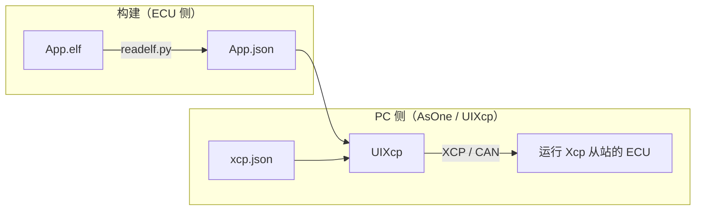
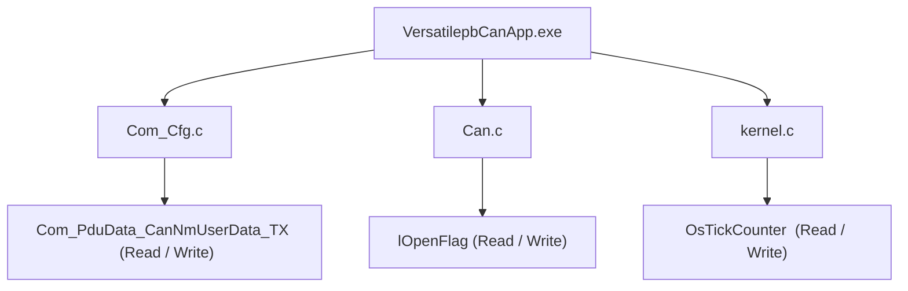
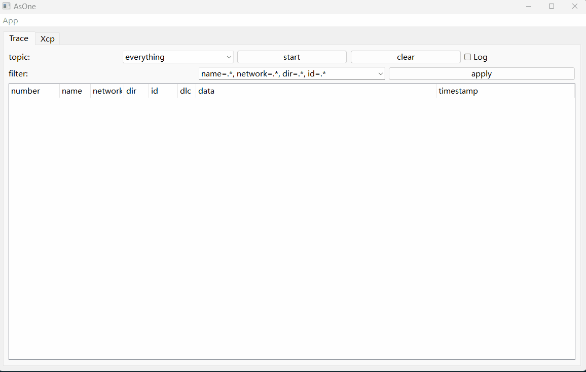
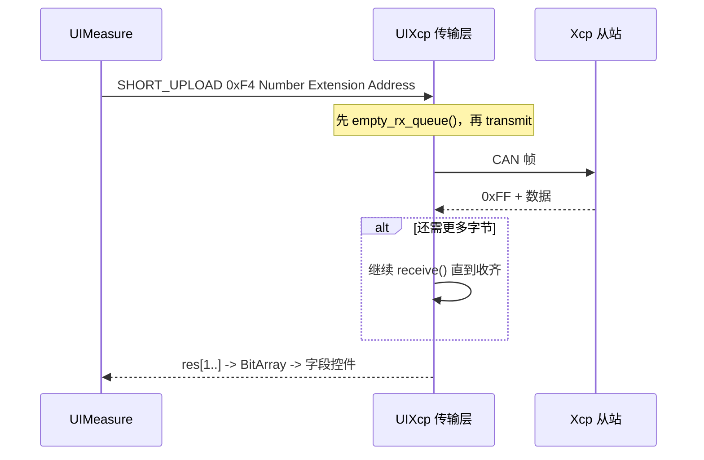
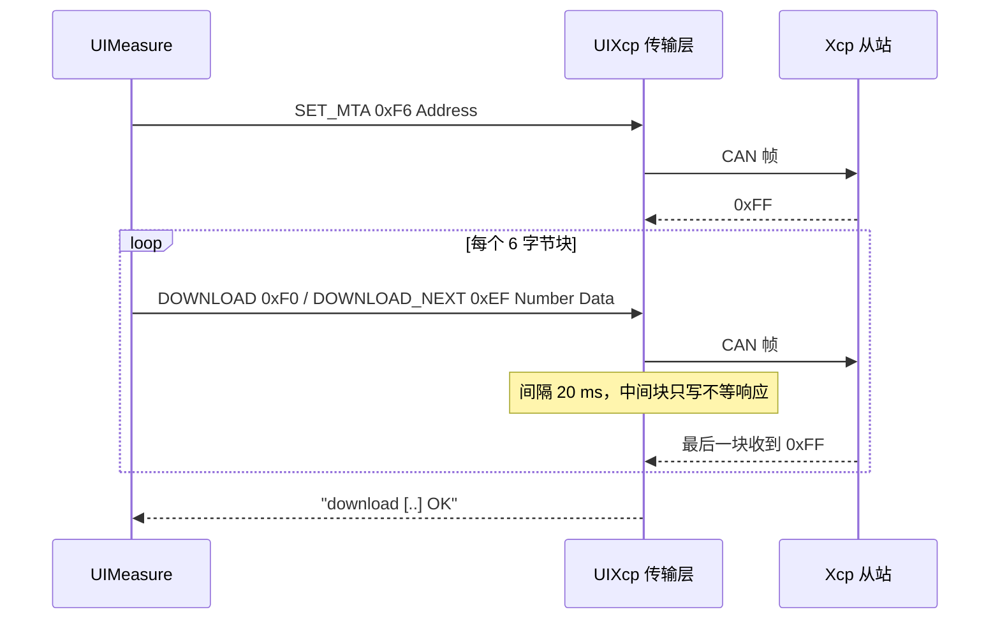

# UIXcp 测量与标定

UIXcp 是 [AsOne](../../tools/asone) PC 工具的 [XCP](https://www.asam.net/standards/detail/xcp/) 面板，它把 XCP 最常用的两件事放在同一个界面里：

- **按服务收发**——服务的定义写在 [tools/asone/examples/xcp.json](../../tools/asone/examples/xcp.json) 里：走哪条总线、用哪两个 CAN ID，以及面板要提供哪些 XCP 服务（`Connect`、`GetStatus`、`GetSeed`/`Unlock`、`SetMTA`、`Upload`、`ShortUpload`、`Download`、`Program*`、`DAQ*`…）；
- **按变量读写内存**——变量清单不必手写。链接器本来就知道每个全局变量及其地址，这些信息保存在 ELF 的 DWARF 调试信息里。[tools/utils/readelf.py](../../tools/utils/readelf.py) 把它转成一份 JSON（UIXcp 默认按 `XcpEcu.Json` 加载），面板据此把每个变量变成一个带 `Read` / `Write` 按钮的小控件。

两种用法共用同一套传输层与组帧/解帧代码，所以本文都覆盖：第 2 节讲 XCP json，第 3~6 节讲变量 JSON 及其读写机制，第 7 节给出在 QEMU 目标上从零跑通的完整步骤。

## 1. 总览

XCP 面板需要三份输入：

| 输入 | 默认值 | 作用 |
| --- | --- | --- |
| XCP json | [tools/asone/examples/xcp.json](../../tools/asone/examples/xcp.json) | `target` 传输层、`groups` 服务列表、`lua` 脚本 |
| Ecu json | `XcpEcu.Json` | 变量清单——地址、类型与字段布局 |
| Lua 脚本 | 由 XCP json 的 `lua` 键指定 | Seed & Key、上传/下载等字段的编解码钩子 |

XCP json 决定面板**有哪些 XCP 服务**：`groups[].Services[]` 下的每一条都会变成一个命令表单（见 2.3）。而"按变量读写"只是面板的**其中一种**用法——它本质上是 `ShortUpload`、以及 `SetMTA` 加 `Download` 的组合，只不过地址是面板从变量 JSON 里替你填的；另一种用法就是手动下发这些具名服务。



## 2. XCP json：传输层与服务

### 2.1 三个顶层键

| 键 | 内容 |
| --- | --- |
| `target` | 传输层：协议、设备、通道、波特率、txid/rxid |
| `groups` | 面板提供的服务，按组划分，每组一个页签 |
| `lua` | Lua 脚本文件名，相对本 JSON 所在目录解析 |

真实文件的一段节选（`groups` 只留了 `General` 组的一条服务）：

```json
{
    "target": {
      "protocol": "CAN",
      "LL_DL": 8,
      "device": "simulator_v2",
      "port": 0,
      "txid": "0x7A0",
      "rxid": "0x7B0",
      "baudrate": 500000
    },
    "lua": "xcp.lua",
    "groups": {
      "General": {
        "Services": [
          {
            "name": "Connect",
            "SID": "0xFF",
            "transmit": [
                { "name": "Mode", "type": "U8Select", "Select": [{ "name": "Normal", "value": "0x00" }, { "name": "User Defined", "value": "0x01" }] }
            ],
            "receive": [
              { "name": "RESOURCE", "type": "U8", "display": "hex", "default": 0, "lua": "decode_xcp_res" },
              { "name": "COMM_MODE_BASIC", "type": "U8", "display": "hex", "default": 0, "newline": true },
              { "name": "MAX_CTO", "type": "U8", "display": "hex", "default": 0 },
              { "name": "MAX_DTO", "type": "U16", "display": "hex", "default": 0, "newline": true },
              { "name": "XCP Protocol Layer Version Number", "type": "U16", "display": "hex", "default": 0 }
            ]
          }
        ]
      }
    }
}
```

### 2.2 `target`：传输层

| 字段 | 默认值 | 说明 |
| --- | --- | --- |
| `protocol` | `CAN` | 目前只支持 `CAN`，其它值会在 `start` 时报 invalid protocol |
| `device` | `simulator_v2` | CanLib 设备名，见 [虚拟 CAN 环境](./virtual-can-env.md) |
| `port` | `0` | 通道号 |
| `baudrate` | `500000` | 波特率，虚拟设备忽略 |
| `LL_DL` | `8` | 传输层每帧的数据长度（响应帧也按此长度计算，故单次 Short Upload 的数据上限为 `LL_DL - 1`，见 5 节） |
| `txid` | `0xFA0` | 面板 → 从站的 CAN ID |
| `rxid` | `0xFB0` | 从站 → 面板的 CAN ID |

`txid` / `rxid` 写成数字或 `"0x7A0"` 这样的字符串都可以。`start` 时面板按 `protocol` / `device` / `port` / `baudrate` 打开总线，并把整个 `target` 对象作为 `target:` 下拉框的一项显示出来——下拉框可编辑，也可以直接粘贴一段 `target` 文本，换链路不必改文件。

### 2.3 `groups` 与 `Services`：服务表单

`groups` 的每个键是一个分组：在左侧树上生成一个顶层节点，同时新增一个同名页签。分组下只有 `Services` 数组有意义，数组的每一项生成一个表单：

- `name` —— 表单标题，也是树里子节点的名字；
- `SID` —— 命令码，点 `Enter` 时作为请求的第一个字节；
- `transmit` —— 请求里 `SID` 之后的字段，按顺序编码；
- `receive` —— 响应的字段，从响应第 1 个字节开始解析（第 0 字节是 `0xFF` 肯定响应码，被跳过）。

出厂 xcp.json 提供四组服务：

| 分组 | 服务（SID） |
| --- | --- |
| `General` | `Connect`(FF)、`GetStatus`(FD)、`GetSeed`(F8)、`Unlock`(F7)、`Disconnect`(FE) |
| `MTA` | `SetMTA`(F6)、`Download`(F0)、`Upload`(F5)、`ShortUpload`(F4) |
| `PGM` | `ProgramStart`(D2)、`ProgramClear`(D1)、`Program`(D0)、`ProgramReset`(CF) |
| `DAQ` | `FreeDAQ`(D6)、`AllocDAQ`(D5)、`AllocODT`(D4)、`AllocODTEntry`(D3)、`ClearDAQList`(E3)、`SetDAQPtr`(E2)、`WriteDAQ`(E1)、`ReadDAQ`(DB)、`SetDAQListMode`(E0)、`StartStopDAQList`(DE)、`DAQStartStopSynch`(DD) |

`Disconnect`、`FreeDAQ`、`ProgramReset` 这类没有参数的服务的 `transmit` / `receive` 是空数组，表单就只有 SID 一个字节。

字段类型由 `type` 决定，形式为 `U<位宽>` 加可选后缀：

| `type` | 界面 | 编码宽度 |
| --- | --- | --- |
| `U8` / `U16` / `U32` | 输入框 | 位宽即字段宽度 |
| `U8Array` + `size` | 输入框（数组字面量） | `size` 个字节 |
| `U8Select` + `Select` | 下拉框 | 选中项的 `value` |
| `U8MultiSelect` + `Select` | 多选 | 被选中项的 `value` 按位或 |
| `Table` | 表格，由 Lua 填充 | 长度由 Lua 决定，见 2.4 |

字段上还可以带这些键：

| 键 | 作用 |
| --- | --- |
| `display` | `dec`（默认）/ `hex` / `asc` |
| `default` | 初始值，数字或 `"0x00"` 这类字符串 |
| `newline` | 该字段之后换行 |
| `optional` | 响应里可以缺失（例如 `StartStopDAQList` 的 `First PID`） |
| `readonly` | 界面上只读，值由 Lua 算出（例如 `Unlock` 的 `keys`） |
| `visible` | `false` 表示不出现在界面上，只参与编解码 |
| `lua` | 该字段的 Lua 钩子，见 2.4 |

点 `Enter` 组帧发送，收到响应后逐字段回填，并弹窗显示 `XXX OK with response [...]`。若响应首字节不是 `0xFF`，展示函数会在十六进制串后面补上 `nrc = ...` 文本（`0x23` 内存写保护、`0x24` 内存不可访问、`0x25` 需要 Seed & Key…）。

`Download`(F0) 与 `Program`(D0) 的处理稍有不同：如果用户填的数据长度与 `Number` 不一致，说明这一块还没发完，面板不再发送而是直接当作肯定响应，好让 Lua 钩子接着拆下一块（见 2.4）。

### 2.4 `lua` 脚本

`lua` 是脚本文件名，相对 XCP json 所在目录解析。`start` 时先加载它，随后调用 `xcp_init(busid, txid, rxid)`——脚本里没有这个函数会弹 `Xcp Lua has no API xcp_init`。

字段上的 `lua` 键把该字段交给一个 Lua 钩子：`transmit` 字段在编码前调用（可以改写要发的内容），`receive` 字段在解码后调用（把字节变成可读文本）。`Table` 类型的字段完全交给钩子：

- 在 `transmit` 侧，钩子返回字节表，由它决定这一帧发什么——例如 `Unlock` 用 `calculate_keys()` 从上一轮收到的种子算出钥匙；
- 在 `receive` 侧，钩子把整段响应渲染成表格，返回值里带表头与单元格——例如 `GetSeed` 的 `record_seeds`。

出厂 [xcp.lua](../../tools/asone/examples/xcp.lua) 提供的钩子：

| 钩子 | 挂在哪 | 做什么 |
| --- | --- | --- |
| `xcp_init` | `start` | 记录通道与 txid/rxid |
| `decode_xcp_res` | `Connect` / `GetStatus` 的 `RESOURCE`、`Protect` | 把资源位翻译成 `CALPAG DAQ STIM PGM` |
| `record_seed_mode` / `record_seed_resource` | `GetSeed` 的 `transmit` | 记下本次请求的 mode 与 resource |
| `record_seeds` | `GetSeed` 的 `receive` | 保存种子并显示 |
| `calculate_keys` | `Unlock` 的 `transmit` | `key = seed ^ 0x78934673`，示例算法 |
| `record_upload_length` | `Upload` / `ShortUpload` 的 `Length` | 记下预期长度 |
| `decode_upload_data` | `Upload` / `ShortUpload` 的 `receive` | 收齐 `Length` 字节（不够就继续读 CAN），按 32 字节一行显示 |
| `prepare_download` / `download_next` | `Download` | 把数据切成 6 字节块，逐块续发 |
| `prepare_program` / `program_next` | `Program` | 同上，用于刷写 |

### 2.5 一次服务交互

在 `General` 分组里点 `Connect`、`Mode` 选 `Normal`，得到的交互是：

```text
0x7A0  FF 00                    <- Connect, Mode = Normal
0x7B0  FF 15 00 08 00 08 01 01  <- RESOURCE 0x15 (CALPAG|DAQ|PGM)、MAX_CTO 8、MAX_DTO 8
```

`MTA` 组里的 `ShortUpload` 表单是同一套机制的另一种拼法：手填 `Length`、`Reserved`、`Extension`、`Address` 后回车，回来的就是 `FF` 加数据——与第 5 节读一个变量时发的帧格式完全一样，区别只是地址和长度是人填的。

要注意从站**必须先建立会话**：`Xcp_RxIndication()` 在没有活动通道时只接受 `CONNECT`，其它命令一律丢弃。所以不论用服务表单还是变量控件，第一步都是发一次 `Connect`（`Disconnect` 结束会话）。

## 3. ELF 变量 JSON

### 3.1 生成方式

`readelf.py` 是对 ELF 文件 DWARF 调试信息的一层轻量封装，在链接完成后手工对应用执行：

```sh
D:\repository\as>python tools\utils\readelf.py -i build\nt\QemuVersatilepbGCC\VersatilepbCanApp\VersatilepbCanApp.exe -o build\nt\QemuVersatilepbGCC\VersatilepbCanApp\VersatilepbCanApp.json

D:\repository\as>cp build/nt/QemuVersatilepbGCC/VersatilepbCanApp/VersatilepbCanApp.json build/nt/GCC/one/XcpEcu.json
```

第二条命令把生成的 JSON 以 `XcpEcu.Json` 之名放进工具工作目录，这样 `load Ecu json` 不必手动选择即可默认加载（见 4 节与 7.2 节）。

`-i` / `--input` 为输入 ELF，`-o` / `--output` 为要写出的 JSON。构建过程**不会**替你执行它——[tools/building.py](../../tools/building.py) 里那个后置动作默认是关闭的——所以每次重新编译后都要再跑一遍上面的命令。由于它依赖 DWARF，应用必须**带调试信息**链接；被 strip 的构建没有可导出的变量。

加 `-v` / `--verbose` 会打印一份统计：共看到多少个 `DW_TAG_variable`、跳过多少个以及原因、导出多少个变量，并给出每个源文件的变量数——用来确认没有任何变量被静默丢弃。

### 3.2 JSON 结构

输出包含五个键：

| 键 | 内容 |
| --- | --- |
| `elf` | 输入 ELF 的路径（用作树根标签） |
| `vars` | 所有静态变量：`name`、`addr`、`type`、`loc`（`file:line`）、`size`（DWARF 给出的真实字节数） |
| `types` | 类型表：typedef 与结构体，及其有序的 `members` |
| `endian` | `LITTLE` 或 `BIG`，取自 ELF 头部 |
| `xcp_vars` | 按源文件分组的变量，并附 `datas` 描述各字段 |

真实文件的一段节选：

```json
{
  "elf": "C:\\repo\\ssas\\build\\nt\\QemuVersatilepbGCC\\VersatilepbCanApp\\VersatilepbCanApp.exe",
  "vars": [
    {
      "name": "RoD_AppVersion",
      "addr": "0x41010",
      "type": "const RoD_AppVersionType",
      "loc": "app\\platform\\qemu\\versatilepb\\config\\RoD\\GEN\\RoD_AppCfg.c:16"
    }
  ],
  "types": { "TickType": { "name": "TickType", "type": "uint32", "loc": "infras\\system\\kernel\\os\\include\\kernel.h:132" } },
  "endian": "LITTLE",
  "xcp_vars": {
    "kernel.c": [
      {
        "name": "OsTickCounter",
        "addr": 1798156,
        "datas": [
          {
            "name": "OsTickCounter",
            "type": "U32",
            "display": "dec",
            "default": 0
          }
        ]
      }
    ]
  }
}
```

### 3.3 `xcp_vars` 如何得出

`vars` 与 `types` 是 DWARF 的原始转储；`xcp_vars` 才是 UIXcp 真正消费的部分，由 `processXcp()` 生成：

1. 按变量声明所在的**源文件**（`loc` 中 `:` 之前的部分）分组；
2. 丢弃地址为 `0` 的变量（它们没有静态存储）——被丢弃的原因会汇总在 `-v` 的统计里，不再静默；
3. 把类型展开为扁平的 `datas` 字段列表；无法逐字段展开的类型退化为原始字节块，而不是整条丢弃；展开出的总字节数与变量 `size` 不一致时同样退化为原始字节块（见第 8 节）。

字段类型通过一张小的标准类型映射表解析：

| C 类型 | `datas` 类型 |
| --- | --- |
| `uint8_t`、`char`、`_Bool` | `U8` |
| `uint16_t`、`short` | `U16` |
| `uint32_t`、`int`、`long`、`enum` | `U32`（`enum` 按底层类型宽度取 `U8`/`U16`/`U32`） |
| `uint8_t[8]` | `U8Array`，`size: 8` |
| 结构体 | 展平为每个成员一条 `datas` |
| 指针 | 一个只读的十六进制 `U32` |
| 联合体、成员间的填充 | 一段 `U8Array` 原始字节（填充项标记 `visible: false`） |

结构体数组会为每个元素生成一条记录（`<name>_0`、`<name>_1`…），并且每个数组项都标记 `newline`，以便控件把它单独放在一行。

### 3.4 它必须与当前构建匹配

变量地址是链接器排出来的。任何会影响布局的改动（加一个变量、动一处配置、重新生成 GEN 配置）之后重新编译，地址都可能整体平移。而面板**发现不了**这件事：它照着 JSON 里的旧地址去读，读回来的是那个位置现在放着的东西，界面上不会报任何错——只是数值不对。

实测过一次：某次重编后，235 个变量里有 62 个整体偏移了 `0x70`，`OsTickCounter` 从 `0x1B6F9C` 挪到了 `0x1B700C`。于是：

```text
0x7A0  F4 04 00 00 0C 70 1B 00  ->  0x7B0  FF CE 01 00 00  <- 新地址：462，且仍在增长
0x7A0  F4 04 00 00 9C 6F 1B 00  ->  0x7B0  FF 00 00 00 00  <- 旧地址：0，看着像计数器没跑
```

所以规则很简单：**每次编译完应用，都要重跑 3.1 的两条命令**。想确认手上的 JSON 是否过期，比较时间戳即可——`XcpEcu.Json` 比 `<App>.exe` 旧就一定是过期的。

## 4. 在 UIXcp 中加载 JSON

在 XCP 面板上用 `load XCP json` 与 `load Ecu json` 选择上面两份文件；按下 `start` 会执行 `UIXcp::loadUI()`，建出两类树节点：

- XCP json 的每个 `groups` 条目——即第 2 节所说的服务分组，其下是各服务的表单；
- 另一个顶层条目是 `basename(elf)`，即应用名，其下按 `xcp_vars` 的源文件各一个子条目，再下面是每个变量对应的一个 `UIMeasure` 控件。

`load Ecu json` 默认查找的是工具工作目录（`build\nt\GCC\one`）下的文件名 **`XcpEcu.Json`**，7.2 节的第二条命令正是把它放在那里；若想临时换用别的 JSON，用 `...` 按钮手动选择即可。`load XCP json` 默认先找当前目录下的 `xcp.json`，没有才退回示例 [tools/asone/examples/xcp.json](../../tools/asone/examples/xcp.json)。



`load Ecu json` 选好 3.1 生成的 `<App>.json` 再按 `start` 之后，面板左侧就会长出这棵树：



每个 `UIMeasure` 控件为每条 `datas` 显示一个可编辑字段，并带 `Read` 与 `Write` 按钮。其总长度是各字段位宽与元素个数之积的总和，读取时从 `addr` 开始作为一整块连续内存处理。编解码值所用的字节序取自 Ecu json 中的 `endian`。

## 5. 读取变量

`Read` 用 **SHORT_UPLOAD（`0xF4`）** 上传变量地址处的字节，并填入各字段控件：

| 请求 | `0xF4` | `Number` | `Reserved` | `Extension` | `Address`（4 字节） |
| --- | --- | --- | --- | --- | --- |
| 含义 | Short Upload | 需要的字节数 | 0 | 0 = MEMORY | 变量地址 |

一个响应帧共 `LL_DL` 字节，其中还包含 `0xFF` 肯定响应码，所以单次 SHORT_UPLOAD 最多返回 `LL_DL - 1` 个数据字节（默认 `LL_DL: 8` 时为 `7`）。更大的变量用多次 SHORT_UPLOAD 请求读取，每次都按递增后的地址索取下一段，并且面板以实际收到的字节数继续往后读。本从站对一次 SHORT_UPLOAD 只会回应一帧——它不会主动推送后续帧——因此面板不能靠继续调用 `receive()` 来凑齐剩余数据。



响应首字节不是 `0xFF` 即为**否定响应**：`0xFE` 后跟一个 NRC，展示函数会把它渲染成 `nrc = ...` 文本（`0x23` = 写保护、`0x24` = 不可访问 等）并弹窗提示。

## 6. 写入变量

`Write` 把各字段的值组装成一块字节，并分两步下发，因为 XCP 把"指向内存"和"这是数据"分开了：

1. **SET_MTA（`0xF6`）**——把内存传输地址设到变量地址；
2. **DOWNLOAD（`0xF0`）**——在该地址写入最多 6 个数据字节，随后每个 6 字节块用 **DOWNLOAD_NEXT（`0xEF`）**。

| 命令 | `0xF6` | `Reserved`（2 字节） | `Extension` | `Address`（4 字节） |
| --- | --- | --- | --- | --- |
| SET_MTA | Set MTA | 0 | 0 = MEMORY | 变量地址 |

| 命令 | `0xF0` / `0xEF` | `Number` | 数据 |
| --- | --- | --- | --- |
| DOWNLOAD / DOWNLOAD_NEXT | 下载 | 本块字节数 | 最多 6 字节 |



中间的 DOWNLOAD_NEXT 帧不等待响应（`res == req`），只有最后一块会被确认；各块之间插入 20 ms 延时，给从站留出写内存的时间。

## 7. 构建与运行

下面以 QEMU 的 `VersatilepbCanApp` 作为目标，逐步走一遍，控制台方式与 [CAN bootloader 简介](./can-bootloader.md) 相同。

### 7.1 编译目标应用

```sh
D:\repository\as>scons --cpl=QemuVersatilepbGCC --app=VersatilepbCanApp
```

链接产物为 `build\nt\QemuVersatilepbGCC\VersatilepbCanApp\VersatilepbCanApp.exe`。`QemuVersatilepbGCC` 派生自 **ArmGCC**，而 ArmGCC 是保留 DWARF 调试信息的编译器，因此这类构建的变量才能导出给 UIXcp。

### 7.2 生成变量 JSON

```sh
D:\repository\as>python tools\utils\readelf.py -i build\nt\QemuVersatilepbGCC\VersatilepbCanApp\VersatilepbCanApp.exe -o build\nt\QemuVersatilepbGCC\VersatilepbCanApp\VersatilepbCanApp.json

D:\repository\as>cp build/nt/QemuVersatilepbGCC/VersatilepbCanApp/VersatilepbCanApp.json build/nt/GCC/one/XcpEcu.json
```

第一条命令产出 235 个变量、分布在 39 个源文件中（`Com_Cfg.c`、`Dcm_Cfg.c`、`PduR_Cfg.c`、`Xcp_Cfg.c`、`kernel.c`…）；第二条命令把它复制成工具工作目录下的 `XcpEcu.json`，也就是 `load Ecu json` 的默认加载文件。每次重新编译后都要再执行一遍这两条命令——见 3.1、3.4 节。

### 7.3 构建 AsOne 工具与 XCP 面板

```sh
D:\repository\as>scons --lib=AsOne
D:\repository\as>scons --app=asone --prebuilt
D:\repository\as>scons --lib=UICommon --prebuilt
D:\repository\as>scons --lib=UIXcp --prebuilt
```

### 7.4 运行目标并把它的 CAN 桥接出来

```sh
# app 页：启动 QEMU 虚拟机（自带一个串口转 CAN）
D:\repository\as>scons --cpl=QemuVersatilepbGCC --app=VersatilepbCanAppRun
qemu-system-arm.exe: -serial tcp:127.0.0.1:9000,server: info: QEMU waiting for connection ...

# sim 页：把 QEMU 的串口 CAN 桥接到 v2 虚拟总线
D:\repository\as>build\nt\GCC\one\CanBridge.exe -d qemu -d simulator_v2
```

目标的 CAN 是一个导出在 TCP `9000` 上的串口；`CanBridge` 把它接到 `simulator_v2` 总线上，而这正是 `xcp.json` 的 `target` 块所指定的传输层。可选的报文监视器：

```sh
D:\repository\as>build\nt\GCC\one\CanDump.exe -d simulator_v2 -p 0
```

### 7.5 运行工具

```sh
D:\repository\as>cd build\nt\GCC\one
D:\repository\as\build\nt\GCC\one>asone.exe
```

AsOne 会加载与自己同目录的所有 UI `*.dll`，因此 `UIXcp.dll` 会以 `Xcp` 标签页出现（`asone.exe -u Xcp` 则只打开该面板）。随后在面板中：

| 步骤 | 操作 |
| --- | --- |
| 1 | `load XCP json`——默认为当前目录的 `xcp.json`，没有则用 [tools/asone/examples/xcp.json](../../tools/asone/examples/xcp.json)；它提供传输层、服务列表与 `xcp.lua` |
| 2 | `load Ecu json`——默认为工作目录下的 `XcpEcu.Json`（7.2 节已把它准备好）；如需换用别的 JSON，用 `...` 选择 |
| 3 | `target`——XCP json 的 `target` 块：CAN、`simulator_v2`、txid `0x7A0`、rxid `0x7B0` |
| 4 | `start`——建树、打开总线并调用 Lua 的 `xcp_init` |
| 5 | 在 `General` 分组点 `Connect`——先建立会话，从站只接受先 CONNECT |
| 6 | 在 `<App>.exe` 树里选中某个变量，右侧点 `Read` / `Write` |

树中既有 XCP json 的服务分组，也有 `<App>.exe` 根节点及其下按源文件划分的条目；服务分组下每条服务对应右侧一个表单，两种用法可以在同一个面板里混用。

### 7.6 总线上的样子

连接建立后，一次 `Connect` 与对变量 `lOpenFlag`（`Can.c`，地址 `0x1B530C`，取自当时那份 JSON）的 `ShortUpload` 在总线上表现为：

```text
0x7A0  FF 00                    <- Connect
0x7B0  FF 15 00 08 00 08 01 01  <- 肯定响应：RESOURCE 0x15、MAX_CTO 8、MAX_DTO 8
0x7A0  F4 04 00 00 0C 53 1B 00  <- ShortUpload，从 0x1B530C 读 4 字节
0x7B0  FF 01 00 00 00           <- 0xFF + 4 字节数据：lOpenFlag = 1
```

同一组交互也可以完全脱离 GUI 手动驱动：

```sh
build\nt\GCC\one\CanSend.exe -d simulator_v2 -p 0 -i 7A0 -v FF00
build\nt\GCC\one\CanSend.exe -d simulator_v2 -p 0 -i 7A0 -v F40400000C531B00
```

若要做真正的测量或标定，ECU 固件必须注册 **Xcp 从站**模块——即应用库列表中的 `Xcp` 项及其 [Xcp.json](../../app/app/config/Xcp/Xcp.json) 服务配置——并在 CAN 上暴露面板所用的两个 CanIf PDU：`XCP_ON_CAN_RX`（`0x7A0`）/ `XCP_ON_CAN_TX`（`0x7B0`），且 `"up": "Xcp"`，写法参考 [app/app/config/Com/CanIf.json](../../app/app/config/Com/CanIf.json)。上面使用的 QEMU 目标两者都已具备，本节那次交互之所以能得到响应正是因为这个原因。

## 8. 限制

- 变量必须具有静态存储且地址非 0；局部变量与函数参数不会被导出。
- `const` 变量导出为只读，指针导出为一个只读的 32 位十六进制地址——两者都无法按名字标定。
- 无法逐字段展开的值（联合体、成员类型无法解析、字段数过多的复合类型数组）会以原始字节块导出而不是被丢弃，因此可以读取但无法按字段标定。
- 类型表以类型名为键，因此两个同名但不同定义的**文件内**类型（例如 `mbedtls` 里两个大小不同的 `sha_test_sum_t`）无法同时表达。所以展开后的布局会与变量自身 DWARF 条目给出的 `size` 比对，不一致的变量改以原始字节导出——依然读得正确，只是不能按字段标定。
- 面板信任 json 中的 `endian`，因此 Ecu json 必须与目标构建出自同一套配置。
- 必须有 DWARF：使用 `--strip` 的构建会产生空的变量列表。
- JSON 不会随构建自动重生成。若重新编译后没有重跑 `readelf.py`，面板读的还是旧地址——不会报错，但**值是错的**，见 3.4 节。
