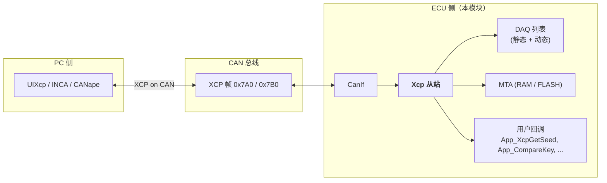
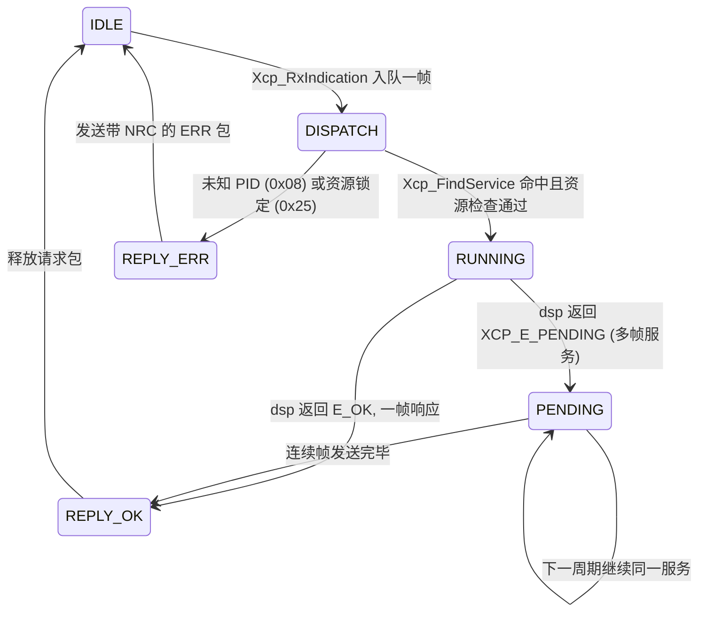
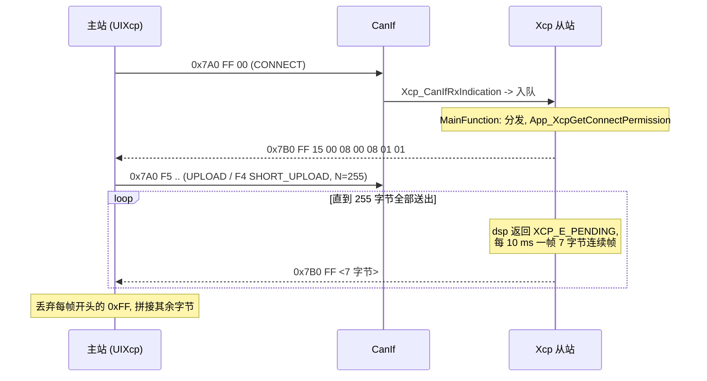

# Xcp - 通用测量与标定协议（从站）

> **一句话概括：** Xcp 是 ECU 上的 XCP **从站**——PC 端工具 [`UIXcp`](UIXcp.md)
> （INCA、CANape 等）的对端：通过 CAN 对外暴露 MTA（内存传输地址）、标定下载、
> Flash 编程与事件驱动的 DAQ 测量，并受 seed-and-key 资源锁保护。

| 项目 | 值 |
| --- | --- |
| 模块代码 | `infras/communication/Xcp`（API：`infras/include/Xcp.h`） |
| 所处层次 | 与诊断栈平级：直接挂在 [CanIf](CanIf.md) 上（固定 PDU id），**不经** PduR 路由 |
| 配置文件 | `app/app/config/Xcp/Xcp.json` |
| 代码生成器 | `tools/generator/Xcp.py` -> `GEN/Xcp_Cfg.c` / `GEN/Xcp_Cfg.h` |
| 规范依据 | ASAM XCP 1.5 / AUTOSAR CP R23-11 XCP（从站侧） |
| 主机对端 | [`UIXcp`](UIXcp.md) PC 工具 |
| 示例 | `scons --app=CanApp` + `CanSend` / `CanDump`（第 6 节） |

**目录**

1. [模块用途](#1-模块用途)
2. [在协议栈中的位置](#2-在协议栈中的位置)
3. [配置](#3-配置)
4. [运行时行为](#4-运行时行为)
5. [公开 API](#5-公开-api)
6. [构建与运行示例](#6-构建与运行示例)
7. [关键注意事项](#7-关键注意事项)
8. [问题排查](#8-问题排查)
9. [已知限制与代码评审发现](#9-已知限制与代码评审发现)
10. [相关文档](#10-相关文档)

---

## 1. 模块用途

* **测量（DAQ）** —— 按事件通道（如"每 100 ms"）周期采样 RAM/Flash 地址，
  打包成 DTO 推上总线，无需任何请求。
* **标定（CAL/PAG）** —— 通过 MTA 指针读写任意内存（`Upload`/`ShortUpload`、
  `Download`），典型对象是 ECU 参数。
* **Flash 编程（PGM）** —— `ProgramStart`/`ProgramClear`/`Program` 钩子供
  bootloader 集成。
* **保护** —— 所有资源上锁，主站通过 `GetSeed`/`Unlock` 解锁；`Connect`
  上报本构建支持哪些资源。

实现遵循 ASAM XCP 协议层语义：命令/响应核心、pending（多帧）服务，以及由
JSON 生成的按服务用户回调表。

---

## 2. 在协议栈中的位置



与诊断服务不同，XCP **不经过** PduR/Dcm：CanIf 把两个固定 PDU 直接路由进
模块：

| PDU | 方向 | 默认 CAN ID | `Up` |
| --- | --- | --- | --- |
| `CANIF_XCP_ON_CAN_RX` | 主站 -> 从站 | `0x7A0` | `Xcp` |
| `CANIF_XCP_ON_CAN_TX` | 从站 -> 主站 | `0x7B0` | `Xcp` |

应用的 `CanIf.json` 中这两个 PDU 的名称必须正好是 `XCP_ON_CAN_RX` /
`XCP_ON_CAN_TX`——生成器把发送 PDU id 硬编码为 `CANIF_XCP_ON_CAN_TX`。

---

## 3. 配置

`Xcp.json`（[app/app/config/Xcp/Xcp.json](../../app/app/config/Xcp/Xcp.json)）
有三个块，各管从站的一部分：

| 块 | 控制 |
| --- | --- |
| `EventChannels` | 周期性 DAQ 事件通道 |
| `DaqList` | 预配置的静态 DAQ 列表与动态 DAQ 池大小 |
| `Services` | 从站接受哪些 XCP 命令、各自调用哪个用户 API |

另有两个标量键：`PacketPoolSize`（默认 `8`，宏 `XCP_PACKET_POOL_SIZE`，
`#ifndef` 可覆盖）与 `MainFunctionPeriod`（默认 `10` ms）。注意
`UsePostBuildConfig` 在本模块默认为 **true**（其他模块默认 false），但生成的
`XCP_USE_PB_CONFIG` 宏 `Xcp.c` 从不读取——见第 9 节。

### 3.1 事件通道

```json
"EventChannels": [
  {"Name": "100ms", "TimeCycle": 100, "MaxDaqList": 8 },
  {"Name": "500ms", "TimeCycle": 500 },
  {"Name": "1s",    "TimeCycle": 1000 }
]
```

| 字段 | 必填 | 含义 |
| --- | --- | --- |
| `Name` | 是 | 通道标签 |
| `TimeCycle` | 是 | 周期（毫秒），换算为 `Xcp_MainFunction` 周期数（向上取整） |
| `MaxDaqList` | 否 | 为对齐规范保留，但**未被使用**（`Xcp_Priv.h` 中已注释） |

### 3.2 DAQ 列表

两种共存：

**静态**（`DaqList.StaticDaqList[]`）——编译期生成，全部 `const`：

| ODT 条目字段 | 含义 |
| --- | --- |
| `Address` | 采样的绝对地址 |
| `Length` | 字节数 |
| `BitOffset` | 可选，默认 `0xFF`（整字节） |
| `Extension` | 地址空间：`MEMORY`（默认）或 `FLASH`（`XCP_MTA_EXT_<name>`） |

静态 DAQ 占据列表索引 `0 .. numOfStaticDaqList-1`，不能被 `AllocDAQ` 重新
分配。

**动态**（`DaqList.DynamicDaqList`）——主站在运行期通过 `AllocDAQ` /
`AllocODT` / `AllocODTEntry` / `SetDAQPtr` / `WriteDAQ` 分配的 RAM 池：

| 字段 | 含义 |
| --- | --- |
| `DaqPoolSize` | 静态列表之外的额外 DAQ 列表数 |
| `OdtPoolSize` | 所有动态列表共享的 ODT 总数 |
| `OdtEntryPoolSize` | 所有动态 ODT 共享的条目总数 |

### 3.3 服务

`Services[]` 是命令表。每条成为一个 `Xcp_ServiceType` 行；**`Name` 字段仅作
显示**——生成器一切从 `Id` 经 `ServiceMap` 推导：

| 字段 | 必填 | 含义 |
| --- | --- | --- |
| `Name` | 是 | 仅显示用 |
| `Id` | 是 | XCP PID（如 `"0xFF"` Connect） |
| `API` | 否 | 用户回调名（见 3.4） |
| `Delay` | 否 | 仅 `ProgramReset`：复位前等待的毫秒数 |
| `maxBs`/`STmin`/`queSz` | 否 | 仅 `ProgramStart`：编程模式通信参数 |

`preprocess()` 会拒绝未知 PID（并列出支持的 PID）与重复 PID，随后**按 PID
排序**——运行期的 `Xcp_FindService()` 二分查找依赖有序。`Connect` 上报的
资源位图由列出的命令组自动推导。

### 3.4 用户回调

`API` 已设置的服务经 `GEN/Xcp_Cfg.c` 中的按服务配置结构体调用用户函数；实现
位于 [app/app/src/xcp_user.c](../../app/app/src/xcp_user.c)：

| 服务 | 回调签名 |
| --- | --- |
| `Connect` | `App_XcpGetConnectPermission(mode, *nrc)` |
| `Disconnect` | `App_XcpDisconnecNotification(void)` |
| `GetSeed` | `App_XcpGetSeed(mode, resource, *seed, *seedLen, *nrc)` |
| `Unlock` | `App_CompareKey(*key, keyLen, *nrc)` |
| `ProgramStart` | `Xcp_GetProgramStartPermission(opStatus, *nrc)` |
| `ProgramReset` | `Xcp_GetProgramStartPermission(opStatus, *nrc)` |

自带的 `xcp_user.c` 实现了演示级 seed/key（`seed ^ 0x78934673`）并无条件接受
编程操作——量产前请替换。

### 3.5 受保护的资源

| 资源 | 位 | 门控 |
| --- | --- | --- |
| `XCP_RES_CALPAG` | `0x01` | `Download`、`DownloadNext`（整个 `CAL_`/`PAG_` 组） |
| `XCP_RES_DAQ` | `0x04` | 所有 `DAQ_*` 服务 |
| `XCP_RES_STIM` | `0x08` | STIM（未使用） |
| `XCP_RES_PGM` | `0x10` | `Program*` 服务 |

`Xcp_Init` 后**所有**资源上锁（`lockedResource = XCP_RES_MASK`）；`Unlock`
按 key 匹配结果清位，`Disconnect` 重新全部上锁。资源仍处于锁定时收到命令
返回 NRC `0x25 Access locked`。

---

## 4. 运行时行为

### 4.1 命令执行

每个收到的帧进入 STAILQ 数据包池队列；主函数**每个周期处理一条命令**：



响应帧同样进入数据包池，由 `Xcp_MainFunction_Response()` 经
`CanIf_Transmit` 排空——总线忙时该帧留到下个周期重试。

多帧服务（如 255 字节的 `SHORT_UPLOAD`，每帧仅 7 字节负载）会把请求包保持在
队列头部并返回 `XCP_E_PENDING` 直到完成——每个主循环周期发一帧：



### 4.2 DAQ

`Xcp_MainFunction_Daq()` 由 `Xcp_MainFunction` 调用，
`Xcp_MainFunction_DaqWrite()` 由 `Xcp_MainFunction_Write` 调用（两者都在 EcuM
主函数表）。事件通道定时器到期时，该通道上每个已启动的 DAQ 列表按 ODT 顺序
采样，每个 ODT 产出一个 DTO 排队发送到 `CANIF_XCP_ON_CAN_TX`。不支持 DAQ
时间戳与 `PID_OFF`——每个 DTO 以 ODT 的 PID 字节开头。

### 4.3 调度方式

`Xcp_Init` 由 EcuM 调用（`EcuM_DriverInitListOne`）；`Xcp_MainFunction` 与
`Xcp_MainFunction_Write` 位于 EcuM 主函数表（`EcuM_Cfg.c`，`USE_XCP` 守卫）。
全模块单线程；唯一的 ISR 入口是 `Xcp_CanIfRxIndication`（临界区内仅做拷贝
入池）——但注意池耗尽时它会在 ISR 里直接发 `Xcp_TxError`（见第 9 节）。

---

## 5. 公开 API

| 函数 | 用途 |
| --- | --- |
| `Xcp_Init(config)` | 复位上下文、初始化数据包池、锁定全部资源 |
| `Xcp_CanIfRxIndication(RxPduId, PduInfo)` | CanIf RX 钩子（校验 `RxPduId == XCP_ON_CAN_CHL`） |
| `Xcp_CanIfTxConfirmation(TxPduId, result)` | 空占位 |
| `Xcp_RxIndication(channel, PduInfo)` | 供其他传输层使用的通用入口 |
| `Xcp_MainFunction` / `Xcp_MainFunction_Write` | 请求/响应/事件 + DAQ 处理 |
| `Xcp_HasFreePacket` / `Xcp_AllocPacket` / `Xcp_FreePacket` | 数据包池辅助 |
| `Xcp_GetU32` / `Xcp_SetU32` / `Xcp_GetU16` / `Xcp_SetU16` | 各 DSP 模块使用的端序安全访问器 |
| `Xcp_GetVersionInfo(info)` | 4.0.0 |

其余（MTA、CAL、DAQ、PGM）均为内部实现，分布在 `Xcp_DspStd.c`（标准命令）、
`Xcp_DspCal.c`（CAL/PAG）、`Xcp_DspDaq.c`（DAQ）、`Xcp_DspPgm.c`（PGM）与
`Xcp_Mta.c`（内存访问）。

---

## 6. 构建与运行示例

主机版 `CanApp` 已启用 XCP，无需硬件即可验证——`CanApp`、`CanSend`、`CanDump`
都在 `simulator_v2` 虚拟总线上通信：

```bash
scons --app=CanApp      # XCP 从站 -> build\nt\GCC\CanApp\CanApp.exe
scons --app=CanSend     # 请求注入器, 安装到 build\nt\GCC\one
scons --app=CanDump     # 帧跟踪器,     安装到 build\nt\GCC\one
```

两个终端分别启动从站与跟踪器：

```bash
build\nt\GCC\CanApp\CanApp.exe
build\nt\GCC\one\CanDump.exe -d simulator_v2 -p 0 -f 700#700
```

第三个终端执行下面任意命令——每行是一条完整的 XCP 命令：

```bash
build\nt\GCC\one\CanSend.exe -d simulator_v2 -p 0 -i 7A0 -v FF00
build\nt\GCC\one\CanSend.exe -d simulator_v2 -p 0 -i 7A0 -v F440000000000000
build\nt\GCC\one\CanSend.exe -d simulator_v2 -p 0 -i 7A0 -v F4FF000000000000
```

`CanDump -f <Mask>#<Code>` 只显示满足 `(canid & Mask) == (Code & Mask)` 的帧，
即只看 XCP 对 `0x7A0`/`0x7B0`。

| 请求 | `-v` 负载 | `0x7B0` 上的应答 |
| --- | --- | --- |
| `CONNECT` | `FF00` | `FF 15 00 08 00 08 01 01` |
| `SHORT_UPLOAD`, 64 字节 | `F440000000000000` | 1 请求, 10 帧 |
| `SHORT_UPLOAD`, 255 字节 | `F4FF000000000000` | 1 请求, 37 帧 |

`CONNECT` 应答含义：`FF` 肯定响应、`15` = 资源 `CALPAG|DAQ|PGM`、`00`
COMM_MODE_BASIC、`08` MAX_CTO、`00 08` MAX_DTO、`01 01` 协议/传输层版本。
`SHORT_UPLOAD` 请求为 `F4 | Number | 保留 | Ext | Addr32(小端)`；`Ext 0` =
`MTA_EXT_MEMORY`。连续帧每 `XCP_MAIN_FUNCTION_PERIOD`（10 ms）一帧；主站丢弃
每帧开头的 `0xFF` 后拼接（见 [UIXcp.cpp](../../tools/asone/src/ui/UIXcp.cpp)
的 `UIMeasure::on_btnRead_clicked()`）。

> 主机版上 `Xcp_MtaRead()` 是桩实现（`linux`/`_WIN32`），上传的字节是残留
> 缓冲内容——上述步骤验证的是时序而非数据。真实数据请在目标构建（如 QEMU
> `VersatilepbCanApp`）上验证；地址来自 map 文件或 `tools/utils/readelf.py`。

---

## 7. 关键注意事项

* **XCP 绕过 PduR 与 Dcm。** CanIf 中两个 PDU 必须命名
  `XCP_ON_CAN_RX` / `XCP_ON_CAN_TX`；PduR 无需任何配置。
* **服务表在生成期按 PID 排序**、运行期二分查找——不要手改 `GEN/Xcp_Cfg.c`。
* **`Services[].name` 只是装饰。** 一切由 PID 决定；`ServiceMap` 中不存在的
  PID 会使构建失败并列出支持的 PID。
* **每个主循环周期只处理一条命令**（默认 10 ms）。批量上传以每周期一帧的
  速度继续——255 字节上传约需 0.4 秒。DAQ 在同一个主函数中运行。
* **初始化后所有资源都是锁定的。** 连 `Download` 都要先
  `CONNECT -> GetSeed -> Unlock`；NRC `0x25` 就是忘了这一步。
* **数据包池 RX/TX 共用**（`PacketPoolSize`，默认 8）。DAQ 繁忙加挂起的
  上传可能耗尽池；症状是 NRC `0x33 resource temporarily not accessible`。
* **只支持 8 字节帧。** `XCP_PATCKET_MAX_SIZE = 8`（注意宏名拼写错误就是把
  PACKET 写成 PATCKET）把 CTO/DTO 限制在 7 字节负载；总线 `LinkLayerDataLength` 必须为 8。
* **`UsePostBuildConfig` 是无效配置**（生成了但 `Xcp.c` 从不读取）。
* **单连接、单通道。** 来自其他"通道"的第二个 CONNECT 得到 NRC
  `0x10 CMD_BUSY`；CAN 上本来就只有通道 0。

---

## 8. 问题排查

| 现象 | 可能原因 |
| --- | --- |
| `0x7B0` 上完全无响应 | `CanIf.json` 缺少/拼错 `XCP_ON_CAN_TX` PDU，或 CAN 发送主函数未被调度（平台构建漏了 `USE_CAN`，见下） |
| `0x25 Access locked` | 先执行该资源的 `GetSeed` + `Unlock` |
| `0x33 Resource temporarily not accessible` | 数据包池耗尽——调大 `PacketPoolSize`（JSON 或 `-DXCP_PACKET_POOL_SIZE=N`） |
| `0x08 Command unknown` | PID 不在 `Xcp.json` 的 `Services[]` 中 |
| 日志出现 `Abort pending service F4` | 某个连续帧的 `Xcp_TxResponse()` 失败——通常是 `Can_MainFunction_Write` 没跑，平台构建忘了 `USE_CAN` |
| 上传中途响应帧停止 | 同上；另外检查 TX 队列是否被 DAQ 流量挤占 |
| DAQ 没有数据 | DAQ 列表未启动（`START_STOP_DAQ_LIST`），或事件通道 `TimeCycle` 相对 `MainFunctionPeriod` 取整为 0 个周期 |
| 主机版上传的数据是乱码 | 预期行为——`Xcp_MtaRead` 在 `linux`/`_WIN32` 是桩；请在目标构建上验证 |

---

## 9. 已知限制与代码评审发现

### 9.1 功能限制

* **仅支持 CAN 传输。** `XCP_ON_FLEXRAY_CHL` / `XCP_ON_ETHERNET_CHL` 已声明
  但未实现；没有 XCP-on-Ethernet/TCP。
* **8 字节 PDU。** 不支持 CAN FD（`XCP_PATCKET_MAX_SIZE = 8`），无分段。
* **无 DAQ 时间戳 / PID_OFF / STIM。** 模式位被接受但忽略；STIM（主站 -> 从站
  DAQ）不存在。
* **单连接。** `activeChannel` 概念存在，但 CAN 只有通道 0。
* **主机版 MTA 是桩**（`Xcp_Mta.c`），`linux`/`_WIN32` 上测量返回残留数据；
  刷写需要按目标定制 `Xcp_DspPgm.c` 集成。

### 9.2 代码评审发现

| # | 位置 | 发现 |
| --- | --- | --- |
| 1 | `Xcp.c:345-366` | `Xcp_RxIndication` 出错时**直接**调用 `Xcp_TxError(channel, nrc)`——而它运行在 CanIf RX 上下文（可能是 ISR）。`Xcp_TxError` 会分配池包（`mp_alloc`，有保护）并调用 `CanIf_Transmit`，即错误响应从中断上下文发送；对不允许 ISR 中发送的驱动这是一个潜在竞态。 |
| 2 | `Xcp.c:33-53` | `Xcp_FindService` 先计算 `h = numOfServices - 1` 并解引用 `config->services[0]`，没有任何空表检查；不带 `Services[]` 的 `Xcp.json` 会导致下溢与越界读（与 `LinIf_HeaderIndication` 同一模式）。 |
| 3 | `Xcp.c:160-166` | 某服务仍处 `PENDING` 时来了**另一条**命令，代码打 "Fatal memory error"、中止挂起服务并开始新命令。对可能长时间挂起的 `Program*` 序列，交错的命令会静默破坏编程会话，而不是应答 `CMD_BUSY`。 |
| 4 | `Xcp.c:210-231` | `Xcp_MainFunction_Response` 没有超时/队列深度控制：若 `CanIf_Transmit` 永不成功（总线关闭），TX 包持续累积直至池耗尽，进而连带阻塞 RX 命令（`no free packet`）。 |
| 5 | `Xcp.c:419-421` | `Xcp_MainFunction_Write`（DAQ 写）与 `Xcp_MainFunction_Daq`（采样）被拆成两个入口，但 `EcuM_Cfg.c:176` 中两者都在同一张主函数表——拆分没有带来并行性，只是一个命名陷阱。 |
| 6 | `Xcp_Priv.h:102-103` | `XCP_PATCKET_MAX_SIZE`——宏名把 "PACKET" 拼成了 "PATCKET"，并扩散到所有 DSP 文件；重命名只是外观问题，但 grep 的集成者一定会被绊一下。 |
| 7 | `Xcp.py:340` | `UsePostBuildConfig` 默认 **true**（其他模块默认 false），而生成的 `XCP_USE_PB_CONFIG` 宏从未被 `Xcp.c` 引用（`Xcp_Init` 无条件忽略 `ConfigPtr`）。误导性的死配置。 |
| 8 | `Xcp.py:299-316` | `preprocess()` 原地排序 `cfg["services"]`；JSON 本身不回写，因此 `GEN/Xcp_Cfg.c` 的顺序与 JSON 顺序不同——对比生成产物时会意外。 |
| 9 | `Xcp_DspDaq.c`（888 行） | DAQ 的每列表状态是普通 RAM 结构，无校验和保护；主站通过 `WriteDAQ` 可把 ODT 条目指向任意地址，采样时每周期读取——对标定工具这是设计使然，但与 `App_CompareKey` 一起纳入安全评审时值得注意。 |
| 10 | `Xcp.c:124-207` | `resData[XCP_PATCKET_MAX_SIZE]` 是 8 字节栈缓冲，`resMaxDataLen = 7`；任何 DSP 函数写更长响应都没有超出 `resMaxDataLen` 约定之外的溢出检测——新增 DSP 命令若不遵守约定会静默栈溢出。 |

---

## 10. 相关文档

* [UIXcp](UIXcp.md) —— PC 端 XCP 主站工具（Qt），另有独立文档
* [CanIf](CanIf.md) —— 传输 PDU（`XCP_ON_CAN_RX` / `XCP_ON_CAN_TX`）
* [CanApp / virtual-can-env](virtual-can-env.md) —— 示例使用的虚拟总线
* 代码：[Xcp.c](../../infras/communication/Xcp/Xcp.c)、
  [Xcp_DspStd.c](../../infras/communication/Xcp/Xcp_DspStd.c)、
  [Xcp_DspDaq.c](../../infras/communication/Xcp/Xcp_DspDaq.c)、
  [Xcp_DspCal.c](../../infras/communication/Xcp/Xcp_DspCal.c)、
  [Xcp_DspPgm.c](../../infras/communication/Xcp/Xcp_DspPgm.c)、
  [Xcp_Mta.c](../../infras/communication/Xcp/Xcp_Mta.c)、
  [Xcp.h](../../infras/include/Xcp.h)、
  [Xcp.py](../../tools/generator/Xcp.py)
* ASAM XCP Part 1-5；AUTOSAR CP R23-11 Specification of XCP
