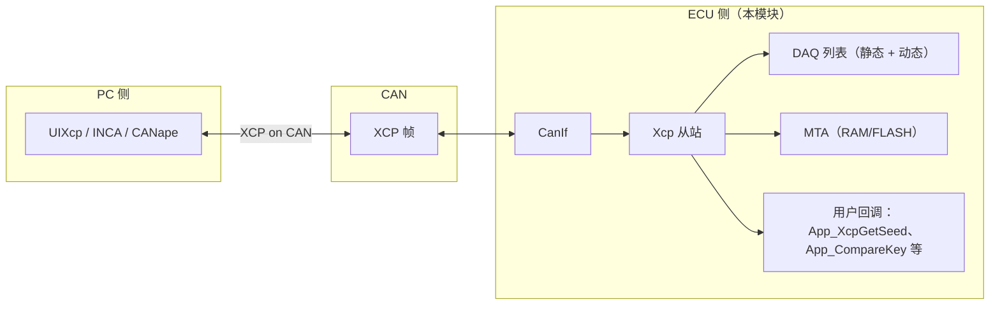

# Xcp 模块配置说明

AUTOSAR [XCP](https://www.asam.net/standards/detail/xcp/) 模块是 ECU 上的 XCP **从站**——PC 端工具 [`UIXcp`](./UIXcp.md) 的对端。它通过单一传输层（目前仅 CAN，见第 6 节）对外暴露内存传输地址（MTA）、标定下载、编程刷写以及事件驱动的 DAQ，并遵循 *Specification of Module XCP AUTOSAR CP R23-11*。

配置由 [Xcp.py](../../tools/generator/Xcp.py) 消费：它读取 [`Xcp.json`](../../app/app/config/Xcp/Xcp.json) 并生成 `GEN/Xcp_Cfg.c` / `GEN/Xcp_Cfg.h`，包含服务表、DAQ 布局以及各服务的配置结构指针。`app/platform/<cpl>/<app>/config/Xcp/Xcp.json` 下的每个平台变体都通过同一份配置由构建系统生成。



## 1. 配置示例

仓库自带的配置文件位于 [app/app/config/Xcp/Xcp.json](../../app/app/config/Xcp/Xcp.json)：

```json
{
  "class": "Xcp",
  "EventChannels": [
    {"name": "100ms", "TimeCycle": 100, "MaxDaqList": 8 },
    {"name": "500ms", "TimeCycle": 500 },
    {"name": "1s",    "TimeCycle": 1000 }
  ],
  "DaqList": {
    "StaticDaqList": [
      { "name": "Daq0", "ODTs": [
          { "name": "ODT0", "Entries": [
              { "Address": 0, "Length": 1 },
              { "Address": 10, "Length": 1 },
              { "Address": 20, "Length": 1 }
          ]},
          { "name": "ODT1", "Entries": [
              { "Address": 30, "Length": 1 },
              { "Address": 40, "Length": 1 },
              { "Address": 50, "Length": 1 }
          ]}
      ]}
    ],
    "DynamicDaqList": { "DaqPoolSize": 2, "OdtPoolSize": 16, "OdtEntryPoolSize": 128 }
  },
  "services": [
    { "name": "Connect",      "id": "0xFF", "API": "App_XcpGetConnectPermission" },
    { "name": "GetStatus",    "id": "0xFD" },
    { "name": "GetSeed",      "id": "0xF8", "API": "App_XcpGetSeed" },
    { "name": "Unlock",       "id": "0xF7", "API": "App_CompareKey" },
    { "name": "SetMTA",       "id": "0xF6" },
    { "name": "Upload",       "id": "0xF5" },
    { "name": "ShortUpload",  "id": "0xF4" },
    { "name": "Download",     "id": "0xF0" },
    { "name": "DownloadNext", "id": "0xEF" },
    { "name": "ProgramStart",   "id": "0xD2", "API": "Xcp_GetProgramStartPermission" },
    { "name": "ProgramClear",   "id": "0xD1" },
    { "name": "Program",        "id": "0xD0" },
    { "name": "ProgramNext",    "id": "0xCA" },
    { "name": "FreeDAQ",        "id": "0xD6" },
    { "name": "AllocDAQ",       "id": "0xD5" },
    { "name": "AllocODT",       "id": "0xD4" },
    { "name": "DAQ_ALLOC_ODT_ENTRY", "id": "0xD3" },
    { "name": "ClearDAQList",   "id": "0xE3" },
    { "name": "SetDAQPtr",      "id": "0xE2" },
    { "name": "WriteDAQ",       "id": "0xE1" },
    { "name": "ReadDAQ",        "id": "0xDB" },
    { "name": "SetDAQListMode", "id": "0xE0" },
    { "name": "StartStopDAQList", "id": "0xDE" },
    { "name": "StartStopSynch",   "id": "0xDD" },
    { "name": "GetDAQProcessorInfo", "id": "0xDA" },
    { "name": "GetDAQResolutionInfo","id": "0xD9" },
    { "name": "GetDAQListInfo",     "id": "0xD8" },
    { "name": "GetDAQEventInfo",    "id": "0xD7" },
    { "name": "ProgramReset",  "id": "0xCF", "delay": "100", "API": "Xcp_GetProgramResetPermission" },
    { "name": "Disconnect",    "id": "0xFE", "API": "App_XcpDisconnecNotification" }
  ]
}
```

三个顶层块控制从站的三个不同部分：

| 块                | 作用                                                              |
| ----------------- | ----------------------------------------------------------------- |
| `EventChannels`   | 周期型 DAQ 事件通道（`TimeCycle` 以 ms 计，见第 2 节）            |
| `DaqList`         | 预配置的 DAQ 列表以及动态 DAQ 池的大小                            |
| `services`        | 从站接受的 XCP 命令，以及每条命令调用的用户 API                    |

## 2. 事件通道

每个条目定义一条**事件通道**，周期性地触发其下挂的所有 DAQ 列表。JSON 中的 `TimeCycle` 单位为毫秒；生成器通过 `XCP_CONVERT_MS_TO_MAIN_CYCLES(TimeCycle)`（向上取整）转换为 `Xcp_MainFunction` 节拍数。`Xcp_MainFunction` 自身的周期来自 JSON 键 `MainFunctionPeriod`（默认 `10` ms），生成器把它写成 `XCP_MAIN_FUNCTION_PERIOD`。

| 字段        | 是否必填 | 含义                                                                  |
| ----------- | -------- | --------------------------------------------------------------------- |
| `name`      | 是       | 通道名，仅作为标签                                                    |
| `TimeCycle` | 是       | 周期（ms），会被换算成主函数节拍数                                     |
| `MaxDaqList`| 否       | 仅为对齐规范保留，当前**未被消费**：该字段在 `Xcp_Priv.h` 中已被注释掉，生成器也不读取 |

事件通道的处理在 `Xcp_MainFunction_Daq()` 中完成。当某条通道的定时器到期时，所有挂在其下的 DAQ 列表按顺序采样，每个 ODT 打包成一个 DTO 经 `CANIF_XCP_ON_CAN_TX` 通道通过 `CanIf_Transmit` 发出。

## 3. DAQ 列表

DAQ 列表是从站向主站发布测量数据的机制。本从站同时支持两类：

### 3.1 静态 DAQ 列表（`DaqList.StaticDaqList[]`）

由 JSON 在编译期构建——ODT 与 ODT 条目均为 `const`，运行时无需分配：

```json
{ "name": "Daq0", "ODTs": [
    { "name": "ODT0", "Entries": [
        { "Address": 0, "Length": 1 },
        { "Address": 10, "Length": 1 }
    ]}
]}
```

| ODT 条目的字段 | 含义                                                                                  |
| -------------- | ------------------------------------------------------------------------------------- |
| `Address`      | 要采样的绝对地址（主站可通过 `GetDAQEventInfo` 等命令读回）                            |
| `Length`        | 字节数                                                                                |
| `BitOffset`   | 可选，默认 `0xFF`（按整字节采样）；否则按比特粒度采样                                  |
| `Extension`   | 地址空间：`MEMORY`（默认）或 `FLASH`                                                  |

生成器为每个 DAQ 列表生成一个 `Xcp_OdtEntryType[]`、一个 `Xcp_OdtType[]` 和一个 `Xcp_DaqListType`，均为 `const`。静态 DAQ 不允许通过 `AllocDAQ` 重新分配——其编号固定为 `0..numOfStaticDaqList - 1`。

### 3.2 动态 DAQ 列表（`DaqList.DynamicDaqList`）

一块运行时内存池，主站可通过 `AllocDAQ` / `AllocODT` / `AllocODTEntry` / `SetDAQPtr` / `WriteDAQ` 自由切分。仅配置大小：

| 字段                | 含义                                            |
| ------------------- | ----------------------------------------------- |
| `DaqPoolSize`       | 静态 DAQ 之外的额外 DAQ 列表数                  |
| `OdtPoolSize`       | 所有动态 DAQ 列表可用的 ODT 总数                |
| `OdtEntryPoolSize`  | 所有动态 ODT 可用的 ODT 条目总数                |

生成器生成 `Xcp_DynDaq0..N`、`Xcp_DynOdts[M]`、`Xcp_DynOdtEntries[K]`，都是普通的（非 `const`）RAM；从站在运行时对它们进行分配/回收。对受影响 DAQ 列表调用 `ClearDAQList` 会把对应的动态条目一次性释放。

## 4. 服务

`services[]` 就是从站的命令表。每个条目对应 `Xcp_Services[]` 中的一行 `Xcp_ServiceType`：

```c
{
  Xcp_Dsp<Name>,                 /* 对应的实现，位于 Xcp_DspStd.c / Xcp_DspCal.c 等 */
  (const void *)&Xcp_<Name>Config,/* 服务的私有配置（无 API 时为 NULL） */
  XCP_PID_CMD_<GROUP>_<NAME>,    /* XCP PID，如 XCP_PID_CMD_STD_CONNECT */
  /* resource */ XCP_RES_<...>,  /* 该命令所需的受保护资源 */
}
```

| 字段                 | 是否必填 | 含义                                                                                                |
| -------------------- | -------- | --------------------------------------------------------------------------------------------------- |
| `name`               | 是       | 仅作显示用，生成器并不读取；`Xcp_Dsp<Name>`、`XCP_PID_CMD_<GROUP>_<NAME>` 与资源位都由 `id` 经 Xcp.py 中的 `ServiceMap` 推导 |
| `id`                 | 是       | XCP PID，如 `"0xFF"` 表示 `Connect`；支持十进制或十六进制                                          |
| `API`                | 否       | 需要用户回调的服务填此项（见第 5 节）                                                                |
| `delay`              | 否       | 仅 `ProgramReset` 使用：接受请求后等待多少毫秒再真正执行 `Xcp_PerformReset()`                       |
| `maxBs`/`STmin`/`queSz` | 否    | 仅 `ProgramStart` 使用：编程模式下的通信参数                                                          |

生成器使用的前缀（`STD_`、`CAL_`、`DAQ_`、`PGM_`）取自 [`ServiceMap`](../../tools/generator/Xcp.py#L87) 中该 PID 对应规范名的前四个字符——JSON 条目的 `name` 字段并不参与（另见 [Xcp_Priv.h](../../infras/communication/Xcp/Xcp_Priv.h#L17) 中的 PID 列表）。PID 不在 `ServiceMap` 中会直接导致生成失败。

### 4.1 受保护的资源

每个服务都被其所触及的资源守护。`Connect` 把从站持有的资源集合通过 `RESOURCE` 字段上报（例如 `0x15` = `CALPAG|DAQ|PGM`）；主站必须先对该资源执行 `GetSeed` + `Unlock`，后续访问该资源的命令才会被接受。`Disconnect` 后所有资源重新加锁。

| 资源                | 位    | 守护的命令                                                                                |
| ------------------- | ----- | ----------------------------------------------------------------------------------------- |
| `XCP_RES_CALPAG`    | `0x01` | `Download`、`DownloadNext`——生成器把 `CAL_` 与 `PAG_` 两组都归到这里                          |
| `XCP_RES_DAQ`       | `0x04` | 所有 `DAQ_*` 命令                                                                          |
| `XCP_RES_PGM`       | `0x10` | `ProgramStart`、`ProgramClear`、`Program`、`ProgramNext`、`ProgramReset`                  |
| `XCP_RES_STIM`      | `0x08` | DAQ STIM（本从站未使用）                                                                  |

只要当前 `lockedResource` 中仍带有该服务所需的位，`Xcp_MainFunction_Request()` 就返回 `0x25 = Access locked`。`Connect` 上报的资源集合由生成器中的 `get_resource(cfg)` 推导——它取自 `services[]` 列表，无须手工声明。

## 5. 用户回调

凡是 JSON 中设置了 `API` 的服务，都会通过 `Xcp_Cfg.c` 里的 per-service 配置结构调用用户函数。应用的集成点在 [app/app/src/xcp_user.c](../../app/app/src/xcp_user.c)，各平台变体都在该文件中实现这些回调。

| 服务           | `API` 回调签名                                                                                                              | 调用方                              |
| -------------- | ------------------------------------------------------------------------------------------------------------------------- | ----------------------------------- |
| `Connect`      | `Std_ReturnType App_XcpGetConnectPermission(uint8_t mode, Xcp_NegativeResponseCodeType *nrc)`                            | `Xcp_DspConnect`                    |
| `Disconnect`   | `Std_ReturnType App_XcpDisconnecNotification(void)`                                                                       | `Xcp_DspDisconnect`                 |
| `GetSeed`      | `Std_ReturnType App_XcpGetSeed(uint8_t mode, uint8_t resource, uint8_t *seed, uint16_t *seedLen, Xcp_NegativeResponseCodeType *nrc)` | `Xcp_DspGetSeed`                    |
| `Unlock`       | `Std_ReturnType App_CompareKey(uint8_t *key, uint16_t keyLen, Xcp_NegativeResponseCodeType *nrc)`                        | `Xcp_DspUnlock`                     |
| `ProgramStart` | `Std_ReturnType Xcp_GetProgramStartPermission(Xcp_OpStatusType opStatus, Xcp_NegativeResponseCodeType *nrc)`              | `Xcp_DspProgramStart`               |
| `ProgramReset` | `Std_ReturnType Xcp_GetProgramResetPermission(Xcp_OpStatusType opStatus, Xcp_NegativeResponseCodeType *nrc)`             | `Xcp_DspProgramReset`（在 `delay` ms 之后） |

未列入的服务没有用户回调，`Xcp_Priv.h` 中也没有为其声明用户 API——这些服务要么不需要任何外部数据（`GetStatus`、`SetMTA`、`Upload`、`ShortUpload`、`Download` 以及 DAQ list/info 系列命令），要么直接调用上层（`Program`、`ProgramNext`、`ProgramClear` —— 见 [Xcp_DspPgm.c](../../infras/communication/Xcp/Xcp_DspPgm.c)）。

仓库自带的 `xcp_user.c` 实现了一个最小的 seed & key 方案（`lXcpSeed ^ 0x78934673`），并且无条件接受 `ProgramReset` / `ProgramStart`。请按自己的安全策略改写这六个回调：`GetConnectPermission`、`GetSeed`、`CompareKey`、`DisconnecNotification`，以及两个编程回调。

## 6. 传输层

本从站目前**仅支持 XCP on CAN**。接收侧通过 `Xcp_CanIfRxIndication()` 接入，仅校验 `RxPduId == XCP_ON_CAN_CHL`（`0`），在连接未建立时丢弃除 `0xFF CONNECT` 之外的所有命令。发送侧通过 `CanIf_Transmit(CANIF_XCP_ON_CAN_TX, &PduInfo)` 发出；[Xcp.c](../../infras/communication/Xcp/Xcp.c#L28) 中那块由 `XCP_PACKET_POOL_SIZE`（JSON 键 `PacketPoolSize`，默认 `8`）定尺寸的槽位池既存放收到的命令，也在总线拥塞时充当发送缓冲——见 [Xcp.c](../../infras/communication/Xcp/Xcp.c#L61) 中的 `Xcp_TxResponse()` 与 `Xcp_TxError()`。

传输层 PDU ID 取自应用的 `CanIf.json` 配置：

| PDU ID                  | 方向        | 默认 CAN ID |
| ----------------------- | ----------- | ----------- |
| `CANIF_XCP_ON_CAN_RX`   | 主站 → 从站 | `0x7A0`     |
| `CANIF_XCP_ON_CAN_TX`   | 从站 → 主站 | `0x7B0`     |

从站一帧的最大长度固定为 `XCP_PATCKET_MAX_SIZE = 8` 字节，因此总线的 `LL_DL` 必须为 `8`（与 PC 工具 [`xcp.json`](../../tools/asone/examples/xcp.json) 中的 `target.LL_DL` 默认值一致）。[`Xcp.h`](../../infras/include/Xcp.h#L13) 中虽声明了 `FlexRay` / `Ethernet` 通道 ID，但并未实现。

## 7. 生成器

[Xcp.py](../../tools/generator/Xcp.py) 读取 `Xcp.json`，生成 `GEN/Xcp_Cfg.h` 与 `GEN/Xcp_Cfg.c`：

1. `preprocess()` 把每个 `id` 转换为数值，拒绝不在 `ServiceMap` 中的 PID 以及重复的 PID，并按 PID 排序，这样 `Xcp_FindService()` 就能在运行时二分查找服务表。
2. 头文件定义 `XCP_PACKET_POOL_SIZE`（JSON 键 `PacketPoolSize`，默认 `8`）、`XCP_MAIN_FUNCTION_PERIOD`（JSON 键 `MainFunctionPeriod`，默认 `10` ms），并为每个服务生成一条 `XCP_USE_SERVICE_<GROUP>_<NAME>` 宏——源文件通过这些宏按需编译对应的实现。两个宏都带 `#ifndef` 保护，编译期 define 仍可覆盖。
3. C 文件声明每个 `API` 回调为 `extern`，实例化每个服务的配置结构（`Xcp_<Name>Config`）、静态 DAQ 的 ODT、动态 DAQ 池、`Xcp_Services[]` 表，最后是 `Xcp_GetConfig()` 返回的根配置 `Xcp_Config`。
4. `get_resource(cfg)` 遍历 `services[]`，把所有命令触及到的资源组取并，写入 `Xcp_Config.resource`——这就是 `Connect` 向主站上报的资源位图。

构建系统在 `Xcp.json` 发生变更时重新生成上述两个文件；唯一手写的就是 `xcp_user.c`（用户回调）以及位于 [infras/communication/Xcp](../../infras/communication/Xcp/) 下的从站源文件。

## 8. 局限

- 当前传输层**仅支持 CAN**。`XCP_ON_FLEXRAY_CHL` 与 `XCP_ON_ETHERNET_CHL` 只是预留 ID，从站实际只注册了 `Xcp_CanIfRxIndication`。
- 单帧最大长度为 `XCP_PATCKET_MAX_SIZE = 8`，因此总线 `LL_DL` 必须为 `8`；不支持超大帧分段。
- DAQ 时间戳和 `PID_OFF` 暂未支持，`DAQ_LIST_MODE_TIMESTAMP` / `DAQ_LIST_MODE_PID_OFF` 位会被忽略。
- 暂未实现 `STIM`（主站 → 从站的 DAQ）。从站只接受 DAQ 方向。
- `Xcp_MtaRead/Write` 在真实目标上接受 `MTA_EXT_MEMORY` 与 `MTA_EXT_FLASH`；在 `linux` / `_WIN32` 主机构建中读写体被桩化（`#if defined(linux) || defined(_WIN32)`），见 [Xcp_Mta.c](../../infras/communication/Xcp/Xcp_Mta.c)。在真实目标上刷写仍需在 [Xcp_DspPgm.c](../../infras/communication/Xcp/Xcp_DspPgm.c) 中自行扩展 `Program*` 实现。
- 从站单通道、单连接。`Xcp_RxIndication()` 中的 `0x10 ERR_CMD_BUSY` 分支只在“命令来自非当前活动通道”时触发；CAN 上通道恒为 `XCP_ON_CAN_CHL`，因此该分支当前不可达，是为后续更多传输层预留的。
- 在途帧数超过 `XCP_PACKET_POOL_SIZE` 时会上报 `0x33 ERR_RESOURCE_TEMPORARY_NOT_ACCESSIBLE`；若在高负载下出现，用 `Xcp.json` 的 `PacketPoolSize` 属性调大（或用编译期 define `-DXCP_PACKET_POOL_SIZE=N`），不要去改生成的 `Xcp_Cfg.h`。

## 9. 用 CanSend 验证从站

主机版 `CanApp` 默认就打开了 XCP（`app/app/SConscript` 已注册 `config/Xcp/Xcp.json`），因此不需要任何硬件即可验证从站：`CanApp` 跑在 `simulator_v2` 虚拟总线上（一个 UDP 组播组），PC 工具 `CanSend` / `CanDump` 加入同一总线即可，三者都跑在本机。

先构建三个目标：

```bash
scons --app=CanApp      # XCP 从站      -> build\nt\GCC\CanApp\CanApp.exe
scons --app=CanSend     # 请求注入工具，安装到 build\nt\GCC\one
scons --app=CanDump     # 报文抓取工具，安装到 build\nt\GCC\one
```

启动从站与抓包工具（两个终端）：

```bash
build\nt\GCC\CanApp\CanApp.exe
build\nt\GCC\one\CanDump.exe -d simulator_v2 -p 0 -f 700#700
```

再在第三个终端里执行下面任意一条——每一行都是完整命令，直接复制即可运行：

```bash
build\nt\GCC\one\CanSend.exe -d simulator_v2 -p 0 -i 7A0 -v FF00
build\nt\GCC\one\CanSend.exe -d simulator_v2 -p 0 -i 7A0 -v F440000000000000
build\nt\GCC\one\CanSend.exe -d simulator_v2 -p 0 -i 7A0 -v F4FF000000000000
```

`CanDump -f <Mask>#<Code>` 只保留满足 `(canid & Mask) == (Code & Mask)` 的报文，所以 `-f 700#700` 把抓包范围限制在 XCP 的 `0x7A0`（请求）与 `0x7B0`（应答）两个 ID 上，滤掉同一条总线上的其他流量；去掉该选项即可查看全部报文。

`CanSend` 以十六进制直接发送 CTO 负载（`-i` 为 CAN ID，`-v` 为数据）。`CanDump` 会把整个数据数组打印出来，因此末尾的 `55` 只是显示填充，不属于请求本身。上面三条命令与下表各行一一对应：

| 请求 | `-v` 负载 | `0x7B0` 上的应答 |
| ---- | --------- | ---------------- |
| `CONNECT` | `FF00` | `FF 15 00 08 00 08 01 01` |
| `SHORT_UPLOAD`，64 字节 | `F440000000000000` | 1 次请求，10 帧，64 字节 |
| `SHORT_UPLOAD`，255 字节 | `F4FF000000000000` | 1 次请求，37 帧，255 字节 |

`CONNECT` 的应答依次是：`FF`（肯定应答）、`15`（`resource` = `CALPAG|DAQ|PGM`）、`00`（`COMM_MODE_BASIC`）、`08`（`MAX_CTO`）、`00 08`（`MAX_DTO`）、`01 01`（协议层/传输层版本号）。

`SHORT_UPLOAD` 请求固定为 8 字节：`F4 | Number | reserved | Extension | Address（32 位小端）`。其中 `Number` 为要读取的字节数，`Extension` 为 `0` 时选择 `MTA_EXT_MEMORY`。

一次请求最多可以要 255 字节，但单个 CTO 帧只能携带 `XCP_PATCKET_MAX_SIZE - 1` = 7 个数据字节。因此只要还有剩余字节，`Xcp_DspShortUpload()` 就返回 `XCP_E_PENDING`，`Xcp_MainFunction_Request()` 每次被调用只发一帧应答，并把该请求包留在 `rxPackets` 队首直到发完。由于 `Xcp_MainFunction()` 由 `MainTask_10ms()` → `EcuM_BswService()` → `EcuM_DriverMainList[]` 驱动，续帧的节奏就是每 10 ms 一帧（`XCP_MAIN_FUNCTION_PERIOD`）：

```text
2026-10-16 21:49:57 7A0 dlc=08 data=[F4,40,00,00,00,00,00,00]  <- 1 次请求，读 64 字节
2026-10-16 21:49:57 7B0 dlc=08 data=[FF,80,3F,FE,E2,F6,7F,00]  <- 第 1 帧（共 10 帧）
2026-10-16 21:49:57 7B0 dlc=08 data=[FF,80,3F,FE,E2,F6,7F,00]  <- 再过 10 ms
...
2026-10-16 21:49:57 7B0 dlc=02 data=[FF,80]                    <- 第 10 帧，最后一个字节
```

每一帧应答都以 `XCP_PID_RES`（`0xFF`）开头；主站会丢掉每帧的第一个字节，把其余字节拼接起来，见 [UIXcp.cpp](../../tools/asone/src/ui/UIXcp.cpp#L362) 中的 `UIMeasure::on_btnRead_clicked()`。`CanSend` 只负责注入请求，所以要与 `CanDump` 配合才能同时看到两个方向。

> 用主机构建验证时有两点需要注意：
>
> - `Xcp_MtaRead()` 在 `linux` / `_WIN32` 上是空实现（见第 8 节），因此应答里的数据是缓冲区残留而不是 `Address` 处的真实内存。上面的步骤验证的是请求/应答的时序与分帧，而不是数据内容。要验证真实数据，请改用目标构建（例如 QEMU 的 `VersatilepbCanApp`），地址取自 map 文件或由 `tools/utils/readelf.py` 导出的 JSON。
> - 如果日志里出现 `Abort pending service F4`（来自 [Xcp.c](../../infras/communication/Xcp/Xcp.c#L177)），说明某一续帧的 `Xcp_TxResponse()` 失败了。最常见的原因是 CAN 驱动的发送主函数从未被调度：`Can_MainFunction_Write` 位于 `EcuM_DriverMainFastList` 中且被 `#ifdef USE_CAN` 包着，所以某个平台若漏定义 `USE_CAN`，就会在第一帧之后卡住。