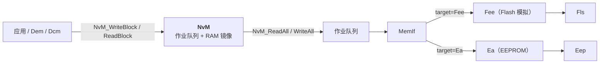

# NvM - NVRAM 管理器

> **一句话概括：** NvM 把带类型的 C 结构体（块）变成非易失存储作业：开机 ReadAll、
> 关机 WriteAll，外加按块的读/写/恢复默认值，下层委托给 Fee（Flash）或
> Ea（EEPROM）。

| 项目 | 值 |
| --- | --- |
| 模块 | `infras/memory/NvM`（API：`infras/include/NvM.h`） |
| 层级 | Fee/Ea（经 MemIf）之上，Dem/Dcm/应用之下 |
| 配置 | `app/app/config/NvM/NvM.json` |
| 生成器 | `tools/generator/NvM.py` -> `GEN/NvM_Cfg.c` / `GEN/NvM_Cfg.h` |
| 标准 | AUTOSAR CP 4.4 NvM（子集） |
| 演示 | `CanApp` + DCM 例程 `31 01 FEEF`（`NvM_TestStart`） |

**目录**

1. [模块用途](#1-模块用途)
2. [配置](#2-配置)
3. [运行时行为](#3-运行时行为)
4. [公开 API](#4-公开-api)
5. [构建与运行演示](#5-构建与运行演示)
6. [关键注意事项](#6-关键注意事项)
7. [已知局限](#7-已知局限)

---

## 1. 模块用途

* **用 C 结构体声明持久数据** - `Blocks[]` 条目生成 `typedef struct` + 静态 RAM
  镜像 + 默认值；应用通过 `NvM_GetBlockDataPtrAndLength()` 或 `NvM_ReadBlock`
  访问。
* **作业队列** - 异步的读/写/擦除/失效/恢复作业，由 `NvM_MainFunction()` 执行。
* **批量服务** - 开机 `NvM_FirstInitAll()` 后 `NvM_ReadAll()`，关机
  `NvM_WriteAll()`。
* **完整性** - 按块 CRC（上下文 CRC）与写次数统计。

---

## 2. 配置

| 键 | 含义 |
| --- | --- |
| `Target` | `Fee`（Flash 模拟，默认）或 `Ea`（真实 EEPROM）；可用环境变量 `NVM_TARGET` 覆盖 |
| `Blocks[]` | 块表（见下） |
| `UseContextCrc` | 默认 **true** - 生成 `FEE_USE_CONTEXT_CRC` |
| `UseFaults` | 默认 **true** - 生成 `FEE_USE_FAULTS`（故障注入，测试用） |
| `banks[]` | 可选 `{address, size, repeat}`，Fee 的 Flash 分区布局 |

块键：

| 键 | 含义 |
| --- | --- |
| `Name` | 结构体名；`{}` 随 `Repeat` 展开下标（如 `Dem_NvmEventStatusRecord{}` x8） |
| `Repeat` | 生成 N 个带下标后缀的实例 |
| `NumberOfWriteCycles` | 每块耐久度，默认 10,000,000 |
| `Data[]` | 字段：`Name`、`Type`（`uint8/16/32`、`uint8_n` + `Size`、嵌套 `Data`）、`Default`、可选 `Size`/`Repeat` |
| `Size` | 结构体数组块的外层重复 |

嵌套/重复字段被摊平成一段连续结构体；默认值可以是 Python 风格表达式
（`"[0xFF]*4"`）。

---

## 3. 运行时行为



* **开机**：`NvM_Init` -> `NvM_FirstInitAll()`（RAM 填默认值）-> `NvM_ReadAll()`
  （用已存数据覆盖；CRC 错或空 Flash 的块保留默认值）。
* **运行**：`NvM_SetRamBlockStatus(block, TRUE)` 标脏；`NvM_WriteAll()` 遍历所有
  脏块（或按块 `NvM_WriteBlock`）。
* **关机**：调 `NvM_WriteAll()`，断电前等待每块 `NvM_GetErrorStatus() !=
  NVM_REQ_PENDING`。

---

## 4. 公开 API

| 函数 | 用途 |
| --- | --- |
| `NvM_Init(ConfigPtr)` / `NvM_MainFunction()` | 初始化、作业执行 |
| `NvM_FirstInitAll()` / `NvM_ReadAll()` / `NvM_WriteAll()` / `NvM_ValidateAll()` / `NvM_CancelWriteAll()` | 批量操作 |
| `NvM_ReadBlock(BlockId, dst)` / `NvM_WriteBlock(BlockId, src)` | 显式作业（数据即 RAM 镜像） |
| `NvM_SetRamBlockStatus(BlockId, changed)` | 标脏 |
| `NvM_GetBlockDataPtrAndLength(BlockId, **ptr, *len)` | 直接访问 RAM |
| `NvM_GetErrorStatus(BlockId, *result)` | `NVM_REQ_OK / PENDING / NOT_OK / ...` |
| `NvM_RestoreBlockDefaults(BlockId, dst)` | 拷贝默认值 |
| `NvM_EraseNvBlock` / `NvM_InvalidateNvBlock(BlockId)` | 抹掉已存数据 |
| `NvM_JobEndNotification` / `NvM_JobErrorNotification()` | Fee/Ea 回调 |
| `NvM_GetVersionInfo` | 版本 |

---

## 5. 构建与运行演示

```bash
scons --app=CanApp
./build/nt/GCC/CanApp/CanApp.exe
./build/nt/GCC/IsoTpSend/IsoTpSend.exe -v 3101FEEF    # NvmTest：读/写/校验一个块
```

`NvM_Test`（DID 例程 `0xFEEF`）支持多个子命令（读块、写块、循环测试等）- 见
`infras/memory/NvM/NvM_Test.c`。模拟器上 Fee 目标使用 `g_FlsAcMirror`
（Flash 的 RAM 镜像）。

---

## 6. 关键注意事项

1. **块 id 就是数组下标** - 重排 `Blocks[]` 会改动代码里所有 `NvM_BlockIdType`
   （Dem 里存着它们！）。
2. **`Repeat` 块是独立块**，各有自己的 id 和作业 - 写
   `Dem_NvmEventStatusRecord{}` 的第 3 块不影响其它实例。
3. **`Target` 决定整个下层栈** - `app/app/SConscript` 会相应加入 `Fls` 或 `Eep`；
   切换目标改 `NVM_TARGET` 或 JSON。
4. **开机时的 CRC 错误表现为"恢复默认值"** - 已存数据消失时查
   `NvM_GetErrorStatus` 是否为 `NVM_REQ_INTEGRITY_FAILED`（经 Fee）。
5. **作业是异步的** - 不要在 Dcm 处理器里自旋等待；跨主函数周期检查
   `NVM_REQ_PENDING`。

---

## 7. 已知局限

1. **没有 dataset（REDUNDANT/DATASET）块类型** - 所有块都是 native。
2. **作业没有按块优先级** - 队列是 FIFO。
3. **`NumberOfWriteCycles` 只是信息** - NvM 层不做磨损均衡（物理磨损由 Fee 管）。
4. **没有完整 AUTOSAR NvM 的显式同步/写保护 API**（没有 `NvM_SetBlockProtection`
   等）。
5. **`NVM_TARGET` 环境变量会静默覆盖 JSON 的 `Target`** - 一个残留的 shell 变量
   就能悄悄把 Fee 换成 Ea，无任何告警。

**相关文档：** [Fee](Fee.md) - [Ea](Ea.md) - [Dem](Dem.md) - [Dcm](Dcm.md)
