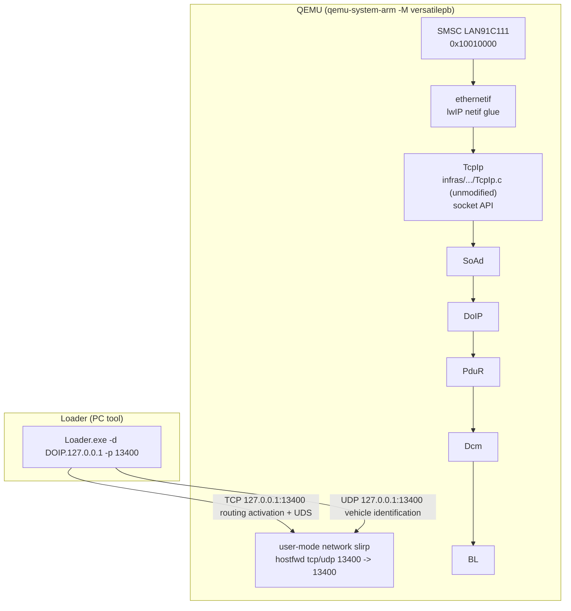

# Validating the Bootloader over TCP/IP on QEMU versatilepb

## Table of Contents

1. [Introduction](#1-introduction)
2. [Architecture](#2-architecture)
3. [Configuration](#3-configuration)
4. [Build](#4-build)
   - [Getting the QEMU Platform First](#41-getting-the-qemu-platform-first)
   - [Building the Targets](#42-building-the-targets)
5. [Running DoIPBL](#5-running-doipbl)
6. [Testing a Flashing Session over DoIP](#6-testing-a-flashing-session-over-doip)
   - [Preparing the Flash Driver and Application Image](#61-preparing-the-flash-driver-and-application-image)
   - [Starting the QEMU Target](#62-starting-the-qemu-target)
   - [Flashing over DoIP](#63-flashing-over-doip)
7. [Troubleshooting](#7-troubleshooting)

## 1. Introduction

[BL-DoIP.md](BL-DoIP.md) demonstrates BL over DoIP on a **host simulator** (a Windows/Linux process). This document targets something different: it runs the same bootloader software stack on the **QEMU ARM Versatile/PB board** (`-M versatilepb`), sending and receiving real Ethernet frames through the on-board **SMSC LAN91C111** Ethernet controller. That lets you validate the whole `Loader -> TCP/IP -> DoIP -> Dcm -> BL` flashing chain end to end without any hardware and without a host packet-capture driver (pcap/tap).

Compared with the host-simulator variant, the only difference is where the network comes from:

| Item | Host-simulator DoIPBL | QEMU versatilepb DoIPBL |
| --- | --- | --- |
| CPU | Native x86/x64 | ARM926EJ-S (emulated by QEMU) |
| Ethernet | lwIP `pcapif`/`tapif`, needs a host NIC and capture driver | SMSC LAN91C111 (`0x10010000`) + bare-metal lwIP port |
| lwIP mode | `NO_SYS=0` with threads/semaphores | `NO_SYS=0` with the socket API, but threads are stubs and the stack is pumped from the main loop (see 2.2) |
| Tester connectivity | Same subnet as the ECU | QEMU user-mode network port forwarding (`hostfwd`) |
| Reset behaviour | No jump, no reset | No jump, no reset (see 3.3) |

Key points:

- **The platform is not in this repository.** `app/platform/qemu` is a separate clone of `autoas/qemu` and is ignored by `app/platform/.gitignore`; clone it there before building (see 4.1).
- `VersatilepbDoIPBL` is a pure flashing target built with `BL_RECOVERY_MODE`: it neither verifies nor jumps to the application, and it does not perform a real reset, so the same QEMU instance can be flashed repeatedly — handy for demos.
- The target IP is fixed to the QEMU user-mode default, `10.0.2.15/24`, with gateway `10.0.2.2`. The tester reaches it through a port forward on the host's `127.0.0.1`.
- The target-side software stack is identical to [BL-DoIP.md](BL-DoIP.md) (same BL, Dcm, PduR, SoAd and DoIP configuration and behaviour), and `TcpIp` is the same `infras/communication/TcpIp/TcpIp.c` — **not a single line changed**; the bare-metal adaptation lives entirely in the platform's `TcpIp_Config` (`InitFnc`/`MainFnc`) plus the lwIP port layer, and `TcpIp.c` still uses the `lwip/sockets.h` socket API.

## 2. Architecture



Request path: `Loader -> slirp hostfwd -> 91C111 -> ethernetif -> TcpIp -> SoAd -> DoIP -> PduR(P2P_RX) -> Dcm -> BL`.
Response path: `BL -> Dcm -> PduR(P2P_TX) -> DoIP -> SoAd -> TcpIp -> 91C111 -> slirp -> Loader`.

DoIP creates two SoAd sockets automatically:

- one UDP socket that joins the vehicle-identification multicast group `224.244.224.245:13400` (vehicle announcement and vehicle identification);
- one TCP server socket listening on `13400` (up to `MaxConnections` connections).

Once the TCP connection is up, the tester sends a routing activation request with source address `0xbeef`; after activation succeeds, UDS requests addressed to `0xdead` are routed to Dcm.

### 2.1 Layered implementation

```
app/platform/qemu/versatilepb/
├── bsp/net/
│   ├── smc91c111.c/.h    SMSC LAN91C111 polling driver (registers + packet-memory DMA)
│   └── ethernetif.c/.h   lwIP netif: linkoutput / input / IGMP MAC filter / loopback NAT
├── config/TcpIp/
│   └── TcpIp_Cfg.c       TcpIp platform port: InitFnc/MainFnc of TcpIp_Config
├── config/LWIP/
│   ├── lwipopts.h        lwIP configuration (NO_SYS=0, socket API, TCP/UDP/IGMP)
│   ├── arch/cc.h         lwIP compiler/platform abstraction
│   ├── arch/sys_arch.h   bare-metal data structures for sys_sem/sys_mutex/sys_mbox
│   ├── sys_arch.c        lwIP port layer: sys_arch_* stubs without a scheduler
│   ├── Lwip_Port.c/.h    sys_now() / lwip_rand() / pump hook / __errno()
│   └── Lwip_Cfg.c        placeholder config source so RegisterConfig("LWIP") works
└── config/Net/           JSON configuration for DoIP/SOAd/PduR/Dcm/Mempool (see section 3)
```

**The TcpIp module is neither rewritten for the platform nor patched up with conditionals.** It is the `infras/communication/TcpIp/TcpIp.c` implementation, and `accept/recv/recvfrom/sendto/send` are plain `lwip/sockets.h` calls. The platform does exactly two things: hand over the two function pointers of `TcpIp_Config`, and fill in the lwIP OS abstraction layer as "there is no OS".

```c
/* config/TcpIp/TcpIp_Cfg.c: the platform provides exactly these two things */
const struct TcpIp_Config_s TcpIp_Config = {
  TcpIp_VersatilepbInit,           /* tcpip_init + netif_add(ethernetif_init) + netif up */
  TcpIp_VersatilepbMainFunction,   /* ethernetif_input + sys_check_timeouts */
};
```

`TcpIp_Init()` / `TcpIp_MainFunction()` (infras side, backend-agnostic) call `TcpIp_Config.InitFnc()` / `MainFnc()`, so the bootloader's `Task_MainLoop()` keeps calling them exactly as on the host.

### 2.2 Why the socket API still works on bare metal

The lwIP socket API sits on top of netconn, and every netconn operation hands a message to the tcpip thread via `tcpip_send_msg_wait_sem()`. With `LWIP_TCPIP_CORE_LOCKING=1` that function is compiled into **inline execution in the caller's context**:

```c
/* lwip/core/tcpip.c (LWIP_TCPIP_CORE_LOCKING=1) */
#define tcpip_send_msg_wait_sem(fn, apimsg, sem) do { \
    LOCK_TCPIP_CORE();                                \
    fn(apimsg);                                       \
    UNLOCK_TCPIP_CORE();                              \
  } while (0)
```

The caller holds the core lock and runs the stack function itself — **no tcpip thread and no mailbox round trip needed**. Bare metal can therefore use `socket()/bind()/recv()/sendto()/accept()` as long as three conditions hold:

1. `lwipopts.h` sets `NO_SYS=0`, `LWIP_SOCKET=1`, `LWIP_NETCONN=1`, `LWIP_TCPIP_CORE_LOCKING=1`;
2. `sys_arch.c` provides **non-blocking stubs** for `sys_sem_*`/`sys_mutex_*`/`sys_mbox_*`, and `sys_thread_new()` just returns a fake handle without creating a thread (so the tcpip thread created by `tcpip_init()` does nothing);
3. the stack is advanced from the main loop: `TcpIp_MainFunction()` → `ethernetif_input()` (receive) + `sys_check_timeouts()` (timers, ARP, TCP retransmission).

One detail in `sys_arch.c`: with no real threads, `TcpIp_Recv()`/`accept()` are blocking calls, and the network must keep being pumped while waiting, otherwise the awaited frame never arrives. So `sys_arch_sem_wait()` / `sys_arch_mbox_fetch()` call the pump hook registered by the platform:

```c
/* sys_arch.c */
do {
  if (sem->count > 0) { sem->count--; return sys_now() - start; }
  elapsed = sys_now() - start;
  if ((0 != timeout) && (elapsed >= timeout)) return SYS_ARCH_TIMEOUT;
  Lwip_PortPump();                      /* -> ethernetif_input + sys_check_timeouts */
} while (elapsed < SYS_WAIT_MAX_MS);     /* capped at 1 s so flashing cannot hang forever */
```

The pump hook is registered by `TcpIp_VersatilepbInit()` through `Lwip_PortSetPumpFnc()` and is re-entrancy protected, so a blocking socket call that pumps the stack does not recurse into the driver.

## 3. Configuration

### 3.1 DoIP-side configuration

This maps one-to-one onto section 3 of [BL-DoIP.md](BL-DoIP.md), only placed under the platform directory (generated into `config/Net/GEN` by `ApplicationVersatilepbDoIPBL.gencfg()`):

| File | Content |
| --- | --- |
| `config/Net/Network.json` | Discovery address `224.244.224.245:13400`, `MaxConnections: 3`, target `P2P` (logical address `0xdead`), tester `default` (`0xbeef`) |
| `config/Net/PduR.json` | `P2P_RX` (DoIP -> Dcm) and `P2P_TX` (Dcm -> DoIP) |
| `config/Net/Dcm.json` | Only the `P2P` physical channel is used for routing; contains the flashing routines `0xFF00/0xFF01/0xFF02` |
| `config/Net/Mempool.json` | `Net` memory pool used by SoAd/DoIP (same as the host version) |
| `config/BL/BL.json` | BL configuration: `BL_USE_CRC_16`, `BL_USE_APP_INFO_V2`, Flash at `0x40000` with size `0x100000`, Flash driver at `0x140000` |

### 3.2 lwIP configuration highlights

`config/LWIP/lwipopts.h` is trimmed for bare metal (note `NO_SYS=0` with empty threads, see 2.2):

```c
#define NO_SYS 0                     /* socket API needed, a real OS is not */
#define SYS_LIGHTWEIGHT_PROT 0
#define LWIP_TIMERS 1
#define LWIP_SOCKET 1                /* this is what TcpIp.c uses */
#define LWIP_NETCONN 1               /* the socket API is built on netconn */
#define LWIP_TCPIP_CORE_LOCKING 1    /* key: API calls execute inline in the caller */
#define LWIP_TCPIP_CORE_LOCKING_INPUT 1
#define LWIP_COMPAT_MUTEX 0
#define LWIP_IPV4 1
#define LWIP_ARP 1
#define LWIP_ICMP 1
#define LWIP_UDP 1
#define LWIP_TCP 1
#define LWIP_IGMP 1                  /* required for DoIP vehicle discovery */
#define LWIP_DHCP 0                  /* static address 10.0.2.15 */
#define LWIP_DNS 0
#define LWIP_SINGLE_NETIF 1
#define LWIP_SO_RCVTIMEO 1
#define LWIP_SO_RCVBUF 1             /* key: TcpIp_Tell() relies on ioctl(FIONREAD) */
#define TCP_MSS 1460
#define MEM_SIZE (24 * 1024)
#define PBUF_POOL_SIZE 16
#define PBUF_POOL_BUFSIZE 1524
#define LWIP_NETIF_TX_SINGLE_PBUF 1
#define LWIP_TIMEVAL_PRIVATE 0       /* struct timeval comes from <sys/time.h> */
#define LWIP_RAND() ((u32_t)lwip_rand())   /* provided by config/LWIP/Lwip_Port.c */
```

Two of these switches separate "it links" from "it works", and their symptoms are misleading:

- `LWIP_TCPIP_CORE_LOCKING=1`: otherwise netconn posts to the tcpip mailbox and waits on a semaphore, which nothing consumes on bare metal — every socket call blocks forever.
- `LWIP_SO_RCVBUF=1`: lwIP implements `ioctl(FIONREAD)` only when this is on, otherwise `lwip_ioctl()` falls to `default` and returns `ENOSYS`, making `TcpIp_Tell()` always return 0 — SoAd then believes there is never anything to read, which shows up as "TCP connects, the routing activation request goes out, but no response ever arrives".

`config/LWIP/arch/cc.h` redirects lwIP assertions/diagnostics to the project's `std_printf`, disables assertions (`LWIP_NOASSERT`), and includes `<sys/time.h>` to avoid a `struct timeval` redefinition.

### 3.3 Platform-specific implementation notes

**(1) The 91C111 receive length field**

The 2 bytes after the LAN91C111 RX status word are the "packet length". It includes a 4-byte header, and:

- **even-length frames**: packet length = frame length + 6 (two extra bytes of trailing control word);
- **odd-length frames**: packet length = frame length + 5 (only one trailing byte), and status bit `0x1000` is set to indicate an odd frame.

`smc91c111_recv()` must handle both cases. Otherwise odd-length frames come up one byte short and lwIP discards the packet in `ip4_input()` because the `pbuf` length does not match the IP header total length — which shows up as "TCP connects but no response ever arrives":

```c
length = (hdr >> 16) & 0x07FF;
if (0 != (hdr & SMC_RX_STATUS_ODD)) {
  length = (length > 5) ? (length - 5) : 0;
} else {
  length = (length > 6) ? (length - 6) : 0;
}
```

**(2) IGMP multicast**

lwIP's `igmp_joingroup()` requires the netif to both carry the `NETIF_FLAG_IGMP` flag and have an `igmp_mac_filter` installed; otherwise it returns `ERR_VAL` and DoIP's UDP discovery socket fails to be created. `ethernetif_init()` supplies both:

```c
netif->flags = NETIF_FLAG_BROADCAST | NETIF_FLAG_ETHARP | NETIF_FLAG_IGMP | NETIF_FLAG_LINK_UP;
netif_set_igmp_mac_filter(netif, ethernetif_igmpMacFilter);
```

(QEMU's 91C111 model does no MAC filtering — every frame reaches the guest — so the filter callback just returns `ERR_OK`. On real hardware you would program the multicast hash table here.)

**(3) The loopback address is NATed to the slirp gateway on receive**

In QEMU user mode, packets arriving from a socket bound to the host's loopback address carry source address `127.0.0.1` inside the guest (a `-nic ...,filter-dump` capture shows `127.0.0.1 → 10.0.2.15` DoIP packets directly). That source address is unroutable for lwIP:

- rewriting the destination in `TcpIp_SendTo()` does not help: `LWIP_SINGLE_NETIF=1` also compiles out `LWIP_HOOK_IP4_ROUTE`, and `ip4_route()` returns `NULL` for loopback by design, so `sendto` fails with `ERR_RTE` (`-4`, `errno` 118 on Windows);
- even if the rewrite succeeded, slirp cannot deliver the reply back to the host loopback (the log shows `Slirp: Failed to send packet, ret: -1`).

So the translation happens on the **receive** side: inside slirp the host is always the gateway alias `10.0.2.2`, so replacing the source address puts the packet on the normal "coming from the gateway" path — the response goes back to `10.0.2.2` and slirp hands it to the host socket:

```c
/* bsp/net/ethernetif.c: called from ethernetif_input() before pbuf_alloc() */
static void ethernetif_natHostLoopback(uint8_t *frame, uint16_t length) {
  /* only IPv4 frames with ip[0]==0x45 and source address 127.0.0.1 */
  memcpy(&ip[12], lHostGateway, 4);          /* 127.0.0.1 -> 10.0.2.2 */
  ip[10] = 0; ip[11] = 0;                    /* recompute the IP header checksum */
  checksum = ethernetif_ipv4Checksum(ip, ipHeaderLen);
  ip[10] = (uint8_t)(checksum >> 8);
  ip[11] = (uint8_t)(checksum & 0xFF);
}
```

For completeness, `ethernetif_announceMac()`: once the netif is up, `TcpIp_VersatilepbInit()` broadcasts a 42-byte ARP reply ("10.0.2.15 is at `<mac>`") so slirp learns the guest MAC early and the first round trip is shorter.

**(4) Recovery mode does not really reset**

`VersatilepbDoIPBL` defines `BL_RECOVERY_MODE`. In that mode `Dcm_PerformReset()` only logs and does not restart (see `app/platform/qemu/common/integration.c`), because a real reset would tear down the tester's TCP connection and the subsequent "communication enable / DTC setting on" steps could never complete. Recovery mode never jumps to the application anyway, so the final state is the same.

### 3.4 Addresses and memory layout

| Item | Address | Notes |
| --- | --- | --- |
| Bootloader (`linker-boot.lds`) | `0x00008000` | Vector table is copied to 0 by `start.S`; `reset_main = 0x8040` |
| Application area (Flash) | `0x00040000` ~ `0x00140000` | 1 MB, single partition (the Versatile/PB BL configuration has no A/B partitions) |
| Application signature | `0x00040000 + 0x3FE80` | `Loader -a ... -s 0x3FE80 -S crc16-v3` |
| Flash driver (run address) | `0x00140000` | Signed by `Loader -f ... -s 4096` |
| BL meta info / application info | Tail of the application area | `BL_USE_APP_INFO_V2`; runtime logs print `V2 sinature at ... app info at ...` |

## 4. Build

### 4.1 Getting the QEMU platform first

`app/platform/qemu` is **not** tracked by this repository: `app/platform/.gitignore` ignores everything except `simulator`, so the QEMU platform is an independent clone of its own repository and a fresh checkout simply does not have it. Clone it into `app/platform/qemu` (on Windows that is `app\platform\qemu`) before building anything for QEMU:

```bash
cd <ssas-root>
# GitHub (canonical)
git clone git@github.com:autoas/qemu.git app/platform/qemu
# Gitee mirror - usually much faster from China
git clone git@gitee.com:autoas/qemu.git app/platform/qemu
# no SSH key? use https://github.com/autoas/qemu.git or https://gitee.com/autoas/qemu.git
```

Either mirror must end up in the same place, `app/platform/qemu` = `app\platform\qemu`, because `app/platform/SConscript` only globs `*/SConscript` one level below `app/platform`.

Once the directory exists, `scons` picks it up automatically. That is where both the `QemuVersatilepbGCC` compiler and the `Versatilepb*` applications are registered, so without the clone `--cpl=QemuVersatilepbGCC` and `--app=VersatilepbDoIPBL` are simply unknown names and the build stops at once.

> The same clone also provides the other virtual boards (`virt`, `x86`, `STM32-P107`), so it is a one-off step for all of them. Keep the checkout on `master`.

### 4.2 Building the targets

For the toolchain see [build environment setup](build-env-setup.md). The only difference from the host version is that **`--net=LWIP` is required**; everything else stays the same.

- `--net=LWIP`: makes `infras/communication/TcpIp` build the lwIP variant and link the `LWIP` library; `RequireConfig("TcpIp")` then picks up the platform-registered `config/TcpIp/TcpIp_Cfg.c` instead of the default pcap/tap + threads host configuration.
- `USE_LWIP`: added automatically by `--net=LWIP`, so `TcpIp.c` uses `lwip/sockets.h`; on the platform side `lwipopts.h` then turns it into "socket API, no threads" (see 2.2).

Both are already set inside `ApplicationVersatilepbDoIPBL`, so no extra command-line arguments are needed:

```bash
# 1) PC tools (Loader and its dependencies)
scons --lib=AsOne
scons --lib=LoaderFBL
scons --app=Loader

# 2) DoIP bootloader on QEMU
scons --cpl=QemuVersatilepbGCC --app=VersatilepbDoIPBL --net=LWIP

# 3) Images to flash (Flash driver + application; Loader signing is automatic)
scons --cpl=QemuVersatilepbGCC --app=VersatilepbFlashDriver
scons --cpl=QemuVersatilepbGCC --app=VersatilepbCanApp
```

Artifacts on Windows:

- `build/nt/QemuVersatilepbGCC/VersatilepbDoIPBL/VersatilepbDoIPBL.exe` (~500 KB, contains lwIP + DoIP + BL)
- `build/nt/GCC/Loader/Loader.exe` + `build/nt/GCC/one/AsOne.dll`
- `build/nt/QemuVersatilepbGCC/VersatilepbFlashDriver/VersatilepbFlashDriver.s19.sign`
- `build/nt/QemuVersatilepbGCC/VersatilepbCanApp/VersatilepbCanApp.s19.sign`

> Tip: the symbols/image of `VersatilepbCanApp` are also embedded by `VersatilepbCanBL`. Build `VersatilepbCanApp` before any BL-type application to avoid "missing `.o`" errors.

## 5. Running DoIPBL

```bash
# QEMU user-mode network: forward host 13400 to guest 13400 (both TCP and UDP)
qemu-system-arm -m 128 -M versatilepb \
  -kernel build/nt/QemuVersatilepbGCC/VersatilepbDoIPBL/VersatilepbDoIPBL.exe \
  -nic user,model=smc91c111,hostfwd=tcp:127.0.0.1:13400-:13400,hostfwd=udp:127.0.0.1:13400-:13400 \
  -serial stdio -display none
```

Or simply use `scons --cpl=QemuVersatilepbGCC --app=VersatilepbDoIPBLRun` (with `-serial stdio`, convenient for watching logs).

Expected output:

```
INFO    :bootloader build @ ...
TCPIPI  :lwIP 2.1.4d, IP 10.0.2.15
BLI     :AS Bootloader version 4.1.0
TCPIPI  :link up
```

- Logs from `SOAD` / `SMC91` / `ETHIF` are suppressed by default. Setting `AS_LOG_DEFAULT=0` (for example temporarily adding it to `CPPDEFINES` when running `scons ... --net=LWIP`) reveals details such as `SOAD :[0] init with 224.244.224.245:13400` and `SOAD :[1] create TcpIP socket 1, next state 2`.
- `TCPIPI :link up` means the netif is up and the link is up — the tester can connect from this point.
- Vehicle announcements are sent as UDP datagrams to `224.244.224.245:13400`. slirp does not forward multicast, so the host will not see them; that is expected. A vehicle-identification request initiated from the host through the UDP port forward does get a unicast response.

### 5.1 The host-side port is 13400

Guest and host both use the standard port `13400`:

```
host 127.0.0.1:13400  <--slirp-->  guest 10.0.2.15:13400
```

This works because the Loader does **not** bind the target port for a unicast target:

- a multicast target (`224.244.224.245`) must bind `13400` to receive the answer — unchanged;
- a unicast target (`DOIP.127.0.0.1`) binds the discovery socket to an ephemeral port (`TCPIP_PORT_ANY`) and the answer comes back to the request's source port, so `hostfwd` holding the host's `13400` does not interfere and `-p 13400` works as is.

Earlier versions moved the host side to `13401` because `doip_create_client()` bound the discovery socket to the **target** port, which collided with `hostfwd` (log: `bind to adapter 0 port ... failed: -1`).

If the host's `13400` is taken by another DoIP tool or by a previous QEMU instance (`hostfwd` reports `Could not set up host forwarding rule`), just pick a free port and use it for `-p` as well:

```
hostfwd=tcp:127.0.0.1:13401-:13400,hostfwd=udp:127.0.0.1:13401-:13400   +   Loader.exe ... -p 13401
```

> This also fixed a `bPortSet` initialisation bug for the `-p` option in `loader_cmd.cpp` (it was set to `FALSE`, so a port passed with `-p` was overwritten back to the default 13400).

## 6. Testing a Flashing Session over DoIP

### 6.1 Preparing the Flash driver and application image

The images are produced and signed by the build in section 4 (`signit()` on `VersatilepbFlashDriver`/`VersatilepbCanApp` invokes `Loader` as a post-build step). You can also re-sign manually:

```bash
build\nt\GCC\Loader\Loader.exe -f build\nt\QemuVersatilepbGCC\VersatilepbFlashDriver\VersatilepbFlashDriver.s19 -s 4096
build\nt\GCC\Loader\Loader.exe -a build\nt\QemuVersatilepbGCC\VersatilepbCanApp\VersatilepbCanApp.s19 -s 0x3FE80 -S crc16-v3
```

### 6.2 Starting the QEMU target

Start it as described in section 5 and leave it running. Because recovery mode does not reset, the same instance can be flashed repeatedly.

> **Wait until the target is up before running the Loader**: the target is ready once `TCPIPI :link up` appears (the DoIP UDP socket is bound roughly 50 ms after that). If the Loader starts at almost the same moment as QEMU, the first vehicle-identification request arrives before the ECU's DoIP socket exists, so the guest answers with **ICMP port unreachable**. QEMU's slirp then tears down the `hostfwd` channel of that source port, and **no** further packet from that port reaches the guest (a capture shows no inbound packet after the ICMP).
>
> What gets torn down is the forwarding channel of **that source port**. Each Loader run creates a new socket with a fresh random source port (`-p` only selects the target port, see 5.1), so in this situation it is enough to **run the Loader again** — no need to restart QEMU. Waiting for the target simply saves that extra round, hence the rule above.

### 6.3 Flashing over DoIP

On Windows, add `C:\msys64\mingw64\bin` and `build\nt\GCC\one` (`AsOne.dll`) to `PATH`. In addition, the host-side `TcpIp` picks the first network adapter by default (the log shows `AS_LOCAL_IP not set, using adapter 0`); you must specify the loopback address, otherwise the socket binds to a real adapter and nothing reaches `127.0.0.1`:

```bash
set AS_LOCAL_IP=127.0.0.1

build\nt\GCC\Loader\Loader.exe -d DOIP.127.0.0.1 -p 13400 ^
  -c FBL -S crc16 ^
  -f build\nt\QemuVersatilepbGCC\VersatilepbFlashDriver\VersatilepbFlashDriver.s19.sign ^
  -a build\nt\QemuVersatilepbGCC\VersatilepbCanApp\VersatilepbCanApp.s19.sign
```

(On Linux use `export AS_LOCAL_IP=127.0.0.1` and `\` for line continuation.)

A successful run:

```
loader FBL started:
Total data size 132818 bytes
enter extended session                    okay
control dtc setting off                   okay
communication disable                     okay
level 1 security access                   okay
enter program session                     okay
level 2 security access                   okay
download flash driver                     okay
check flash driver integrity              okay
read finger print                         okay
erase flash        erase block 0x40000 - 0x20800   okay
erase fee          skip fee erase as no env FEE_BANK_ADDRESS  okay
write finger print                        okay
download application   average speed 7.55 kbps cost 17.00 seconds   okay
check program integrity                   okay
check dependencies                        okay
check integrity                           okay
ecu reset                                 okay
communication enable                      okay
control dtc setting on                    okay
loader average speed 6.89 kbps cost 18.82 seconds
```

The matching QEMU-side log (`-serial stdio`):

```
TCPIPI  :[1] accepted as [2] from 10.0.2.2:54688
INFO    :DOIP default activated
BLI     :Flash Driver is ready @140000
INFO    :BL_CheckProgramDependency: major = 4, minor = 1, patch = 0
BLI     :V2 sinature at 60168 app info at 13fd00
BLI     :First Time or Backup Meta corrupted
BLI     :programming Counter: 1
BLI     :app sampled CRC 2e9d
BLI     :check integrity on section 0: 40000-60150
INFO    :reset request 3 ignored in recovery mode
```

Notes:

- `-d DOIP.127.0.0.1` sets the target address. Unlike the host version this is a **unicast** address (the host forward port), not the multicast address `224.244.224.245`.
- `-p 13400` matches the `hostfwd` port in `-nic` (see 5.1).
- `-S crc16` must match `BL_USE_CRC_16` in `BL.json`; `crc32` corresponds to `BL_USE_CRC_32`.
- `-c FBL` selects the FBL loader. `-l 64` is not needed here — that is a CAN TP parameter, and over DoIP the maximum PDU size is dictated by TCP.
- Roughly 7 kbps: the bottleneck is the polling 91C111 driver plus byte-wise packet-memory transfers, together with the Loader's 128-byte `0x36` blocks.

## 7. Troubleshooting

| Symptom | Cause and fix |
| --- | --- |
| `scons` says the app/compiler is unknown, or `--cpl=QemuVersatilepbGCC` is rejected | `app/platform/qemu` is a separate clone and is missing; clone it as in 4.1 |
| `SOADE :[0] failed to creat socket with error 0` | Multicast join failed: the netif lacks `NETIF_FLAG_IGMP` or an `igmp_mac_filter` (see 3.3(2)) |
| TCP `accept` works but diagnostic requests get no response and the connection is finally reset | Odd-length Ethernet frames are read one byte short and lwIP drops the IP packet (see 3.3(1)). Give `-nic` an id and capture for comparison: `-nic user,id=n0,model=smc91c111,... -object filter-dump,id=f0,netdev=n0,file=net.pcap` |
| Vehicle-identification response is not sent, log shows `sendto(...) error is -1` / `-4` | `-4` is lwIP `ERR_RTE`: the destination address is not routable. The platform therefore NATs `127.0.0.1` to the gateway `10.0.2.2` on the receive side (see 3.3(3)); do not try to patch `TcpIp_SendTo()` |
| `Loader` reports `failed to create isotp` | Open `log/Loader.<n>.txt` and look at the `DOIPE` lines: `target is not reachable` means the identification request got no response (target not up yet / started before `link up`, see 6.2); `Failed to bind` means the host port is taken; pick a free one and use it for `-p` too (see 5.1) |
| `sendto(127.0.0.1:...) error is -1` (`errno` 118) | `AS_LOCAL_IP=127.0.0.1` was not set, so the socket is bound to a real adapter and cannot send to loopback |
| TCP connects and the routing activation request goes out, but no response ever arrives | With `LWIP_SO_RCVBUF=0` lwIP does not implement `ioctl(FIONREAD)`, `TcpIp_Tell()` always returns 0 and SoAd never reads. Set `LWIP_SO_RCVBUF 1` (see 3.2) |
| Every socket call hangs forever | `LWIP_TCPIP_CORE_LOCKING=0` makes netconn post to the tcpip mailbox and wait on a semaphore that nothing consumes on bare metal. Set `LWIP_TCPIP_CORE_LOCKING 1` (see 2.2) |
| `undefined reference to '__errno'` | The small bare-metal libc has no `errno`, but the lwIP socket API writes it on every failure; provide `int *__errno(void)` in `config/LWIP/Lwip_Port.c` |
| `multiple definition of 'sys_msleep'` | lwIP core already implements it in `src/core/sys.c`; do not define it again in `sys_arch.c` |
| Flashing fails right at startup | The first packet triggered ICMP port unreachable from the guest and slirp tore down `hostfwd` for that source port; just run the Loader again (new process, new source port), waiting for `TCPIPI :link up` is safer (see 6.2) |
| `check dependencies` returns `01` (`response not as expected at 4 R 01 != E 00`) | The CRC of the `RoD` block in the application image does not match. The `ProgramDependency` block contains function pointers whose addresses are only known after linking, so `Crc` in `config/RoD/RoD.json` must match the current build. The log prints the measured value (`RODE :[1] CRC xxxx != yyyy`); put it back into `Crc` and rebuild the application |
| `communication enable` reports `isotp transmit error: -1` | The ECU really restarted after `ecu reset` and the TCP connection dropped. Under `BL_RECOVERY_MODE` it must not restart (see 3.3(4)) |
| `undefined reference to 'printf'/'rand'` while compiling lwIP | `config/LWIP/arch/cc.h` must point `LWIP_PLATFORM_DIAG` at `std_printf`, and `lwipopts.h` must provide `LWIP_RAND()` |
| `error: lwip/opt.h: No such file` | Built without `--net=LWIP`, so the `TcpIp` library did not pull lwIP in; or `RegisterConfig("LWIP", ...)` did not take effect |
| `error: lwip/sockets.h: redefinition of 'struct timeval'` | `<sys/time.h>` is not included from `arch/cc.h`, or `LWIP_TIMEVAL_PRIVATE 0` is missing in `lwipopts.h` |

### 7.1 Differences from the host DoIP version

If you switch back and forth between the two, note that these items only exist in the QEMU variant:

1. `--net=LWIP` plus the platform's own `config/LWIP` (`lwipopts.h`, `sys_arch.c`, `Lwip_Port.c`): `TcpIp.c` is the same code on the same socket API, but lwIP is configured as "`NO_SYS=0` with core-locking inline execution" for bare metal; the platform supplies only `TcpIp_Config` plus the netif/driver.
2. Static address `10.0.2.15/24` with gateway `10.0.2.2` (QEMU user-mode defaults); the host version uses a real adapter.
3. `127.0.0.1` is NATed to `10.0.2.2` on receive, and a broadcast ARP reply is sent once so slirp learns the guest MAC.
4. The tester uses the host port-forwarding address (`DOIP.127.0.0.1 -p 13400`) instead of the multicast address.
5. `BL_RECOVERY_MODE` with the reset ignored, so repeated flashing works and the flashing sequence can run to completion.
6. A single application partition (no A/B), with the signature area at `+0x3FE80`.
