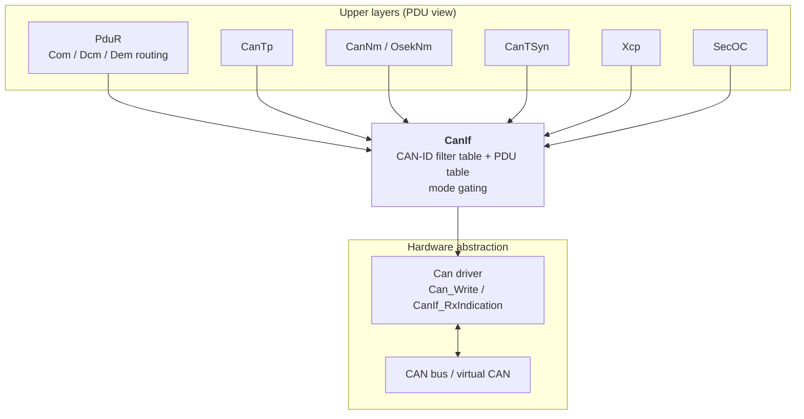
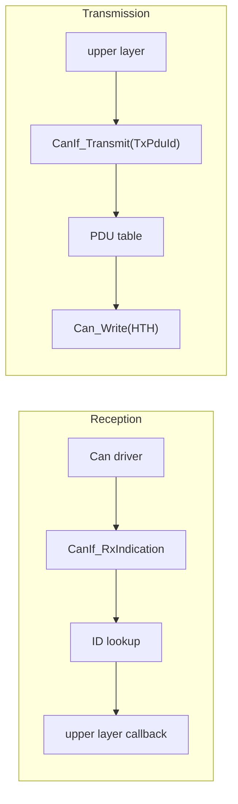
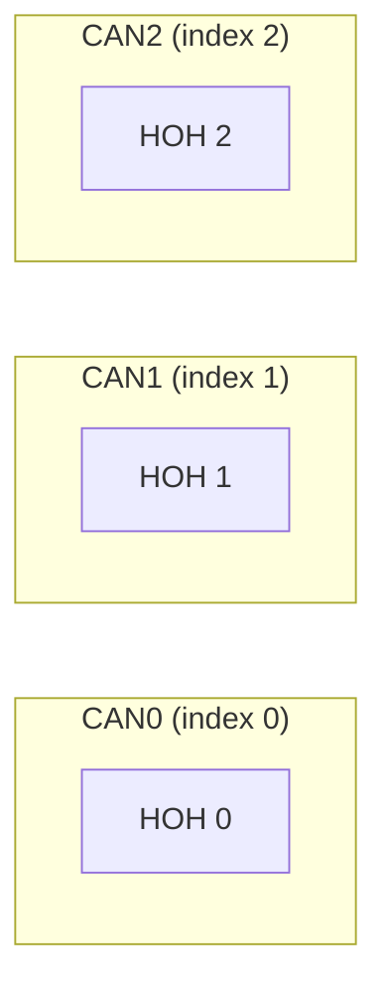
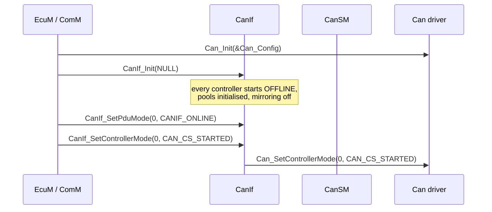
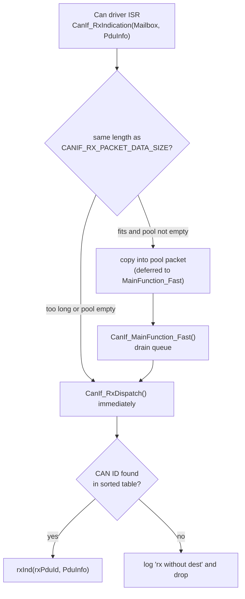
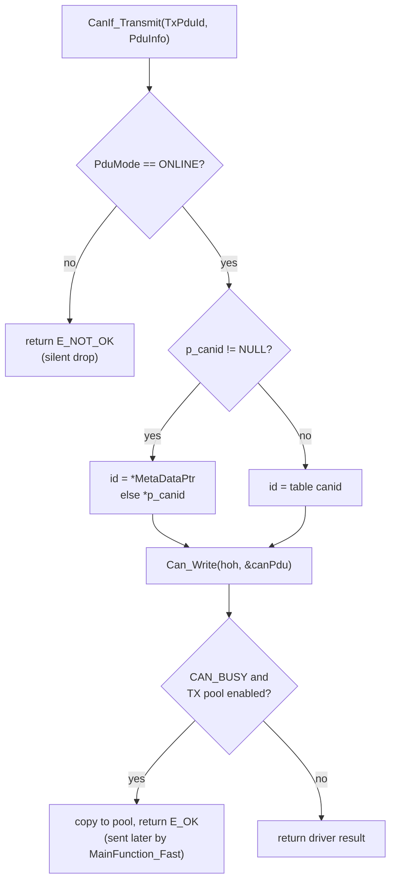

# CanIf - CAN Interface

> **In one sentence:** CanIf owns the CAN-ID filter table and the static PDU
> table, so upper layers say "send PDU 5" instead of "send a frame with ID
> 0x732", and the CAN driver says "a frame with ID 0x731 arrived" instead of
> calling Dcm.

| Item | Value |
| --- | --- |
| Module | `infras/communication/CanIf` (API: `infras/include/CanIf.h`) |
| Layer | Bus interface, between the CAN driver (below) and PduR / CanTp / CanNm / CanTSyn / Xcp / SecOC (above) |
| Configuration | `app/app/config/Com/CanIf.json` |
| Generator | `tools/generator/CanIf.py` -> `GEN/CanIf_Cfg.c` / `GEN/CanIf_Cfg.h` (+ intermediate `GEN/CanIf.json`) |
| Standard | AUTOSAR CP 4.4 CanIf (with SSAS extensions) |
| Demo | `CanApp`; every RX/TX frame can be traced by enabling `AS_LOG_CANIF` |

**Contents**

1. [What the module is for](#1-what-the-module-is-for)
2. [Where it sits in the stack](#2-where-it-sits-in-the-stack)
3. [Configuration](#3-configuration)
4. [How it works at runtime](#4-how-it-works-at-runtime)
5. [Public API](#5-public-api)
6. [Build and run a demo](#6-build-and-run-a-demo)
7. [Key notes and gotchas](#7-key-notes-and-gotchas)
8. [Troubleshooting](#8-troubleshooting)
9. [Known limitations](#9-known-limitations)

---

## 1. What the module is for

CanIf is the **translation layer between "PDU" and "CAN frame"**. Everything
above it thinks in PDU ids; everything below it thinks in CAN ids, hardware
objects and raw bytes. CanIf does exactly four things:

* **Rx filtering and dispatch** - a received frame is matched against a sorted
  table of CAN IDs; on a hit the configured upper-layer callback is called
  (`CanTp_RxIndication`, `PduR_CanIfRxIndication`, `CanNm_RxIndication`, ...).
  Frames that match nothing are dropped (and logged).
* **Tx PDU lookup** - `CanIf_Transmit(TxPduId, ...)` looks up CAN ID, HTH and
  controller id, and calls `Can_Write()`.
* **Controller / PDU mode gating** - `CanIf_SetControllerMode()` forwards to the
  driver, `CanIf_SetPduMode()` decides whether this controller may transmit at
  all.
* **Bus-level supervision** - TX timeout towards CanSM, bus-off notification,
  optional bus mirroring.

What it does **not** do:

* No segmentation (that is [CanTp](CanTp.md)), no routing ([PduR](PduR.md)), no
  signal packing ([Com](Com.md)).
* No baudrate / pin configuration - that is the CAN driver and Port.
* No dynamic ID arbitration beyond the `Dynamic` flag; the ID itself is either
  compiled in or written with `CanIf_SetDynamicTxId()`.

---

## 2. Where it sits in the stack



CanIf is **below PduR and below CanTp at the same time**: CanTp has its own
`up: "CanTp"` PDUs, it does not go through PduR to reach the bus. This is why one
CAN ID appears once in `CanIf.json`, but may be referenced by two different
modules in `PduR.json`.

The two directions:



---

## 3. Configuration

`app/app/config/Com/CanIf.json` is hand written; `tools/generator/CanIf.py`
merges it with the DBC and emits the C tables.

### 3.1 Top-level keys

| Key | Default in generator | Emitted as | Meaning |
| --- | --- | --- | --- |
| `MainFunctionPeriod` | **10** | `CANIF_MAIN_FUNCTION_PERIOD` (only if not already defined) + `CANIF_CONVERT_MS_TO_MAIN_CYCLES(x)` | Cycle of `CanIf_MainFunction()` in ms, used for the TX timeout |
| `RxPacketPoolSize` | **0** | `CANIF_RX_PACKET_POOL_SIZE` | Number of Rx packets that may be queued between ISR and main function; 0 = dispatch immediately in the Rx interrupt |
| `TxPacketPoolSize` | **0** | `CANIF_TX_PACKET_POOL_SIZE` | Number of Tx PDUs that may be queued when the driver returns `CAN_BUSY`; 0 = no retry queue |
| `RxPacketDataSize` | **64** | `CANIF_RX_PACKET_DATA_SIZE` | Payload bytes per pooled Rx packet (64 covers CAN FD) |
| `TxPacketDataSize` | **64** | `CANIF_TX_PACKET_DATA_SIZE` | Payload bytes per pooled Tx packet |
| `UsePostBuildConfig` | **false** | `#define CANIF_USE_PB_CONFIG` (commented out when false) | `CanIf_Init()` takes the config pointer from the caller instead of `&CanIf_Config` |
| `UseTxCallout` | **false** | `CANIF_USE_TX_CALLOUT` | Call `CanIf_UserTxCallout()` before every `Can_Write()` |
| `UseRxCallout` | **false** | `CANIF_USE_RX_CALLOUT` | Call `CanIf_UserRxCallout()` before dispatching a received frame |
| `Networks[]` | - | one `CanIf_CtrlConfigType` per entry | One entry per CAN controller; **the array index is the controller id** |

> The two callouts have **no implementation in this repository** - they are
> declared in `CanIf.h` and you must provide them in your project. Enabling the
> flags without an implementation fails at link time.

### 3.2 Network keys

| Key | Default | Meaning |
| --- | --- | --- |
| `Name` | required | Network name; also emits `#define CANIF_CHL_<name> <index>` which is the controller id to pass to `CanIf_SetPduMode()` / `CanIf_SetControllerMode()` |
| `Me` | required if `Dbc` is used | Node name of this ECU inside the DBC; messages where `node == me` become Tx, all others become Rx |
| `Dbc` | optional | DBC imported automatically; imported PDUs get `up: "PduR"` and sequential HOHs |
| `Ignore` | `[]` | DBC message names to skip during import |
| `E2E` | `[]` | Despite the name **this is not an E2E setting**: the listed DBC messages get `UseTxPool: true` |
| `NumHrh` | **1** | Number of Rx hardware objects reserved for this network; advances the HOH base for the next network |
| `NumHth` | **1** | Same for Tx hardware objects |
| `TxTimeout` | **100** | ms; a non-zero value for *any* network enables `CANIF_USE_TX_TIMEOUT` globally |
| `RxPdus` / `TxPdus` | `[]` | Explicit PDU lists (see 3.3) |

The DBC import is a convenience, not a requirement: the demo configuration
imports `CAN0.dbc` for Com signals **and** lists diagnostic, NM, XCP and SecOC
frames explicitly, because those must not be owned by Com. Keep them out of the
DBC (or in `Ignore`), otherwise the same CAN ID appears twice and the generator
aborts with `Duplicate Rx Pdus`.

### 3.3 RxPdu / TxPdu keys

| Key | Default | Applies to | Meaning |
| --- | --- | --- | --- |
| `Name` | required | both | Unique PDU name; also becomes the macro `CANIF_<NAME>` |
| `Id` | required | both | CAN ID (hex string or number). `0x1FFFFFFF` mask is applied on Rx |
| `Mask` | all ones (= exact match) | Rx only | Frame matches when `received_canid == (id & mask)` |
| `Hoh` | first HOH of the network | both | Hardware object handle; the value is passed unchanged to `Can_Write()` (HTH) or comes back in `Mailbox->Hoh` |
| `Up` | required | both | Upper layer; determines the callback symbol (see 3.4) |
| `Dynamic` | `false` | Tx only | Emit `static Can_IdType canidOf<NAME>` and a `p_canid` pointer, so `CanIf_SetDynamicTxId()` can change the ID at runtime |
| `UseTxPool` | `false` | Tx only | **Currently has no effect at runtime** - written to the table but never read |

Masked reception example from the demo: `{"name": "OSEKNM0_RX", "id": "0x400",
"mask": "0x700"}` accepts `0x400..0x4FF`, which is how one NM PDU id serves all
node ids on the segment.

### 3.4 What `Up` generates

`Up` is not just a comment - it selects the callback function and the second
field of the table entry:

| `Up` | Rx callback | Tx callback | Second field (id passed to the callback) |
| --- | --- | --- | --- |
| `PduR` | `PduR_CanIfRxIndication` | `PduR_CanIfTxConfirmation` | `<UP>_<NAME>` e.g. `PDUR_CAN0_TX_MSG_TIME` |
| `CanTp` | `CanTp_RxIndication` | `CanTp_TxConfirmation` | `CANTP_<NAME>` e.g. `CANTP_P2P_RX` |
| `SecOC` | `SecOC_RxIndication` | `SecOC_TxConfirmation` | `SECOC_<NAME>` |
| `J1939Tp` | `J1939Tp_RxIndication` | `J1939Tp_TxConfirmation` | `J1939TP_<NAME>` |
| `OsekNm` / `CanNm` / `CanTSyn` | `<UP>_RxIndication` | `<UP>_TxConfirmation` | **network index**, not a PDU id |
| `Xcp` | `Xcp_CanIfRxIndication` | `Xcp_CanIfTxConfirmation` | **network index** |
| `User...` | `<UP>_RxIndication` | `<UP>_TxConfirmation` | `CANIF_<NAME>` |

The generator also adds `#include "<up>.h"`, plus `"<up>_Cfg.h"` for every
module except `OsekNm`, `CanNm`, `CanTSyn` and `Xcp`. So `Up` must be spelled
exactly like the module's header file name.

For user callbacks the generator declares the prototypes itself:

```c
void User0Rx_RxIndication(PduIdType RxPduId, const PduInfoType *PduInfoPtr);
void User0Tx_TxConfirmation(PduIdType TxPduId, Std_ReturnType result);
```

### 3.5 HOH numbering

HOHs are **global**, not per controller: `NumHrh`/`NumHth` are accumulated across
the `Networks[]` array in order, and a PDU without an explicit `Hoh` gets the
first HOH of its own network. With three networks and the default `NumHrh: 1`,
the generated table looks like:



The value is used as the HTH argument of `Can_Write()`, so it must match the
hardware object table of the **driver**, not of CanIf.

### 3.6 Generated output

```c
/* CanIf_Cfg.h */
#define CANIF_CHL_CAN0 0u
#define CANIF_FW_CAN0_SECOC_MSG1_RX 0u /* CAN0 id=0x89 */
#define CANIF_P2P_RX 5u                /* CAN0 id=0x731 */
#define CANIF_MIRROR_TX 11u            /* CAN2 id=0x300 */
#define CANIF_USE_TX_TIMEOUT
// #define CANIF_USE_PB_CONFIG
#ifndef CANIF_RX_PACKET_POOL_SIZE
#define CANIF_RX_PACKET_POOL_SIZE 8u
#endif
```

`CanIf_Cfg.c` contains one `CanIf_RxPdus_<network>[]` array **per controller**
(sorted by CAN ID, needed by the binary search) and **one global**
`CanIf_TxPdus[]` array, plus `CanIf_CtrlContexts[]` and `CanIf_CtrlConfigs[]`.

Note the two id spaces: `CANIF_P2P_RX` and `CANIF_P2P_TX` are both `5u` because
Rx and Tx are numbered independently from 0. Passing an Rx id to
`CanIf_Transmit()` therefore silently transmits a *different* PDU - always use
the `_TX` macro.

---

## 4. How it works at runtime

### 4.1 Start-up order



Two independent switches must be closed before a single frame leaves the ECU:

1. `CanIf_SetControllerMode(CAN_CS_STARTED)` - the driver leaves STOPPED.
2. `CanIf_SetPduMode(CANIF_ONLINE)` - CanIf allows transmission.

`CanIf_Init()` always sets `PduMode = CANIF_OFFLINE`, so a forgotten
`CanIf_SetPduMode()` looks like "the stack runs but nothing is transmitted".
If `USE_CANSM` is in the build, CanSM does both calls for you; without CanSM the
application must do it - see `EcuM_AL_EnterRUN()` in `app/app/main.c`.

### 4.2 Reception



* The lookup is a **binary search** over `CanIf_RxPdus_<network>[]`, which the
  generator sorts by CAN ID. On the host build (`linux` / `_WIN32`) the code
  additionally does a linear scan "because the table is not sorted" - that
  fallback exists for hand-written test tables, not for the generated ones.
* `Mailbox->Hoh` is ignored for dispatch; only the CAN ID decides.
* With mirroring active the frame is reported to `Mirror_ReportCanFrame()` after
  dispatch, for both received and successfully transmitted frames.

### 4.3 Transmission



`Can_Write()` keeps `swPduHandle = TxPduId`; when the driver confirms it calls
`CanIf_TxConfirmation(swPduHandle)`, which forwards `E_OK` to the configured
`txConfirm` and clears the TX timeout timer.

### 4.4 PDU mode and TX timeout

| Mode | Value | Behaviour in this implementation |
| --- | --- | --- |
| `CANIF_OFFLINE` | 0 | No transmission, frames are silently dropped |
| `CANIF_TX_OFFLINE` | 1 | Same as offline (Rx is *not* disabled) |
| `CANIF_TX_OFFLINE_ACTIVE` | 2 | Accepted by `CanIf_SetPduMode()` but treated like offline - not implemented |
| `CANIF_ONLINE` | 3 | Transmission allowed |

With `CANIF_USE_TX_TIMEOUT` **and** `USE_CANSM` defined, the first successful
`Can_Write()` per controller arms `txTimeoutTimer = TxTimeout / MainFunctionPeriod`
cycles; the timer is cleared by `CanIf_TxConfirmation()`. On expiry
`CanSM_TxTimeoutException(controller)` is called once. The timer is decremented
in `CanIf_MainFunction_Fast()` when `CANIF_MAIN_FUNCTION_PERIOD == 1`, otherwise
in `CanIf_MainFunction()`.

---

## 5. Public API

| Function | Called by | Purpose |
| --- | --- | --- |
| `CanIf_Init(const CanIf_ConfigType*)` | EcuM | Reset contexts, init pools. Parameter is ignored unless `CANIF_USE_PB_CONFIG` |
| `CanIf_SetControllerMode(id, mode)` | CanSM / EcuM | Forward `STARTED` / `STOPPED` / `SLEEP` to the driver |
| `CanIf_GetControllerMode(id, *mode)` | CanSM / app | Read the driver state |
| `CanIf_SetPduMode(id, mode)` | CanSM / EcuM / app | Gate transmission per controller; leaving `ONLINE` flushes the TX pool |
| `CanIf_GetPduMode(id, *mode)` | app | Read the current PDU mode |
| `CanIf_Transmit(TxPduId, PduInfo)` | PduR, CanTp, CanNm, CanTSyn, Xcp, SecOC | Map PDU id to CAN ID and call `Can_Write()` |
| `CanIf_SetDynamicTxId(TxPduId, CanId)` | CanNm, OsekNm, app | Change the ID of a `Dynamic` Tx PDU |
| `CanIf_TxConfirmation(CanTxPduId)` | Can driver | Forward the confirmation upward |
| `CanIf_RxIndication(Mailbox, PduInfo)` | Can driver | Filter and dispatch a received frame |
| `CanIf_ControllerBusOff(id)` | Can driver | Report bus-off to CanSM and Mirror |
| `CanIf_MainFunction()` | scheduler | TX timeout when the period is not 1 ms |
| `CanIf_MainFunction_Fast()` | scheduler | Drain Rx/Tx pools, TX timeout at 1 ms period |
| `CanIf_EnableBusMirroring(id, active)` | app | Enable mirroring for a controller (needs `USE_MIRROR`) |
| `CanIf_UserTxCallout/RxCallout` | CanIf itself | **User supplied**, only with the callout flags |
| `CanIf_GetVersionInfo(info)` | anyone | Module version |

---

## 6. Build and run a demo

```bash
# build the demo ECU application (includes CanIf, CanTp, Dcm, Com, SecOC, ...)
scons --app=CanApp

# run it with frame tracing: prints every received/transmitted frame
AS_LOG_CANIF=3 ./build/nt/GCC/CanApp/CanApp.exe

# in a second terminal, send a UDS request over the virtual CAN bus
./build/nt/GCC/IsoTpSend/IsoTpSend.exe -v 22F15B
```

Expected trace in the `CanApp` window (one line per frame, first 8 bytes only):

```
CANIF   :RX CAN ID=0x00000731 LEN=8 DATA=[03 22 F1 5B ...]
CANIF   :RX CAN ID=0x00000732 LEN=8 DATA=[10 0D 62 F1 5B ...]
```

`AS_LOG_CANIF=3` works because the module level (`AS_LOG_CANIF 0` in
`CanIf.c:25`) is compared against the global level; setting the environment
variable above the global level (default `1` = INFO) enables the messages.

---

## 7. Key notes and gotchas

1. **Offline by default.** `CanIf_Init()` sets every controller to
   `CANIF_OFFLINE`. Nothing is transmitted until `CanIf_SetPduMode(id,
   CANIF_ONLINE)`. This is the most common "the stack is silent" cause.
2. **`Up` is a naming contract.** `up: "CanTp"` makes the generator emit
   `#include "CanTp.h"` and `CanTp_RxIndication`. A typo compiles into a missing
   symbol, not into a runtime error - good, keep it that way.
3. **One CAN ID, one owner.** A frame must be declared either by the DBC import
   or explicitly, never both. Duplicate detection raises
   `Duplicate Rx Pdus: ...` at generation time.
4. **Masked PDUs.** `Id` is the *base* id, and the match is
   `received == (id & mask)`; `Id` must itself be already masked (the generator
   stores `id & 0x1FFFFFFF`). Masked ranges must not overlap - the generator
   rejects overlaps, and the binary search relies on it.
5. **`Hoh` is a driver-level index**, accumulated across networks. If you add a
   controller in the middle of `Networks[]`, all HOHs after it shift by
   `NumHrh`/`NumHth`.
6. **`dynamic: true` costs a `static` variable per PDU** and makes the ID
   writable. Non-dynamic PDUs silently ignore `CanIf_SetDynamicTxId()` (only a
   log message at `CANIFE` level).
7. **Pool sizes change the call context.** With `RxPacketPoolSize > 0` the upper
   layer is called from `CanIf_MainFunction_Fast()`, not from the CAN Rx
   interrupt - latency grows by up to one main-function cycle, but the stack is
   no longer re-entered from interrupt context.
8. **`CanIf_MainFunction_Fast()` must be called** when a pool size is non-zero,
   otherwise queued frames never leave the ECU (`CanIf_Transmit()` already
   returned `E_OK`).

---

## 8. Troubleshooting

| Symptom | Likely cause | Check |
| --- | --- | --- |
| RX frames are ignored, log says `rx without dest` | CAN ID not in `RxPdus` (or wrong channel: a CAN1 ID declared under CAN0) | `GEN/CanIf_Cfg.c`, `CanIf_RxPdus_CANx[]` |
| Nothing is transmitted, no error | PDU mode still `OFFLINE`, or controller not `STARTED` | `CanIf_GetPduMode()`, call order in `EcuM_AL_EnterRUN()` |
| `CanIf_Transmit()` returns `E_NOT_OK` immediately | PDU mode not online, or `TxPduId >= numOfTxPdus` | pass the `CANIF_<NAME>_TX` macro, not the Rx one |
| `CanIf_Transmit()` returns `E_OK` but nothing on the bus | frame went into the TX pool and `CanIf_MainFunction_Fast()` is not scheduled | scheduler table |
| Generation fails with `Duplicate Rx Pdus` | same ID declared by DBC import and explicitly | add the message to `Ignore` |
| Generation fails with `Invalid hoh` | explicit `Hoh` outside `[base, base+NumHrh)` of that network | raise `NumHrh`/`NumHth` or fix the value |
| Link error on `CanIf_UserTxCallout` | `UseTxCallout: true` without an implementation | provide the function or disable the flag |
| Confirmation goes to the wrong module | an Rx macro was passed to `CanIf_Transmit()` (Rx and Tx ids overlap numerically) | use `CANIF_*_TX` |

---

## 9. Known limitations

Code review findings in `infras/communication/CanIf/CanIf.c` (verified against
the source, in decreasing severity):

1. **`CanIf_GetPduMode()` has an inverted DET check** (`CanIf.c:349`):
   `DET_VALIDATE(NULL == PduModePtr, ...)`. With `USE_DET` every *valid* call
   reports `CANIF_E_PARAM_POINTER` and returns `E_NOT_OK`; a `NULL` pointer is
   dereferenced. Should be `NULL != PduModePtr`.
2. **The TX queue is drained under the RX pool macro** (`CanIf.c:501`):
   the loop is guarded by `#if CANIF_RX_PACKET_POOL_SIZE > 0` while the
   variables are declared under `CANIF_TX_PACKET_POOL_SIZE > 0`. Two
   consequences: Rx pool > 0 with Tx pool == 0 does not compile; Tx pool > 0
   with Rx pool == 0 compiles but never sends the queued PDUs, while
   `CanIf_Transmit()` still returns `E_OK` (silent frame loss).
3. **`CanIf_SetTrcvMode()` / `CanIf_GetTrcvMode()` are implemented in the CAN
   driver** (`infras/mcal/Can/Can.c:123` and `:161`), not in CanIf. They report
   DET errors with `MODULE_ID_CAN`, and they disappear when
   `USE_THIRD_PARTY_CAN` is defined (Can.c is not compiled) - any caller then
   fails at link time.
4. **`UseTxPool` / the `E2E` list have no runtime effect.** The `bUseTxPool`
   field is generated and stored but never read; `CanIf_Transmit()` queues
   *any* PDU on `CAN_BUSY` regardless of the flag. See limitation 2 for why the
   queue may not be drained at all.
5. **Queued PDUs lose their per-PDU CAN ID.** `CanIf_MainFunction_Fast()` calls
   the internal transmit with `MetaDataPtr = NULL`, so a `Dynamic` PDU is sent
   with the *current* value of `canidOf<NAME>`, not with the value at queue
   time. For NM PDUs whose ID depends on `NodeId` this can put a frame on the
   bus with a stale ID.
6. **Frame logging reads 8 bytes unconditionally** (`CanIf.c:85-88`): a 2-byte
   frame causes a 6-byte over-read of the caller's buffer. Harmless on the host,
   a potential fault on target; only active when `AS_LOG_CANIF` is enabled.
7. **`CANIF_TX_OFFLINE_ACTIVE` is not implemented**: `CanIf_SetPduMode()`
   accepts it, but the transmit path only allows `CANIF_ONLINE`. The AUTOSAR
   meaning ("transmit allowed, reception disabled") is not honoured.
8. **Generator: the HOH range check is off by one** (`CanIf.py:257,262`):
   `hh > (hrh + NumHrh)` accepts `hh == hrh + NumHrh`, one past the last HOH of
   the network.
9. **Generator: the `E2E` key is misleading** (`CanIf.py:229`): it only sets
   `UseTxPool` for imported Tx messages. Real E2E protection is configured in
   `E2E.json`, not here.
10. **Generator: DBC import assigns one HOH per message** (`CanIf.py:230-235`,
    `hoh: hth`/`hrh` without increment) - all imported messages of a network
    share the same HOH, which is what the driver expects for a single hardware
    filter, but it means imported traffic cannot use several mailboxes without
    post-editing `GEN/CanIf.json`.

**Related documents:** [CanTp](CanTp.md) - [PduR](PduR.md) - [Com](Com.md) -
[Dcm](Dcm.md) - [SecOC](SecOC.md) - [Mirror](Mirror.md) - [virtual CAN
environment](virtual-can-env.md)
