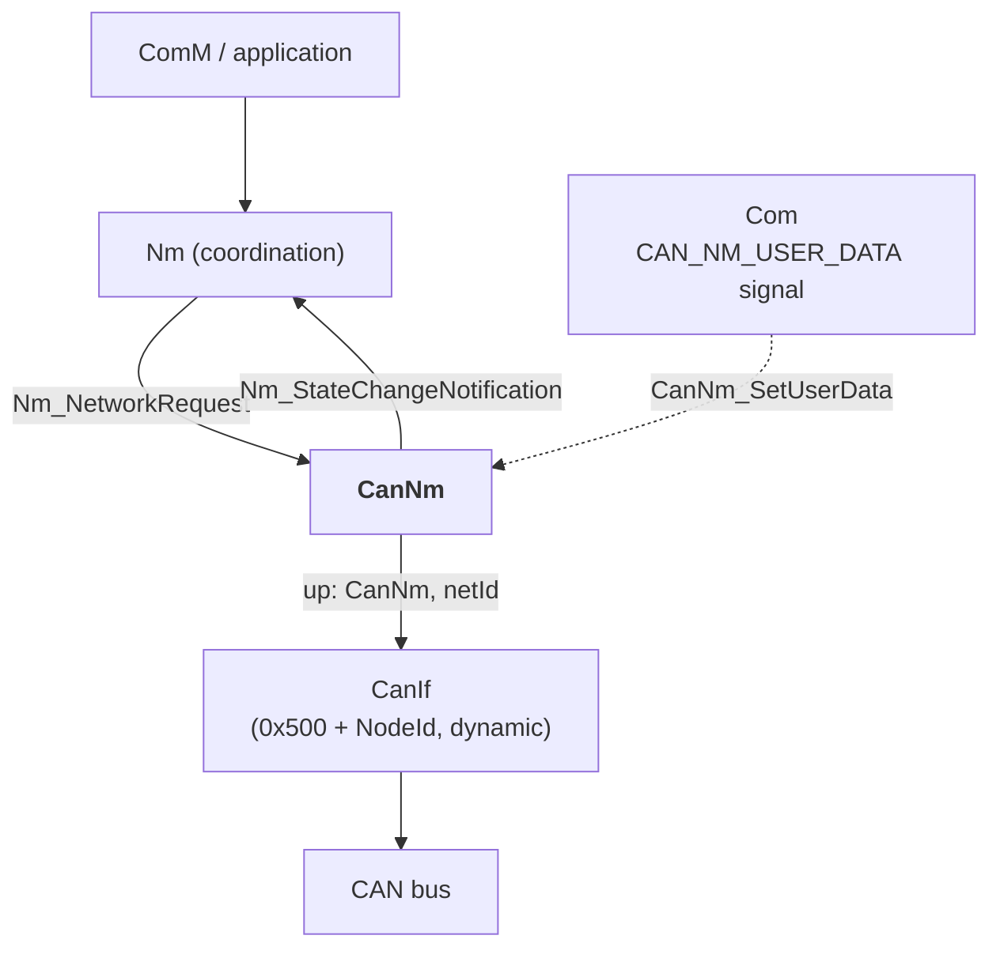
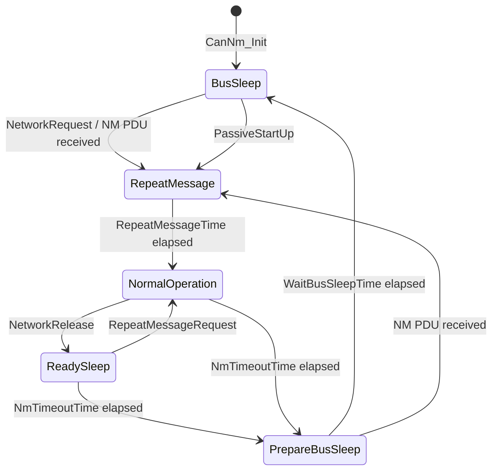

# CanNm - CAN Network Management (AUTOSAR NM)

> **In one sentence:** CanNm periodically sends a NM PDU with the node id and user
> data, so every node knows who is awake; when the last node releases the network,
> all nodes count down `WaitBusSleepTime` and go to bus sleep together.

| Item | Value |
| --- | --- |
| Module | `infras/communication/CanNm` (API: `infras/include/CanNm.h`) |
| Layer | Above CanIf (`up: "CanNm"`), below [Nm](Nm.md) / [ComM](ComM.md) |
| Configuration | `app/app/config/Com/CanNm.json` |
| Generator | `tools/generator/CanNm.py` -> `GEN/CanNm_Cfg.c` / `GEN/CanNm_Cfg.h` |
| Standard | AUTOSAR CP 4.4 CanNm (with SSAS extensions: partial networking, car wakeup) |
| Demo | `scons --app=CanNm` (minimal NM-only app) or `CanApp` |

**Contents**

1. [What the module is for](#1-what-the-module-is-for)
2. [Where it sits in the stack](#2-where-it-sits-in-the-stack)
3. [Configuration](#3-configuration)
4. [How it works at runtime](#4-how-it-works-at-runtime)
5. [Public API](#5-public-api)
6. [Build and run a demo](#6-build-and-run-a-demo)
7. [Key notes and gotchas](#7-key-notes-and-gotchas)
8. [Troubleshooting](#8-troubleshooting)
9. [Known limitations](#9-known-limitations)

---

## 1. What the module is for

* **Network coordination** - one NM PDU per `MsgCycleTime` announces "I am awake".
* **Sleep coordination** - releasing the network starts `NmTimeoutTime`; when it
  expires without any NM PDU, `WaitBusSleepTime` runs, then the node sleeps.
* **User data transport** - up to 6 payload bytes piggyback on the NM PDU
  (`ComUserDataSupport` + `UserDataTxPdu`), fed from Com signal
  `CAN_NM_USER_DATA`.
* **Partial networking (PN)** - filtered NM messages wake only compliant nodes
  (`PnEnabled`, `PnFilterMask`, `PnInfoOffset`).
* **Car wakeup** - a dedicated bit/byte in the NM PDU wakes the whole vehicle
  (`CarWakeupSupport`).

---

## 2. Where it sits in the stack



Without ComM/Nm in the build, the application calls `CanNm_*` directly (see
`EcuM_AL_EnterRUN()`).

---

## 3. Configuration

### 3.1 Top-level switches

| Key | Demo | Meaning |
| --- | --- | --- |
| `RemoteSleepIndEnabled` | true | Enable `Nm_RemoteSleepIndication` callbacks |
| `CoordinatorSyncSupport` | true | NM coordinator sleep synchronisation (`Coordinator` feature) |
| `GlobalPnSupport` | false | Global partial-networking switch |
| `CarWakeupSupport` | true | Car wakeup bit handling |
| `ComUserDataSupport` | true | NM PDU carries Com user data |
| `PassiveStartupRepeatEnabled` | true | Passive start-up also sends the immediate repeat messages |
| `RequestBitAutoSet` | true | Auto-set the Repeat Message Request bit in CBV on request |

### 3.2 Network keys (`Networks[]`)

| Key | Demo | Meaning |
| --- | --- | --- |
| `Name` | CANNM0 | Channel name; index = `NetworkHandleType` |
| `NodeId` | 0/1 | Source node id; the NM CAN ID is `0x500 + NodeId` |
| `ImmediateNmCycleTime` / `ImmediateNmTransmissions` | 100 / 10 | Fast cycle + count at network start |
| `MsgCycleOffset` / `MsgCycleTime` / `MsgReducedTime` | 10 / 1000 / 500 | Normal TX period (offset is the first one); `MsgReducedTime` used in reduced mode |
| `MsgTimeoutTime` | 10 | TX confirmation timeout (alarm `TxTimeout`) |
| `RepeatMessageTime` | 1050 | Duration of the REPEAT_MESSAGE state |
| `NmTimeoutTime` | 2000 | Time without NM PDUs before PREPARE_BUS_SLEEP |
| `WaitBusSleepTime` | 5000 | Duration of PREPARE_BUS_SLEEP before BUS_SLEEP |
| `RemoteSleepIndTime` | 1500 | Idle time before remote-sleep indication |
| `UserDataTxPdu` | `COM_CAN0_...` | Com I-PDU id holding the user data |
| `PduNidPosition` / `PduCbvPosition` | 0 / 1 | Node id / CBV byte position in the NM PDU |
| `ActiveWakeupBitEnabled` / `RepeatMsgIndEnabled` / `NodeDetectionEnabled` / `PnEnabled` | true | Per-channel feature switches |
| `AllNmMessagesKeepAwake` / `PnInfoOffset` / `PnFilterMask[]` | true / 4 / [0x55,0xAA] | Partial-networking filter |
| `CarWakeUpRxEnabled`, `CarWakeUpBytePosition`, `CarWakeUpBitPosition`, `CarWakeUpFilterEnabled`, `CarWakeUpFilterNodeId`, `NodeMask` | - | Car wakeup detection |

---

## 4. How it works at runtime



* **Tx** - in RepeatMessage state up to `ImmediateNmTransmissions` PDUs at
  `ImmediateNmCycleTime`, then every `MsgCycleTime`. The PDU is assembled from
  NodeId (byte `PduNidPosition`), CBV (byte `PduCbvPosition`) and the Com user
  data. `MsgTimeoutTime` guards the TX confirmation.
* **Rx** - every NM PDU resets the `NMTimeout` alarm; the CBV
  Repeat-Message-Request bit forces `RepeatMessage`; the car-wakeup bit calls
  `Nm_CarWakeUpIndication`.
* **Main function** - `CanNm_MainFunction()` ticks all alarms
  (`Tx`, `TxTimeout`, `NMTimeout`, `RepeatMessage`, `WaitBusSleep`,
  `RemoteSleep`) and drives the state transitions.

---

## 5. Public API

| Function | Caller | Purpose |
| --- | --- | --- |
| `CanNm_Init(config)` / `CanNm_DeInit()` | EcuM | Enter BUS_SLEEP, clear flags |
| `CanNm_NetworkRequest(ch)` | Nm / ComM / app | Volunteer to stay awake (start TX) |
| `CanNm_NetworkRelease(ch)` | Nm / ComM / app | Release the network (stop TX) |
| `CanNm_PassiveStartUp(ch)` | Nm | Wake up without transmitting |
| `CanNm_DisableCommunication` / `CanNm_EnableCommunication(ch)` | ComM | Silence NM TX while awake (busoff recovery) |
| `CanNm_SetUserData` / `CanNm_GetUserData(ch, ptr)` | Nm / app | 6-byte NM user data |
| `CanNm_RepeatMessageRequest(ch)` | app | Force all nodes to REPEAT_MESSAGE |
| `CanNm_SetSleepReadyBit(ch, bool)` | app / coordinator | Signal "ready to sleep" in CBV |
| `CanNm_GetState` / `CanNm_GetPduData` / `CanNm_GetNodeIdentifier` | app / tests | State and last received PDU |
| `CanNm_CheckRemoteSleepIndication(ch, *state)` | app | Remote sleep status |
| `CanNm_RequestBusSynchronization(ch)` | coordinator | Goto-synchronisation bit |
| `CanNm_RxIndication` / `CanNm_TxConfirmation` | CanIf | Stack callbacks |
| `CanNm_Transmit(TxPduId, PduInfo)` | Nm shim (`CanNm_Cfg.c`) | NM TX path when CanIf is not in the build |
| `CanNm_MainFunction()` | scheduler | Alarm processing |

---

## 6. Build and run a demo

```bash
# minimal application with only CanNm in the stack
scons --app=CanNm
./build/nt/GCC/CanNm/CanNm.exe

# or the full stack
scons --app=CanApp
./build/nt/GCC/CanApp/CanApp.exe
AS_LOG_CANNM=3 ./build/nt/GCC/CanApp/CanApp.exe   # state transitions logged
```

Two instances on the virtual bus (CAN0 NodeId 0, CAN1 NodeId 1) show
RepeatMessage -> NormalOperation and, after `NetworkRelease`, the
`NmTimeoutTime` -> `WaitBusSleepTime` countdown down to `NM_STATE_BUS_SLEEP`.

---

## 7. Key notes and gotchas

1. **NM CAN ID = `0x500 + NodeId`** (also the `CANNM0_RX`/`CANNM_TX` entries in
   `CanIf.json` with mask `0x700`). Changing the base ID means touching CanIf,
   CanNm generator and the DBC.
2. **`CanNm_MainFunction()` must be scheduled at 10 ms** - all times in the JSON
   are converted with the built-in 10 ms cycle.
3. **`CanNm_NetworkRequest` is a veto system**: sleep happens only when every
   node released. A crashed node keeps the bus awake until `NmTimeoutTime` on
   the others.
4. **The `CanIf_Transmit` shim hardcodes controller 0** - see limitation 2.
5. **PN filter bytes** are matched against the user data at `PnInfoOffset`; a
   non-matching NM PDU does not wake this node (it still resets the NM timeout
   when `AllNmMessagesKeepAwake` is true).

---

## 8. Troubleshooting

| Symptom | Likely cause | Check |
| --- | --- | --- |
| Bus never sleeps | a node still has the network requested, or user data TX keeps resetting the timeout | `CanNm_GetState` on every node |
| No NM PDUs on the bus | channel not started, or `MsgCycleTime` alarm not running | scheduler calls `CanNm_MainFunction` |
| `TxTimeout` alarm fires | NM TX blocked (bus off / CanIf offline) | CanIf PduMode, CanSM busoff |
| Node does not wake by PN | filter mask does not match the sender's bytes | `PnFilterMask`, `PnInfoOffset` |
| Two nodes with the same NodeId | duplicate `NodeId` in the config | both send `0x500+NodeId` |

---

## 9. Known limitations

1. **The CanIf-shim TX path hardcodes controller 0** (`GEN/CanNm_Cfg.c:171`,
   emitted by `CanNm.py:199`): without `USE_CANIF`, `CanNm_Transmit` always
   writes to controller 0, so a `CANNM1` channel on CAN1 cannot transmit.
2. **NM PDU is fixed 8 bytes, classic CAN** - no CAN FD variant of the NM PDU.
3. **`MsgReducedTime` is used only by the coordinator sync path**; plain
   reduced-power mode is not implemented.
4. **PN filter supports a single info offset per channel** - AUTOSAR's multiple
   PNI positions are not supported.
5. **`CanNm_Transmit` ignores `TxPduId`** in the shim path - only one NM PDU per
   channel is possible without CanIf.

**Related documents:** [Nm](Nm.md) - [ComM](ComM.md) - [CanSM](CanSM.md) -
[CanIf](CanIf.md) - [can-oseknm](can-oseknm.md)
