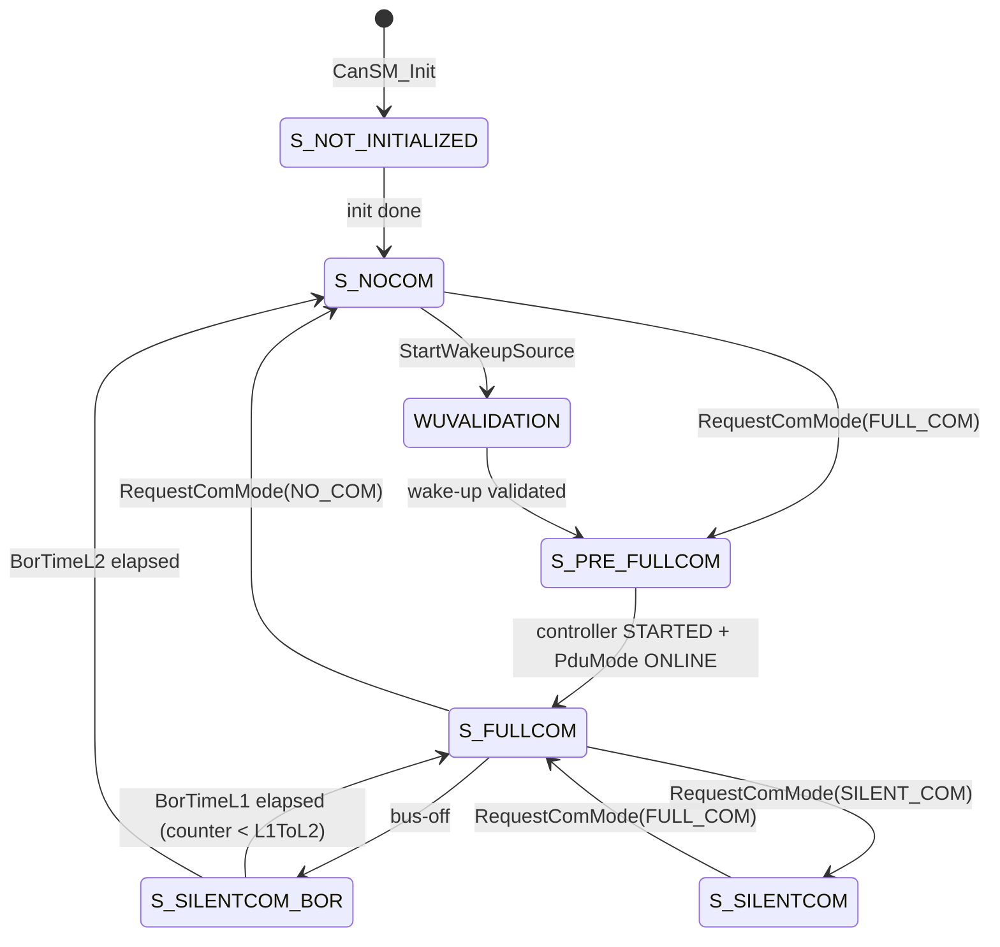

# CanSM - CAN State Manager

> **In one sentence:** CanSM translates "I want full communication" from ComM into
> the concrete CanIf controller/PDU mode calls, and runs the bus-off recovery
> state machine.

| Item | Value |
| --- | --- |
| Module | `infras/communication/CanSM` (API: `infras/include/CanSM.h`) |
| Layer | Between [ComM](ComM.md) (above) and [CanIf](CanIf.md) (below) |
| Configuration | `app/app/config/Com/CanSM.json` |
| Generator | `tools/generator/CanSM.py` -> `GEN/CanSM_Cfg.c` / `GEN/CanSM_Cfg.h` |
| Standard | AUTOSAR CP 4.4 CanSM (subset) |
| Demo | `CanApp` (started via ComM in `EcuM_AL_EnterRUN()`) |

**Contents**

1. [What the module is for](#1-what-the-module-is-for)
2. [Configuration](#2-configuration)
3. [How it works at runtime](#3-how-it-works-at-runtime)
4. [Public API](#4-public-api)
5. [Build and run a demo](#5-build-and-run-a-demo)
6. [Key notes and gotchas](#6-key-notes-and-gotchas)
7. [Troubleshooting](#7-troubleshooting)
8. [Known limitations](#8-known-limitations)

---

## 1. What the module is for

* **Mode arbitration** - `CanSM_RequestComMode(network, FULL_COM / SILENT_COM /
  NO_COM)` drives `CanIf_SetControllerMode` + `CanIf_SetPduMode` in the right
  order, with `TxRecoveryTime` waits between steps.
* **Bus-off recovery (BOR)** - on `CanIf_ControllerBusOff()` the network restarts
  the controller: L1 recovery (`BorTimeL1`) up to `BorCounterL1ToL2` times, then
  the long L2 recovery (`BorTimeL2`).
* **TX timeout supervision** - together with CanIf's `CANIF_USE_TX_TIMEOUT`, a
  confirmation-less transmission raises `CanSM_TxTimeoutException()`.
* **Wake-up validation** - the `WUVALIDATION` sub-state brings the transceiver to
  NORMAL and checks the bus before going to full communication.

---

## 2. Configuration

`CanSM.json` - one entry per network:

| Key | Demo | Meaning |
| --- | --- | --- |
| `Name` | CANSM0 | Network name; index = `NetworkHandleType` |
| `BorTimeL1` | 1000 ms | Short bus-off recovery wait |
| `BorTimeL2` | 5000 ms | Long recovery wait after repeated bus-offs |
| `BorCounterL1ToL2` | 5 | L1 recoveries before switching to L2 |
| `BorTimeTxEnsured` | 1000 ms | Time without TX timeout before the counter resets |
| `TxRecoveryTime` | 100 ms | Wait after controller restart before TX is allowed |

The network index must match the CanIf controller id (`CANSM0` = controller 0).

---

## 3. How it works at runtime



* **FULL_COM sequence**: transceiver NORMAL (if configured) -> controller
  `CAN_CS_STARTED` -> `CanIf_SetPduMode(CANIF_ONLINE)` -> notify ComM.
* **Bus-off**: `CanSM_ControllerBusOff()` (called by CanIf) puts the network
  into recovery; `CanSM_TxTimeoutException()` (called by CanIf main function)
  uses the same machinery.
* The BSM sub-states (`S_RESTART_CC`, `S_BUS_OFF_CHECK`, ...) are visible via
  `CanSM_GetBusoff_Substate()`.

---

## 4. Public API

| Function | Caller | Purpose |
| --- | --- | --- |
| `CanSM_Init(ConfigPtr)` / `CanSM_DeInit()` | EcuM | All networks to NO_COM |
| `CanSM_RequestComMode(network, mode)` | ComM | `COMM_FULL_COMMUNICATION` / `COMM_SILENT_COMMUNICATION` / `COMM_NO_COMMUNICATION` |
| `CanSM_GetCurrentComMode(network, *mode)` | ComM | Current mode |
| `CanSM_StartWakeupSource` / `CanSM_StopWakeupSource(network)` | ComM | Wake-up validation sequence |
| `CanSM_SetEcuPassive(passive)` | app | Global TX suppression |
| `CanSM_ControllerBusOff(network)` | CanIf | Bus-off notification, starts BOR |
| `CanSM_TxTimeoutException(network)` | CanIf | TX timeout notification |
| `CanSM_GetBusoff_Substate(network, *substate)` | tests | BOR progress |
| `CanSM_MainFunction()` | scheduler | Timers and state machine |
| `CanSM_GetVersionInfo` | anyone | Version |

---

## 5. Build and run a demo

```bash
scons --app=CanApp
./build/nt/GCC/CanApp/CanApp.exe
AS_LOG_CANSM=3 ./build/nt/GCC/CanApp/CanApp.exe
```

`EcuM_AL_EnterRUN()` calls `CanSM_RequestComMode(0, COMM_FULL_COMMUNICATION)`;
watch the BSM transition to `S_FULLCOM`, after which CanIf allows TX. To
simulate a bus-off, stop the peer virtual bus node and let the controller hit
TX errors.

---

## 6. Key notes and gotchas

1. **CanSM owns CanIf mode changes** - do not call
   `CanIf_SetControllerMode`/`SetPduMode` yourself when `USE_CANSM` is defined;
   CanSM will overwrite your mode on the next transition.
2. **`CANIF_USE_TX_TIMEOUT` is only active with `USE_CANSM`** - the timeout
   code in CanIf is compiled under both macros.
3. **Network index = CanIf controller id** - `CanSM.json` order matters.
4. **BOR does not reset the Can driver** - only `Can_SetControllerMode(STOPPED/
   STARTED)`; a driver-level fault needs `Can_DeInit` (not wired).

---

## 7. Troubleshooting

| Symptom | Likely cause | Check |
| --- | --- | --- |
| Stuck in `S_PRE_FULLCOM` | controller refuses to start (baudrate/pins) | driver logs, `Can_SetControllerMode` return |
| Bus never recovers after bus-off | `BorTimeL2` active (counter exhausted) | `CanSM_GetBusoff_Substate` |
| ComM never reaches FULL_COM | CanSM mode request rejected | return value of `CanSM_RequestComMode` |
| TX timeout exception loop | confirmation never arrives (wrong HTH) | CanIf `Hoh`, driver confirmation path |

---

## 8. Known limitations

1. **No change-baudrate support** - the `S_CHANGE_BAUDRATE` state exists but the
   API (`CanSM_ChangeBaudrate`) is not implemented.
2. **BOR counters are per network, 8-bit** - more than 255 L1 recoveries wrap.
3. **No transceiver handling without `USE_PORT`** - the WUVALIDATION transceiver
   step depends on the driver's transceiver pin support.
4. **`CanSM_SetEcuPassive` suppresses TX globally but is not persisted** across
   `CanSM_DeInit/Init`.

**Related documents:** [ComM](ComM.md) - [CanIf](CanIf.md) - [CanNm](CanNm.md)
