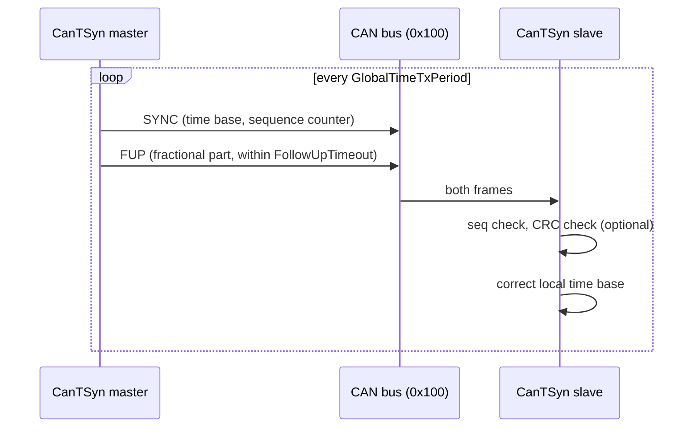

# CanTSyn - CAN Time Synchronization (Autosar time sync over CAN)

> **In one sentence:** a CanTSyn master periodically broadcasts the current time
> (and optional CRC) in a CAN frame; slaves correct their local time base from it.

| Item | Value |
| --- | --- |
| Module | `infras/communication/CanTSyn` (API: `infras/include/CanTSyn.h`) |
| Layer | Above CanIf (`up: "CanTSyn"`), fed by the local time base |
| Configuration | **hand-written C**, no JSON: `app/app/config/CanTSyn/{master,slave}/CanTSyn_Cfg.c` |
| Generator | none - the config is a static C file registered directly in `app/app/SConscript` |
| Standard | AUTOSAR CP 4.4 CanTSyn (subset: FUP/CRC elements) |
| Demo | `CanApp` uses the **slave** config on the virtual bus |

**Contents**

1. [What the module is for](#1-what-the-module-is-for)
2. [Configuration](#2-configuration)
3. [How it works at runtime](#3-how-it-works-at-runtime)
4. [Public API](#4-public-api)
5. [Key notes and gotchas](#5-key-notes-and-gotchas)
6. [Known limitations](#6-known-limitations)

---

## 1. What the module is for

* **Master role** (`CANTSYN_MASTER`) - every `GlobalTimeTxPeriod`, pack the
  current `SynchronizedTimeBase` into the SYNC message (0x100 in the demo) and
  transmit it; a FUP (follow-up) message carries the fractions.
* **Slave role** (`CANTSYN_SLAVE`) - receive SYNC/FUP, validate the sequence
  counter jump and optional CRC, and update the local time base via the StbM-like
  interface (`CanTSyn_SlaveContextType`).
* Time base source/destination is a callback pair provided in the config C file
  (the "SynchronizedTimeBaseRef" points to your time functions).

---

## 2. Configuration

No JSON - edit the C file directly. Slave example
(`app/app/config/CanTSyn/slave/CanTSyn_Cfg.c`):

```c
static const CanTSyn_GlobalTimeSlaveType CanTSyn_GlobalTimeSlave0 = {
  CANTSYN_CONVERT_MS_TO_MAIN_CYCLES(100), /* GlobalTimeFollowUpTimeout */
  CANTSYN_CONVERT_MS_TO_MAIN_CYCLES(10),  /* GlobalTimeMinMsgGap */
  3,                                      /* GlobalTimeSequenceCounterJumpWidth */
  CANTSYN_CRC_IGNORED,                    /* RxCrcValidated */
  FALSE,                                  /* RxTmacValidated */
};
static const CanTSyn_GlobalTimeDomainType CanTSyn_GlobalTimeDomains[1] = {
  { {{&CanTSyn_SlaveContext0, &CanTSyn_GlobalTimeSlave0}},
    FALSE, /* EnableTimeValidation */
    0, 0, 0, FALSE, 0,
    CANTSYN_SLAVE },
};
```

| Parameter (slave) | Meaning |
| --- | --- |
| `GlobalTimeFollowUpTimeout` | Max time between SYNC and its FUP |
| `GlobalTimeMinMsgGap` | Minimum gap before another SYNC is accepted |
| `GlobalTimeSequenceCounterJumpWidth` | Allowed sequence counter jump on resync |
| `RxCrcValidated` | `CANTSYN_CRC_IGNORED` / `CANTSYN_CRC_OPTIONAL` / `CANTSYN_CRC_MANDATORY` |
| `RxTmacValidated` | Authenticated time (TMAC) validation, needs Csm |

Master counterpart (`master/CanTSyn_Cfg.c`): `GlobalTimeTxPeriod` (demo 5000 ms)
plus the same domain header, with role `CANTSYN_MASTER`.

| Domain field | Meaning |
| --- | --- |
| `GlobalTimeDomainId` / `GlobalTimeNetworkSegmentId` | Ids carried in the message header |
| `UseExtendedMsgFormat` | 29-bit addressing variant |
| `SynchronizedTimeBaseRef` | Index of the local time base (see below) |

Switch master/slave by choosing the config directory in `app/app/SConscript`
(`"CanTSyn": Glob("config/CanTSyn/slave/CanTSyn_Cfg.c")`).

---

## 3. How it works at runtime



* `CanTSyn_MainFunction()` runs both roles (TX timer on the master, follow-up
  timeout on the slave).
* Transmission mode is controlled per controller:
  `CanTSyn_SetTransmissionMode(CtrlIdx, CANTSYN_TX_ON/OFF)` - typically driven
  by ComM state changes.

---

## 4. Public API

| Function | Caller | Purpose |
| --- | --- | --- |
| `CanTSyn_Init(ConfigPtr)` | EcuM | Set up domains/contexts |
| `CanTSyn_SetTransmissionMode(CtrlIdx, mode)` | ComM / app | Enable/disable master TX |
| `CanTSyn_RxIndication(RxPduId, PduInfo)` | CanIf | SYNC/FUP reception |
| `CanTSyn_TxConfirmation(TxPduId, result)` | CanIf | Master TX confirmation |
| `CanTSyn_MainFunction()` | scheduler | Timers |
| `CanTSyn_GetVersionInfo` | anyone | Version |

The **time base read/write callbacks** (get/set the synchronized time) are part
of the config struct - implement them against your RTC/counter (there is no
separate StbM module in this repository).

---

## 5. Key notes and gotchas

1. **No JSON, no generator** - the config is plain C; a mistake is a compile
   error, which is fine.
2. **The demo uses CAN ID 0x100** for `CANTSYN_RX`/`CANTSYN_TX` in
   `CanIf.json` - if your cluster uses different sync IDs, change both.
3. **CRC mandatory needs Csm** - `CANTSYN_CRC_MANDATORY` without the crypto
   stack rejects every frame; start with `CANTSYN_CRC_IGNORED`.
4. **Master and slave are two different builds**, not two run-time roles - pick
   one config directory per application.
5. **The 0x29 Authentication-style protection (TMAC) is a stub** unless Csm is
   available.

---

## 6. Known limitations

1. **No StbM module** - the time base is the callback pair in the config; there
   is no rate correction / offset filtering beyond the immediate set.
2. **Only one domain per config file instance** in the demo (arrays support more,
   but the callbacks are shared).
3. **CRC validation** covers the global time element only; the full
   `CrcValidation` matrix of AUTOSAR is not implemented.
4. **No LinTSyn / Ethernet TSyn** - CAN only.

**Related documents:** [CanIf](CanIf.md) - [ComM](ComM.md) - [Com](Com.md)
