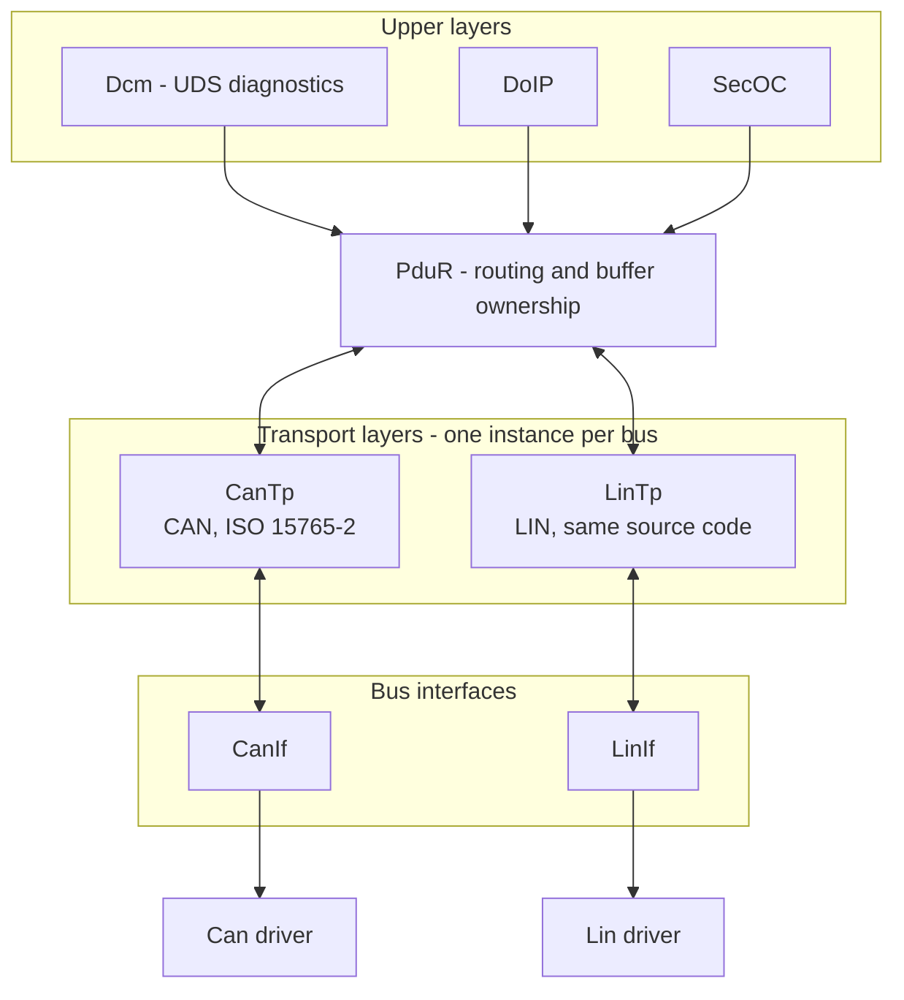
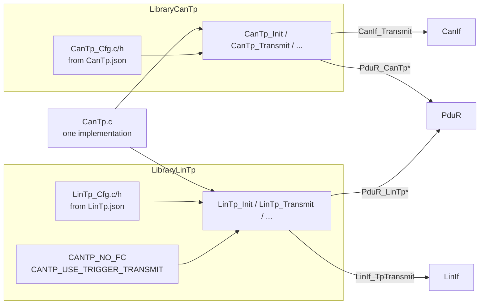
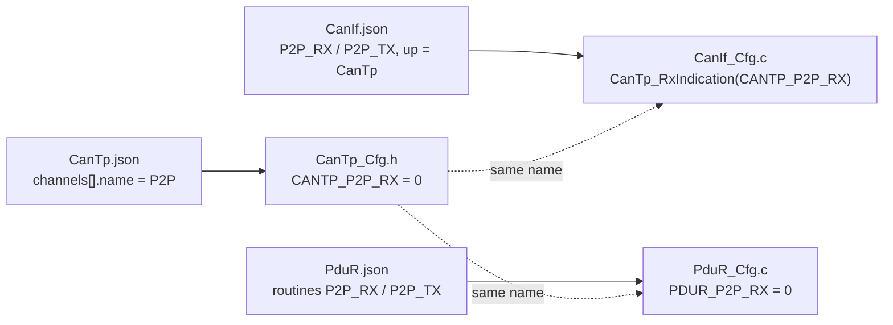
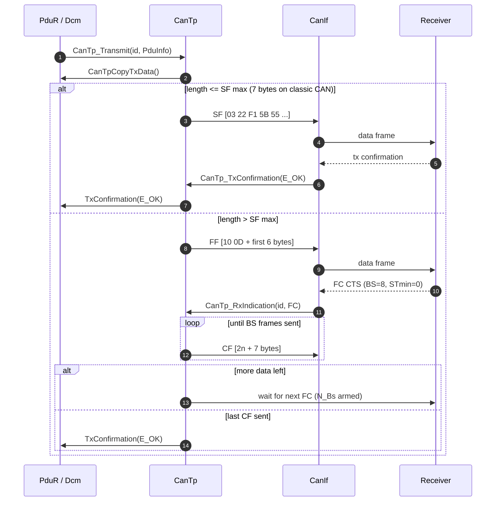
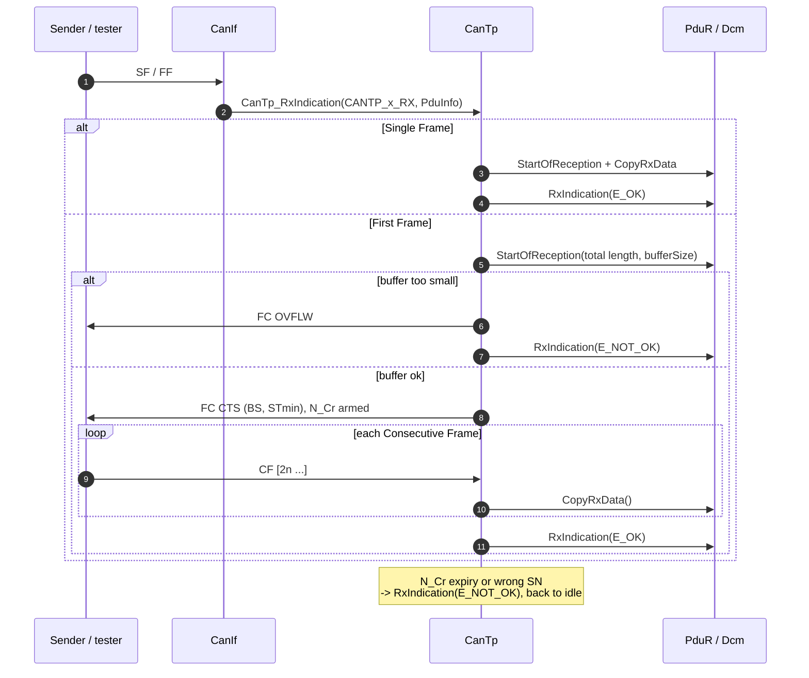
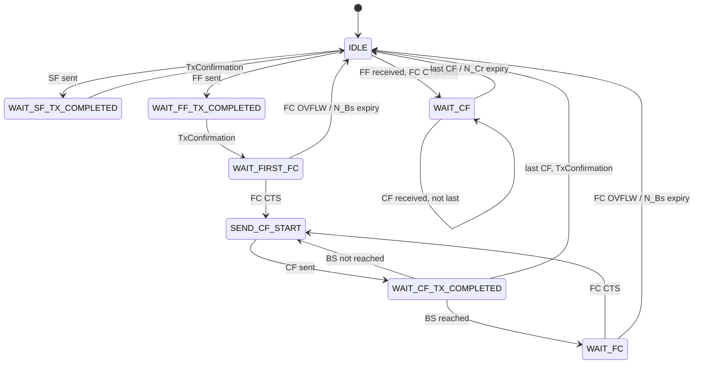

# CanTp - CAN Transport Protocol (ISO 15765-2)

> **In one sentence:** CanTp turns a message that is longer than one CAN frame into
> a sequence of frames on transmission, and reassembles the frames back into one
> message on reception.

| Item | Value |
| --- | --- |
| Module | `infras/communication/CanTp` (API: `infras/include/CanTp.h`) |
| Layer | Transport layer, between CanIf (below) and PduR (above) |
| Configuration | `app/app/config/CanTp/CanTp.json` |
| Generator | `tools/generator/CanTp.py` -> `GEN/CanTp_Cfg.c` / `GEN/CanTp_Cfg.h` |
| Standard | ISO 15765-2 (AUTOSAR CP 4.4 CanTp) |
| Demo | `CanApp` (ECU side) + `IsoTpSend` (tester side) over the virtual CAN bus |

**Contents**

1. [What the module is for](#1-what-the-module-is-for)
2. [Where it sits in the stack](#2-where-it-sits-in-the-stack)
3. [Configuration](#3-configuration)
4. [How it works at runtime](#4-how-it-works-at-runtime)
5. [Public API](#5-public-api)
6. [Build and run a demo](#6-build-and-run-a-demo)
7. [Key notes and gotchas](#7-key-notes-and-gotchas)
8. [Troubleshooting](#8-troubleshooting)
9. [Known limitations](#9-known-limitations)

---

## 1. What the module is for

A classical CAN frame carries at most 8 bytes (64 bytes with CAN FD). A UDS
request such as "read the VIN" is a few bytes, but the **response** and things like
flash download are hundreds of bytes. CanTp adds the addressing and segmentation
layer that is missing between the CAN driver and the diagnostic/communication
stack:

* **Segmentation on Tx** - split an N-SDU into a First Frame (FF) plus Consecutive
  Frames (CF), and react to the receiver's Flow Control (FC) frames.
* **Reassembly on Rx** - decode Single Frame (SF), First Frame and Consecutive
  Frames, request a buffer from PduR, and hand the complete N-SDU up.
* **Timing supervision** - `N_As`, `N_Bs`, `N_Cr` timers abort a broken transfer.
* **Flow control** - `BS` (block size) and `STmin` (separation time) throttle the
  sender.
* **Functional addressing** - single-frame only requests to all ECUs (CAN ID
  `0x7DF`) on a `FUNCTIONAL` channel.

What it does **not** do:

* It does not know about UDS services, sessions or security - that is
  [Dcm](Dcm.md).
* It does not route PDUs between modules - that is [PduR](PduR.md).
* It does not touch CAN IDs directly - the frames of a channel are declared in
  [CanIf](CanIf.md).

## 2. Where it sits in the stack



`CanTp` and `LinTp` are **siblings, not stacked**: two instances of the same
transport-layer state machine, one per bus. `LinTp` is literally `CanTp.c` compiled a
second time under different names - see [section 2.1](#21-why-lintp-is-not-above-cantp).

Every arrow is a configured PDU: one CanTp channel is one RxPdu plus one TxPdu in
CanIf, and one Rx plus one Tx routine in PduR. The three configurations must agree
on names - see [section 3.4](#34-the-canif-coupling-rule).

### 2.1 Why LinTp is not above CanTp

`infras/communication/LinTp/LinTp.c` contains no logic; it only re-includes the
CanTp implementation under a different symbol prefix:

```c
#define CANTP_CFG_H                  /* use LinTp_Cfg.h instead */
#define CANTP_NO_FC                  /* LIN has no flow control frames */
#define CANTP_USE_TRIGGER_TRANSMIT   /* LinIf pulls the frame, no tx confirmation */
#include "CanTp.c"
```



with the renaming done by `LinTp.h` / `LinTp_Priv.h`:

| CanTp symbol | LinTp symbol |
| --- | --- |
| `CanTp_Init` / `Transmit` / `RxIndication` / `TxConfirmation` / `MainFunction` | `LinTp_*` |
| `CanIf_Transmit` | `LinIf_TpTransmit` |
| `PduR_CanTp*` | `PduR_LinTp*` |
| `CanTp_ChannelConfigType`, `CanTp_ChannelContextType` | `LinTp_ChannelConfigType`, ... |

Consequences worth knowing:

* Everything in this document about segmentation, `N_Cr`, `STmin` pacing and buffer
  handling applies to LIN unchanged. **`BS`, `STmin`, `WFT` and `N_Bs` do not apply**
  on LIN because flow control is compiled out (`CANTP_NO_FC`).
* `LinTp` has its own configuration and its own generator
  (`app/bootloader/config/LinTp/LinTp.json`), it is not configured through
  `CanTp.json`.
* A build that needs both buses links `CanTp` and `LinTp` as two separate libraries;
  they share the source, not the instances.
* Because `CANTP_USE_TRIGGER_TRANSMIT` is always on for `LinTp`, the
  `CanTp_TriggerTransmit()` prototype problem mentioned in
  [section 9](#9-known-limitations) only affects the CAN side.


## 3. Configuration

### 3.1 Minimal example

`app/app/config/CanTp/CanTp.json` of the reference application:

```json
{
  "Class": "CanTp",
  "Channels": [
    { "Name": "P2P" },
    { "Name": "P2A", "ComType": "FUNCTIONAL" },
    { "Name": "P2A_FW", "ComType": "FUNCTIONAL" }
  ]
}
```

Each entry of `Channels` creates **one logical CanTp channel**, and a channel owns
exactly one receive path and one transmit path. The naming convention is what ties
the stacks together:

| Derived symbol | Where it is used | Meaning |
| --- | --- | --- |
| `CANTP_<name>_RX` / `CANTP_<name>_TX` | `CanIf_Cfg.c` calls `CanTp_RxIndication(CANTP_<name>_RX, ...)` | the channel index, used as the CanTp PDU id |
| `CANIF_<name>_RX` / `CANIF_<name>_TX` | `CanTp_Cfg.c` calls `CanIf_Transmit(CANIF_<name>_TX, ...)` | the CanIf PDU id |
| `PDUR_<name>_RX` / `PDUR_<name>_TX` | `CanTp_Cfg.c` calls `PduR_CanTp*` | the PduR routing id |

So a channel named `P2P` requires `P2P_RX` and `P2P_TX` PDUs in CanIf.json with
`"up": "CanTp"`, and `P2P_RX` / `P2P_TX` routines in PduR.json:

```json
/* CanIf.json */
"RxPdus": [ { "Name": "P2P_RX", "Id": "0x731", "Hoh": 0, "Up": "CanTp" } ],
"TxPdus": [ { "Name": "P2P_TX", "Id": "0x732", "Hoh": 0, "Up": "CanTp" } ]

/* PduR.json - routine "P2P_RX": from CanTp to Dcm; routine "P2P_TX": from Dcm to CanTp */
```

### 3.2 Channel fields

Everything except `Name` is optional. The defaults below are exactly what the
generator emits when the field is absent (verified against
`tools/generator/CanTp.py` and the generated `CanTp_Cfg.c`):

| Field | Default | Unit | Description |
| --- | --- | --- | --- |
| `Name` | (required) | - | Channel name, also the PDU name stem. Must be a valid C identifier and must **not** already end in `_RX`/`_TX` |
| `ComType` | `PHYSICAL` | - | `PHYSICAL` = 1-to-1 addressing; `FUNCTIONAL` = broadcast, single frame only |
| `N_As` | **25** | ms | Sender: time allowed for one N-PDU to be transmitted (CF/FF/SF confirmation) |
| `N_Bs` | **1000** | ms | Sender: time to wait for the next Flow Control N-PDU |
| `N_Cr` | **1000** | ms | Receiver: time to wait for the next Consecutive Frame |
| `STmin` | **0** | ms | Minimum separation between two CF frames that this ECU sends |
| `BS` | **8** | frames | Block size announced in the Flow Control frames this ECU sends |
| `WftMax` | **8** | frames | Number of WAIT flow-control frames tolerated before aborting (0 = none allowed) |
| `LinkLayerDataLength` | `CANTP_LINK_LAYER_DATA_LENGTH` (**8**) | bytes | Lower-layer data length: 8 for classical CAN, 64 for CAN FD |
| `Padding` | `0x55` | byte | Fill byte for the unused bytes of a padded frame |
| `N_TA` | absent | byte | **Presence alone switches the channel to extended addressing**; value is the target address compared with the first data byte |

Two rarely used fields that the generator understands:

| Field | Default | Description |
| --- | --- | --- |
| `RxPduId` / `TxPduId` | `<name>_RX` / `<name>_TX` | Overrides the PduR symbol used for this channel, when the PduR routine has a different name than the channel |
| `N_TA` | - | see above; there is no separate "address format" switch in JSON |

### 3.3 Top-level fields

| Field | Default | Description |
| --- | --- | --- |
| `MainFunctionPeriod` | **10** | Period of `CanTp_MainFunction()` in ms. All timers are counted in these cycles |
| `STMinAdjust` | **0** | Constant added to every negotiated STmin (ms). Use it when the peer's timer resolution is too coarse |
| `UseTxConfirmation` | **true** | When false, `CANTP_USE_TX_CONFIRMATION` is commented out and the channel returns to idle right after `CanIf_Transmit()` |
| `UsePostBuildConfig` | **false** | Enables `CANTP_USE_PB_CONFIG` (load the channel table from a post-build structure) |

### 3.4 The CanIf coupling rule

The generated `CanTp_Cfg.h` publishes the channel index as the PDU id, and
`CanIf_Cfg.c` refers to it **by name**:

```c
#define CANTP_P2P_RX 0
#define CANTP_P2P_TX 0
#ifndef USE_CANIF                 /* only when CanIf is not part of the build */
#define CANIF_P2P_TX (CANIF_CANTP_BASEID+0)
#endif
```

The three JSON files and their generated output form one wiring chain - a single
name change has to be applied in all of them:



Therefore, for every channel `X`:

1. CanIf must contain the PDUs `X_RX` and `X_TX` with `"up": "CanTp"` - the name is
   the contract, not the order.
2. CanIf calls `CanTp_RxIndication(CANTP_X_RX, ...)`, i.e. the id CanTp receives is
   the **channel index**, not a CanIf-wide PDU id.
3. PduR needs the routines `X_RX` (CanTp -> upper) and `X_TX` (upper -> CanTp), or
   the `RxPduId`/`TxPduId` override must point to the real names.

If a name is wrong you get a compile error on `CANTP_<name>_RX` - which is the
cheapest possible failure mode, so keep the naming rule.

### 3.5 Generated output

`GEN/CanTp_Cfg.h` - the macros above plus:

```c
#define CANTP_USE_TX_CONFIRMATION
#define CANTP_STMIN_ADJUST 0u
#define CANTP_MAIN_FUNCTION_PERIOD 10u
#define CANTP_CONVERT_MS_TO_MAIN_CYCLES(x) \
  ((x + CANTP_MAIN_FUNCTION_PERIOD - 1u) / CANTP_MAIN_FUNCTION_PERIOD)
// #define CANTP_USE_PB_CONFIG
```

`GEN/CanTp_Cfg.c` - the channel table. The field order of
`CanTp_ChannelConfigType` (`infras/communication/CanTp/CanTp_Priv.h`) is:

```c
typedef struct {
  uint8_t *Data;                  /* LinkLayerDataLength-byte transmit buffer, one per channel */
  CanTp_AddressingFormatType AddressingFormat;  /* CANTP_STANDARD / CANTP_EXTENDED */
  PduIdType CanIfTxPduId;
  PduIdType PduR_RxPduId;
  PduIdType PduR_TxPduId;
  uint16_t N_As;                  /* already converted to MainFunction cycles */
  uint16_t N_Bs;
  uint16_t N_Cr;
  uint8_t STmin;
  uint8_t BS;
  uint8_t N_TA;                   /* only for CANTP_EXTENDED; LIN: 0 means go-to-sleep */
  uint8_t CanTpRxWftMax;          /* must not be 0xFF */
  uint8_t LinkLayerDataLength;
  uint8_t Padding;
  CanTp_CommunicationType ComType;
} CanTp_ChannelConfigType;
```

Because `N_As`/`N_Bs`/`N_Cr` are converted with
`CANTP_CONVERT_MS_TO_MAIN_CYCLES`, they are rounded **up** to whole main-function
cycles: with a 10 ms period, `N_As = 25` becomes 3 cycles = 30 ms, and any value
below 10 ms becomes one cycle.

## 4. How it works at runtime

### 4.1 Transmission (this ECU sends a long message)



* `N_As` runs while a frame is on the bus; expiry means the CanIf/driver never
  confirmed, so the channel is reset.
* `N_Bs` runs while waiting for an FC; expiry aborts the transfer and reports
  `E_NOT_OK` to PduR.
* `STmin` is applied between two CFs as
  `CANTP_CONVERT_MS_TO_MAIN_CYCLES(STmin + CANTP_STMIN_ADJUST)`.

### 4.2 Reception (this ECU receives a long message)



If a new frame arrives while a reception is in progress, the incomplete reception
is reported as `E_NOT_OK` and the channel restarts - this is how a tester that
repeats a request "wins" over a stale transfer.

### 4.3 Channel state machine



### 4.4 Frame formats at a glance (classical CAN, standard addressing)


| Type | Byte 0 | Bytes 1..7 |
| --- | --- | --- |
| SF, 3 data bytes | `03` | `22 F1 5B` + padding |
| FF, 13 data bytes total | `10 0D` | first 6 data bytes |
| CF #1 | `21` | next 7 data bytes |
| CF #2 | `22` | next 7 data bytes |
| FC from receiver | `30 08 00` | BS = 8, STmin = 0 |

## 5. Public API

`infras/include/CanTp.h`:

| Function | Called by | Purpose |
| --- | --- | --- |
| `CanTp_Init(const CanTp_ConfigType *)` | EcuM | One-time initialisation of all channels |
| `CanTp_InitChannel(uint8_t)` | EcuM / test | Reset a single channel to idle |
| `CanTp_RxIndication(PduIdType, const PduInfoType *)` | CanIf | A frame for this channel arrived |
| `CanTp_TxConfirmation(PduIdType, Std_ReturnType)` | CanIf | A frame was confirmed (or failed) |
| `CanTp_Transmit(PduIdType, const PduInfoType *)` | PduR | Start sending an N-SDU |
| `CanTp_MainFunction(void)` | scheduler, every `MainFunctionPeriod` | Timers, FC, CF pacing |
| `CanTp_MainFunction_Fast(void)` | scheduler, fast | Same, but only for channels that need a finer STmin |
| `CanTp_TriggerTransmit()` | CanIf | Pre-load the frame for trigger-transmit mode. **Not declared in `CanTp.h`** - it is compiled in with `CANTP_USE_TRIGGER_TRANSMIT` and only used by the LIN stack alias in `LinTp.h`; add your own prototype if you call it from a custom CanIf |

Error codes (`CANTP_E_*`) are reported through DET; `CANTP_E_INVALID_RX_ID` /
`CANTP_E_INVALID_TX_ID` almost always mean a name mismatch between CanTp and CanIf.

## 6. Build and run a demo

The reference application `CanApp` owns channels `P2P` (physical, `0x731`/`0x732`)
and `P2A` (functional, `0x7DF`). `IsoTpSend` is a ready-made tester.

```sh
# app tab - build the ECU and the tester
scons --app=CanApp
scons --app=IsoTpSend

# app tab - run the ECU (it listens on the virtual CAN bus, bus 0)
build/nt/GCC/CanApp/CanApp.exe

# boot tab - read DID 0xF15B (10 bytes -> forces a multi-frame response)
build/nt/GCC/IsoTpSend/IsoTpSend.exe -v 22F15B
```

`IsoTpSend` defaults are already the reference ones: `-d CAN.simulator_v2 -p 0
-r 0x732 -t 0x731 -l 8`. Expected traffic:

```
TX: 03 22 F1 5B 55 55 55 55        <- SF request
RX: 10 0D 62 F1 5B A5 A5 A5 ...    <- FF, 13 bytes announced
TX: 30 08 00 55 55 55 55 55        <- FC, BS=8, STmin=0
RX: 21 A5 A5 A5 A5 A5 A5 A5        <- CF 1
RX: 22 A5 A5 55 55 55 55 55        <- CF 2, last one
```

Useful switches:

| Option | Meaning |
| --- | --- |
| `-v <hex>` | request bytes |
| `-r` / `-t` | rx / tx CAN id (tester rx = ECU tx) |
| `-l <n>` | `linkLayerDataLength`: use 64 to run the same stack in CAN FD mode |
| `-d CAN.simulator` | use the v1 simulator instead of `simulator_v2` |
| `-w` | wait for the response and keep listening |

To switch the whole stack to CAN FD without regenerating, set `CANTP_LINK_LAYER_DATA_LENGTH=64` in the
environment before starting `CanApp`: the generated constructor overwrites the
`LinkLayerDataLength` of every channel at process start (the old `LINK_LAYER_DATA_LENGTH` and
`LL_DL` names are still honoured, with lower precedence).

To watch the raw frames, start `CanDump` on the same bus (see
[virtual CAN environment](virtual-can-env.md)).

## 7. Key notes and gotchas

1. **Frames must be padded to a valid DLC.** CanTp accepts an SduLength of
   exactly 8/12/16/20/24/32/48/64 bytes. A receiver that delivers a 3-byte I-PDU
   (unpadded frame) is rejected with `RX with invalid DLC` and the request silently
   times out on the tester side. Check the padding of the CanIf/Can driver side
   first when "the tester gets no answer".
2. **`STmin` resolution is the main-function period.** With
   `MainFunctionPeriod = 10`, any STmin below 10 ms becomes 10 ms. Use
   `CanTp_MainFunction_Fast()` (and `CANTP_USE_STD_TIMER`) if you need finer
   pacing.
3. **`BS = 0` means "send everything without waiting for another FC"**. This is
   legal and fast, but a slow receiver without enough buffer will overflow.
   `BS = 8` (the default) is the safe choice.
4. **Functional channels are single-frame only.** If a non-SF PCI arrives on a
   `FUNCTIONAL` channel, CanTp drops it (`E_NOT_OK`). Functional responses must
   therefore be short; on a functional read of a long DID every ECU answers, which
   also collides on the bus - filter the DID by session/security in Dcm instead.
5. **`N_TA` present = extended addressing.** There is no explicit
   `AddressingFormat` field in JSON; the presence of `N_TA` is what selects it.
   For LIN, `N_TA = 0` is reserved for the go-to-sleep command, so use a non-zero
   value.
6. **One transmit buffer per channel**, sized `LinkLayerDataLength`. Data is copied into the
   channel buffer frame by frame, so an N-SDU larger than `LinkLayerDataLength` is fine, but a
   channel cannot interleave two SDUs.
7. **CanTp frames never appear in a DBC/LDF.** They are always declared by hand in
   `CanIf.json`, because their content is not a signal layout.
8. **`CanTp_Transmit()` returns immediately.** `E_OK` means "accepted and
   started", not "sent". Completion arrives as
   `PduR_CanTpTxConfirmation()`.
9. **Build wiring**: a module is enabled by adding one line to the libs dictionary in
   `app/SConscript`:

   ```python
   "CanTp": Glob("config/CanTp/CanTp.json"),
   ```

   `RegisterConfig()` then runs the generator, defines `USE_CANTP` and puts
   `$CanTp_Cfg` on the include path. CanTp does **not** pull CanIf/PduR in by
   itself - keep their entries (and their JSON files) in the same dictionary,
   otherwise `CANIF_*` / `PDUR_*` macros are missing at compile time.

## 8. Troubleshooting

| Symptom | Likely cause | What to check |
| --- | --- | --- |
| Compile error `CANTP_xxx_RX undeclared` | CanIf PDU name does not match the channel name | `CanIf.json` names must be `<channel>_RX` / `<channel>_TX` |
| Tester times out, log shows `RX with invalid DLC` | Unpadded frame, or `LinkLayerDataLength` mismatch | Pad to 8 (or set `CANTP_LINK_LAYER_DATA_LENGTH=64` for CAN FD) |
| Log shows `FC received when in state N` | Tester sent FC twice, or FC arrival raced a re-send | Usually harmless, but a stuck state means `N_Bs` expired earlier |
| Transfer aborts with `E_NOT_OK` after ~1 s | `N_Bs`/`N_Cr` timeout | Increase `N_Bs`/`N_Cr`, or check that the peer answers FC |
| Multi-frame request ignored, single frame works | Channel is `FUNCTIONAL` | Use a `PHYSICAL` channel for segmented transfers |
| Response is truncated at 7 bytes | Dcm/Com buffer too small, not CanTp | See the buffer section of the [Dcm](Dcm.md) document |

## 9. Known limitations

* `STmin` received in an FC is used as-is: values `0xF1..0xF9` (100..900 us) are
  treated as 241..249 ms instead of being interpreted or clamped, and values
  above `0x7F` are not clamped to `0x7F` as ISO 15765-2 suggests. In practice only
  `0x00..0x7F` should be negotiated with this stack.
* Timer granularity equals `MainFunctionPeriod`; sub-10 ms timings are not
  representable with the default configuration.
* `PDUR_DCM_CANTP_ZERO_COST` (a shortcut that skips PduR for CanTp -> Dcm) is
  referenced by the generator but never defined, so the normal PduR path is always
  used.
* Post-build configuration (`CANTP_USE_PB_CONFIG`) is supported by the code but
  there is no generator output for it yet.
* `CanTp_TriggerTransmit()` has no prototype in `CanTp.h` (see the API table), so
  trigger-transmit has to be wired by hand.

## Related documents

* [CanIf](CanIf.md) - CAN IDs and PDU wiring below CanTp
* [PduR](PduR.md) - routing above CanTp
* [Dcm](Dcm.md) - the usual upper layer
* [Virtual CAN environment](virtual-can-env.md) - bus simulator used by the lab
* [Build environment setup](build-env-setup.md) - toolchain, `scons` targets
