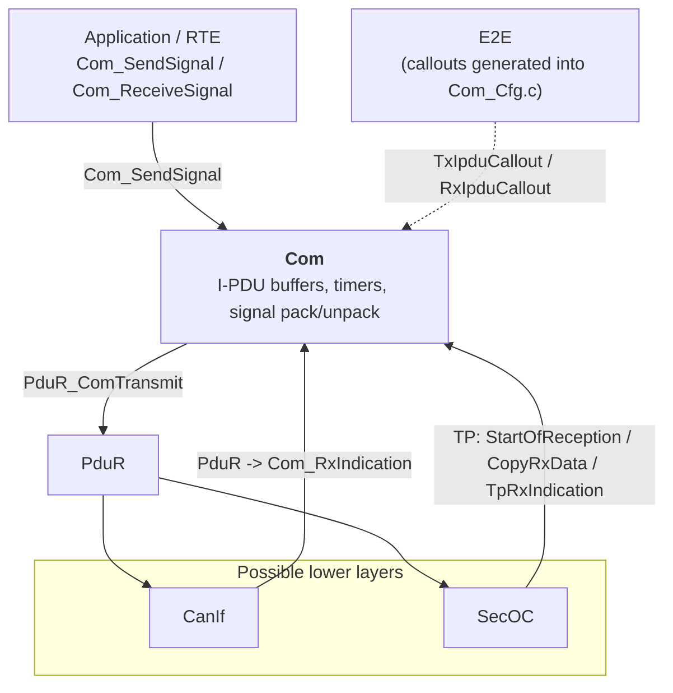
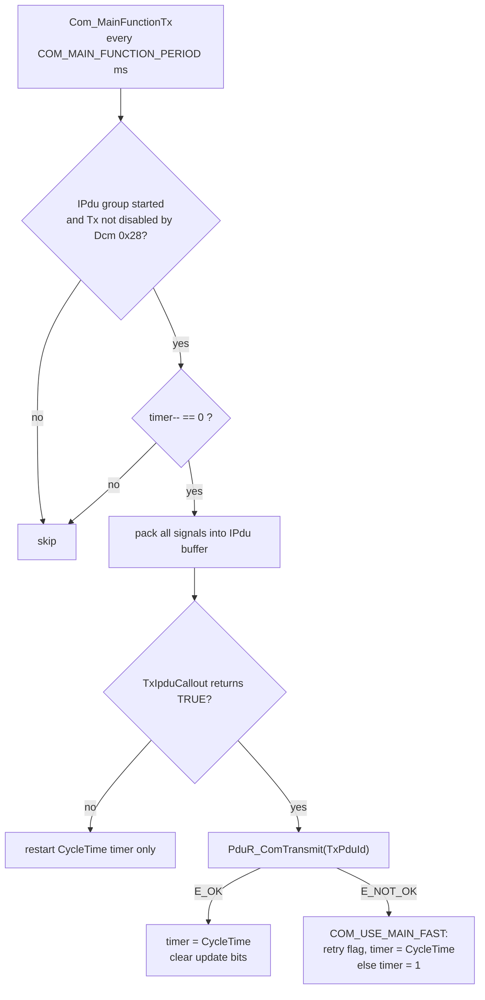
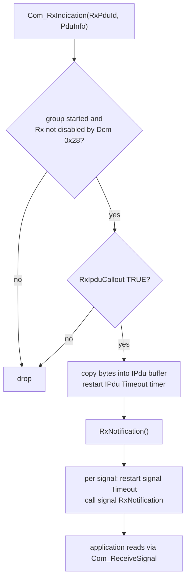
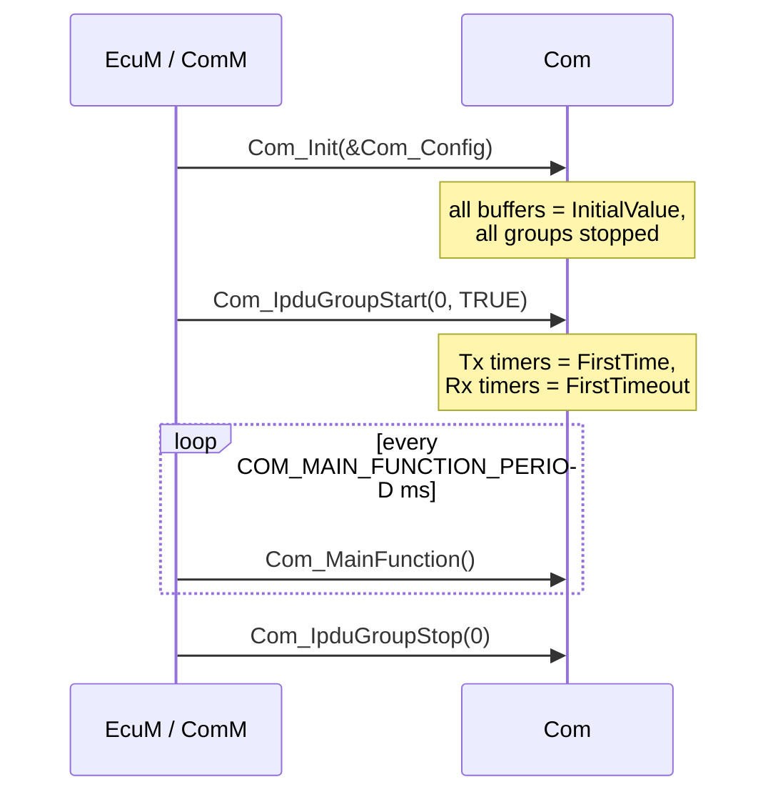

# Com - Signal Communication (pack, schedule, monitor)

> **In one sentence:** Com turns your named signals into packed I-PDUs, sends them
> periodically, unpacks received PDUs back into signals, and raises a timeout when
> an expected message stops arriving.

| Item | Value |
| --- | --- |
| Module | `infras/communication/Com` (API: `infras/include/Com.h`) |
| Layer | Between the application/RTE (above) and PduR (below) |
| Configuration | `app/app/config/Com/Com.json` |
| Generator | `tools/generator/Com.py` -> `GEN/Com_Cfg.c` / `GEN/Com_Cfg.h` + intermediate `GEN/Com.json` + `GEN/bswcom.py` (RTE helper) |
| Standard | AUTOSAR CP 4.4 Com (with SSAS extensions) |
| Demo | `CanApp` - the `MsgTime`/`MsgAbsInfo` messages on the virtual CAN bus |

**Contents**

1. [What the module is for](#1-what-the-module-is-for)
2. [Where it sits in the stack](#2-where-it-sits-in-the-stack)
3. [Configuration](#3-configuration)
4. [How it works at runtime](#4-how-it-works-at-runtime)
5. [Public API](#5-public-api)
6. [Build and run a demo](#6-build-and-run-a-demo)
7. [Key notes and gotchas](#7-key-notes-and-gotchas)
8. [Troubleshooting](#8-troubleshooting)
9. [Known limitations](#9-known-limitations)

---

## 1. What the module is for

* **Signal packing/unpacking** - the generator emits pack/unpack code per signal
  (start bit, size, endianness, sign, factor, offset).
* **Periodic transmission** - each Tx I-PDU has a `CycleTime`; `Com_MainFunctionTx()`
  counts down and calls `PduR_ComTransmit()`.
* **Deadline monitoring** - each Rx I-PDU and each Rx signal has `FirstTimeout` /
  `Timeout`; on expiry `RxDataTimeoutAction` decides what to do with the signal.
* **Signal groups** - read/write several signals of one PDU consistently
  (`Groups` in the JSON, `SystemTime` in the demo).
* **Triggered transmission** - messages in `Trigger` are not periodic; they are
  sent by `Com_TriggerIPDUSend()`.
* **E2E hook** - for every message with an `E2E` entry the generator writes a
  `*_TxIpduCallout` / `*_RxIpduCallout` that calls `E2E_PxxProtect/Check`.

What it does **not** do:

* No bus access - it hands the packed PDU to [PduR](PduR.md) (and only PduR).
* No mode management - someone must call `Com_IpduGroupStart()`
  ([ComM](ComM.md) or the application).
* No DTC logic - that is [Dem](Dem.md).

---

## 2. Where it sits in the stack



Both the IF path (`Com_RxIndication`, one frame) and the TP path
(`Com_StartOfReception` + `Com_CopyRxData` + `Com_TpRxIndication`, multi-frame,
e.g. a large secured PDU) are supported; the PduR API table selects them per
routing path.

---

## 3. Configuration

### 3.1 Top-level keys

| Key | Default | Meaning |
| --- | --- | --- |
| `MainFunctionPeriod` | **10** | ms; emitted as `COM_MAIN_FUNCTION_PERIOD` and the basis of `COM_CONVERT_MS_TO_MAIN_CYCLES()` |
| `UsePostBuildConfig` | **false** | emits `COM_USE_PB_CONFIG` |
| `E2E` | - | path to `E2E.json`; merges the E2E configuration so message `E2E` entries resolve to `E2E_PxxProtect/Check` calls (only active with `USE_E2E`) |
| `Networks[]` | - | one entry per physical network (CAN or LIN) |

### 3.2 Network keys

| Key | Default | Meaning |
| --- | --- | --- |
| `Name` | required | Network name; must match the name used in `CanIf.json`/`PduR.json` |
| `Network` | required | `"CAN"` or `"LIN"` |
| `Me` | required | Local node name in the DBC/LDF |
| `UseDbc` | optional | Import all messages of node `Me` from the DBC |
| `Dbc` / `Ldf` | optional | Database file; for LIN the generator converts LDF to DBC first |
| `Groups` | `{}` | `{GroupName: [signals...]}` - AUTOSAR signal groups |
| `Trigger` | `[]` | Message names sent only via `Com_TriggerIPDUSend()` |
| `Messages` | `[]` | Hand-written messages (added to the import), e.g. SecOC PDUs |
| `E2E` | `[]` | Per-message E2E profile: `{"name": "TxMsgTime", "profile": "P11"}` |
| `timeout_factor` | - | Auto-set Rx `Timeout = factor * CycleTime` for Rx messages without an explicit `Timeout` |
| `EnableMessageTxCallout` | **false** | Auto-generate `TxIpduCallout` names for every Tx message |
| `enable_message_rx_callout` | **false** | Auto-generate `RxIpduCallout` names for every Rx message |
| `enable_message_rx_notification` | **false** | Auto-generate Rx notification names |
| `enable_message_rx_timeout_notification` | **false** | Auto-generate `RxTOut` names |
| `enable_signal_rx_notification` | **false** | Auto-generate signal Rx notifications |
| `enable_signal_rx_timeout_notification` | **false** | Auto-generate signal `RxTOut` names |

> `Device`, `Port` and `Baudrate` appear in `Com.json` but are **not read by
> `Com.py`** - the CAN hardware is configured elsewhere (driver/Network config).
> They are leftovers and can be removed.

### 3.3 Message keys

| Key | Default | Meaning |
| --- | --- | --- |
| `Name` | required | Message name; collisions are auto-prefixed with network name |
| `Id` | required | CAN/LIN frame id |
| `Dlc` | required | PDU length in bytes |
| `Node` | required | Sender node (`Me` = this ECU sends it) |
| `CycleTime` | **0** | ms between transmissions; 0 = send only when triggered |
| `FirstTime` | **0** | ms after `Com_IpduGroupStart()` before the first transmission |
| `FirstTimeout` | **0** | ms; deadline for the *first* reception (0 = use `Timeout`) |
| `Timeout` | **0** | ms; deadline for subsequent receptions; 0 = no monitoring |
| `RxTOut` | `"NULL"` | Function called on Rx timeout (name or `"NULL"`) |
| `RxNotification` | `"NULL"` | Function called on every reception |
| `RxIpduCallout` | `"NULL"` | `boolean f(PduIdType, PduInfoType*)`; return FALSE to drop the frame |
| `TxIpduCallout` | `"NULL"` | `boolean f(PduIdType, PduInfoType*)`; return FALSE to suppress the transmission |
| `TxNotification` / `ErrorNotification` | `"NULL"` | Tx success / failure callbacks |
| `Trigger` | **false** | Same effect as the network-level `Trigger` list |
| `E2E` | - | `{"name": ..., "profile": "P11"}` - generates the E2E callout body |

### 3.4 Signal keys

| Key | Default | Meaning |
| --- | --- | --- |
| `Name` | required | Signal name (the API handle: `Com_SendSignal(COM_<name>, ...)` uses `COM_<NAME>`) |
| `Start` / `Size` | required | Bit position and bit size inside the PDU |
| `Endian` | - | `big` or `little` |
| `Sign` | `"+"` | `"+"` unsigned / `"-"` signed |
| `Factor`, `Offset`, `Min`, `Max` | - | Physical scaling (emitted into pack/unpack) |
| `InitialValue` | `0` / `[0]` | Value or byte array used at init, after `REPLACE` timeout and after invalidation |
| `UpdateBit` | `COM_UPDATE_BIT_NOT_USED` | Bit position of the update bit inside the PDU; an int is relative to the signal start |
| `dyn` | **false** | On the *last* signal: the PDU length is dynamic (`Com_SendDynSignal`) |
| `isGroup` | **false** | Internal: marks the group header entry |
| `RxDataTimeoutAction` | `"NONE"` | `NONE` / `REPLACE` (restore `InitialValue`) / `SUBSTITUTE` (write `TimeoutSubstitutionValue`) |
| `TimeoutSubstitutionValue` | `[0]` / `0` | Value used by `SUBSTITUTE` |
| `DataInvalidAction` | `"NOTIFY"` | Emitted as `COM_ACTION_*` but **currently never read by Com.c** |
| `InvalidNotification` | `"NULL"` | Callback intended for invalidation (not wired up today) |
| `RxNotification`, `RxTOut` | `"NULL"` | Signal-level callbacks (see `enable_signal_*` for auto-naming) |

### 3.5 Generated symbols

```c
/* Com_Cfg.h */
#define COM_MAIN_FUNCTION_PERIOD 10u
#define COM_USE_SIGNAL_CONFIG
#define COM_USE_SIGNAL_UPDATE_BIT
#define COM_CAN0_TX_MSG_TIME 2      /* TxPduId/RxPduId used in PduR */
#define COM_CAN0_RX_MSG_ABS_INFO 4
```

Signal handles are `COM_S<ID>_<NAME>` / `COM_G<ID>_<NAME>` (handle ids in
`Com_Cfg.c`) - use the macros, not the numeric ids. Notification callouts are
emitted under `#ifdef COM_USE_SIGNAL_RX_NOTIFICATION` etc., so a callback only
exists if at least one user of it is configured.

---

## 4. How it works at runtime

### 4.1 Tx scheduling



`Com_TriggerIPDUSend(PduId)` sends immediately (same gate conditions) and
restarts the periodic timer afterwards - a good way to combine event-driven and
periodic behaviour.

### 4.2 Rx handling and deadline monitoring



`Com_MainFunctionRx()` decrements the timers of started Rx IPdus. On expiry it
calls the IPdu `RxTOut` callback and, per signal, applies the
`RxDataTimeoutAction`:

| Action | Effect on expiry |
| --- | --- |
| `NONE` (default) | Only restart the timer |
| `REPLACE` | `Com_SendSignal(signal, InitialValue)` - restore the init value |
| `SUBSTITUTE` | `Com_SendSignal(signal, TimeoutSubstitutionValue)` |

`FirstTimeout` covers the time from `Com_IpduGroupStart()` to the first frame;
`Timeout` covers frame-to-frame afterwards.

### 4.3 Startup



`Com_IpduGroupStart(0, TRUE)` (group id 0 = all IPdus in this implementation) is
called by ComM on FULL_COMMUNICATION, or directly by `EcuM_AL_EnterRUN()` when
ComM is not in the build.

---

## 5. Public API

| Function | Caller | Purpose |
| --- | --- | --- |
| `Com_Init(config)` / `Com_DeInit()` | EcuM | Init buffers and timers |
| `Com_IpduGroupStart(id, initialize)` | ComM / EcuM | Activate Tx and Rx of a group |
| `Com_IpduGroupStop(id)` | ComM / EcuM | Deactivate |
| `Com_EnableReceptionDM` / `Com_DisableReceptionDM(id)` | Dcm 0x28 handling | Control the deadline-monitoring buffer on stop |
| `Com_SendSignal(SignalId, ptr)` | application | Copy the signal into the IPdu buffer and set the update bit |
| `Com_SendDynSignal(SignalId, ptr, len)` | application | Dynamic-length variant |
| `Com_ReceiveSignal(SignalId, ptr)` | application | Copy the signal out of the IPdu buffer |
| `Com_ReceiveDynSignal(SignalId, ptr, *len)` | application | Dynamic-length variant |
| `Com_SendSignalGroup` / `Com_ReceiveSignalGroup(id)` | application | Consistent group access |
| `Com_SendSignalGroupArray` / `Com_ReceiveSignalGroupArray(id, ptr, size)` | application | Byte-array group access |
| `Com_TriggerIPDUSend(PduId)` | application / CanNm | Send one IPdu immediately |
| `Com_TriggerIPDUSendWithMetaData(PduId, meta)` | application | Same with metadata |
| `Com_RxIndication` / `Com_TxConfirmation` / `Com_TpRxIndication` / `Com_TpTxConfirmation` | PduR | Stack callbacks |
| `Com_MainFunction()` | scheduler | `Rx` + `Tx` |
| `Com_MainFunction_Fast()` | scheduler | Retry queued Tx (`COM_USE_MAIN_FAST`) |
| `Com_DcmCommunicationControl(mode)` | Dcm 0x28 | Enable/disable Rx/Tx globally |
| `Com_GetVersionInfo` | anyone | Version |

---

## 6. Build and run a demo

```bash
scons --app=CanApp
./build/nt/GCC/CanApp/CanApp.exe
```

The demo config sends `CAN0_TX_MSG_TIME` (id `0x101`) with a `CycleTime` and
expects `CAN0_RX_MSG_ABS_INFO` (id `0x102`). To see the periodic TX live, trace
the bus with the tester application or enable Com logs:

```bash
AS_LOG_COM=3 ./build/nt/GCC/CanApp/CanApp.exe
```

A minimal receive test is `scons --app=CanIC` + the VicServer SWC signals - see
the [Com SWC demo](../../app/app/config/SWC).

---

## 7. Key notes and gotchas

1. **Nothing is sent until the group is started.** Every Tx/Rx path checks
   `GroupStatus`; forget `Com_IpduGroupStart()` and Com is a black hole.
2. **`CycleTime: 0` means "never periodic"** - such messages need
   `Com_TriggerIPDUSend()` or the `Trigger` list.
3. **Timeouts are in ms** and are converted with
   `COM_CONVERT_MS_TO_MAIN_CYCLES()`; values below `MainFunctionPeriod` (10 ms
   by default) round up to one cycle.
4. **Signal names are global.** The generator auto-renames collisions by
   prefixing the message name and, if needed, the network name - the macro in
   your code is `COM_<FINAL_NAME>`, so check `GEN/Com_Cfg.c` after renaming.
5. **The IPdu buffer is the API.** `Com_SendSignal` only writes into the buffer;
   the frame leaves at the next timer tick. For immediate transmission use
   `Com_TriggerIPDUSend()`.
6. **Dcm 0x28 wins.** `Com_DcmCommunicationControl()` disables Tx/Rx regardless
   of the group state.
7. **Update bit is cleared by Com after each successful Tx** and set by
   `Com_SendSignal` - receivers can use it to detect fresh data.
8. **E2E callouts are generated, not hand-written.** `enable_message_*_callout`
   auto-names them; the body calls `E2E_PxxProtect/Check` from the profile in
   `E2E.json`. Dropping frames (callout FALSE) restarts the timer without an
   error message - check callouts when "messages disappear".

---

## 8. Troubleshooting

| Symptom | Likely cause | Check |
| --- | --- | --- |
| Signals never sent | group not started, or `CycleTime` 0 without trigger | `Com_IpduGroupStart`, `GEN/Com_Cfg.c` timer value |
| Nothing received | PduR routing missing for the Rx PDU, or `Up` chain broken | `GEN/PduR_Cfg.c` routing paths, `CanIf.json` |
| Frame on the bus but signal not updated | wrong `Start`/`Endian`, or the Rx PDU id mismatch | compare `Com_Cfg.c` signal table with the DBC |
| Timeout callback fires although frames arrive | `Timeout` shorter than the sender's `CycleTime` + jitter | use `timeout_factor` (e.g. 3) |
| `SUBSTITUTE` value never applied | action spelled wrong (only `NONE/REPLACE/SUBSTITUTE` are mapped) | `GEN/Com_Cfg.c` `/* RxDataTimeoutAction */` |
| Link error on `Com_SendSignal(COM_X)` | signal renamed by the collision rule | search `COM_.*X` in `GEN/Com_Cfg.c` |
| Tx stops after tester present | Dcm 0x28 disabled communication and nobody re-enabled | `Com_DcmCommunicationControl` calls in Dcm.c |

---

## 9. Known limitations

Code review findings verified against `infras/communication/Com/Com.c` and
`tools/generator/Com.py`:

1. **Four declared APIs are not implemented**: `Com_InvalidateSignal`,
   `Com_InvalidateSignalGroup`, `Com_SwitchIpduTxMode`, `Com_GetStatus` exist
   only in `Com.h` - using them is a link error.
2. **`DataInvalidAction` is dead configuration**: emitted as `COM_ACTION_*`
   into the signal table, never read by `Com.c` (the only actions evaluated are
   the Rx-timeout ones). Same for `InvalidNotification`.
3. **`Device`, `Port`, `Baudrate` in `Com.json` are ignored** by the generator;
   they look meaningful but the CAN device is configured elsewhere.
4. **`Com_MainFunctionRx` restarts the timer before acting**: on expiry the
   timer is reloaded first, so a callback that blocks for several cycles still
   keeps the nominal period - but a long callback delays all later IPdus in the
   same loop (single-threaded scan, no per-PDU phase).
5. **`Com_TriggerIPDUSend` treats a failed transmit as success** (sets
   `timer = 1` and returns `E_OK`): with `COM_USE_MAIN_FAST` unset the retry
   happens one cycle later; the caller cannot distinguish "sent" from "queued".
6. **`Com_CopyRxData` requires `MetaDataPtr`** (offset) unconditionally - only
   usable behind a TP module that provides offsets (SecOC/CanTp gateway paths).
7. **Generator: `enable_*` switches only auto-generate names**, they do not
   validate that the function actually exists - a typo in a callback name still
   compiles until link time.
8. **Generator: LIN networks silently drop Tx** (`COM_TX_FOR_*` macro for LIN is
   generated empty); LIN Tx relies on trigger-transmit via LinIf.

**Related documents:** [PduR](PduR.md) - [CanIf](CanIf.md) - [E2E](E2E.md) -
[ComM](ComM.md) - [SecOC](SecOC.md) - [Dcm](Dcm.md)
