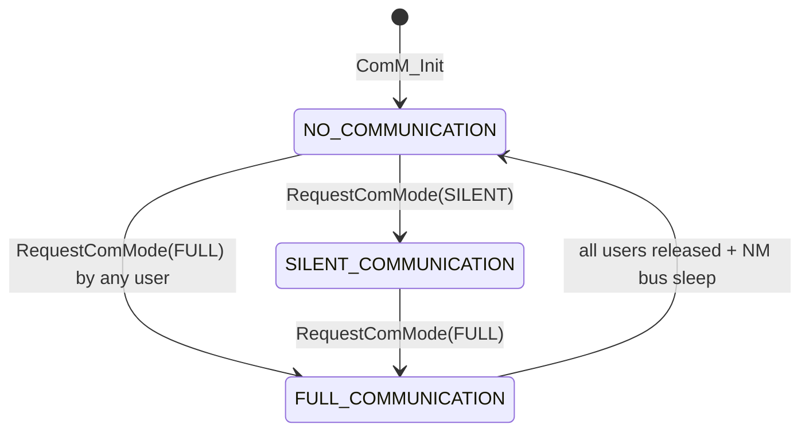

# ComM - Communication Manager

> **In one sentence:** ComM collects the communication wishes of users
> (application, Dcm, Nm), arbitrates them per channel, and instructs the bus
> state manager (CanSM) and Com (`Com_IpduGroupStart/Stop`) accordingly.

| Item | Value |
| --- | --- |
| Module | `infras/communication/ComM` (API: `infras/include/ComM.h`) |
| Layer | Above CanSM/[Nm](Nm.md)/[Com](Com.md); users request modes |
| Configuration | `app/app/config/Com/ComM.json` |
| Generator | `tools/generator/ComM.py` -> `GEN/ComM_Cfg.c` / `GEN/ComM_Cfg.h` |
| Standard | AUTOSAR CP 4.4 ComM (subset) |
| Demo | `CanApp` - `EcuM_AL_EnterRUN()` requests FULL_COMMUNICATION |

**Contents**

1. [What the module is for](#1-what-the-module-is-for)
2. [Configuration](#2-configuration)
3. [How it works at runtime](#3-how-it-works-at-runtime)
4. [Public API](#4-public-api)
5. [Build and run a demo](#5-build-and-run-a-demo)
6. [Key notes and gotchas](#6-key-notes-and-gotchas)
7. [Troubleshooting](#7-troubleshooting)
8. [Known limitations](#8-known-limitations)

---

## 1. What the module is for

* **User arbitration** - several users may share one channel; the highest
  requested mode wins. Release all users and the channel goes to NO_COM after
  the NM handshake.
* **Com IPdu group control** - on entering FULL_COMMUNICATION ComM starts the
  configured `IpduGroupIds` (`Com_IpduGroupStart`), on NO_COM it stops them.
* **NM interaction** - with `variant: FULL` ComM requests/releases the network
  via Nm and reacts to `Nm_NetworkMode` / `Nm_BusSleepMode` indications.
* **Inhibition** - `ComM_PreventWakeUp`, `ComM_LimitChannelToNoComMode`,
  `ComM_LimitECUToNoComMode` for diagnostics and tests.

---

## 2. Configuration

```json
{
  "Class": "ComM",
  "Chanels": [
    { "Name": "CAN0", "Type": "CAN", "Variant": "FULL", "IpduGroupIds": ["COM_GROUP_ID_CAN0"] },
    { "Name": "CAN1", "Type": "CAN", "Variant": "FULL", "IpduGroupIds": ["COM_GROUP_ID_CAN1"] }
  ],
  "Users": [ { "Name": "User0", "Chanels": ["CAN0", "CAN1"] } ]
}
```

| Key | Meaning |
| --- | --- |
| `Chanels[]` | **The key is spelled `Chanels`** - the generator expects the typo; do not "fix" it to `channels` |
| `Chanels[].Name` | Channel name; index = `NetworkHandleType`, must match the CanSM/Nm channel index |
| `Chanels[].Type` | `CAN` (also `LIN`, `ETH` are defined in the types) |
| `Chanels[].Variant` | NM variant: `FULL` (active NM), `LIGHT`, `NONE`, `PASSIVE` |
| `Chanels[].IpduGroupIds[]` | Com group id symbols; they come from the Com generator as `COM_GROUP_ID_<network>` |
| `Users[]` | Mode requesters; `Users[].Chanels[]` lists the channel names the user spans |

`COM_GROUP_ID_<name>` is emitted by `Com.py` per network, so a channel's
`IpduGroupIds` must reference networks that exist in `Com.json`.

---

## 3. How it works at runtime



* `ComM_RequestComMode(user, mode)` sets the user's wish; the channel mode is
  the maximum over all its users.
* Entering FULL_COMMUNICATION: `Com_IpduGroupStart(id, TRUE)` for every group of
  the channel, then `Nm_NetworkRequest` (variant FULL) or
  `CanSM_RequestComMode` (variant NONE).
* Leaving it: reverse order - `Com_IpduGroupStop`, `Nm_NetworkRelease`, wait for
  `Nm_BusSleepMode` before declaring NO_COM.
* `ComM_Nm_NetworkStartIndication` / `Nm_NetworkMode` / `Nm_BusSleepMode` are
  the NM-side callbacks that update the channel state.

---

## 4. Public API

| Function | Caller | Purpose |
| --- | --- | --- |
| `ComM_Init(ConfigPtr)` / `ComM_DeInit()` | EcuM | Init all channels to NO_COM |
| `ComM_RequestComMode(User, mode)` | application, Dcm | Request `COMM_FULL_COMMUNICATION` / `COMM_SILENT_COMMUNICATION` / `COMM_NO_COMMUNICATION` |
| `ComM_GetRequestedComMode` / `ComM_GetCurrentComMode(User, *mode)` | application | Query |
| `ComM_GetState(Channel, *state)` / `ComM_GetInhibitionStatus` | tests | Detailed state |
| `ComM_PreventWakeUp(Channel, status)` | app | Ignore wake-up requests |
| `ComM_LimitChannelToNoComMode(Channel, status)` | Dcm 0x28 / tests | Force one channel down |
| `ComM_LimitECUToNoComMode(status)` | tests | Force the whole ECU down |
| `ComM_ReadInhibitCounter` / `ComM_ResetInhibitCounter()` | tests | Inhibition statistics |
| `ComM_SetECUGroupClassification(status)` | app | ECU group profile |
| `ComM_Nm_NetworkStartIndication` / `Nm_NetworkMode` / `Nm_BusSleepMode` / `Nm_PrepareBusSleepMode` | Nm | NM callbacks |
| `ComM_MainFunction()` | scheduler | State machine |

---

## 5. Build and run a demo

```bash
scons --app=CanApp
./build/nt/GCC/CanApp/CanApp.exe
AS_LOG_COMM=3 ./build/nt/GCC/CanApp/CanApp.exe
```

`EcuM_AL_EnterRUN()` requests `COMM_FULL_COMMUNICATION` for `User0`, which
starts both Com IPdu groups and brings CanSM to FULL_COM. In the shell you can
watch the state with `ComM_GetState`.

---

## 6. Key notes and gotchas

1. **`Chanels` (sic) is the JSON key** - renaming it to `channels` makes the
   generator produce an empty configuration without any error.
2. **Channel index must match CanSM/Nm/CanIf** - all four configs order
   networks identically.
3. **Com group ids are per network in Com** - one ComM channel may reference
   several groups (e.g. a gateway ECU forwarding between two networks).
4. **The user handle is the array index of `Users[]`** - `ComM_RequestComMode(0, ...)`
   refers to `User0`.
5. **`variant: NONE` bypasses Nm** - the channel is driven straight via CanSM;
   useful for test benches.

---

## 7. Troubleshooting

| Symptom | Likely cause | Check |
| --- | --- | --- |
| Com signals never start | ComM never reaches FULL_COM | `AS_LOG_COMM=3`, `ComM_GetCurrentComMode` |
| Channel stays in NO_COM | user index wrong, or all users released | user array index in `ComM_RequestComMode` |
| Bus never sleeps after release | NM handshake pending (`variant: FULL` without Nm in build) | variant vs build configuration |
| `COM_GROUP_ID_CAN0 undeclared` | IpduGroupIds name not generated by Com | network name in `Com.json` |

---

## 8. Known limitations

1. **The JSON key is `Chanels`** - a typo preserved by `ComM.py`; it is part of
   the file format, not a bug to fix silently.
2. **No `COMM_PNC_SHUTDOWN` / partial-networking coordination** at ComM level.
3. **`ComM_PrepareBusSleep` handling is minimal** - the ECU goes to NO_COM on
   `Nm_BusSleepMode` without a configurable delay.
4. **One user handle namespace for all channels** - users cannot request
   different modes per channel (the request applies to the user's channel set).

**Related documents:** [CanSM](CanSM.md) - [Nm](Nm.md) - [Com](Com.md) -
[CanNm](CanNm.md)
