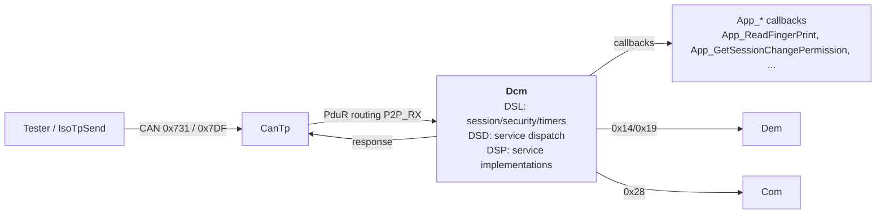
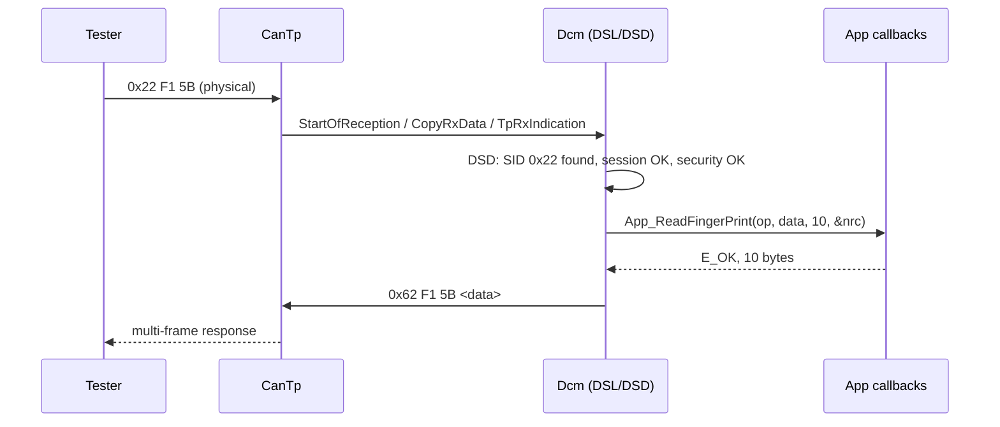

# Dcm - Diagnostic Communication Manager (UDS server)

> **In one sentence:** Dcm is the UDS (ISO 14229) server: it parses request
> messages, checks session/security permissions, calls your `App_*` callbacks and
> builds the response.

| Item | Value |
| --- | --- |
| Module | `infras/diagnostic/Dcm` (`Dcm.c`, `Dcm_Dsl.c`, `Dcm_Dsd.c`, `Dcm_Dsp.c`; API: `infras/include/Dcm.h`) |
| Layer | Between PduR (below, via CanTp) and the application callbacks |
| Configuration | `app/app/config/Dcm/Dcm.json` |
| Generator | `tools/generator/Dcm.py` -> `GEN/Dcm_Cfg.c` / `GEN/Dcm_Cfg.h` |
| Standard | ISO 14229 / AUTOSAR CP 4.4 Dcm |
| Demo | `CanApp` + `IsoTpSend -v 22F15B` (Read DID FingerPrint) |

**Contents**

1. [What the module is for](#1-what-the-module-is-for)
2. [Where it sits in the stack](#2-where-it-sits-in-the-stack)
3. [Configuration](#3-configuration)
4. [How it works at runtime](#4-how-it-works-at-runtime)
5. [Public API](#5-public-api)
6. [Build and run a demo](#6-build-and-run-a-demo)
7. [Key notes and gotchas](#7-key-notes-and-gotchas)
8. [Troubleshooting](#8-troubleshooting)
9. [Known limitations](#9-known-limitations)

---

## 1. What the module is for

* **Session management (0x10)** - Default / Program / Extended / Factory sessions,
  S3 timeout falls back to Default automatically.
* **Security access (0x27)** - seed/key per level, lockout after `NumAtt` failed
  attempts for `DelayTime` ms.
* **Data services** - Read DID (0x22), Write DID (0x2E), Read Scaling DID (0x24),
  Read Periodic DID (0x2A), Dynamically Define DID (0x2C), IO Control (0x2F).
* **Memory services** - Read Memory (0x23), Write Memory (0x3D),
  RequestDownload (0x34) / TransferData (0x36) / RequestTransferExit (0x37) with
  per-range `Sessions`/`Securities`/`Attr` checks.
* **Routine Control (0x31)** - start/stop/result callbacks per routine.
* **Ecu Reset (0x11)**, Tester Present (0x3E), Communication Control (0x28),
  Clear/Read DTC (0x14/0x19, forwarded to [Dem](Dem.md)), Authentication (0x29,
  needs `USE_CRYPTO`).

What it does **not** do:

* No transport - segmentation and timing come from [CanTp](CanTp.md).
* No DTC storage - that is [Dem](Dem.md); Dcm only forwards the requests.
* No payload signing - SecOC operates below.

---

## 2. Where it sits in the stack



Internally Dcm follows the AUTOSAR split:

* **DSL** (session layer) - sessions, security states, P2/P2*/S3 timers, buffers.
* **DSD** (dispatcher) - SID lookup, session/security/access check, NRC 0x11/0x12/0x31/0x7F.
* **DSP** (service layer) - the actual service implementations calling your APIs.

---

## 3. Configuration

Everything lives in one JSON (`Dcm.json`). The same content can be authored as an
Excel workbook for review; **`ServiceMap` is the Excel sheet name - the JSON key
is `Services`**.

### 3.1 Top-level keys

| Key | Default | Meaning |
| --- | --- | --- |
| `MainFunctionPeriod` | **10** | ms; `DCM_MAIN_FUNCTION_PERIOD`, basis of `DCM_CONVERT_MS_TO_MAIN_CYCLES()` |
| `Timings` | see 3.2 | P2/P2*/S3 timeouts |
| `Security` | `{NumAtt: 3, DelayTime: 3000, SeedProtection: true}` | Global lockout policy |
| `Buffer` | required | `{Rx, Tx}` UDS buffer sizes in bytes |
| `Channels` | `[{Name: P2P}, {Name: P2A}]` | Diagnostic channels; a name containing `P2A` becomes the **functional** channel (e.g. 0x7DF), the others are physical (0x731). Each channel gets `DCM_P2P_PDU` / `DCM_P2A_PDU` contexts |
| `Sessions[]` | required | Session table |
| `Securities[]` | required | Security level table |
| `Services[]` | required | Service table (see 3.3) |
| `Memories[]` | optional | Memory ranges for 0x23/0x3D/0x34/0x36/0x37 |
| `memory.format` | `[0x44]` | Allowed AddressAndLengthFormatIdentifiers; `0x44` = 4-byte address + 4-byte size |

### 3.2 `Timings`

| Parameter | Demo value | Purpose |
| --- | --- | --- |
| `S3Server` | 5000 ms | Fall back to the Default session after this idle time |
| `P2ServerMax` | 50 ms | Response deadline for a request |
| `P2StarServerMax` | 5000 ms | Deadline after NRC 0x78 (ResponsePending) |
| `P2ServerAdjust` / `P2StarServerAdjust` | 20/20 ms | Margin for scheduling jitter |

All values are converted to `Dcm_MainFunction()` cycles at build time; there is
no runtime reconfiguration.

### 3.3 `Sessions[]` / `Securities[]`

```json
"Sessions":  [ { "Name": "Default", "Id": "0x01" }, { "Name": "Program", "Id": "0x02" } ],
"Securities": [ { "Name": "Extended", "Level": "1", "Size": "4", "Sessions": ["Extended"],
                  "API": { "Seed": "App_GetExtendedLevelSeed", "Key": "App_CompareExtendedLevelKey" } } ]
```

* Session ids are the 0x10 request values; the generator emits bit masks
  (`DCM_DEFAULT_MASK = 0x1`, ...).
* Security `Level` is the odd level number of 0x27 (1, 2, 3 ...); `Size` is the
  seed/key length; `Sessions` restricts where the level can be requested.
* The seed/key comparison is fully delegated to the application - Dcm only
  counts attempts and applies the delay.
* `security.NumAtt` (default 3) failed attempts lock the level for
  `security.DelayTime` (default 3000 ms). `SeedProtection: true` also protects
  the seed API when the tester has already unlocked.

### 3.4 `Services[]`

| Key | Meaning |
| --- | --- |
| `Name` | Documentation name |
| `Id` | UDS SID (`0x10`, `0x22`, ...) |
| `Access` | `"physical"` / `"functional"` or both |
| `Sessions` | Allowed sessions; empty = all |
| `Securities` | Required security levels; empty = none |
| `API` | Service-level permission callback, e.g. `App_GetSessionChangePermission` for 0x10 |
| `Delay` | ms; minimum time before this service can be requested again (0x11: reset delay) |
| `Functions[]` | Sub-function table with per-sub-function `API` (0x28) or predefined sub-functions (0x29) |
| `DIDs[]` | For 0x22/0x2E/0x24/0x2A: the DID table |
| `Routines[]` | For 0x31: routine table |
| `IOCTLs[]` | For 0x2F: IO-control table |

**DID keys** (`Services[Id=0x22].DIDs[]`):

| Key | Meaning |
| --- | --- |
| `Name` | Symbol name (`DCM_RDID_F15B_INDEX` derives from it) |
| `Id` | DID value, e.g. `"0xF15B"` |
| `Size` | Fixed data length in bytes |
| `API` | Read callback: `Std_ReturnType f(Dcm_OpStatusType, uint8_t *data, uint16_t length, Dcm_NegativeResponseCodeType *nrc)` - for 0x2E the same signature writes |
| `DynamicLength` | Optional; the callback gets `WithDynamicLength` suffix and appends the real length (2 bytes) after the fixed part |
| `Sessions`, `Securities`, `Access` | Per-DID permission override |
| `sourceDID` | For 0x2A: the static DID whose data is periodically sent |

Periodic DIDs (0x2A) reference a source DID; Dcm copies its data on the
scheduler cycle. Dynamically defined DIDs (0x2C) live at the tail of the TX
buffer - size the TX buffer accordingly.

**Routines** (`Services[Id=0x31].Routines[]`):

| Key | Meaning |
| --- | --- |
| `Id` | Routine identifier, e.g. `"0xFEEF"` |
| `API.start` / `API.stop` / `API.result` | Callbacks for 0x01/0x02/0x03 sub-functions; omit unneeded ones |
| `Sessions`, `Securities`, `Access` | Permission override |

**IOCTLs** (`Services[Id=0x2F].IOCTLs[]`): `Id` + `Actions[]` of
`{id: <sub-function>, API: <callback>}` (0x00 = ReturnControlToEcu,
0x03 = ShortTermAdjustment).

**Memories** (`Memories[]`):

| Key | Meaning |
| --- | --- |
| `Name` | Documentation name |
| `Low` / `High` | Address range, `High` exclusive |
| `Attr` | `"r"`, `"w"` or `"rw"` - **the key is `Attr`, not `attribute`** |
| `Access` | `"physical"` / `"functional"` |
| `Sessions`, `Securities` | Permission override for the range |

Every 0x23/0x3D/0x34 request is validated at runtime by `Dcm_DspIsMemoryValid()`:
format id must be in `memory.format`, address must fall completely inside a range
with a matching attribute, and the range's session/security must be satisfied.

---

## 4. How it works at runtime



* **P2 handling**: the response must be ready within `P2ServerMax`; a handler
  that needs longer returns the pending NRC (`DCM_E_PENDING`), Dcm sends 0x78
  and the deadline extends to `P2StarServerMax`.
* **S3 timeout**: without a request for `S3Server` ms the session falls back to
  Default and all unlocked security levels are dropped.
* **Security lockout**: after `NumAtt` wrong keys the level answers
  NRC 0x36/0x37 (exceeded number of attempts / required time delay) until
  `DelayTime` has passed.
* **Dual channels**: functional requests (P2A) are answered only when the
  service allows `functional` access; the response goes back on the physical
  channel.
* **`Dcm_MainFunction()`** drives the DSL timers and the pending-response state
  machine; `Dcm_MainFunction_Request/Response` exist for split scheduling.

---

## 5. Public API

| Function | Caller | Purpose |
| --- | --- | --- |
| `Dcm_Init(ConfigPtr)` / `Dcm_MainFunction()` | EcuM / scheduler | Init, timer + pending response processing |
| `Dcm_StartOfReception` / `Dcm_CopyRxData` / `Dcm_TpRxIndication` | PduR | TP reception chain |
| `Dcm_CopyTxData` / `Dcm_TpTxConfirmation` / `Dcm_TxConfirmation` | PduR | TP transmission chain |
| `Dcm_GetSecurityLevel` / `Dcm_SetSecurityLevel` | app / bootloader | Query or force a security level |
| `Dcm_GetSesCtrlType` / `Dcm_SetSesCtrlType` / `Dcm_ResetToDefaultSession` | app / bootloader | Query or force a session |
| `Dcm_SessionChangeIndication` | DSL internal | Hook on session change |
| `Dcm_PerformReset(resetType)` | DSP 0x11 | Executes the configured reset |
| `Dcm_GetVin(Data)` | app | Read the VIN DID (if configured) |
| `Dcm_ReadMemory` / `Dcm_WriteMemory` | DSP memory services | Range-checked memory access |
| `Dcm_Authentication*` | DSP 0x29 | Certificate/challenge handling (`USE_CRYPTO`) |
| `Dcm_GetRxPduId` | app | Current channel PDU id |
| `Dcm_Transmit(buffer, len, functional)` | app / BL | Push a response asynchronously |
| `Dcm_GetVersionInfo` | anyone | Version |

The application-side callbacks (`App_*`) are declared by the generator in
`Dcm_Cfg.c` - their exact signatures come from the `API` entries in the JSON.

---

## 6. Build and run a demo

```bash
scons --app=CanApp
./build/nt/GCC/CanApp/CanApp.exe                       # ECU side

./build/nt/GCC/IsoTpSend/IsoTpSend.exe -v 22F15B       # Read DID 0xF15B
./build/nt/GCC/IsoTpSend/IsoTpSend.exe -v 1001         # default session
./build/nt/GCC/IsoTpSend/IsoTpSend.exe -v 1003         # extended session
./build/nt/GCC/IsoTpSend/IsoTpSend.exe -v 2701         # request seed level 1
./build/nt/GCC/IsoTpSend/IsoTpSend.exe -v 3100FEEF     # start NvmTest routine
```

Expected behaviour (with the demo config):

* `22 F1 5B` returns `62 F1 5B` + 10 fingerprint bytes from
  `App_ReadFingerPrint()`.
* `10 03` answers `50 03 ...` with the configured P2/P2* values.
* A second `27 01` before sending the key returns the **same** cached seed
  (seed protection).
* Three wrong keys lock level 1 for 3 s - further `27 xx` get NRC 0x36/0x37.

---

## 7. Key notes and gotchas

1. **JSON key spellings matter**: `Services` (not `ServiceMap` - that is the
   Excel sheet), DID `Id`/`Size` (not `ID`/`length`), memory `Attr` (not
   `attribute`). The generator ignores unknown keys silently, so a misspelled
   permission silently widens access to the default.
2. **Empty `Sessions`/`Securities` = always allowed.** If you forget the list,
   the service/DID/routine is reachable in Default session without security.
3. **The TX buffer hosts dynamic DIDs** - if you use 0x2C heavily, add their
   total size to `buffer.tx`.
4. **`P2ServerMax` is a hard deadline.** Long handlers (flash erase) must return
   `DCM_E_PENDING` and finish within `P2StarServerMax`.
5. **0x29 Authentication is compiled only with `USE_CRYPTO`** and needs the Csm
   stack.
6. **Functional responses** (P2A channel) are suppressed for services not marked
   `functional` - a tester sending `10 03` on 0x7DF gets no answer if `Access`
   lacks `functional`.
7. **The boot loader has its own Dcm.json** (`app/bootloader/config/Dcm/Dcm.json`)
   with fewer services - do not share one file between BL and app blindly.
8. **`Dcm_Transmit()` from the application** is the hook for unsolicited
   messages (e.g. sending a response after an E2E check completes
   asynchronously).

---

## 8. Troubleshooting

| Symptom | Likely cause | Check |
| --- | --- | --- |
| NRC 0x11 (service not supported) | service missing from `Services[]` or `Id` typo | `GEN/Dcm_Cfg.c` service table |
| NRC 0x12 (sub-function not supported) | missing `Functions[]` entry | service JSON |
| NRC 0x22 / 0x7F (conditions not correct / rejected) | `App_GetSessionChangePermission` or service `API` returned E_NOT_OK | your callbacks |
| NRC 0x31 (request out of range) on 0x23 | address outside `Memories[]`, wrong `Attr`, or format id not in `memory.format` | `Dcm_DspIsMemoryValid` inputs |
| NRC 0x33 (security denied) | service needs a `Securities[]` entry and the level is not unlocked | `27 xx` state |
| NRC 0x36/0x37 after 3 keys | security lockout active | wait `DelayTime` ms |
| Response never arrives, no NRC | handler returned `DCM_E_PENDING` and never completed | pending state machine, `P2StarServerMax` |
| `DID read` returns garbage | `Size` in JSON smaller than what the callback writes | callback vs `Size` |

---

## 9. Known limitations

Code review findings verified against `infras/diagnostic/Dcm/*` and
`tools/generator/Dcm.py`:

1. **Memory range check can overflow**
   (`Dcm_Dsp.c:1882`): `(memoryAddress + memorySize) <= Mems[i].high` - an
   address close to `0xFFFFFFFF` wraps around and passes the range check. The
   allowed `memory.format` limits the blast radius, but the check itself should
   use `memoryAddress <= high - memorySize`.
2. **Misspelled permission keys are accepted silently**: the generator reads
   `Sessions`/`Securities`/`Access` with defaults that widen access (empty =
   everything allowed). A typo in a DID's `Sessions` list does not fail the
   build.
3. **`security.SeedProtection` default is `true`** - the seed is cached and
   re-sent on repeated `27 xx` requests; implementations relying on a fresh seed
   per request must set it explicitly.
4. **Dynamic-length DID wrapper appends 2 bytes** (`data[length]`,
   `data[length+1]`) - bounded by `resMaxDataLen` in `Dcm_Dsp.c:224`, but the
   configured DID `Size` must leave room for the 2 length bytes in the response.
5. **0x29 Authentication service functions are generated but several depend on
   `USE_CRYPTO` + Csm**, which is not part of every build - enabling the service
   without the stack fails at link time.
6. **`Dcm_Transmit(buffer, len, functional)` takes a raw buffer** without a
   length sanity check against `buffer.tx` - the caller must not exceed it.
7. **Generator: the Excel (`ServiceMap`) and JSON paths must stay in sync
   manually**; there is no tooling to regenerate JSON from the workbook.

**Related documents:** [CanTp](CanTp.md) - [PduR](PduR.md) - [Dem](Dem.md) -
[Com](Com.md) - [can-bootloader](can-bootloader.md)
