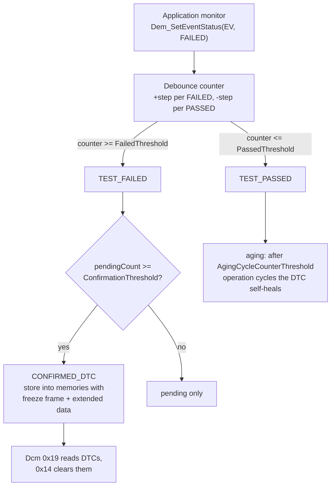

# Dem - Diagnostic Event Manager (DTC storage)

> **In one sentence:** the application reports event pass/fail to Dem; Dem debounces
> them into UDS status bytes, stores DTCs with freeze frames and extended data into
> event memories, and serves them to Dcm (0x14 / 0x19).

| Item | Value |
| --- | --- |
| Module | `infras/diagnostic/Dem` (API: `infras/include/Dem.h`) |
| Layer | Below Dcm (0x14/0x19), above the application monitors |
| Configuration | `app/app/config/Dcm/Dem.json` |
| Generator | `tools/generator/Dem.py` -> `GEN/Dem_Cfg.c` / `GEN/Dem_Cfg.h` |
| Standard | AUTOSAR CP 4.4 Dem (subset) |
| Demo | `CanApp` - routine `31 01 DEED` (`Dem_TestStart`) triggers a synthetic event |

**Contents**

1. [What the module is for](#1-what-the-module-is-for)
2. [How it works at runtime](#2-how-it-works-at-runtime)
3. [Configuration](#3-configuration)
4. [Public API](#4-public-api)
5. [Build and run a demo](#5-build-and-run-a-demo)
6. [Key notes and gotchas](#6-key-notes-and-gotchas)
7. [Troubleshooting](#7-troubleshooting)
8. [Known limitations](#8-known-limitations)

---

## 1. What the module is for

* **Event status tracking** - `Dem_SetEventStatus(EventId, PASSED/FAILED/...)`
  feeds a counter-based debouncing state machine.
* **DTC storage** - confirmed DTCs are written into one or more event memories
  (Primary, Mirror) with UDS status byte, occurrence counter and aging.
* **Freeze frames** - a snapshot of configured environment data at failure time.
* **Extended data** - per-DTC additional records (e.g. occurrence counter) filled
  by application callbacks.
* **DTC service backend** - Clear DTC (0x14), Read DTC (0x19 sub-functions
  0x01/0x02/0x04/0x06/0x0A...), DTC setting control (0x85).

What it does **not** do: no bus I/O (Dcm is the only client), no monitor
algorithms (the application decides pass/fail).

---

## 2. How it works at runtime



* **Operation cycles** (`IGNITION` etc.) gate aging and occurrence counting:
  `Dem_RestartOperationCycle()` / `Dem_SetOperationCycleState()`.
* **Enable conditions** (`Conditions` in the JSON, e.g. `BatteryNormal`) must be
  reported `TRUE` via `Dem_SetEnableCondition()` before events are processed.
* **Storage conditions** via `Dem_SetStorageCondition()` gate writing to memory.

---

## 3. Configuration

### 3.1 Top-level keys

| Key | Default | Meaning |
| --- | --- | --- |
| `Memories[]` | `[{Name: Primary, Origin: 0x0001}]` | Event memories; `Origin` is the DTCOrigin used by 0x19 (1=Primary, 2=Mirror...) |
| `General` | see 3.2 | Debounce/aging/confirmation policy |
| `DTCs[]` | required | DTC table (see 3.3) |
| `Environments[]` | `[]` | Freeze-frame (FFD) data records |
| `ExtendedDatas[]` | `[]` | Extended data (EXTD) records |
| `MaxFreezeFrameNum` | **2** | Freeze-frame records per DTC |
| `StatusAvailabilityMask` | **0x7F** | Which UDS status bits are supported |
| `UsePostBuildConfig` | **false** | Emits `DEM_USE_PB_CONFIG` |

### 3.2 `General`

| Key | Demo value | Meaning |
| --- | --- | --- |
| `DebounceCounterFailedThreshold` | 10 | Counter value that sets TEST_FAILED |
| `DebounceCounterPassedThreshold` | -10 | Counter value that sets TEST_PASSED |
| `DebounceCounterIncrementStepSize` / `DecrementStepSize` | 1 / 2 | Step per FAILED / PASSED report |
| `DebounceCounterJumpDown` / `JumpDownValue` | false / 0 | Jump directly to a value when passing |
| `DebounceCounterJumpUp` / `JumpUpValue` | true / 0 | Jump when failing |
| `ConfirmationThreshold` | 2 | Failed operation cycles before a DTC becomes confirmed |
| `AgingCycleCounterThreshold` | 5 | Passed operation cycles before a confirmed DTC ages out |
| `OccurrenceCounterProcessing` | `"TF"` | Count occurrences on TEST_FAILED |
| `FreezeFrameRecordTrigger` | `"TEST_FAILED"` | When to snapshot the freeze frame |
| `ExtendedDataRecordTrigger` | `"TEST_FAILED"` | When to update extended data |

### 3.3 `DTCs[]`

| Key | Meaning |
| --- | --- |
| `Name` | Symbol name - generates `DEM_EVENT_ID_<NAME>`; combined DTCs hold several events via `Events[]` |
| `Number` | 3-byte DTC number, e.g. `"0x112200"` |
| `Conditions` | Enable-condition names; the union of all names generates `DEM_NUM_OF_ENABLE_CONDITION` |
| `Destination` | Memories to store into, e.g. `["Primary", "Mirror"]` |
| `Priority` | Lower value = higher priority (clear/overflow behaviour) |
| `OperationCycleRef` | Cycle name, default `IGNITION` |
| `Events[]` | Optional sub-events of a combined DTC (`DTC_COMB0` in the demo) |
| `Environments` / `FreezeFrameRecNums` | Per-DTC override of the freeze-frame content/record numbers |

### 3.4 `Environments[]` / `ExtendedDatas[]`

Each record is `{Name, Id, Type, Unit?}` (`uint8`/`uint16`/...). For every record
the generator **declares a callback the application must implement**:

```c
Std_ReturnType Dem_FFD_GetBattery(Dem_DtcIdType EventId, uint8_t *data, Dem_DTCOriginType DTCOrigin);
Std_ReturnType Dem_EXTD_GetFaultOccuranceCounter(Dem_DtcIdType EventId, uint8_t *data, Dem_DTCOriginType origin);
```

Missing implementations are link errors; wrong `Type` size corrupts the record
layout.

---

## 4. Public API

| Function | Caller | Purpose |
| --- | --- | --- |
| `Dem_PreInit()` / `Dem_Init(ConfigPtr)` / `Dem_Shutdown()` | EcuM | Restore NvM data at PreInit, activate at Init |
| `Dem_SetEventStatus(EventId, status)` | application monitors | Report `PASSED` / `FAILED` / `PREPASSED` / `PREFAILED` |
| `Dem_SetEventStatusWithMonitorData(...)` | application | Same with monitor data for extended data |
| `Dem_ResetEventStatus(EventId)` | application | Reset debounce state |
| `Dem_SetEnableCondition(id, bool)` | application | Report `BatteryNormal` etc. |
| `Dem_SetStorageCondition(id, bool)` | application | Gate memory writes |
| `Dem_SetOperationCycleState` / `Dem_RestartOperationCycle(id)` | application / EcuM | Drive `IGNITION` cycle |
| `Dem_SetEventAvailable(EventId, bool)` | application | Mask single events |
| `Dem_GetEventUdsStatus(EventId, *byte)` | application | Current UDS status byte |
| `Dem_GetFaultDetectionCounter(EventId, *counter)` | application | Debounce counter (for tests) |
| `Dem_SetDTCFilter` / `Dem_GetNumberOfFilteredDTC` / `Dem_GetNextFilteredDTC` (+ `AndFDC`, `AndSeverity`) | Dcm 0x19 | DTC report iteration |
| `Dem_SetFreezeFrameRecordFilter` / `Dem_GetNextFilteredRecord` | Dcm 0x19/0x04 | Freeze-frame iteration |
| `Dem_SelectDTC` / `Dem_ClearDTC(ClientId)` | Dcm 0x14 | Clear a DTC in the selected origin |
| `Dem_SelectFreezeFrameData` / `Dem_GetNextFreezeFrameData` | Dcm 0x19/0x04 | Freeze-frame readout |
| `Dem_SelectExtendedDataRecord` / `Dem_GetNextExtendedDataRecord` / `Dem_GetSizeOfExtendedDataRecordSelection` | Dcm 0x19/0x06 | Extended-data readout |
| `Dem_DisableDTCSetting` / `Dem_EnableDTCSetting(ClientId)` | Dcm 0x85 | Stop/start event storage |
| `Dem_GetDTCStatusAvailabilityMask` | Dcm 0x19 | Status availability mask |
| `Dem_MainFunction()` | scheduler | Debounce + aging processing |

---

## 5. Build and run a demo

```bash
scons --app=CanApp
./build/nt/GCC/CanApp/CanApp.exe
./build/nt/GCC/IsoTpSend/IsoTpSend.exe -v 1902FF      # read DTC status by mask 0xFF
./build/nt/GCC/IsoTpSend/IsoTpSend.exe -v 3101DEED    # routine: Dem_TestStart
./build/nt/GCC/IsoTpSend/IsoTpSend.exe -v 1902FF      # the DTC is now stored
./build/nt/GCC/IsoTpSend/IsoTpSend.exe -v 14FFFFFF    # clear all DTCs
```

The demo DTCs are `0x112200` ... `0x112204` + combined `DTC_COMB0`; the routine
`0xDEED` (`Dem_TestStart`) reports a FAILED event so you can watch the whole
pipeline: event -> debounce -> confirmed -> freeze frame -> 0x19 report -> 0x14
clear.

---

## 6. Key notes and gotchas

1. **Event ids are generated from names** - `DEM_EVENT_ID_DTC0` etc. The
   application includes `Dem_Cfg.h` and reports with these macros; renumbering
   happens silently when DTCs are reordered.
2. **Combined DTCs share one storage entry** - all events of `Events[]` map to
   the same DTC number; any event failing confirms the DTC.
3. **Enable conditions must be reported at startup** - with
   `conditions: ["BatteryNormal"]` and no `Dem_SetEnableCondition(0, TRUE)`,
   every event report is ignored.
4. **Aging counts operation cycles, not time** - call
   `Dem_RestartOperationCycle()` on ignition off/on, otherwise a confirmed DTC
   never ages.
5. **FFD/EXTD callbacks must exist for every record** - the generator emits the
   prototypes; the demo implementations live in `app/app/src`.
6. **Memories are backed by NvM** - via the `NvmBlock` hooks of the NvM
   configuration; without a working NvM the memories stay RAM-only (lost on
   reset).
7. **`Priority` matters for overflow** - when a memory is full the lowest
   priority DTC is replaced.

---

## 7. Troubleshooting

| Symptom | Likely cause | Check |
| --- | --- | --- |
| 0x19 returns no DTCs although events fail | enable condition not set, or events still debouncing | `Dem_SetEnableCondition`, `Dem_GetFaultDetectionCounter` |
| 0x14 does not clear | DTC setting disabled (0x85) or wrong DTCOrigin | `Dem_DisableDTCSetting` state, `Origin` |
| Freeze frame empty | `FreezeFrameRecordTrigger` not reached, or FFD callback returns E_NOT_OK | callback return value |
| Link error `Dem_FFD_GetX` | record declared in JSON but not implemented | implement or remove the record |
| DTC gone after reset | NvM not storing the memory block | NvM.json, `Dem_PreInit` order |
| Combined DTC shows one event only | all `Events[]` names identical | DTC JSON |

---

## 8. Known limitations

Code review findings verified against `infras/diagnostic/Dem/Dem.c` and
`tools/generator/Dem.py`:

1. **Only two operation cycles exist** - `Dem_OperationCycleStates[2]` is
   hard-coded; a JSON referencing more than `IGNITION` + one more cycle will not
   get its own state storage.
2. **Debounce is counter-based only** - no time-based or monitor-internal
   debouncing; `Dem_ResetEventDebounceStatus` is the only reset path.
3. **`OccurrenceCounterProcessing: "TF"` is the only implemented policy**;
   other AUTOSAR policies are not wired.
4. **`MaxFreezeFrameNum` defaults to 2 globally**; per-DTC `FreezeFrameRecNums`
   defaults to `1..MaxFreezeFrameNum` - a DTC cannot exceed the global maximum.
5. **Generator silently renames duplicate record names**; two `Environments[]`
   entries with the same `Name` produce colliding `Dem_FFD_Get*` callbacks.
6. **`StatusAvailabilityMask` default 0x7F advertises bits the subset may not
   fully implement** (e.g. severity-related bits) - a strict tester may flag
   inconsistencies.

**Related documents:** [Dcm](Dcm.md) - [NvM](NvM.md) - [CanTp](CanTp.md)
