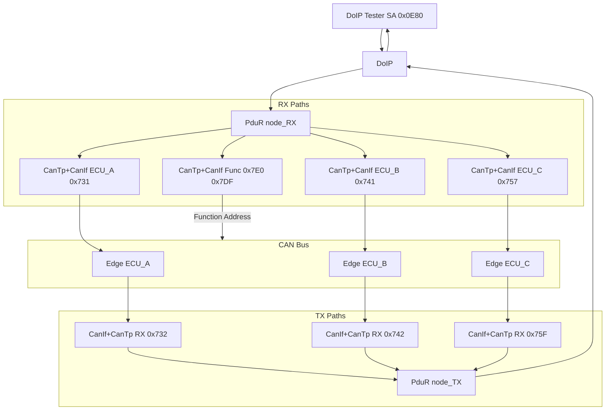

# DoIP to CAN TP Gateway - Routing Matrix Generation and Host Demo

## Table of Contents

1. [Introduction](#1-introduction)
2. [The Diagnostic Routing Table Model](#2-the-diagnostic-routing-table-model)
3. [Gateway Network Configuration](#3-gateway-network-configuration)
4. [Runtime Routing Behavior](#4-runtime-routing-behavior)
5. [Simulating Edge CAN TP Nodes](#5-simulating-edge-can-tp-nodes)
6. [Host Demo](#6-host-demo)

## 1. Introduction

A central gateway connects the DoIP diagnostic tester on Ethernet to many edge ECUs distributed over several CAN/CAN FD buses. The diagnostic routing is usually maintained by system engineers in a diagnostic routing table. AS provides:

- Runtime modules (`DoIP` + `PduR` gateway routing + `CanTp` + `CanIf`) that perform the actual DoIP to CAN TP forwarding.
- A Python script, [`dummy_ecu.py`](../../app/app/config/DoIPGW/dummy_ecu.py), that simulates edge CAN TP nodes and returns a dummy positive response to every UDS request, so the entire gateway can be tested on a host without real ECUs.

This document explains the routing table model, gateway configuration, and runtime data flow using typical fictionalized examples. The corresponding example configuration files are located in [`app/app/config/DoIPGW/`](../../app/app/config/DoIPGW/).

## 2. The Diagnostic Routing Table Model

### 2.1 Table Layout

Each row describes one routing rule and is split into a DoIP side and a CAN side:

| Side | Meaning |
|---|---|
| DoIP side | Tester `Source`, tester DoIP `SA` (source logical address), DoIP `TA` (target logical address) |
| CAN side | `Target` bus, CAN request/response `Message ID`, optional DoIP SA/TA |
| Meta | Gateway ECU, comment, change record |

The table has two sections with mirrored column semantics:

- **Requests** (tester → ECU): CAN message ID is in the CAN-side ID column.
- **Responses** (ECU → tester): CAN message ID is in the DoIP-side ID column; DoIP SA/TA carry the ECU address and tester address respectively.

### 2.2 Typical Request Table

Example: Tester SA `0x0E80`, functional group TA `0xE001`, and three physical ECUs.

| DoIP SA | DoIP TA | Target bus | CAN request ID | Comment |
|---|---|---|---|---|
| `0x0E80` | `0xE001` | PT_CANFD | `0x7E0` | Functional group (fan-out to CAN FD) |
| `0x0E80` | `0xE001` | CL1_CAN | `0x7DF` | Functional group (classic CAN functional ID) |
| `0x0E80` | `0x004A` | PT_CANFD | `0x731` | ECU_A, physical |
| `0x0E80` | `0x0053` | BD_CANFD | `0x741` | ECU_B, physical |
| `0x0E80` | `0x0757` | CL1_CAN | `0x757` | ECU_C, physical (11-bit ID) |

Rules:

- **Physical** requests have a unique DoIP TA (one ECU) and a unique CAN request ID.
- **Functional** requests use one DoIP group TA (e.g. `0xE001`) and fan out to multiple buses. The distinguishing feature is **the same DoIP TA appearing in multiple rows with different target buses/CAN IDs** (TA `0xE001` appears for PT_CANFD/CL1_CAN with CAN IDs `0x7E0`/`0x7DF`).
- All IDs are 11-bit standard (CAN STD): both CAN FD and classic CAN use 11-bit IDs and differ only by `LL_DL` (64 vs 8) (ECU_A `0x731`/`0x732`, ECU_B `0x741`/`0x742`, functional `0x7DF`/`0x7E0`).

A second section typically lists remote/OTA testers with different SAs (e.g. `0x0F00`) and their own functional groups routed to different bus subsets. Each tester SA corresponds to one tester/routine pair in the DoIP configuration.

### 2.3 Typical Response Table

| Source bus | CAN response ID | DoIP SA | DoIP TA | Comment |
|---|---|---|---|---|
| PT_CANFD | `0x732` | `0x004A` | `0x0E80` | ECU_A → tester |
| BD_CANFD | `0x742` | `0x0053` | `0x0E80` | ECU_B → tester |
| CL1_CAN | `0x75F` | `0x0757` | `0x0E80` | ECU_C → tester |

The response table derives each node's CAN **RX** ID at the gateway (gateway receives responses on `0x732` and sends requests on `0x731`). Functional groups have no response rows: functional UDS requests are normally sent with the response-suppression bit set, so edge nodes do not respond.

## 3. Gateway Network Configuration

The example configuration files are located in [`app/app/config/DoIPGW/`](../../app/app/config/DoIPGW/):

| File | Content |
|---|---|
| [`Network.json`](../../app/app/config/DoIPGW/Network.json) | DoIP: discovery address, `max_connections`, targets (physical + functional group), routines, testers |
| [`PduR.json`](../../app/app/config/DoIPGW/PduR.json) | PduR gateway routes: `_RX`/`_TX` per node; functional target includes `destinations` fan-out and `DestBuffer` |
| [`CanTp.json`](../../app/app/config/DoIPGW/CanTp.json) | One CanTp channel per node; `LL_DL` = 64 for CAN FD, 8 for classic CAN |
| [`CanIf.json`](../../app/app/config/DoIPGW/CanIf.json) | CAN IDs: TX PDU = request ID, RX PDU = response ID, all 11-bit standard IDs |
| [`Mempool.json`](../../app/app/config/DoIPGW/Mempool.json) | Memory pool used by SoAd/DoIP |

### 3.1 CanIf and CanTp PDU Direction Explanation

In the PduR configuration for this gateway, PDU routing paths use the naming convention where `_RX` denotes the direction "from tester to ECU" (request path) and `_TX` denotes "from ECU to tester" (response path). The CanTp configuration must align with PduR's PDU IDs.

Looking at the generated code (e.g. `CanTp_Cfg.c` and `PduR_Cfg.h`):
- For a channel like `PT_CANFD_E001`, CanTp is configured with `PDUR_PT_CANFD_E001_TX` as its `PduR_RxPduId` and `PDUR_PT_CANFD_E001_RX` as its `PduR_TxPduId`.
- In PduR routing paths, the request path uses `PT_CANFD_E001_RX` (DoIP → CanTp), while the response path uses `PT_CANFD_E001_TX` (CanTp → DoIP).
- This means: from CanTp's perspective, when CanTp receives a TP PDU from PduR for transmission to the bus (the request coming in from the upper layer side for this gateway's forward direction), that corresponds to the request path ID (`..._RX` in PduR naming). When CanTp notifies PduR of TP reception completion/result for a response coming from the bus, it uses the response path ID (`..._TX` in PduR naming).

Also mapping to CanIf: the request that CanTp sends to the bus goes via `CANIF_<name>_TX` (defined in CanIf as the gateway TX frame on the bus). The responses received from the bus come in via the corresponding CanIf RX frame and are delivered to CanTp. In the JSON, we see `RxPduId` in CanTp points to the CanIf TX PDU name (e.g. `PT_CANFD_E001_TX`) and `TxPduId` points to the CanIf RX PDU name (e.g. `PT_CANFD_E001_RX`). This matches the generator's mapping: `CanIfTxPduId = CANIF_<name>_TX`, and `PduR_RxPduId`/`PduR_TxPduId` are taken from `RxPduId`/`TxPduId` in the JSON (mapped to `PDUR_*` in the generated config).

So for gateway forwarding (DoIP → CAN):
- The request arrives via PduR to CanTp on the PduR request path (named `_RX`). In CanTp config, this is `PduR_RxPduId = PDUR_<RxPduId from JSON>`. Since the JSON sets `RxPduId = PT_CANFD_E001_TX`, this becomes `PDUR_PT_CANFD_E001_TX` in the generated code — which is the PduR ID for the CanTp→DoIP response path in this example's naming? Wait, looking at PduR_Cfg.h: `PDUR_PT_CANFD_E001_RX = 0` is the DoIP→CanTp request path, `PDUR_PT_CANFD_E001_TX = 4` is the CanTp→DoIP response path. And CanTp_Cfg.c uses `PDUR_PT_CANFD_E001_TX` as `PduR_RxPduId`. That means the CanTp channel's "PduR Rx" (reception from PduR/upper layer side for transmission to bus) is wired to the PduR response-path ID by this naming — this is the convention used in this configuration/generator.

In this configuration, the JSON fields are mapped by the generator as follows (see `tools/generator/CanTp.py`):
- `CanIfTxPduId = CANIF_<name>_TX`
- `PduR_RxPduId = PDUR_<RxPduId>` (from `CanTp.RxPduId`)
- `PduR_TxPduId = PDUR_<TxPduId>` (from `CanTp.TxPduId`)

The key point is that the naming is consistent with the generated PduR/CanTp configuration; `RxPduId` in the JSON is used to derive the PduR ID that CanTp uses for its PduR interface, not directly the bus RX name. For functional group channels, the corresponding response-side PDU is typically unused due to response suppression, but `TxPduId` is still specified to maintain a uniform channel structure.

### 3.2 Configuration Notes

- **Physical target**: one DoIP TA mapped to one CanTp channel. **Functional target**: one DoIP TA with a `nodes` array (DoIP receives the request once, PduR replicates it to each node). Response matching in DoIP uses each node's own `doipTxPduId` to avoid mixing responses.
- **Functional fan-out**: the functional target's request route carries `destinations`; the same buffered request is forwarded to each listed CanTp channel.
- **Destination buffer required**: A TP gateway **must** configure a destination buffer (`DestBuffer` + `buffers` entry). Otherwise `PduR_GwStartOfReception` rejects the message and DoIP returns NACK `0x08` (`DOIP_E_DIAG_TP_ERROR`). Size the buffer for the maximum expected UDS message (e.g. 4096 for flashing).
- **ID format**: All IDs are 11-bit standard IDs, written as-is with no extended-frame bit.
- **Host simulation**: All virtual nodes share the `simulator_v2` bus and are separated by CAN ID filtering. The `networks` split into physical controllers is relevant only on real hardware.

## 4. Runtime Routing Behavior



- **Request**: The DoIP diagnostic message (payload type `0x8001`) is matched by target address; the target's `RxPduId` selects the PduR gateway route. For a functional target, PduR starts one TP reception per destination node using the shared gateway buffer.
- **Response**: The edge node responds on its CAN response ID. CanTp reassembles the message; PduR forwards it via `<node>_TX` to DoIP. DoIP matches the waiting connection by the node's `doipTxPduId` and sends it back with the ECU address as DoIP SA and the tester as DoIP TA.
- **Functional requests** (`0xE001`): Replicated to every node and typically carry the positive-response-suppression bit (e.g. `0x28 0x83 0x03`, `0x10 0x83`, `0x3E 0x80`), so edge nodes do not respond, avoiding collisions when multiple ECUs share the same functional ID.
- **DoIP diagnostic ACK** (`0x8002`): Sent before the UDS response. Per ISO 13400, it may echo the first bytes of the request; this echo is not the UDS response.

## 5. Simulating Edge CAN TP Nodes

[`dummy_ecu.py`](../../app/app/config/DoIPGW/dummy_ecu.py) uses the host simulator binding `one.AsPy.isotp`. Each ECU runs in its own process. The ID orientation is from the ECU's perspective:

- `rxid` = CAN ID carrying requests **to** this ECU (= gateway CanIf **TX** ID)
- `txid` = CAN ID carrying responses **from** this ECU (= gateway CanIf **RX** ID)

### 5.1 Edge Node and CAN ID Mapping

| Simulated node | `rxid` (requests in) | `txid` (responses out) | `LL_DL` |
|---|---|---|---|
| ECU_A (PT_CANFD) | `0x731` | `0x732` | 64 |
| ECU_B (BD_CANFD) | `0x741` | `0x742` | 64 |
| ECU_C (CL1 classic CAN) | `0x757` | `0x75F` | 8 |
| Functional listener (FD) | `0x7E0` | - (no response) | 64 |
| Functional listener (classic CAN) | `0x7DF` | - (no response) | 8 |

> The functional listener nodes do not need to be started in the demo: functional UDS requests always set the positive-response-suppression bit, so no simulated ECU needs to respond. You only observe the gateway fanning the request out to `0x7E0` and `0x7DF`.

### 5.2 Dummy Responder

[`dummy_ecu.py`](../../app/app/config/DoIPGW/dummy_ecu.py) simulates one ECU per process (no threading). It accepts `--rxid`, `--txid`, `--ll-dl`, and `--name` as command-line arguments. Response logic: for every request, it returns the positive service ID (`SID | 0x40`) and echoes the remaining bytes. For `0x10` (SessionControl), it appends the standard P2/P2* timing bytes `00 32 01 F4` (P2=50ms, P2*=5s).

Example startup:

```sh
python app/app/config/DoIPGW/dummy_ecu.py --rxid 0x731 --txid 0x732 --ll-dl 64 --name ECU_A
python app/app/config/DoIPGW/dummy_ecu.py --rxid 0x741 --txid 0x742 --ll-dl 64 --name ECU_B
python app/app/config/DoIPGW/dummy_ecu.py --rxid 0x757 --txid 0x75F --ll-dl 8  --name ECU_C
```

### 5.3 DoIP Tester

Use the `DoIPSend` command-line tool (build with `scons --app=DoIPSend`, binary at `build\nt\GCC\DoIPSend\DoIPSend.exe`) to send diagnostic requests. It performs vehicle discovery, TCP connection, and routing activation, sends a single UDS request, and prints the response. Key options: `-v` UDS request as a hex string, `-s` tester SA, `-t` target TA, `-i`/`-p` discovery address and port.

Examples:

```sh
# Physical request to ECU_A (TA 0x004A), UDS 10 01
build\nt\GCC\DoIPSend\DoIPSend.exe -v 1001 -s 0x0E80 -t 0x004A

# Physical request to ECU_C (TA 0x0757), UDS 10 01
build\nt\GCC\DoIPSend\DoIPSend.exe -v 1001 -s 0x0E80 -t 0x0757

# Functional request (TA 0xE001), UDS 28 83 03 (positive response suppressed), no UDS response
build\nt\GCC\DoIPSend\DoIPSend.exe -v 288303 -s 0x0E80 -t 0xE001
```

## 6. Host Demo

Follow the steps below to run the DoIP-to-CAN gateway demo on a host and observe CAN bus traffic with `CanDump`. You need four components: the gateway `DoIPGW`, CAN sniffer `CanDump`, DoIP client `DoIPSend`, and the edge ECU simulation script [`dummy_ecu.py`](../../app/app/config/DoIPGW/dummy_ecu.py).

> Before running, ensure MSYS2 `mingw64\bin` and `build\nt\GCC\one` are in your `PATH`.

### Step 1 - Build

```sh
scons --app=DoIPGW      # Gateway
scons --app=CanDump     # CAN sniffer
scons --app=DoIPSend    # DoIP tester client
```

Build artifacts:

| Tool | Path |
|---|---|
| Gateway | `build\nt\GCC\DoIPGW\DoIPGW.exe` |
| CAN sniffer | `build\nt\GCC\one\CanDump.exe` |
| DoIP client | `build\nt\GCC\DoIPSend\DoIPSend.exe` |

### Step 2 - Start the Gateway (Shell 1)

```sh
build\nt\GCC\DoIPGW\DoIPGW.exe
```

The gateway opens DoIP UDP/TCP port `13400` and activates the line.

### Step 3 - Start the CAN Bus Sniffer (Shell 2)

```sh
build\nt\GCC\one\CanDump.exe -d simulator_v2 -p 0
```

`CanDump` attaches to the same `simulator_v2` virtual CAN bus as the gateway and prints all CAN frames in real time.

### Step 4 - Start the Edge ECUs (Shell 3+)

```sh
python app/app/config/DoIPGW/dummy_ecu.py --rxid 0x731 --txid 0x732 --ll-dl 64 --name ECU_A
python app/app/config/DoIPGW/dummy_ecu.py --rxid 0x741 --txid 0x742 --ll-dl 64 --name ECU_B
python app/app/config/DoIPGW/dummy_ecu.py --rxid 0x757 --txid 0x75F --ll-dl 8  --name ECU_C
```

Each process listens for requests on `rxid` and replies on `txid`.

### Step 5 - Send Requests and Observe CAN Frames

Use `DoIPSend` to send requests. The `CanDump` window displays the request frame forwarded by the gateway to the CAN bus and the response frame returned by the ECU.

#### Scenario 1: Physical request to ECU_A (TA `0x004A`), UDS `10 01`

```sh
build\nt\GCC\DoIPSend\DoIPSend.exe -v 1001 -s 0x0E80 -t 0x004A
```

`CanDump` output:

```
canid=00000731,dlc=08,data=[02,10,01,55,55,55,55,55,] [...UUUUU] @ 0.808733 s rel 0.00 ms
canid=00000732,dlc=08,data=[06,50,01,00,32,01,F4,55,] [P.2.U] @ 0.812000 s rel 3.27 ms
```

- Request frame `0x731`: ISO-TP single frame, PCI=`0x02` (2 data bytes), UDS `10 01`, padded to 8 bytes with `0x55`.
- Response frame `0x732`: PCI=`0x06`, UDS positive response `50 01 00 32 01 F4` (SessionControl positive response + P2/P2* timing).

#### Scenario 2: Physical request to ECU_C (TA `0x0757`, classic CAN), UDS `10 01`

```sh
build\nt\GCC\DoIPSend\DoIPSend.exe -v 1001 -s 0x0E80 -t 0x0757
```

```
canid=00000757,dlc=08,data=[02,10,01,55,55,55,55,55,] [...UUUUU] @ 7.120599 s rel 0.00 ms
canid=0000075F,dlc=08,data=[06,50,01,00,32,01,F4,55,] [P.2.U] @ 7.124000 s rel 3.40 ms
```

Classic CAN uses 8-byte frames; PCI and data format are the same as for FD nodes.

#### Scenario 3: Functional request (TA `0xE001`), UDS `28 83 03` (positive response suppressed)

```sh
build\nt\GCC\DoIPSend\DoIPSend.exe -v 288303 -s 0x0E80 -t 0xE001
```

```
canid=000007E0,dlc=08,data=[03,28,83,03,55,55,55,55,] [.(..UUUU] @ 13.416609 s rel 0.00 ms
canid=000007DF,dlc=08,data=[03,28,83,03,55,55,55,55,] [.(..UUUU] @ 13.417583 s rel 0.97 ms
```

The gateway replicates the functional request to two functional CAN IDs: `0x7E0` (FD functional node) and `0x7DF` (classic CAN functional node). Since the positive-response-suppression bit is set, edge nodes do not respond; only request frames appear.

### 6.2 CAN ID Reference Table

| Direction | CAN ID | PDU name | Description |
|---|---|---|---|
| Gateway → ECU_A | `0x731` | `PT_CANFD_004A_TX` | Request to ECU_A |
| ECU_A → Gateway | `0x732` | `PT_CANFD_004A_RX` | Response from ECU_A |
| Gateway → ECU_B | `0x741` | `BD_CANFD_0053_TX` | Request to ECU_B |
| ECU_B → Gateway | `0x742` | `BD_CANFD_0053_RX` | Response from ECU_B |
| Gateway → ECU_C | `0x757` | `CL1_0757_TX` | Request to ECU_C (classic CAN) |
| ECU_C → Gateway | `0x75F` | `CL1_0757_RX` | Response from ECU_C (classic CAN) |
| Gateway → Functional (FD) | `0x7E0` | `PT_CANFD_E001_TX` | Functional fan-out (FD) |
| Gateway → Functional (classic CAN) | `0x7DF` | `CL1_E001_TX` | Functional fan-out (classic CAN) |
