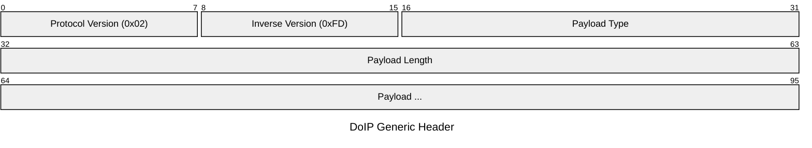
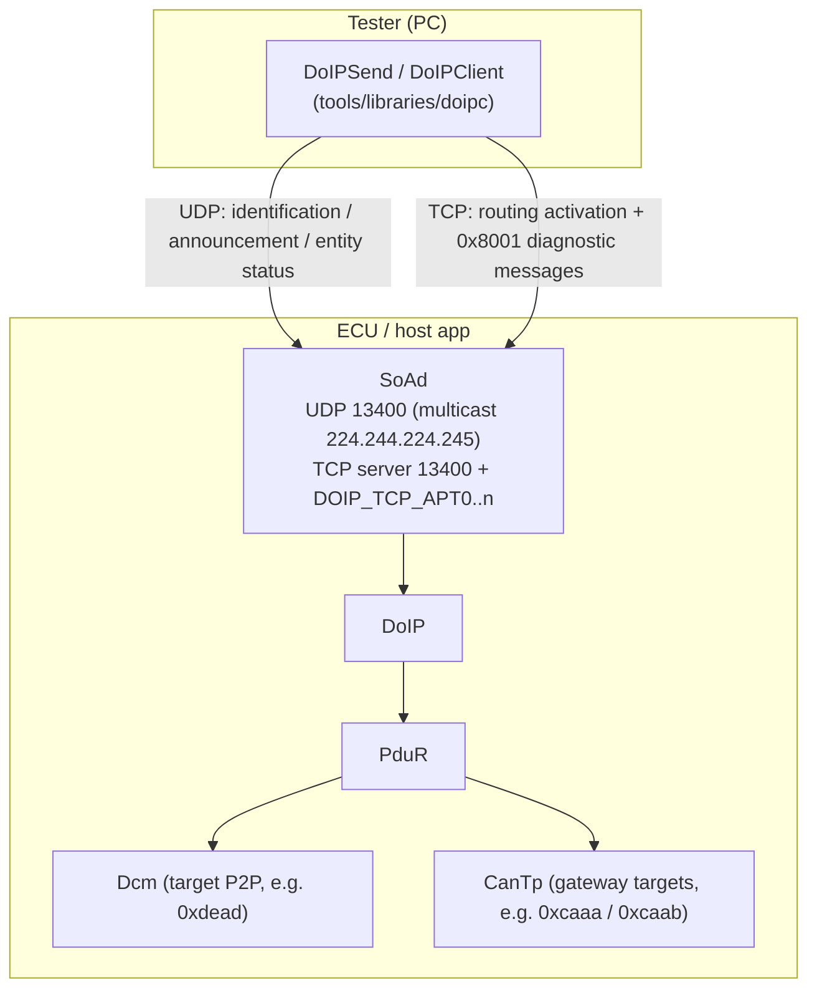
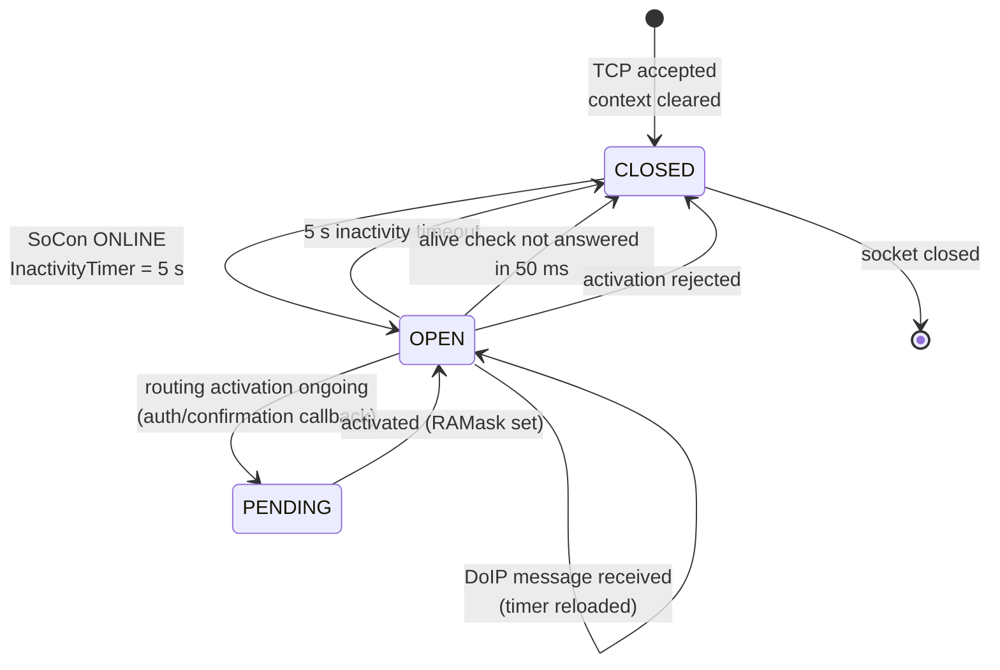
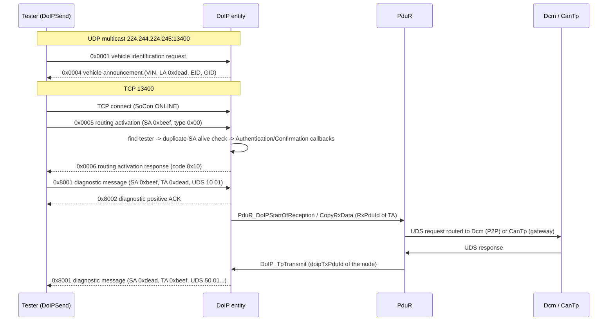
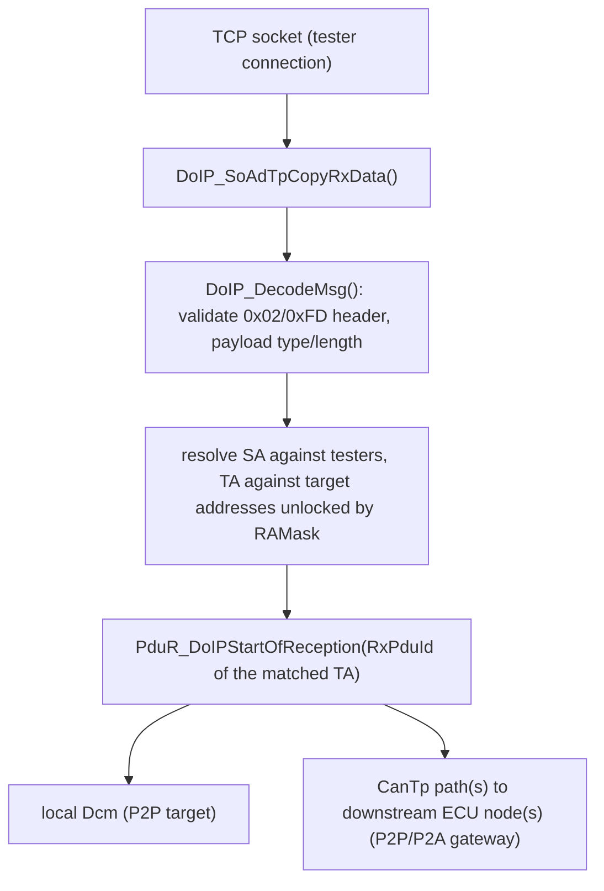
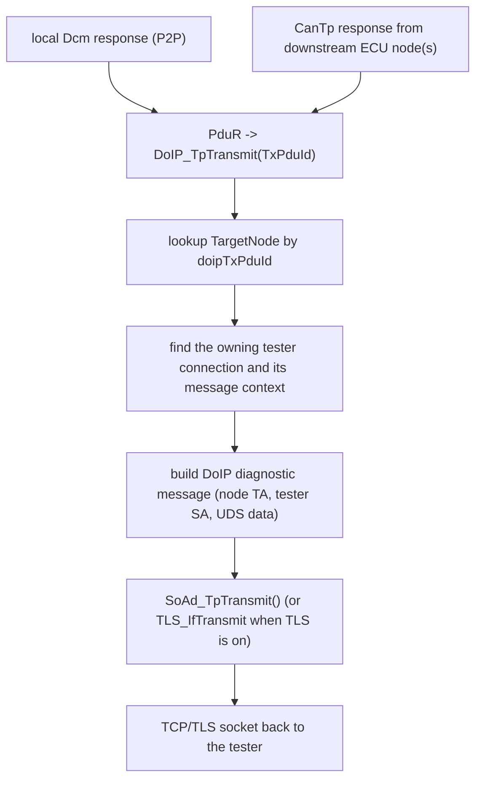
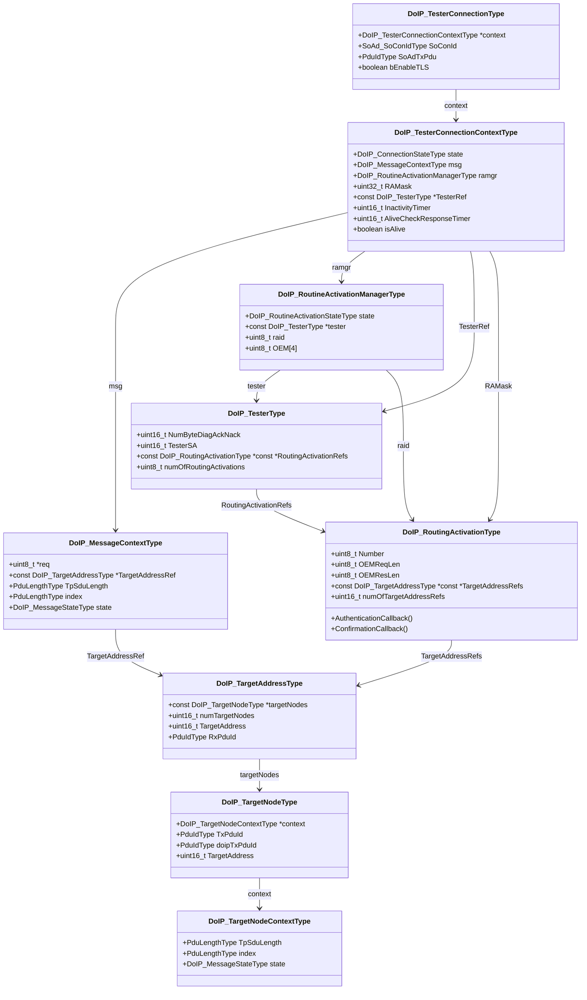

# DoIP - UDS Diagnostics over Ethernet

> **In one sentence**: DoIP (Diagnostics over IP, ISO 13400 / AUTOSAR CP 4.4) carries UDS diagnostic traffic over Ethernet: a tester discovers the ECU via UDP multicast, activates diagnostic routing over TCP, and then exchanges UDS messages that either terminate in the local Dcm or are gatewayed over CAN to other ECUs.

| | |
| --- | --- |
| Module | `infras/communication/DoIP` (v4.0.5) |
| Layer | Communication / Service on top of SoAd, peer of PduR |
| Configuration | `DoIp` module in `Network.json` (class `Net`) → `tools/generator/DoIp.py` |
| Standard | ISO 13400-2, AUTOSAR CP 4.4.0 SWS_DoIP |
| Tester library | `tools/libraries/doipc` (`DoIPClient`), CLI tool `DoIPSend` |
| Demos | host: `NetApp` + `DoIPSend` / `CanApp`; real ECU: `tc3x7 AsDemo` |

## Table of Contents

1. [Protocol basics](#1-protocol-basics)
2. [Position in the stack](#2-position-in-the-stack)
3. [Configuration](#3-configuration)
4. [Runtime behaviour](#4-runtime-behaviour)
5. [Public API and scheduling](#5-public-api-and-scheduling)
6. [Build and run](#6-build-and-run)
7. [Key notes and gotchas](#7-key-notes-and-gotchas)
8. [Troubleshooting](#8-troubleshooting)
9. [Known limitations and code review findings](#9-known-limitations-and-code-review-findings)
10. [Related documents](#10-related-documents)

## 1. Protocol basics

Every DoIP message starts with an 8-byte generic header followed by the payload:



The version bytes must be `0x02` and `0xFD` (inverse), otherwise a generic header NACK (payload type `0x0000`) is returned (see [DoIP.c](../../infras/communication/DoIP/DoIP.c) `DoIP_FillHeader()` / `DoIP_DecodeMsg()`).

Supported payload types (see [DoIP_Priv.h](../../infras/communication/DoIP/DoIP_Priv.h)):

| Payload Type | Value | Transport | Purpose |
| --- | --- | --- | --- |
| Generic header NACK | 0x0000 | UDP/TCP | malformed header / unknown type / bad length |
| Vehicle identification request | 0x0001/0x0002/0x0003 | UDP | broadcast identification, by EID or by VIN |
| Vehicle announcement / VIN response | 0x0004 | UDP | VIN(17) + LA + EID(6) + GID(6) + sync status |
| Routing activation request / response | 0x0005 / 0x0006 | TCP | tester asks for diagnostic routing |
| Alive check request / response | 0x0007 / 0x0008 | TCP | connection liveness monitoring |
| Entity status request / response | 0x4001 / 0x4002 | UDP | node type, max/open connections |
| Power mode request / response | 0x4003 / 0x4004 | UDP | power mode status |
| Diagnostic message | 0x8001 | TCP | UDS request (SA + TA + user data) |
| Diagnostic message positive ACK | 0x8002 | TCP | request accepted for routing |
| Diagnostic message negative ACK | 0x8003 | TCP | invalid SA / unknown TA / too large / unreachable / TP error |

NACK codes used in the 1-byte payload of `0x0000`: `0x00` invalid protocol, `0x01` unknown payload type, `0x02` too much payload, `0x03` no buffer available, `0x04` invalid payload length.

Routing activation response codes: `0x00` unknown SA, `0x02` connection in use, `0x03` SA already active, `0x04` authentication failed, `0x05` rejected confirmation, `0x06` unsupported activation type, `0x10` OK, `0x11` pending confirmation.

Diagnostic message negative ACK codes: `0x02` invalid SA, `0x03` unknown TA, `0x06` target unreachable, `0x08` TP error.

## 2. Position in the stack



Sockets (generated from the `Discovery` / `MaxConnections` config, see [Net.py ProcDoIp](../../tools/generator/Net.py)):

* **UDP 13400** on the multicast group `224.244.224.245`: vehicle identification requests/responses and cyclic vehicle announcements;
* **TCP server 13400**: accepts tester connections; up to `MaxConnections` concurrent tester sockets (`DOIP_TCP_APT0..n`).

The DoIP entity stays **silent until the application activates it** by calling `DoIP_ActivationLineSwitchActive()` ([DoIP.c](../../infras/communication/DoIP/DoIP.c)): before that, all received DoIP messages are silently dropped and no socket is opened. On a real ECU this call is tied to the KL15/activation line state; in the host simulator apps it is bound to the `d` key ([Key.cpp](../../app/platform/simulator/src/Key.cpp)).

## 3. Configuration

DoIP is configured by the `DoIp` module inside `Network.json` (class `Net`). Example from [app/app/config/Net/Network.json](../../app/app/config/Net/Network.json):

```json
{
  "Name": "DoIp",
  "Class": "DoIp",
  "Discovery": "224.244.224.245:13400",
  "EnableTLS": false,
  "MaxConnections": 3,
  "Targets": [
    { "Name": "P2P",    "Address": "0xdead" },
    { "Name": "GW_P2P", "Address": "0xcaaa" },
    { "Name": "GW_P2A",  "Address": "0xcaab",
      "Nodes": [
        { "Name": "GW_P2A0", "Address": "0xcaa0" },
        { "Name": "GW_P2A1", "Address": "0xcaa1" }
      ]
    }
  ],
  "Routines": [
    { "Name": "default", "Number": "0x00", "Targets": ["P2P", "GW_P2P", "GW_P2A"] }
  ],
  "Testers": [
    { "Name": "default", "Address": "0xbeef", "Routines": ["default"] }
  ]
}
```

| Field | Meaning |
| --- | --- |
| `Discovery` | multicast group and UDP port for vehicle identification / announcement |
| `EnableTLS` | wrap the DoIP TCP connections in TLS (requires a TLS.json entry and mbedTLS); default `false` |
| `MaxConnections` | maximum simultaneous tester TCP connections; also the listen backlog |
| `Targets[].address` | target address (TA) a tester can address |
| `Targets[].nodes[]` | optional: one TA is served by several downstream nodes (one-to-any gateway); each node gets its own PduR path |
| `Routines[]` | routing activation types (`Number`) and the target addresses each one unlocks |
| `Testers[]` | known tester source addresses (SA) and the routing types they may activate |

The generator [DoIp.py](../../tools/generator/DoIp.py) produces `DoIP_Cfg.c/.h`. The JSON only controls targets/nodes, testers and routines; most other parameters are **hardcoded in the generated code**:

| Generated value | Value | Notes |
| --- | --- | --- |
| `LogicalAddress` | `0xdead` | **hardcoded**, not derived from the targets; see gotcha 7.1 |
| `NumByteDiagAckNack` | 8 | the 0x8002/0x8003 ACK echoes at most 8 bytes of the request payload |
| `NodeType` | `DOIP_GATEWAY` (0x00) | reported by the 0x4001 entity status response |
| `EntityStatusMaxByteFieldUse` | `TRUE` | entity status carries the 4-byte max field (`MEMPOOL_NET_MAX_SIZE`) |
| `VinInvalidityPattern` | `0xFF` | used when `Dcm_GetVin` fails |
| initial / general inactivity time | 5000 ms | connection closed after 5 s without traffic |
| alive check response timeout | 50 ms | |
| vehicle announcement | 50 ms initial delay, 200 ms interval, 3 messages | retried every cycle on transmit failure until the netif is up |
| `MainFunctionPeriod` | 10 ms | `MainFunctionPeriod` JSON key, only used to convert the ms values above into ticks |
| `RxPduIdToConnectionMap` | UDP → invalid, TCP i → connection i | maps SoAd RxPduId to the tester connection |

### 3.1 PduR routing: local Dcm vs. CAN gateway

Where a diagnostic message goes is decided by [PduR.json](../../app/app/config/Net/PduR.json):

* **P2P (point-to-point)**: `DoIP <-> Dcm`, the UDS request terminates inside this ECU (target `0xdead`);
* **GW_P2P**: `DoIP <-> CanTp`, forwarded to exactly one CAN ECU (target `0xcaaa`);
* **GW_P2A (point-to-any)**: one DoIP target (`0xcaab`) fans out to several CAN nodes (`0xcaa0`, `0xcaa1`, ...); a 4096-byte routing buffer is shared and the response comes back from the node that answered.

### 3.2 Required user callbacks

The generated code references these functions as `extern`; the application **must** implement them or the link fails (reference implementation: [app/app/src/doip.c](../../app/app/src/doip.c)):

| Callback | Purpose |
| --- | --- |
| `DoIP_<routine>_RoutingActivationAuthenticationCallback` | per routing-activation type; return `E_OK` + `*Authentified=TRUE` to pass, `DOIP_E_PENDING` to answer later |
| `DoIP_<routine>_RoutingActivationConfirmationCallback` | same pattern for confirmation; `*Confirmed=TRUE` activates routing |
| `DoIP_UserGetEID` / `DoIP_UserGetGID` | 6-byte entity identifier / group identifier |
| `DoIP_UserGetPowerModeStatus` | power mode reported by 0x4004 |
| `DoIP_UserGetRoutingActivationResponseOem` | return `E_OK` to append a 4-byte OEM field to the 0x0006 response |
| `Dcm_GetVin` | 17-byte VIN used by identification and announcement |

The demo app simply returns `*Authentified = TRUE` / `*Confirmed = TRUE`, and `DoIP_UserGetRoutingActivationResponseOem` returns `E_NOT_OK` so no OEM field is appended.

### 3.3 TLS

When `EnableTLS` is true the TCP server socket is owned by the TLS layer instead of DoIP, and [TLS.json](../../app/app/config/Net/TLS.json) provides the certificate files (`TLS0_ServerCerts.pem`, `TLS0_ServerKey.pem`, `TLS0_CasCerts.pem` under [config/Net/Cert](../../app/app/config/Net/Cert)). The tester side verifies the server certificate against the CA PEM passed with `-T` (mbedTLS client in [doip_client.cpp](../../tools/libraries/doipc/src/doip_client.cpp)).

## 4. Runtime behaviour

### 4.1 Connection lifecycle



Timers (all converted to main-function ticks with `DOIP_MAIN_FUNCTION_PERIOD` = 10 ms): `InitialInactivityTime` 5000 ms (fresh connection must be activated within 5 s), `GeneralInactivityTime` 5000 ms (reloaded on every received DoIP message), `AliveCheckResponseTimeout` 50 ms.

### 4.2 Routing activation and diagnostic message round trip



### 4.3 UDS message reception (tester -> ECU)

One TCP connection carries all diagnostic traffic. DoIP decodes the header, resolves the TA to a configured target address, and starts a PduR TP reception on the RxPduId of that target. PduR then routes the assembled UDS message either to the local Dcm (P2P) or to one/several CanTp paths (gateway).



### 4.4 UDS reply (ECU -> tester)

The downstream UDS response arrives through PduR (`DoIP_TpTransmit`). DoIP looks up the target node by `doipTxPduId`, finds the tester connection that previously routed to it, rebuilds a diagnostic message with the node TA and the tester SA, and sends it over the same TCP (or TLS) connection. If the response does not fit into one `Net_Mem` block, the remainder is meant to be streamed by `doipHandleDiagMsgResponse()` in the main function — see limitation 9.1.



### 4.5 Internal data model



## 5. Public API and scheduling

| API | Purpose |
| --- | --- |
| `DoIP_Init(ConfigPtr)` | clears all connection/target-node contexts (config is taken from the generated global) |
| `DoIP_ActivationLineSwitchActive/Inactive()` | open/close the DoIP sockets; the entity is silent until active |
| `DoIP_ActivationLineSwitch(InterfaceId, *Active)` | query-and-set the activation line (DET-checked, one interface) |
| `DoIP_TriggerVehicleAnnouncement(InterfaceId)` | restart the 3x announcement cycle |
| `DoIP_MainFunction()` | inactivity/alive-check timers, vehicle announcement, response streaming, pending RA handling |
| `DoIP_TpTransmit(TxPduId, PduInfoPtr)` | called by PduR with the UDS response of a target node |
| `DoIP_RxIndication` / `DoIP_SoAdIfRxIndication` / `DoIP_SoAdTpStartOfReception` / `DoIP_SoAdTpCopyRxData` | SoAd callbacks (UDP IF + TCP TP) |
| `DoIP_HeaderIndication(RxPduId, info, *payloadLength)` | optional SoAd header-indication support |
| `DoIP_SoConModeChg(SoConId, Mode)` | SoAd socket state change callback |
| `DoIP_GetVersionInfo()` | 4.0.5 |

Scheduling: linking the DoIP library defines `USE_DOIP`, and [EcuM_Cfg.c](../../infras/system/EcuM/config/EcuM_Cfg.c) then calls `DoIP_Init()` in the init list and `DoIP_MainFunction()` in `EcuM_DriverMainList` (every 10 ms via `EcuM_BswService()`).

Debug logs: `AS_LOG_DOIP` (0, verbose trace) and `AS_LOG_DOIPE` (2, errors). E.g. `AS_LOG_DOIP=3`.

## 6. Build and run

### 6.1 Host lab

Everything here runs on the host with native OSAL sockets - no LWIP, VirtualBox or PCAP needed.

```sh
# ECU side: integrated app (SOME/IP + DoIP + CAN stacks)
scons --app=NetApp --os=OSAL

# CAN edge-node ECU answering the gateway requests (optional, for -t caaa/caab)
scons --app=CanApp

# standalone DoIP tester
scons --app=DoIPSend
```

Activating DoIP in the host app: linking the DoIP library defines `USE_DOIP`, so EcuM already calls `DoIP_Init()` and schedules `DoIP_MainFunction()` automatically. The application still has to switch the activation line once at run-time — in the simulator apps press **`d`** ([Key.cpp](../../app/platform/simulator/src/Key.cpp)); a real-ECU integration calls `DoIP_ActivationLineSwitchActive()` from `EcuM_AL_EnterRUN()` (see [AsDemo main.c](../../app/platform/tc3x7/AsDemo/src/main.c)):

```c
#ifdef USE_DOIP
  DoIP_ActivationLineSwitchActive();
#endif
```

Running:

```sh
# terminal 1: the DoIP ECU (press 'd' to activate DoIP)
build/nt/GCC/NetApp/NetApp.exe

# terminal 2 (optional): the CAN edge node
build/nt/GCC/CanApp/CanApp.exe -d simulator_v2

# terminal 3: the tester - send UDS 10 01 (defaultSession) to local target 0xdead
build/nt/GCC/DoIPSend/DoIPSend.exe -v 1001
```

DoIPSend first waits for a vehicle announcement on the multicast group, then falls back to sending a vehicle identification request, opens TCP 13400, performs routing activation, sends **one** UDS request and prints the response.

> On Windows the tester/ECU apps need `C:\msys64\mingw64\bin` and `build\nt\GCC\one` (`AsOne.dll`) in `PATH`. If the announcement is not received, set `AS_LOCAL_IP` on **both** sides to the same adapter (e.g. `127.0.0.1`) — see [virtual-can-env](virtual-can-env.md) for the adapter-selection rules.

### 6.2 DoIPSend command line

Source: [doip_send.c](../../tools/libraries/doipc/utils/doip_send.c).

| Option | Default | Meaning |
| --- | --- | --- |
| `-v <hex>` | (mandatory) | UDS request as a hex string, e.g. `1001` = DiagnosticSessionControl defaultSession |
| `-i <ip>` | `224.244.224.245` | discovery IP / multicast group |
| `-p <port>` | `13400` | DoIP UDP/TCP port |
| `-s <hex>` | `beef` | tester source address (SA) |
| `-a <hex>` | `00` | routing activation type |
| `-t <hex>` | `dead` | target address (TA) |
| `-T <pem>` | none | CA certificate PEM; enables a TLS (mbedTLS) tester connection |

More examples:

```sh
# gateway test: UDS 10 01 routed over CAN to the edge node at TA 0xcaaa
build/nt/GCC/DoIPSend/DoIPSend.exe -v 1001 -t caaa

# secure connection (requires "EnableTLS": true in Network.json and a NetApp rebuild)
build/nt/GCC/DoIPSend/DoIPSend.exe -v 1001 -T app/app/config/Net/Cert/TLS0_CasCerts.pem
```

Instead of CanApp you can also simulate the downstream CAN ECUs in Python; [TestDoIP_CANTP_GW.py](../../app/app/config/Net/TestDoIP_CANTP_GW.py) shows two ISO-TP responders on the v2 multicast CAN bus (rxid/txid 0x7E0/0x7D0 and 0x7E1/0x7D1).

The same client functionality is available to PC tools through the DoIPClient library ([doip_client.h](../../tools/libraries/doipc/include/doip_client.h)): `doip_create_client()`, `doip_await_vehicle_announcement()`, `doip_request()`, `doip_connect()`, `doip_activate()`, `doip_transmit()`.

### 6.3 Real ECU integration: AURIX TC3x7 AsDemo

The [tc3x7 AsDemo](../../app/platform/tc3x7/AsDemo/SConscript) is a production-shaped example: DoIP runs on Ethernet while 30+ target addresses are gatewayed to CAN/CAN FD ECUs (the P2A `MCANFD_E400` target even fans out to two nodes with different CAN TxIds). Activation happens automatically at start-up ([main.c](../../app/platform/tc3x7/AsDemo/src/main.c), `EcuM_AL_EnterRUN` under `USE_DOIP`). Example tester invocations registered in its SConscript:

```sh
# local ECU (TA 0xE400), tester SA 0x0E80
DoIPSend.exe -v 1001 -s 0x0E80 -t 0xE400
# gateway to CAN TA 0x0724
DoIPSend.exe -v 1001 -s 0x0E80 -t 0x724
# second tester SA, TA 0x0757
DoIPSend.exe -v 1001 -s 0x0F00 -t 0x757
```

For a bootloader variant of the same stack see [BL-DoIP.md](BL-DoIP.md) (host) and [BL-DoIP-QEMU.md](BL-DoIP-QEMU.md) (QEMU versatilepb over lwIP).

## 7. Key notes and gotchas

* **Silent until activated**: all sockets are opened only by `DoIP_ActivationLineSwitchActive()`; before that every request is silently dropped (`DOIP_E_NOT_OK_SILENT`).
* **7.1 Entity logical address is hardcoded `0xdead`** (generated `DoIP_Config`): if your main P2P target address is not `0xdead`, the announcement/RA responses advertise the wrong entity address. Keep the entity address and the P2P target consistent, or adjust `DoIp.py`.
* **5-second inactivity**: a fresh connection must complete routing activation within 5 s, and an activated connection is closed after 5 s without any DoIP message. Testers that stay idle longer must tolerate the alive check (`0x0007`, 50 ms to answer).
* **One SA per tester**: activating the same tester SA on a second connection triggers an alive check on the first one; if it answers, the new activation is rejected with `0x03` (SA already active).
* **TCP-only routing**: only `0x8001` diagnostic messages and RA/alive-check messages are accepted on TCP; identification/entity-status/power-mode only on UDP. Responses to UDP requests always go out on the single UDP socket (`UdpConnections[0]`).
* **ACK echo size**: 0x8002/0x8003 echo at most `NumByteDiagAckNack` = 8 bytes of the original request.
* **TA lookup respects routing activations**: a TA is only reachable if the routing activation type that unlocks it was activated (checked via `RAMask`); an activated-but-different TA yields `0x06` unreachable, an unknown TA yields `0x03`.
* **P2A fan-out shares one buffer**: all nodes of a one-to-any target share a 4096-byte PduR buffer; the response comes back from whichever node answers.
* **TLS is a build-time feature**: `EnableTLS` requires the TLS library (`USE_TLS`) and certificates; otherwise the tester connection is plain TCP.

## 8. Troubleshooting

| Symptom | Cause and fix |
| --- | --- |
| DoIPSend prints `target is not reachable` | no vehicle announcement received: NetApp not started, DoIP not activated (press `d`), `AS_LOCAL_IP` selecting different adapters, or a firewall blocking multicast `224.244.224.245` |
| RA response code `0x00` (unknown SA) | tester SA not listed in `Testers[]` |
| RA response code `0x02` / `0x03` | same tester SA active on another connection (alive check answered) or this connection already activated for a different tester |
| RA response code `0x04` / `0x05` | the application's authentication/confirmation callback rejected the activation |
| RA response code `0x06` | unsupported activation type; `-a` must match a `Number` in `Routines[]` |
| 0x8003 negative ACK `0x02` / `0x03` / `0x06` | SA mismatch, unknown TA, or TA configured but not unlocked by the active routing activation |
| 0x8003 negative ACK `0x08` | PduR/Dcm buffer problem (`StartOfReception`/`CopyRxData` failed) |
| Connection drops ~5 s after activation | inactivity timeout — normal if the tester sends nothing; keep traffic or answer alive checks |
| Gateway test (`-t caaa`) no response | CanApp not running (`-d simulator_v2`), CAN IDs/rxid mismatch with PduR.json, or the P2A buffer occupied by a previous unfinished request |
| TLS handshake fails | wrong CA PEM passed to `-T`, expired certificates, or NetApp rebuilt without `EnableTLS` |
| Large UDS response never arrives (small ones fine) | response larger than one `Net_Mem` block needs the continuation path — see limitation 9.1 |
| Link error `DoIP_<name>_RoutingActivationAuthenticationCallback` undefined | every routine in `Routines[]` needs both callbacks implemented in the app |

## 9. Known limitations and code review findings

Functional limitations:

* Only one DoIP entity/instance (single config, single UDP socket); `DoIP_ActivationLineSwitch` accepts only `InterfaceId == 0`.
* Routing activation authentication is all-or-nothing per activation type — no per-message security; use SecOC/TLS for that.
* Vehicle announcement always re-announces the full VIN/EID/GID; VIN/GID management (0x0008-0x0011 sync) is not implemented.

Code review findings (as of v4.0.5, `infras/communication/DoIP/DoIP.c`):

| # | Location | Finding |
| --- | --- | --- |
| 1 | DoIP.c:1011 | `doipHandleDiagMsgResponse()` assigns `connection` at the top of the loop body, so both the outer (`NULL == connection`) and inner loop conditions are already false — the function can never find a node in `DOIP_MSG_TX` state and is effectively dead code. Consequence: a UDS response larger than one `Net_Mem` block (continuation started by `DoIP_TpTransmit`, state `DOIP_MSG_TX`) is never completed — the response hangs |
| 2 | DoIP.c:849 | `doipHandleAliveCheckResponse()` dereferences `connection->context->TesterRef->TesterSA` without a NULL check; `TesterRef` is only set after a successful routing activation, so an unsolicited `0x0008` on a fresh connection causes a NULL-pointer crash |
| 3 | DoIP.c:501 | routing activation accepts `payloadLength` 7 (no OEM), but `memcpy(..., &msg->req[7], 4)` unconditionally reads 4 bytes past the 7-byte payload (out-of-bounds read into `ramgr.OEM`) |
| 4 | DoIP.c:733/810 | `sa`/`ta` are only assigned in the `DOIP_MSG_IDLE` branch; a 0x8003 negative ACK emitted from the TP continuation path uses uninitialized values |
| 5 | DoIp.py:214 | `LogicalAddress` is hardcoded `0xdead` in the generated config instead of being derived from the configured targets |
| 6 | DoIP.c:265-280 | `doipFindRoutingActivation()` does not break at the first match; if two routines share the same `Number`, the last one silently wins |
| 7 | DoIP.c:800-803 | the positive ACK response is built twice (inline fill then `doipReplyDiagMsg()` overwrites it) — redundant but harmless |
| 8 | DoIP.c:1276 | `DoIP_SoAdIfRxIndication()` always replies on `UdpConnections[0]` (acknowledged by a comment) — correct for today's single-UDP-socket design only |
| 9 | DoIP.c:1065 | `DoIP_Init()` ignores its `ConfigPtr` argument and uses the global `DoIP_Config` |
| 10 | DoIP.c:73 | the header check only accepts version `0x02`; ISO 13400 also defines `0x03` and the `0x0E..0x0F` range for UDP discovery messages — a tester using those gets a header NACK |

## 10. Related documents

* [PduR](PduR.md) - routing of the diagnostic messages
* [Dcm](Dcm.md) - UDS handling behind DoIP
* [DoIP-CAN-Gateway](DoIP-CAN-Gateway.md) - the gateway routing matrix in detail
* [BL-DoIP](BL-DoIP.md) / [BL-DoIP-QEMU](BL-DoIP-QEMU.md) - bootloader over DoIP
* [TLS](TLS.md) / [HowToCreateCA](HowToCreateCA.md) - securing the DoIP TCP connection
