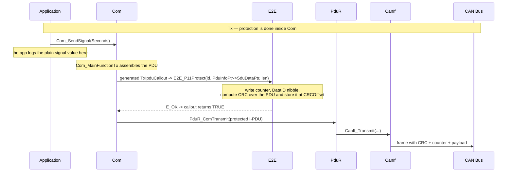
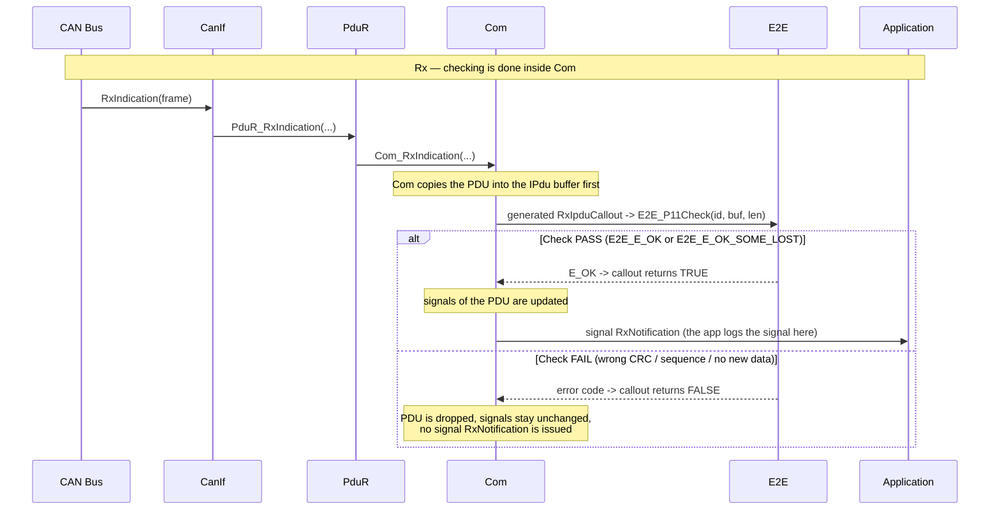
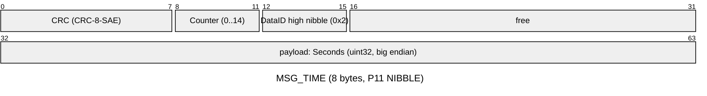
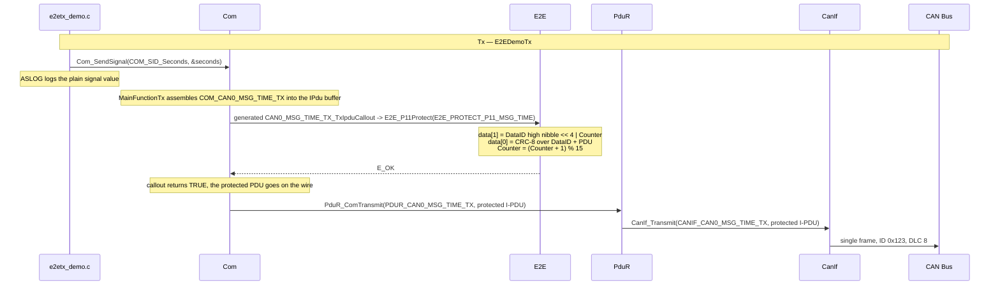
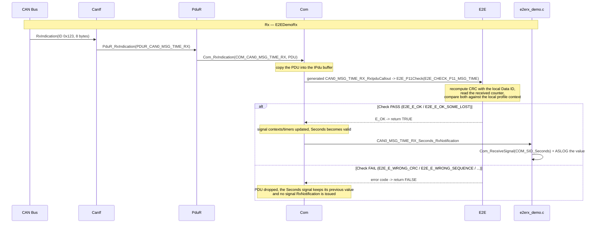

# AUTOSAR E2E - End-to-End Protection Overview

**E2E** (End-to-End Protection) protects safety-related communication against faults that can happen *anywhere on the path between two software components*: corruption inside an ECU, in the gateway, or on the bus, as well as message loss, repetition, delay and reordering. Unlike SecOC it is **not** a security mechanism — it adds no keys and no authentication; it only makes faults *detectable* so that the consumer can discard data it cannot trust.

In AS, E2E is **not a standalone BSW module driven by a MainFunction**. It is a small library (`infras/communication/E2E`) whose Protect/Check functions are called **from inside Com**, and the Com generator emits those calls into the Com IPdu callouts for you. That means an E2E-protected message needs **no extra BSW module** in the stack: the data path stays `Com → PduR → CanIf`, and the protection is just a callout hook on the Com IPdu.

- Implementation: [infras/communication/E2E/E2E.c](../../infras/communication/E2E/E2E.c)
- Header: [infras/include/E2E.h](../../infras/include/E2E.h)
- Private config types: [infras/communication/E2E/E2E_Priv.h](../../infras/communication/E2E/E2E_Priv.h)
- Generator: [tools/generator/E2E.py](../../tools/generator/E2E.py) (profile config) and [tools/generator/Com.py](../../tools/generator/Com.py) (callout emission)
- Demo applications: [E2EDemoTx / E2EDemoRx](../../app/app/config/E2E)

## 1. Core Concepts

### 1.1 Design Goals
- Detect data corruption across the whole end-to-end path (not only a single bus segment)
- Detect lost, repeated, delayed and out-of-order messages via a sequence counter
- Distinguish the sender/consumer of a message via a Data ID
- Keep the payload untouched where possible: the protection fields are placed at configured bit offsets
- Stay out of the security domain — E2E complements SecOC, it does not replace it

### 1.2 Key Terms

| Term | Description |
|---|---|
| E2E profile | A named protection scheme with a defined header layout and algorithm (P11, P22, P44, P05, ...) |
| CRC | Checksum over the PDU (and the Data ID), detects corruption |
| Counter | 4-bit (P11/P22) or 8/16-bit (P05/P44) sequence number, detects loss/duplication/reorder |
| Data ID | 16-bit identifier of the message, used to tell apart PDUs that share a profile |
| Protect | Sender side: write CRC/counter/Data ID into the PDU |
| Check | Receiver side: verify CRC/counter/Data ID against the local profile context |
| Offset | Bit position of a field inside the PDU (all E2E offsets are in **bits**) |

### 1.3 Supported Profiles

| Profile | CRC | Counter width | Header fields in the PDU | Config keys |
|---|---|---|---|---|
| **P11** | CRC-8-SAE J1850 | 4 bit (0..14, wraps) | CRC, counter, Data ID nibble (mode dependent) | `DataID`, `DataIDMode`, `CRCOffset`, `CounterOffset`, `DataIDNibbleOffset` |
| **P22** | CRC-8H2F | 4 bit | CRC, counter | `Offset`, `DataIDList` |
| **P44** | CRC-32P4 | 16 bit | length + counter + Data ID + CRC | `DataID`, `Offset` |
| **P05** | CRC-16 | 8 bit | CRC, counter | `DataID`, `Offset` |

`E2E.py` accepts five top-level keys, each a list of profiles: `ProtectP11`, `CheckP11`, `ProtectP22`, `CheckP22`, `ProtectP44`, `CheckP44`, `ProtectP05`, `CheckP05`. The **name of a profile must equal the name of the Com message it protects** — that is how `Com.py` matches them (section 4.2).

P11 `DataIDMode` controls how the Data ID enters the CRC and the PDU:

| Mode | Data ID in the CRC | Data ID in the PDU |
|---|---|---|
| `BOTH` | low byte then high byte | not present |
| `ALT` | low byte on even counter, high byte on odd counter | not present |
| `LOW` | low byte only | not present |
| `NIBBLE` | low byte | **high nibble** placed at `DataIDNibbleOffset` |

### 1.4 Integration with the AUTOSAR Stack

E2E is called from Com, so it adds **no module** to the data path. The generated Com IPdu callout is the single extension point in both directions; the application itself only deals with signals:

| Direction | Path | Where E2E runs | Where the application hooks in |
|---|---|---|---|
| **Tx** | Com → PduR → CanIf | generated `TxIpduCallout` (before `PduR_ComTransmit`), calls `E2E_<P>Protect` | any application code that sets the signal — e.g. `Com_SendSignal` |
| **Rx** | CanIf → PduR → Com | generated `RxIpduCallout` (after the PDU is received), calls `E2E_<P>Check` | the **signal** `RxNotification`, called only after the check accepted the PDU |





The detailed step-by-step demos are in section 2:
- **Tx demo (E2EDemoTx)** — see [2.2](#22-tx-demo--e2edemotx);
- **Rx demo (E2EDemoRx)** — see [2.3](#23-rx-demo--e2edemorx).

## 2. Demo Overview

All E2E configuration in this repository is organised as **exactly two demo kinds** — a transmit and a receive application — that carry **one** E2E-protected message between them:

| # | Kind | Application | Protection done in |
|---|---|---|---|
| 1 | **Tx demo** | [E2EDemoTx](../../app/app/config/E2E/DemoTx) | `CAN0_MSG_TIME_TX_TxIpduCallout` → `E2E_P11Protect` |
| 2 | **Rx demo** | [E2EDemoRx](../../app/app/config/E2E/DemoRx) | `CAN0_MSG_TIME_RX_RxIpduCallout` → `E2E_P11Check` |

Common to both:

- both sides carry the same message `MSG_TIME` (DLC 8) with one 32-bit `Seconds` signal;
- both sides use profile **P11** with the same `DataID` (`0x1234`) and the same bit offsets, so the two profiles are mirror images of each other;
- each side logs the `Seconds` signal value it sends / receives, so the two logs can be compared line by line, and the `E2E` trace lines show the protection in between;
- both are registered in [app/app/SConscript](../../app/app/SConscript) and built like any other app.

Each demo directory contains `E2E.json` (the profile), `Com.json` (message + callout wiring), `PduR.json`, `CanIf.json` and the glue source. There is **no** `E2E.c` glue and **no** MainFunction — EcuM only calls `E2E_Init` once.

### 2.1 Message and E2E Profile Configuration

`MSG_TIME` (DLC 8, CAN ID `0x123`) carries one 32-bit big-endian `Seconds` signal, which is allocated to the last four bytes (bytes 4..7). The P11 header needs only the first two bytes and overlaps nothing else, so bytes 2..3 are simply left unused and the payload is not shifted; the profile is fully described by three offsets:

| Setting | Value | Meaning |
|---|---|---|
| Profile | P11 | CRC-8-SAE J1850 + 4-bit counter |
| DataID | `0x1234` | identifies the message |
| DataIDMode | `NIBBLE` | high nibble `0x2` goes into the PDU, low byte `0x34` goes into the CRC |
| CRCOffset | 0 | CRC in **bit** 0..7 → byte 0 |
| CounterOffset | 8 | counter in **bit** 8..11 → low nibble of byte 1 |
| DataIDNibbleOffset | 12 | Data ID nibble in **bit** 12..15 → high nibble of byte 1 |

Resulting wire layout of the 8-byte PDU:



The Data ID low byte (`0x34`) never appears on the bus — in NIBBLE mode only the high nibble is embedded in the PDU, the rest is fed into the CRC (`E2E_ComputeP11Crc`). This is the layout the demo logs in section 5 show.

The `Seconds` signal is declared in `Com.json` as

```json
{ "name": "Seconds", "start": 39, "size": 32, "endian": "big",
  "sign": "+", "factor": 1, "offset": 0, "min": 0, "max": 4294967295, "node": [ "Other"] }
```

`start` is the **MSB** bit position: bit 39 is the most significant bit of byte 4, and the signal grows downwards through bytes 5..7, so `size: 32` covers bits 32..63 — exactly the last four bytes. `Com.py` turns this into a 4-byte pointer (`&Com_PduData_MSG_TIME_TX[4]`) with `BitSize 32`, type `COM_UINT32` and `BitPosition 7`.

`E2E.json` for the Tx side (the Rx side is the same profile under the `CheckP11` key):

```json
{
    "class": "E2E",
    "ProtectP11": [
        { "name": "MSG_TIME", "DataID": "0x1234", "DataIDMode": "NIBBLE",
          "CRCOffset": 0, "CounterOffset": 8, "DataIDNibbleOffset": 12 }
    ]
}
```

### 2.2 Tx Demo — E2EDemoTx

The application only updates the `Seconds` Com signal and logs its value; Com assembles the PDU, runs the **generated** Tx IPdu callout (which protects it) and hands it to PduR.

| Item | Value |
|---|---|
| Direction | Com → (E2E protect) → PduR → CanIf |
| Message | `MSG_TIME`, CAN ID `0x123`, DLC 8 |
| Profile | P11, `DataID 0x1234`, `DataIDMode NIBBLE` |
| Config / source | [DemoTx](../../app/app/config/E2E/DemoTx) (`E2E.json`, `Com.json`, `PduR.json`, `CanIf.json`, `e2etx_demo.c`) |

`Com.json` references the profile file, lists the message in the network level `E2E` array and enables the message tx callout — nothing else is needed, the callout body is generated:

```json
{
  "class": "Com",
  "E2E": "E2E.json",
  "networks": [
    {
      "name": "CAN0", "network": "CAN", "device": "simulator_v2", "port": 0,
      "baudrate": 500000, "me": "AS",
      "enable_message_tx_callout": true,
      "messages": [
        {
          "name": "MSG_TIME", "id": "0x123", "dlc": 8,
          "node": "AS", "CycleTime": 1000,
          "signals": [
            { "name": "Seconds", "start": 39, "size": 32, "endian": "big",
              "sign": "+", "factor": 1, "offset": 0, "min": 0, "max": 4294967295, "node": [ "Other"] }
          ]
        }
      ],
      "E2E": [ { "name": "MSG_TIME", "profile": "P11" } ]
    }
  ]
}
```

The application never implements a callout; `e2etx_demo.c` just sets the signal and logs its value:

```c
void E2E_DemoTx_Transmit(void) {
  ASLOG(DEMO, ("[DemoTx] send MSG_TIME.Seconds=%u\n", (unsigned)seconds));

  (void)Com_SendSignal(COM_SID_Seconds, &seconds);

  seconds++;
}
```

```bash
scons --app=E2EDemoTx
```

Because the v2 simulator uses UDP multicast (no server needed), running the Rx app at the same time is enough to observe the whole flow.



### 2.3 Rx Demo — E2EDemoRx

CanIf receives the frame on the same CAN ID `0x123` and passes it to Com through PduR. Com copies the PDU into the IPdu buffer and then runs the **generated** Rx IPdu callout, which is what accepts or drops it — only after `E2E_P11Check` returns an acceptable code do the signals get updated, and only then is the signal `RxNotification` called.

| Item | Value |
|---|---|
| Direction | CanIf → PduR → Com (E2E check) |
| Message | `MSG_TIME`, CAN ID `0x123`, DLC 8 |
| Profile | P11, `DataID 0x1234`, `DataIDMode NIBBLE` — **must match the Tx side** |
| Config / source | [DemoRx](../../app/app/config/E2E/DemoRx) (`E2E.json`, `Com.json`, `PduR.json`, `CanIf.json`, `e2erx_demo.c`) |

The Rx `Com.json` mirrors the Tx one, with two differences: the message is owned by the peer (`"node": "Other"`, i.e. it is a received message on this node), and instead of hand-writing a callout the demo lets the generator create it and asks Com for a **signal-level notification**:

```json
{
  "name": "CAN0", "network": "CAN", "device": "simulator_v2", "port": 0,
  "baudrate": 500000, "me": "AS",
  "enable_message_rx_callout": true,
  "enable_signal_rx_notification": true,
  ...
  "E2E": [ { "name": "MSG_TIME", "profile": "P11" } ]
}
```

- `"E2E": [ { "name": "MSG_TIME", "profile": "P11" } ]` — the network-level E2E list; `Com.py` sees that `MSG_TIME` is *not* owned by this node and therefore emits a `Check` callout (`E2E_P11Check(E2E_CHECK_P11_MSG_TIME, ...)`) into the message's `RxIpduCallout`.
- `enable_signal_rx_notification` — makes `Com.py` also generate the per-signal notification declarations, so the application can hook the **signal** instead of the IPdu.

The glue (`e2erx_demo.c`) then only implements the signal notification. Com calls the Rx IPdu callout **first**; only when it returns `TRUE` (E2E check accepted) are the signal notifications invoked — so logging from here means "this message arrived *and* passed E2E":

```c
void CAN0_MSG_TIME_RX_Seconds_RxNotification(void) {
  uint32_t seconds = 0;

  (void)Com_ReceiveSignal(COM_SID_Seconds, &seconds);

  ASLOG(DEMO, ("[DemoRx] MSG_TIME checked OK, Seconds=%u\n", (unsigned)seconds));
}
```

The function name is the one `Com.py` expects for the `Seconds` signal of `MSG_TIME`: `<network>_<message>_<signal>_RxNotification` (with the `_RX` direction suffix already part of the message name). A mismatched name is caught at link time, not at runtime.

```bash
scons --app=E2EDemoRx
```



Because the signal notification is only reached **after** the check succeeded, the application does not have to inspect any return code: every call to `CAN0_MSG_TIME_RX_Seconds_RxNotification` already means "authentic message received".

## 3. How It Works

### 3.1 Profile Configuration (E2E_Cfg.c/.h)

`E2E.py` turns one `E2E.json` into two files in a `GEN/` directory next to it:

- `E2E_Cfg.h` — feature macros per profile and one **profile index macro** per entry, e.g.

  ```c
  #define E2E_USE_PROTECT_P11
  #define E2E_PROTECT_P11_MSG_TIME 0u
  ```

  for the Tx demo, and `E2E_USE_CHECK_P11` / `E2E_CHECK_P11_MSG_TIME 0u` for the Rx demo.

- `E2E_Cfg.c` — one static context per profile entry plus the configuration tables and the top level `E2E_Config`:

  ```c
  static E2E_ProtectProfile11ContextType E2E_ProtectP11_MSG_TIME_Context;
  static const E2E_ProtectProfile11ConfigType E2E_ProtectProfile11Configs[] = {
    { /* MSG_TIME */
      &E2E_ProtectP11_MSG_TIME_Context,
      { /* P11 */
        0x1234u, /* DataID */
        0u,      /* CRCOffset */
        8u,      /* CounterOffset */
        12u,     /* DataIDNibbleOffset */
        E2E_P11_DATAID_NIBBLE,
      }
    },
  };

  const E2E_ConfigType E2E_Config = {
    E2E_ProtectProfile11Configs,
    ARRAY_SIZE(E2E_ProtectProfile11Configs),
  };
  ```

  A `Check` profile additionally carries `MaxDeltaCounter` (default 1), the maximum tolerated counter jump before the message counts as lost.

All offsets in `E2E.json` are in **bits**; `DataID` may be written as a hex string in the JSON (`"0x1234"`) and ends up as an integer in C.

### 3.2 Calling Protection from Com

`Com.py` resolves the network-level `E2E` list of `Com.json` against the referenced `E2E.json` and, for every matching message, decides the direction from `node` vs `me`:

- `msg["node"] == network["me"]` → the node **sends** it → needs a `Protect` profile;
- otherwise → the node **receives** it → needs a `Check` profile.

If the profile is missing from `E2E.json` the build fails early:

```
Exception: E2E profile ProtectP11 MSG_TIME for MSG_TIME is not configured
```

The generator then writes the callout body **once**, right after the Com config tables, guarded by `#ifdef USE_E2E`:

```c
#ifdef USE_E2E
#include "E2E.h"
#include "E2E_Cfg.h"

boolean CAN0_MSG_TIME_TX_TxIpduCallout(PduIdType PduId, const PduInfoType *PduInfoPtr) {
  Std_ReturnType ret;
  ret = E2E_P11Protect(E2E_PROTECT_P11_MSG_TIME, PduInfoPtr->SduDataPtr, PduInfoPtr->SduLength);
  return (E_OK == ret);
}

boolean CAN0_MSG_TIME_RX_RxIpduCallout(PduIdType PduId, const PduInfoType *PduInfoPtr) {
  Std_ReturnType ret;
  ret = E2E_P11Check(E2E_CHECK_P11_MSG_TIME, PduInfoPtr->SduDataPtr, PduInfoPtr->SduLength);
  return ( (E_OK == ret) || (E2E_E_OK_SOME_LOST == ret));
}
#endif /* USE_E2E */
```

So there are **two wirings** for the same thing, and both demos use the first (automatic) one:

1. **Automatic** — as in this demo: list the message in the network-level `E2E` array (`{ "name": "MSG_TIME", "profile": "P11" }`) and let the generator write the callout body. The profile name must equal the message name. Nothing else to do — and the E2E callout stays out of the application code entirely.
2. **Explicit** — declare `TxIpduCallout` / `RxIpduCallout` on the message, include `E2E.h` / `E2E_Cfg.h` in the application and call `E2E_<P>Protect` / `E2E_<P>Check` yourself. Same effect, but you can add logic *around* the call — at the price of owning the retry/drop decision, which is exactly what the generator already does correctly.

Either way, the profile index macro (`E2E_PROTECT_P11_MSG_TIME` / `E2E_CHECK_P11_MSG_TIME`) is what links Com to the E2E config table — a mismatch between profile name and message name makes the macro undefined, which the compiler catches.

The application never needs to touch E2E: it sends with `Com_SendSignal` and receives via the signal `RxNotification` (see 2.2 / 2.3).

### 3.3 Return Codes

`E2E_<P>Check` returns a `Std_ReturnType`; the important values are:

| Code | Value | Meaning | Typical Com callout action |
|---|---|---|---|
| `E2E_E_OK` | `E_OK` (0) | CRC, counter and Data ID all fine | accept |
| `E2E_E_OK_SOME_LOST` | `0xE0` | acceptable, but some messages were lost (counter jumped within `MaxDeltaCounter`) | accept |
| `E2E_E_REPEATED` | `0xE1` | counter is the same as the last accepted one | drop or count as repetition |
| `E2E_E_WRONG_CRC` | `0xE2` | checksum mismatch | **drop** |
| `E2E_E_WRONG_SEQUENCE` | `0xE3` | counter outside the tolerated window | **drop** |
| `E2E_E_NOT_AVAILABLE` | `0xE4` | profile not usable / uninitialized | drop |
| `E2E_E_NO_NEWDATA` | `0xE5` | the checker had no new data since the last call | drop |

The generated callout accepts exactly `E2E_E_OK` and `E2E_E_OK_SOME_LOST`; everything else makes Com discard the PDU, so the signals of that PDU keep their previous value.

For state-machine style consumers there is a second family of codes (`E2E_E_SM_VALID`, `E2E_E_SM_NODATA`, `E2E_E_SM_DEINIT`, `E2E_E_SM_INIT`, `E2E_E_SM_INVALID`), which follow the `E2E_P11StateMachine` semantics of `AUTOSAR_FO_PRS_E2EProtocol`; the demo does not use them.

### 3.4 Initialization and the Counter

- `E2E_Init(&E2E_Config)` is called once by EcuM from the driver-init list (`infras/system/EcuM/config/EcuM_Cfg.c`), guarded by `#ifdef USE_E2E`. The demo applications do **not** call it themselves.
- The 4-bit counter is kept in the profile **context** (one per profile entry). The sender increments it after every protect and wraps at 14 → 0; the checker compares the received counter against its own context to classify loss/repetition/sequence errors. Because context is per profile, **each protected message needs its own profile entry**, even if two messages share the same layout.

## 4. Generated Code & APIs

Main APIs (see [E2E.h](../../infras/include/E2E.h)):

| API | Role |
|---|---|
| `E2E_Init` | initialize all profile contexts; called by EcuM |
| `E2E_P11Protect` / `E2E_P11Check` | CRC-8-SAE J1850 profile, 4-bit counter |
| `E2E_P22Protect` / `E2E_P22Check` | CRC-8H2F profile, 4-bit counter |
| `E2E_P44Protect` / `E2E_P44Check` | CRC-32P4 profile, 16-bit counter, length + Data ID header |
| `E2E_P05Protect` / `E2E_P05Check` | CRC-16 profile, 8-bit counter |

All of them share the same signature — `(profileId, data, length)` — and operate **in place** on the PDU buffer. `length` is the whole PDU length in bytes, and the offsets are resolved as `config->XXXOffset >> 3` (bit → byte), with the nibble fields masked into the target byte.

The demo glue sources contain **no** E2E code at all. The Com-level hooks are generated: the Tx app gets `CAN0_MSG_TIME_TX_TxIpduCallout` and the Rx app `CAN0_MSG_TIME_RX_RxIpduCallout`. The applications only use the Com signal API — `e2etx_demo.c` calls `Com_SendSignal(COM_SID_Seconds, ...)` and logs the value it is about to send, `e2erx_demo.c` implements the generated `CAN0_MSG_TIME_RX_Seconds_RxNotification` and reads the signal back with `Com_ReceiveSignal(COM_SID_Seconds, ...)`.

## 5. Build & Run

EcuM calls `E2E_Init` automatically and there is no MainFunction to schedule: everything happens inside Com. Build and run the two applications side by side as described in section 2. Both sides now log at the **application** level rather than from a callout, so the two logs are about signals, while the protection itself is visible in the `E2E` trace lines that the E2E library itself prints:

- Tx (`E2E_DemoTx_Transmit`, before the PDU is protected): `[DemoTx] send MSG_TIME.Seconds=<n>`
- Rx (signal `RxNotification`, after E2E check accepted the PDU): `[DemoRx] MSG_TIME checked OK, Seconds=<n>`

A failed Rx check is **silent** in the application: Com drops the PDU, the signal keeps its previous value and no `RxNotification` is called. The only evidence is the E2E library's own trace (`E2E` / `E2EE` lines, see the failure examples at the end of 5.2).

### 5.1 Tx Demo — Run and Typical Log

Build and run:

```bash
scons --app=E2EDemoTx
scons --app=E2EDemoRx
build\nt\GCC\E2EDemoTx\E2EDemoTx.exe -v 0
build\nt\GCC\E2EDemoRx\E2EDemoRx.exe -v 0
```

**Tx app** (`E2EDemoTx.exe -v 0`) — the application line shows the plain signal value it hands to Com; the `E2E` debug line right after it is the internal `E2E_P11Protect` trace, showing the protected header (CRC, Data ID, counter) and the final PDU bytes. Watch byte 0 (CRC, changes each cycle), byte 1 (high nibble `2` = Data ID high nibble, low nibble = counter `0,1,2,...`) and bytes 4..7 (the 32-bit `Seconds`):

```
INFO    :[DemoTx] E2E P11 transmit demo, MSG_TIME on CAN ID 0x123
ECUM    :Enter Run
DEMO    :[DemoTx] send MSG_TIME.Seconds=0
E2E     :[0]: P11 crc=0xc4 DataId=0x1234 Mode=3 Counter=0
  00000000 C4 20 00 00 00 00 00 00
PDUR    :PduR_Transmit 0
DEMO    :[DemoTx] send MSG_TIME.Seconds=1
E2E     :[0]: P11 crc=0x84 DataId=0x1234 Mode=3 Counter=1
  00000000 84 21 00 00 00 00 00 01
PDUR    :PduR_Transmit 0
DEMO    :[DemoTx] send MSG_TIME.Seconds=2
E2E     :[0]: P11 crc=0x44 DataId=0x1234 Mode=3 Counter=2
  00000000 44 22 00 00 00 00 00 02
PDUR    :PduR_Transmit 0
```

(`Mode=3` is `E2E_P11_DATAID_NIBBLE`; the hex dump belongs to the E2E trace line, not to the application log — the application only prints the signal value.)

Because `Seconds` is 32 bits wide, a small counter only fills the last byte. Seeding a realistic value such as `604796` (`0x00093A7C`) shows the upper bytes carrying data, and the carry into byte 4 at the 7-day boundary:

```
DEMO    :[DemoTx] send MSG_TIME.Seconds=604799
E2E     :[0]: P11 crc=0x41 DataId=0x1234 Mode=3 Counter=3
  00000000 41 23 00 00 00 09 3A 7F
PDUR    :PduR_Transmit 0
DEMO    :[DemoTx] send MSG_TIME.Seconds=604800
E2E     :[0]: P11 crc=0xb  DataId=0x1234 Mode=3 Counter=4
  00000000 0B 24 00 00 00 09 3A 80
PDUR    :PduR_Transmit 0
```

### 5.2 Rx Demo — Run and Typical Log

**Rx app** (`E2EDemoRx.exe -v 0`) — CanIf receives the frame on ID `0x123` with exactly the bytes the Tx side sent; `E2E_P11Check` recomputes the CRC and compares the counter, and only **after** the check returns `TRUE` does Com invoke the signal notification that produces the `DEMO` line:

```
INFO    :[DemoRx] E2E P11 receive demo, MSG_TIME on CAN ID 0x123
ECUM    :Enter Run
CANIF   :RX CAN ID=0x00000123 LEN=8 DATA=[81 20 00 00 00 09 3A 7C]
E2E     :[0]: P11 crc=0x81 DataId=0x1234 Mode=3 Counter=0
DEMO    :[DemoRx] MSG_TIME checked OK, Seconds=604796
CANIF   :RX CAN ID=0x00000123 LEN=8 DATA=[C1 21 00 00 00 09 3A 7D]
E2E     :[0]: P11 crc=0xc1 DataId=0x1234 Mode=3 Counter=128
DEMO    :[DemoRx] MSG_TIME checked OK, Seconds=604797
CANIF   :RX CAN ID=0x00000123 LEN=8 DATA=[0B 24 00 00 00 09 3A 80]
E2E     :[0]: P11 crc=0xb  DataId=0x1234 Mode=3 Counter=130
DEMO    :[DemoRx] MSG_TIME checked OK, Seconds=604800
```

Reading both together:

- the `DEMO` line appears **after** the corresponding `E2E` check line and reports the same `Seconds` value the Tx side put in the payload, which is the signal-level proof that data survived the round trip;
- `00 09 3A 7C` = `604796` and `00 09 3A 80` = `604800`, i.e. all four payload bytes are used and the big-endian encoding is byte-order correct;
- the `CANIF :RX ... DATA=[...]` line is byte-identical to the Tx side's protected bytes — with E2E, unlike SecOC, the PDU on the wire **is** the protected payload: there is no extra header added by a lower module, the protection fields live inside the application payload;
- the counter is visible in the low nibble of byte 1: `0x20 → 0x21 → 0x24` (Data ID nibble `2` in the high nibble);
- bytes 2..3 stay `00 00` because the P11 header only occupies bytes 0..1 and the payload starts at byte 4;
- the Rx `Counter` values in the E2E trace (`0`, then `128`, `130`, …) are the *checker context* counter, whose top bit is the internal `E2E_CHECK_DONE_ONCE` flag — the first message only synchronizes the context, which is why it reads `0` and the following ones count up normally.

A broken pairing is easy to spot in the E2E trace, but note that the **application stays silent** — the PDU is dropped before the signal notification runs. The demo was run against a Tx app whose profile uses a different `DataIDMode` (`BOTH` instead of `NIBBLE`), and the log becomes

```
CANIF   :RX CAN ID=0x00000123 LEN=8 DATA=[81 20 00 00 00 09 3A 7C]
E2EE    :[0] P11 Wrong Crc e3 != 81
```

with no `DEMO` line at all. A different `DataID` mismatches even earlier, in the Data ID nibble comparison:

```
CANIF   :RX CAN ID=0x00000123 LEN=8 DATA=[81 20 00 00 00 09 3A 7C]
E2E     :[0]: P11 crc=0x81 DataId=0x9999 Mode=3 Counter=0
E2EE    :[0] P11 Nibble 2 not correct: 9999
```

Either way the PDU is dropped, the `Seconds` signal keeps its previous value, and the application is never told — which is exactly what E2E is for.

## 6. Peeking the Real CAN Frame

Unlike SecOC there is no extra module between Com and CanIf for E2E, so the protected PDU that the generator's Tx callout hands to PduR is already the full wire frame — the Rx side's own `CANIF :RX ... DATA=[...]` line above confirms it byte for byte. There is therefore no separate CanDump section for this demo; attach the sniffer only if you want the timestamps:

```bash
scons --app=CanDump
build\nt\GCC\CanDump\CanDump.exe -d simulator_v2 -p 0
```

## 7. References

- AUTOSAR FO R23-11 E2E Protocol Specification (`AUTOSAR_FO_PRS_E2EProtocol.pdf`)
- Code: [E2E.c](../../infras/communication/E2E/E2E.c), [E2E.h](../../infras/include/E2E.h), [E2E_Priv.h](../../infras/communication/E2E/E2E_Priv.h)
- Generator: [E2E.py](../../tools/generator/E2E.py), Com integration [Com.py](../../tools/generator/Com.py)
- Com documentation: [Com.md](Com.md), CanIf documentation: [CanIf.md](CanIf.md)
- Tx demo: [DemoTx](../../app/app/config/E2E/DemoTx), Rx demo: [DemoRx](../../app/app/config/E2E/DemoRx)
- SecOC over CanIf/CanTp, for comparison: [SecOC.md](SecOC.md)
