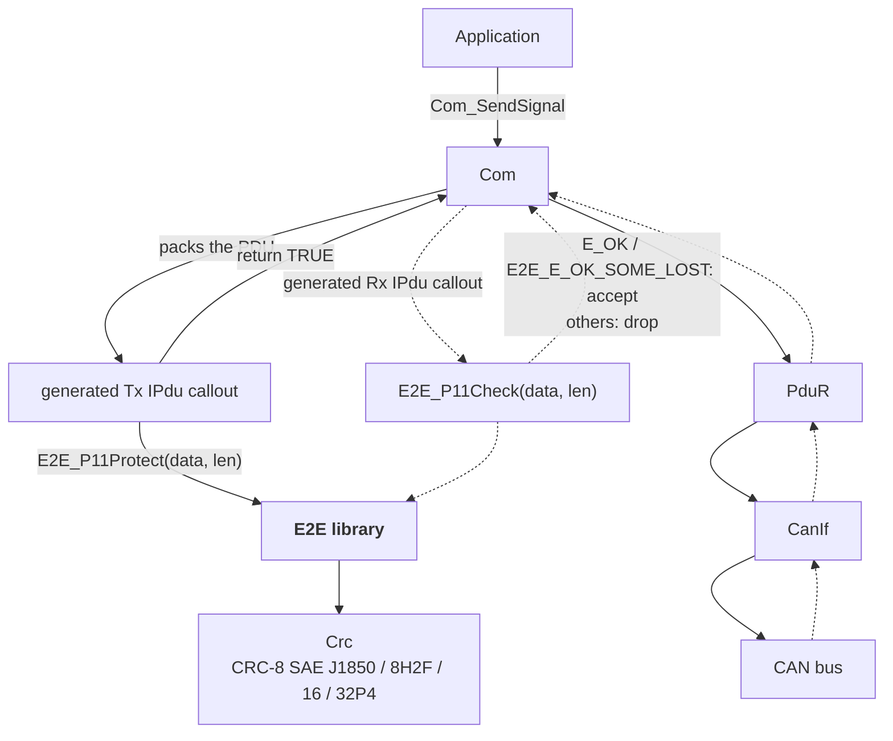
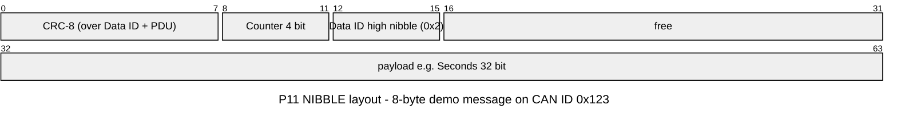
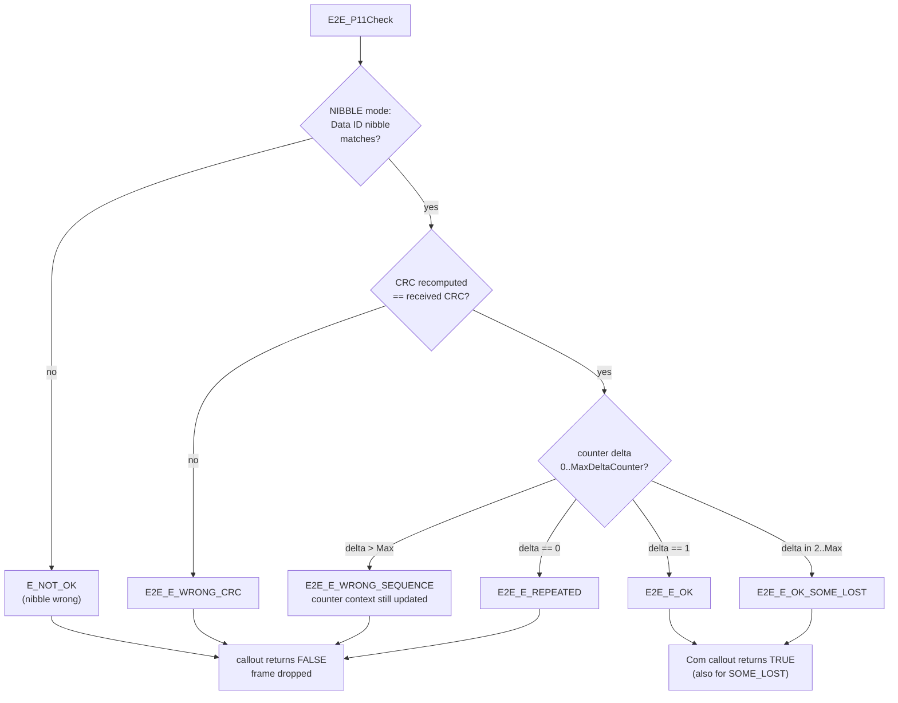
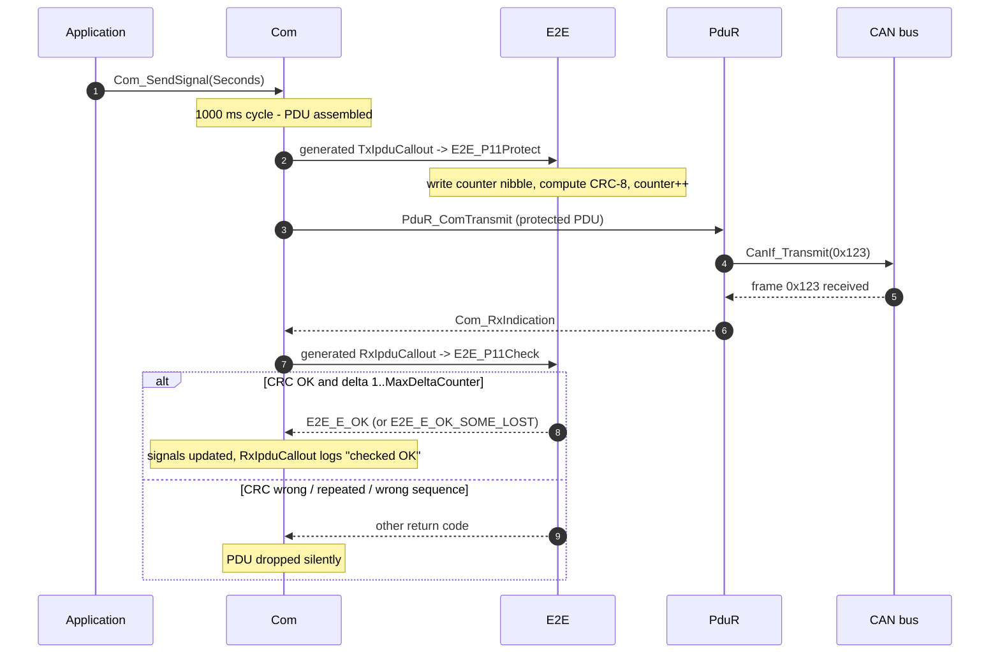

# E2E - End-to-End Protection

> **In one sentence:** E2E adds a CRC and a 4-bit sequence counter to selected
> Com messages, so the receiver can detect corruption, loss, repetition and
> reordering anywhere between the two ECUs - it is a safety mechanism, not a
> security mechanism (no keys, no MAC; use [SecOC](SecOC.md) for that).

| Item | Value |
| --- | --- |
| Module | `infras/communication/E2E` (API: `infras/include/E2E.h`) |
| Layer | Library called **from inside [Com](Com.md)** - not a stack layer of its own |
| Configuration | `app/app/config/E2E/E2E.json` + an `"E2E"` section in `Com.json` |
| Generator | `tools/generator/E2E.py` -> `GEN/E2E_Cfg.c` / `GEN/E2E_Cfg.h`, plus the callout code emitted by `tools/generator/Com.py` |
| Standard | AUTOSAR R23-11 PRS E2E Protocol (`@PRS_E2E_*` in the code), profiles P11 / P22 / P44 / P05 |
| Demos | `scons --app=E2EDemoTx` / `E2EDemoRx` |

**Contents**

1. [What the module is for](#1-what-the-module-is-for)
2. [Where it sits in the stack](#2-where-it-sits-in-the-stack)
3. [Configuration](#3-configuration)
4. [How it works at runtime](#4-how-it-works-at-runtime)
5. [Public API](#5-public-api)
6. [Build and run a demo](#6-build-and-run-a-demo)
7. [Key notes and gotchas](#7-key-notes-and-gotchas)
8. [Troubleshooting](#8-troubleshooting)
9. [Known limitations and code review findings](#9-known-limitations-and-code-review-findings)
10. [Related documents](#10-related-documents)

---

## 1. What the module is for

A safety function consuming a signal must know whether the value it reads is the
value the producer sent. Faults can be introduced by the sender software, by the
Com stack, by a gateway, by the transceiver or by EMC on the wire - E2E protects
against all of them, end to end, by putting two things into every PDU:

* **CRC** - a checksum over the payload plus (part of) the Data ID, so any bit
  corruption is detected;
* **Sequence counter** - a 4-bit (P11/P22) or 16-bit (P44) / 8-bit (P05) counter,
  so loss, repetition and reordering are detected.

The receiver compares the verdict against its own counter history and returns
one of `E2E_E_OK`, `E2E_E_OK_SOME_LOST`, `E2E_E_REPEATED`,
`E2E_E_WRONG_CRC`, `E2E_E_WRONG_SEQUENCE`. Only `E2E_E_OK` and
`E2E_E_OK_SOME_LOST` are treated as "accept the data".

Four profiles are implemented:

| Profile | CRC | Counter | Data ID protection | Typical use |
| --- | --- | --- | --- | --- |
| **P11** | CRC-8 SAE J1850 | 4 bit, 0..14 | 16-bit or 12-bit (4 bits on bus in NIBBLE mode) | 8-byte classic CAN messages |
| **P22** | CRC-8H2F | 4 bit | 16-entry Data ID list | small messages, Data ID alternates per counter |
| **P44** | CRC-32P4 | 16 bit | 32-bit, carried in the PDU | large/FD messages, length carried too |
| **P05** | CRC-16 | 8 bit | 16-bit, only in CRC | messages with byte-aligned CRC+counter |

Only **P11** is exercised by the shipped configurations (`config/E2E/E2E.json`
and the demos); the other three compile only when configured.

---

## 2. Where it sits in the stack

E2E is not a layer. It is a library whose Protect/Check calls are **generated
into the Com IPdu callouts** by the Com generator. The data path is unchanged:



What this means in practice:

* **No extra BSW module** is linked for E2E beyond the small library itself;
  the PduR routing table does not mention E2E at all.
* **No MainFunction** - protection runs synchronously inside
  `Com_TriggerIPDUSend` / `Com_RxIndication`.
* The application does nothing except send/receive signals as usual.

---

## 3. Configuration

E2E needs **two** files that must agree with each other:

1. `E2E.json` - the profile parameters (CRC offset, counter offset, Data ID);
2. `Com.json` - which message uses which profile.

### 3.1 `E2E.json`

`app/app/config/E2E/E2E.json` (the demos each carry their own copy):

```json
{
    "Class": "E2E",
    "ProtectP11": [
        { "Name": "MSG_TIME", "DataID": "0x1234", "DataIDMode": "NIBBLE",
          "CRCOffset": 0, "CounterOffset": 8, "DataIDNibbleOffset": 12 }
    ],
    "CheckP11": [
        { "Name": "MSG_TIME", "DataID": "0x5678", "DataIDMode": "NIBBLE",
          "CRCOffset": 48, "CounterOffset": 56, "DataIDNibbleOffset": 60 }
    ]
}
```

| Key | Applies to | Meaning |
| --- | --- | --- |
| `Class` | all | selects `E2E.py` |
| `ProtectP11[]` / `ProtectP22[]` / `ProtectP44[]` / `ProtectP05[]` | all | one entry per protected message; **`Name` must equal the Com message name** (the generator emits `E2E_PROTECT_P11_<NAME>` and Com looks it up by message name) |
| `CheckP11[]` / `CheckP22[]` / `CheckP44[]` / `CheckP05[]` | all | one entry per verified message, same naming rule (`E2E_CHECK_P11_<NAME>`) |
| `DataID` | all | P11/P05: 16-bit; P22: 16-entry `DataIDList[]` instead; P44: 32-bit |
| `DataIDMode` | P11 | `BOTH`, `ALT`, `LOW` or `NIBBLE` - see section 4.1 |
| `CRCOffset` | P11 | bit offset of the CRC byte; default `0` |
| `CounterOffset` | P11 | bit offset of the 4-bit counter; default `8` |
| `DataIDNibbleOffset` | P11 | bit offset of the 4-bit Data ID nibble (NIBBLE mode only); default `12` |
| `Offset` | P22/P44/P05 | bit offset of the CRC (P22: counter follows in the next nibble); default `0` |
| `MaxDeltaCounter` | all Check entries | maximum allowed counter delta; default `1` (any lost frame -> `E2E_E_WRONG_SEQUENCE`) |
| `UsePostBuildConfig` | all | `false` default; emits `E2E_USE_PB_CONFIG` (whose placeholder macro is misnamed `cantpConfig`, see section 9) |

All offsets are in **bits**, not bytes.

### 3.2 `Com.json` wiring

```json
{
  "Class": "Com",
  "E2E": "E2E.json",
  "Networks": [
    {
      "Name": "CAN0", "...": "...",
      "EnableMessageTxCallout": true,
      "Messages": [
        { "Name": "MSG_TIME", "Id": "0x123", "Dlc": 8, "Node": "AS", "...": "..." }
      ],
      "E2E": [ { "Name": "MSG_TIME", "Profile": "P11" } ]
    }
  ]
}
```

Three things happen in `Com.py`:

1. the top-level `"E2E": "<path>"` loads the profile parameters from the given
   JSON and merges them into the message entry;
2. the network-level `E2E[]` array maps message name -> profile (`P11`, `P22`,
   `P44`, `P05`); messages whose `Node` equals the network's `Me` become
   **Protect**, all others become **Check**;
3. for each mapped message the generator writes the whole IPdu callout:

```c
/* generated into GEN/Com_Cfg.c, wrapped in #ifdef USE_E2E */
boolean CAN0_MSG_TIME_TX_TxIpduCallout(PduIdType PduId, const PduInfoType *PduInfoPtr) {
  Std_ReturnType ret;
  ret = E2E_P11Protect(E2E_PROTECT_P11_MSG_TIME, PduInfoPtr->SduDataPtr,
                       PduInfoPtr->SduLength);
  return (E_OK == ret);
}

boolean CAN0_MSG_TIME_RX_RxIpduCallout(PduIdType PduId, const PduInfoType *PduInfoPtr) {
  Std_ReturnType ret;
  ret = E2E_P11Check(E2E_CHECK_P11_MSG_TIME, PduInfoPtr->SduDataPtr,
                     PduInfoPtr->SduLength);
  return ((E_OK == ret) || (E2E_E_OK_SOME_LOST == ret));
}
```

If a message already declares its own `TxIpduCallout` / `RxIpduCallout` **and**
an E2E mapping, the generator overwrites your callout with the E2E version -
you cannot have both in one callout.

### 3.3 Generated code

`GEN/E2E_Cfg.h` defines one macro per profile entry and enables exactly the
profiles that appear in the JSON:

```c
#define E2E_USE_PROTECT_P11
#define E2E_PROTECT_P11_MSG_TIME 0u
#define E2E_USE_CHECK_P11
#define E2E_CHECK_P11_MSG_TIME   0u
```

`GEN/E2E_Cfg.c` holds one context variable (the counter) and one config struct
per entry; `E2E_Config` aggregates them in profile order (P11 protect, P11
check, P22 protect, ... P05 check).

`E2E_Init(NULL)` is called by EcuM during startup
(`infras/system/EcuM/config/EcuM_Cfg.c`), which resets every counter context to
0 and clears the `bSynced` flags.

---

## 4. How it works at runtime

### 4.1 P11 wire format

With the demo values (NIBBLE mode, `CRCOffset 0`, `CounterOffset 8`,
`DataIDNibbleOffset 12`, `DataID 0x1234`), an 8-byte message looks like this:



* byte 0: CRC-8 SAE J1850, computed over the *whole* PDU except the CRC byte
  itself, seeded with the Data ID bytes according to `DataIDMode`;
* byte 1 low nibble: sequence counter 0..14 (wraps from 14 to 0, 15 is invalid);
* byte 1 high nibble: high nibble of Data ID (NIBBLE mode only) - the low byte
  `0x34` never appears on the bus, it only feeds the CRC.

`DataIDMode` decides what goes into the CRC seed (`E2E.c`, `E2E_ComputeP11Crc`):

| Mode | CRC seed | Bus |
| --- | --- | --- |
| `BOTH` | low byte then high byte of Data ID | nothing |
| `ALT` | low byte for one counter parity, high byte for the other | nothing |
| `LOW` | low byte only | nothing |
| `NIBBLE` | low byte + one zero byte | 4 bits of the high byte |

### 4.2 Protect (Tx)

`E2E_P11Protect` runs in three steps on the PDU buffer **in place**:

1. NIBBLE mode: clear the Data ID nibble and write `(DataID >> 8) & 0xF`;
2. clear the counter nibble and write the context counter;
3. compute the CRC and store it at `CRCOffset`; then increment the counter
   (wrapping at 14).

The Com generator calls this from the Tx IPdu callout just before the PDU is
handed to PduR.

### 4.3 Check (Rx)



Important details:

* On the **first** frame after init the delta is assumed to be 1 (accept).
* The counter context is updated on every CRC-valid frame - even a
  `WRONG_SEQUENCE` one - so a burst of lost frames resynchronises as soon as a
  frame arrives with a delta <= `MaxDeltaCounter`.
* `E2E_E_REPEATED` (delta 0) passes the CRC but is still dropped by the
  generated callout.
* The library never modifies the payload on Check - the received CRC byte is
  only compared.

### 4.4 One round trip



---

## 5. Public API

| Function | Purpose |
| --- | --- |
| `E2E_Init(config)` | reset counters / sync flags; EcuM calls it with `NULL` |
| `E2E_P11Protect(profileId, data, length)` | add CRC + counter in place (P11) |
| `E2E_P11Check(profileId, data, length)` | verify CRC + counter (P11) |
| `E2E_P22Protect` / `E2E_P22Check` | profile 22, CRC-8H2F + Data ID list |
| `E2E_P44Protect` / `E2E_P44Check` | profile 44, CRC-32P4, 16-bit counter, length + Data ID carried in the PDU |
| `E2E_P05Protect` / `E2E_P05Check` | profile 05, CRC-16, 8-bit counter |

Return codes (`E2E.h`): `E2E_E_OK`, `E2E_E_OK_SOME_LOST` (0xE0),
`E2E_E_REPEATED` (0xE1), `E2E_E_WRONG_CRC` (0xE2), `E2E_E_WRONG_SEQUENCE`
(0xE3). The state-machine codes (`E2E_E_SM_*`) are defined but the associated
E2E SM API is not implemented.

`profileId` is the index generated as `E2E_PROTECT_P<xx>_<NAME>` /
`E2E_CHECK_P<xx>_<NAME>` - never hardcode a number.

---

## 6. Build and run a demo

### 6.1 Applications

| App | Direction | Config / source |
| --- | --- | --- |
| `E2EDemoTx` | protects `MSG_TIME` with P11 NIBBLE | [`config/E2E/DemoTx`](../../app/app/config/E2E/DemoTx) |
| `E2EDemoRx` | verifies `MSG_TIME` | [`config/E2E/DemoRx`](../../app/app/config/E2E/DemoRx) |

Both send `MSG_TIME` on CAN ID `0x123`, 8 bytes, one 32-bit `Seconds` signal,
1000 ms cycle. Each directory holds `E2E.json`, `Com.json`, `PduR.json`,
`CanIf.json` and the glue source (`e2etx_demo.c` / `e2erx_demo.c`). The
application implements **no callout** - the callouts are fully generated.

```bash
scons --app=E2EDemoTx -j8
scons --app=E2EDemoRx -j8
```

### 6.2 What you should see

Run the receiver, then the transmitter (virtual CAN, bus 0):

```
INFO    :[DemoTx] E2E P11 transmit demo, MSG_TIME on CAN ID 0x123
DEMO    :[DemoTx] send MSG_TIME.Seconds=604796
```

Receiver - with `AS_LOG_E2E=2` the library dumps every checked PDU:

```
INFO    :[DemoRx] E2E P11 receive demo, MSG_TIME on CAN ID 0x123
E2E     :[0]: P11 crc=0x81 DataId=0x1234 Mode=3 Counter=0
  00000000 81 20 00 00 00 09 3A 7C
DEMO    :[DemoRx] MSG_TIME checked OK, Seconds=604796
E2E     :[0]: P11 crc=0xc1 DataId=0x1234 Mode=3 Counter=128
  00000000 C1 21 00 00 00 09 3A 7D
DEMO    :[DemoRx] MSG_TIME checked OK, Seconds=604797
```

Reading the dump:

* byte 0 is the CRC (changes with the counter because `ALT`-like Data ID bytes
  enter the CRC and the payload changes);
* byte 1 = `0x20`, `0x21`, `0x22`, ... - high nibble `2` is the Data ID high
  nibble, low nibble is the counter 0, 1, 2, ...;
* bytes 4..7 are the `Seconds` payload.

The `Counter=128, 129, ...` in the log is the check context: bit 7 is the
internal `E2E_CHECK_DONE_ONCE` flag, the low nibble is the last accepted
counter.

### 6.3 Seeing the protection work

Stop the transmitter, change one byte of the payload handling in
`e2etx_demo.c`, or simply replay an old frame: the receiver stops printing
"checked OK" and the `SECOCE`-style `E2EE` log (enable with `AS_LOG_E2EE=2`)
shows the reason - `P11 Wrong Crc`, `P11 repeat` or `P11 wrong sequence`.

---

## 7. Key notes and gotchas

* **E2E is configured in two places** (`E2E.json` + `Com.json`) and the
  profile entry `Name` must equal the Com message name, otherwise generation
  aborts with `E2E profile P11 <name> for <msg> is not configured`.
* **All offsets are bits.** `CRCOffset 48` means byte 6.
* **The counter is only 4 bits in P11/P22 and wraps 14 -> 0** (0xF is invalid
  per the profile). With a 100 ms message cycle that is 1.4 s of history -
  `MaxDeltaCounter` should stay small.
* **`MaxDeltaCounter` defaults to 1.** With the default, a single lost frame
  makes the *next* frame fail with `E2E_E_WRONG_SEQUENCE` (delta 2 > 1) and it
  is dropped, but the counter context is updated, so the frame after that is
  accepted again. Set `MaxDeltaCounter` to the loss budget of your design if
  occasional loss must be tolerated.
* **The generated callout replaces a custom callout.** A message cannot have
  both a user `RxIpduCallout` and E2E checking in the same callout; if you need
  both, do the E2E check in your own callout instead of using the mapping.
* **`E2E_E_OK_SOME_LOST` must be accepted like `E_OK`** - the generated callout
  already does this; code that calls `E2E_P11Check` directly must not forget it.
* **Protect modifies the buffer in place.** The Com TX buffer is what gets the
  CRC - never call Protect on a buffer you still need unmodified.
* **P44 writes length, counter, Data ID and CRC at `Offset`** - the payload
  must be at least `Offset/8 + 12` bytes and the application must not use those
  bytes.
* **Profiles other than P11 only compile when configured.** The `#ifdef` guard
  means linking a P05 check without the JSON entry gives a link error, not a
  runtime one.

---

## 8. Troubleshooting

| Symptom | Likely cause |
| --- | --- |
| Generation fails: `E2E profile P11 <name> for <msg> is not configured` | the `CheckP11[]`/`ProtectP11[]` entry name does not match the message name in `Com.json` |
| Generation fails: `KeyError: 'DataIDList'` | a P22 entry without `DataIDList` |
| Receiver logs `P11 Wrong Crc` for every frame | sender and receiver disagree on `CRCOffset`, `DataIDMode`, `DataID` or payload layout - every offset must match bit for bit |
| Receiver logs `P11 wrong sequence` after every loss | `MaxDeltaCounter` too small (default 1) |
| Receiver logs `P11 Nibble <x> not correct` | NIBBLE mode: the high nibble of the received Data ID byte does not match `(DataID >> 8) & 0xF` on the receiver |
| Everything passes although you expected a CRC failure | you are looking at the Tx side - only Check produces verdicts |
| Link error on `E2E_CheckProfile05Configs` | generator quirk: `E2E_USE_CHECK_P05` is emitted only when `CheckP44` is non-empty (see section 9) |
| Frames dropped with no E2E log at all | enable `AS_LOG_E2EE=2`; also confirm the message actually has the `E2E` mapping in `Com.json` |

---

## 9. Known limitations and code review findings

### 9.1 Functional limitations

* **No E2E state machine (SM) API.** `E2E.h` defines `E2E_E_SM_*` codes but the
  `E2E_PxxCheck` calls are used bare; there is no `E2E_ExxxCheckSMInitialize`,
  no status window, no "data stale" tracking beyond the first-frame rule.
* **Only P11 is used and tested** in the repository; P22/P44/P05 are compiled
  out unless configured.
* **No transformation layers** (E2EXf) - the protected PDU *is* the Com PDU;
  there is no separation of "E2E header" from signal payload at the SWC level.
* **The whole PDU except the CRC byte is CRC input** - for P11 that matches the
  profile examples, but it also means any Com-level change (padding, DLC)
  changes the CRC; both ends must use identical DLC.
* **Counter context is a single variable per entry** - shared between callout
  invocation contexts; fine for the single-threaded Com main functions, but not
  safe if Protect/Check were called from different contexts.

### 9.2 Code review findings

| # | Where | Finding |
| --- | --- | --- |
| 1 | `E2E.py:49` | **`E2E_USE_CHECK_P05` is emitted only when `CheckP44` is non-empty** (`if len(cfg.get("CheckP44", [])):` should be `CheckP05`). A configuration with P05 checks but no P44 checks never defines the macro, so `E2E_P05Check` is not compiled while `E2E_Cfg.c` still references `E2E_CheckProfile05Configs` - the build breaks. |
| 2 | `E2E.c:318` | `E2E_P22Protect` validates `profileId < numOfProtectP11` - copy-paste from P11. When both P11 and P22 are configured the bound is wrong (allows out-of-range P22 ids when `numOfProtectP22 > numOfProtectP11`, rejects valid ones otherwise); with P22 only, the struct member does not even exist. |
| 3 | `E2E.c:462` | `E2E_P44Check` uses `offset = config->P44.Offset` without `>> 3`, while `E2E_P44Protect` uses `Offset >> 3`. Any non-zero (or non-byte-aligned) offset makes Check read length/counter/DataID/CRC from the wrong bytes. Works only because the demo uses `Offset = 0`. |
| 4 | `E2E.c:16` | `#define E2E_CONFIG cantpConfig` under `E2E_USE_PB_CONFIG` - the placeholder macro is named after the CanTp module (copy-paste). It compiles only because `SecOC`-style PB code declares it per module; a PB build of E2E alone would fail to link. |
| 5 | `E2E.c:49-60` | In `ALT` mode the code includes the Data ID **low** byte when the counter is odd, while its own comment (and `PRS_E2E_00634` variant 1B) says even counter -> low byte. Protect and Check share the function, so SSAS-to-SSAS always agrees, but interop with a spec-conformant stack breaks on odd counters. |
| 6 | `E2E.c:289-307` | After `E2E_E_WRONG_SEQUENCE` the counter context is still updated with the received value. That is deliberate (fast resync) but differs from stricter AUTOSAR implementations that require an explicit `E2E_ExxxCheckSM...` restart; document it in your safety case. |
| 7 | `E2E.c:465` | P44 length check is `(ReceivedLength < length)` -> fail. Equality would be the correct requirement; a frame *longer* than the carried length passes. |
| 8 | `Com.py:583-614` | The E2E callout is emitted whenever the message has an `E2E` key *and* the corresponding `TxIpduCallout`/`RxIpduCallout` name is set - a user-defined callout body of the same name would collide at link time (duplicate symbol) rather than being rejected at generation time. |
| 9 | `E2E.c:220` | P11 counter wraps after 14 (`> 0x0E`), per spec; but nothing prevents `MaxDeltaCounter > 15` in the config, which would make `E2E_E_WRONG_SEQUENCE` unreachable. No range validation of `MaxDeltaCounter`. |
| 10 | `E2E.py:118,134` | `eval(str(dl))` on the JSON `DataIDList` - works for lists of numbers but will happily execute arbitrary Python embedded in the config file. |

---

## 10. Related documents

* [Com](Com.md) - the module that calls Protect/Check from its IPdu callouts
* [SecOC](SecOC.md) - cryptographic protection against attackers (E2E only
  detects faults, not attacks)
* [CanIf](CanIf.md) / [PduR](PduR.md) - the (unchanged) transport path
* Code: [E2E.c](../../infras/communication/E2E/E2E.c),
  [E2E_Priv.h](../../infras/communication/E2E/E2E_Priv.h),
  [E2E.h](../../infras/include/E2E.h),
  [E2E.py](../../tools/generator/E2E.py),
  the callout emission in [Com.py](../../tools/generator/Com.py)
* AUTOSAR R23-11 - PRS_E2EProtocol
