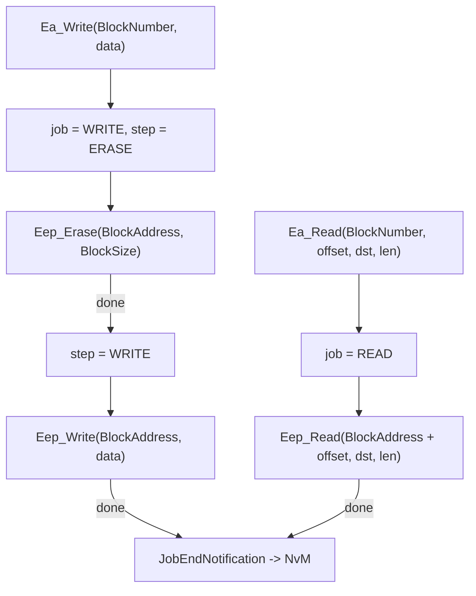

# Ea - EEPROM Abstraction

> **In one sentence:** Ea maps NvM block numbers to fixed addresses in a real
> EEPROM: write = erase + program the block, read = read the block (CRC included
> in the size).

| Item | Value |
| --- | --- |
| Module | `infras/memory/Ea` (API: `infras/include/Ea.h`) |
| Layer | Above Eep, below [NvM](NvM.md) (via MemIf) |
| Configuration | generated by `tools/generator/NvM.py` into `GEN/Ea_Cfg.c` (`Ea_BlockConfigs[]`) |
| Standard | AUTOSAR CP 4.4 Ea (subset) |
| Demo | build with `NVM_TARGET=Ea` (or `target: "Ea"` in `NvM.json`) |

**Contents**

1. [What the module is for](#1-what-the-module-is-for)
2. [Configuration](#2-configuration)
3. [How it works at runtime](#3-how-it-works-at-runtime)
4. [Public API](#4-public-api)
5. [Key notes and gotchas](#5-key-notes-and-gotchas)
6. [Known limitations](#6-known-limitations)

---

## 1. What the module is for

* **Address mapping** - each NvM block gets a fixed `BlockAddress` in the EEPROM;
  `Ea_Write` performs the erase-then-write sequence that EEPROMs require.
* **Job state machine** - one job at a time (`EA_JOB_READ`/`EA_JOB_WRITE`),
  stepped in `Ea_MainFunction()` until `Eep` finishes.
* **Endurance bookkeeping** - `NumberOfWriteCycles` per block is stored in the
  config (informational).

When to choose Ea over [Fee](Fee.md): the board has a real EEPROM (I2C/SPI),
the block layout is stable and wear per address is acceptable.

---

## 2. Configuration

Generated `Ea_BlockConfigs[]` (from `NvM.json` `blocks[]`):

```c
typedef struct {
  uint16_t BlockNumber;
  uint16_t BlockAddress;   /* offset inside the EEPROM */
  uint16_t BlockSize;      /* including CRC */
  uint32_t NumberOfWriteCycles;
} Ea_BlockConfigType;
```

Addresses are assigned sequentially by the generator over the EEPROM size
declared in `config/NvM/Eep_Cfg.c`. Block numbers `0x0000` and `0xFFFF` are
reserved.

---

## 3. How it works at runtime



One job at a time; `Ea_Cancel()` aborts the current job and reports an error to
NvM.

---

## 4. Public API

| Function | Purpose |
| --- | --- |
| `Ea_Init(ConfigPtr)` | Register job callbacks |
| `Ea_Read(BlockNumber, offset, dst, len)` | Async read job |
| `Ea_Write(BlockNumber, src)` | Async erase+write job |
| `Ea_InvalidateBlock` / `Ea_EraseImmediateBlock(BlockNumber)` | Erase helpers |
| `Ea_Cancel()` / `Ea_SetMode(Mode)` | Job control |
| `Ea_JobEndNotification` / `Ea_JobErrorNotification()` | Eep callbacks |
| `Ea_MainFunction()` | Job worker |
| `Ea_GetVersionInfo` | Version |

---

## 5. Key notes and gotchas

1. **`BlockSize` includes the CRC** - the usable payload is smaller than the
   struct size you declared in `NvM.json` when `UseContextCrc` is on.
2. **Fixed addresses mean fixed wear** - a hot block (e.g. the security-access
   attempt counter) burns out its cells; Fee avoids this by appending.
3. **Jobs are sequential** - a long erase blocks everything behind it.
4. **Eep driver quality dominates** - timeouts of the I2C/SPI driver surface as
   `Ea_JobErrorNotification` -> `NVM_REQ_NOT_OK`.

---

## 6. Known limitations

1. **No redundancy per block** - a failed write leaves the block blank/garbage;
   NvM's CRC detects it but Ea does not retry.
2. **No wear levelling** - by design (fixed mapping).
3. **`Ea_SetMode` has no effect** (no FAST/SLOW handling).
4. **No immediate-data special casing** (the `ImmediateData` flag is commented
   out in the config type).

**Related documents:** [NvM](NvM.md) - [Fee](Fee.md)
