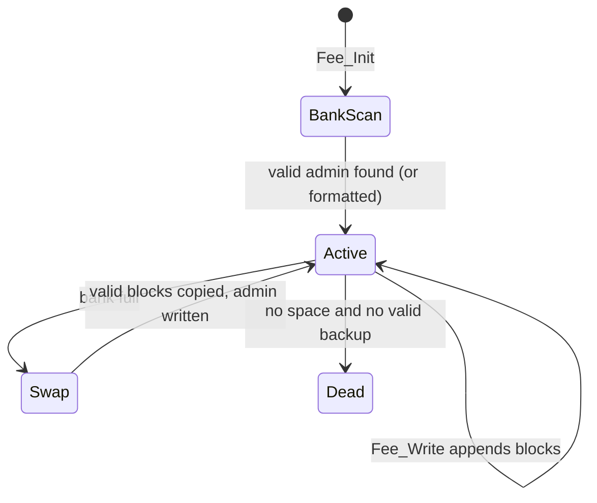

# Fee - Flash EEPROM Emulation

> **In one sentence:** Fee emulates byte-writable EEPROM on top of a
> page-erased flash: blocks are appended with an admin header, a full bank is
> swapped to the backup bank, and stale copies are collected during the swap.

| Item | Value |
| --- | --- |
| Module | `infras/memory/Fee` (API: `infras/include/Fee.h`) |
| Layer | Above Fls, below [NvM](NvM.md) (via MemIf) |
| Configuration | generated by `tools/generator/NvM.py` into `GEN/Fee_Cfg.c` (`Fee_Banks[]`), plus `config/NvM/Fls_Cfg.c` (bank addresses) |
| Standard | AUTOSAR CP 4.4 Fee (subset) |
| Demo | `CanApp` with `target: Fee` and `FLS_DIRECT_ACCESS` on the simulator |

**Contents**

1. [What the module is for](#1-what-the-module-is-for)
2. [Configuration](#2-configuration)
3. [How it works at runtime](#3-how-it-works-at-runtime)
4. [Public API](#4-public-api)
5. [Key notes and gotchas](#5-key-notes-and-gotchas)
6. [Known limitations](#6-known-limitations)

---

## 1. What the module is for

* **Append-only block store** - every write appends `{admin header, CRC, data}`
  at the next free page of the active bank; the newest copy wins.
* **Bank swap** - when the active bank is full, valid blocks are copied to the
  other bank, which then becomes active. "Flash is dead" only when both banks
  are full of valid data.
* **Wear spreading** - because writes are appended, a small block updated often
  does not wear a single flash page.
* **Power-loss safety** - bank/block admin structures carry magic numbers and
  CRCs; an interrupted swap or write is detected and rolled back at boot.

---

## 2. Configuration

Fee has **no own JSON**; it is configured through the NvM generator:

| Source | Content |
| --- | --- |
| `NvM.json` `target: "Fee"` | selects Fee in `app/app/SConscript` (`Fls_Cfg.c` is added) |
| `NvM.json` `banks[]` | optional explicit bank table `{address, size, repeat}` |
| `NvM.json` `UseContextCrc` / `UseFaults` | emit `FEE_USE_CONTEXT_CRC` / `FEE_USE_FAULTS` |
| `config/NvM/Fls_Cfg.c` | `FLS_BANK0_ADDRESS/SIZE`, `FLS_BANK1_ADDRESS/SIZE` |
| build defines | `FEE_PAGE_SIZE` (default **8**), `FEE_WORKING_AREA_SIZE`, `FLS_ERASED_VALUE` (default 0xFF), `FLS_DIRECT_ACCESS`, `FEE_USE_BLANK_CHECK` |

Generated `Fee_Banks[]` (demo):

```c
static CONSTANT(Fee_BankType, FEE_CONST) Fee_Banks[] = {
  {FLS_BANK0_ADDRESS, FLS_BANK0_ADDRESS + FLS_BANK0_SIZE},
  {FLS_BANK1_ADDRESS, FLS_BANK1_ADDRESS + FLS_BANK1_SIZE},
};
```

Exactly **two banks**; the active bank is the one whose admin page carries the
valid magic.

---

## 3. How it works at runtime



* **Read** - scan the active bank admin for the newest copy of the requested
  block number, then `Fls_Read` (or direct access with `FLS_DIRECT_ACCESS`).
* **Write** - `Fls_BlankCheck` the target page, append admin + data; the old
  copy becomes stale automatically.
* **Swap** - copy all newest blocks to the other bank, write its admin magic,
  erase the old bank afterwards.
* `Fee_GetAdminInfo()` exposes the current bank/counter for tests
  (`NvM_Test` prints it).

---

## 4. Public API

| Function | Purpose |
| --- | --- |
| `Fee_Init(ConfigPtr)` | Scan banks, recover state |
| `Fee_Read(BlockNumber, offset, dst, len)` | Async read job |
| `Fee_Write(BlockNumber, src)` | Async append job |
| `Fee_InvalidateBlock` / `Fee_EraseImmediateBlock(BlockNumber)` | Mark block invalid/erase |
| `Fee_Cancel()` / `Fee_SetMode(Mode)` | Job control |
| `Fee_JobEndNotification` / `Fee_JobErrorNotification()` | Fls callbacks |
| `Fee_MainFunction()` | Job worker |
| `Fee_GetAdminInfo(*info)` | Bank state introspection (SSAS extension) |
| `Fee_GetVersionInfo` | Version |

---

## 5. Key notes and gotchas

1. **Page size is 8 bytes** (`FEE_PAGE_SIZE`) - small writes cost a whole page
   including admin; do not expect byte-granular efficiency.
2. **Two banks only** - sizing them is the whole wear-levelling strategy. The
   sum must hold every block at least twice (active + swap).
3. **`FLS_ERASED_VALUE` must match the flash** - a wrong value corrupts the
   blank checks; the demo sets `FLS_ERASED_VALUE=0xFF` and `FEE_USE_BLANK_CHECK`.
4. **On the simulator** `FLS_DIRECT_ACCESS` maps flash to `g_FlsAcMirror` RAM;
   never enable it on a real target.
5. **Swap time is proportional to valid data** - schedule it away from real-time
   critical phases (NvM jobs run in `NvM_MainFunction` anyway).
6. **"flash is dead" is logged as `FEEE`** - when you see
   `No space left, flash is dead`, both banks are exhausted; enlarge the banks.

---

## 6. Known limitations

1. **Fixed two-bank scheme** - no N-bank ring; with tiny flash this wastes one
   whole bank.
2. **No immediate block priority / escape line** - AUTOSAR immediate blocks are
   not special-cased (`Fee_EraseImmediateBlock` only invalidates).
3. **Block header CRC covers admin + data separately** (`FEE_USE_CONTEXT_CRC`);
   disabling it trades safety for space with no per-block warning.
4. **No compression, no dedup** - every write appends the full block.
5. **`Fee_SetMode(MemIf_ModeType)` is accepted but has no effect** (no
   FAST/SLOW differential handling).

**Related documents:** [NvM](NvM.md) - [Ea](Ea.md)
