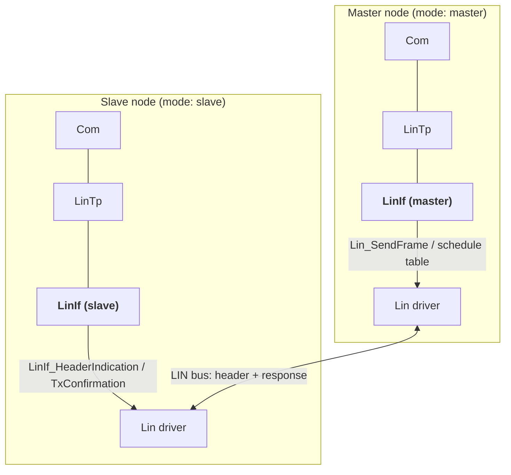
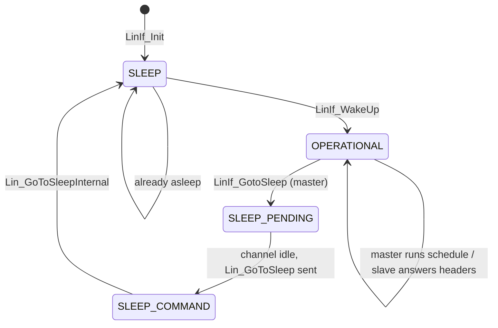
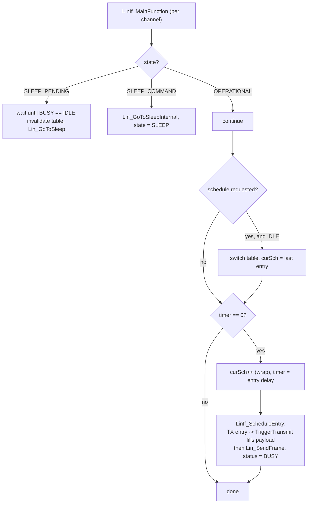
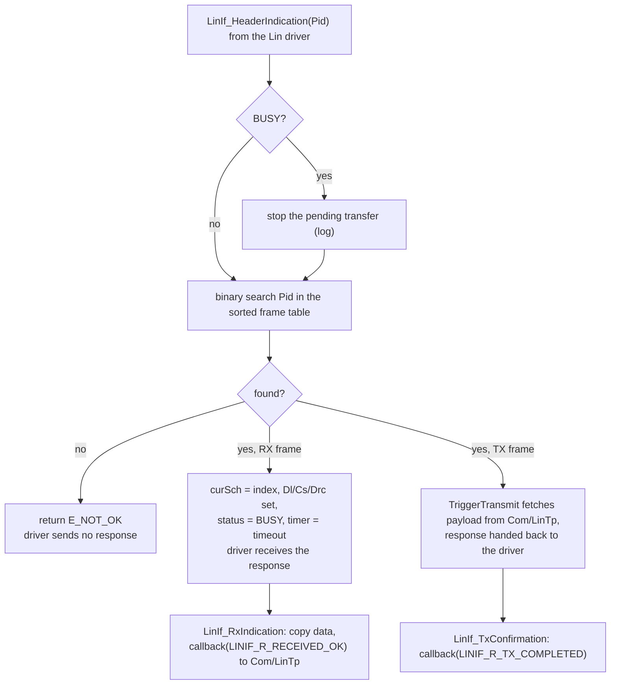
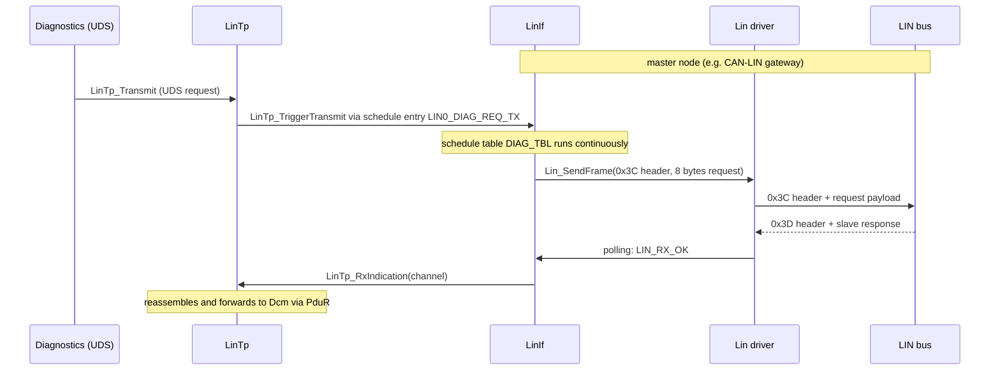

# LinIf - LIN Interface

> **In one sentence:** LinIf turns raw LIN frames into configured PDUs: on a
> **master** node it walks a schedule table and sends one frame header per
> entry, on a **slave** node it matches every received header against its frame
> table and answers with the configured response - and for diagnostic frames
> (0x3C/0x3D) everything is handed to [LinTp](LinTp.md).

| Item | Value |
| --- | --- |
| Module | `infras/communication/LinIf` (API: `infras/include/LinIf.h`) |
| Layer | Above the Lin driver, below [LinTp](LinTp.md) and [Com](Com.md) |
| Configuration | `LinIf.json` (e.g. `app/bootloader/config/LinIf/LinIf.json`, platform configs under `app/platform/*/config/Com/LinIf.json`) |
| Generator | `tools/generator/LinIf.py` -> `GEN/LinIf_Cfg.c` / `GEN/LinIf_Cfg.h` (+ optional LDF import) |
| Standard | AUTOSAR CP 4.4 LinIf (simplified: 2 bus states, no full schedule runtime checks) |
| Demo | `scons --app=LinApp` (LIN slave with diagnostic frames + Mirror) |

**Contents**

1. [What the module is for](#1-what-the-module-is-for)
2. [Where it sits in the stack](#2-where-it-sits-in-the-stack)
3. [Configuration](#3-configuration)
4. [How it works at runtime](#4-how-it-works-at-runtime)
5. [Public API](#5-public-api)
6. [Build and run a demo](#6-build-and-run-a-demo)
7. [Key notes and gotchas](#7-key-notes-and-gotchas)
8. [Troubleshooting](#8-troubleshooting)
9. [Known limitations and code review findings](#9-known-limitations-and-code-review-findings)
10. [Related documents](#10-related-documents)

---

## 1. What the module is for

LIN is a master-driven bus: only the master sends frame headers, slaves fill in
responses. LinIf is the AUTOSAR layer that owns this on both roles:

* **Master** - executes the **schedule tables** from the LDF: every
  `MainFunction` tick it picks the next entry, asks Com/LinTp for the payload
  (`TriggerTransmit`) and sends the frame via the Lin driver. `Delay` keeps the
  timing between entries.
* **Slave** - receives every header from the Lin driver
  (`LinIf_HeaderIndication`), finds the matching frame in its table, either
  fills the response (its own TX frame, payload from Com/LinTp) or prepares to
  receive (RX frame, result to Com/LinTp).
* **Diagnostics** - frames of type `DIAG_MRF` (0x3C master request) and
  `DIAG_SRF` (0x3D slave response) are routed to LinTp instead of Com, so UDS
  works over LIN unchanged.
* **Bus mirroring** - with `USE_MIRROR`, every completed frame (TX/RX/error) is
  reported to [Mirror](Mirror.md) via `Mirror_ReportLinFrame`.

---

## 2. Where it sits in the stack



Generated user callbacks connect LinIf to the upper modules; the `Up` field of
each PDU decides which one is called:

| PDU direction | `up: "Com"` | `up: "LinTp"` |
| --- | --- | --- |
| RX (`*_RX`) | `Com_RxIndication(COM_<name>)` | `LinTp_RxIndication(channel)` |
| TX (`*_TX`) | `Com_TriggerTransmit(COM_<name>)` | `LinTp_TriggerTransmit(channel)` |

Unlike CanIf, the PDU id is **not** passed upwards: RX for LinTp is identified
by the channel index only (see section 7).

---

## 3. Configuration

### 3.1 Top-level keys

| Key | Default | Meaning |
| --- | --- | --- |
| `Class` | - | selects `LinIf.py` |
| `SchedMode` | `POLLING` | `POLLING`: results are polled in `LinIf_MainFunction_Read`; `INTERRUPT`: the Lin driver calls `LinIf_RxIndication` / `LinIf_TxConfirmation` directly (used on ac7840x) |
| `ProcessParity` | `false` | when `true`, the generator stores the **PID** (6-bit id + parity bits P0/P1) instead of the raw id - needed when the Lin driver expects a complete PID |
| `MainFunctionPeriod` | `10` | ms; only produces `LINIF_MAIN_FUNCTION_PERIOD` and the convert macro |
| `UsePostBuildConfig` | `false` | emits `LINIF_USE_PB_CONFIG` |
| `Networks[]` | required | one entry per LIN channel |

### 3.2 Network keys

| Key | Meaning |
| --- | --- |
| `Name` | network name, e.g. `LIN0` |
| `Me` | this node's name; for LDF import it decides master vs slave |
| `Mode` | `master` or `slave` (derived automatically when importing an LDF) |
| `Timeout` | default `100` (ms); slave response timeout and master per-entry timeout |
| `Ldf` | optional: path to a `.ldf` file; see 3.3 |
| `TxPdus[]` / `RxPdus[]` | frame configuration, see 3.4 |
| `ScheduleTables[]` | master only, see 3.5 |

### 3.3 LDF import

When a network has an `Ldf` key, the generator (function `extract`) imports the
LDF once and writes an expanded `GEN/LinIf.json` next to it:

* `Mode` = `master` if the LDF's master node equals `Me`, else `slave`;
* every LDF signal message becomes a `UNCONDITIONAL` PDU named
  `<NET>_<MESSAGE>_TX` or `_RX`, `up: "Com"`, enhanced checksum;
* diagnostic frames become `DIAG_MRF` / `DIAG_SRF` PDUs with classic checksum,
  `up: "LinTp"` (direction depends on the node role);
* on a master, the LDF schedule tables are imported as `ScheduleTables` plus a
  `DIAG_REQ` / `DIAG_RES` diagnostic table with 20 ms entries;
* on a slave, one implicit schedule table containing all PDUs (sorted by id) is
  generated - slaves never send headers, so the "table" is only the frame
  lookup list.

### 3.4 PDU keys (`TxPdus[]` / `RxPdus[]`)

| Key | Meaning |
| --- | --- |
| `Name` | **must end with `_TX` or `_RX`** - the generator derives the frame response direction from the last two characters and generates `COM_<name>` / callback names |
| `Id` | frame id (6-bit); with `ProcessParity` the parity bits are computed at generation time |
| `Type` | `UNCONDITIONAL`, `DIAG_MRF`, `DIAG_SRF` (emitted as `LINIF_<type>`) |
| `Checksum` | `enhanced` (default) or `classic` |
| `Dlc` | payload length, 1..8 (`LINIF_MAX_DATA_LENGHT = 8`) |
| `Up` | `Com` or `LinTp` |

### 3.5 Schedule tables (master only)

```json
"ScheduleTables": [
  { "Name": "DIAG_TBL",
    "Tables": [
      { "Name": "LIN0_DIAG_REQ_TX", "Delay": "10" },
      { "Name": "LIN0_DIAG_RES_RX", "Delay": "10" }
    ] }
]
```

* every entry references a PDU by `Name` and has a `Delay` in **ms**;
* `LINIF_SCHTBL_<NET>_<TBL>` index macros are generated, to be used with
  `LinIf_ScheduleRequest`;
* on `_WIN32` builds `LINIF_DELAY_UINT` is 10, so every delay and the network
  `Timeout` are multiplied by 10 internally (one "tick" = 10 ms);
* an empty table is rejected at runtime (`E_NOT_OK` when switching).

### 3.6 Generated code

`GEN/LinIf_Cfg.h`:

```c
#define LINIF_SCHTBL_LIN0 0              /* slave: one table per network   */
#define LINIF_SCHTBL_LIN0_DIAG_TBL 0     /* master: one per schedule table */
#define LINIF_VARIANT LINIF_VARIANT_SLAVE   /* MASTER / SLAVE / BOTH */
#define LINIF_MAIN_FUNCTION_PERIOD 10u
#define LINIF_SCHED_MODE_POLLING
```

`GEN/LinIf_Cfg.c` contains one `LinIf_ScheduleTableEntryType` per frame (id,
dlc, type, checksum, direction, callback, delay), the table array, and one
`LinIf_ChannelConfigType` per network. Each PDU gets a generated
`LinIf_UserCallback_<name>` implementing the routing table above.

---

## 4. How it works at runtime

### 4.1 Channel states



Only two transfer states exist per channel (`LINIF_STATUS_IDLE` / `BUSY`) -
deliberately simple compared to full AUTOSAR.

### 4.2 Master: schedule execution



Completion depends on `SchedMode`:

* `POLLING`: `LinIf_MainFunction_Read` calls `Lin_GetStatus`; `LIN_TX_OK`
  completes a TX entry, `LIN_RX_OK` completes an RX entry and copies the data
  before invoking the user callback;
* `INTERRUPT`: the Lin driver calls `LinIf_TxConfirmation` / (for slave RX)
  `LinIf_RxIndication` instead.

Either way the user callback is invoked with `LINIF_R_TX_COMPLETED` or
`LINIF_R_RECEIVED_OK` and the channel returns to `IDLE`.

### 4.3 Slave: header matching



If the slave never sees the response, the `timeout` timer in
`LinIf_MainFunction` fires, resets the channel to `IDLE` and notifies the
callback with `LINIF_R_NOT_OK` (release note 4.0.2).

### 4.4 Diagnostic round trip



---

## 5. Public API

| Function | Role | Purpose |
| --- | --- | --- |
| `LinIf_Init(ConfigPtr)` | both | reset contexts, start in `SLEEP` |
| `LinIf_DeInit()` | both | back to `UNINIT`, force sleep |
| `LinIf_ScheduleRequest(Channel, Schedule)` | master | switch schedule table (validated against `numOfSchTbls`, only in `OPERATIONAL`) |
| `LinIf_GotoSleep(Channel)` | both | master: graceful (`SLEEP_PENDING`, finishes the current frame); slave: immediate `Lin_GoToSleepInternal` |
| `LinIf_WakeUp(Channel)` | both | `SLEEP -> OPERATIONAL`, Lin bus wakeup pulse |
| `LinIf_MainFunction()` | both | master schedule engine / slave timeout supervision |
| `LinIf_MainFunction_Read()` | master | POLLING mode result polling |
| `LinIf_HeaderIndication(Channel, PduPtr)` | slave | called by the Lin driver for every header; returns response or prepares RX |
| `LinIf_RxIndication(Channel, SduPtr)` | both | response data received |
| `LinIf_TxConfirmation(Channel)` | both | response transmitted |
| `LinIf_EnableBusMirroring(Channel, Active)` | both | with `USE_MIRROR`: report frames to Mirror |
| `LinIf_GetVersionInfo(info)` | both | 4.0.2 |

`LinIf_Transmit` and `LinIf_LinErrorIndication` are declared in `LinIf.h` but
**not implemented** (see section 9).

### Scheduling

`LinIf_MainFunction` and `LinIf_MainFunction_Read` are registered in the EcuM
main lists (`EcuM_Cfg.c`, guarded by `USE_LINIF`); `Lin_MainFunction` /
`Lin_MainFunction_Read` (the driver) run in the fast list next to them.

---

## 6. Build and run a demo

`scons --app=LinApp` builds the LIN demo app (`ApplicationLinApp` in
`app/app/SConscript`). It links:

* `LinIf` + `LinTp` with the **slave** configuration from
  [`app/bootloader/config/LinIf/LinIf.json`](../../app/bootloader/config/LinIf/LinIf.json)
  (diagnostic frames 0x3C RX / 0x3D TX, `up: LinTp`, schedule table `DIAG_TBL`);
* `Mirror` with `config/Mirror/Mirror.json` (LIN source network, for bus
  mirroring).

The app starts as a LIN slave in `SLEEP`; after `LinIf_WakeUp` it waits for
headers:

```bash
scons --app=LinApp -j8
AS_LOG_LINIF=3 AS_LOG_LINTP=3 build\nt\GCC\LinApp\LinApp.exe
```

On its own it stays quiet - a LIN slave only talks when a master sends headers.
Use the virtual LIN environment described in
[virtual-lin-env](virtual-lin-env.md) to run a master (e.g. the `Lin` tool from
`tools/libraries/Lin`) that sends `0x3C` diagnostic requests; the LinApp console
then shows the received frames and the LinTp activity. On real hardware the same
configuration is used by the bootloader variants
(`app/platform/ac7840x/app0/config/Com/LinIf.json` with two LDF-imported
networks, `SchedMode: INTERRUPT`).

---

## 7. Key notes and gotchas

* **PDU names must end in `_TX` / `_RX`.** The generator reads the direction
  from the last two characters (`name[-2:]`); anything else raises at
  generation time. LDF import guarantees this for you.
* **The `up: "LinTp"` route carries no PDU id.** RX goes to
  `LinTp_RxIndication(<channel index>)`, so a multi-channel LinTp config maps
  channels by position, not by name.
* **`Delay` is in ms in the JSON, but multiplied by `LINIF_DELAY_UINT`**
  (1 ms on targets, 10 ms in `_WIN32` simulation). A `delay: "10"` entry waits
  100 ms in the simulator - do not "fix" the LDF because the simulation looks
  slow.
* **Slave tables are sorted by id and searched by binary search** - keep the
  GEN file sorted (the generator already does) and remember the search matches
  the **raw 6-bit id**, unless `ProcessParity` is enabled.
* **`ProcessParity` must match the Lin driver.** If the driver expects a full
  PID (with P0/P1 in bits 6/7) and the table stores raw ids, no slave response
  is ever produced - this typically shows up as "no response" on real hardware
  while the simulation works.
* **One response per header.** If a new header arrives while a response is
  still pending, LinIf drops the pending one and follows the new header.
* **Master sleeps gracefully, slave sleeps immediately.**
  `LinIf_GotoSleep` on a master waits for `IDLE`, invalidates the table and
  sends the sleep command - it takes up to two main cycles.
* **`Timeout` covers both roles** (master per-entry timeout, slave response
  timeout) and is converted with the same `LINIF_DELAY_UINT`.

---

## 8. Troubleshooting

| Symptom | Likely cause |
| --- | --- |
| Slave never responds | `ProcessParity` mismatch with the driver, or the PDU id is not in the slave table (check `GEN/LinIf_Cfg.c`) |
| `LINIFE: context buffer too small` | a PDU with `dlc > 8` (`LINIF_MAX_DATA_LENGHT`); LIN classic allows max 8 |
| `LINIFE: <ch> slave timeout` | master sent the header but the response did not arrive (wiring, checksum mismatch, or the upper layer returned no payload) |
| `LINIFE: <ch> master timeout` | a schedule entry never completed - check the Lin driver status handling / `SchedMode` consistency |
| `LINIFE: <ch> get data in idle` | `LinIf_RxIndication` without a pending header - driver/driver-config mismatch, or `SchedMode` set to `INTERRUPT` while the driver polls |
| Schedule table never starts | `LinIf_ScheduleRequest` only works in `OPERATIONAL` - call `LinIf_WakeUp` first; also check the table is non-empty |
| Timing 10x too slow in simulation | that is `LINIF_DELAY_UINT = 10` on `_WIN32` - by design |
| Duplicate symbol `LinIf_UserCallback_...` | two PDU entries with the same `Name` in the JSON |

---

## 9. Known limitations and code review findings

### 9.1 Functional limitations

* **No `LinIf_Transmit`.** Declared in `LinIf.h` but not implemented - in this
  architecture PDUs are always scheduled (master) or header-triggered (slave);
  Com/LinTp never push a PDU by id.
* **`LinIf_LinErrorIndication` is declared but not implemented** - bus errors
  are only visible through timeouts.
* **No bus-idle / schedule-table runtime semantics of the full spec**: no
  `LINIF_SCHTBL_...` events, no `LinIf_ScheduleRequest` while a table runs
  queued requests beyond the single `scheduleRequested` slot, no
  resume-position handling after wakeup (restarts from the last entry).
* **Max 8 data bytes** (`LINIF_MAX_DATA_LENGHT`, no LIN 2.1+ 16/24-byte
  "fast frames").
* **Master restarts each table from the last entry index** on switch
  (`curSch = numOfEntries - 1`, then `curSch++` wraps to 0) so the first entry
  runs immediately - correct but subtle; release note 4.0.1 documents the
  related wakeup fix.

### 9.2 Code review findings

| # | Where | Finding |
| --- | --- | --- |
| 1 | `LinIf.c:435` | `LinIf_HeaderIndication` computes `h = numOfEntries - 1` on a `uint16_t`: an **empty slave table** (a slave node with zero PDUs, possible after LDF import) underflows to 65535 and the binary search then reads out of bounds. Guarded only by the fact that the generator always creates at least the diagnostic PDUs. |
| 2 | `LinIf.c:89-102` | In POLLING mode `Lin_GetStatus` returns the RX buffer pointer, and the 8-byte log dump reads `SduPtr[0..7]` **unconditionally** - a frame with `Dl < 8` causes an over-read of the driver buffer (same pattern as the CanIf log bug). |
| 3 | `LinIf.c:543` | `memcpy(context->frame.SduPtr, Lin_SduPtr, entry->dlc)` copies `entry->dlc` bytes without the driver reporting how many were actually received; a slave answering with a different DLC would corrupt the buffer or over-read. |
| 4 | `LinIf.c:38-75` | `LinIf_ScheduleEntry` treats a failed `TriggerTransmit` (`FAIL to provide Tx buffer`) as a hard `E_NOT_OK` for that entry but **does not advance or skip** - the same entry is retried after `timer` expires via the master-timeout path, without any retry counter. A permanently unresponsive Com/LinTp stalls the whole schedule table (entries after it never run). |
| 5 | `LinIf.c:111-121` | Mirror reporting in `LinIf_CheckEntry` runs for **any** final status including `LIN_TX_ERROR` / `RX_NO_RESPONSE`, but reports `context->data` - for an RX-no-response the buffer holds stale data, so the mirror shows garbage bytes for failed frames. |
| 6 | `LinIf.c:17-18` | `AS_LOG_LINIFE` (error channel) defaults to **0**, i.e. all LinIf errors are invisible unless `AS_LOG_LINIF`/`AS_LOG_LINIFE` is set via the environment. Most "my LIN does not work" cases produce no output at all by default. |
| 7 | `LinIf.c:246-259` | `LinIf_Init` uses `int i` against `numOfChannels` (uint16) - harmless, but inconsistent with the rest of the codebase. |
| 8 | `LinIf.py:112-121` | The schedule entry's `Drc` is derived from the PDU **name suffix** (`name[-2:]`), not from the `RxPdus`/`TxPdus` list membership. A PDU named `FOO_TX` placed in `RxPdus` silently generates a TX-entry callback that calls `Com_TriggerTransmit` on an RX Com PDU symbol - generation succeeds, runtime misbehaves. |
| 9 | `LinIf.py:82-87` | `LINIF_DELAY_UINT` silently differs between `_WIN32` (10) and targets (1); the same JSON produces different absolute timings on both. Not documented in the generated header. |
| 10 | `LinIf.py:388-389` | `extract()` sorts PDUs by `toNum(id) & 0x1FFFFFFF` *after* generating, but `ScheduleTables` entries reference PDUs by name - a master table whose entries were written in LDF order is not re-sorted, so the binary-search assumption (sorted table) only holds for the implicit slave table. |

---

## 10. Related documents

* [LinTp](LinTp.md) - the transport layer riding on the diagnostic frames
  (reuses the CanTp code)
* [Com](Com.md) - signal layer for the UNCONDITIONAL frames
* [Mirror](Mirror.md) - bus mirroring, `Mirror_ReportLinFrame`
* [virtual-lin-env](virtual-lin-env.md) - how to simulate a LIN bus with a
  master node on the host
* Code: [LinIf.c](../../infras/communication/LinIf/LinIf.c),
  [LinIf_Priv.h](../../infras/communication/LinIf/LinIf_Priv.h),
  [LinIf.h](../../infras/include/LinIf.h),
  [LinIf.py](../../tools/generator/LinIf.py)
* AUTOSAR CP 4.4 - Specification of LIN Interface
