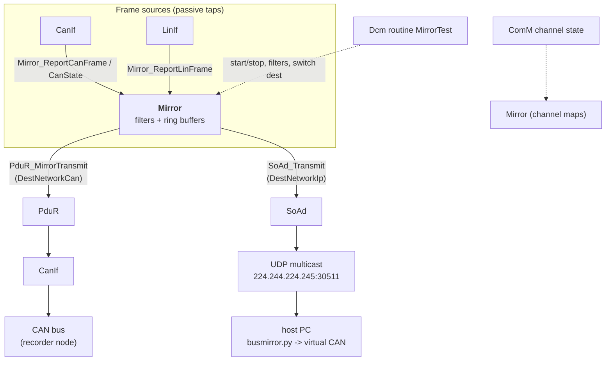
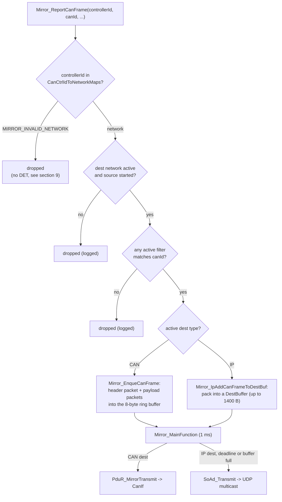
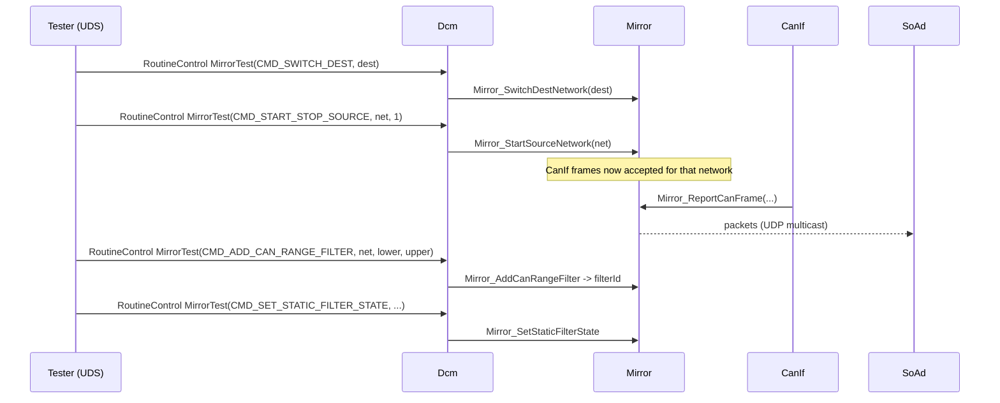

# Mirror - Bus Mirroring

> **In one sentence:** Mirror records every CAN and LIN frame that passes
> through CanIf/LinIf, filters it, packages it into the AUTOSAR bus-mirror
> protocol and streams it either as **UDP multicast over Ethernet** (SoAd, for
> the host PC tool) or as **CAN frames** (PduR, for on-vehicle recorders) - so
> a test engineer can watch the whole vehicle's buses from one point.

| Item | Value |
| --- | --- |
| Module | `infras/diagnostic/Mirror` (API: `infras/include/Mirror.h`) |
| Layer | Diagnostic area; hooks into [CanIf](CanIf.md) / [LinIf](LinIf.md), sends via [SoAd](SoAd-link) or [PduR](PduR.md) |
| Configuration | `app/app/config/Mirror/Mirror.json` + `config/Mirror/Network/Network.json` (SoAd socket) |
| Generator | `tools/generator/Mirror.py` -> `GEN/Mirror_Cfg.c` / `GEN/Mirror_Cfg.h` |
| Standard | AUTOSAR CP 4.4 Mirror (bus mirroring protocol per `@SWS_Mirror_*`) |
| Host tool | `tools/libraries/python/mirror/busmirror.py` |
| Demo | part of `CanApp` / `LinApp`; controlled remotely via the Dcm routine `MirrorTest` |

**Contents**

1. [What the module is for](#1-what-the-module-is-for)
2. [Where it sits in the stack](#2-where-it-sits-in-the-stack)
3. [Configuration](#3-configuration)
4. [How it works at runtime](#4-how-it-works-at-runtime)
5. [Public API](#5-public-api)
6. [Build and run a demo](#6-build-and-run-a-demo)
7. [Key notes and gotchas](#7-key-notes-and-gotchas)
8. [Troubleshooting](#8-troubleshooting)
9. [Known limitations and code review findings](#9-known-limitations-and-code-review-findings)
10. [Related documents](#10-related-documents)

---

## 1. What the module is for

Rest-bus simulation, EMC measurement and field diagnostics all need the same
thing: a copy of the raw bus traffic without disturbing the nodes. Mirror does
that inside the ECU:

* **Capture** - CanIf calls `Mirror_ReportCanFrame` for every transmitted and
  received frame (and `Mirror_ReportCanState` for bus state changes); LinIf
  calls `Mirror_ReportLinFrame`.
* **Filter** - static filters (range / mask, configured at build time) plus
  dynamic filters (added at runtime via API or diagnostics) decide which frames
  are mirrored.
* **Package** - each frame becomes a sequence of 8-byte protocol packets:
  header packet (`type | NetworkId | length | ID flags + ID`) followed by
  payload packets, exactly as the AUTOSAR mirror protocol defines
  (`@SWS_Mirror_00098/00099` for the extended-ID and CAN-FD flag bits).
* **Deliver** - the packets are queued per destination network: a CAN
  destination (ring buffer -> PduR -> CanIf) or an IP destination (large
  buffers -> SoAd -> UDP multicast), with a transmission deadline for the IP
  path.
* **Control** - a DCM routine (`MirrorTest`) lets a diagnostic tester switch
  destinations, start/stop source networks and manage filters remotely.

---

## 2. Where it sits in the stack



Both destinations may be configured at once; `Mirror_SwitchDestNetwork` picks
the active one. Nothing on the mirrored buses is modified - Mirror is a pure
observer.

---

## 3. Configuration

### 3.1 Top-level keys

| Key | Demo | Meaning |
| --- | --- | --- |
| `Class` | `"Mirror"` | selects `Mirror.py` |
| `MainFunctionPeriod` | absent | default `1` ms; generates `MIRROR_MAIN_FUNCTION_PERIOD` (IP destination deadline handling) |
| `UsePostBuildConfig` | absent | default `false`; emits `MIRROR_USE_PB_CONFIG` |
| `SourceNetworkCan[]` | 1 (CAN0) | CAN buses to observe |
| `SourceNetworkLin[]` | 1 (LIN0) | LIN buses to observe |
| `DestNetworkCan[]` | 1 (AS) | CAN destination(s) |
| `DestNetworkIp[]` | 1 (AS) | Ethernet destination(s) |

All four lists may be empty except at least one destination should exist.
Network handle indexes are assigned in this order: CAN sources, LIN sources,
CAN destinations, IP destinations (`MIRROR_SRC_NT_CAN_*`,
`MIRROR_SRC_NT_LIN_*`, `MIRROR_DST_NT_CAN_*`, `MIRROR_DST_NT_IP_*`).

### 3.2 `SourceNetworkCan[]` / `SourceNetworkLin[]`

| Key | Demo CAN | Demo LIN | Meaning |
| --- | --- | --- | --- |
| `Name` | `CAN0` | `LIN0` | symbolic name, becomes `MIRROR_SRC_NT_CAN_<NAME>` |
| `ControllerId` | `0` | `0` | the Can/Lin controller this bus maps to; builds the `CanCtrlIdToNetworkMaps` / `LinCtrlIdToNetworkMaps` lookup used by the Report APIs |
| `NetworkId` | `3` | `5` | bus identifier carried in the mirror protocol packets - choose it so the collector can tell buses apart (the host tool forwards to virtual bus `10 + NetworkId`) |
| `StaticFilters[]` | 2 | 2 | build-time filters; each is `{"type": "range", "lower": .., "upper": ..}` or `{"type": "mask", "code": .., "mask": ..}`. A frame passes if **any** active filter matches |
| `MaxDynamicFilters` | `128` | `32` | RAM slots for filters added at runtime (`Mirror_AddCanRangeFilter` etc.); default 128 (CAN) / 32 (LIN) |
| `SingleIdMappings[]` | - | - | CAN only: 1:1 `SourceCanId -> DestCanId` remap for the CAN destination |
| `MaskBasedIdMappings[]` | - | - | CAN only: `DestBaseId + SourceCanIdCode/Mask` remap |
| `SourceLinToCanIdMappings[]` | - | - | LIN only: `LinId -> CanId` table for carrying LIN frames in the CAN-oriented protocol packets |
| `SourceLinToCanBaseId` | - | `0` | LIN only: base CAN id when no mapping table is given |

### 3.3 `DestNetworkCan[]`

| Key | Demo | Meaning |
| --- | --- | --- |
| `Name` | `AS` | becomes `MIRROR_DST_NT_CAN_<NAME>` |
| `DestQueueSize` | `128` | ring buffer entries; **doubled** by the generator and must then be a power of two (asserted) |
| `TxPduId` | `MIRROR_TX` | PduR route name `PDUR_MIRROR_TX` (PduR.json has `{ "Name": "MIRROR_TX", "From": "Mirror", "To": "CanIf" }`) |
| `MirrorStatusCanId` | `0xFFFFFFFF` | CAN id used for mirror status frames (invalid = disabled) |

### 3.4 `DestNetworkIp[]`

| Key | Demo | Meaning |
| --- | --- | --- |
| `Name` | `AS` | becomes `MIRROR_DST_NT_IP_<NAME>` |
| `DestQueueSize` | `2` | number of large buffers (power of two, asserted) |
| `DestBufferSize` | `1400` | bytes per buffer (fits one UDP payload) |
| `SoAd` | `SOAD_TX_PID_MIRROR_CLIENT_0` | SoAd TX PDU id; the socket is defined in `config/Mirror/Network/Network.json` as UDP multicast client `224.244.224.245:30511` with `up: "Mirror"` |
| `MirrorDestTransmissionDeadline` | absent (`655` ms) | buffered data older than this is flushed by `Mirror_MainFunction` |

### 3.5 Generated code

`GEN/Mirror_Cfg.h` emits `MIRROR_USE_SOURCE_CAN`, `MIRROR_USE_SOURCE_LIN`,
`MIRROR_USE_DEST_CAN`, `MIRROR_USE_DEST_IP` plus one index macro per network -
the whole module is `#ifdef`-pruned to exactly what you configured.
`GEN/Mirror_Cfg.c` holds the filter tables, ring buffers, the controller->network
lookup maps and `Mirror_ComChannelMaps` (used by ComM integration and
`Mirror_GetNetworkHandle`).

---

## 4. How it works at runtime

### 4.1 Frame path



LIN frames follow the same shape via `Mirror_ReportLinFrame`, with the optional
LIN->CAN id mapping before the packets are built.

### 4.2 The mirror protocol packet

One CAN frame becomes `ceil((length + 8) / 8)` ring slots (header + payload):

| Byte | Header packet | Payload packet |
| --- | --- | --- |
| 0 | `MIRROR_NT_CAN` (or `MIRROR_NT_LIN`) | payload byte |
| 1 | `NetworkId` | payload byte |
| 2 | reserved | payload byte |
| 3 | length | payload byte |
| 4 | flags: bit7 extended ID, bit6 CAN FD, bits 4..0 = ID bits 28..24 | payload byte |
| 5..7 | ID bits 23..0 | payload bytes |

The IP destination prepends a header timestamp (48-bit seconds + 32-bit
nanoseconds) and a sequence number - `busmirror.py` decodes exactly this.

### 4.3 State and control



`Mirror_Offline()` stops everything; `Mirror_IsMirrorActive()` tells callers
whether mirroring is currently on. With ComM in the build, Mirror follows the
ComM channel mode via `Mirror_ComChannelMaps`.

---

## 5. Public API

| Function | Purpose |
| --- | --- |
| `Mirror_Init` / `Mirror_DeInit` | lifecycle |
| `Mirror_ReportCanFrame(controllerId, canId, length, payload)` | called by CanIf for TX and RX frames |
| `Mirror_ReportCanState(controllerId, state)` | AS extension: bus online/error-passive/bus-off + TX error counter/8 |
| `Mirror_ReportLinFrame(controllerId, pid, PduInfo, status)` | called by LinIf |
| `Mirror_GetStaticFilterState` / `Mirror_SetStaticFilterState` | enable/disable one build-time filter |
| `Mirror_AddCanRangeFilter` / `Mirror_AddCanMaskFilter` / `Mirror_AddLinRangeFilter` / `Mirror_AddLinMaskFilter` / `Mirror_RemoveFilter` | runtime filter management (returns a filterId) |
| `Mirror_SwitchDestNetwork(network)` / `Mirror_GetDestNetwork` | select the active destination |
| `Mirror_StartSourceNetwork` / `Mirror_StopSourceNetwork` / `Mirror_IsSourceNetworkStarted` | per-source enable |
| `Mirror_GetNetworkType` / `Mirror_GetNetworkId` / `Mirror_GetNetworkHandle` | network handle <-> type/id mapping |
| `Mirror_IsMirrorActive` / `Mirror_Offline` | global switch |
| `Mirror_MainFunction` | drains destinations (EcuM fast list, `USE_MIRROR`) |
| `Mirror_TestStart(...)` | DCM routine used by the `MirrorTest` service (commands 0..8) |

---

## 6. Build and run a demo

`CanApp` already links Mirror with both source networks and both destinations
(`app/app/config/Mirror/Mirror.json`); the SoAd socket configuration comes from
`config/Mirror/Network/Network.json` + `Mempool.json`, generated by
`ApplicationApp.gencfg()`.

To watch the mirrored traffic on the host:

```bash
# 1. build and run CanApp (any app linking Mirror + SoAd)
scons --app=CanApp -j8
build\nt\GCC\one\one.exe

# 2. on another shell, run the collector
python tools/libraries/python/mirror/busmirror.py
```

The collector joins multicast group `224.244.224.245:30511`, decodes the
mirror packets and **forwards every mirrored frame to a virtual CAN bus**
`simulator_v2` port `10 + NetworkId` (so CAN0 with `NetworkId 3` appears on
port 13). You can then open that port with `CanDump`:

```bash
build\nt\GCC\one\CanDump.exe -d simulator_v2 -p 13
```

To control mirroring remotely, use the UDS routine `MirrorTest` registered in
`Dcm.json` (`"name": "MirrorTest"`, `"start": "Mirror_TestStart"`); its command
byte selects one of the 9 operations listed in
[Mirror_Test.c](../../infras/diagnostic/Mirror/Mirror_Test.c).

---

## 7. Key notes and gotchas

* **Mirror is passive but not free.** Every frame is memcpy'd at least twice
  (CanIf report -> ring/buffer -> SoAd); with mirroring active on a busy bus the
  CPU cost is measurable. Keep filters tight.
* **`NetworkId` is your convention, not a fixed number.** The demo uses 3 for
  CAN and 5 for LIN because the host tool and restbus scripts expect that; if
  you change it, change `busmirror.py` usage too (it forwards to
  `10 + NetworkId`).
* **Filters only bite after the source network is started.** A started network
  with zero active filters mirrors *every* frame (`MaxActiveFilterId == 0 ->
  accept all`); as soon as one filter is active, a frame must match at least
  one active filter.
* **The CAN destination ring is small.** `DestQueueSize` is doubled to a power
  of two; on overflow frames are dropped with a single `MIRRORE: No free
  space` log - there is no counter.
* **The IP deadline default is 655 ms.** A silent bus means nothing is sent for
  up to 655 ms; do not interpret the silence as a broken socket.
* **`Mirror_ReportCanFrame` logs every accepted frame at `AS_LOG_MIRROR`** -
  enable it for debugging but expect heavy output.
* **SoAd config is a separate JSON.** Mirror.json alone is not enough: the UDP
  multicast socket lives in `config/Mirror/Network/Network.json` and is
  generated by the `Net` class.
* **LIN frames ride the CAN-oriented packet format.** With
  `SourceLinToCanIdMappings` each LIN frame gets a CAN id; without it,
  `SourceLinToCanBaseId + LinId` is used.

---

## 8. Troubleshooting

| Symptom | Likely cause |
| --- | --- |
| Collector receives nothing | destination not active (`Mirror_SwitchDestNetwork`), source network not started, or the SoAd socket config (`Network.json`) missing/mismatched |
| `MIRRORE: No free space` | CAN destination ring too small for the filtered traffic; increase `DestQueueSize` (power of two) or narrow filters |
| Frames missing although the bus is busy | a filter excludes them - remember a frame passes if *any* active filter matches; check `Mirror_GetStaticFilterState` |
| `Mirror_ReportCanFrame` seems never called | the controller id is not in `CanCtrlIdToNetworkMaps` (no `SourceNetworkCan` entry with that `ControllerId`) |
| Host tool decodes garbage | `NetworkId`/flag-byte interpretation mismatch between ECU config and `busmirror.py` expectations |
| UDS `MirrorTest` returns NRC 0x31 | the routine is not registered in `Dcm.json`, or the command/length combination does not match the `Mirror_Test.c` table |
| LIN frames appear with wrong CAN ids | missing `SourceLinToCanIdMappings` and unsuitable `SourceLinToCanBaseId` |

---

## 9. Known limitations and code review findings

### 9.1 Functional limitations

* **No MirrorOverEthernet statemachine of the full spec** - the module implements
  the frame/state reporting and the two destination types, but there is no
  port-agent / network-configuration dialogue, no PNC gateway coordination.
* **One active destination at a time.**
* **`Mirror_ReportCanState` is an AS extension** (bit layout documented in
  `Mirror.h`), not the AUTOSAR CAN state mapping.
* **Only CanIf and LinIf feed the module** - Ethernet (EthIf) sources are not
  implemented.
* **No overflow statistics** on the CAN destination ring.
* **Timestamps only exist on the IP path** (host decodes header timestamp); the
  CAN destination carries no time information.

### 9.2 Code review findings

| # | Where | Finding |
| --- | --- | --- |
| 1 | `Mirror.c:1133-1134` | `Mirror_GetNetworkHandle` searches `MIRROR_CONFIG->ComChannelMaps[network]` instead of `[i]` - it inspects the same (initially `MIRROR_INVALID_NETWORK`) element on every iteration, so the function can never find a match and reads `ComChannelMaps[0xFF]` out of bounds on the first iteration. Copy-paste/variable-shadowing bug; any caller relying on this API gets `MIRROR_INVALID_NETWORK` or a crash. |
| 2 | `Mirror.c:1170-1172` | `Mirror_ReportCanFrame` maps `controllerId` through `CanCtrlIdToNetworkMaps` without checking for `MIRROR_INVALID_NETWORK`; a CAN controller that is not configured as a mirror source yields `config = &SourceNetworkCans[<huge>]` (out-of-bounds pointer) before the `bStarted` check can save it. CanIf calls this API for *every* controller in the system. |
| 3 | `Mirror.c:1176-1188` | The filter loop condition `i < config->context->MaxActiveFilterId` combined with `MaxActiveFilterId == 0 -> accept all` means: adding one filter and deactivating it does **not** restore "accept all" - the accept-all case is only the pristine state. After `Mirror_RemoveFilter`, `MaxActiveFilterId` is compacted, which silently re-enables frames that the removed filter used to pass. |
| 4 | `Mirror.c:335-390` | `Mirror_EnqueCanFrame` reserves `numPackets` slots via a capability check and then writes them one by one; correct as long as `in - out <= NumOfDataElements` holds - but the capability arithmetic (`0xFFFFul - out + 1u + in`) is correct only while `in`/`out` differ by less than 65536. With uint16 counters and long uptimes this holds, but the code deserves a comment; a single misplaced increment breaks the invariant silently. |
| 5 | `Mirror.c:201-216` | `Mirror_ValidateLinFilter` is used for both range and mask LIN filters, while CAN has separate validate paths; the LIN mask filter semantics (`code/mask` over an 6-bit PID) differ subtly from the CAN one - easy to configure a LIN mask that never matches. |
| 6 | `Mirror.c:1549` total | At 1549 lines with 20+ static functions all gated by different `#ifdef` combinations (`MIRROR_USE_SOURCE_CAN`, `MIRROR_USE_DEST_CAN`, `USE_SOAD`, ...), the module has no unit tests in-tree beyond `test/mirror_test.cpp`; most combinations (e.g. LIN source + CAN dest) are only exercised by hardware demos. |
| 7 | `Mirror.py:44` | `#define MIRROR_%s %su` for `TxPduId` - the generated macro name (`MIRROR_MIRROR_TX` for `TxPduId: "MIRROR_TX"`) is redundant but harmless; a `TxPduId` name colliding with a network name would silently produce a duplicate macro. |
| 8 | `Mirror.py:249-251` | `DestQueueSize` for CAN destinations is **doubled** (128 -> 256 slots) with an `assert` on power-of-two; the doubled value is what RAM is allocated for, but `DestQueueSize` in the JSON reads like the slot count. IP destinations use the raw value. Inconsistent and undocumented. |
| 9 | `Mirror.c:293` | `Mirror_SetNetworkLinFilterState` and the CAN counterpart duplicate the same bounds logic four times (get/set x CAN/LIN) - one bad refactor away from the `GetNetworkHandle` bug above. |
| 10 | `Mirror_Test.c` | `Mirror_TestStart` trusts `*currentDataLength` for command dispatch but several commands read fixed offsets (`dataIn[1..3]`) after only checking some lengths; a tester sending a short request on `CMD_MIRROR_ADD_CAN_MASK_FILTER` (checked) is fine, but any new command added without the same care will read past the buffer. |

---

## 10. Related documents

* [CanIf](CanIf.md) - the CAN frame source (`Mirror_ReportCanFrame` /
  `Mirror_ReportCanState`)
* [LinIf](LinIf.md) - the LIN frame source (`Mirror_ReportLinFrame`)
* [PduR](PduR.md) - the CAN destination route (`MIRROR_TX`)
* [Dcm](Dcm.md) - the `MirrorTest` diagnostic routine
* Host collector: [busmirror.py](../../tools/libraries/python/mirror/busmirror.py)
* Code: [Mirror.c](../../infras/diagnostic/Mirror/Mirror.c),
  [Mirror_Priv.h](../../infras/diagnostic/Mirror/Mirror_Priv.h),
  [Mirror.h](../../infras/include/Mirror.h),
  [Mirror.py](../../tools/generator/Mirror.py)
* AUTOSAR CP 4.4 - Specification of Mirror
