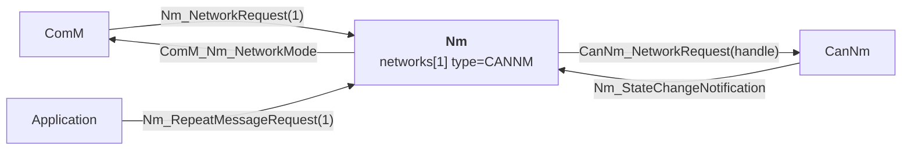

# Nm - Network Management Interface (dispatcher)

> **In one sentence:** Nm is a thin dispatcher: every API call is forwarded to the
> bus-specific NM module configured for that network (CanNm, UdpNm, OsekNm), and
> every indication from them is forwarded up to ComM.

| Item | Value |
| --- | --- |
| Module | `infras/communication/Nm` (API: `infras/include/Nm.h`) |
| Layer | Between [CanNm](CanNm.md)/UdpNm/OsekNm (below) and [ComM](ComM.md) (above) |
| Configuration | `app/app/config/Com/Nm.json` |
| Generator | `tools/generator/Nm.py` -> `GEN/Nm_Cfg.c` / `GEN/Nm_Cfg.h` |
| Standard | AUTOSAR CP 4.4 Nm |
| Demo | `CanApp` |

**Contents**

1. [What the module is for](#1-what-the-module-is-for)
2. [Configuration](#2-configuration)
3. [How it works at runtime](#3-how-it-works-at-runtime)
4. [Public API](#4-public-api)
5. [Key notes and gotchas](#5-key-notes-and-gotchas)

---

## 1. What the module is for

* **One API, many buses** - ComM and the application never call `CanNm_*`
  directly; they call `Nm_*` and the configuration decides where it goes.
* **Callback fan-in** - `CanNm` reports state changes through
  `Nm_StateChangeNotification`, `Nm_CarWakeUpIndication`, etc.; Nm forwards them
  to ComM (`ComM_Nm_*`).

---

## 2. Configuration

```json
{
  "Class": "Nm",
  "Networks": [
    { "Name": "CANNM0", "Type": "CANNM" },
    { "Name": "CANNM1", "Type": "CANNM" }
  ]
}
```

| Key | Meaning |
| --- | --- |
| `Networks[].name` | Network name; index = `NetworkHandleType` |
| `Networks[].type` | `CANNM` -> `CanNm_*`, `UDPNM` -> `UdpNm_*`, `OSEKNM` -> `OsekNm_*` |

The network handle passed to `Nm_*` is translated to the underlying module's own
channel handle (`config->handle`).

---

## 3. How it works at runtime



`Nm.c` is ~200 lines: each function is a DET-guarded table lookup plus a call to
the selected module. There is no state of its own.

---

## 4. Public API

| Function | Direction | Purpose |
| --- | --- | --- |
| `Nm_Init(ConfigPtr)` | EcuM | (Dispatched; underlying module already inited) |
| `Nm_PassiveStartUp` / `Nm_NetworkRequest` / `Nm_NetworkRelease` / `Nm_DisableCommunication` / `Nm_EnableCommunication` | down | Mode requests |
| `Nm_SetUserData` / `Nm_GetUserData` | down | NM user data |
| `Nm_RepeatMessageRequest` / `Nm_RequestBusSynchronization` / `Nm_SetSleepReadyBit` | down | NM feature requests |
| `Nm_GetState` / `Nm_GetNodeIdentifier` / `Nm_GetLocalNodeIdentifier` / `Nm_GetPduData` | down | Queries |
| `Nm_CheckRemoteSleepIndication` | down | Remote sleep query |
| `Nm_NetworkStartIndication` / `Nm_NetworkMode` / `Nm_BusSleepMode` / `Nm_PrepareBusSleepMode` | up | Bus NM -> ComM |
| `Nm_TxTimeoutException` | up | Bus NM -> CanSM/ComM |
| `Nm_StateChangeNotification` | up | State machine trace |
| `Nm_CarWakeUpIndication` / `Nm_RemoteSleepIndication` / `Nm_RemoteSleepCancellation` / `Nm_CoordReadyToSleepIndication` / `Nm_CoordReadyToSleepCancellation` | up | Feature indications |
| `Nm_MainFunction()` | scheduler | Dispatched |

---

## 5. Key notes and gotchas

1. **Both tables must line up**: the `Networks[]` order in `Nm.json` must match
   the channel order in `CanNm.json`/`ComM.json`/`CanSM.json` - the handles are
   plain indexes everywhere.
2. **`OSEKNM` dispatch calls `OsekNm_NetworkRequest` for `Nm_PassiveStartUp`**
   too (the OsekNm API has no passive start-up) - see `Nm.c:36-41`.
3. **Nm has no timer** - all timing lives in CanNm/UdpNm/OsekNm.
4. **Adding a new bus NM** (e.g. a custom one) requires touching `Nm.c` - the
   dispatch is a hard-coded switch, not a function-pointer table.

**Related documents:** [CanNm](CanNm.md) - [ComM](ComM.md) - [can-oseknm](can-oseknm.md)
