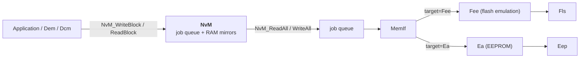

# NvM - NVRAM Manager

> **In one sentence:** NvM turns typed C structs (blocks) into non-volatile
> storage jobs: ReadAll at boot, WriteAll on shutdown, plus per-block read/write/
> restore-defaults, delegated to Fee (flash) or Ea (EEPROM).

| Item | Value |
| --- | --- |
| Module | `infras/memory/NvM` (API: `infras/include/NvM.h`) |
| Layer | Above Fee/Ea (via MemIf), below Dem/Dcm/application |
| Configuration | `app/app/config/NvM/NvM.json` |
| Generator | `tools/generator/NvM.py` -> `GEN/NvM_Cfg.c` / `GEN/NvM_Cfg.h` |
| Standard | AUTOSAR CP 4.4 NvM (subset) |
| Demo | `CanApp` + DCM routine `31 01 FEEF` (`NvM_TestStart`) |

**Contents**

1. [What the module is for](#1-what-the-module-is-for)
2. [Configuration](#2-configuration)
3. [How it works at runtime](#3-how-it-works-at-runtime)
4. [Public API](#4-public-api)
5. [Build and run a demo](#5-build-and-run-a-demo)
6. [Key notes and gotchas](#6-key-notes-and-gotchas)
7. [Known limitations](#7-known-limitations)

---

## 1. What the module is for

* **Declaring persistent data as C structs** - `Blocks[]` entries become
  `typedef struct` + a static RAM mirror + default values; the application
  accesses `NvM_GetBlockDataPtrAndLength()` or `NvM_ReadBlock`.
* **Job queue** - asynchronous Read/Write/Erase/Invalidate/Restore jobs, worked
  off by `NvM_MainFunction()`.
* **Bulk services** - `NvM_ReadAll()` after `NvM_FirstInitAll()` at boot,
  `NvM_WriteAll()` at shutdown.
* **Integrity** - per-block CRC (context CRC) and write-cycle accounting.

---

## 2. Configuration

| Key | Meaning |
| --- | --- |
| `Target` | `Fee` (flash emulation, default) or `Ea` (real EEPROM); overridable with the `NVM_TARGET` environment variable |
| `Blocks[]` | Block table (see below) |
| `UseContextCrc` | default **true** - emits `FEE_USE_CONTEXT_CRC` |
| `UseFaults` | default **true** - emits `FEE_USE_FAULTS` (fault injection for tests) |
| `banks[]` | optional `{address, size, repeat}` flash bank layout for Fee |

Block keys:

| Key | Meaning |
| --- | --- |
| `Name` | Struct name; `{}` expands per `Repeat` (e.g. `Dem_NvmEventStatusRecord{}` x8) |
| `Repeat` | Generate N instances with index suffix |
| `NumberOfWriteCycles` | Endurance per block, default 10,000,000 |
| `Data[]` | Fields: `Name`, `Type` (`uint8/16/32`, `uint8_n` + `Size`, nested `Data`), `Default`, optional `Size`/`Repeat` |
| `Size` | Outer repeat for array-of-struct blocks |

Nested/repeated fields are flattened into one contiguous struct; defaults may be
Python-style expressions (`"[0xFF]*4"`).

---

## 3. How it works at runtime



* **Boot**: `NvM_Init` -> `NvM_FirstInitAll()` (fill RAM with defaults) ->
  `NvM_ReadAll()` (overwrite with stored data; blocks with CRC errors or blank
  flash keep defaults).
* **Runtime**: `NvM_SetRamBlockStatus(block, TRUE)` marks dirty data;
  `NvM_WriteAll()` walks all dirty blocks (or use per-block `NvM_WriteBlock`).
* **Shutdown**: call `NvM_WriteAll()` and wait for `NvM_GetErrorStatus() !=
  NVM_REQ_PENDING` on every block before power-off.

---

## 4. Public API

| Function | Purpose |
| --- | --- |
| `NvM_Init(ConfigPtr)` / `NvM_MainFunction()` | Init, job worker |
| `NvM_FirstInitAll()` / `NvM_ReadAll()` / `NvM_WriteAll()` / `NvM_ValidateAll()` / `NvM_CancelWriteAll()` | Bulk operations |
| `NvM_ReadBlock(BlockId, dst)` / `NvM_WriteBlock(BlockId, src)` | Explicit jobs (data is the RAM mirror) |
| `NvM_SetRamBlockStatus(BlockId, changed)` | Mark dirty |
| `NvM_GetBlockDataPtrAndLength(BlockId, **ptr, *len)` | Direct RAM access |
| `NvM_GetErrorStatus(BlockId, *result)` | `NVM_REQ_OK / PENDING / NOT_OK / ...` |
| `NvM_RestoreBlockDefaults(BlockId, dst)` | Copy defaults |
| `NvM_EraseNvBlock` / `NvM_InvalidateNvBlock(BlockId)` | Kill stored data |
| `NvM_JobEndNotification` / `NvM_JobErrorNotification()` | Fee/Ea callbacks |
| `NvM_GetVersionInfo` | Version |

---

## 5. Build and run a demo

```bash
scons --app=CanApp
./build/nt/GCC/CanApp/CanApp.exe
./build/nt/GCC/IsoTpSend/IsoTpSend.exe -v 3101FEEF    # NvmTest: read/write/check a block
```

`NvM_Test` (DID routine `0xFEEF`) supports sub-commands (read block, write block,
loop test, ...) - see `infras/memory/NvM/NvM_Test.c`. The Fee target on the
simulator uses `g_FlsAcMirror` (a RAM mirror of the flash).

---

## 6. Key notes and gotchas

1. **Block ids are array indexes** - reordering `Blocks[]` changes every
   `NvM_BlockIdType` in the code (Dem stores them!).
2. **`Repeat` blocks are individual blocks** with their own id and job - writing
   `Dem_NvmEventStatusRecord{}` block 3 touches only that instance.
3. **`Target` selects the whole lower stack** - `app/app/SConscript` adds `Fls`
   or `Eep` accordingly; switching target changes `NVM_TARGET` or the JSON.
4. **CRC errors at boot look like "defaults restored"** - check
   `NvM_GetErrorStatus` for `NVM_REQ_INTEGRITY_FAILED` (via Fee) if stored data
   vanishes.
5. **Jobs are asynchronous** - never spin-wait inside a Dcm handler; use
   `NVM_REQ_PENDING` checks across main-function cycles.

---

## 7. Known limitations

1. **No dataset (REDUNDANT/DATASET) block types** - every block is native.
2. **No per-block job priority** - the queue is FIFO.
3. **`NumberOfWriteCycles` is informational** - no wear-level enforcement at NvM
   level (Fee handles the physical wear).
4. **No explicit-sync or write-protection APIs** of full AUTOSAR NvM
   (`NvM_SetBlockProtection` etc. are absent).
5. **`NVM_TARGET` env var overrides the JSON `Target` silently** - a stale shell
   variable can swap Fee/Ea without any warning.

**Related documents:** [Fee](Fee.md) - [Ea](Ea.md) - [Dem](Dem.md) - [Dcm](Dcm.md)
