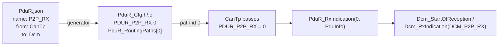
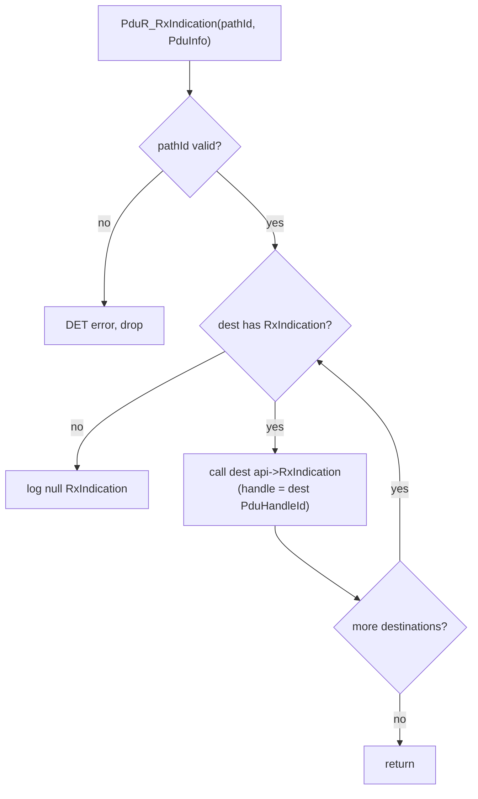
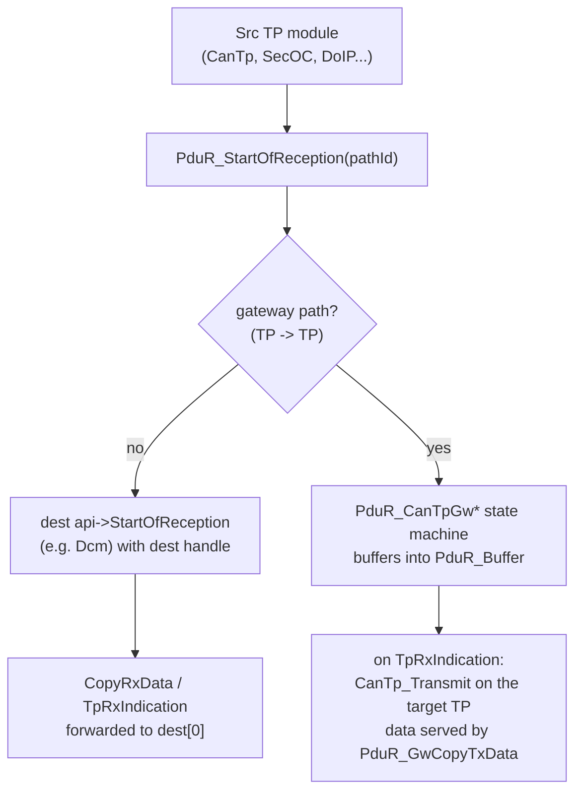
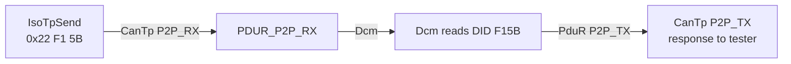

# PduR - PDU Router

> **In one sentence:** PduR is the switchboard of the stack: every routing path is
> a `From` module + `To` module pair, and PduR forwards indications and transmit
> requests along them - including one-to-many multicast and TP-to-TP gateways.

| Item | Value |
| --- | --- |
| Module | `infras/communication/PduR` (API: `infras/include/PduR.h`) |
| Layer | Between all modules; below Com/Dcm/SecOC, above CanTp/CanIf/LinTp/... |
| Configuration | `app/app/config/Com/PduR.json` |
| Generator | `tools/generator/PduR.py` -> `GEN/PduR_Cfg.c` / `GEN/PduR_Cfg.h` |
| Standard | AUTOSAR CP 4.4 PduR (with SSAS extensions) |
| Demo | `CanApp`: CanTp <-> Dcm P2P routing, Com -> SecOC -> CanIf secured Tx |

**Contents**

1. [What the module is for](#1-what-the-module-is-for)
2. [How a routing path is wired](#2-how-a-routing-path-is-wired)
3. [Configuration](#3-configuration)
4. [How it works at runtime](#4-how-it-works-at-runtime)
5. [Public API](#5-public-api)
6. [Build and run a demo](#6-build-and-run-a-demo)
7. [Key notes and gotchas](#7-key-notes-and-gotchas)
8. [Troubleshooting](#8-troubleshooting)
9. [Known limitations](#9-known-limitations)

---

## 1. What the module is for

* **IF routing** - forward one-frame PDUs: `PduR_RxIndication(pathId, ...)` fans
  the same `PduInfoType` out to every destination module.
* **TP routing** - forward multi-frame PDUs: `StartOfReception` / `CopyRxData` /
  `TpRxIndication` and `CopyTxData` / `TpTxConfirmation`.
* **TP gateway** - receive a long message over one transport module (e.g. CanTp)
  and transmit it over another (e.g. LinTp) through a middle buffer
  (`PDUR_USE_TP_GATEWAY`).
* **One id space for the upper layer** - the upper module passes
  `PDUR_<ROUTINE_NAME>` and PduR maps it to the destination module's PDU id.

PduR has **no queues and no timers** (except the gateway middle buffer); it is a
pure function-pointer router. If a destination cannot accept a PDU, the failure
is returned to the source module - nothing is buffered.

---

## 2. How a routing path is wired

One `Routines[]` entry becomes one generated id plus one routing path:



The three conventions that make the whole stack compile:

1. The **source module** must be able to produce the id `PDUR_<NAME>`. CanIf
   does this through `up: "PduR"` (`CANIF_<NAME>` equals the `PDUR_<NAME>` index
   because both generators number the same routine list), Com through
   `txConfig->TxPduId`.
2. The **destination module** must own a PDU named exactly like the routine (or
   the `Dest`/`Fake` alias), e.g. `CANTP_P2P_TX`, `DCM_P2P_RX`, `SECOC_...`.
3. The function pointers come from **hard-coded API tables** in the generator
   (`PduR_DcmApi`, `PduR_ComApi`, `PduR_CanTpApi`, `PduR_CanIfApi`,
   `PduR_SecOCApi`, ...). A module not in that list cannot be routed.

---

## 3. Configuration

### 3.1 Top-level keys

| Key | Default | Meaning |
| --- | --- | --- |
| `Routines[]` | required | Routing paths (see 3.2) |
| `Networks[]` | optional | DBC import; generates one routine per DBC message (`Com <-> CanIf/LinIf`) |
| `Memory[]` | optional | Middle-buffer memory pool `{Name, Size, Number}`; emits `PDUR_USE_MEMPOOL` and the MemCluster definition |
| `buffers[]` | optional | Named gateway byte buffers `{Name, Size}` referenced by `DestBuffer` |
| `enable_base_id` | **true** | **Dead key** - assigned in `PduR.py` but never consumed |
| `UsePostBuildConfig` | **true** | Emits `PDUR_USE_PB_CONFIG`, but `PduR.c` always uses `&PduR_Config` - currently cosmetic |

### 3.2 Routine keys

| Key | Default | Meaning |
| --- | --- | --- |
| `Name` | required | Routine name; becomes `PDUR_<NAME>` = routing path index |
| `From` | required | Source module: `Com`, `Dcm`, `SecOC`, `Mirror`, `DoIP`, `CanTp`, `LinTp`, `J1939Tp`, `CanIf` |
| `To` | required | Destination module (same list) |
| `Dest` | `Name` | The destination PDU name if it differs from `Name` (also emits `PDUR_<dest>` as an alias) |
| `Destinations[]` | `[]` | Multicast: additional destinations `{Name, To, Fake?}` |
| `Fake` | - | Additional alias macro `PDUR_<fake>` for the same path |
| `DestBufferSize` | 0 | Gateway static buffer size in bytes (`PduR_GwBuffer_<name>`) |
| `DestBuffer` | - | Reference to a `buffers[]` entry instead |
| `Id` | optional | DBC message id, informational |

Demo excerpt with multicast + alias:

```json
{ "Name": "P2A_RX", "From": "CanTp", "To": "Dcm",
  "Destinations": [ { "Name": "P2A_FW_TX", "To": "CanTp", "Fake": "P2A_FW_RX" } ] }
```

generates `PDUR_P2A_RX 1`, `PDUR_P2A_FW_TX 1`, `PDUR_P2A_FW_RX 1` - one path,
three names. Reception of the functional request echoes it back to CanTp
(`P2A_FW_TX`) *and* delivers it to Dcm.

### 3.3 DBC import

A `Networks[]` entry with `Dbc` + `Me` + `network: "CAN"|"LIN"` creates one
routine per message: `node == me` gives `from: Com, to: CanIf/LinIf` with
`_TX` suffix, otherwise `from: CanIf/LinIf, to: Com` with `_RX`. Use `Ignore`
to exclude messages that are routed explicitly (NM, diagnostics, SecOC).

### 3.4 Generated output

```c
/* PduR_Cfg.h */
#define PDUR_USE_MEMPOOL
#define PDUR_USE_TP_GATEWAY
#define PDUR_P2P_RX 0
#define PDUR_P2A_RX 1
#define PDUR_P2P_TX 2
```

`PduR_Cfg.c` contains per-module `PduR_<Mod>Api` function tables, per-path
`PduR_SrcPdu_*` / `PduR_DstPdu_*[]` arrays, optional `PduR_Buffer_<name>`
gateway buffers, and the final `PduR_RoutingPaths[]` consumed by `PduR.c`.

> The path index equals the position in `PduR_RoutingPaths[]`, but the generator
> **groups the paths by (from, to) module pair**, not by the order of
> `Routines[]`. Never hardcode index numbers - always use the `PDUR_<NAME>`
> macro.

---

## 4. How it works at runtime

### 4.1 IF reception (multicast fan-out)



All destinations receive the **same buffer pointer** - a destination that keeps
data must copy it (Com, Dcm, SecOC all copy into their own buffers).

### 4.2 IF transmission

`PduR_Transmit(pathId, PduInfo)` calls every destination's `Transmit`
(`CanIf_Transmit`, `CanTp_Transmit`, `SecOC_IfTransmit`, ...). The returned
value is the **first failure** (or `E_OK`); there is no retry.

### 4.3 TP reception and gateway



* IF and TP callbacks are selected per module by the generated API table.
* For TP paths **only `DestPduRef[0]` is used** - multicast TP delivery is not
  implemented (see limitations).
* The gateway buffer is `PduR_Buffer_<name>` (`DestTxBufferRef` in the routing
  path); `PduR_GwCopyTxData` serves the target TP from it with the offset in
  `info->MetaDataPtr`.

### 4.4 TX confirmation

`PduR_TxConfirmation(pathId, result)` calls the **source** module's
confirmation. For gateway paths the handle passed is `pathId` (the gateway
buffer context), otherwise the source's own PDU id.

---

## 5. Public API

| Function | Caller | Purpose |
| --- | --- | --- |
| `PduR_Init(ConfigPtr)` | EcuM | Init the routing table and gateway buffers |
| `PduR_RxIndication(pathId, PduInfo)` | lower modules (CanIf, CanTp, SecOC) | Fan out one frame to all destinations |
| `PduR_Transmit(pathId, PduInfo)` | upper modules (Com, Dcm, SecOC) | Send to all destinations, return first failure |
| `PduR_TxConfirmation(pathId, result)` | lower modules | Forward confirmation to the source |
| `PduR_StartOfReception` / `PduR_CopyRxData` / `PduR_TpRxIndication` | TP modules | TP reception chain |
| `PduR_CopyTxData` / `PduR_TpTxConfirmation` | TP modules | TP transmission chain |
| `PduR_GwCopyTxData` / `PduR_GwTxConfirmation` | gateway TP | Serve the middle buffer |
| `PduR_EnableRouting` / `PduR_DisableRouting(id, initialize)` | declared only | **Not implemented** - link error if used |
| `PduR_GetVersionInfo` | anyone | Version |

`PduR_CanIfRxIndication`, `PduR_CanIfTxConfirmation` etc. (in `PduR_CanIf.c`,
`PduR_Com.c`, ...) are thin adapters that the generated tables point to.

---

## 6. Build and run a demo

```bash
scons --app=CanApp
./build/nt/GCC/CanApp/CanApp.exe          # ECU side
./build/nt/GCC/IsoTpSend/IsoTpSend.exe -v 22F15B   # tester side
```

The UDS request exercises the full routing chain:



Enable tracing with `AS_LOG_PDUR=3` to see `PduR_RxIndication <id>` /
`PduR_Transmit <id>` lines for every hop.

---

## 7. Key notes and gotchas

1. **`PDUR_<NAME>` is the only stable handle.** The numeric id depends on the
   grouping order in the generator; a routine inserted in the middle of
   `PduR.json` renumbers everything after it.
2. **Names must match on both ends.** The `To` module must have a PDU whose
   generated symbol is `<TO>_<NAME>` (or the `Dest` alias). A mismatch is a
   compile error in `PduR_Cfg.c` - cheap and loud.
3. **Multicast is IF-only.** `PduR_RxIndication` and `PduR_Transmit` fan out;
   the TP chain uses only `DestPduRef[0]`.
4. **PduR is synchronous and copy-free** (except the gateway). A slow destination
   blocks the source's interrupt/main-function context.
5. **`From`/`To` determine the API table** - both must be in the generator's
   hard-coded list. `Mirror` for example only provides `TxConfirmation`.
6. **TP gateway needs memory.** Without `Memory[]` the gateway middle buffer
   comes from a static `PduR_BufferType` with no data; size it with
   `DestBufferSize`/`buffers[]` to the largest routed N-SDU.
7. **CAN FD / large PDUs**: the demo middle pool is 64 bytes x 2; routing
   larger PDUs needs a bigger `Memory[]` cluster.

---

## 8. Troubleshooting

| Symptom | Likely cause | Check |
| --- | --- | --- |
| Compile error `PDUR_X undeclared` in `CanIf_Cfg.c`/`Com_Cfg.c` | routine renamed or removed in `PduR.json` | keep names in sync across `CanIf.json`, `Com.json`, `PduR.json` |
| Link error on `PduR_EnableRouting` | API declared but not implemented | implement or drop the call |
| `PduR_RxIndication` DET error | a `CANIF_*` id was passed that is not `up: "PduR"` | check `CanIf.json` `Up` fields |
| `null RxIndication` log | destination module provides no IF callback (e.g. TP-only module) | route via TP path or add the module API |
| Gateway sends garbage | middle buffer too small / not allocated | `DestBufferSize` or `Memory[]` |
| Confirmation never arrives | the `To` module never confirms (e.g. `Mirror` has no Transmit) | inspect `PduR_MirrorApi` |

---

## 9. Known limitations

Code review findings verified against `infras/communication/PduR/PduR.c` and
`tools/generator/PduR.py`:

1. **`PduR_EnableRouting()` / `PduR_DisableRouting()` are declared but not
   implemented** - any caller fails at link time; routing is always enabled.
2. **TP paths use only the first destination** (`DestPduRef[0]` in
   `StartOfReception` / `CopyRxData` / `TpRxIndication`); a `Destinations[]`
   list on a TP path silently ignores destinations 2..n.
3. **`UsePostBuildConfig` / `PDUR_USE_PB_CONFIG` is dead**: `PDUR_CONFIG` is
   hard-wired to `&PduR_Config` in `PduR_Priv.h`.
4. **`enable_base_id` is a dead key**: read into a global in `PduR.py:317`, never
   consumed.
5. **`PduR_Transmit` returns only the first destination failure** - with
   multicast you cannot tell which destination failed; the log names the index.
6. **No Det/ASLOG on the gateway buffer overflow**: `PduR_GwCopyTxData` returns
   `BUFREQ_E_NOT_OK` when `buffer->data == NULL` without any diagnostic output.
7. **Generator writes `#include "<mod>.h"` + `"<mod>_Cfg.h"` for every routed
   module** - removing a module from the build requires removing its routing
   paths too, otherwise the generated file does not compile.
8. **The `Comments` field is accepted** (e.g. in
   `backup-routines-secoc-test-over-cantp`) and ignored - fine, but undocumented.

**Related documents:** [CanIf](CanIf.md) - [CanTp](CanTp.md) - [Com](Com.md) -
[Dcm](Dcm.md) - [SecOC](SecOC.md) - [Mirror](Mirror.md)
