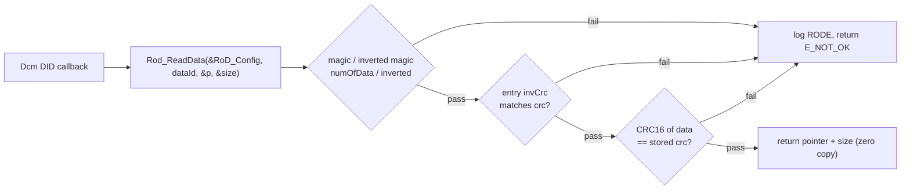

# RoD - Read-only Data

> **In one sentence:** RoD is a tiny library that serves constant data (calibration
> values, DID payloads) straight from flash, protected by magic numbers and a
> CRC16 so a corrupted table is detected instead of served.

| Item | Value |
| --- | --- |
| Module | `infras/memory/RoD` (46 lines; API: `infras/include/RoD.h`) |
| Layer | Library; typically used by Dcm DID read callbacks (0x22) |
| Configuration | generated tables via `tools/generator/RoD.py` from a JSON descriptor |
| Standard | SSAS-specific (no AUTOSAR counterpart) |
| Demo | used by Dcm DID handlers that read constant data |

**Contents**

1. [What it is for](#1-what-it-is-for)
2. [How it works](#2-how-it-works)
3. [Public API](#3-public-api)
4. [Key notes](#4-key-notes)
5. [Known limitations](#5-known-limitations)

---

## 1. What it is for

Instead of copying calibration/identity data into RAM, RoD keeps it in flash and
validates it on every read:

* `RoD_DataType` - one entry: `{data pointer, size, crc, ~crc}`.
* `RoD_ConfigType` - the table: `{datas[], magic, ~magic, numOfData, ~numOfData}`.

All fields are `const`, placed in the `ROD_ENTRY` / `ROD_CONST` linker sections
(ARM/GCC `__attribute__((section))`), so the table lives with the application
image and is flashed once.

---

## 2. How it works

The CRC is CRC16-CCITT (poly `0x1021`, init `0xFFFF`, non-reflected), computed
by `tools/generator/RoD.py` at build time and verified at run time.

`RoD.py` generates:

* the struct/typedef definitions from a nested JSON descriptor (including
  function-pointer-typed fields via `Return`/`Args`),
* the const data tables with pre-computed CRCs,
* `MemMap`-aware placement (`#define ROD_CONST_START/STOP` sections).

---

## 3. Public API

| Function | Purpose |
| --- | --- |
| `Rod_ReadData(config, dataId, **pData, *size)` | Validate and return a pointer to the const data (no copy) |

That is the whole API - one function, zero-copy.

---

## 4. Key notes

1. **dataId is the array index** - reordering the JSON table changes all ids;
   Dcm DID mappings must be regenerated together.
2. **Corruption semantics**: any mismatch logs `RODE` and returns `E_NOT_OK` -
   the caller (Dcm) answers NRC instead of serving garbage.
3. **The inverted fields** (`invMagic`, `invNumOfData`, `invCrc`) are there so an
   all-`0xFF` erased flash never validates.
4. **The data is truly const** - writes must go through a different mechanism
   (NvM/Fee); do not cast the pointer away.

---

## 5. Known limitations

1. **Zero-copy means the caller must not modify the data** - the API returns a
   `const void *` but nothing enforces it beyond the type system.
2. **CRC verified per access** - for large tables on slow cores this is runtime
   overhead per read; cache the validation result if needed.
3. **Generator is JSON-in, C-out only** - no round-trip editing of generated
   tables.
4. **Linker sections** `ROD_ENTRY`/`ROD_CONST` must exist in the scatter/linker
   script on target builds; on the host they fall back to default sections.

**Related documents:** [NvM](NvM.md) - [Dcm](Dcm.md)
