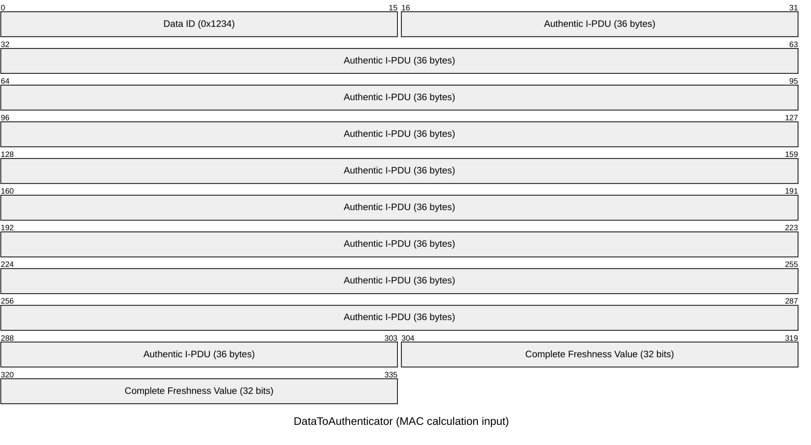
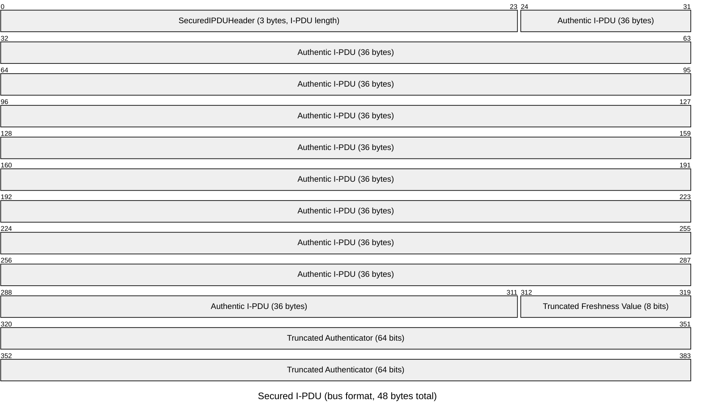
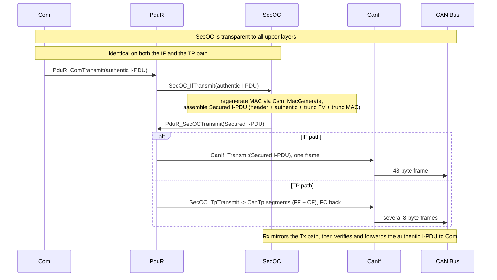
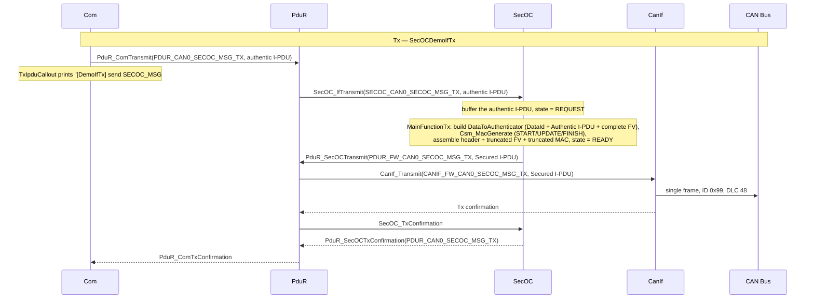
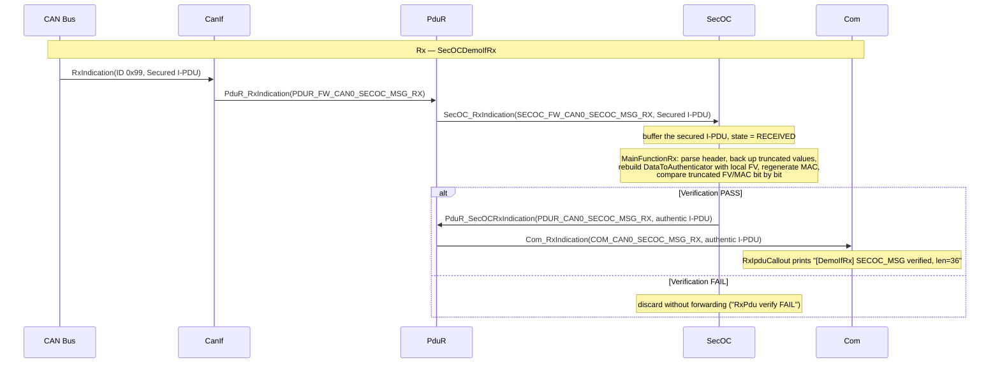
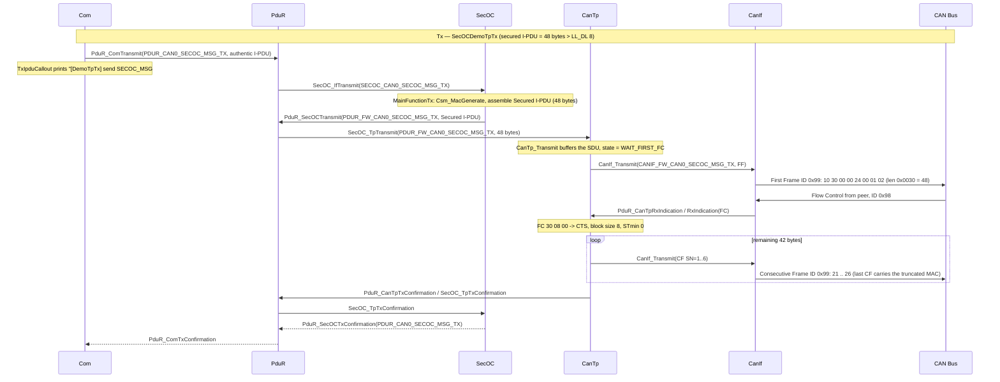
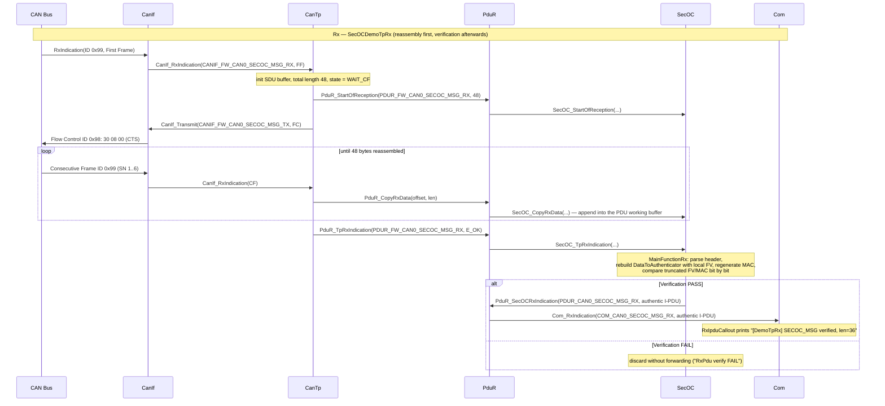

# AUTOSAR SecOC - Secure Onboard Communication Overview

**SecOC** (Secure Onboard Communication) provides message authentication and integrity protection for AUTOSAR in-vehicle communication. It adds authentication information (Authenticator/MAC) and a Freshness Value to I-PDUs without changing upper-layer interfaces, allowing receivers to verify message integrity and authenticity and to reject replayed or forged frames.

The AS SecOC implementation follows AUTOSAR CP R23-11 (`@SWS_SecOC_*` requirements are referenced in code comments), supports IF (Immediate) transmission, integrates with **Csm** (Crypto Service Manager) for MAC generation/verification, and works with **PduR**, **Com**, **CanIf** (and CanTp for the TP path).

- Implementation: [infras/communication/SecOC/SecOC.c](../../infras/communication/SecOC/SecOC.c)
- Header: [infras/include/SecOC.h](../../infras/include/SecOC.h)
- Generator: [tools/generator/SecOC.py](../../tools/generator/SecOC.py)
- Demo applications: [SecOCDemoIfTx / SecOCDemoIfRx / SecOCDemoTpTx / SecOCDemoTpRx](../../app/app/config/SecOC)

## 1. Core Concepts

### 1.1 Design Goals
- Message authentication: compute a MAC for the transmitted I-PDU and append authentication information
- Freshness protection: use a Freshness Value to prevent replay attacks
- Transparent routing: works with PduR so upper layers (e.g., Com) remain largely unaware
- Flexible truncation: supports truncated Authenticator/FV to save bus bandwidth
- CSM integration: reuses AUTOSAR cryptographic services (no crypto code inside SecOC)

### 1.2 Key Terms

| Term | Description |
|---|---|
| Authentic I-PDU | Original application PDU to be protected |
| Secured I-PDU | PDU after adding the truncated Authenticator and Freshness Value |
| Authenticator (MAC) | Key-based MAC used for integrity/authenticity verification |
| Freshness Value (FV) | Counter/timestamp used to prevent replay |
| Data ID | Identifier to distinguish PDUs, included in the MAC calculation |
| Truncation | Truncates the Authenticator/FV to save bandwidth |

### 1.3 PDU Formats

Two layouts are important (lengths follow the AUTOSAR specification):

- **DataToAuthenticator** (MAC calculation input) = `Data ID (2 bytes) | Authentic I-PDU | Complete Freshness Value` (`@SWS_SecOC_00034`)
- **Secured I-PDU** (what goes on the bus) = `SecuredIPDUHeader (optional, contains the authentic I-PDU length) | Authentic I-PDU | FreshnessValue [SecOCFreshnessValueTruncLength] (optional) | Authenticator [SecOCAuthInfoTruncLength]` (`@SWS_SecOC_00261`)

> Note: in `SecOC.json`, `AuthInfoLength`/`AuthInfoTruncLength`/`FreshnessValueTruncLength` and the Freshness Value length are in **bits**, while `AuthenticIPduLength` (maximum authentic I-PDU length, used to size the working buffers) is in **bytes**.

With the demo configuration: MAC 128 bits truncated to 64 bits, FV 32 bits truncated to 8 bits, 3-byte header, so a 36-byte authentic I-PDU becomes a 48-byte secured I-PDU.

Packet layout diagrams (using the demo values):





### 1.4 Integration with the AUTOSAR Stack

SecOC sits as an intermediate layer: on Tx it is the upper client of PduR, on Rx it is the lower module of PduR. Cryptographic services are accessed via the CSM MAC generation APIs.

The **data path is the same for both demo kinds**; only the lower module on the far side of PduR differs — `CanIf` on the **IF** path, `CanTp` on the **TP** path:

| Path | Tx | Rx |
|---|---|---|
| **IF** (Immediate) | Com → PduR → SecOC → PduR → **CanIf** | **CanIf** → PduR → SecOC → PduR → Com |
| **TP** (Transport Protocol) | Com → PduR → SecOC → PduR → **CanTp** → CanIf | CanIf → **CanTp** → PduR → SecOC → PduR → Com |



The detailed step-by-step sequences are given per demo kind in section 2:
- **IF demo (DemoIfTx / DemoIfRx)** — see [2.2](#22-if-demo--secocemoiftx--secocemoifrx);
- **TP demo (DemoTpTx / DemoTpRx)** — see [2.3](#23-tp-demo--secocemotptx--secocemotprx).

## 2. Demo Overview

All SecOC configuration in this repository is organised as **exactly two demo kinds** that share the same upper stack and differ only in how the secured I-PDU reaches the bus. Each kind consists of a transmit and a receive application:

| # | Kind | Applications | Transport of the secured I-PDU |
|---|---|---|---|
| 1 | **IF demo** | [SecOCDemoIfTx](../../app/app/config/SecOC/DemoIfTx) / [SecOCDemoIfRx](../../app/app/config/SecOC/DemoIfRx) | `CanIf` sends/receives it as one CAN frame |
| 2 | **TP demo** | [SecOCDemoTpTx](../../app/app/config/SecOC/DemoTpTx) / [SecOCDemoTpRx](../../app/app/config/SecOC/DemoTpRx) | `CanTp` (ISO 15765-2) segments/reassembles it over several CAN frames |

Common to both kinds:

- both sides carry the same message `SECOC_MSG` with a 288-bit (36-byte) big-endian `VehicleConfig` signal;
- the CSM job is a single `MAC_GENERATE` job on **both** sides (section 3) — SecOC regenerates the MAC on Rx rather than calling a verify API;
- each side prints the PDU from its Com IPdu callout, so the two logs can be compared line by line;
- both are registered in [app/app/SConscript](../../app/app/SConscript) and built like any other app.

### 2.1 Message and SecOC Configuration

`SECOC_MSG` (DLC 36) carries one 288-bit big-endian `VehicleConfig` signal. The DLC covers the **authentic** I-PDU only; SecOC appends the 3-byte header, the 8-bit truncated FV and the 64-bit truncated MAC when assembling the 48-byte secured I-PDU.

| Setting | Value |
|---|---|
| DataId | `0x1234` |
| AuthInfoLength / AuthInfoTruncLength | 128 / 64 bits |
| FreshnessValue (FV) length / FreshnessValueTruncLength | 32 / 8 bits |
| AuthPduHeaderLength | 3 bytes |
| AuthenticIPduLength | 64 bytes (buffer sizing) |

Each demo directory contains `SecOC.json`, `Csm.json`, `PduR.json`, `Com.json`, `CanIf.json`, the glue source, plus `CanTp.json` for the TP demo only.

### 2.2 IF Demo — SecOCDemoIfTx / SecOCDemoIfRx

The secured I-PDU is handed straight to `CanIf` and put on the bus as a single 48-byte frame. Both sides use the **same CAN ID `0x99`**, so running the two applications side by side demonstrates the complete round trip: the Tx app secures and sends, the Rx app verifies and forwards the authentic I-PDU to Com.

| App | Direction | Config / source |
|---|---|---|
| `SecOCDemoIfTx` | Com → PduR → SecOC → PduR → CanIf | [DemoIfTx](../../app/app/config/SecOC/DemoIfTx) |
| `SecOCDemoIfRx` | CanIf → PduR → SecOC → PduR → Com | [DemoIfRx](../../app/app/config/SecOC/DemoIfRx) |

The glue source (`secoctx_demo.c` / `secocrx_demo.c`) provides the `User_Init` / `User_MainTask10ms` hooks. To keep the two sides symmetric, **both sides print the message from their Com IPdu callout**:

- Tx side: `enable_message_tx_callout` in `Com.json` enables `CAN0_SECOC_MSG_TX_TxIpduCallout`. Com invokes it right before handing the authentic I-PDU to PduR, i.e. before SecOC secures it; returning `TRUE` allows the transmission to proceed.
- Rx side: `enable_message_rx_callout` enables `CAN0_SECOC_MSG_RX_RxIpduCallout`. Com invokes it only after SecOC has verified the MAC and freshness and forwarded the authentic I-PDU, so anything printed there is guaranteed to have passed verification.

```bash
scons --app=SecOCDemoIfTx
scons --app=SecOCDemoIfRx
```

Because the v2 simulator uses UDP multicast (no server needed), running both applications at the same time is enough to observe the whole flow. A third process — the `CanDump` sniffer — can be attached to the same bus to watch the secured frame, see section 6.3.

The IF sequence, with the actual routing names:





### 2.3 TP Demo — SecOCDemoTpTx / SecOCDemoTpRx

The 48-byte secured I-PDU does not fit in a single classic CAN frame, so it can be handed to **CanTp** (ISO 15765-2) instead of CanIf, letting the transport protocol segment it into a First Frame plus Consecutive Frames.

| App | Direction | Config / source |
|---|---|---|
| `SecOCDemoTpTx` | Com → PduR → SecOC → PduR → CanTp → CanIf | [DemoTpTx](../../app/app/config/SecOC/DemoTpTx) |
| `SecOCDemoTpRx` | CanIf → CanTp → PduR → SecOC → PduR → Com | [DemoTpRx](../../app/app/config/SecOC/DemoTpRx) |

Each directory holds `SecOC.json`, `Csm.json`, `PduR.json`, `CanTp.json`, `CanIf.json`, `Com.json` and the glue (`secoctp_demo.c` / `secocrxtp_demo.c`). The Com callouts, the CSM job (`MAC_GENERATE` on both sides) and the SecOC procs are **identical to the IF demo** — only three things differ:

1. `PduR.json` routes SecOC ↔ **CanTp** (instead of SecOC ↔ CanIf);
2. an extra `CanTp.json` configures the ISO-TP channel;
3. the CanIf PDU's `up` field is set to `CanTp`.

Because ISO-TP is inherently bidirectional — the sender always waits for a Flow Control frame — the two nodes use **two CAN IDs**: the data direction (First/Consecutive Frames, Tx → Rx) is on `0x99`, and the **Flow Control** frame that the receiver sends back is on `0x98`. Each CanTp channel therefore has both a `TxPduId` (data out) and an `RxPduId` (Flow Control in), exactly like a normal ISO-TP point-to-point channel; the unused SDU-level `PduR_*PduId` on each one-directional node simply reuses the existing route so the generated macro resolves.

```bash
scons --app=SecOCDemoTpTx
scons --app=SecOCDemoTpRx
```

The TP sequence adds segmentation/reassembly on both ends — `SecOC_TpTransmit` on the sender, `SecOC_StartOfReception` / `SecOC_CopyRxData` / `SecOC_TpRxIndication` on the receiver — plus the Flow Control handshake:





## 3. CSM Configuration

`Csm.json` defines one MAC algorithm and one job used by both demo kinds:

- **MACGEN0**: AES family, ECB mode, 128-bit key (`0x00..0x0f`), verify enabled. AES-ECB is used as a CMAC-like MAC primitive by the CSM driver.
- **SECOC_MACGEN_0**: a `MAC_GENERATE` job referencing MACGEN0.

**In both the IF and the TP demo, both sides declare the same single `MAC_GENERATE` job (`SECOC_MACGEN_0`).**

AS verifies the MAC on Rx by **regenerating** it, not by calling a verify API: `SecOC_ProcRx` rebuilds the same DataToAuthenticator with its local FV and calls `Csm_MacGenerate` (START/UPDATE/FINISH) to recompute the MAC, then compares the truncated FV + MAC against the received values bit by bit. SecOC never calls `Csm_MacVerify`. Therefore **both the transmit and the receive node need a `MAC_GENERATE` job** — a receive-only node must not be configured with a `MAC_VERIFY` job, because `Csm_MacGenerate` validates that the job's service type is `CRYPTO_MAC_GENERATE` and would reject a `MAC_VERIFY` job.

## 4. How It Works

### 4.1 Tx Processing (SecOC_MainFunctionTx)

The Tx state machine per PDU: `IDLE → REQUEST → ASSEMBLE → READY → WAIT_TX_DONE → IDLE`.

1. **REQUEST**: `SecOC_IfTransmit` (called by PduR) copies the authentic I-PDU into the PDU working buffer and sets state to REQUEST.
2. `SecOC_ProcTx` writes the 2-byte Data ID, fetches the complete FV via `SecOC_GetTxFreshness`, and calls `Csm_MacGenerate` three times (START/UPDATE/FINISH) over the DataToAuthenticator.
3. **ASSEMBLE**: builds the SecuredIPDUHeader (`@SWS_SecOC_00262`), then uses bit-level moves (`Std_BitCopy`) to truncate the FV to `FreshnessValueTruncLength` and the MAC to `AuthInfoTruncLength` (`@SWS_SecOC_00261`), state becomes READY.
4. **READY**: transmits the secured I-PDU via `PduR_SecOCTransmit`; on Tx confirmation the state returns to IDLE and the confirmation is forwarded to Com.

### 4.2 Rx Processing (SecOC_MainFunctionRx)

1. `SecOC_RxIndication` (called by PduR) buffers the secured I-PDU, state = RECEIVED.
2. `SecOC_ProcRx` parses the header to recover the authentic I-PDU length, backs up the trailing truncated FV + MAC to the end of the working buffer, overwrites the 2-byte Data ID, and fetches the local FV.
3. Regenerates the MAC over the reconstructed DataToAuthenticator via `Csm_MacGenerate` (START/UPDATE/FINISH) and compares the truncated FV + MAC bit by bit. Note this is the same `Csm_MacGenerate` API used on Tx — SecOC does not call `Csm_MacVerify`, so the Rx CSM job must be a `MAC_GENERATE` job (see section 3).
4. On PASS the authentic I-PDU is forwarded via `PduR_SecOCRxIndication`; on FAIL it is silently dropped (a log line is emitted).

### 4.3 Freshness Value

The generated `SecOC_GetFreshness_FreshnessValue0` weak function is a **demo placeholder**: it returns an incrementing counter (value/2 in big-endian in the first two bytes) and increments on every call. For a real ECU, replace it with your FV manager (counter sync, secure timestamp, or SecOC's own FV management). Since both Tx and Rx on the same node query the same counter, verification works out of the box with `SECOC_SELF_TEST`.

### 4.4 TP Path and Self-Test

- The full TP API set is implemented (`SecOC_TpTransmit`, `SecOC_StartOfReception`, `SecOC_CopyRxData`, `SecOC_CopyTxData`, `SecOC_TpRxIndication`, `SecOC_TpTxConfirmation`), so secured PDUs can be carried over CanTp — this is exactly what the **TP demo (section 2.3)** uses.
- Compile with `SECOC_SELF_TEST` to let the Tx path feed its own secured PDU back into `SecOC_RxIndication` for loop-back verification without a bus.

## 5. Generated Code & APIs

The generator ([tools/generator/SecOC.py](../../tools/generator/SecOC.py)) generates `SecOC_Cfg.c/.h` from SecOC.json:

- `SecOC_<PduName>` / `SECOC_FW_<PduName>` PDU ID macros for PduR wiring
- per-PDU working buffers sized from `AuthenticIPduLength` + MAC + FV lengths (e.g., 87 bytes for the demo PDU)
- `SecOC_TxPduProcs` / `SecOC_RxPduProcs` configuration tables and per-PDU contexts
- `__weak SecOC_GetFreshness_<FreshnessValueName>` dummy implementations for FVs with `GenDummy: true`
- `SECOC_MAIN_FUNCTION_PERIOD` (default 10 ms)

Main APIs (see [SecOC.h](../../infras/include/SecOC.h)):

| API | Role |
|---|---|
| SecOC_Init | initialize all PDU processing contexts |
| SecOC_IfTransmit | IF Tx entry from PduR |
| SecOC_RxIndication / SecOC_TxConfirmation | IF Rx entry / Tx confirm from PduR |
| SecOC_MainFunctionTx / SecOC_MainFunctionRx | cyclic MAC generation, assembly and verification |
| SecOC_GetTxFreshness | FV provider (implemented in SecOC_Callout.c) |
| SecOC_TpTransmit / StartOfReception / CopyTxData / CopyRxData / TpRxIndication / TpTxConfirmation | TP path support |

The demo glue sources provide the Com-level hooks: the Tx apps implement `CAN0_SECOC_MSG_TX_TxIpduCallout` (`secoctx_demo.c` / `secoctp_demo.c`) and the Rx apps implement `CAN0_SECOC_MSG_RX_RxIpduCallout` (`secocrx_demo.c` / `secocrxtp_demo.c`), both printing the PDU for inspection.

## 6. Build & Run

EcuM automatically calls SecOC_Init and schedules SecOC_MainFunctionTx/Rx. Build and run the two applications of one demo kind side by side as described in section 2; both sides print the message from their Com IPdu callout with the same layout (a summary line followed by a hex dump), so the two logs can be compared line by line:

- Tx (Com Tx IPdu callout, before SecOC secures the PDU): `[Demo<Kind>Tx] send SECOC_MSG #<n>, len=<n> data:` + hex dump
- Rx (Com Rx IPdu callout, after SecOC verified the PDU): `[Demo<Kind>Rx] SECOC_MSG verified, len=<n> data:` + hex dump

A failed Rx verification instead shows up as `RxPdu verify FAIL` (e.g. an unsynced freshness counter).

Below are the typical run logs (real captured output) for each demo kind, so you can tell a healthy run from a broken one directly at log level `-v 0`.

### 6.1 IF Demo — Run and Typical Log

Build and run:

```bash
scons --app=SecOCDemoIfTx
scons --app=SecOCDemoIfRx
build\nt\GCC\SecOCDemoIfTx\SecOCDemoIfTx.exe -v 0
build\nt\GCC\SecOCDemoIfRx\SecOCDemoIfRx.exe -v 0
```

**Tx app** (`SecOCDemoIfTx.exe -v 0`) — printed from the Com Tx IPdu callout, before SecOC secures it:

```
DEMO    :[DemoIfTx] send SECOC_MSG #1, len=36 data:
DEMO    :
  00000000 00 01 02 03 04 05 06 07 08 09 0A 0B 0C 0D 0E 0F 10 11 12 13 14 15 16 17 18 19 1A 1B 1C 1D 1E 1F
DEMO    :[DemoIfTx] send SECOC_MSG #2, len=36 data:
DEMO    :
  00000000 01 02 03 04 05 06 07 08 09 0A 0B 0C 0D 0E 0F 10 11 12 13 14 15 16 17 18 19 1A 1B 1C 1D 1E 1F 20
```

**Rx app** (`SecOCDemoIfRx.exe -v 0`) — CanIf receives the single 48-byte secured I-PDU as one frame; after SecOC verifies the MAC, the authentic I-PDU is printed from the Com Rx IPdu callout:

```
CANIF   :RX CAN ID=0x00000099 LEN=48 DATA=[00 00 24 00 01 02 03 04]
SECOC   :[0] RxPdu data length = 36, backup 9 auth info to pos 80
SECOC   :[0] RxPdu verify PASS
PDUR    :PduR_RxIndication 1
DEMO    :[DemoIfRx] SECOC_MSG verified, len=36 data:
DEMO    :
  00000000 00 01 02 03 04 05 06 07 08 09 0A 0B 0C 0D 0E 0F 10 11 12 13 14 15 16 17 18 19 1A 1B 1C 1D 1E 1F
```

**CanDump** (`CanDump.exe -d simulator_v2 -p 0 -f 7FF#099`, see section 6.3) — the real secured I-PDU on the wire, carried in a single 48-byte CAN frame:

```
canid=00000099,dlc=48,data=[00,00,24,00,01,...,23,00,19,43,F8,77,9E,D9,77,AB,] [...] @ 2.375215 s rel 0.00 ms
canid=00000099,dlc=48,data=[00,00,24,01,02,...,24,00,CE,41,A8,A4,3B,0A,3A,69,] [...] @ 3.375162 s rel 999.95 ms
```

Reading the three together: the Tx callout payload `00 01 … 1F 20 21 22 23` is the same 36 bytes the Rx callout prints after `verify PASS`, and CanDump shows those 36 bytes wrapped as `SecuredIPDUHeader (00 00 24) | authentic I-PDU | truncated FV (00) | truncated MAC`. The MAC differs every cycle (e.g. `19 43 F8 77 9E D9 77 AB` then `CE 41 A8 A4 3B 0A 3A 69`) because the freshness value changes each transmission, while the truncated FV byte stays `00` in this dummy-FV demo.

### 6.2 TP Demo — Run and Typical Log

Build and run:

```bash
scons --app=SecOCDemoTpTx
scons --app=SecOCDemoTpRx
build\nt\GCC\SecOCDemoTpTx\SecOCDemoTpTx.exe -v 0
build\nt\GCC\SecOCDemoTpRx\SecOCDemoTpRx.exe -v 0
```

**Tx app** — the 48-byte secured I-PDU is first buffered by CanTp, then a First Frame (`10 30 …`, length `0x0030` = 48) goes out and the sender **waits for a Flow Control**. Only after the peer answers with an FC on `0x98` (`30 08 00`: CTS, block size 8, STmin 0) does it send the Consecutive Frames with increasing sequence numbers `21`…`26`, the last one carrying the truncated MAC:

```
DEMO    :[DemoTpTx] send SECOC_MSG #1, len=36 data:
DEMO    :
  00000000 00 01 02 03 04 05 06 07 08 09 0A 0B 0C 0D 0E 0F 10 11 12 13 14 15 16 17 18 19 1A 1B 1C 1D 1E 1F
  00000020 20 21 22 23
PDUR    :PduR_Transmit 0
PDUR    :PduR_Transmit 1
PDUR    :PduR_CopyTxData 1
CANTPI  :[0]TX len=8 data=[10,30,00,00,24,00,01,02]      <-- First Frame (FF), length 0x0030 = 48
CANIF   :RX CAN ID=0x00000098 LEN=8 DATA=[30 08 00 55 55 55 55 55]
CANTPI  :[0]RX len=8 data=[30,08,00,55,55,55,55,55], state=2 left=42   <-- Flow Control, CTS BS=8
PDUR    :PduR_CopyTxData 1
CANTPI  :[0]TX len=8 data=[21,03,04,05,06,07,08,09]      <-- Consecutive Frame SN=1
...
CANTPI  :[0]TX len=8 data=[26,43,F8,77,9E,D9,77,AB]      <-- last CF carries the truncated MAC
PDUR    :PduR_TxConfirmation 1
SECOC   :[0] Tx Confirm result=0
PDUR    :PduR_TxConfirmation 0
```

**Rx app** — CanIf receives the N-PDUs frame by frame and CanTp reassembles the 48 bytes: the First Frame triggers `PduR_StartOfReception`, an FC is sent back on `0x98`, then each frame is appended via `PduR_CopyRxData` (`left` counts down from 42). Once complete, `PduR_TpRxIndication` fires and only then does SecOC verify:

```
CANIF   :RX CAN ID=0x00000099 LEN=8 DATA=[10 30 00 00 24 00 01 02]
CANTPI  :[0]RX len=8 data=[10,30,00,00,24,00,01,02], state=0 left=0
PDUR    :PduR_StartOfReception 0
PDUR    :PduR_CopyRxData 0
CANTPI  :[0]TX len=8 data=[30,08,00,55,55,55,55,55]      <-- FC sent back on 0x98
CANIF   :RX CAN ID=0x00000099 LEN=8 DATA=[21 03 04 05 06 07 08 09]
CANTPI  :[0]RX len=8 data=[21,03,04,05,06,07,08,09], state=1 left=42
PDUR    :PduR_CopyRxData 0
...
CANIF   :RX CAN ID=0x00000099 LEN=8 DATA=[26 43 F8 77 9E D9 77 AB]
CANTPI  :[0]RX len=8 data=[26,43,F8,77,9E,D9,77,AB], state=1 left=7
PDUR    :PduR_CopyRxData 0
PDUR    :PduR_TpRxIndication 0
SECOC   :[0] RxPdu data length = 36, backup 9 auth info to pos 80
SECOC   :[0] RxPdu verify PASS
PDUR    :PduR_RxIndication 1
DEMO    :[DemoTpRx] SECOC_MSG verified, len=36 data:
DEMO    :
  00000000 00 01 02 03 04 05 06 07 08 09 0A 0B 0C 0D 0E 0F 10 11 12 13 14 15 16 17 18 19 1A 1B 1C 1D 1E 1F
  00000020 20 21 22 23
```

**CanDump** — on the TP path the bus carries a sequence of 8-byte N-PDUs instead of one 48-byte frame (`-f 7FF#099` filters to the data direction; Flow Control lives on `0x98`):

```
canid=00000099,dlc=8,data=[10,30,00,00,24,00,01,02,] [...] @ 1.208061 s rel 0.00 ms   <-- FF
canid=00000099,dlc=8,data=[21,03,04,05,06,07,08,09,] [...] @ 1.208563 s rel 0.50 ms   <-- CF SN=1
canid=00000099,dlc=8,data=[22,0A,0B,0C,0D,0E,0F,10,] [...] @ 1.208565 s rel 0.00 ms
canid=00000099,dlc=8,data=[23,11,12,13,14,15,16,17,] [...] @ 1.208566 s rel 0.00 ms
canid=00000099,dlc=8,data=[24,18,19,1A,1B,1C,1D,1E,] [...] @ 1.208568 s rel 0.00 ms
canid=00000099,dlc=8,data=[25,1F,20,21,22,23,00,19,] [...] @ 1.208570 s rel 0.00 ms
canid=00000099,dlc=8,data=[26,43,F8,77,9E,D9,77,AB,] [...] @ 1.208572 s rel 0.00 ms   <-- last CF
```

Cross-checking: the Tx-side `CANTPI :[0]TX` lines map one-to-one onto the frames CanDump captures (First Frame + 6 Consecutive Frames = 7 frames × 8 bytes = 56 bytes; the FF header is 2 bytes and each CF carries a 1-byte sequence number `21`…`26`, leaving exactly 48 bytes of payload). On the Rx side the CanTp `state` goes from `0` (waiting for the FF) to `1` (receiving CFs) while `left` counts down 42 → 7, then the SDU is complete and `verify PASS` follows. If the peer never answers with a Flow Control, the Tx side stays in `WAIT_FIRST_FC` and no Consecutive Frame is ever sent.

### 6.3 Peeking the Real CAN Frame with CanDump

The Com callouts above print the **authentic I-PDU** (36 bytes, before/after SecOC). To see what actually goes on the wire — the **Secured I-PDU** including the SecuredIPDUHeader, truncated freshness value and truncated authenticator — attach the CAN sniffer `CanDump` to the same virtual bus while the demo runs:

```bash
scons --app=CanDump
build\nt\GCC\one\CanDump.exe -d simulator_v2 -p 0
```

`-d simulator_v2` selects the UDP-multicast virtual CAN driver and `-p 0` selects bus 0 (the `port` field of the network in `Com.json`). CanDump needs no server and can run alongside the Tx/Rx apps in a third shell. Typical IF-demo output (the TP demo shows an 8-byte N-PDU sequence instead, see section 6.2):

```
canid=00000099,dlc=48,data=[00,00,24,01,02,03,04,05,...,24,00,CE,41,A8,A4,3B,0A,3A,69,] [...] @ 0.608061 s rel 0.00 ms
```

Mapping that frame back to the SecOC layout of section 1.3:

| Bytes | Field | Value |
|---|---|---|
| `00 00 24` | SecuredIPDUHeader (3 bytes) | I-PDU length `0x24` = 36 |
| `01 02 … 24` | Authentic I-PDU | the 36-byte `VehicleConfig` payload |
| `00` | Truncated Freshness Value (8 bits) | truncation of the 32-bit FV |
| `CE 41 A8 A4 3B 0A 3A 69` | Truncated Authenticator (64 bits) | truncated 128-bit MAC |

Note that the Data ID (`0x1234`) does **not** appear on the bus — it is only an input to the MAC computation (see section 1.3).

## 7. References

- AUTOSAR CP R23-11 SecOC Specification
- Code: [SecOC.c](../../infras/communication/SecOC/SecOC.c), [SecOC.h](../../infras/include/SecOC.h), [Csm.c](../../infras/crypto/Csm/Csm.c)
- Runtime config shared by both demo kinds: [Csm.json](../../app/app/config/Csm/Csm.json)
- IF demo (one frame per secured I-PDU): [DemoIfTx](../../app/app/config/SecOC/DemoIfTx), [DemoIfRx](../../app/app/config/SecOC/DemoIfRx)
- TP demo (ISO 15765-2 segmentation): [DemoTpTx](../../app/app/config/SecOC/DemoTpTx), [DemoTpRx](../../app/app/config/SecOC/DemoTpRx)
- CAN sniffer used to peek the bus: [can_dump.cpp](../../tools/libraries/Can/utils/can_dump.cpp)
