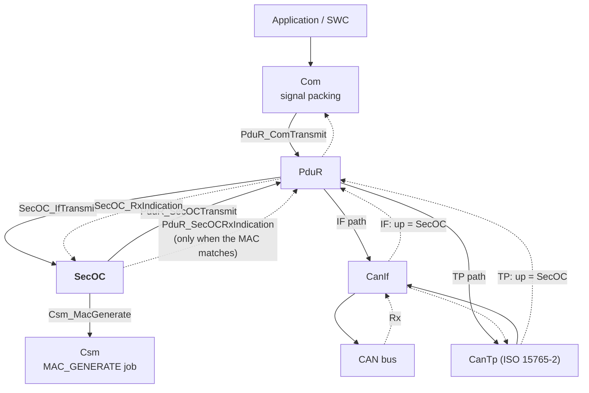
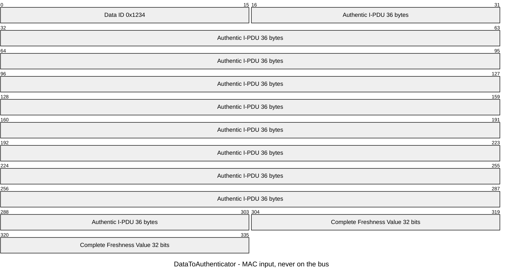
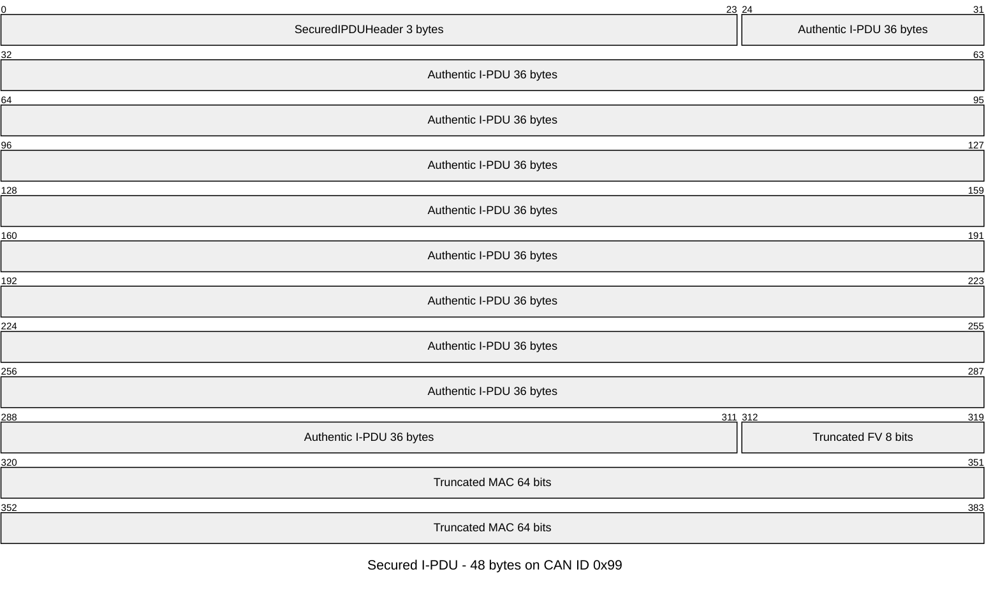
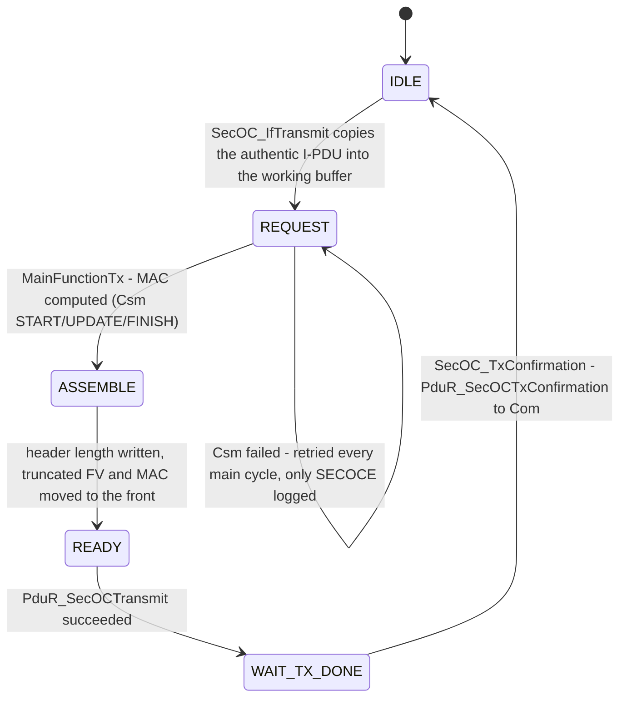
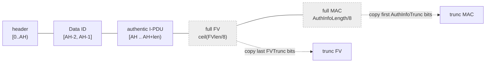
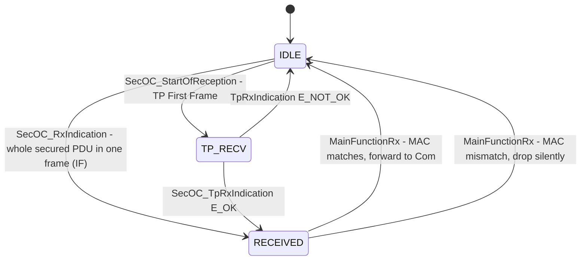
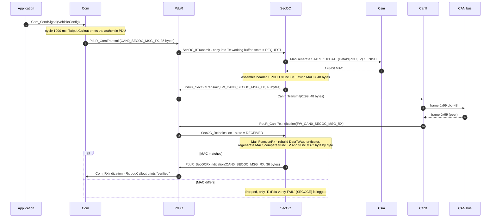

# SecOC - Secure Onboard Communication

> **In one sentence:** SecOC sits between Com and the bus, appends a truncated
> authenticator (MAC) plus a truncated freshness value to every I-PDU on the way
> out, and on the way in recomputes that authenticator and silently drops every
> frame whose MAC does not match - so forged or replayed frames never reach Com.

| Item | Value |
| --- | --- |
| Module | `infras/communication/SecOC` (API: `infras/include/SecOC.h`) |
| Layer | Above the bus/TP layer, below [PduR](PduR.md) and [Com](Com.md) |
| Configuration | `app/app/config/SecOC/SecOC.json` |
| Generator | `tools/generator/SecOC.py` -> `GEN/SecOC_Cfg.c` / `GEN/SecOC_Cfg.h` |
| Crypto backend | Csm `MAC_GENERATE` job (no crypto code inside SecOC) |
| Standard | AUTOSAR CP R23-11 SecOC (`@SWS_SecOC_*` referenced in the code) |
| Demos | `scons --app=SecOCDemoIfTx` / `SecOCDemoIfRx` / `SecOCDemoTpTx` / `SecOCDemoTpRx` |

**Contents**

1. [What the module is for](#1-what-the-module-is-for)
2. [Where it sits in the stack](#2-where-it-sits-in-the-stack)
3. [Configuration](#3-configuration)
4. [How it works at runtime](#4-how-it-works-at-runtime)
5. [Public API](#5-public-api)
6. [Build and run a demo](#6-build-and-run-a-demo)
7. [Key notes and gotchas](#7-key-notes-and-gotchas)
8. [Troubleshooting](#8-troubleshooting)
9. [Known limitations and code review findings](#9-known-limitations-and-code-review-findings)
10. [Related documents](#10-related-documents)

---

## 1. What the module is for

Classic AUTOSAR has no way to tell a genuine frame from a replayed one: a CAN ID
plus a payload can be recorded and sent again at any time. SecOC closes that gap
without touching the application:

* **Authenticity** - a keyed MAC over `Data ID | Authentic I-PDU | Freshness
  Value` proves the frame came from a node that owns the key.
* **Integrity** - any bit flip in the payload invalidates the MAC.
* **Freshness** - a counter (or time stamp) inside the MAC input makes an old
  frame fail once the receiver's counter has moved on.
* **Bandwidth friendly** - both the MAC and the freshness value are truncated on
  the bus; the full values only exist in the MAC computation.
* **Transparent** - Com and the application are unchanged. SecOC is a PduR
  routing hop, nothing else.

Two things it explicitly does **not** do in this implementation: it does not
manage keys (that is Csm's job) and it does not verify with Csm's verify API -
it regenerates the MAC and compares the bytes itself.

---

## 2. Where it sits in the stack

SecOC is a *router* module: PduR can hand a PDU down to it and it hands the
secured PDU back to PduR, which forwards it to whatever sits below - CanIf for a
single frame, CanTp when the secured PDU needs segmentation.



The same SecOC code serves both paths. The only difference is which PDU the
PduR routing table maps `PduR_SecOCTransmit` onto:

| Path | Tx route | Rx route |
| --- | --- | --- |
| **IF** (one frame) | `Com -> SecOC -> CanIf` | `CanIf -> SecOC -> Com` |
| **TP** (segmented) | `Com -> SecOC -> CanTp -> CanIf` | `CanIf -> CanTp -> SecOC -> Com` |

---

## 3. Configuration

### 3.1 Top-level keys

`app/app/config/SecOC/SecOC.json` (one file per application; the demos each have
their own copy under `config/SecOC/<Demo>/`):

| Key | Demo value | Generator default | Meaning |
| --- | --- | --- | --- |
| `Class` | `"SecOC"` | - | selects `SecOC.py` |
| `MainFunctionPeriod` | absent | `10` | ms; only generates `SECOC_MAIN_FUNCTION_PERIOD` and `SECOC_CONVERT_MS_TO_MAIN_CYCLES()`. SecOC itself has no cyclic timer - the value is informational |
| `UsePostBuildConfig` | absent | `false` | when `true` emits `SECOC_USE_PB_CONFIG` and `SecOC_Init(config)` really uses the passed pointer |
| `SELF_TEST` | absent | `false` | emits `SECOC_SELF_TEST`: every transmitted secured PDU is fed back into `SecOC_RxIndication()` in the same instance |
| `FreshnessValueManager[]` | 1 entry | required | list of freshness value sources |
| `TxProc[]` | 1 entry | optional | one entry per *authentic* I-PDU to protect |
| `RxProc[]` | 1 entry | optional | one entry per *secured* I-PDU to verify |

`FreshnessValueManager[]`:

| Key | Meaning |
| --- | --- |
| `Name` | identifier; also used to name the generated callback `SecOC_GetFreshness_<name>` |
| `Length` | **bits** (0..64) - the *complete* freshness value length that goes into the MAC |
| `GenDummy` | `true` emits a `__weak` dummy generator you can override in the application |

`TxProc[]`:

| Key | Demo | Meaning |
| --- | --- | --- |
| `Name` | `CAN0_SECOC_MSG_TX` | used for `SECOC_<name>`, `SECOC_FW_<name>` and for the PduR symbol names `PDUR_<name>` / `PDUR_FW_<name>` |
| `DataId` | `0x1234` | 16-bit identifier mixed into the MAC, **not** transmitted |
| `AuthInfoLength` | `128` | full MAC length in **bits** (must match the Csm key length) |
| `AuthInfoTruncLength` | `64` | MAC bits actually put on the bus |
| `AuthPduHeaderLength` | `3` | bytes of the optional `SecuredIPDUHeader` that carries the authentic I-PDU length; `0` = no header |
| `TxAuthServiceConfigRef` | `SECOC_MACGEN_0` | Csm job name; generator prepends `CSM_JOB_` |
| `FreshnessValueId` | `FreshnessValue0` | must exist in `FreshnessValueManager` |
| `FreshnessValueTruncLength` | `8` | FV bits actually put on the bus |
| `AuthenticIPduLength` | `64` | **bytes**; only used to size the working buffer |
| `TxPduUnusedAreasDefault` | absent (`0x55`) | generated into the config but currently **not used** by `SecOC.c` |

`RxProc[]` is the mirror image with `RxAuthServiceConfigRef`, plus:

| Key | Demo | Meaning |
| --- | --- | --- |
| `UseAuthDataFreshness` | `false` | generated into `UseAuthDataFreshness`, together with `AuthDataFreshnessLen` / `AuthDataFreshnessStartPosition` - all three are **not read** by `SecOC.c` |

> Unit trap: `AuthInfoLength`, `AuthInfoTruncLength`, `FreshnessValueTruncLength`,
> `FreshnessValueManager[].length` are **bits**; `AuthenticIPduLength` and
> `AuthPduHeaderLength` are **bytes**.

### 3.2 Csm jobs

`app/app/config/Csm/Csm.json` (or the per-demo copy) must define the job names
referenced by `TxProc[]` / `RxProc[]`:

| Object | Setting | Notes |
| --- | --- | --- |
| `MacGen[].name = MACGEN0` | `Family: AES`, `Mode: ECB`, 16-byte `Key` | the MAC primitive |
| `Jobs[].name = SECOC_MACGEN_0` | `ServiceType: MAC_GENERATE` | referenced by `TxAuthServiceConfigRef` **and** `RxAuthServiceConfigRef` |
| `Jobs[].name = SECOC_MACVER_0` | `ServiceType: MAC_VERIFY` | present in the shipped JSON but unused, see section 9 |

`AuthInfoLength` must equal the key length in bits (16 bytes -> 128), otherwise
`Csm_MacGenerate` rejects the FINISH call (`Csm.c`, `macLength` check).

### 3.3 PduR routing

```json
"Routines": [
  { "Name": "CAN0_SECOC_MSG0_TX",    "From": "Com",    "To": "SecOC" },
  { "Name": "FW_CAN0_SECOC_MSG0_TX", "From": "SecOC",  "To": "CanIf" },
  { "Name": "FW_CAN0_SECOC_MSG1_RX", "From": "CanIf",  "To": "SecOC" },
  { "Name": "CAN0_SECOC_MSG1_RX",    "From": "SecOC",  "To": "Com"   }
]
```

* `SecOC` <-> upper layer route: `From`/`To` = `Com` (or `Dcm`), name = the
  `Name` of the `TxProc` / `RxProc` entry.
* `SecOC` <-> lower layer route: name must be `FW_<name>`; that is exactly the
  `PDUR_FW_<name>` symbol the generator uses for `FwTxPduId`.
* Changing `To` from `CanIf` to `CanTp` is the *only* configuration difference
  between the IF and the TP path.

### 3.4 Generated code

`GEN/SecOC_Cfg.c` for the Tx demo (abridged, real output):

```c
static const SecOC_FreshnessValueType SecOC_FreshnessValues[] = {
  { SecOC_GetFreshness_FreshnessValue0, 32u /* length in bits */ },
};

static SecOC_TxPduProcContextType SecOC_TxPduProcContexts[1];
static uint8_t SecOC_TxPduProc_CAN0_SECOC_MSG_TX_Buffer[87];
static const SecOC_TxPduProcessingType SecOC_TxPduProcs[] = {
  {
    &SecOC_TxPduProcContexts[0],
    SecOC_TxPduProc_CAN0_SECOC_MSG_TX_Buffer,
    CSM_JOB_SECOC_MACGEN_0,
    PDUR_FW_CAN0_SECOC_MSG_TX,  /* FwTxPduId */
    PDUR_CAN0_SECOC_MSG_TX,     /* UpTxPduId  */
    ARRAY_SIZE(SecOC_TxPduProc_CAN0_SECOC_MSG_TX_Buffer),   /* 87 */
    128u, 64u, 0x1234u, FV_FRESHNESS_VALUE_0, 32u, 8u,
    0x55u,   /* TxPduUnusedAreasDefault (unused) */
    3u, 3u,  /* AuthPduHeaderLength, AuthPduOffset = max(3, 2) */
  },
};
```

Buffer sizes are computed at generation time:

| Buffer | Formula (`SecOC.py`) | Demo |
| --- | --- | --- |
| Tx | `max(AuthPduHeaderLength,2) + AuthInfoLength/8 + AuthenticIPduLength + FV.length/8` | `3+16+64+4 = 87` |
| Rx | `2 + AuthPduHeaderLength + AuthInfoLength/8 + AuthenticIPduLength + FV.length/8` | `2+3+16+64+4 = 89` |

`GEN/SecOC_Cfg.h` also emits `SECOC_<name>` / `SECOC_FW_<name>` indices (both
transmit *and* receive procs share one numbering space per direction) and, when
`GenDummy` is set, a weak freshness generator:

```c
Std_ReturnType __weak SecOC_GetFreshness_FreshnessValue0(uint8_t *FreshnessValue,
                                                         uint32_t *FreshnessValueLength) {
  static uint16_t fvFreshnessValue0 = 0;
  uint16_t fv = fvFreshnessValue0 / 2;          /* note: /2 - see section 9 */
  (void)memset(FreshnessValue, 0, *FreshnessValueLength / 8);
  FreshnessValue[0] = (fv >> 8) & 0xFFu;
  FreshnessValue[1] = fv & 0xFFu;
  fvFreshnessValue0++;
  return E_OK;
}
```

---

## 4. How it works at runtime

### 4.1 The two PDU layouts

Everything SecOC does follows from these two layouts (demo values):





So a 36-byte payload becomes 48 bytes: `3 + 36 + ceil(8/8) + ceil(64/8)`.

### 4.2 Transmit state machine



The buffer layout explains the "move" steps: the MAC is *computed* where the
complete freshness value ends, then the truncated FV and truncated MAC are
shifted left over the discarded bits so the PDU starts at
`AuthPduOffset - AuthPduHeaderLength`:



### 4.3 Receive state machine



Note that `RECEIVED` is *the only* place where verification happens: the
`ASSEMBLE` and `CHECK` states declared in `SecOC_Priv.h` are never entered.

### 4.4 One full round trip (IF demo)



### 4.5 Freshness value

`SecOC_GetTxFreshness()` (in `SecOC_Callout.c`) is the single entry point to the
`FreshnessValueManager` table: it validates the id, checks that the caller's
buffer is at least `Length` bits, then calls the generated
`SecOC_GetFreshness_<name>()`. Replace the weak dummy with a real source
(`StbM` time base, NvM-backed counter, HSM counter) in the application.

---

## 5. Public API

| Function | Called by | Purpose |
| --- | --- | --- |
| `SecOC_Init(config)` | EcuM (`EcuM_DriverInitListTwo`) | reset all proc contexts to `IDLE`; with `SECOC_USE_PB_CONFIG` also latch the config pointer |
| `SecOC_IfTransmit(TxPduId, PduInfo)` | PduR (IF path) | copy the authentic I-PDU, set `REQUEST`, return immediately |
| `SecOC_RxIndication(RxPduId, PduInfo)` | PduR | copy the secured PDU, set `RECEIVED` |
| `SecOC_TxConfirmation(TxPduId, result)` | PduR | `WAIT_TX_DONE -> IDLE`, report up to Com |
| `SecOC_StartOfReception` / `SecOC_CopyRxData` / `SecOC_TpRxIndication` | CanTp via PduR | reassemble a segmented secured PDU |
| `SecOC_CopyTxData` | CanTp via PduR | hand the assembled secured PDU to ISO-TP |
| `SecOC_MainFunctionTx` / `SecOC_MainFunctionRx` | `EcuM_BswServiceFast()` | run the two state machines, one PDU each per call |
| `SecOC_GetTxFreshness(id, buf, &len)` | internal / application | read the current freshness value |
| `SecOC_GetVersionInfo(info)` | application | 4.0.0 |

Declared in `SecOC.h` but **not implemented** anywhere in the tree:
`SecOC_TpTransmit`, `SecOC_TpTxConfirmation`, `SecOC_DeInit`,
`SecOC_GetRxFreshness`, `SecOC_GetRxFreshnessAuthData`,
`SecOC_GetTxFreshnessTruncData`, `SecOC_SPduTxConfirmation`. Do not call them -
the linker will complain.

### Scheduling

SecOC has no OS task of its own. `SecOC_MainFunctionTx` / `SecOC_MainFunctionRx`
are registered in the **fast** main list of EcuM:

```c
/* infras/system/EcuM/config/EcuM_Cfg.c */
#ifdef USE_SECOC
  SecOC_MainFunctionTx,     SecOC_MainFunctionRx,
#endif
```

`USE_SECOC` is added automatically by the build system when the `SecOC` library
is linked, and `EcuM_BswServiceFast()` is called from the main loop of
`app/app/main.c` (about once per millisecond in the simulator).

---

## 6. Build and run a demo

### 6.1 The four demo applications

| App | Direction | Lower module | Config / source |
| --- | --- | --- | --- |
| `SecOCDemoIfTx` | Com -> SecOC -> CanIf | CanIf | [`config/SecOC/DemoIfTx`](../../app/app/config/SecOC/DemoIfTx) |
| `SecOCDemoIfRx` | CanIf -> SecOC -> Com | CanIf | [`config/SecOC/DemoIfRx`](../../app/app/config/SecOC/DemoIfRx) |
| `SecOCDemoTpTx` | Com -> SecOC -> CanTp -> CanIf | CanTp | [`config/SecOC/DemoTpTx`](../../app/app/config/SecOC/DemoTpTx) |
| `SecOCDemoTpRx` | CanIf -> CanTp -> SecOC -> Com | CanTp | [`config/SecOC/DemoTpRx`](../../app/app/config/SecOC/DemoTpRx) |

All four send the same message: `SECOC_MSG`, CAN ID `0x99`, one 288-bit
big-endian `VehicleConfig` signal (36 bytes), `CycleTime` 1000 ms, triggered from
`User_MainTask10ms()` every 100 ticks. Each directory holds `SecOC.json`,
`Csm.json`, `PduR.json`, `Com.json`, `CanIf.json` and the glue source
(`secoctx_demo.c` / `secocrx_demo.c` / `secoctp_demo.c` / `secocrxtp_demo.c`);
the TP demos additionally carry `CanTp.json`.

Because the demos use the virtual CAN bus (`device: simulator_v2`, bus 0,
UDP multicast), two processes on the same machine see each other:

```bash
scons --app=SecOCDemoIfTx -j8
scons --app=SecOCDemoIfRx -j8
```

Run the receiver first, then the transmitter, in two shells:

```bash
build\nt\GCC\SecOCDemoIfRx\SecOCDemoIfRx.exe
AS_LOG_SECOC=3 build\nt\GCC\SecOCDemoIfTx\SecOCDemoIfTx.exe
```

### 6.2 What you should see

Transmitter - the authentic PDU printed from the Com Tx IPdu callout, then a
successful confirmation from CanIf:

```
INFO    :[DemoIfTx] SecOC transmit demo, SECOC_MSG on CAN ID 0x99
DEMO    :[DemoIfTx] send SECOC_MSG #1, len=36 data:
DEMO    :  00000000 00 01 02 03 ... 20 21 22 23
SECOC   :[0] Tx Confirm result=0
```

Receiver - each accepted frame is printed by its Com Rx IPdu callout, which can
only be reached *after* verification:

```
INFO    :[DemoIfRx] SecOC receive demo, SECOC_MSG on CAN ID 0x99
SECOC   :[0] RxPdu data length = 36, backup 9 auth info to pos 80
SECOC   :[0] RxPdu verify PASS
DEMO    :[DemoIfRx] SECOC_MSG verified, len=36 data:
DEMO    :  00000000 01 02 03 ... 20 21 22 23
```

"backup 9 auth info to pos 80" is `ceil((FVTrunc 8 + AuthTrunc 64)/8) = 9` bytes
of trailer saved at `bufLen - 9 = 89 - 9 = 80` before the MAC is recomputed.

### 6.3 Seeing the real frame

The Com callouts print the *authentic* PDU. To see the 48-byte secured frame,
sniff the same virtual bus with `CanDump`:

```bash
scons --app=CanDump
build\nt\GCC\one\CanDump.exe -d simulator_v2 -p 0
```

```
canid=00000099,dlc=48,data=[00,00,24, 01,02,03,...,24, 00, CE,41,A8,A4,3B,0A,3A,69]
```

| Bytes | Field | Demo value |
| --- | --- | --- |
| `00 00 24` | SecuredIPDUHeader | authentic length 0x24 = 36 |
| `01 .. 24` | Authentic I-PDU | the 36-byte payload |
| `00` | Truncated FV | low 8 bits of the 32-bit FV |
| `CE 41 A8 A4 3B 0A 3A 69` | Truncated MAC | first 64 bits of the AES-128 MAC |

The Data ID `0x1234` never appears on the bus - it only exists inside the MAC
input.

---

## 7. Key notes and gotchas

* **Bits vs bytes.** Nearly every length in `SecOC.json` is in bits except
  `AuthenticIPduLength` and `AuthPduHeaderLength`. Forgetting this is the most
  common configuration mistake: a `FreshnessValueTruncLength` of 8 means *one*
  byte on the bus.
* **`DataId` must match on both ends.** The receiver rebuilds the MAC input with
  its own `RxProc[].DataId`; a mismatch shows up as a permanent "verify FAIL"
  with no other hint.
* **`AuthPduHeaderLength` is optional but recommended.** With `0` the receiver
  derives the authentic length from `SduLength - 9`, which only works if the
  truncated FV and MAC lengths are identical on both ends.
* **`AuthPduOffset` is generated, not configured.** It is
  `max(AuthPduHeaderLength, 2)` because the Data ID needs two bytes of scratch
  space in front of the payload. With `AuthPduHeaderLength = 3` the Data ID is
  temporarily written into `buffer[1..2]` and overwritten by the header later -
  that is intentional, the MAC has already been computed by then.
* **Only one secured PDU per proc in flight.** `SecOC_IfTransmit` does not check
  the current state, so a second transmit while the first is still in
  `READY`/`WAIT_TX_DONE` restarts the state machine and loses the first PDU.
  Keep the Com cycle time above the transmit latency.
* **`FreshnessValueId` must exist**, otherwise generation aborts with
  `Exception: FV <name> not found`.
* **The generator is strict**: `AuthInfoLength`, `AuthInfoTruncLength`,
  `AuthenticIPduLength`, `FreshnessValueId`, `FreshnessValueTruncLength` are
  mandatory keys in every `TxProc`/`RxProc` entry (plain `KeyError` otherwise).
* **`SELF_TEST` gives you a one-process round trip**: the assembled secured PDU
  is looped back into `SecOC_RxIndication`, so the Rx path can be exercised
  without a peer - useful when porting a freshness source.
* **Both sides use a `MAC_GENERATE` job.** SecOC never calls `Csm_MacVerify`;
  it regenerates the MAC and compares bytes. `SECOC_MACVER_0` in `Csm.json` is
  dead configuration.

---

## 8. Troubleshooting

| Symptom | Likely cause |
| --- | --- |
| `SecOCE: [0] TxPdu update FAIL` | Csm job wrong type, unknown `TxAuthServiceConfigRef`, or `AuthInfoLength` != key length. Check `GEN/Csm_Cfg.h` for `CSM_JOB_<name>` |
| `SecOCE: [0] TxPdu in state 3` | `SecOC_TxConfirmation` arrived while not in `WAIT_TX_DONE` - normally a routing mistake (the confirmation was routed to a different PDU id) |
| `SecOCE: [0] RxPdu verify FAIL` on every frame | `DataId` mismatch, different keys in the two Csm configs, or the freshness values of the two nodes are out of phase |
| `verify PASS` and `verify FAIL` alternating | freshness value of the two nodes drifts - see the `/2` dummy generator in section 9 |
| Nothing received at all, no SecOC log | the secured PDU never left the node: check `PduR.json` has a `FW_<name>` route, and that `CanIf.json` `Up` is `SecOC` (IF) or `CanTp` (TP) |
| `SECOC_E_INVALID_PDU_SDU_ID` in DET | the PduR route points at a `TxProc`/`RxProc` index that does not exist |
| Linker error `undefined reference to SecOC_TpTransmit` | that API is declared but not implemented; route through `PduR_SecOCTransmit` instead |
| Frame is 48 bytes but the peer drops it | classic CAN limit is 8 bytes - use the TP demos, or a CAN FD network with `LinkLayerDataLength >= 48` |

---

## 9. Known limitations and code review findings

### 9.1 Functional limitations

* **No real freshness check on Rx.** `SecOC_ProcRx` calls
  `SecOC_GetTxFreshness()` (`SecOC.c:163`) to obtain the freshness value it
  mixes into the MAC, i.e. the receiver uses *its own* counter and never
  compares the truncated FV that arrived on the bus with the local expectation.
  `SecOC_GetRxFreshness()` is declared in `SecOC.h` but not implemented. As a
  result the freshness value protects against a *different* replay only as long
  as both nodes' counters stay in phase - a replayed frame fails merely because
  the local counter moved on, which is accidental rather than by design.
* **Dummy generator advances every second call.** `SecOC.py` writes
  `uint16_t fv = fvFreshnessValue0 / 2;`, so two consecutive secured PDUs carry
  the *same* freshness value. With the Tx and Rx demos running side by side this
  is directly observable: `verify PASS`, `verify FAIL`, `verify PASS`, ... It
  also limits the effective counter to 15 bits even though `Length` is 32.
* **Only 2 bytes of FV are generated.** The dummy writes `FreshnessValue[0..1]`
  regardless of the configured `Length`, so a 64-bit FV would be constant in its
  upper 48 bits.
* **No overflow strategy.** `ReceptionOverflowStrategy`, `ReceptionQueueSize`,
  `AuthenticationBuildAttempts`, `AuthenticationVerifyAttempts`,
  `DynamicRuntimeLengthHandling`, `ProvideTxTruncatedFreshnessValue`,
  `UseTxConfirmation` exist in `SecOC_Priv.h` inside `#if 0` blocks - none of
  them is implemented.
* **`UseAuthDataFreshness` is dead configuration.** The generator emits it plus
  `AuthDataFreshnessLen` / `AuthDataFreshnessStartPosition` (`SecOC.py:127-132`)
  but `SecOC.c` never reads any of the three, so "freshness from the payload"
  silently degrades to "freshness from the local counter".
* **`TxPduUnusedAreasDefault` is dead too.** Generated as `0x55`, never used to
  fill the gap between the authentic PDU and the trailer; those bytes keep
  whatever the previous PDU left there (the buffer is static, so on a fresh
  start they are 0).
* **No HSM / hardware acceleration path.** Everything goes through the software
  Csm primitives; there is no async CSM handling, so a slow primitive blocks
  the whole fast main list.
* **`SECOC_USE_PB_CONFIG` is all-or-nothing post-build.** `SecOC_Init(NULL)` is
  what EcuM passes, and without the macro the passed pointer is ignored
  completely.

### 9.2 Code review findings

| # | Where | Finding |
| --- | --- | --- |
| 1 | `SecOC.c:154` | `memcpy` into the working buffer uses `dataLength` **taken from the received header**, after only checking `SduLength + 2 + FV + Auth < bufLen`. A corrupt or malicious frame with a large header value causes an out-of-bounds *read* and then forwards `SduLength = dataLength` up to Com. There is no check that `2 + AuthPduHeaderLength + dataLength + 9 <= SduLength`. For a security module this is the most serious issue found. |
| 2 | `SecOC.c:163` | Rx verification uses `SecOC_GetTxFreshness` instead of a receive-side freshness manager (see 9.1). |
| 3 | `SecOC.c:305-307` | `SecOC_RxIndication` only logs when the state is not `IDLE`, then overwrites the buffer anyway. A frame arriving while the previous one is still in `RECEIVED` silently destroys it. |
| 4 | `SecOC.c:256-276` | `SecOC_IfTransmit` does not check the state either: nothing prevents a new request from clobbering an in-flight secured PDU. |
| 5 | `SecOC.c:411,422` | `SecOC_MainFunctionTx/Rx` dereference `SECOC_CONFIG->numTxPduProcs` without a `NULL` check, so calling them before `SecOC_Init` is a hard fault instead of a DET report. |
| 6 | `SecOC.c:266-269` | The buffer-size validation reports `SECOC_E_PARAM_POINTER` for a length problem; should be a length/id error code. Same pattern at `:302` and `:355`. |
| 7 | `SecOC.h` | Seven declared APIs have no implementation (`SecOC_TpTransmit`, `SecOC_TpTxConfirmation`, `SecOC_DeInit`, `SecOC_GetRxFreshness`, `SecOC_GetRxFreshnessAuthData`, `SecOC_GetTxFreshnessTruncData`, `SecOC_SPduTxConfirmation`). Only `SecOC_GetTxFreshness` exists, in `SecOC_Callout.c`. |
| 8 | `SecOC.py:80,109-115` | Buffer sizing uses floor division (`AuthInfoLength // 8`), while the runtime uses `(x + 7) >> 3`. Any bit length that is not a multiple of 8 under-sizes the buffer by up to one byte per field. |
| 9 | `SecOC.py:172-176` | The `GenDummy` freshness generator divides by two and writes only 2 bytes (see 9.1). |
| 10 | `SecOC.py:26,30` | `MainFunctionPeriod` only produces a macro that no SecOC code uses; the real period comes from `EcuM_DriverMainFastList`. Misleading for integrators. |
| 11 | `Csm.c:101` | `Csm_MacVerify` requires the job's `serviceType` to be `CRYPTO_MAC_GENERATE`, so a `MAC_VERIFY` job (`SECOC_MACVER_0`) can never be used through that API. SecOC avoids the problem by comparing bytes itself, which is why the verify job is dead configuration. |
| 12 | `SecOC_Callout.c:32` | The freshness getter validates `*FreshnessValueLength >= FrVal->length` but then passes the caller's length straight to the generated function, which may be larger than the configured length - the generated dummy then `memset`s more bytes than the FV actually occupies. |

---

## 10. Related documents

* [Com](Com.md) - the upper neighbour on the transmit path
* [PduR](PduR.md) - the routing table that makes SecOC a transparent hop
* [CanIf](CanIf.md) - the lower neighbour on the IF path
* [CanTp](CanTp.md) - the lower neighbour on the TP path (ISO 15765-2)
* [E2E](E2E.md) - end-to-end protection, complementary to SecOC (CRC/counter
  against random faults rather than cryptographic MAC against attackers)
* Code: [SecOC.c](../../infras/communication/SecOC/SecOC.c),
  [SecOC_Callout.c](../../infras/communication/SecOC/SecOC_Callout.c),
  [SecOC_Priv.h](../../infras/communication/SecOC/SecOC_Priv.h),
  [SecOC.h](../../infras/include/SecOC.h),
  [SecOC.py](../../tools/generator/SecOC.py)
* AUTOSAR CP R23-11 - Specification of Secure Onboard Communication
